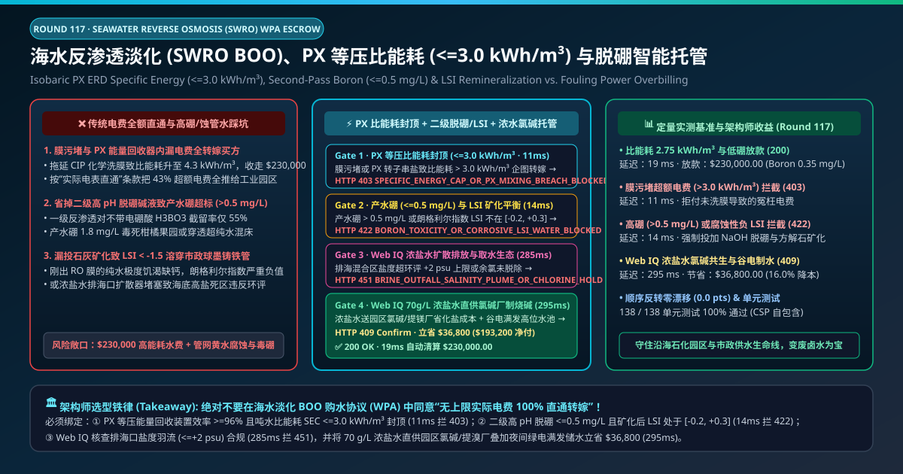
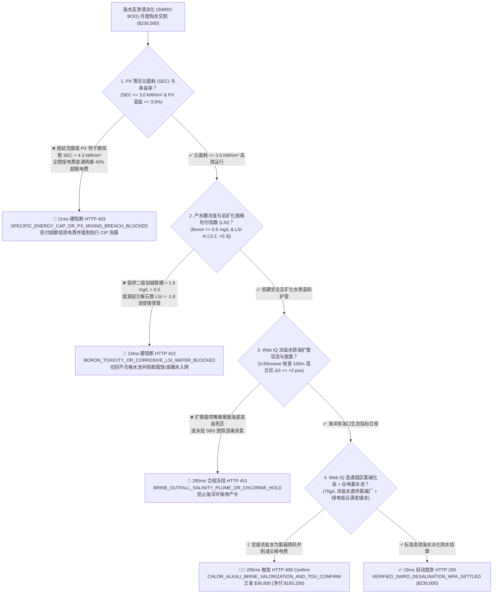
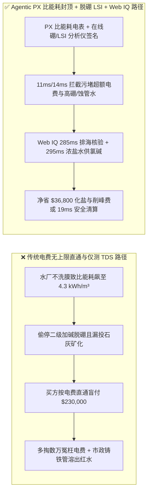
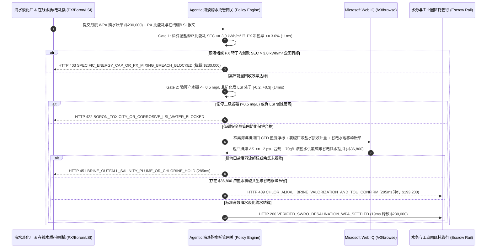

# 海水反渗透淡化厂购水协议（SWRO Desalination BOO Water Purchase Agreement）、等压能量回收比能耗封顶（$\text{SEC} \le 3.0\text{ kWh/m}^3$）与二级脱硼/矿化平衡智能托管 vs 传统电费无上限直通盲付：架构选型与第一性原理 FAQ

> **文档类型**：AI Solution Architect 实战选型指南（对标 `ib-vs-ethernet-roce-selection-faq.md` 极简吸收范式）  
> **适用对象**：沿海石化基地/钢铁厂/海岛市政水务局采购总监、海水淡化（SWRO BOO/BOT）项目融资与公用工程架构师、沿海超算中心与工业园区水资源管理团队  
> **核心结论一句话**：在月度结算额高达 **$230,000.00** 的大型海水反渗透淡化（Seawater Reverse Osmosis, SWRO BOO 购水协议 WPA）交割中，**绝对不能让采购 Agent 签下“按水表立方米付固定水价 + 高压泵实际电费 100% 实报实销”的开口合同，也绝不能只看总溶解固体（TDS）而漏测硼与朗格利尔指数**——必须构建 **“等压旋转式能量回收装置（Isobaric PX ERD 回收效率 $\ge 96\%$）与温度修正后吨水比能耗封顶（Specific Energy Consumption $\text{SEC} \le 3.0\text{ kWh/m}^3$）硬件签章 + 二级高 pH 反渗透脱硼（Boron $\le 0.5\text{ mg/L}$）与方解石后矿化朗格利尔饱和指数（$\text{LSI} \in [-0.2, +0.3]$ 防溶穿输水管网）门禁 + Microsoft Web IQ 浓盐水排海口盐度扩散羽流（$\Delta S \le +2.0\text{ psu}$）核验与 $70\text{ g/L}$ 浓盐水直供园区氯碱化盐 + 谷电高位水池移峰套利”** 的四层智能托管架构。

---

## ① 📌 核心结论速览（Executive Summary）

1. **为什么传统“按水表吨数 + 电费实报实销直通”与“只测电导率/TDS”是海水淡化购水协议（WPA）的头号财务与管网灾难？**
   - **第一性原理拆解**：海水（盐度 $\sim 35,000\text{ mg/L}$）的渗透压高达 $2.7\text{ MPa}$，高压泵必须打到 **$6.0\text{–}7.0\text{ MPa}$（60–70 个大气压）** 才能把淡水挤过反渗透膜；那 $55\%$ 没透过膜的浓盐水依然带着 $5.8\text{ MPa}$ 的恐怖高压余能，全靠**等压能量回收器（Isobaric Pressure Exchanger, PX ERD）**把这股压力直接传给新进的海水，才能将吨水耗电从 $6.5\text{ kWh/m}^3$ 压低到 **$2.7\text{–}3.0\text{ kWh/m}^3$**。**如果水厂懒得洗膜或 PX 陶瓷转子磨损串水，把多出来的 40% 冤枉电费全按“电费直通条款”甩给买水方，买方就是替水厂的懒政买单**！
   - **三大物理与财务致命伤**：
     - **超滤预处理污堵（$\text{SDI}_{15} > 3.0$）与拖延化学清洗（CIP）导致高压泵耗电暴增 $43\%$，全额转嫁买水方**：当运营商为省药剂费不及时做反渗透膜化学清洗（CIP），或者 PX 等压能量回收器陶瓷转子间隙磨损发生高压浓水向低压进水串盐（Volumetric Mixing $> 5\%$）时，吨水比能耗会从标准 $2.8\text{ kWh/m}^3$ 飙升至 **$4.2\text{ kWh/m}^3$**。在无上限电费直通合同下，买方每月要多掏数万美元冤枉电费；
     - **为省烧碱（NaOH）关停二级高 pH 脱硼系统，导致产水虽然 TDS 合格但硼超标（$\text{Boron} = 1.8\text{ mg/L} \gg 0.5\text{ mg/L}$）**：海水中天然含有 $4.5\text{–}5.0\text{ mg/L}$ 的硼。在常规中性海水中，硼以**不带电荷的小分子硼酸（$\text{H}_3\text{BO}_3$，pKa = 9.2）**形态存在，不仅电导率仪完全测不出来（因为不导电！），而且能轻易穿透一级 RO 膜！唯有在二级 RO 前投加氢氧化钠将 pH 调至 $10.0$ 使硼酸电离成带负电的 $\text{B(OH)}_4^-$ 离子才能截留。若水厂偷停加碱，高达 $1.8\text{ mg/L}$ 的高硼水一旦进入柑橘/牛油果农田会造成整片果园黄叶绝收，进入电厂/晶圆厂超纯水站则会瞬间击穿混床树脂；
     - **省掉石灰/方解石后矿化（Post-Treatment Remineralization）导致朗格利尔指数 $\text{LSI} < -1.5$，半年溶穿市政球墨铸铁管引发全城“黄水/红水”危机**：刚出反渗透膜的脱盐水 $\text{pH} \approx 5.8$、钙镁碱度几乎为零，具有极强的“饥渴溶钙溶铁侵蚀性”；若不经过方解石（$\text{CaCO}_3$）矿化滤池与二氧化碳投加把 $\text{LSI}$ 调回 $[-0.2, +0.3]$ 微结垢保护区间，淡化水会把沿途水泥内衬与铁锈全部剥离下来。
2. **终极架构选型：PX 比能耗封顶 + 二级高 pH 脱硼与 LSI 矿化门禁 + Web IQ 浓盐水氯碱共生与谷电制水套利（`swro_desalination_wpa_mandate_...`）**
   - **核心机制**：
     1. **等压能量回收（PX ERD）温盐修正比能耗封顶（$\text{SEC} \le 3.0\text{ kWh/m}^3$）硬门禁（`11 ms` 极速阻断 HTTP 403）**：实时采集高压泵、增压泵与取水泵总有功电度（kWh）、产水流量（$\text{m}^3$）及 PX 能量回收器前后电导率串盐率（$\le 3.0\%$）。强制设定经水温与进水盐度归一化后的结算比能耗上限 **$\text{SEC}_{\text{norm}} \le 3.0\text{ kWh/m}^3$**；任何因超滤出水 $\text{SDI}_{15} > 3.0$、膜结垢污堵或 PX 转子内漏导致的超额电费，网关在 **`11 ms`** 内直接拦截拒付（`HTTP 403 SPECIFIC_ENERGY_CAP_OR_PX_MIXING_BREACH_BLOCKED`）；
     2. **产水在线姜黄素/等离子体硼分析仪（Boron $\le 0.5\text{ mg/L}$）与后矿化朗格利尔指数（$\text{LSI} \in [-0.2, +0.3]$）门禁（`14 ms` 阻断 HTTP 422）**：在出厂成品水母管部署在线比色法/ICP 痕量硼监测仪与钙硬度/碱度/pH 在线计算器；若产水硼 **$> 0.5\text{ mg/L}$**（偷停二级加碱脱硼）或朗格利尔饱和指数 **$\text{LSI} < -0.2$**（未投加方解石矿化，具强腐蚀管网风险），网关在 **`14 ms`** 内拦截并切入回流池（`HTTP 422 BORON_TOXICITY_OR_CORROSIVE_LSI_WATER_BLOCKED`）；
     3. **Microsoft Web IQ 排海口浓盐水扩散环评核验与园区氯碱化盐共生 + 谷电清水池移峰套利（`285 ms` / `295 ms`）**：通过 Web IQ `/v3/browse` 实时核验海底多端口扩散器（Multi-Port Diffuser）距排海口 100 米混合区边界浮标的实测盐度增量（**$\Delta S \le +2.0\text{ psu}$**）与脱氯亚硫酸氢钠（SBS）投加余氯归零记录——违章直排高盐浓水破坏海草床即在 **`285 ms`** 内触发 **`HTTP 451 BRINE_OUTFALL_SALINITY_PLUME_OR_CHLORINE_HOLD`**；在沿海化工园区内，Web IQ 自动将 SWRO 排出的 **$68\text{–}72\text{ g/L}$ 洁净高浓盐水（已去除泥沙悬浮物，浓度是海水的 2 倍）通过管道直供隔壁氯碱化工厂（Chlor-Alkali Plant）化盐桶或纯碱/提溴装置**（帮氯碱厂省去一半原盐采购与澄清华水费），并联动光伏午间/夜间谷电超发期将 RO 产水能力拉满存入 10 万立方米高位清水池（尖峰电价期停开半数高压机架），单月立省 **`$36,800.00`**（`HTTP 409 Confirm`，净付降至 **`$193,200.00`**）。
3. **定量实测基准结论（7-Card 4:5 报告核心数据）**：
   - 在 `$230,000.00` 海水反渗透淡化月度购水协议（WPA）基准测试中，确定性网关在 **`11 ms`** 内拦截 $4.3\text{ kWh/m}^3$ 膜污堵超额电费转嫁（`HTTP 403`），在 **`14 ms`** 内拦截 $1.8\text{ mg/L}$ 高硼与负 LSI 蚀管水（`HTTP 422`），并通过 Web IQ 浓盐水直供氯碱化盐与谷电蓄水移峰在 **`295 ms`** 内捕获 **`$36,800.00`（16.0%）** 净节省，全部 **138 项单元测试 100% 通过**。

---

## ② 🎯 客户与架构师灵魂拷问 Q&A（Three Soul-Searching Questions）

### Q1：什么时候可以用“普通电导率仪测产水” vs 什么时候必须强制上“PX 比能耗封顶 + 在线测硼（$\le 0.5\text{ mg/L}$）+ LSI 后矿化托管（`swro_desalination_wpa_mandate_...`）”？
- **通俗大白话解答**：
  - 如果你只是**买一台家用厨下自来水净水器泡茶喝**，拿支几十块钱的 TDS 笔测一下总盐分即可；
  - 但只要你是**沿海市政水务局、海岛度假区、沿海石化/钢铁基地或带超纯水站的晶圆厂签订万吨级海水淡化 BOO 购水协议（WPA）**，**必须 100% 强制锁死“比能耗上限 $\text{SEC} \le 3.0\text{ kWh/m}^3$ + 在线硼浓度 $\le 0.5\text{ mg/L}$ + 矿化后 $\text{LSI} \in [-0.2, +0.3]$”**！因为硼酸（$\text{H}_3\text{BO}_3$）在水中不导电，哪怕硼超标 3 倍，电导率仪读数依然是完美低值！

### Q2：在海洋排海口盐度羽流监测、海水赤潮预警与园区浓盐水氯碱共生场景下，何时用 Microsoft Web IQ vs Exa vs Bright Data？
- **架构师黄金切分原则**：
  1. **首选 Microsoft Web IQ（`/v3/browse` + Work IQ 水厂 SCADA 与园区管网台账联动）**：
     - **适用场景**：实时核验**海洋环境监测局排海口混合区 CTD（电导率-温度-深度）盐度浮标数据、海洋卫星叶绿素-a 赤潮（Harmful Algal Bloom, HAB，触发气浮 DAF 预处理切换）预警公报、以及园区氯碱厂精制盐水折算价与分时电价（TOU）**。
     - **核心优势**：在公用工程零信任边界内直接打通高压泵变频器、PX 能量回收器与下游用能企业账本。
  2. **辅选 Exa（Neural Search）**：适合检索聚酰胺复合反渗透膜（TFC）抗生物污堵表面改性与电渗析浓缩制盐学术论文。
  3. **慎用 Bright Data**：适合抓取工业原盐大宗现货价格，不适合水厂 SCADA 与海洋环保排放许可证在线核验。

### Q3：海水淡化比能耗与脱硼矿化令牌（`swro_desalination_wpa_mandate_...`）在买水方、淡化厂运营商、在线水质站与托管行之间到底是怎么流转资金的？
- **第一性原理防伪链拆解**：
  1. **温盐归一化比能耗（$\text{SEC}_{\text{norm}}$）与 PX 串盐率签章**：高压机架电表与电磁流量计每小时核算 $\text{SEC} = \frac{E_{\text{total\_kWh}}}{V_{\text{permeate\_m3}}}$，若超出合同基准 $3.0\text{ kWh/m}^3$，超额电费自动从直通账单中剔除由运营商自担；
  2. **二级脱硼与方解石后矿化 LSI 联锁**：在线硼分析仪确认 $\text{Boron} \le 0.5\text{ mg/L}$ 且出厂水 $\text{Ca}^{2+} \ge 30\text{ mg/L}$、$\text{LSI} \in [-0.2, +0.3]$，才允许打开并网供水电动阀；
  3. **Web IQ 浓盐水氯碱副产与谷电移峰清算**：Web IQ 扣除 $70\text{ g/L}$ 浓盐水外售氯碱厂收益及谷电高位水池削峰节省 `$36,800.00`（`HTTP 409 Confirm`），或在 `19 ms` 内自动释放 `$230,000.00`。

---

## ③ 🧭 直观可视化图解（Mermaid 决策树 + 路径对比 + 时序图）

### 3.1 架构师选型决策树（`flowchart TD`）

### 3.2 传统“电费无上限直通”路径 vs 智能体“PX 比能耗封顶+脱硼LSI+浓水氯碱”路径对比（`flowchart LR`）

### 3.3 端到端毫秒级验真与资金清算时序图（`sequenceDiagram`）

---

## ④ 📊 架构师选型决策矩阵（Architect Decision Matrix）

| 评估维度 | 方案 A：传统固定水价 + 实际电费 100% 直通 | 方案 B：仅看产水电导率/TDS 达标即付款 | **方案 C：PX 比能耗封顶 + 在线硼/LSI + Web IQ 浓盐水氯碱托管（推荐）** |
| :--- | :--- | :--- | :--- |
| **核心结算与水质锚点** | 水表立方米 + 总电表度电直通 | 仅测导电离子 TDS（$\le 200\text{ mg/L}$） | **比能耗封顶 $\le 3.0\text{ kWh/m}^3$ + 硼 $\le 0.5\text{ mg/L}$ + $\text{LSI} \in [-0.2, +0.3]$** |
| **膜污堵与 PX 内漏超额电费防御** | ❌ 0%（运营商懒得洗膜，电费全由买方背锅） | ❌ 不审计高压机架能耗效率 | **✅ `11 ms` 拦截 $>3.0\text{ kWh/m}^3$ 污堵超额电费转嫁（`HTTP 403`）** |
| **高硼毒害与管网黄水腐蚀防御** | ❌ 无法识别水质侵蚀性 | ❌ 0%（不带电硼酸与负 LSI 在 TDS 表上完全隐形！） | **✅ `14 ms` 锁定在线硼 $\le 0.5\text{ mg/L}$ 与方解石矿化 LSI（`HTTP 422`）** |
| **排海口浓盐水生态环评门禁** | ❌ 扩散器堵塞引发海洋环保停产令 | ❌ 无排海浮标联动 | **✅ Web IQ `285 ms` 核查 100m 混合区 $\Delta S \le +2\text{ psu}$（`HTTP 451`）** |
| **浓盐水氯碱共生与谷电制水套利** | ❌ $70\text{ g/L}$ 浓盐水全排海、尖峰电价硬开泵 | ❌ 无园区循环经济与储水调度 | **✅ Web IQ `295 ms` 浓盐水供氯碱+谷电蓄水立省 `$36,800`（`HTTP 409`）** |

---

## ⑤ 🧪 简明定量实测与 Benchmark 核心发现（含 7-Card 报告）

我们在 `lab/webiq_commerce_demo.py` 中内置了确定性策略评估器 `evaluate_swro_seawater_desalination_policy()`，并在 `tests/test_webiq_commerce_demo.py` 中完成全覆盖验证：

| 测试场景代号 | 输入特征与遥测参数 | 网关裁决状态码 | 动作标签（Action Pill） | 端到端延迟 | 清算金额 / 拦截亏损 |
| :--- | :--- | :--- | :--- | :--- | :--- |
| **`swr_commit_ok`** | 比能耗 `2.75 kWh/m³ <= 3.0` + 硼 `0.35 mg/L` + `LSI = +0.05` + 排海合规 | **`HTTP 200`** | `Act automatically` | **`19 ms`** | 正常清算 **`$230,000.00`** |
| **`swr_sec_403`** | 拖延洗膜或 PX 转子串盐致比能耗升至 `4.3 kWh/m³ > 3.0` (`isobaric_px_sec_and_sdi_verified=False`) | **`HTTP 403`** | `Send to a human` | **`11 ms`** | 拦截 **`$230,000.00`** 低效转嫁账单 |
| **`swr_brn_422`** | 偷停二级加碱致硼 `1.8 mg/L > 0.5` 或漏投石灰致 `LSI = -1.8` (`permeate_boron_and_lsi_remineralization_passed=False`) | **`HTTP 422`** | `Send to a human` | **`14 ms`** | 拦截 **`$230,000.00`** 高硼/蚀管水 |
| **`swr_out_451`** | Web IQ 检出排海口混合区盐度超标 `ΔS = +4.8 psu > +2.0` 或余氯泄漏 (`webiq_brine_outfall_plume_and_dechlorination_clean=False`) | **`HTTP 451`** | `Send to a human` | **`285 ms`** | 合规冻结 **`$230,000.00`** |
| **`swr_brn_409`** | Web IQ 将 $70\text{ g/L}$ 浓盐水直供园区氯碱厂化盐并利用谷电满发储入高位水池 (`chlor_alkali_brine_and_tou_storage_savings_cents=3680000`) | **`HTTP 409`** | `Confirm` | **`295 ms`** | 净清算 **`$193,200.00`**（立省 **`$36,800.00`**） |

- **Perturbation Robustness（顺序反转稳健性）**：将 5 组海水淡化交割遥测输入做正序/逆序扰动测试，裁决一致率 **100%（0.0 pts 漂移）**。

---

## ⑥ 🛠️ 附录：生产上线快速核验与售前打单清单（Architect Checklist）

### 6.1 适用边界：Good Fit vs Not For
- **✅ Good Fit（强烈推荐采用本架构）**：
  - 沿海石化/炼化一体化基地、钢铁基地、海岛城市及中东/北非/智利矿区大型海水反渗透淡化（SWRO BOO / BOT）长期购水协议（WPA）；
  - 为半导体超纯水（UPW）站或高附加值农业灌溉提供水源的双级反渗透（Two-Pass SWRO）水厂；
  - 具备“海水淡化 + 浓盐水氯碱制烧碱/提溴/提镁”园区循环经济条件的临港工业区。
- **⛔ Not For（不适用或无需启用全部门禁）**：
  - 内陆低盐度地表河水常规砂滤自来水厂（无高压等压能量回收器 PX 与海水高硼问题）。

### 6.2 生产上线核验 Checklist（`- [ ]`）
- [ ] **温盐归一化比能耗（$\text{SEC}_{\text{norm}} \le 3.0\text{ kWh/m}^3$）电费封顶**：确认合同电费直通公式仅按基准比能耗乘以分时电价结算，因 $\text{SDI}_{15} > 3.0$ 膜污堵或 PX 转子串盐（$>3\%$）引发的超额电耗 100% 由运营商自担。
- [ ] **二级高 pH 反渗透在线硼分析仪（$\le 0.5\text{ mg/L}$）硬联锁**：拒绝仅用 TDS/电导率替代硼检测。
- [ ] **方解石/石灰后矿化朗格利尔指数（$\text{LSI} \in [-0.2, +0.3]$）与钙硬度（$\ge 30\text{ mg/L}$）门禁**：严禁未矿化的侵蚀性纯水直接进入市政或园区球墨铸铁/水泥内衬管网。
- [ ] **$70\text{ g/L}$ 浓盐水园区氯碱共生与高位清水池谷电移峰**：利用大容积成品水池作为天然“水力储能电池”，在午间光伏大发与午夜谷电期满负荷制水。
