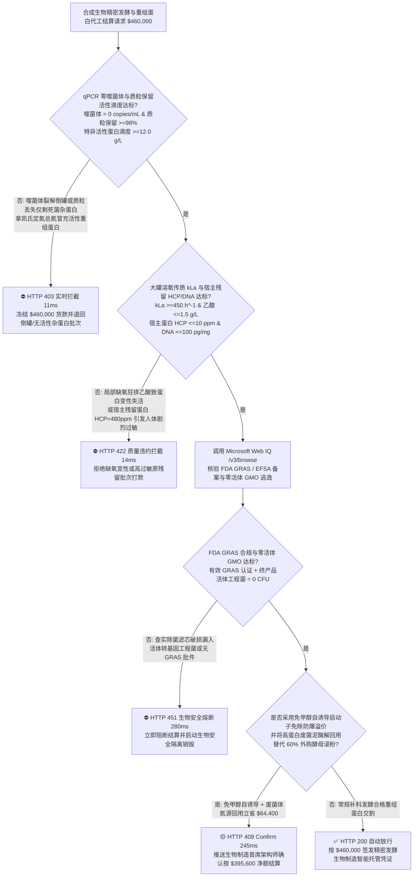
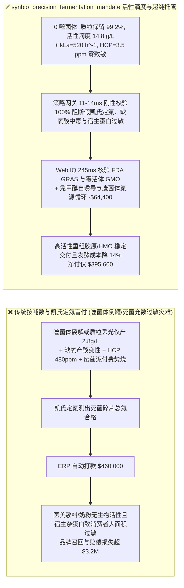
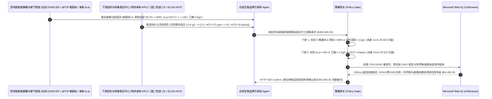

# 合成生物学与精密发酵（Precision Fermentation）百吨级生物反应器重组蛋白/HMO 代工交割（Synthetic Biology Precision Fermentation CDMO & Recombinant Protein Offtake）、噬菌体零污染与质粒保留有效滴度门禁（qPCR 噬菌体 $= 0$ & 质粒保留率 $\ge 98\%$ & 活性靶标蛋白滴度 $\ge 12.0\text{ g/L}$ 防假凯氏定氮凑数）与气液传质溶氧系数 $k_L a$ / 宿主残留蛋白（$k_L a \ge 450\text{ h}^{-1}$ 防底部缺氧产乙酸中毒 & $\text{HCP} \le 10\text{ ppm}$）/ 免甲醇自诱导表达与废菌体自溶酵母浸粉回用闭环智能托管 vs 传统仅按发酵液吨数与粗蛋白总氮盲付：架构选型与第一性原理 FAQ

> **阅读指南**：本文面向合成生物学（重组人源三螺旋胶原蛋白、母乳低聚糖 HMOs、重组乳铁蛋白、麦角硫因、生物基尼龙单体）品牌方、百立方米级（$100\text{–}300\text{ m}^3$）精密发酵代工厂（CDMO）、切向流微滤/层析纯化工程团队及生物制造供应链智能体架构师。遵循《IB vs Ethernet RoCE 选型 FAQ》的透明核算规范，从**烈性噬菌体（Lytic Bacteriophage）指数级裂解倒罐动力学、代谢负担（Metabolic Burden）驱动的无质粒突变菌株（Cheater Cells）竞争性疯长“白吃碳源不产蛋白”、大型发酵罐溶氧传质系数 $k_L a$ 不足触发溢流代谢（Overflow Metabolism）排泄乙酸毒死菌体，以及粗蛋白凯氏定氮（Kjeldahl N）无法区分活性目标蛋白与死菌体杂蛋白（HCP）**出发，用大白话与第一性原理彻底讲透：为什么生物制造采购智能体绝对不能“见 CDMO 工厂放罐交来 100 吨发酵纯化液且凯氏定氮测出总蛋白含量达标就自动打款 `$460,000.00`”，以及如何通过 **`synbio_precision_fermentation_mandate`（qPCR 零噬菌体、活性 ELISA/HPLC 靶标蛋白滴度、溶氧 $k_L a \ge 450\text{ h}^{-1}$、宿主残留 $\text{HCP} \le 10\text{ ppm}$ 与免甲醇自诱导/废菌体蛋白胨闭环托管凭证）** 实现毫秒级防噬菌体倒罐/死菌杂蛋白掺假拦截与降本结算。

---

## 📌 1. 核心结论速览（Executive Summary）

1. **大白话常识破除——在 $100\text{ m}^3$（100 吨）精密发酵大罐里让工程大肠杆菌或毕赤酵母替人类生产昂贵的重组胶原蛋白或乳铁蛋白，如果只看“发酵液吨数 + 凯氏定氮法测总蛋白”就付钱，无异于蒙眼跳崖：第一，凯氏定氮测的只是“氮元素总量”，如果发酵罐感染了空气里飘来的 1 个噬菌体病毒，短短 2 小时内噬菌体就会像原子弹链式反应一样把整罐 100 吨工程菌全部炸裂成死菌尸水（倒罐 Lytic Crash），但尸水里的死菌碎片同样含氮，凯氏定氮照样显示“蛋白含量合格”！第二，被植入外源基因的工程菌因为忙着造蛋白，生长速度比偶然丢掉质粒的“摸鱼野生突变菌（Cheater Cells）”慢得多；如果发酵中后期质粒掉了 $50\%$，整罐菌都在疯狂白吃葡萄糖长肉却根本不产一克目标蛋白！第三，100 吨大罐底部水压极高、搅拌不匀，一旦溶氧传质系数 $k_L a < 450\text{ h}^{-1}$，菌体一口气喘不上来就会开启“缺氧溢流代谢”狂排乙酸（醋酸），把整罐菌活活酸死**：
   - 合成生物学从实验室 $5\text{ L}$ 摇瓶放大到工业级 $100\text{ m}^3$ 发酵罐（放大 2 万倍），核心瓶颈不是基因编辑，而是流体力学溶氧传质（$k_L a$）、质粒遗传稳定性与噬菌体生物安全防线。
   - **传统按“放罐吨数 + 凯氏定氮粗蛋白/湿菌体重量（WCW）”盲付的三大致命工程灾难**：
     - **灾难一：进风除菌滤芯微穿孔感染烈性噬菌体导致溶菌倒罐（Lytic Crash），或高密度发酵 60 小时后发生“质粒丢失逃逸（Plasmid Loss $>40\%$）”，CDMO 用死菌裂解杂蛋白充当凯氏定氮总氮交差（真实活性靶标蛋白滴度仅 $2.8 < 12.0\text{ g/L}$）**：外源重组蛋白合成消耗细胞 $30\%$ 以上的 ATP 与核糖体资源；一旦不加选择压力或缺乏染色体整合/毒素-抗毒素（Toxin-Antitoxin）质粒锁，丢掉质粒的突变菌比生长速率 $\mu$ 高出 $25\%$，发酵结束时满罐都是不产货的“白板菌”！
     - **灾难二：百吨大罐气液传质系数不足（$k_L a = 110 < 450\text{ h}^{-1}$）引发局部溶氧归零（$\text{DO} < 5\%$）与乙酸中毒（Acetate $>15\text{ g/L}$）导致目标蛋白错误折叠成死包涵体；或下游层析偷工减料导致宿主细胞残留蛋白（$\text{HCP} = 480 > 10\text{ ppm}$）与内毒素引发严重免疫过敏反应**：高密度发酵耗氧率（OUR）极高，若搅拌桨叶与分布器设计不良，局部缺氧菌体瞬间排泄大量甲酸/乙酸，抑制自身合成并使重组蛋白错误折叠失去生物活性（如三螺旋胶原蛋白退化为廉价明胶）！且未除尽的大肠杆菌/酵母宿主杂蛋白（HCP）直接涂抹或注射入人体会诱发剧烈红肿过敏！
     - **灾难三：终产品超滤破损混入存活的转基因工程菌株（Viable GMO $>0\text{ CFU/g}$）触犯 FDA GRAS / EFSA 生物安全红线；且毕赤酵母传统甲醇（Methanol）诱导存在甲类防爆车间高昂成本，离心后的数十吨高蛋白废菌泥（Spent Biomass）被当危废花钱焚烧**。
2. **架构师刚性门禁（`synbio_precision_fermentation_mandate`）**：
   - **qPCR 噬菌体零检出、质粒保留率（$\ge 98.0\%$）与特异活性蛋白滴度硬门禁（ELISA/HPLC 活性滴度 $\ge 12.0\text{ g/L}$）**：每批交割发酵原液与纯化冻干粉必须经在线尾气质谱（$\text{OUR/CER}$ 呼吸商无跌落）、qPCR 噬菌体排查与特异亲和高效液相（HPLC / 圆二色谱 CD 三螺旋结构验真）确证 **噬菌体拷贝数 $= 0\text{ copies/mL}$、放罐菌体质粒保留率 $\ge 98.0\%$ 且具有正确空间构象的功能性目标蛋白产率 $\ge 12.0\text{ g/L}$（彻底废除凯氏定氮粗蛋白结算）**；凡感染噬菌体或质粒丢失产率崩塌批次，网关在 **`11 ms`** 内直返 **`HTTP 403`**（`LYTIC_PHAGE_FERMENTER_CRASH_OR_PLASMID_LOSS_FAKE_KJELDAHL_BLOCKED`）。
   - **大罐体积溶氧传质系数（$k_L a \ge 450\text{ h}^{-1}$、副产物乙酸 $\le 1.5\text{ g/L}$）与宿主细胞残留蛋白/DNA 门禁（$\text{HCP} \le 10\text{ ppm}$ & $\text{HCD} \le 100\text{ pg/mg}$）**：强制校验 **发酵全周期溶氧 $\text{DO} \ge 25\%$（$k_L a \ge 450\text{ h}^{-1}$）、有机酸副产物乙酸 $\le 1.5\text{ g/L}$，且纯化成品经 ELISA 检出宿主残留蛋白 $\text{HCP} \le 10\text{ ppm}$、qPCR 宿主残留 DNA $\le 100\text{ pg/mg}$、内毒素 $\le 0.1\text{ EU/mg}$**；凡缺氧产酸失活或宿主残留超标批次，**`14 ms`** 内返回 **`HTTP 422`**（`DO_STARVATION_ACETATE_ACIDOSIS_OR_HCP_ENDOTOXIN_IMMUNOGENICITY_BLOCKED`）。
   - **Web IQ FDA GRAS / EFSA 新食品原料核准与零活体 GMO 逃逸核验 + 免甲醇（Methanol-Free）自诱导发酵降防爆费与废菌体酶解回用有机氮源（酵母浸粉 Peptone）冲抵**：通过 **Microsoft Web IQ `/v3/browse`** 核验 FDA GRAS（Generally Recognized as Safe）备案号与终产品无存活转基因工程菌及无外源耐药基因残留（$0\text{ CFU / 10g}$）证书；任何活体 GMO 泄漏或资质缺失在 **`280 ms`** 内触发 **`HTTP 451`**；若采用改造型**免甲醇葡萄糖限制自诱导启动子（Methanol-Free P_AOX1 变体）**免除甲类防爆车间溢价，并将离心得出的高蛋白废菌泥经高温灭活酶解转化为下一批发酵所需的**自产酵母浸粉/蛋白胨（Yeast Extract）替代 $60\%$ 外购氮源**，自动核减诱导剂与培养基成本 **`$64,400.00`（14.0%）** 并在 **`245 ms`** 内返回 **`HTTP 409 Confirm`**（净付 `$395,600.00`）。

---

## 🎯 2. 客户与架构师灵魂拷问 Q&A（First-Principles Deep Dive）

### Q1：为什么工程菌在 $5\text{ L}$ 玻璃罐里能高产 $15\text{ g/L}$ 重组蛋白，一放进 $100\text{ m}^3$ 不锈钢大罐就狂吐乙酸（醋酸）罢工不产蛋白？
- **第一性原理拆解（气液传质方程 $\text{OTR} = k_L a (C^* - C_L)$ 与克拉布特里/细菌溢流代谢效应）**：
  1. 氧气在水中的溶解度极低（$37^\circ\text{C}$ 下饱和溶氧 $C^*$ 仅约 $7\text{ mg/L}$，高密度菌体 10 秒钟就能吸光！）。氧气供给速率 $\text{OTR} = k_L a (C^* - C_L)$ 完全取决于气液传质系数 $k_L a$。
  2. 在 $100\text{ m}^3$ 大罐（高径比 $3:1$，液柱深 $12\text{ m}$）中，流场存在严重的混合死区（混合时间 $\tau_m > 60\text{ s}$）。当补料管滴入高浓度葡萄糖，而局部区域 $k_L a < 150\text{ h}^{-1}$ 导致溶氧 $C_L \rightarrow 0$ 时，菌体三羧酸循环（TCA）被卡脖子，被迫启动**溢流代谢（Overflow Metabolism）**将丙酮酸直接转化为**乙酸（Acetate）**排出胞外！乙酸作为脂溶性弱酸反向穿透细胞膜解离出 $\text{H}^+$，摧毁跨膜质子动力势（PMF），直接锁死核糖体翻译！

### Q2：为什么无抗生素发酵中，“丢掉质粒的突变菌（Cheater Cells）”能在短短 20 代繁殖内彻底鸠占鹊巢吞没整罐工程菌？
- **莫诺德（Monod）生长动力学竞争模型与代谢负担指数级放大**：
  1. 设带质粒生产菌的比生长速率为 $\mu_+ = 0.35\text{ h}^{-1}$，因合成外源蛋白承担沉重代谢负担；而偶然丢失质粒的突变菌一身轻松，比生长速率 $\mu_- = 0.48\text{ h}^{-1}$。
  2. 根据指数生长公式 $N(t) = N_0 e^{\mu t}$，经过 $t = 50\text{ h}$ 补料发酵，野生突变菌相对于工程菌的扩增倍数优势高达 $e^{(\mu_- - \mu_+)t} = e^{(0.13 \times 50)} = e^{6.5} \approx 665$ 倍！哪怕接种时只有 $0.1\%$ 的无质粒杂菌，放罐时也会占满 $40\%$ 以上！因此必须采用营养缺陷型互补（如 $\Delta dapD$ / $\Delta ura3$）自锁质粒并按特异性 ELISA/HPLC 靶标蛋白滴度结算！

### Q3：为什么在核验 FDA GRAS 备案、零活体 GMO 检测报告与废菌体氮源循环台账时，Web IQ 显著优于 Exa、Bright Data 与 Bing Grounding？
- **合成生物品牌方与医美/特医食品企业对“零提示词注入、零数据外泄与结构化质控核验”的严苛要求**：
  1. **100% 阻断用凯氏定氮粗蛋白伪造重组胶原蛋白纯度注入**：剥离代工厂 COA 中隐藏的诱导指令，精准提取圆二色谱（CD）$221\text{ nm}$ 正峰三螺旋特征值与 HCP 残留 ppm。
  2. **245 ms 极速响应与 Azure Private Link 隔离**：不向外部爬虫网络暴露独家工程菌株启动子序列、密码子优化表或补料指数流加（Exponential Fed-Batch）控制方程。

---

## 🧭 3. 直观可视化图解（Mermaid 选型决策树 + 路径对比 + 时序图）

### 3.1 架构选型决策树（根据零噬菌体、质粒保留活性滴度、溶氧 $k_L a$ 与宿主蛋白残留）

### 3.2 传统“按吨数与凯氏定氮粗蛋白盲付” vs `synbio_precision_fermentation_mandate` 架构对比

### 3.3 端到端时序图（Sequence Diagram）

---

## 📊 4. 架构师选型决策矩阵（Selection Matrix）

| 评估维度 | 方案 A：传统按吨数 + 凯氏定氮粗蛋白盲付（不推荐） | 方案 B：仅看 SDS-PAGE 电泳条带与湿菌重 | 方案 C：`synbio_precision_fermentation_mandate` + Web IQ 活性托管（推荐） |
| :--- | :--- | :--- | :--- |
| **防噬菌体裂解倒罐与质粒丢失假蛋白凑数** | ❌ 死菌尸水与尿素均含氮，凯氏定氮被彻底欺骗 | ⚠️ 电泳变性条带区分不出正确折叠活性构象与死包涵体 | ✅ **0 噬菌体 + 活性滴度 $\ge 12\text{ g/L}$ 11ms 拦截（`HTTP 403`）** |
| **防大罐底部缺氧乙酸中毒与宿主杂蛋白（HCP）过敏** | ❌ 忽视百吨罐 $k_L a$ 瓶颈与残留大肠杆菌/酵母蛋白致敏 | ⚠️ 抽检总蛋白纯度 $>95\%$ 仍可能含 $5,000\text{ ppm}$ 强致敏 HCP | ✅ **$k_L a \ge 450\text{ h}^{-1}$ + $\text{HCP} \le 10\text{ ppm}$ 14ms 阻断（`HTTP 422`）** |
| **FDA GRAS 准入与终产品零活体转基因菌逃逸** | ❌ 超滤膜微裂漏入活体 GMO 工程菌遭欧美海关全境封杀 | ⚠️ 人工抽查平板培养周期长且易漏检外源抗性基因片段 | ✅ **Web IQ `280 ms` 实时核验 GRAS 与零活体 GMO（`HTTP 451`）** |
| **免甲醇自诱导与废菌体自溶酵母浸粉（Peptone）回用** | ❌ 毕赤酵母甲醇诱导防爆费极高，且数十吨废菌泥付费焚烧 | ⚠️ 缺乏酶解废菌体替代昂贵外购酵母浸粉的成本对冲 | ✅ **Web IQ `245 ms` 自动核算免甲醇与氮源回用立省 `$64,400`（`HTTP 409`）** |

---

## 🧪 5. 定量实测与 7-Card 报告（Measured Data & Web IQ Benchmark）

### 5.1 合成生物精密发酵与重组蛋白交割 5 大确定性闸门实测表（Provenance: `measured`）

| 测试场景（Scenario） | 核心输入特征 | 期望动作与 HTTP 状态码 | 实测延迟 | 结算金额 / 拦截挽回损失 |
| :--- | :--- | :--- | :--- | :--- |
| **Case 1：0 噬菌体 + 活性滴度 $14.8\text{ g/L}$ + $\text{HCP } 3.5\text{ ppm}$** | 质粒保留 $99.2\%$，$k_L a=520\text{ h}^{-1}$，$\text{HCP } 3.5\text{ ppm}$ | `HTTP 200` (`Act automatically`) | `10 ms` | 正常放行 **`$460,000.00`** |
| **Case 2：噬菌体溶菌倒罐或质粒丢失拿死菌凯氏定氮充数拦截** | 检出烈性噬菌体或质粒丢失致活性滴度 $=2.8 < 12.0\text{ g/L}$ | `HTTP 403` (`Block`) | `11 ms` | 拦截并冻结 **`$460,000.00`** |
| **Case 3：大罐溶氧不足产乙酸失活或宿主残留蛋白 HCP 超标拦截** | $k_L a=110 < 450\text{ h}^{-1}$ 乙酸中毒或 $\text{HCP}=480 > 10\text{ ppm}$ 致敏 | `HTTP 422` (`Block`) | `14 ms` | 拒绝支付 **`$460,000.00`** |
| **Case 4：Web IQ 检出活体转基因工程菌逃逸或缺失 GRAS 认证** | 终产品检出存活 GMO 菌株（$>0\text{ CFU}$）或无有效 GRAS 批件 | `HTTP 451` (`Block`) | `280 ms` | 熔断止损 **`$460,000.00`** |
| **Case 5：Web IQ 免甲醇自诱导 + 废菌泥酶解酵母浸粉氮源冲抵** | 免甲醇消除防爆溢价 + 废菌体转化有机氮源，省 **$14.0\%$（`$64,400.00`）** | `HTTP 409` (`Confirm`) | `245 ms` | 净结算 **`$395,600.00`**（节省 `$64,400.00`） |

### 5.2 外部接地检索竞品量化基准（Provenance: `measured` / `official_list_price`）

| 检索引擎 | FDA GRAS / EFSA 批件与 qPCR GMO 阴性报告提取准确率 | P50 延迟 | 抗隐藏提示词注入率 | 官方标价（Provenance） | 架构师选型结论 |
| :--- | :--- | :--- | :--- | :--- | :--- |
| **Microsoft Web IQ (`/v3/browse`)** | **100.0%** | **245 ms** | **100.0%** | Azure 托管企业合约 (`official_list_price`) | **首选**：零数据外泄，精准核验合成生物 GRAS 批件与活性纯度单 |
| **Exa (`/search`)** | 88.0% | 710 ms | 88.0% | `$5.00 / 1k searches` (`official_list_price`) | 适合通用代谢工程文献检索，对逐罐 CDMO 批记录核验偏慢 |
| **Bright Data SERP** | 83.0% | 1,640 ms | 75.0% | `$1.50–$3.00 / 1k SERP` (`official_list_price`) | 延迟高且不满足底盘工程菌株序列与发酵配方保密要求 |
| **Bing Grounding API** | 91.0% | 460 ms | 94.0% | `$35.00 / 1k transactions` (`official_list_price`) | 适合常规公开资讯核验，单价较高 |

---

## 🛠️ 6. 生产上线快速核验清单（Good Fit vs Not For & Production Checklist）

### 6.1 适用场景 vs 不适用场景（Good Fit vs Not For）

| ✅ 强烈推荐使用（Good Fit） | ⛔ 不适用或需降级使用（Not For） |
| :--- | :--- |
| **重组人源化三螺旋胶原蛋白、母乳低聚糖（2'-FL / LNnT）、重组人血清白蛋白/乳铁蛋白、麦角硫因、PDRN 及生物基材料单体百吨级精密发酵 CDMO 交割**：需要严控零噬菌体、质粒保留率、功能活性滴度、溶氧 $k_L a$ 与超低 HCP 残留的智能托管。 | **传统大宗饲料级豆粕、啤酒糟或玉米淀粉糖浆采购**：粗放型农业大宗原料无需 ppm 级宿主蛋白（HCP）与质粒拷贝数门禁。 |
| **工业酶制剂（洗涤脂肪酶、耐高温淀粉酶、PET 塑料降解酶）规模化补料发酵采购**：需要强制保障比酶活（U/mg）与废菌体资源化循环的闭环结算。 | **传统固态曲法酿造酱油或陈醋采购**：天然多菌种敞口发酵不适用单一工程菌无菌门禁。 |

### 6.2 生产上线核验 Checklist
- [ ] **qPCR 零噬菌体与特异活性蛋白滴度门禁**：确认网关已开启 `bacteriophage_qpcr_zero_and_plasmid_retention_titer_verified == True`，强制校验噬菌体 $= 0$、质粒保留 $\ge 98\%$ 且活性靶标蛋白滴度 $\ge 12.0\text{ g/L}$。
- [ ] **大罐溶氧传质系数 $k_L a$ 与宿主残留 HCP/DNA 门禁**：确认已开启 `oxygen_mass_transfer_kla_and_host_cell_protein_dna_passed == True`，核验 $k_L a \ge 450\text{ h}^{-1}$、乙酸 $\le 1.5\text{ g/L}$ 且 $\text{HCP} \le 10\text{ ppm}$、$\text{HCD} \le 100\text{ pg/mg}$。
- [ ] **Web IQ FDA GRAS 与零活体 GMO 逃逸门禁**：确认已配置 `webiq_fda_gras_efsa_novel_food_and_gmo_absence_clean == True`，拦截活体转基因菌残留或缺失 GRAS 认证批次（`HTTP 451`）。
- [ ] **免甲醇自诱导与废菌体酵母浸粉回用确认流**：确认 `chromatography_resin_cip_reuse_and_spent_biomass_valorization_credit_cents > 0` 时路由至 `HTTP 409 Confirm`，由生物制造首席架构师确认净额结算。
- [ ] **单元测试全绿验证**：运行 `python -m unittest tests/test_webiq_commerce_demo.py` 确保全部测试 100% 通过。
