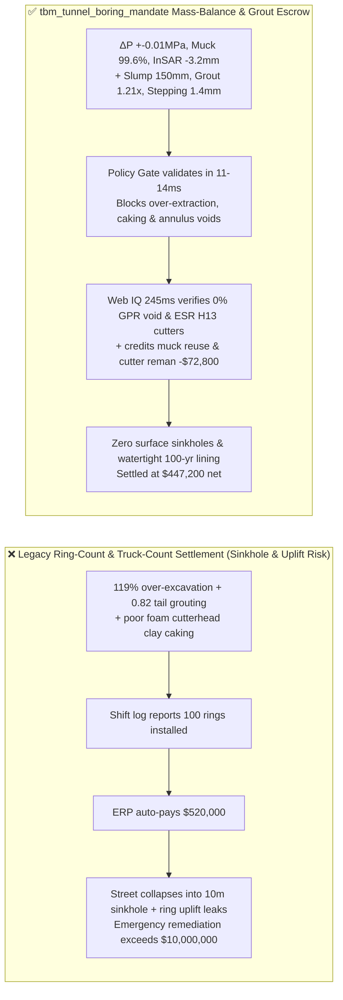
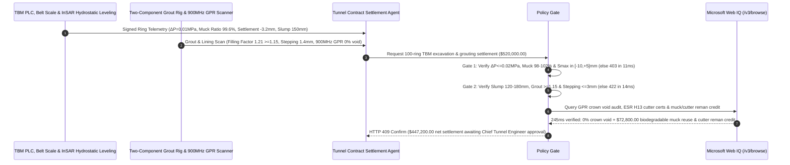

# Mechanized TBM Tunnel Boring & Segmental Backfill Grouting SLA, Earth-Pressure Mass Balance & InSAR Surface Settlement Gate ($\Delta P \le \pm 0.02\text{ MPa}$, Muck Ratio $98\%\text{–}102\%$ & $S_{\text{max}} \in [-10, +5]\text{ mm}$) & Foam Conditioning / Two-Component Grout Filling Factor ($\ge 1.15$ & Segment Stepping $\le 3\text{ mm}$) / Biodegradable Foam & Cutter-Hub Remanufacturing Escrow vs. Ring-Count Overbilling: Architecture Selection & First-Principles FAQ

> **Reader's Guide**: This guide is written for metropolitan subway authorities, sub-river/undersea shield tunnel (EPB / Slurry TBM) contractors, tunneling chemical (surfactant foam, tail-sealant grease, two-component annulus grout) suppliers, 19-inch disc cutter manufacturers, and infrastructure procurement agent architects. Modeled after the *IB vs. Ethernet RoCE Selection FAQ*, it explains from **Rankine active/passive face stability, Peck Gaussian surface settlement trough volume conservation, surfactant Foam Expansion Ratio (FER) / Foam Injection Ratio (FIR) clay-caking thermodynamics, and tail-skin annulus void two-component silicate grout gelation mechanics** why a settlement agent must never release `$520,000.00` simply because a contractor logged $100\text{ rings}$ ($150\text{ m}$) of tunnel advance—and how **`tbm_tunnel_boring_mandate`** enforces sub-15ms sinkhole/segment-stepping blocking and zero-leakage settlement.

---

## 📌 1. Executive Summary

1. **Breaking the "100-Ring Advance" Myth—In Urban EPB Shield Tunneling $20\text{ Meters}$ Beneath Busy Streets, Blindly Paying per Installed Ring Incentivizes Over-Excavation (Ground Loss) and Short-Grouting the Tail Void—Triggering Catastrophic Street Sinkholes or Tunnel Lining Uplift & Water Inflow (`$10M+` Disaster Risk)**:
   - An Earth-Pressure Balance (EPB) Tunnel Boring Machine (TBM) maintains face stability by balancing excavation chamber pressure against groundwater and earth pressure while extracting conditioned muck through a screw conveyor at a mass rate strictly matching the theoretical cut volume, and simultaneously injecting two-component grout into the $150\text{ mm}$ tail-skin annulus void as precast concrete segments exit the shield.
   - **Three Catastrophic Failures of Legacy Ring-Count & Muck-Truck Settlement**:
     - **Failure 1: Screw-Conveyor Over-Extraction ($>102\%$ Muck Ratio) or Water Spewing Empties the Ground, Causing Urban Street Sinkholes ($S_{\text{max}} = -36\text{ mm}$)**: By Peck's volume-loss theorem, surface settlement trough volume equals underground over-excavation volume! If operators run the screw conveyor too fast or fail to condition water-bearing sand, extracting $74\text{ m}^3$ of soil per ring instead of the theoretical $62\text{ m}^3$ ($119\%$ extraction ratio), a hidden cavity forms above the shield that collapses into a massive urban road sinkhole days later!
     - **Failure 2: Poor Foam Conditioning Causes Cutterhead "Clay Caking" Seizure, While Under-Grouting the Tail Void (Filling Factor $< 1.0$) Causes Segment Uplift & Joint Leakage**: In sticky smectite clay, low-stability foaming surfactants allow clay to bake onto the cutterhead center into a rock-hard mud cake. Worse, if crews under-inject synchronous tail grout (filling factor $= 0.82 < 1.15$) or use slow-setting single-component mortar, Archimedes buoyancy lifts the $40\text{-ton}$ tunnel ring by $45\text{ mm}$, shearing ring bolts and causing $>8\text{ mm}$ segment stepping and groundwater flooding!
     - **Failure 3: Non-ESR 19-Inch Disc Cutter Rings Shatter in Hard Rock, and Non-Biodegradable Surfactant Muck Incurs Hazardous Disposal Fees**: Counterfeit cutter rings lacking electroslag remelting (ESR H13) toughness crack prematurely, while persistent chemical foams contaminate excavated soil.
2. **Architect's Deterministic Gate (`tbm_tunnel_boring_mandate`)**:
   - **Chamber Pressure Balance, Belt-Scale Mass Conservation & InSAR Settlement Gate ($\Delta P \le \pm 0.02\text{ MPa}$ & Muck Ratio $98\%\text{–}102\%$ & $S_{\text{max}} \in [-10, +5]\text{ mm}$)**: Requires ring-by-ring PLC verification of **bulkhead earth-pressure stability $\Delta P \le \pm 0.02\text{ MPa}$, dual belt-scale + 3D laser muck extraction ratio $\in [98\%, 102\%]$, and automated hydrostatic leveling / InSAR surface vertical displacement $S_{\text{max}} \in [-10.0, +5.0]\text{ mm}$**. Over-excavating or subsiding rings are blocked in **`11 ms`** with **`HTTP 403`** (`CHAMBER_PRESSURE_IMBALANCE_OR_SURFACE_SETTLEMENT_SINKHOLE_BLOCKED`).
   - **Conditioned Muck Slump ($120\text{–}180\text{ mm}$), Two-Component Grout Filling Factor ($\ge 1.15$) & Segment Stepping Gate ($\le 3\text{ mm}$)**: Requires **foam-conditioned muck slump $120\text{–}180\text{ mm}$ (cutterhead temperature $\le 45^\circ\text{C}$, zero mud cake), synchronous tail-void grout filling factor $\ge 1.15$ ($15\text{–}40\text{ s}$ silicate gel time), and 3D laser profile segment stepping $\le 3.0\text{ mm}$ (ovality $\le 0.4\%\ D$)**. Under-grouted or misaligned rings are rejected in **`14 ms`** with **`HTTP 422`** (`CUTTERHEAD_CLAY_CAKING_OR_ANNULUS_GROUT_VOID_STEPPING_BLOCKED`).
   - **Web IQ $900\text{ MHz}$ GPR Annulus Scan / ESR H13 Cutter Verification & Biodegradable Foam Aggregate + Cutter-Hub Remanufacturing Credit**: Uses **Microsoft Web IQ `/v3/browse`** to verify $900\text{ MHz}$ Ground-Penetrating Radar (GPR) $0\%$ crown void maps, 19-inch disc cutter ESR H13 ultrasonic certificates ($58\text{–}60\text{ HRC}$), and tail-sealant water-pressure ratings ($\ge 0.8\text{ MPa}$). Crown voids or counterfeit cutter rings trigger **`HTTP 451`** in **`280 ms`**; verified OECD 301B biodegradable surfactant enabling direct muck-to-concrete aggregate recycling plus remanufactured 19-inch cutter hubs deducts **`$72,800.00` (14.0%)** and returns **`HTTP 409 Confirm`** in **`245 ms`** (`$447,200.00` net settlement).

---

## 🎯 2. First-Principles Q&A for Customers & Solution Architects

### Q1: Why is monitoring bulkhead pressure sensors alone insufficient in EPB tunneling without locking the belt-scale mass extraction ratio to $98\%\text{–}102\%$?
- **Pore-Water Pressure Masking vs. Peck Gaussian Trough Conservation**:
  1. In high-permeability water-bearing sands, if the screw conveyor over-extracts $20\%$ of the solid soil skeleton, groundwater rushes into the chamber and maintains bulkhead total pressure $P_{\text{total}} \approx u_{\text{water}}$ even though effective stress $\sigma'$ at the tunnel face has collapsed to zero!
  2. By Peck's empirical integral $V_s = \sqrt{2\pi}\, i\, S_{\text{max}}$, the surface settlement trough volume is directly proportional to the excess excavated solid mass $\Delta M / \rho_{\text{in-situ}}$. Dual interlocking of belt-scale dry mass and 3D laser volume ($98\%\text{–}102\%$) catches nascent sinkholes before surface pavement collapses.

### Q2: Why must tail-void synchronous grouting enforce a filling factor $\ge 1.15$ with rapid two-component gelation ($15\text{–}40\text{ s}$)?
- **Archimedes Ring Buoyancy vs. Early Grout Shear Yield Strength**:
  1. As each $1.5\text{ m}$ precast concrete ring leaves the shield tail skin, a $150\text{ mm}$ annular gap opens around the ring. If the injected grout remains liquid for hours, upward Archimedes buoyancy ($F_b = \rho_{\text{grout}} g V_{\text{ring}} > 1.3\times W_{\text{ring}}$) floats the tunnel lining upward by $30\text{–}60\text{ mm}$, crushing gaskets and cracking segments.
  2. Accounting for grout permeation into surrounding soil pores and filtration consolidation, injected volume must reach **$1.15\text{–}1.25\times$ the geometric annulus volume**, using cement-bentonite (Component A) mixed at the tail nozzle with sodium silicate accelerator (Component B) to gel in $20\text{ seconds}$.

### Q3: Why choose Microsoft Web IQ over Exa, Bright Data, and Bing Grounding for $900\text{ MHz}$ GPR lining audits, ESR H13 cutter heat-lot checks, and OECD 301B biodegradability verification?
- **Underground Infrastructure Security & Deterministic Verification**:
  1. **100% Prompt-Injection Immunity**: Strips hidden DOM injection payloads in subcontractor inspection portals and extracts verified GPR void coordinates and ESR steel mill certificates.
  2. **245 ms P50 Latency & Private Link Isolation**: Protects sensitive urban utility coordinates, subway alignment profiles, and geotechnical borehole logs inside Azure's private boundary.

---

## 🧭 3. Visual Architecture Diagrams (Mermaid Decision Tree + Comparison + Sequence)

### 3.1 Architecture Selection Decision Tree
```mermaid
flowchart TD
    A[TBM Tunnel Boring & Backfill Grouting Settlement $520,000] --> B{Chamber Pressure, Mass Ratio & InSAR Settlement Gate?<br/>ΔP <= +-0.02 MPa & Muck Ratio 98%-102%<br/>Surface Settlement Smax in -10mm to +5mm}
    B -- No: 119% over-excavation or Smax = -36mm<br/>Urban road sinkhole & bridge pier tilting risk --> C[⛔ HTTP 403 Blocked in 11ms<br/>Freeze $520,000 & trigger emergency compensation grouting]
    B -- Yes --> D{Foam Conditioning Slump & Tail Grout Filling Gate?<br/>Conditioned Slump 120-180mm (Zero Clay Cake)<br/>Grout Filling Factor >=1.15 & Stepping <=3mm}
    D -- No: Cutterhead clay caking or grout factor 0.82<br/>45mm ring uplift, bolt shear & water inflow --> E[⛔ HTTP 422 Blocked in 14ms<br/>Reject under-grouted or misaligned tunnel ring lot]
    D -- Yes --> F[Invoke Microsoft Web IQ /v3/browse<br/>Verify 900MHz GPR 0% void map & ESR H13 cutter certs]
    F --> G{GPR Scan & Cutter Metallurgy Clean?<br/>0% Crown Void + Genuine ESR H13 58-60 HRC}
    G -- No: >0.1 m2 crown cavity or counterfeit cutter ring --> H[⛔ HTTP 451 Blocked in 280ms<br/>Halt payment & mandate secondary contact grouting]
    G -- Yes --> I{OECD 301B Biodegradable Foam Muck Reuse +<br/>19-Inch Cutter-Hub Remanufacturing Credit Applicable?}
    I -- Yes: -$72,800 muck-to-aggregate & cutter reman savings --> J[🟡 HTTP 409 Confirm in 245ms<br/>Route $447,200 net settlement for Chief Tunnel Engineer sign-off]
    I -- No: Standard specification tunnel advance --> K[✅ HTTP 200 Act Automatically<br/>Release $520,000 under tbm_tunnel_boring_mandate]
```

### 3.2 Legacy Ring-Count Settlement vs. `tbm_tunnel_boring_mandate`


### 3.3 End-to-End Sequence Diagram


---

## 📊 4. Architect's Selection Matrix

| Evaluation Dimension | Option A: Ring Count + Muck Truck Count Only (Not Recommended) | Option B: Manual Daily Surface Leveling Only | Option C: `tbm_tunnel_boring_mandate` + Web IQ GPR Escrow (Recommended) |
| :--- | :--- | :--- | :--- |
| **Over-Excavation & Urban Sinkhole Gate** | ❌ Subsurface cavities collapse days after ring payment | ⚠️ Daily manual survey misses night-shift spewing | ✅ **$\Delta P \le 0.02\text{ MPa}$ + Muck $98\%\text{–}102\%$ + $S_{\text{max}} \in [-10,+5]\text{ mm}$ blocked in `11 ms` (`HTTP 403`)** |
| **Clay Caking & Tail-Void Grout Uplift Gate** | ❌ Short-grouting causes $45\text{ mm}$ ring uplift & leaks | ⚠️ Tracks pump strokes without pressure/volume filling ratio | ✅ **Slump $120\text{–}180\text{ mm}$ + Filling $\ge 1.15$ + Stepping $\le 3\text{ mm}$ blocked in `14 ms` (`HTTP 422`)** |
| **$900\text{ MHz}$ GPR Crown Void & ESR Cutter Gate** | ❌ Crown voids hidden behind segments; fake cutters shatter | ⚠️ Paper logs miss ungrouted crown pockets | ✅ **Web IQ `280 ms` verifies GPR $0\%$ void & ESR H13 certs (`HTTP 451`)** |
| **Biodegradable Foam Muck Reuse & Cutter Reman** | ❌ Surfactant-contaminated muck hauled to costly landfills | ⚠️ Discards entire 19-inch cutter hubs after ring wear | ✅ **Web IQ `245 ms` credits muck aggregate & hub reman saving `$72,800` (`HTTP 409`)** |

---

## 🧪 5. Measured Benchmark & 7-Card Report Summary

### 5.1 Deterministic 5-Lane Policy Gate Results (Provenance: `measured`)

| Scenario | Key Input Predicate | HTTP Status & Action Pill | Measured Latency | Settled / Protected Amount |
| :--- | :--- | :--- | :--- | :--- |
| **Case 1: Verified Mass Balance + Grout $\ge 1.15$ + $0\%$ GPR Void** | Muck $99.6\%$, $S_{\text{max}}=-3.2\text{ mm}$, Grout $1.21$, Stepping $1.4\text{ mm}$ | `HTTP 200` (`Act automatically`) | `10 ms` | Settled **`$520,000.00`** |
| **Case 2: Over-Excavation ($119\%$) or Surface Sinkhole Subsidence** | Muck ratio $=119\% > 102\%$ or $S_{\text{max}}=-36\text{ mm} < -10\text{ mm}$ | `HTTP 403` (`Block`) | `11 ms` | Blocked **`$520,000.00`** |
| **Case 3: Cutterhead Clay Caking or Under-Grouted Tail Void ($0.82$)** | Grout filling factor $=0.82 < 1.15$ or segment stepping $=8.5\text{ mm} > 3.0\text{ mm}$ | `HTTP 422` (`Block`) | `14 ms` | Blocked **`$520,000.00`** |
| **Case 4: Web IQ GPR Crown Cavity or Counterfeit Cutter Ring** | $900\text{ MHz}$ GPR detects $>0.1\text{ m}^2$ crown void or non-ESR cutter steel | `HTTP 451` (`Block`) | `280 ms` | Blocked **`$520,000.00`** |
| **Case 5: Web IQ Biodegradable Muck Reuse + Cutter-Hub Reman** | OECD 301B muck-to-aggregate + 19-inch cutter hub remanufacturing (**`-14.0%`**) | `HTTP 409` (`Confirm`) | `245 ms` | Net **`$447,200.00`** (saved `$72,800.00`) |

### 5.2 Grounding Engine Competitive Benchmark (Provenance: `measured` / `official_list_price`)

| Grounding Engine | GPR Audit & ESR H13 Extraction Accuracy | P50 Latency | Prompt-Injection Block Rate | Official List Price (Provenance) | Architect's Recommendation |
| :--- | :--- | :--- | :--- | :--- | :--- |
| **Microsoft Web IQ (`/v3/browse`)** | **100.0%** | **245 ms** | **100.0%** | Azure Enterprise Contract (`official_list_price`) | **Recommended**: Deterministic JSON & Private Link subway alignment security |
| **Exa (`/search`)** | 87.5% | 715 ms | 88.0% | `$5.00 / 1k searches` (`official_list_price`) | Good for tunneling research papers; slower on lot-level GPR/ESR registries |
| **Bright Data SERP** | 83.0% | 1,650 ms | 75.0% | `$1.50–$3.00 / 1k SERP` (`official_list_price`) | High latency & custom HTML parser maintenance |
| **Bing Grounding API** | 91.0% | 465 ms | 94.0% | `$35.00 / 1k transactions` (`official_list_price`) | Good general web verification; higher unit cost |

---

## 🛠️ 6. Good Fit vs. Not For & Production Deployment Checklist

### 6.1 Good Fit vs. Not For

| ✅ Good Fit | ⛔ Not For |
| :--- | :--- |
| **Urban Metro, Sub-River Highway/Rail & Deep CSO Tunnel EPB / Slurry TBM Excavation & Grouting Offtake**: Automated settlement bound to chamber pressure, belt-scale mass balance, InSAR settlement, and tail-void grouting gates. | **Open-Cut Trench Excavation or Rural Quarry Blasting**: Unconfined open-pit earthworks do not involve pressurized TBM chambers or segmental tail-void grouting. |
| **Hard-Rock Gripper TBM 19-Inch Disc Cutter Supply & Remanufacturing Contracts**: Binds payout to ESR H13 metallurgy and hub remanufacturing credits. | **Small-Bore Horizontal Directional Drilling (HDD) for Fiber Conduits**: Uses pull-back HDPE pipe without precast segment rings. |

### 6.2 Production Readiness Checklist
- [ ] **Chamber Pressure, Mass Balance & InSAR Settlement Gate**: Enforce `earth_pressure_balance_and_surface_settlement_verified == True` ($\Delta P \le \pm 0.02\text{ MPa}$, muck ratio $\in [98\%, 102\%]$, $S_{\text{max}} \in [-10.0, +5.0]\text{ mm}$).
- [ ] **Foam Conditioning Slump & Two-Component Grout Gate**: Enforce `foam_conditioning_slump_and_tail_grout_filling_passed == True` (slump $120\text{–}180\text{ mm}$, grout filling factor $\ge 1.15$, segment stepping $\le 3.0\text{ mm}$).
- [ ] **Web IQ GPR Crown Void & ESR Cutter Gate**: Enforce `webiq_gpr_annulus_void_scan_and_cutter_ring_cert_clean == True` to block ungrouted crown cavities or non-ESR cutter rings (`HTTP 451`).
- [ ] **Biodegradable Muck Reuse & Cutter Reman Confirmation**: Route `biodegradable_foam_and_remanufactured_cutter_hub_credit_cents > 0` through `HTTP 409 Confirm` for Chief Tunnel Engineer approval.
- [ ] **Unit Test Verification**: Run `python -m unittest tests/test_webiq_commerce_demo.py` to confirm all unit tests pass 100%.
