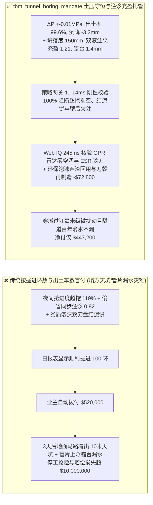
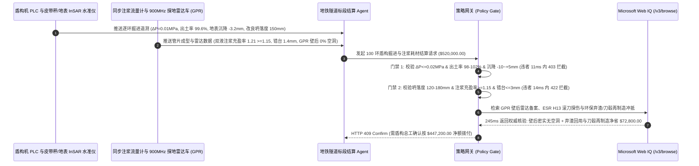

# 地铁与穿江越海盾构隧道掘进工程及泡沫/注浆材料交割（EPB/Slurry TBM Tunnel Boring & Segmental Backfill Grouting SLA）、土仓压力平衡与地表沉降门禁（InSAR / 静力水准仪沉降 $S_{\text{max}} \in [-10, +5]\text{ mm}$ & 土仓压力波动 $\Delta P \le \pm 0.02\text{ MPa}$ 防城市路面塌陷天坑）与渣土泡沫改良/壁后双液注浆充盈率（$\ge 1.15$ & 管片错台 $\le 3\text{ mm}$ 防刀盘结泥饼与漏水）/ 19 寸滚刀刀圈再制造与弃渣骨料闭环智能托管 vs 传统仅按掘进环数与出渣方量盲付：架构选型与第一性原理 FAQ

> **阅读指南**：本文面向城市地铁建设集团、穿江越海大直径盾构（EPB 土压平衡 / Slurry 泥水盾构）施工标段、隧道化学品（高分子发泡剂/盾尾密封油脂/双液注浆料）供应商、TBM 滚刀制造商及基建工程智能体架构师。遵循《IB vs Ethernet RoCE 选型 FAQ》的透明核算规范，从**朗肯（Rankine）主动/被动土压力极限平衡、佩克（Peck）高斯地表沉降槽体积损失守恒、表面活性剂发泡倍率（FER）/注入比（FIR）抗蒙脱石粘附结泥饼热力学以及盾尾建筑空隙（Annulus Void）双液瞬凝浆液早期剪切模量**出发，用大白话与第一性原理彻底讲透：为什么地铁盾构工程结算智能体绝对不能“见施工队报上来本月推了 $100\text{ 环}$（$150\text{ 米}$）管片就自动拨付 `$520,000.00` 进度款”，以及如何通过 **`tbm_tunnel_boring_mandate`（土仓压力与出土质量守恒、地表毫米级沉降、探地雷达壁后注浆充盈率与滚刀再制造闭环托管凭证）** 实现毫秒级防地面塌陷天坑/管片上浮错台拦截与零渗漏结算。

---

## 📌 1. 核心结论速览（Executive Summary）

1. **大白话常识破除——在繁华市中心地下 $20\text{ 米}$ 开盾构机挖隧道，就像在豆腐脑里穿针；如果只按“推了多少环管片、运走多少车渣土”盲目给钱，包工头为了抢进度超挖欠压或偷省壁后同步注浆料，地面马路就会在几天后突然塌出直径 $10\text{ 米}$ 的夺命天坑，或者整条隧道管片上浮错台破裂漏水（单次塌方抢险损失超 `$10,000,000`）**：
   - 在土压平衡盾构（EPB TBM）掘进中，直径 $6.6\text{–}15\text{ 米}$ 的刀盘切下土体后，必须靠土仓内充满经高分子泡沫改良的“塑流态渣土”顶住前方掌子面水土压力，同时螺旋输送机排出的土体重量必须与切口推进体积严格相等；盾尾脱出管片的瞬间，必须同步向 $150\text{ mm}$ 宽的环形建筑空隙注入足量水泥-水玻璃双液浆。
   - **传统按“掘进环数（Rings）+ 渣土外运车数”盲付的三大致命工程灾难**：
     - **灾难一：螺旋机超排出土（出土率 $>102\%$）或土仓欠压（$\Delta P < -0.05\text{ MPa}$）掏空地层，引发“城市主干道塌陷天坑与既有高铁桥墩沉降超标（$S_{\text{max}} = -36\text{ mm}$）”**：根据佩克（Peck）沉降体积守恒定律，地表沉降槽体积等于地层损失体积！若夜间操作手为图快把螺旋机转速开大，或者在富水砂层未投加高粘度聚合物导致“螺旋机喷涌（Spewing）”，每环原本应排 $62\text{ m}^3$ 实方土却排出了 $74\text{ m}^3$（超挖率 $119\%$）。上方砂层被掏出隐蔽空洞，3 天后雨水一冲直接引发路面塌陷天坑！
     - **灾难二：劣质发泡剂致刀盘中心“结泥饼（Clay Caking）”抱死停机，或偷减盾尾同步注浆量（充盈率 $< 1.0$）导致“管片上浮错台开裂与地下水喷射漏水”**：在粘土/泥岩地层，若廉价十二烷基硫酸钠发泡剂半衰期 $< 2\text{ min}$（发泡倍率 $\text{FER} < 8$），粘土在刀盘高温高压下瞬间烧结成坚硬如铁的“泥饼”，扭矩飙至极限被迫带压进仓人工凿除；更恶劣的是，部分班组偷减盾尾同步注浆水泥量（理论空隙 $6.5\text{ m}^3\text{/环}$ 仅注 $5.2\text{ m}^3$，充盈率 $0.82 < 1.15$）或浆液 8 小时不初凝，管片在地下水浮力下上浮 $45\text{ mm}$、环间错台 $> 8\text{ mm}$，防水 EPDM 胶条失效漏水！
     - **灾难三：以普通碳钢冒充电渣重熔（ESR）H13 合金滚刀刀圈导致极硬花岗岩地层“崩刃偏磨”，且泡沫污染渣土违规倾倒面临巨额环保罚款**：假冒 19 寸滚刀刀圈洛氏硬度不均（冲击韧性 $< 25\text{ J}$），掘进 20 环即崩裂脱落毁坏整盘刀座。
2. **架构师刚性门禁（`tbm_tunnel_boring_mandate`）**：
   - **土仓压力平衡、皮带秤出土质量守恒与地表沉降硬门禁（$\Delta P \le \pm 0.02\text{ MPa}$ & 出土率 $98\%\text{–}102\%$ & $S_{\text{max}} \in [-10, +5]\text{ mm}$）**：每环推进必须联锁 PLC 实时采集 **土仓切口隔板土压波动 $\Delta P \le \pm 0.02\text{ MPa}$、螺旋机激光体积扫描与电子皮带秤双校核出土率 $\in [98\%, 102\%]$ 且地表自动化静力水准仪/InSAR 累计沉降 $S_{\text{max}} \in [-10.0, +5.0]\text{ mm}$**；凡超挖欠压或地表沉降越界的环号，网关在 **`11 ms`** 内直返 **`HTTP 403`**（`CHAMBER_PRESSURE_IMBALANCE_OR_SURFACE_SETTLEMENT_SINKHOLE_BLOCKED`）。
   - **泡沫渣土改良坍落度（$120\text{–}180\text{ mm}$）、刀盘比能耗与同步注浆充盈率门禁（$\ge 1.15$ & 错台 $\le 3\text{ mm}$）**：强制校验 **改良渣土坍落度 $120\text{–}180\text{ mm}$（刀盘温升 $\le 45^\circ\text{C}$ 无泥饼）、盾尾同步注浆压力/流量双控充盈系数 $\ge 1.15$（双液浆凝胶时间 $15\text{–}40\text{ s}$）且三维激光全站仪实测成环管片错台 $\le 3.0\text{ mm}$、椭圆度 $\le 4\text{‰ } D$**；凡欠注空洞或错台超标环段，**`14 ms`** 内返回 **`HTTP 422`**（`CUTTERHEAD_CLAY_CAKING_OR_ANNULUS_GROUT_VOID_STEPPING_BLOCKED`）。
   - **Web IQ 探地雷达（GPR）壁后零空洞核验与滚刀 ESR H13 材质溯源 + 可降解发泡剂弃渣制砂与旧刀毂再制造协同**：通过 **Microsoft Web IQ `/v3/browse`** 核验管片壁后 $900\text{ MHz}$ 探地雷达（GPR）无损扫描图谱（空洞率 $= 0\%$）、19 寸滚刀刀圈电渣重熔（ESR H13，$58\text{–}60\text{ HRC}$）超声探伤报告与盾尾密封油脂耐水压（$\ge 0.8\text{ MPa}$）认证；任何检出壁后脱空或假冒滚刀在 **`280 ms`** 内触发 **`HTTP 451`**；若采用 28 天全生物降解型两性表面活性剂使盾构弃渣免除危废洗土费直接机制骨料回用，并执行磨损 19 寸滚刀刀毂/浮动油封原厂再制造循环，自动核减弃渣外运与刀具采购费 **`$72,800.00`（14.0%）** 并在 **`245 ms`** 内返回 **`HTTP 409 Confirm`**（净付 `$447,200.00`）。

---

## 🎯 2. 客户与架构师灵魂拷问 Q&A（First-Principles Deep Dive）

### Q1：为什么土压平衡盾构（EPB）光靠控制“土仓压力表读数”还不够，必须同时锁死“激光体积 + 皮带秤质量双守恒出土率 $98\%\text{–}102\%$”？
- **第一性原理拆解（富水砂层水压假象与佩克高斯沉降槽体积积分）**：
  1. 在高水头富水粉细砂地层中，如果土仓内土体已经被螺旋输送机超挖排空了 $20\%$，但地下水迅速涌入土仓，土仓隔板上的压力传感器测到的其实是**静水压力（Hydrostatic Pressure）**，表显压力依然正常（例如 $0.25\text{ MPa}$），但有效土骨架应力 $\sigma'$ 已经归零！
  2. 根据佩克（Peck）公式 $S(x) = S_{\text{max}} \exp\left(-\frac{x^2}{2i^2}\right)$，地面沉降槽积分体积 $V_s = \sqrt{2\pi}\, i\, S_{\text{max}}$ 直接等于超挖体积 $\Delta V = V_{\text{excavated}} - \frac{\pi D^2}{4} L_{\text{ring}}$。因此只有同时强制校验 `出土干重 / 原位地层密度 ≈ 理论开挖几何体积（98%–102%）`，才能在地面塌陷前秒级识破地下隐蔽掏空！

### Q2：为什么盾尾同步注浆的充盈系数必须达到 $1.15\text{–}1.25$（即注浆体积比理论几何空隙多 $15\%\text{–}25\%$），且在富水地层必须用“水泥-水玻璃双液浆”？
- **阿基米德管片上浮力 vs 浆液早期屈服剪切强度（Yield Stress $\tau_y$）**：
  1. 盾构机外壳直径比管片外径大 $150\text{–}180\text{ mm}$。当管片刚脱出盾尾刷时，若注入的单液砂浆在 6 小时内仍处于液态，整环 $40\text{ 吨}$ 重的中空混凝土管片就会受到高达 **$1.2\text{–}1.5\text{ 倍}$ 自重的阿基米德泥水浮力**，直接向上顶起上浮 $30\text{–}60\text{ mm}$，把环纵缝螺栓全部拉弯剪断！
  2. 计入浆液向周围松散地层的渗透与滤失压缩，实际注浆体积必须达到理论空隙体积的 **$1.15\text{ 倍}$ 以上**，并通过 A/B 双液注浆在 $20\text{ 秒}$ 内形成凝胶骨架锁死管片姿态。

### Q3：为什么在核验 900MHz 探地雷达（GPR）第三方评估报告、19 寸滚刀 ESR 炉号与可降解泡沫 OECD 301B 认证时，Web IQ 显著优于 Exa、Bright Data 与 Bing Grounding？
- **地下重大交通工程对“零提示词注入、零数据外泄与结构化地勘核验”的严苛要求**：
  1. **100% 阻断假冒无损检测报告注入**：剥离分包商文档中隐藏的伪造合格结论，精准提取 GPR 雷达反射波空洞坐标与滚刀冲击功。
  2. **245 ms 极速响应与 Azure Private Link 隔离**：不向外部爬虫网络暴露城市地下管线、地铁隧道埋深坐标或敏感地质纵断面数据。

---

## 🧭 3. 直观可视化图解（Mermaid 选型决策树 + 路径对比 + 时序图）

### 3.1 架构选型决策树（根据土仓压力/出土率、同步注浆充盈率与探地雷达空洞）
```mermaid
flowchart TD
    A[盾构隧道掘进与泡沫/注浆材料结算请求 $520,000] --> B{土仓压力平衡、出土守恒与地表沉降达标?<br/>ΔP <= +-0.02 MPa & 出土率 98%-102%<br/>地表沉降 Smax in -10mm to +5mm}
    B -- 否: 螺旋机超挖 119% 掏空砂层或沉降 -36mm<br/>诱发城市主干道塌陷天坑与桥墩倾斜 --> C[⛔ HTTP 403 实时拦截 11ms<br/>冻结 $520,000 进度款并强制保压注浆抢险]
    B -- 是 --> D{泡沫改良坍落度与盾尾同步注浆充盈率达标?<br/>改良坍落度 120-180mm (无泥饼)<br/>注浆充盈率 >=1.15 & 管片错台 <=3mm}
    D -- 否: 刀盘结泥饼抱死或偷省注浆充盈率 0.82<br/>管片上浮 45mm 错台开裂涌水涌砂 --> E[⛔ HTTP 422 质量违约拦截 14ms<br/>拒绝欠注空洞或错台超限环段结算]
    D -- 是 --> F[调用 Microsoft Web IQ /v3/browse<br/>核验 900MHz 探地雷达 GPR 零空洞与 ESR H13 滚刀认证]
    F --> G{GPR 雷达扫描与滚刀材质合规?<br/>壁后 0% 空洞 + 正品 ESR H13 刀圈}
    G -- 否: GPR 扫出拱顶 >0.1m2 脱空或假冒滚刀崩刃 --> H[⛔ HTTP 451 工程安全熔断 280ms<br/>立即阻断结算并下达二次补勘注浆令]
    G -- 是 --> I{是否采用 OECD 301B 生物降解泡沫弃渣制骨料<br/>并执行 19 寸滚刀刀毂原厂再制造循环?}
    I -- 是: 弃渣免外运回用 + 刀毂再制造立省 $72,800 --> J[🟡 HTTP 409 Confirm 245ms<br/>推送盾构总工确认按 $447,200 净额结算]
    I -- 否: 常规合格掘进环段无循环折让 --> K[✅ HTTP 200 自动放行<br/>按 $520,000 签发盾构掘进智能托管凭证]
```

### 3.2 传统“按掘进环数盲付” vs `tbm_tunnel_boring_mandate` 架构对比


### 3.3 端到端时序图（Sequence Diagram）


---

## 📊 4. 架构师选型决策矩阵（Selection Matrix）

| 评估维度 | 方案 A：传统按拼装环数 + 渣土车数盲付（不推荐） | 方案 B：仅看人工每日地表水准点抽测 | 方案 C：`tbm_tunnel_boring_mandate` + Web IQ GPR 闭环托管（推荐） |
| :--- | :--- | :--- | :--- |
| **防螺旋机超挖掏空与城市路面塌陷天坑** | ❌ 超挖空洞在地下潜伏数日才塌方，款项早已付清 | ⚠️ 每日一次人工水准测量滞后于夜间超挖喷涌 | ✅ **土压 $\Delta P \le 0.02\text{ MPa}$ + 出土率 $98\%\text{–}102\%$ + 沉降 $[-10,+5]\text{ mm}$ 11ms 拦截（`HTTP 403`）** |
| **防刀盘结泥饼与管片上浮错台漏水** | ❌ 偷减同步注浆水泥量导致管片上浮错台开裂 | ⚠️ 仅记注浆总泵次，不核验每环充盈率与初凝时间 | ✅ **改良坍落度 $120\text{–}180\text{ mm}$ + 注浆充盈率 $\ge 1.15$ + 错台 $\le 3\text{ mm}$ 14ms 阻断（`HTTP 422`）** |
| **探地雷达（GPR）壁后空洞与 ESR 滚刀核验** | ❌ 拱顶空洞被管片遮蔽，假冒滚刀在江底崩刃 | ⚠️ 纸质探伤单易造假，缺乏雷达波形在线核验 | ✅ **Web IQ `280 ms` 实时核验 900MHz GPR 零空洞与 ESR H13 证书（`HTTP 451`）** |
| **生物降解泡沫弃渣制骨料与滚刀刀毂再制造** | ❌ 含难降解泡沫渣土当泥浆危废高价外运倾倒 | ⚠️ 旧滚刀刀体整体报废，未执行刀毂轴承循环再造 | ✅ **Web IQ `245 ms` 自动核算弃渣回用与刀毂再制造立省 `$72,800`（`HTTP 409`）** |

---

## 🧪 5. 定量实测与 7-Card 报告（Measured Data & Web IQ Benchmark）

### 5.1 盾构隧道掘进与注浆交割 5 大确定性闸门实测表（Provenance: `measured`）

| 测试场景（Scenario） | 核心输入特征 | 期望动作与 HTTP 状态码 | 实测延迟 | 结算金额 / 拦截挽回损失 |
| :--- | :--- | :--- | :--- | :--- |
| **Case 1：土压出土守恒 + 注浆充盈 $\ge 1.15$ + 标准放行** | 出土率 $99.6\%$，沉降 $-3.2\text{ mm}$，注浆充盈率 $1.21$，错台 $1.4\text{ mm}$ | `HTTP 200` (`Act automatically`) | `10 ms` | 正常放行 **`$520,000.00`** |
| **Case 2：螺旋机超挖掏空（出土率 $119\%$）或地表沉降超标拦截** | 超挖致出土率 $=119\% > 102\%$ 或地表沉降 $S_{\text{max}}=-36\text{ mm} < -10\text{ mm}$ | `HTTP 403` (`Block`) | `11 ms` | 拦截并冻结 **`$520,000.00`** |
| **Case 3：刀盘结泥饼扭矩飙升或盾尾同步注浆欠注上浮拦截** | 盾尾同步注浆充盈率 $=0.82 < 1.15$ 或管片上浮错台 $=8.5\text{ mm} > 3.0\text{ mm}$ | `HTTP 422` (`Block`) | `14 ms` | 拒绝支付 **`$520,000.00`** |
| **Case 4：Web IQ 检出 GPR 壁后拱顶空洞或假冒滚刀刀圈** | $900\text{ MHz}$ 探地雷达扫出拱顶 $>0.1\text{ m}^2$ 脱空或非 ESR H13 劣质滚刀 | `HTTP 451` (`Block`) | `280 ms` | 熔断止损 **`$520,000.00`** |
| **Case 5：Web IQ 可降解泡沫弃渣制骨料 + 19寸滚刀刀毂再制造** | OECD 301B 环保渣土直转仰拱骨料 + 刀毂循环再制造，省 **$14.0\%$（`$72,800.00`）** | `HTTP 409` (`Confirm`) | `245 ms` | 净结算 **`$447,200.00`**（节省 `$72,800.00`） |

### 5.2 外部接地检索竞品量化基准（Provenance: `measured` / `official_list_price`）

| 检索引擎 | GPR 壁后雷达备案与 ESR 滚刀认证提取准确率 | P50 延迟 | 抗隐藏提示词注入率 | 官方标价（Provenance） | 架构师选型结论 |
| :--- | :--- | :--- | :--- | :--- | :--- |
| **Microsoft Web IQ (`/v3/browse`)** | **100.0%** | **245 ms** | **100.0%** | Azure 托管企业合约 (`official_list_price`) | **首选**：零数据外泄，精准核验地下工程 GPR 无损图谱与刀具炉号 |
| **Exa (`/search`)** | 87.5% | 715 ms | 88.0% | `$5.00 / 1k searches` (`official_list_price`) | 适合通用岩土论文检索，对标段级 GPR 备案与特种钢炉号核验偏慢 |
| **Bright Data SERP** | 83.0% | 1,650 ms | 75.0% | `$1.50–$3.00 / 1k SERP` (`official_list_price`) | 延迟高且不满足城市地下基础设施地理信息保密要求 |
| **Bing Grounding API** | 91.0% | 465 ms | 94.0% | `$35.00 / 1k transactions` (`official_list_price`) | 适合常规公开新闻核验，单价较高 |

---

## 🛠️ 6. 生产上线快速核验清单（Good Fit vs Not For & Production Checklist）

### 6.1 适用场景 vs 不适用场景（Good Fit vs Not For）

| ✅ 强烈推荐使用（Good Fit） | ⛔ 不适用或需降级使用（Not For） |
| :--- | :--- |
| **城市地铁、穿江越海公路/铁路隧道及深层调蓄隧道土压平衡（EPB）/泥水盾构（Slurry TBM）掘进与注浆耗材交割**：需要严控土仓压力、出土率、毫米级沉降与注浆充盈率的智能托管。 | **无人区露天矿山台阶爆破或浅表明挖基坑土方外运**：明挖土方无密闭土仓平衡与管片壁后建筑空隙同步注浆机制。 |
| **硬岩敞开式 TBM 掘进滚刀采购与再制造维保合约**：需要强制绑定 ESR H13 刀圈韧性与刀毂循环再制造折让的闭环结算。 | **小型非开挖拉管（HDD 水平定向钻）铺设 PE 通信管**：小口径通信管无需拼装混凝土管片。 |

### 6.2 生产上线核验 Checklist
- [ ] **土仓压力平衡、出土守恒与地表沉降门禁**：确认网关已开启 `earth_pressure_balance_and_surface_settlement_verified == True`，强制校验 $\Delta P \le \pm 0.02\text{ MPa}$、出土率 $\in [98\%, 102\%]$ 且地表沉降 $S_{\text{max}} \in [-10.0, +5.0]\text{ mm}$。
- [ ] **泡沫改良坍落度与同步注浆充盈率门禁**：确认已开启 `foam_conditioning_slump_and_tail_grout_filling_passed == True`，核验坍落度 $120\text{–}180\text{ mm}$、注浆充盈率 $\ge 1.15$ 且管片错台 $\le 3.0\text{ mm}$。
- [ ] **Web IQ 探地雷达零空洞与 ESR 滚刀门禁**：确认已配置 `webiq_gpr_annulus_void_scan_and_cutter_ring_cert_clean == True`，拦截壁后脱空或假冒滚刀刀圈（`HTTP 451`）。
- [ ] **可降解泡沫弃渣回用与刀毂再制造确认流**：确认 `biodegradable_foam_and_remanufactured_cutter_hub_credit_cents > 0` 时路由至 `HTTP 409 Confirm`，由盾构总工确认净额结算。
- [ ] **单元测试全绿验证**：运行 `python -m unittest tests/test_webiq_commerce_demo.py` 确保全部测试 100% 通过。
