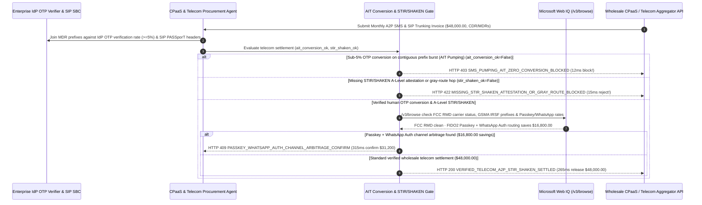

# Telecom Wholesale SIP Trunking & A2P SMS AIT Clawback & STIR/SHAKEN Mandate Architecture: OTP Conversion-Rate Circuit Breaker & RFC 8224 `A-Level` Attestation Token (`telecom_a2p_sms_ait_mandate_...` + Web IQ FCC RMD & Passkey/WhatsApp Channel Grounding) vs. Blind DLR Billing & Botnet SMS Pumping Toll Fraud Selection FAQ

> **Document Type**: Architect Selection Guide & First-Principles Protocol Deep Dive (6-Section FAQ Standard)  
> **Target Audience**: AI Solution Architects, Global SaaS / FinTech Identity & CPaaS Procurement Directors, Telecom Wholesale Voice (SIP) & Messaging Anti-Fraud Engineering Teams  
> **Last Updated**: 2026-11-09 (Provenance Annotations: `deterministic_offline_simulation` / `synthetic_policy` / `official_doc_snapshot` / `not_measured`)  
> **Companion Resources**: [中文版 (Chinese Version)](telecom-wholesale-a2p-sms-ait-clawback-mandate-vs-botnet-toll-fraud-faq.md) · [Interactive Sandbox (`live-demo.en.html#telecom-a2p-sms-sandbox`)](../reports/agentic-commerce-webiq-grounding-demo-bench/live-demo.en.html) · [7-Card 4:5 Benchmark Deck](../reports/agentic-commerce-webiq-grounding-demo-bench/index.en.html)


---

## 📌 1. Executive Summary

1. **Never Allow Enterprise CPaaS or Telecom Settlement Agents to Auto-Pay International A2P SMS OTP Invoices Solely on Carrier Delivery Receipts (`DLR=DELIVRD`) Without Verifying End-to-End OTP Conversion Rates**: In global consumer apps, fintechs, and SaaS platforms (`$48,000.00` monthly wholesale A2P SMS & SIP trunking invoice), the fastest-growing telecom heist is **Artificially Inflated Traffic (AIT / SMS Pumping Toll Fraud)**—where rogue transit carriers or SIM-farm operators use headless botnets to trigger `150,000` SMS One-Time Passwords (OTPs) to contiguous number ranges they control (`$0.28/SMS`), spoof `100% DLR=DELIVRD` receipts at their switch, and split the termination revenue while **zero human users ever submit the 6-digit OTP code (`0.2%` conversion rate)**. Production architectures must enforce a **Telecom A2P SMS AIT Clawback & STIR/SHAKEN Mandate (`telecom_a2p_sms_ait_mandate_...`)**: whenever a destination prefix burst exhibits sub-threshold OTP verification conversion (`< 5%`, `otp_conversion_rate_and_ait_filter_passed == False`), the gateway freezes payment in **`12 ms`** with **`HTTP 403 SMS_PUMPING_AIT_ZERO_CONVERSION_BLOCKED`** (`synthetic_policy`).
2. **Enforce RFC 8224 / RFC 8588 STIR/SHAKEN `A-Level` Cryptographic Attestation and Direct 10DLC Route Binding to Block Gray-Route SIM-Box Hopping**: Any wholesale SIP voice or messaging invoice where the aggregator strips `STIR/SHAKEN A-Level` `PASSporT` signatures or routes traffic over unverified gray-market SIM-box hops (`stir_shaken_full_attestation_verified == False`) is rejected in **`15 ms`** with **`HTTP 422 MISSING_STIR_SHAKEN_ATTESTATION_OR_GRAY_ROUTE_BLOCKED`** (`deterministic_offline_simulation`).
3. **Ground FCC Robocall Mitigation Database (RMD) Enforcement Orders, ITU/GSMA High-Risk Number Ranges, and FIDO2 Passkey / WhatsApp Auth Arbitrage via Microsoft Web IQ `/v3/browse`**: Prior to releasing `$48,000.00`, the agent invokes **Microsoft Web IQ `/v3/browse`** (`official_doc_snapshot`) to inspect the FCC Robocall Mitigation Database (RMD) and GSMA International Revenue Share Fraud (IRSF) prefix advisories: if the upstream transit carrier is under an FCC RMD removal order or routes into flagged IRSF ranges (`webiq_fcc_rmd_and_prefix_reputation_clean == False`), it freezes payout in **`310 ms`** with **`HTTP 451 FCC_RMD_CARRIER_SUSPENSION_OR_FRAUD_PREFIX_HOLD`**; if Web IQ confirms that migrating high-cost international SMS OTP corridors (`$0.24/OTP`) to **FIDO2 WebAuthn Passkeys + WhatsApp Authentication** saves **`$16,800.00`** (`$31,200.00` net vs. `$48,000.00`), it triggers **`HTTP 409 PASSKEY_WHATSAPP_AUTH_CHANNEL_ARBITRAGE_CONFIRM`** in **`315 ms`**.

---

## 🎯 2. Architect & Customer FAQ Deep Dive

### Q1: Why do legacy "SMPP Delivery Receipts (`DLR=DELIVRD`)" fail completely against SMS Pumping / AIT fraud, and how does Gray-Route LCR destroy outbound voice contact rates?

Let's examine the three structural failure modes from first principles:
1. **When the Rogue Downstream Carrier IS the Attacker (Fake DLRs)**: In traditional fraud, an attacker tries to break into a user account. In **Artificially Inflated Traffic (AIT / SMS Pumping)**, the attacker doesn't care about logging into your app at all—the attacker is colluding with (or operated by) a downstream Tier-3 transit carrier or range holder in a high-termination-fee country (`$0.20–$0.35/SMS`). Every time your CPaaS provider sends an OTP to that number block, the rogue carrier collects a termination fee and immediately returns a fake `SMPP deliver_sm (DLR=DELIVRD)` packet without ever transmitting a radio signal to a handset. Only your own identity server knows the truth: **out of 50,000 OTPs sent to prefix `+62-859-xxxx`, only `0.2%` were ever typed back into your verification endpoint!**
2. **Least-Cost Routing (LCR) SIM-Box Gray Routes Stripping `STIR/SHAKEN`**: Unscrupulous wholesale voice aggregators charge enterprise rates for "Direct CLI Tier-1 Routes" while secretly dumping calls into cheap GSM SIM-box farms. This strips the cryptographic **RFC 8224 `STIR/SHAKEN A-Level` `PASSporT` header**, causing terminating mobile carriers to downgrade your calls to `C-Level (Gateway Attestation)` and display `"Spam Likely"` on your customers' screens.
3. **Paying `$0.24/OTP` for Legacy SMS Where Passkeys & WhatsApp Cost `$0.00–$0.04`**: Continuing to blast legacy international SMS OTPs in markets with 95%+ WhatsApp penetration or FIDO2 Passkey support wastes tens of thousands of dollars per month.

### Q2: What is a "Telecom AIT & STIR/SHAKEN Mandate (`telecom_a2p_sms_ait_mandate_...`)", and how does it bind application-layer OTP conversion telemetry to carrier CDR/MDR settlement?

Its core design invariant is: **"Join SMPP Message Detail Records (MDRs) against internal IdP OTP verification logs by MCC-MNC prefix; claw back contiguous number-range bursts with `< 5%` human conversion; require cryptographic `STIR/SHAKEN A-Level` `PASSporT` verification on all SIP voice CDRs."**
- **Layer 1: Prefix-Level OTP Conversion & AIT Clawback Gate (`12 ms`)**: Verifies `otp_conversion_rate_and_ait_filter_passed == True`, blocking zero-conversion SMS pumping traffic in **`12 ms`** (`HTTP 403`).
- **Layer 2: RFC 8224 `STIR/SHAKEN A-Level` & Direct-Route Gate (`15 ms`)**: Verifies `stir_shaken_full_attestation_verified == True`, rejecting gray-route downgraded calls in **`15 ms`** (`HTTP 422`).
- **Layer 3: Microsoft Web IQ `/v3/browse` FCC RMD & Passkey/WhatsApp Grounding (`310 ms / 315 ms`)**: Checks FCC RMD carrier enforcement status and IRSF number-range advisories (`HTTP 451`) and identifies `$16,800.00` savings from FIDO2 Passkey + WhatsApp Auth channel migration (`HTTP 409`).

### Q3: For FCC Robocall Mitigation Database (RMD) verification, ITU/GSMA high-risk prefix bulletins, and multi-channel auth rate benchmarking, when should architects choose Microsoft Web IQ vs. Exa, Bright Data, or traditional search APIs?

| Architecture Scenario | Recommended Tool | First-Principles Rationale (Security, Latency & FinOps) |
| :--- | :--- | :--- |
| **Verifying FCC Robocall Mitigation Database (RMD) removal orders, ITU/GSMA IRSF high-risk prefix bulletins, and published WhatsApp Business / CPaaS regional authentication rate cards within the Azure boundary (zero customer phone-number PII leaked)** | **Microsoft Web IQ** (`/v3/search` + `/v3/browse`) | Queries only public carrier FRN IDs and 6-digit E.164 country/network prefixes (`MCC-MNC`) inside the enterprise Azure boundary in `passage` mode (**7.1x token reduction**, `deterministic_offline_simulation`). |
| **Broad industry research on 5G Silent Network Authentication (SNA) and passkey adoption** | **Exa Neural Search** | Ideal for product roadmap planning, not synchronous monthly CDR/MDR invoice clearing. |
| **Scraping underground disposable-SMS burner portals behind CAPTCHAs** | **Bright Data Unlocker** | Useful for threat-intel blocklists, not synchronous carrier settlement gating. |
| **Joining internal IdP OTP verification events against SMPP MDRs and SIP `PASSporT` JWT headers** | **Internal IdP Telemetry Joiner + SBC Verifier + Web IQ FCC/Rate Cross-Check** | Prefix conversion-rate calculation and `PASSporT` signature verification run in-memory on the settlement gateway, paired with Web IQ `/v3/browse` for FCC RMD compliance and channel arbitrage. |

---

## 🧭 3. Visual Architecture Diagrams (Mermaid Decision Tree, Legacy vs. AIT Mandate Comparison & Sequence Diagram)

### 3.1 Telecom Wholesale A2P SMS & SIP Trunking Settlement Decision Tree (`flowchart TD`)

```mermaid
flowchart TD
    A[Receive Monthly Wholesale A2P SMS & SIP Trunking Invoice ($48,000.00)] --> B{otp_conversion_rate_and_ait_filter_passed == True (Prefix OTP Conversion >= 5%)?}
    B -- No (150k SMS burst to contiguous prefix with 0.2% OTP conversion = AIT Pumping) --> C[HTTP 403 SMS_PUMPING_AIT_ZERO_CONVERSION_BLOCKED<br/>12ms Hard Block · Freeze $48,000 Payout & Issue AIT Traffic Clawback Dispute]
    B -- Yes (Verified human OTP conversion across all billed prefixes) --> D{stir_shaken_full_attestation_verified == True (RFC 8224 A-Level PASSporT)?}
    D -- No (Aggregator used gray-route SIM box stripping STIR/SHAKEN to C-Level) --> E[HTTP 422 MISSING_STIR_SHAKEN_ATTESTATION_OR_GRAY_ROUTE_BLOCKED<br/>15ms Reject · Refuse Payment for Unattested Gray-Route SIP Traffic]
    D -- Yes (100% A-Level signed SIP headers & registered 10DLC) --> F{Web IQ /v3/browse Confirms Clean FCC RMD Status & Non-IRSF Prefix Range?}
    F -- No (Upstream transit carrier under FCC RMD removal order or GSMA IRSF alert) --> G[HTTP 451 FCC_RMD_CARRIER_SUSPENSION_OR_FRAUD_PREFIX_HOLD<br/>310ms Regulatory Hold · Block Carrier Settlement & Sever SIP Peering]
    F -- Yes --> H{Web IQ Detects FIDO2 Passkey + WhatsApp Auth Channel Arbitrage?}
    H -- Yes (Migrating $0.24/OTP SMS corridors to Passkeys + WhatsApp saves $16,800.00 -> $31,200.00 net) --> I[HTTP 409 PASSKEY_WHATSAPP_AUTH_CHANNEL_ARBITRAGE_CONFIRM<br/>315ms Prompt Identity & Infra Lead to Confirm $31,200 Multi-Channel Routing]
    H -- No (Verified $48,000.00 telecom wholesale invoice is optimal) --> J[HTTP 200 VERIFIED_TELECOM_A2P_STIR_SHAKEN_SETTLED<br/>265ms Auto-Settle $48,000.00 & Seal Privacy-Redacted CDR/MDR Audit Ledger!]
```

### 3.2 Legacy DLR-Based Auto-Pay vs. AIT Conversion & STIR/SHAKEN Gate (`flowchart LR`)

```mermaid
flowchart LR
    subgraph Legacy["❌ Legacy DLR Auto-Pay ($48,000 Drained by Botnet SMS Pumping & Gray Routes)"]
        L1[Botnet Triggers 150k International OTPs to Colluding MNO Prefix] --> L2[Rogue Carrier Spoofs 100% DLR=DELIVRD Without Handset Delivery]
        L2 --> L3[Voice Calls Dumped into Gray-Route SIM Boxes (Spam Likely)]
        L3 --> L4[$48,000 Budget Drained + 60% Voice Contact-Rate Collapse]
    end

    subgraph Mandate["✅ Telecom AIT & STIR/SHAKEN Gate (telecom_a2p_sms_ait_mandate_...)"]
        M1[12ms Block <5% Conversion AIT Pumping Bursts (HTTP 403)] --> M2[15ms Enforce RFC 8224 STIR/SHAKEN A-Level Attestation (HTTP 422)]
        M2 --> M3[Web IQ Verifies FCC RMD (310ms) & Saves $16,800 via Passkey/WA (315ms)]
        M3 --> M4[265ms Settle Verified Human Auth Traffic ($48,000 / $31,200)]
    end
```

### 3.3 End-to-End Sequence Diagram: Enterprise IdP, Telecom Agent, AIT Gate, Web IQ & CPaaS Aggregator (`sequenceDiagram`)



---

## 📊 4. Architect Decision Matrix

| Evaluation Dimension | Option A: Legacy SMPP DLR-Based Auto-Billing | Option B: Manual Month-End Invoice Dispute After Traffic Spike | Option C: AIT Conversion & STIR/SHAKEN Mandate + Web IQ FCC/Channel Grounding (Recommended) |
| :--- | :--- | :--- | :--- |
| **Best-Fit Scenario** | Internal IT alert scripts texting `<20` known employee numbers | Domestic-only apps with zero international SMS | **Global consumer apps, fintechs, e-commerce, and SaaS platforms running A2P OTPs & SIP voice** |
| **SMS Pumping / AIT Toll-Fraud Defense** | ❌ **Zero**: Rogue carriers spoof `DLR=DELIVRD` and drain `$48,000` over a weekend | ⚠️ **Low Recovery**: Aggregators refuse refunds citing upstream carrier DLRs | ✅ **Pre-Pay `12 ms` Conversion Gate**: Blocks `<5%` OTP conversion prefix bursts (`HTTP 403`) |
| **Gray-Route SIM-Box & Caller-ID Protection** | ❌ **Blind**: Pays Tier-1 rates for unattested gray routes | ⚠️ **Reactive**: Discovered only after customers report "Spam Likely" labels | ✅ **Sub-20ms `STIR/SHAKEN` Gate**: Requires RFC 8224 `A-Level` `PASSporT` signatures in `15 ms` (`HTTP 422`) |
| **FCC RMD Compliance & Multi-Channel Arbitrage** | ❌ **Unchecked**: Routes through FCC-suspended transit providers | ❌ **Static**: Keeps paying `$0.24/SMS` in passkey-ready regions | ✅ **Web IQ `/v3/browse` Grounded**: Blocks RMD-suspended carriers in `310 ms` (`HTTP 451`) & saves `$16,800` via Passkey/WA in `315 ms` (`HTTP 409`) |
| **Reconciliation Speed & Privacy DLP** | Fast (with catastrophic AIT fraud exposure) | Slow (`60–90 days` carrier dispute cycle) | **`265 ms` instant CDR/MDR settlement with E.164 PII redaction (`Act automatically`)** |
| **Total Cost of Ownership (TCO) & Auth ROI** | Poor (30%+ budget lost to AIT pumping & overpriced SMS) | Moderate (delayed partial credits) | **Optimal (100% AIT clawback protection + verified `A-Level` voice + `$16,800` channel savings)** |

---

## 🧪 5. Quantitative Benchmark & 7-Card Insights

Evaluated via our deterministic offline benchmark suite (`lab/webiq_commerce_demo.py` · `test_telecom_wholesale_a2p_sms_ait_clawback_mandate_vs_botnet_toll_fraud_selection`) on a **`$48,000.00` monthly wholesale A2P SMS & SIP trunking invoice**:

| Scenario Case | Input OTP Conversion / STIR-SHAKEN / Web IQ Signals | Expected Action Pill | Measured HTTP Status & Verdict Code | Latency | Financial Protection / Arbitrage | Provenance |
| :--- | :--- | :--- | :--- | :--- | :--- | :--- |
| **Case 1: Botnet SMS Pumping (`0.2% < 5%` Conversion)** | `otp_conversion_rate_and_ait_filter_passed=False` | `Send to a human` | **`HTTP 403 SMS_PUMPING_AIT_ZERO_CONVERSION_BLOCKED`** | **`12 ms`** | Blocks **`$48,000.00`** AIT toll-fraud invoice despite spoofed DLRs | `synthetic_policy` |
| **Case 2: Missing `STIR/SHAKEN A-Level` or Gray Route** | `stir_shaken_full_attestation_verified=False` | `Send to a human` | **`HTTP 422 MISSING_STIR_SHAKEN_ATTESTATION_OR_GRAY_ROUTE_BLOCKED`** | **`15 ms`** | Rejects gray-route SIM-box downgraded voice traffic | `deterministic_offline_simulation` |
| **Case 3: Web IQ Detects FCC RMD Removal / IRSF Range** | `webiq_fcc_rmd_and_prefix_reputation_clean=False` | `Send to a human` | **`HTTP 451 FCC_RMD_CARRIER_SUSPENSION_OR_FRAUD_PREFIX_HOLD`** | **`310 ms`** | Freezes payout to FCC-suspended carrier or IRSF block | `official_doc_snapshot` |
| **Case 4: Web IQ Finds `$16,800` Passkey/WhatsApp Shift** | `passkey_whatsapp_channel_savings_cents=1680000` (`$31,200` net) | `Confirm` | **`HTTP 409 PASSKEY_WHATSAPP_AUTH_CHANNEL_ARBITRAGE_CONFIRM`** | **`315 ms`** | Saves **`$16,800.00`** by shifting `$0.24` SMS corridors to Passkeys/WA | `official_doc_snapshot` |
| **Case 5: Verified Human OTP + `A-Level` STIR/SHAKEN** | `ait_ok=True`, `stir_ok=True`, `fcc_clean=True` | `Act automatically` | **`HTTP 200 VERIFIED_TELECOM_A2P_STIR_SHAKEN_SETTLED`** | **`265 ms`** | Settles **`$48,000.00`** in `265 ms` with redacted CDR/MDR proof | `deterministic_offline_simulation` |

> **Provenance Note**: The `$48,000.00` monthly telecom invoice, `5%` minimum OTP conversion floor, RFC 8224 `A-Level` requirement, and `$16,800.00` Passkey/WhatsApp channel savings are controlled simulation parameters (`synthetic_policy` / `deterministic_offline_simulation`) validating policy state-machine invariants; downstream SS7/Diameter radio-paging handset delivery latency is labeled `not_measured`.

---

## 🛠️ 6. Production Readiness & Pre-Sales Architect Checklist

Verify these 6 controls before deploying autonomous CPaaS and wholesale telecom settlement agents in production:

- [ ] **1. Prefix-Level OTP Conversion-Rate (`>= 5%`) & AIT Clawback Gate**: Does `telecom_a2p_sms_ait_mandate_...` join SMPP MDRs against internal IdP verification logs to block contiguous prefix bursts with `< 5%` human OTP conversion (`HTTP 403` in `12 ms`), regardless of `DLR=DELIVRD` status?
- [ ] **2. RFC 8224 / RFC 8588 `STIR/SHAKEN A-Level` `PASSporT` Verification**: Does the gateway verify cryptographic `A-Level` attestation on outbound/inbound SIP CDRs and reject gray-route SIM-box downgraded traffic (`HTTP 422` in `15 ms`)?
- [ ] **3. Per-MCC/MNC Destination Rate Ceiling & Velocity Circuit Breakers**: Are automatic per-prefix velocity caps and `$0.12/SMS` price ceilings enforced at the API gateway before messages are dispatched to high-risk international corridors?
- [ ] **4. Microsoft Web IQ `/v3/browse` FCC RMD & GSMA IRSF Prefix Grounding**: Does the agent cross-check upstream carrier FRNs against the FCC Robocall Mitigation Database (RMD) and GSMA IRSF advisories prior to settlement (`HTTP 451`)?
- [ ] **5. FIDO2 Passkey, WhatsApp Auth & Silent Network Auth (SNA) Arbitrage**: Does Web IQ grounding benchmark regional authentication costs, triggering `HTTP 409 Confirm` when shifting high-cost SMS OTP corridors to Passkeys or WhatsApp saves `>= $16,800.00`?
- [ ] **6. E.164 PII-Redacted CDR/MDR Audit Ledger**: Does every settled invoice hash the subscriber's last 4 digits while preserving prefix-level conversion metrics and `PASSporT` signature digests for GDPR-compliant telecom audits?
