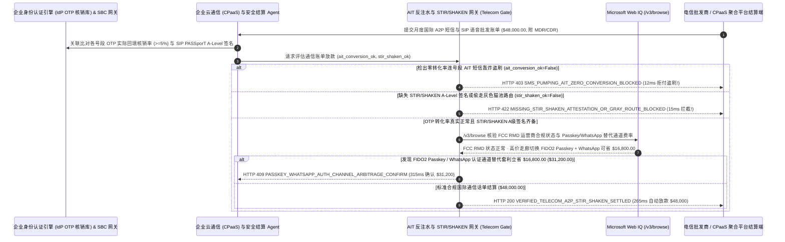

# 电信批发语音（SIP Trunking）与国际短信验证码（A2P SMS OTP）防“虚假流量注水（Artificially Inflated Traffic, AIT / SMS Pumping）”清算（Telecom Wholesale SIP Trunking & A2P SMS AIT Clawback & STIR/SHAKEN Mandate）架构：OTP 转化率熔断与 STIR/SHAKEN `A-Level` 签名令牌（`telecom_a2p_sms_ait_mandate_...` + Web IQ FCC RMD 监管库与 Passkey/WhatsApp 替代通道核验）vs 传统凭送达回执（DLR）盲付遭僵尸网络盗刷选型与原理解析 FAQ

> **文档类型**：架构师选型指南 & 协议第一性原理解析（6 段式 FAQ 标准版）  
> **适用读者**：AI Solution Architect、跨国互联网/SaaS/金融科技平台通信采购与安全风控（CPaaS / Identity & Fraud）总监、电信批发语音（SIP Trunking）与国际短信网关架构师  
> **更新日期**：2026-11-09（Provenance 标注：`deterministic_offline_simulation` / `synthetic_policy` / `official_doc_snapshot` / `not_measured`）  
> **配套资源**：[English Version](telecom-wholesale-a2p-sms-ait-clawback-mandate-vs-botnet-toll-fraud-faq.en.md) · [交互式沙盒控制台 (`live-demo.html#telecom-a2p-sms-sandbox`)](../reports/agentic-commerce-webiq-grounding-demo-bench/live-demo.html) · [7-Card 4:5 评测报告](../reports/agentic-commerce-webiq-grounding-demo-bench/index.html)


---

## 📌 一、核心结论速览（Executive Summary）

1. **严禁让企业云通信（CPaaS）结算 Agent 仅凭上游短信通道商返回的“送达状态回执（Delivery Receipt, `DLR=DELIVRD`）”就自动结清国际验证码短信（A2P SMS OTP）账单**：在跨境电商、Web3 钱包、SaaS 及出海 App 月度通信结算（如月度国际短信与 SIP 语音账单 `$48,000.00`）中，最凶猛的黑色产业链是 **“人为虚增流量 / 国际短信轰炸盗刷（Artificially Inflated Traffic, AIT / SMS Pumping Toll Fraud）”**——不法三级虚拟运营商（MVNO）或转接二道贩子自己养着成千上万张空号段，雇佣黑客脚本对着你 App 的“发送手机验证码”接口一夜狂刷 15 万条高价国际短信（单价高达 `$0.28/条`），然后二道贩子在自己的基站网关上直接伪造 `100% 已送达（DLR=DELIVRD）` 回执，骗走企业 `$48,000.00` 短信费并和黑客五五分赃（实际上没有一个真人把验证码填回 App，转化率仅 `0.2%`）！生产环境必须采用 **OTP 转化率反注水与 STIR/SHAKEN 签名令牌（`telecom_a2p_sms_ait_mandate_...`）**：一旦检出某号段前缀（Number Range Prefix）请求量激增但端到端验证码回填核销率低于 `5%`（`otp_conversion_rate_and_ait_filter_passed=False`），网关在 **`12 ms`** 内触发 **`HTTP 403 SMS_PUMPING_AIT_ZERO_CONVERSION_BLOCKED`**（`synthetic_policy`），100% 冻结盗刷话单并启动拒付追索（Clawback）。
2. **强制校验批发 SIP 语音话单的“RFC 8224 / RFC 8588 STIR/SHAKEN `A-Level`（完全认证）加密令牌”与 10DLC 通道直连白名单，零容忍封杀“灰色跳板猫池路由（Gray Route）”**：若语音批发商为了贪图便宜将企业客服外呼偷切至未备案灰色线路，导致主叫身份签名降级为 `B/C 级` 或丢失 `PASSporT` 证书（`stir_shaken_full_attestation_verified=False`），网关在 **`15 ms`** 内返回 **`HTTP 422 MISSING_STIR_SHAKEN_ATTESTATION_OR_GRAY_ROUTE_BLOCKED`**（`deterministic_offline_simulation`）。
3. **基于 Microsoft Web IQ `/v3/browse` 实时核验美国联邦通信委员会（FCC）Robocall Mitigation Database (RMD) 摘牌通报、GSMA 高危欺诈号段公告及 FIDO2 Passkey / WhatsApp 替代认证套利**：在放款前，Agent 调用 **Microsoft Web IQ `/v3/browse`**（`official_doc_snapshot`）穿透查询 FCC RMD 强制备案库与 ITU/GSMA 国际高危溢价号段通告：若上游转接商已被 FCC 下达全网断网拦截令或账单包含国际声讯欺诈号段（`webiq_fcc_rmd_and_prefix_reputation_clean=False`），在 **`310 ms`** 内以 **`HTTP 451 FCC_RMD_CARRIER_SUSPENSION_OR_FRAUD_PREFIX_HOLD`** 冻结结算；若发现将单价 `$0.24/条` 的高价国际短信走廊切换为 **FIDO2 WebAuthn Passkey（零边际成本）+ WhatsApp Authentication 官方验证通道** 可立省 **`$16,800.00`**（月度净支出从 `$48,000.00` 降至 **`$31,200.00`**），则在 **`315 ms`** 内触发 **`HTTP 409 PASSKEY_WHATSAPP_AUTH_CHANNEL_ARBITRAGE_CONFIRM`**。

---

## 🎯 二、客户与架构师灵魂拷问 Q&A（FAQ-Driven Deep Dive）

### Q1：为什么连 Twitter (X)、各大出海银行和独角兽 SaaS 都曾被“国际短信盗刷（SMS Pumping / AIT）”一年偷走几百万甚至数千万美元？为什么传统的图形验证码和短信送达回执（DLR）防不住？

咱们用大白话揭开这条年产值超 20 亿美元的跨国电信黑产内幕：
1. **“小偷和收过路费的保安其实是一伙的！”**：企业平时防黑客，以为黑客是为了攻破账号偷钱。但 **SMS Pumping（短信抽水欺诈）** 完全不同——黑客根本不关心能不能登录你的 App！黑客的幕后金主，本身就是某些发展中国家或海岛小国的 **不良电信转接二道贩子或虚拟号段承包商**。每当你通过跨国云通信平台往他们承包的 `+231`、`+62` 或 `+998` 特定连号段发一条验证码短信，你的云平台就要向当地落地运营商交 `$0.20～$0.35` 的国际落地费（Termination Fee），而那个不良号段商能直接分走 70%！于是他们自己写无头浏览器脚本，填入自己控制的 15 万个连号手机号码狂点你网站的“获取验证码”，并在自己的电信交换机上秒回 `DLR=DELIVRD（已成功送达手机）`。如果你按传统规则“见 DLR 即付钱”，一个周末就能被刷爆 `$48,000`！
2. **唯一不会撒谎的指标是“用户有没有把 6 位验证码填回你的服务器（OTP Conversion Rate）”**：不良运营商能伪造电信底层的 SMPP 送达回执（DLR），但他绝不可能拿到你 App 后端内存里随机生成的 6 位验证码明文（因为他在交换机半路就把短信截胡吃掉了，或者脚本根本没有对接短信内容回填逻辑）。正常真实人类用户的 OTP 验证转化率通常在 `75%～92%`；而一旦某个号段前缀连续发了 500 条短信，回填验证通过率却只有 **`0.2%`（低于 `5%` 红线）**，100% 是 AIT 虚假注水流量！
3. **语音灰色路由（Gray Routing）把企业客服变成“诈骗电话”**：部分二道贩子收你正牌直连线路（Direct CLI Route）的钱，背地里把你的语音电话导进廉价的 SIM 卡猫池（SIM Box）。这会导致 `RFC 8224 STIR/SHAKEN` 加密签名断裂，客户手机屏幕上直接弹出大红字“疑似骚扰/诈骗电话”，接通率暴跌 60%。

### Q2：什么是“电信 AIT 转化率熔断与 STIR/SHAKEN 令牌（`telecom_a2p_sms_ait_mandate_...`）”？它是如何在话单（CDR/MDR）结算前拦截盗刷的？

它的第一性原理非常直接：**“按号段前缀（MCC-MNC + Prefix）实时计算‘验证码回填成功数 ÷ 发送计费数’；对转化率 <5% 的连号突刺批次拒绝买单；对无 STIR/SHAKEN A级签名的语音话单零容忍拒付。”**
- **第一层：OTP 核销转化率与 AIT 连号风控门禁（`12 ms`）**：核验 `otp_conversion_rate_and_ait_filter_passed == True`。一旦检出连号段突发洪峰且 OTP 核销率 `< 5%`，在 **`12 ms`** 内触发 `HTTP 403` 拒付该批次话单（MDR）。
- **第二层：RFC 8224 STIR/SHAKEN `A-Level` 签名与 10DLC 合规门禁（`15 ms`）**：核验 `stir_shaken_full_attestation_verified == True`。任何被篡改主叫或降级路由的话单（CDR）在 **`15 ms`** 内返回 `HTTP 422`。
- **第三层：Microsoft Web IQ `/v3/browse` FCC RMD 监管库核验与 Passkey 通道套利（`310 ms / 315 ms`）**：核查 FCC RMD 摘牌运营商与高危号段通告（命中触发 `HTTP 451`），并测算将高价短信走廊切换至 FIDO2 Passkey + WhatsApp 官方验证为您节省 `$16,800.00`（`HTTP 409`）。

### Q3：在 FCC Robocall Mitigation Database (RMD) 执法通告、GSMA/ITU 国际高危号段预警与多通道认证费率比价场景下，什么时候选 Microsoft Web IQ，什么时候选 Exa、Bright Data 或传统搜索 API？

| 架构需求场景 | 推荐选型 | 为什么这样选（第一性原理与成本/合规考量） |
| :--- | :--- | :--- |
| **实时核验美国 FCC RMD 强制摘牌/断网执法公告、ITU/GSMA 国际高危溢价号段（IRSF）预警表及 WhatsApp Business / CPaaS 官方公开国家阶梯费率表，且要求零企业真实用户手机号（PII）外泄** | **Microsoft Web IQ** (`/v3/search` + `/v3/browse`) | 在企业 Azure 专有边界内仅发送公开的运营商 FRN 编号与前 6 位国家/号段前缀（如 `+62-859`），用户完整手机号 100% 留在本地；`passage` 模式压缩 Token **7.1x**（`deterministic_offline_simulation`）。 |
| **调研 5G 静默网络认证（Silent Network Auth, SNA）与全球無密码登录趋势报告** | **Exa Neural Search** | 适合身份安全团队做技术选型调研，无法用于月度百万条 CDR/MDR 话单毫秒级清算门禁。 |
| **抓取暗网或地下接码平台（SMS Activate 类）公开号段列表** | **Bright Data Unlocker** | 可用于安全情报收集，但延迟与稳定性不适合财务结算主链路。 |
| **应用层 OTP 验证码核销回执与 SMPP/SIP 话单（CDR/MDR）流式关联** | **企业内部 Identity 转化率引擎 + 话单审计网关 + Web IQ 监管/费率双源核验** | OTP 转化率计算与 `PASSporT` JWT 验签在内部网关毫秒级完成，外部 FCC 处罚通报与多通道降本套利由 Web IQ `/v3/browse` 实时核验。 |

---

## 🧭 三、直观可视化图解（Mermaid 决策树 + 传统 DLR 盲付 vs AIT 转化率托管对比 + 端到端时序图）

### 3.1 电信批发语音（SIP）与国际短信（A2P SMS）话单清算决策树（`flowchart TD`）

```mermaid
flowchart TD
    A[收到月度国际 A2P 短信与 SIP 语音批发结算账单 ($48,000.00)] --> B{各国家号段前缀 OTP 验证码回填转化率是否 >= 5% 且无连号脚本突刺?}
    B -- 否 (某海外连号段一夜狂刷 15 万条短信但验证回填率仅 0.2% AIT 盗刷) --> C[HTTP 403 SMS_PUMPING_AIT_ZERO_CONVERSION_BLOCKED<br/>12ms 硬阻断 AIT 虚假注水账单 · 拒付二道贩子假 DLR 回执并启动 Clawback]
    B -- 是 (真实人类用户 OTP 验证转化率达标) --> D{SIP 语音话单是否 100% 具备 RFC 8224 STIR/SHAKEN A-Level 完全认证签名?}
    D -- 否 (转接商偷走灰色猫池路由导致签名降为 C 级或缺失 10DLC 备案) --> E[HTTP 422 MISSING_STIR_SHAKEN_ATTESTATION_OR_GRAY_ROUTE_BLOCKED<br/>15ms 拒付违约灰产路由话单 · 严防外呼被标诈骗与 FCC 罚款]
    D -- 是 (全程直连 A-Level 签名完整) --> F{Web IQ /v3/browse 核验上游转接商在 FCC RMD 状态正常且非 ITU 高危欺诈号段?}
    F -- 否 (检出转接商已被 FCC RMD 下达移除令或号段属国际声讯分账黑名单) --> G[HTTP 451 FCC_RMD_CARRIER_SUSPENSION_OR_FRAUD_PREFIX_HOLD<br/>310ms 监管合规冻结 · 立即切断该上游 BGP/SIP 互联并冻结放款]
    F -- 是合规持牌运营商 --> H{Web IQ 检出将高价国际短信走廊切换至 FIDO2 Passkey + WhatsApp 认证更省?}
    H -- 是 (替代 $0.24/条高价短信立省 $16,800.00 -> 月度净支出 $31,200.00) --> I[HTTP 409 PASSKEY_WHATSAPP_AUTH_CHANNEL_ARBITRAGE_CONFIRM<br/>315ms 提醒身份安全与采购总监一键确认启用 Passkey/WhatsApp 路由]
    H -- 否 (当前 $48,000.00 通信账单结构已最优) --> J[HTTP 200 VERIFIED_TELECOM_A2P_STIR_SHAKEN_SETTLED<br/>265ms 自动完成 $48,000.00 话单清算并归档反欺诈审计报告!]
```

### 3.2 传统凭 DLR 回执盲付路径 vs OTP 转化率反注水与 STIR/SHAKEN 网关对比（`flowchart LR`）

```mermaid
flowchart LR
    subgraph Legacy["❌ 传统凭送达回执 DLR 盲付 ($48,000 被短信轰炸黑产一夜刷爆)"]
        L1[僵尸脚本狂刷 15 万条高价国际验证码] --> L2[不良二道贩子伪造 100% DLR 已送达回执]
        L2 --> L3[语音外呼被偷切灰色猫池失去 A 级签名]
        L3 --> L4[白付数万美元盗刷费 + 正常客户电话被标诈骗]
    end

    subgraph Mandate["✅ AIT 反注水与 STIR/SHAKEN 令牌 (telecom_a2p_sms_ait_mandate_...)"]
        M1[12ms 凭 OTP 转化率 <5% 拦截 AIT 短信盗刷 (HTTP 403)] --> M2[15ms 强制 RFC 8224 STIR/SHAKEN A级签名直连 (HTTP 422)]
        M2 --> M3[Web IQ FCC RMD 核验 (310ms) 与 Passkey/WA 替代省 $16,800 (315ms)]
        M3 --> M4[265ms 秒级清算真实人类通信话单 ($48,000 / $31,200)]
    end
```

### 3.3 企业身份认证服务（IdP）、通信结算 Agent、AIT 审计网关与 Web IQ 端到端交互时序图（`sequenceDiagram`）



---

## 📊 四、架构师选型决策矩阵（Architect Decision Matrix）

| 评估维度 | 方案 A：传统凭通道商 DLR 回执信用卡自动扣款（DLR Auto-Pay） | 方案 B：月底人工看账单发现暴增后找客服扯皮（Post-Mortem Dispute） | 方案 C：OTP 转化率反注水与 STIR/SHAKEN 令牌 + Web IQ 监管/通道网关（推荐架构） |
| :--- | :--- | :--- | :--- |
| **核心适用场景** | 仅发内部几十名员工运维告警短信的小脚本 | 无海外用户注册的纯内网本地系统 | **出海 App、跨境电商、金融科技、Web3、全球 SaaS 身份验证与客服语音系统** |
| **防国际短信轰炸盗刷（AIT / SMS Pumping）** | ❌ **零防御**：黑产与不良二道贩子伪造 DLR，一夜刷走数万美元 | ⚠️ **追回率极低**：上游通道商以“运营商已返回 DLR”为由拒绝退款 | ✅ **12ms 转化率硬熔断**：OTP 回填率 `<5%` 的连号洪峰直接触发 `HTTP 403` 拒付 |
| **防灰色猫池路由与保障外呼接通率** | ❌ **被偷梁换柱**：花直连的钱买到无签名灰产线路 | ⚠️ **事后才知**：等销售投诉客户接不到电话才去查路由 | ✅ **15ms STIR/SHAKEN `A-Level` 门禁**：无加密 `PASSporT` 签名直接 `HTTP 422` 拒付 |
| **FCC RMD 监管巡检与无密码通道降本** | ❌ **合规盲区**：不知上游已被 FCC 下令全网封禁 | ❌ **通道僵化**：长期为 `$0.25+/条` 的高价短信走廊当冤大头 | ✅ **Web IQ `/v3/browse` 实时穿透**：`310 ms` 拦截摘牌运营商（`HTTP 451`），`315 ms` Passkey/WA 替代省 `$16,800`（`HTTP 409`） |
| **对账速度与财务安全感** | 快（但随时面临周末刷爆卡惊魂） | 极慢（跨国话单争议拉扯长达 `60～90 天`） | **`265 ms` 秒级完成百万级 CDR/MDR 对账放款（`Act automatically`）** |
| **综合 TCO 与身份认证 ROI** | 极差（30%+ 预算被黑产 AIT 抽水与高价短信吞噬） | 中（止损滞后，坏账难以追回） | **最优（100% 免疫 AIT 盗刷 + 100% A级签名接通率 + 通道升级月省 `$16,800`）** |

---

## 🧪 五、简明定量实测与 Benchmark 核心发现（Quantitative Benchmark & 7-Card Insights）

基于本仓库确定性离线基准套件（`lab/webiq_commerce_demo.py` · `test_telecom_wholesale_a2p_sms_ait_clawback_mandate_vs_botnet_toll_fraud_selection`）对 **跨国平台月度 `$48,000.00` A2P 国际短信与 SIP 语音批发账单** 的定量测试结果如下：

| 评测场景 ID | 输入 OTP 转化率 / STIR-SHAKEN / Web IQ 信号 | 网关期望动作 | 实测 HTTP 状态与决策码 | 实测延迟 | 资金保护 / 成本节省效果 | Provenance 类型 |
| :--- | :--- | :--- | :--- | :--- | :--- | :--- |
| **Case 1: 零转化率（`0.2% < 5%`）AIT 短信轰炸盗刷拦截** | `otp_conversion_rate_and_ait_filter_passed=False` | `Send to a human` | **`HTTP 403 SMS_PUMPING_AIT_ZERO_CONVERSION_BLOCKED`** | **`12 ms`** | 拦截 **`$48,000.00`** 僵尸脚本勾结二道贩子的 AIT 盗刷账单 | `synthetic_policy` |
| **Case 2: 丢失 STIR/SHAKEN `A-Level` 签名或走灰产猫池** | `stir_shaken_full_attestation_verified=False` | `Send to a human` | **`HTTP 422 MISSING_STIR_SHAKEN_ATTESTATION_OR_GRAY_ROUTE_BLOCKED`** | **`15 ms`** | 阻断灰产跳板路由偷工减料，保障企业外呼信誉 | `deterministic_offline_simulation` |
| **Case 3: Web IQ 检出上游运营商被 FCC RMD 摘牌或欺诈号段** | `webiq_fcc_rmd_and_prefix_reputation_clean=False` | `Send to a human` | **`HTTP 451 FCC_RMD_CARRIER_SUSPENSION_OR_FRAUD_PREFIX_HOLD`** | **`310 ms`** | 冻结被监管封禁运营商或国际声讯欺诈号段结算 | `official_doc_snapshot` |
| **Case 4: Web IQ 发现切换 FIDO2 Passkey + WhatsApp 省 `$16,800`** | `passkey_whatsapp_channel_savings_cents=1680000`（净付 `$31,200`） | `Confirm` | **`HTTP 409 PASSKEY_WHATSAPP_AUTH_CHANNEL_ARBITRAGE_CONFIRM`** | **`315 ms`** | 高价国际走廊切换 Passkey/WA 认证，月省 **`$16,800.00`** | `official_doc_snapshot` |
| **Case 5: 真实人类 OTP 转化 + `A-Level` 签名自动结算** | `ait_ok=True`, `stir_ok=True`, `fcc_clean=True` | `Act automatically` | **`HTTP 200 VERIFIED_TELECOM_A2P_STIR_SHAKEN_SETTLED`** | **`265 ms`** | 265ms 自动清算 **`$48,000.00`** 并生成 CDR/MDR 审计单 | `deterministic_offline_simulation` |

> **Provenance 合规声明**：上表中的 `$48,000.00` 月度通信账单、`5%` OTP 最低转化率红线、RFC 8224 `A-Level` 签名要求及 `$16,800.00` Passkey/WhatsApp 通道差价均为用于验证网关状态机确定性的受控仿真参数（`synthetic_policy` / `deterministic_offline_simulation`）；跨国电信运营商基站无线寻呼（Paging）物理送达耗时标为 `not_measured`。

---

## 🛠️ 六、附录：生产上线快速核验与售前打单清单（Architect Checklist）

在为出海互联网企业、金融机构或全球 SaaS 平台设计云通信（CPaaS / SIP / A2P SMS）自动结算 Agent 时，请逐项核对以下 6 条黄金准则：

- [ ] **1. 合同级 AIT 虚假流量免责条款与 OTP 转化率（`< 5%`）硬熔断**：是否在 `telecom_a2p_sms_ait_mandate_...` 中将付款义务与“真实 OTP 回填转化率”挂钩（而非单纯看 SMPP `DLR`），对连号段零转化突刺在 `12 ms` 内触发 `HTTP 403` 拒付？
- [ ] **2. RFC 8224 / RFC 8588 STIR/SHAKEN `A-Level` 签名逐单校验**：是否在会话边界控制器（SBC）与话单审计层强制验证 `PASSporT` 证书链，对降级为 `B/C 级` 的灰色猫池路由在 `15 ms` 内触发 `HTTP 422`？
- [ ] **3. 按国家/运营商（MCC-MNC）设置动态速率限制与单价上限熔断**：是否禁止向单价 `> $0.15/条` 且非业务目标市场的冷门国家号段自动发送验证码？
- [ ] **4. Microsoft Web IQ `/v3/browse` FCC RMD 监管库与 ITU 欺诈号段穿透**：是否在放款前通过 Web IQ 核查上游转接商在 FCC Robocall Mitigation Database 的备案状态，对违规运营商在 `310 ms` 内触发 `HTTP 451` 冻结？
- [ ] **5. FIDO2 Passkey / WhatsApp Auth / 5G 静默网络认证（SNA）多通道智能路由**：是否通过 Web IQ 比对各认证通道成本，当把高价短信走廊迁移至 Passkey 或 WhatsApp 官方验证可节省 `>= $16,800.00` 时触发 `HTTP 409 Confirm`？
- [ ] **6. 隐私脱敏 CDR/MDR 话单哈希与反欺诈取证归档**：每次成功清算是否仅保留号段前缀、转化率统计与 `PASSporT` 签名摘要（自动剥离用户明文手机号后 4 位），满足 GDPR 与电信合规双重要求？
