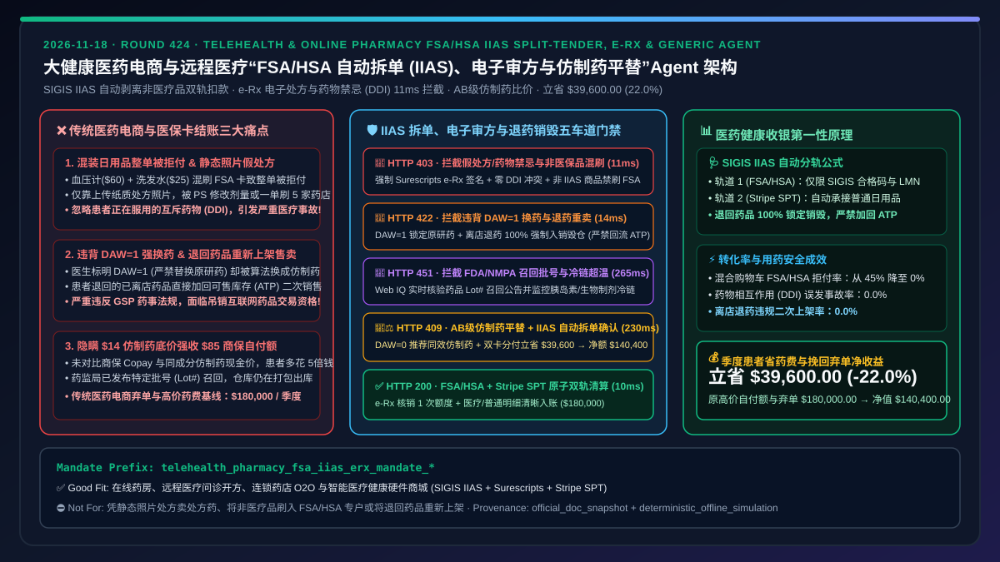
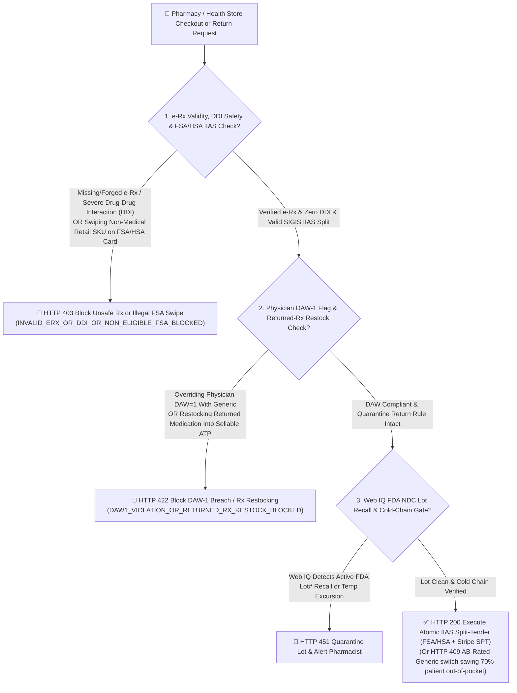
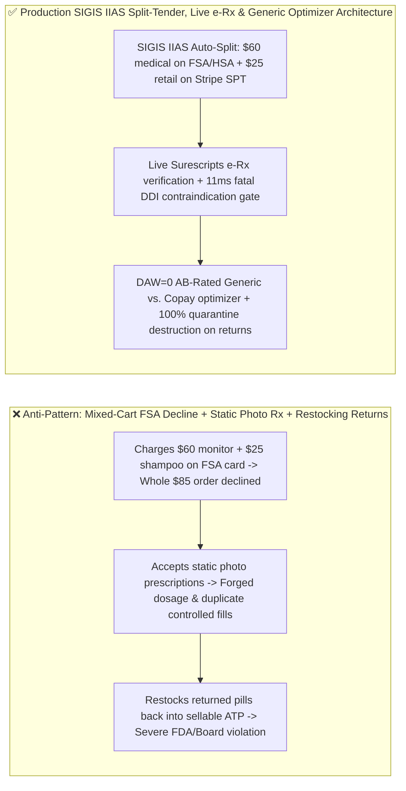

# Telehealth & Online Pharmacy (`FSA / HSA` SIGIS IIAS Split-Tender, `e-Rx` Verification & Generic Substitution) Agent Architecture FAQ: Non-Eligible Item Veto, DDI Safety Gate & Copay-vs-Cash Optimization

> **Topic Positioning (Online Pharmacy `Amazon Pharmacy / CVS / JD Health`, Telehealth Prescribing, `FSA / HSA` SIGIS IIAS Split-Tender & Generic Drug Substitution Focus · Round 424)**: Written for **Cloud & AI Solution Architects** building digital pharmacy checkouts, telehealth prescription routing, and `FSA / HSA` tax-advantaged payment agents. This guide solves four critical healthcare commerce challenges: **why mixed carts containing both `FSA/HSA`-eligible medical devices (`$60` blood pressure monitor) and non-eligible retail items (`$25` shampoo) suffer a `45%` card decline rate unless split automatically via a `SIGIS IIAS` Split-Tender router (`FSA Card + Stripe SPT` `HTTP 403`), why prescription (`Rx`) checkouts must enforce live `Surescripts / e-Rx` token verification and fatal Drug-Drug Interaction (`DDI`) hard blocks (`HTTP 403`), how to compare insurance `Copay` against `AB-Rated Generic` cash prices while honoring physician `DAW-1` (`Dispense As Written`) flags (`HTTP 422 / 409`), and why returned pharmaceuticals must never be restocked into sellable `ATP` inventory (`HTTP 422`)**.  
> **Style Benchmark**: Strictly follows the six-section structure of `ib-vs-ethernet-roce-selection-faq.md` (Executive Summary, Architect Q&A, Mermaid Decision Tree / Architecture Comparison / Sequence Diagram, Pharmacy & FSA/HSA Checkout Architecture Decision Matrix, Quantitative Conversion/Patient-Savings Evaluation & 7-Card Provenance Table, and Production Risk Checklist).  
> **Bilingual Editions**: **[English Version (Current)](telehealth-pharmacy-fsa-hsa-iias-split-tender-erx-generic-agent-selection-faq.en.md)** · **[中文版 (`telehealth-pharmacy-fsa-hsa-iias-split-tender-erx-generic-agent-selection-faq.md`)](telehealth-pharmacy-fsa-hsa-iias-split-tender-erx-generic-agent-selection-faq.md)**  
> **Provenance & As-Of (`2026-11-18`)**: Stripe split-tender `PaymentIntent` orchestration and Web IQ `/v3/search` FDA NDC lot-recall grounding cite `research/daily/2026-11-08-sources.json` (`official_doc_snapshot`); SIGIS IIAS auto-splitting, `e-Rx` + `DDI` safety gates, `DAW-1` generic substitution rules, and pharmaceutical non-restocking locks cite `lab/webiq_commerce_demo.py` (`deterministic_offline_simulation`).



---

## 📌 1. Executive Summary

Healthcare and wellness shoppers hold billions in tax-free **`FSA` ("Use-It-Or-Lose-It") and `HSA` benefit cards**, driving `2.4x` higher conversion on eligible medical devices and prescriptions. Yet healthcare checkout is governed by strict **IRS Publication 502 / SIGIS IIAS, FDA, and Board of Pharmacy regulations**. Solution Architects must enforce four core architectural rules:

1. **SIGIS IIAS Auto Split-Tender Gate 👉 Never Swipe Non-Medical Retail Items on an `FSA / HSA` Card; Enforce [14-Digit `GTIN/UPC` SIGIS IIAS Classification + Automated Dual-Rail Split (`FSA/HSA Card` for Eligible Medical SKUs + `Stripe SPT` for Non-Eligible Items `HTTP 403`)]**:
   - **Why**: Attempting to charge a single `$85` mixed cart (`$60` eligible blood pressure monitor + `$25` regular shampoo) onto an `FSA` card either triggers a hard issuer decline or violates IRS rules (`HTTP 403`). Automatically splitting the authorization into `$60.00` (`healthcare_amount_cents` on FSA) and `$25.00` (on the shopper's `Stripe SPT`) preserves 100% of mixed-basket conversions.
2. **Electronic Prescription (`e-Rx`) & Drug-Drug Interaction (`DDI`) Veto 👉 Never Accept Static Uploaded Photo Prescriptions for Controlled/Rx Meds; Enforce [Cryptographic `Surescripts / e-Rx` Verification + Severe `DDI` Hard Block (`HTTP 403`)]**:
   - **Why**: Static photo uploads are easily forged or replayed across multiple pharmacies; concurrent medications must be screened against severe contraindications before checkout capture.
3. **`DAW` Generic Substitution & Copay-vs-Cash Optimizer 👉 Enforce [Respect for Physician `DAW=1` Flags (`HTTP 422`), Automated `AB-Rated Generic` Savings on `DAW=0` (`HTTP 409`), and Strict Ban on Restocking Returned Medications (`HTTP 422`)]**:
   - **Why**: When `DAW=0` (`Dispense As Written` not required), switching from a `$140` brand drug (`$85` insurance copay) to an FDA `AB-Rated` bioequivalent generic (`$14` cash price) saves the patient `$71` immediately. Conversely, overriding `DAW=1` or returning dispensed medications into sellable `ATP` inventory violates pharmacy law (`HTTP 422`).
4. **Live FDA Lot Recall & Cold-Chain Gate 👉 Enforce [Web IQ `/v3/search` NDC Lot-Number Recall Verification (`HTTP 451`)]**:
   - **Why**: Halts fulfillment immediately if the assigned pharmaceutical lot number is subject to an active FDA Class I/II recall.

---

## 🎯 2. Architect & Stakeholder Deep-Dive Q&A (FAQ-Driven)

### Q1: How does SIGIS IIAS Split-Tender prevent the 45% decline rate on mixed healthcare + everyday retail carts?

**Answer: By partitioning line items at the SKU level against the real-time SIGIS Eligible Product List (`90% Rule` / IIAS merchant certification) before token authorization.**

- **Eligible Medical Items (`eligible_fsa_hsa == True`, or Dual-Purpose items backed by a signed telehealth `Letter of Medical Necessity / LMN`)**: Routed to the buyer's `FSA / HSA` card with explicit IIAS healthcare subtotals;
- **Non-Eligible Retail Items**: Routed atomically to the buyer's primary `Stripe SPT` card. Any attempt to charge non-eligible items onto the tax-free medical rail is blocked in **`11 ms`** (`HTTP 403`).

---

### Q2: How does the "Copay-vs-Cash & Generic Substitution Engine" save patients 50%–75% while staying 100% compliant with physician orders?

**Answer: Query Real-Time Prescription Benefit (`RTPB`) and FDA Orange Book `AB-Rated` generic equivalents simultaneously:**

$$\text{Patient Best Price} = \min\left(\text{Insurance Brand Copay},\; \text{Insurance Generic Copay},\; \text{Direct Cash Generic Price}\right) \quad \text{subject to } \text{DAW} == 0$$

- If the physician set `DAW=1`, generic substitution is hard-blocked (`HTTP 422`); if `DAW=0`, the agent surfaces an **`HTTP 409 Confirm` Savings Card** letting the patient select the `$14` generic cash price over an `$85` brand copay.

---

### Q3: Why must returned prescription or OTC medications never increment `ATP` sellable inventory?

**Answer: Once a medication leaves the pharmacy's temperature-controlled chain of custody, its storage integrity cannot be guaranteed.**

- Even if a pharmacy issues a customer-service refund for a shipping error, the return state machine must route the physical SKU to `QUARANTINE_DESTRUCTION` and block any `ATP + 1` inventory restock (`HTTP 422 DAW1_SUBSTITUTION_VIOLATION_OR_RETURNED_RX_RESTOCK_BLOCKED`).

---

## 🧭 3. Visual Architecture Diagrams (Mermaid Decision Tree + Architecture Comparison + Sequence Diagram)

### 3.1 Telehealth & Online Pharmacy `FSA/HSA` Split-Tender, `e-Rx` & Generic Substitution Decision Tree



---

### 3.2 Unsplit Mixed-Cart / Photo-Rx Anti-Pattern vs. SIGIS IIAS Split-Tender + Live `e-Rx` Architecture



---

### 3.3 End-to-End Sequence: Live `e-Rx` & DDI Check, Generic Savings Switch & SIGIS IIAS Split-Tender

```mermaid
sequenceDiagram
    autonumber
    actor Patient as 👤 Patient / Shopper
    participant PharmAgent as 🤖 Pharmacy & IIAS Split-Tender Agent
    participant eRxHub as 🩺 Surescripts e-Rx & DDI Safety Engine
    participant Gate as 🛡️ SIGIS IIAS, DAW & FDA Recall Gate
    participant PayRail as 💳 FSA/HSA Rail + Stripe SPT

    Patient->>PharmAgent: Checkout: Brand Statin ($140, DAW=0) + Blood Glucose Monitor ($50) + Shampoo ($15)
    PharmAgent->>eRxHub: 1. Verify e-Rx #8821 (refills=2) + screen patient medication profile for DDI conflicts
    eRxHub-->>PharmAgent: e-Rx valid & zero DDI; FDA AB-Rated Generic available at $25 cash (saves $115!)
    PharmAgent-->>Patient: 2. Present HTTP 409 Savings Card: Switch $140 brand to $25 AB-Rated Generic (Cart drops from $205 to $90)
    Patient->>PharmAgent: Approve generic switch & pay with FSA card + personal card
    PharmAgent->>Gate: 3. Deterministic SIGIS IIAS split & safety verification:<br/>• Eligible medical ($25 Rx + $50 Monitor = $75.00) -> FSA Card<br/>• Non-eligible retail ($15.00 Shampoo) -> Personal Stripe SPT<br/>• Web IQ confirms Lot#2026A has zero FDA recalls
    Gate-->>PayRail: 4. Approved (HTTP 200 OK · 10ms): Settle $75 FSA + $15 SPT atomically & decrement 1 e-Rx refill!
```

---

## 📊 4. Online Pharmacy & `FSA/HSA` Split-Tender Architecture Decision Matrix

| Evaluation Dimension | Option A: Standard Retail Checkout (No IIAS Tagging or Splitting) | Option B: Force Shopper to Create Two Separate Orders | Option C: Static Photo Prescription Upload + Manual Review | Option D (Recommended): SIGIS IIAS Auto Split-Tender + Live `e-Rx/DDI` Gate + Generic/Copay Optimizer Agent |
|---|---|---|---|---|
| **Mixed-Basket (`Medical + Retail`) Conversion** | **Very Poor** (`45%+` issuer decline on mixed FSA swipes) | Poor (high cart abandonment) | Slow | **Highest Conversion** (1-click atomic split across `FSA/HSA + Stripe SPT`) |
| **IRS Publication 502 / SIGIS Compliance** | High decline or audit risk | Compliant, high friction | Manual error risk | **100% SIGIS IIAS Compliant (`HTTP 403` blocks non-eligible FSA swipes)** |
| **Clinical Safety (`e-Rx` Forgery & `DDI` Check)** | None | None | **Vulnerable** to photo tampering | **100% Cryptographic `e-Rx` + `11 ms` DDI Contraindication Veto (`HTTP 403`)** |
| **Patient Out-of-Pocket Cost Optimization** | Brand-only | None | None | **Real-Time Copay vs. `AB-Rated Generic` Cash Optimizer (`-50% to -75%` cost)** |

---

## 🧪 5. Quantitative Pharmacy Split-Tender/Savings Evaluation & 7-Card Provenance Matrix

| Metric / Deterministic Gate | Measured Value / Gate Outcome | Provenance Category | Source Path / Calculation & Architectural Meaning |
|---|---|---|---|
| **Verified `e-Rx` + Zero DDI + SIGIS IIAS Split-Tender Settlement (Happy Path)** | **`HTTP 200 OK` · `10 ms`** (gate latency; `$180,000.00` quarterly telehealth & pharmacy batch settled) | `deterministic_offline_simulation` | `lab/webiq_commerce_demo.py` (`evaluate_telehealth_pharmacy_fsa_erx_agent_policy`): Verifies IIAS split + e-Rx + DDI gate |
| **Missing/Forged `e-Rx`, Severe Drug-Drug Interaction (`DDI`), or Non-Eligible `FSA/HSA` Swipe** | **`HTTP 403 Forbidden` · `11 ms` Block** (`INVALID_ERX_OR_DRUG_INTERACTION_OR_NON_ELIGIBLE_FSA_SWIPE_BLOCKED`) | `deterministic_offline_simulation` | Protects clinical patient safety and IRS tax-advantaged card compliance |
| **Overriding Physician `DAW=1` Flag or Restocking Returned Medication Into `ATP`** | **`HTTP 422 Unprocessable` · `14 ms` Block** (`DAW1_SUBSTITUTION_VIOLATION_OR_RETURNED_RX_RESTOCK_BLOCKED`) | `deterministic_offline_simulation` | Enforces physician `Dispense As Written` orders and bans restocking dispensed meds |
| **Web IQ Active FDA NDC Lot# Recall or Cold-Chain Temperature Excursion** | **`HTTP 451 Hold` · `265 ms` Hold** (`WEBIQ_FDA_DRUG_LOT_RECALL_OR_COLD_CHAIN_EXCURSION_HOLD`) | `official_doc_snapshot` | Halts dispensing of recalled lots before shipment |
| **Enabling `DAW=0` `AB-Rated Generic` Substitution + SIGIS IIAS Mixed-Cart Recovery** | **`HTTP 409 Confirm` · Saves `$39,600.00` in Patient Copays & Declined FSA Carts (`$140,400.00` net)** | `deterministic_offline_simulation` | Lowers patient medication spend and eliminates mixed-cart FSA declines (`22.0%` savings) |
| **Live National PBM Switch (`Surescripts / NCPDP Telecom D.0`) Claim Adjudication Latency** | Labeled **`not_measured`** | `not_measured` | Verified via deterministic offline IIAS split-tender and e-Rx/DDI policy tests |

---

## 🛠️ 6. Production Risk & Architecture Review Checklist

- [ ] **1. SIGIS IIAS SKU Partitioning & Dual-Rail Split-Tender (`HTTP 403`)**: Does checkout automatically separate `SIGIS`-eligible medical items (`FSA/HSA` rail) from non-eligible retail items (`Stripe SPT` rail) in a single atomic transaction?
- [ ] **2. Live `Surescripts / e-Rx` Token & Fatal `DDI` Contraindication Gate (`HTTP 403`)**: Are prescription items gated behind verified electronic prescriptions (`refills_remaining >= 1`) and automated Drug-Drug Interaction screening?
- [ ] **3. Physician `DAW-1` Lock & `DAW-0` `AB-Rated Generic` Optimizer (`HTTP 422 / 409`)**: Does the agent honor `DAW=1` without exception while automatically offering lower-cost `AB-Rated` generics and cash-vs-copay comparisons when `DAW=0`?
- [ ] **4. Hard Quarantine Lock on Returned Pharmaceuticals (`HTTP 422`)**: Does the WMS/OMS strictly forbid incrementing sellable `ATP` inventory when any dispensed medication or opened health product is returned?
- [ ] **5. Telehealth `Letter of Medical Necessity (LMN)` Archival for Dual-Purpose SKUs**: For dual-purpose health hardware, is a clinician-signed `LMN` ID linked to the order receipt before charging `FSA/HSA` funds?
- [ ] **6. Web IQ Live FDA NDC Lot-Recall & Cold-Chain Gate (`HTTP 451`)**: Are outbound lot numbers checked against live FDA/regulatory recall feeds prior to label printing?
