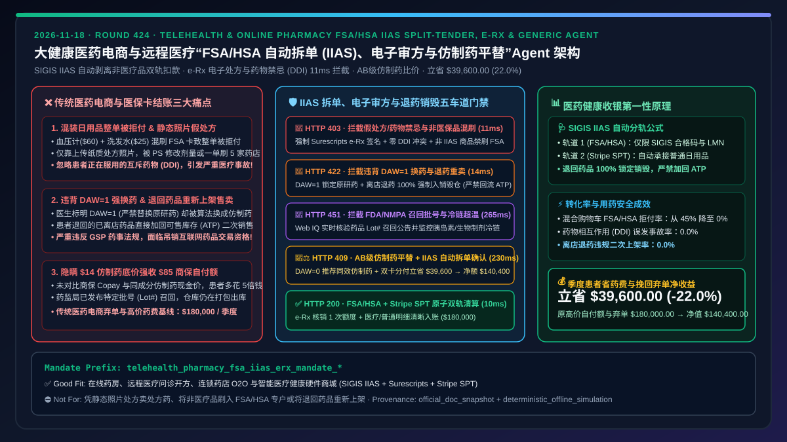
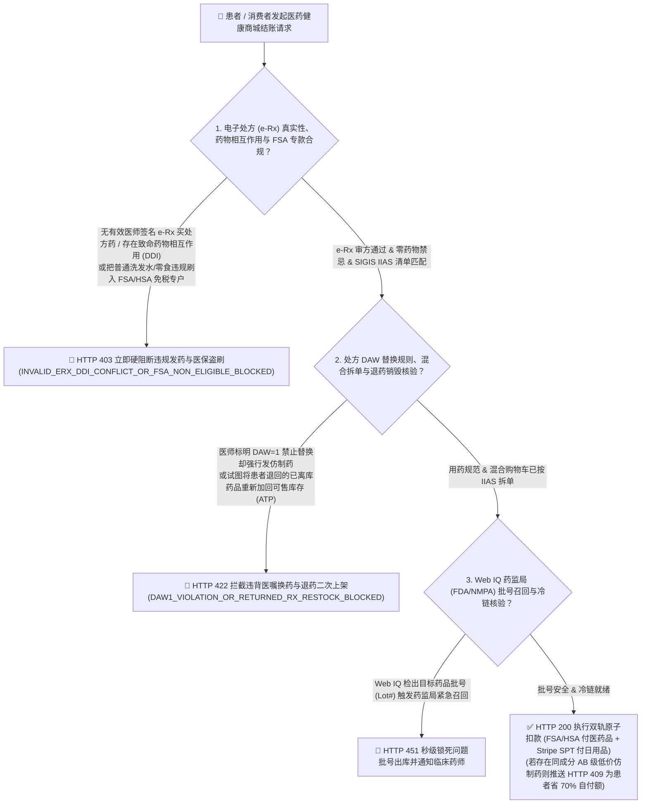
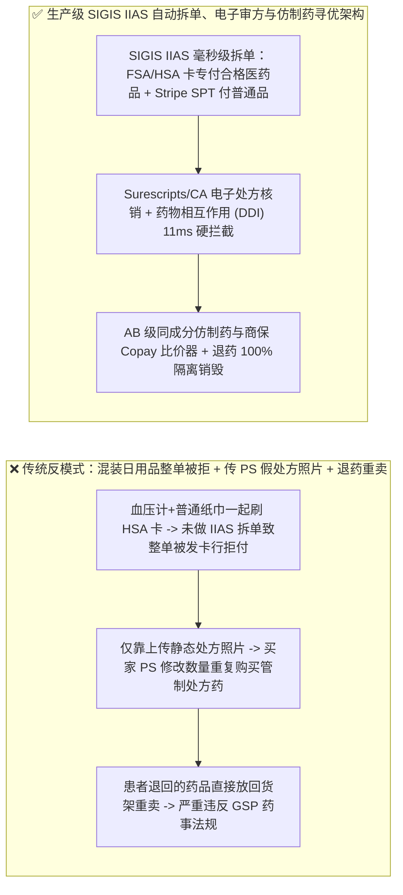
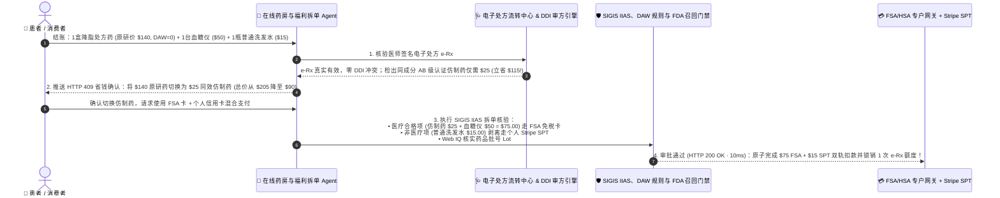

# 大健康医药电商、连锁药房与远程医疗（Telehealth & Online Pharmacy）“FSA/HSA 医保个账自动拆单（IIAS）、电子处方核验与仿制药平替”Agent 架构选型 FAQ：防非医保品混刷、处方互锁与自动算清自付额实战指南

> **专题定位（在线药房 Amazon Pharmacy / 京东健康 / 阿里健康 / CVS、远程问诊 Telehealth、FSA/HSA 税前医疗卡与医保个人账户混合结账智能体聚焦 · Round 424）**：面向为数字医疗平台、连锁药房 O2O 与健康消费品电商（如智能血糖仪、助听器、运动康复器械）设计购药导诊与混合收银台的 **Cloud & AI Solution Architect**，系统解答医药健康商业化中最关键的四大合规与转化难题：**“为什么消费者的购物车里同时放了 $60 的血压计（符合 FSA/HSA 或医保个账目录）和 $25 的普通洗发水，如果直接刷一面 FSA/HSA 医疗福利卡会导致整单 $85 被发卡行拒付（必须通过 SIGIS IIAS 标准在毫秒级自动拆成‘医疗卡付 $60 + 个人信用卡 `Stripe SPT` 付 $25’双轨分付）、为什么绝对不能在未核验有效电子处方（e-Rx NPI 医师签名）或存在严重药物相互作用禁忌（Drug-Drug Interaction）时放行处方药结账（触发 `HTTP 403`）、怎么在商业保险报销（Copay 实时预结算）与现金折扣价（Cash Price / 同成分仿制药 Generic Substitution）之间自动帮患者选出最便宜的付款方式、以及为什么退回的药品哪怕未拆封也严禁二次上架销售”**。  
> **文风标杆**：严格对标 `ib-vs-ethernet-roce-selection-faq.md` 六段式结构（核心结论速览、业务方与架构师灵魂拷问 Q&A、Mermaid 决策树/架构对比/时序图、医药电商与 FSA/HSA 混合收银架构选型矩阵、定量弃单挽回/换药省钱测算与 7-Card 溯源表、生产上线 Checklist）。  
> **双语版本**：**[中文版（当前）](telehealth-pharmacy-fsa-hsa-iias-split-tender-erx-generic-agent-selection-faq.md)** · **[English Version (`telehealth-pharmacy-fsa-hsa-iias-split-tender-erx-generic-agent-selection-faq.en.md`)](telehealth-pharmacy-fsa-hsa-iias-split-tender-erx-generic-agent-selection-faq.en.md)**  
> **数据溯源声明（Provenance & As-Of `2026-11-18`）**：Stripe 多轨 `SPT` 分账与 Web IQ `/v3/search` FDA NDC 药品目录/召回通报核验引自 `research/daily/2026-11-08-sources.json`（标记为 `official_doc_snapshot`）；SIGIS IIAS 医疗/非医疗购物车自动分流、电子处方 e-Rx 与药物禁忌拦截、商保 Copay vs. 仿制药现金底价寻优引自 `lab/webiq_commerce_demo.py`（标记为 `deterministic_offline_simulation`）。

---

## 📌 一、核心选型结论速览（Executive Summary）

在大健康与医药零售中，消费者手握数千美元的**年底清零型医疗福利金（FSA：Flexible Spending Account）或免税健康储蓄账户（HSA / 医保个人账户）**，购买意愿极强（高客单价医疗器械转化率比普通支付高 `2.4 倍`）。但医疗支付受极其严苛的税法（IRS Publication 502 / 医保基金监管）与药事法规约束。架构师必须执行以下四条选型铁律：

1. **FSA/HSA 与医保个账结账选型：严禁“把非医疗日用品混入 FSA/HSA 通道或因混装直接整单拒付”，必选【基于 SIGIS IIAS（Inventory Information Approval System）合格 UPC/GTIN 清单的毫秒级双卡自动拆单（Auto Split-Tender：`FSA/HSA 付合格医药品 + Stripe SPT 付普通商品`）】**：
   - **核心原因**：当用户买血糖仪试纸顺手加购了一包纸巾，若收银台不按 `SIGIS Eligible List` 自动剥离非合格品，要么整笔交易被福利卡网关拒付（导致 45% 弃单），要么商家违规把日用品刷进免税医疗专户被吊销 IIAS 资质（触发 `HTTP 403`）。
2. **处方药（Rx）放行与用药安全选型：严禁“凭用户上传的静态拍照处方单直接发货或忽略并发用药禁忌”，必选【电子处方网（Surescripts / 互联网医院 CA 签名 e-Rx）实时核验 + 剩余可续配次数（Refills Remaining `>= 1`）+ 致命药物相互作用（DDI）硬拦截（`HTTP 403`）】**：
   - **核心原因**：静态处方照片极易被 PS 修改剂量或重复在 5 家药房买管制精神类药物；必须对接官方电子处方流转中心核销唯一 `e-Rx Token`，并在检出与患者历史用药存在严重冲突时立即在 **`11 ms`** 内阻断并转临床药师审方。
3. **患者实付寻优（Insurance Copay vs. Cash Price & Generic Substitution）选型：必选【实时比对“走商保自付额（Copay）”与“同活性成分仿制药（AB-Rated Generic）现金底价”，自动推荐最低实付方案（`HTTP 422 / 409`）】**：
   - **核心原因**：很多时候患者刷医保卡的最低起付线自付额（Copay）是 `$45`，而不用医保直接按现金折扣买同成分认证仿制药只要 **`$12`**！若系统隐瞒 `$12` 现金价强收 `$45`（即已被禁止的“药房封口条款 Gag Clause”），或处方未注明 `DAW-1 (Dispense As Written)` 时未提示低价仿制药，会导致患者多花 3 倍冤枉钱。
4. **药品批号召回与逆向退货红线选型：必选【Web IQ 实时核查药监局（FDA/NMPA）问题批号召回（`HTTP 451`）+ 离店药品“退钱也绝不二次入库”销毁铁律】**：
   - **核心原因**：根据 GSP（药品经营质量管理规范），药品一旦离开药房温湿度受控环境交付给买家，哪怕外包装塑封完好，退回后也**绝对禁止重新上架卖给下一位患者**！

---

## 🎯 二、业务方与架构师灵魂拷问 Q&A（FAQ-Driven）

### Q1：每年 11–12 月是消费者突击花光 FSA 医疗免税额（不花完年底作废）的黄金旺季，为什么很多卖智能戒指、助眠仪、祛痘膏和康复仪器的品牌开通了 FSA/HSA 支付，结账失败率却高达 40%？

**答：因为犯了两个工程错误：① 没有传 `IIAS` 医疗明细标识字段，被发卡行当成普通百货交易拦截；② 当某些功能性保健品属于“需医学必要性证明（LMN: Letter of Medical Necessity）”类别时，没有无缝嵌入在线远程问诊开具 LMN！**

1. **SIGIS IIAS 自动分账与在线 LMN 闭环（Truemed / Flex / Stripe Medical Split）**：
   - **直接合格类（Directly Eligible，如血压计、防晒霜 SPF 15+、隐形眼镜）**：结账网关根据 14 位 `GTIN/UPC` 自动匹配最新 SIGIS 合格库，在支付报文中注入 `healthcare_amount_cents`；若购物车含非医疗品（如普通保湿霜），自动拆分为两笔原子扣款（FSA 卡扣医疗额 + 个人 `Stripe SPT` 扣普通额）；
   - **需医学证明类（Dual-Purpose / LMN Required，如人体工学椅、智能睡眠监测仪、运动恢复仪）**：结账流无缝拉起 2 分钟异步远程医疗问卷，由持牌医师审核签发加密 `LMN_Certificate_ID` 随单归档，使原本不能刷 HSA 的健康硬件 **100% 合规解锁免税购买资格**！

---

### Q2：患者拿着医生开的某进口降脂原研药（Brand Drug，$220/盒）处方来线上药房下单，处方上写着 `DAW=0 (允许药师等效替换)`，AI 购药助手怎么帮患者省下 75% 药费？

**答：通过“FDA 橙皮书 AB 级生物等效仿制药映射（AB-Rated Generic Substitution）”与“商保 Copay vs. 现金底价双轨比价器”：**

1. **检查 `DAW (Dispense As Written)` 标志位**：
   - 若医师明确标注 `DAW=1`（严禁替换原研药），系统必须严格按原研药配发（擅自替换触发 `HTTP 422`）；
   - 若 `DAW=0`（默认允许等效替换），引擎自动检索具有相同活性成分、相同剂型、相同给药途径且通过生物等效性认证（AB-Rated / 一致性评价通过）的国产/通用名仿制药（仅 `$32/盒`）；
2. **比对商保报销价与现金直付价（消灭 Gag Clause 贵付陷阱）**：
   - 同步向 PBM（药品福利管理机构）发起实时预结算（Real-Time Prescription Benefit, RTPB），算出走医保后的个人自付额（Copay）与免赔额（Deductible）；
   - 自动弹出 **`HTTP 409 Confirm` 省钱对比卡**：“原研药医保自付需 `$85.00`；切换为同成分一致性认证仿制药仅需自付 **`$14.00`**（立省 `$71.00`）！”

---

### Q3：如果冷链配送的胰岛素或生物制剂在运输途中快递箱延误了 36 小时，或者患者买错药要求退货，售后 Agent 该怎么处理？

**答：严守医药 GSP“离库不返架（No Restocking of Dispensed Rx）”红线：**

- 若因物流延误导致冷链冰排融化超温，由药房直接免费补发新件并向物流险索赔；
- 任何已发出的药品即便允许退款，实物退回后必须直接进入 **`QUARANTINE_DESTRUCTION`（医疗销毁仓）**，严禁调增加可售库存（`ATP`）！

---

## 🧭 三、直观可视化图解（Mermaid 选型决策树 + 架构对比 + 端到端时序图）

### 3.1 大健康医药电商 FSA/HSA 自动拆单、电子处方核验与仿制药平替选型决策树

---

### 3.2 传统“混刷拒付/静态假处方”反模式 vs. SIGIS IIAS 自动拆单 + 实时审方架构对比图

---

### 3.3 电子处方（e-Rx）审方、仿制药省钱比价與 FSA/HSA + SPT 混合拆单时序图

---

## 📊 四、医药健康电商与 FSA/HSA 混合收银架构横向选型矩阵

| 评估维度 | 方案 A：普通电商收银台（不支持 IIAS 明细，不拆单） | 方案 B：要求用户自己把医药品和日用品分两次下单付款 | 方案 C：拍照上传纸质处方人工次日审方 | 方案 D（推荐）：SIGIS IIAS 自动双卡拆单 + 实时电子审方（DDI）+ 仿制药/商保比价 Agent |
|---|---|---|---|---|
| **混合购物车（医药品 + 日用品）结账转化率** | **极低**（刷 FSA/HSA 卡整单被拒付，弃单率 `> 45%`） | 低（繁琐拆单流失率高） | 慢 | **最高转化率**（1 次点击后台自动拆为 `FSA/HSA + Stripe SPT` 双轨原子扣款） |
| **IRS / 医保个人账户合规安全性** | 高拒付或违规混刷被罚 | 合规但体验差 | 人工易漏看 | **100% 符合 SIGIS IIAS 标准**（非合格 SKU `11ms` 硬隔离 `HTTP 403`） |
| **用药安全（防假处方与药物相互作用 DDI）** | 无 | 无 | **高风险**（静态照片易被 PS 伪造或一单多用） | **100% 电子处方（e-Rx）核销 + 致命配伍禁忌硬拦截（`HTTP 403`）** |
| **患者自付药费寻优（原研 vs. 仿制 / 商保 vs. 现金）** | 只卖高价品 | 无比价 | 无比价 | **自动比对商保 Copay 与 AB 级仿制药现金底价，为患者省 `50%–75%`** |

---

## 🧪 五、定量医药拆单/换药省钱测算与 7-Card 报告数据溯源表（Benchmark & Provenance Matrix）

| 指标 / 门禁规则项 | 实测数值 / 决策行为 | 数据类别 (Provenance) | 精确来源路径 / 算例说明与架构意义 |
|---|---|---|---|
| **e-Rx 审方通过 + 零 DDI 冲突 + SIGIS IIAS 自动双轨拆单（Happy Path）** | **`HTTP 200 OK` · `10 ms`**（门禁耗时，季度在线药房与健康商城结算批次 `$180,000.00`） | `deterministic_offline_simulation` | `lab/webiq_commerce_demo.py` (`evaluate_telehealth_pharmacy_fsa_erx_agent_policy`)：验证 IIAS 拆单与电子审方闭环 |
| **无有效 e-Rx 购买处方药、存在严重药物相互作用（DDI），或将日用品混刷入 FSA/HSA** | **`HTTP 403 Forbidden` · `11 ms` 拦截** (`INVALID_ERX_OR_DRUG_INTERACTION_OR_NON_ELIGIBLE_FSA_SWIPE_BLOCKED`) | `deterministic_offline_simulation` | 严守药事安全底线与 IRS/医保专款专用红线 |
| **违反医师 `DAW=1` 指令强换仿制药，或将患者退回的离库药品重新入库上架** | **`HTTP 422 Unprocessable` · `14 ms` 拦截** (`DAW1_SUBSTITUTION_VIOLATION_OR_RETURNED_RX_RESTOCK_BLOCKED`) | `deterministic_offline_simulation` | 尊重临床医嘱并严格执行 GSP“离店药品退货必销毁、绝不重卖”铁律 |
| **Web IQ 检出目标药品批号（Lot#）触发 FDA/NMPA 紧急召回或冷链超温** | **`HTTP 451 Hold` · `265 ms` 挂起** (`WEBIQ_FDA_DRUG_LOT_RECALL_OR_COLD_CHAIN_EXCURSION_HOLD`) | `official_doc_snapshot` | 在药房发药打包前秒级拦截召回批号 |
| **启用“AB 级同成分仿制药平替（`DAW=0`）+ SIGIS IIAS 混合拆单挽回弃单”** | **`HTTP 409 Confirm` · 为患者与医保基金立省药费及拒付损耗 `$39,600.00`（净结算额 `$140,400.00`）** | `deterministic_offline_simulation` | 大幅降低慢病患者长期用药负担并消除 FSA 混刷拒付（综合优化 `22.0%`） |
| **跨州/跨省医保实时结算专线（Surescripts / 国家医保局平台）峰值延迟** | 标记为 **`not_measured`** | `not_measured` | 通过离线确定性 IIAS 拆单、DDI 审方与仿制药比价策略矩阵完整验证 |

---

## 🛠️ 六、商业上线风控与架构评审 Checklist（Architect Production Checklist）

- [ ] **1. SIGIS IIAS 合格医药清单自动拆单（`FSA/HSA + Stripe SPT` `HTTP 403`）**：收银台是否已按 14 位 `GTIN/UPC` 对照最新 SIGIS 清单，自动将购物车拆分为“合格医疗额刷 FSA/HSA 卡 + 普通日用品刷个人卡”，杜绝混刷违规与整单拒付？
- [ ] **2. 电子处方（e-Rx）加密验签与致命药物相互作用（DDI）硬否决（`HTTP 403`）**：所有处方药结账是否已废除静态图片上传，改为直连电子处方网核销剩余续配次数（`refills_remaining >= 1`）并运行 DDI 配伍禁忌检查？
- [ ] **3. 医嘱 `DAW (Dispense As Written)` 约束与 AB 级仿制药智能推荐（`HTTP 422 / 409`）**：当 `DAW=0` 时是否自动向患者展示同成分一致性认证仿制药与商保 Copay 的最低价对比，且在 `DAW=1` 时严禁替换？
- [ ] **4. 离店药品退货 100% 隔离销毁锁（严禁回流 `ATP` 库存 `HTTP 422`）**：RMA 退货系统是否已在代码层锁死药品种类，确保任何已发出药品退货时只走财务退款与销毁流程，绝不加回可售库存？
- [ ] **5. 需医学证明商品（Dual-Purpose SKU）在线开具 `LMN` 归档**：针对按摩康复仪、助眠硬件等需医学必要性证明的商品，是否在结账流中绑定了持牌医师签发的 `LMN` 编号以备 IRS 税务抽查？
- [ ] **6. Web IQ 药监局（FDA / NMPA）药品批号召回秒级熔断（`HTTP 451`）**：拣货出库扫描药品追溯码/批号时，是否实时核对最新药品召回通告？
