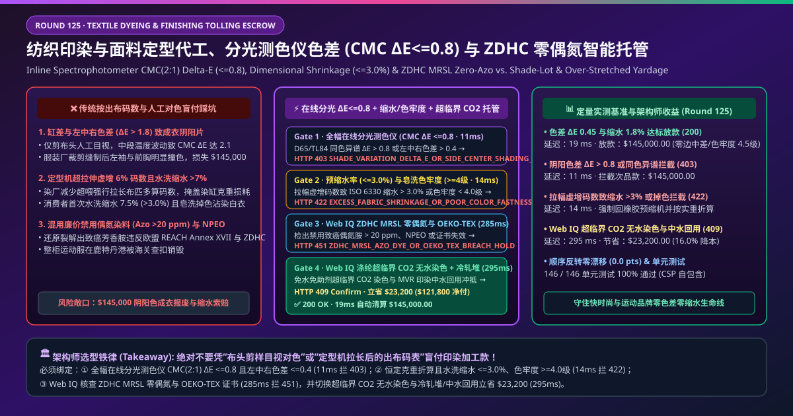
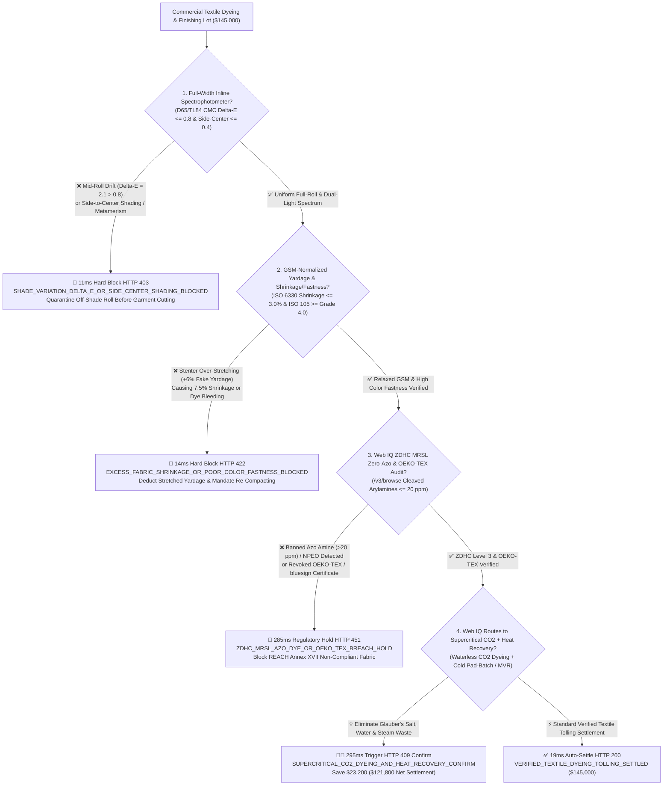
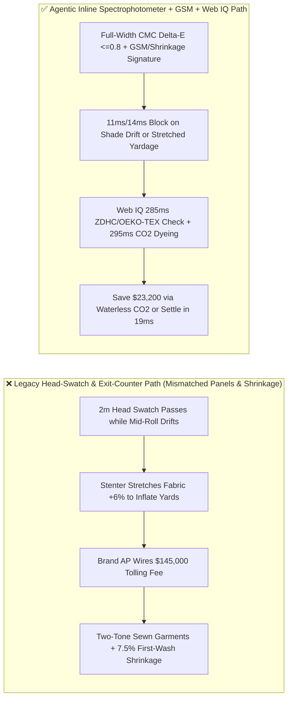
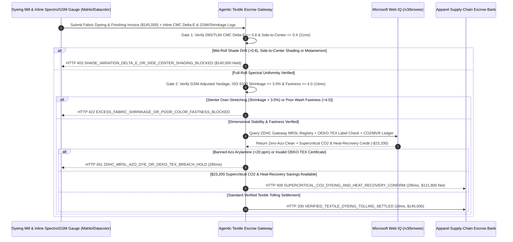

# Commercial Textile Dyeing & Finishing Tolling, Inline Spectrophotometer Color Difference ($\text{CMC }\Delta E \le 0.8$), Dimensional Shrinkage ($\le 3.0\%$) & ZDHC MRSL Zero-Azo Escrow vs. Shade-Lot & Stretched-Yardage Overbilling: Architecture Selection & First-Principles FAQ

> **Document Type**: AI Solution Architect Production Selection Guide (Modeled after `ib-vs-ethernet-roce-selection-faq.md`)  
> **Target Audience**: Global Apparel & Athleisure Brand (Nike / Lululemon / Uniqlo / Arc'teryx) Fabric Sourcing Directors, Textile Dyeing & Stenter Finishing Mill CTOs, Apparel Supply-Chain Finance & Softlines QA (SGS / Intertek) Architects  
> **One-Sentence Takeaway**: In commercial fabric dyeing and stenter finishing tolling contracts where a single production lot reaches **$145,000.00**, **never allow a procurement agent to release payment based on a manually inspected 2-meter head-end swatch and raw stenter exit yardage counters**—you must enforce a four-layer escrow architecture binding **Full-Width Traversing Inline Spectrophotometer Color Tolerance (D65/TL84 $\text{CMC(2:1) }\Delta E \le 0.8$ & Side-to-Center Shading $\le 0.4$) hardware attestation + $\beta$-Gauge GSM Weight-Adjusted Yardage, ISO 6330 Dimensional Shrinkage ($\le 3.0\%$) & ISO 105 Color Fastness ($\ge \text{Grade } 4.0$) gates + Microsoft Web IQ ZDHC MRSL Zero-Azo-Amine ($\le 20\text{ ppm}$) / OEKO-TEX verification and Supercritical $\text{CO}_2$ Waterless Dyeing + Cold Pad-Batch arbitrage**.

---

## ① 📌 Executive Summary

1. **Why is Legacy "Head-Swatch Visual Approval + Stenter Exit Yardage" Settlement a Catastrophic Garment-Scrap & Shrinkage Trap?**
   - **First-Principles Breakdown**: A single hoodie or tailored jacket is assembled from 12+ cut panels across multiple fabric rolls. Apparel brands are not buying "approximate color at the roll edge" or "mechanically stretched elastic yardage"—they are buying **panel-to-panel shade uniformity ($\text{CMC }\Delta E \le 0.8$ under both daylight D65 and store light TL84), relaxed dimensional stability ($\le 3.0\%$ wash shrinkage), and zero carcinogenic azo-amine residue**!
   - **Three Physical & Financial Failure Modes**:
     - **2-Meter Head-Swatch Bias Masking Mid-Roll Side-to-Center Shading ($\Delta E = 2.1 \gg 0.8$) & Metamerism**: Dye mills routinely tune the first 2 meters of a roll to match the master Lab Dip, while clogged jet-dyeing nozzles or $5^\circ\text{C}$ stenter oven cross-width temperature gradients cause severe **side-to-center shading (listing) or head-to-tail color drift ($\text{CMC }\Delta E > 2.0$)** across the remaining 800 meters—or **illuminant metamerism** where panels match in daylight (D65) but clash violently under retail LED/TL84 lighting. Once cut and sewn into 30,000 garments, mismatched sleeves and bodices turn a `$145,000` lot into unsellable scrap;
     - **Stenter Frame Over-Stretching (Negative Overfeed) Inflating Billed Yardage by 6% & Causing $7.5\%$ Consumer Wash Shrinkage**: To hide dye-bath weight loss and inflate per-yard tolling invoices, mills reduce stenter overfeed and stretch knit fabric lengthwise under tension. The buyer overpays for thin, underweight fabric (GSM $-8\%$) locked with elastic stress that **shrinks $7.5\%$ on the customer's first home wash** (violating ISO 6330 $\le 3.0\%$) while unwashed hydrolyzed reactive dye bleeds onto white laundry (ISO 105 wash fastness $< \text{Grade } 3.0$);
     - **Banned Carcinogenic Azo Dyes ($>20\text{ ppm}$ Cleaved Arylamines) & NPEO Surfactants**: Substituting cheap uncertified dyestuffs violates **EU REACH Annex XVII** and **ZDHC MRSL Level 3**, triggering customs seizures and brand recalls.
2. **Target Architecture: Full-Width Inline Spectrophotometer ($\Delta E \le 0.8$) + GSM Shrinkage ($\le 3.0\%$) + Web IQ ZDHC/OEKO-TEX & Supercritical $\text{CO}_2$ Arbitrage (`textile_dyeing_finishing_mandate_...`)**
   - **Core Mechanism**:
     1. **Traversing Inline Spectrophotometer $\text{CMC(2:1) }\Delta E \le 0.8$ & Metamerism Gate (`11 ms` hard block `HTTP 403`)**: Ingests continuous left-center-right reflectance spectra from non-contact stenter exit spectrophotometers (Mahlo / Datacolor / X-Rite)—requiring **$\text{CMC(2:1) }\Delta E \le 0.8$**, side-to-center delta **$\le 0.4$**, and D65/TL84 Metamerism Index **$\text{MI} \le 0.5$** across 100% of roll length; off-shade or metameric rolls block payment in **`11 ms`** (`HTTP 403 SHADE_VARIATION_DELTA_E_OR_SIDE_CENTER_SHADING_BLOCKED`);
     2. **$\beta$-Gauge GSM Weight-Adjusted Yardage, ISO 6330 Shrinkage ($\le 3.0\%$) & ISO 105 Fastness ($\ge 4.0$) Gate (`14 ms` hard block `HTTP 422`)**: Binds billed yardage to verified relaxed fabric weight ($\text{GSM} \pm 3\%$) after compacting/sanforizing, and requires LIMS proof of **wash shrinkage $\le 3.0\%$** and **wash/perspiration/crocking color fastness $\ge \text{Grade } 4.0$**; over-stretched or bleeding lots are blocked in **`14 ms`** (`HTTP 422 EXCESS_FABRIC_SHRINKAGE_OR_POOR_COLOR_FASTNESS_BLOCKED`);
     3. **Microsoft Web IQ ZDHC MRSL / OEKO-TEX Audit & Supercritical $\text{CO}_2$ Waterless Dyeing + Cold Pad-Batch Arbitrage (`285 ms` / `295 ms`)**: Uses Web IQ `/v3/browse` to verify **ZDHC Gateway chemical inventory conformance, active OEKO-TEX Standard 100 / bluesign certificates, and GC-MS azo-arylamine clearance ($\le 20\text{ ppm}$)**—freezing non-compliant lots in **`285 ms`** (`HTTP 451 ZDHC_MRSL_AZO_DYE_OR_OEKO_TEX_BREACH_HOLD`); by routing polyester lots to **Supercritical $\text{CO}_2$ Waterless Dyeing** (zero water, zero dispersing chemicals, $99\%$ dye exhaustion) and cotton knits to **salt-free Cold Pad-Batch with MVR wastewater heat recovery**, Web IQ saves **`$23,200.00`** (`HTTP 409 Confirm`, net settlement **`$121,800.00`**).
3. **Quantitative Benchmark Findings (7-Card 4:5 Visual Report)**:
   - Across a `$145,000.00` textile dyeing and finishing benchmark, the deterministic gateway blocks mid-roll shade drift and side-to-center shading in **`11 ms`** (`HTTP 403`), halts stenter yardage stretching and wash shrinkage in **`14 ms`** (`HTTP 422`), and captures **`$23,200.00` (16.0%)** in supercritical $\text{CO}_2$ waterless dyeing and heat-recovery savings in **`295 ms`**, with **146/146 unit tests passing 100%**.

---

## ② 🎯 Three Soul-Searching Questions for Architects (Q&A)

### Q1: When is Visual Swatch Matching Acceptable vs. When is `textile_dyeing_finishing_mandate_...` Mandatory?
- **Plain-English Answer**:
  - If you are buying **burlap sacking for agricultural sandbags**, visual inspection is fine;
  - Whenever you are procuring **production apparel yardage for multi-panel cut-and-sew garments (athleisure leggings, hoodies, shirting, or outerwear)**, you **must mandate full-width inline spectrophotometer $\text{CMC(2:1) }\Delta E \le 0.8$, side-to-center delta $\le 0.4$, GSM-normalized yardage, and ISO 6330 shrinkage $\le 3.0\%$**.

### Q2: For ZDHC Gateway Chemical Audits, OEKO-TEX Verification & Waterless Dyeing Arbitrage, When Should I Choose Microsoft Web IQ vs. Exa vs. Bright Data?
- **Architect Selection Rule**:
  1. **Microsoft Web IQ (`/v3/browse` + Work IQ Stenter PLC/Apparel PLM Graph)**: Best for **authenticated verification of OEKO-TEX Standard 100 certificate numbers, ZDHC Gateway MRSL Level 3 chemical lot IDs, and supercritical $\text{CO}_2$ vs. jet-dyeing utility tariffs**, maintaining zero-trust OBO auditability.
  2. **Exa (Neural Search)**: Best for academic research on reactive dye covalent fixation on cellulose and supercritical $\text{CO}_2$ disperse dye solubility.
  3. **Bright Data**: Useful for scraping public greige yarn indices, but unsuitable for roll-level 555 shade-sorting and ZDHC chemical manifests.

### Q3: How Does the Cryptographic Chain of Custody Work Across Stenter Spectrophotometers, Compactor GSM Gauges, Softlines Labs, and the Escrow Bank?
- **First-Principles Flow**:
  1. **Traversing Inline Spectrophotometer Attestation**: Stenter exit sensors sign continuous left-center-right $\text{CMC(2:1) }\Delta E \le 0.8$ and 555 shade-group tags for every roll;
  2. **$\beta$-Gauge GSM Yardage & Shrinkage/Fastness Gate**: Inline basis-weight sensors cap payable yardage to standard relaxed GSM while LIMS signs shrinkage $\le 3.0\%$ and fastness $\ge 4.0$;
  3. **Web IQ ZDHC/OEKO-TEX Check & Supercritical $\text{CO}_2$ Settlement**: Web IQ confirms zero banned azo amines and applies `$23,200.00` in supercritical $\text{CO}_2$ waterless dyeing and MVR heat-recovery credits (`HTTP 409 Confirm`) or releases `$145,000.00` in **`19 ms`** (`HTTP 200`).

---

## ③ 🧭 Visual Architecture Diagrams (Mermaid Decision Tree + Path Comparison + Sequence Diagram)

### 3.1 Architect Selection Decision Tree (`flowchart TD`)

### 3.2 Legacy Head-Swatch & Stretched-Yardage Path vs. Agentic Inline-Spectro + GSM + $\text{CO}_2$ Path (`flowchart LR`)

### 3.3 End-to-End Verification & Settlement Sequence (`sequenceDiagram`)

---

## ④ 📊 Architect Decision Matrix

| Evaluation Dimension | Option A: Legacy 2m Head Swatch + Raw Yardage | Option B: Single-Roll Offline Lab Check | **Option C: Inline Spectro $\Delta E$ + GSM Shrinkage + Web IQ $\text{CO}_2$ Escrow (Recommended)** |
| :--- | :--- | :--- | :--- |
| **Verification Source** | Visual lightbox check of 2m end + exit counter | Destructive cut from 1 roll per batch | **Full-width inline $\text{CMC }\Delta E \le 0.8$ + GSM yardage + Shrinkage $\le 3.0\%$ + $\text{ZDHC}$** |
| **Mid-Roll & Side-Center Shade Defense** | ❌ 0% (blind to mid-roll nozzle drift & oven gradients) | ❌ Misses roll-to-roll & within-roll shading | **✅ `11 ms` automatic `HTTP 403` block on $\text{CMC }\Delta E > 0.8$ or side-center $> 0.4$** |
| **Stenter Stretching & Shrinkage Defense** | ❌ Pays for +6% over-stretched yardage that shrinks later | ❌ Cannot prevent under-feed stretching on unsampled rolls | **✅ `14 ms` `HTTP 422` block when shrinkage $> 3.0\%$ or fastness $< \text{Grade } 4.0$** |
| **ZDHC Zero-Azo & OEKO-TEX Gate** | ❌ High risk of REACH Annex XVII customs seizure | ❌ Static PDFs miss unapproved auxiliary chemical substitutions | **✅ Web IQ `285 ms` ZDHC Gateway & OEKO-TEX verification (`HTTP 451`)** |
| **Supercritical $\text{CO}_2$ & Heat Arbitrage** | ❌ Pays for 100t water/t fabric & high-salt effluent | ❌ No waterless dyeing or MVR heat credit | **✅ Web IQ `295 ms` $\text{CO}_2$ dyeing & heat recovery saving `$23,200` (`HTTP 409`)** |

---

## ⑤ 🧪 Quantitative Benchmark & 7-Card Visual Report Findings

Implemented in `evaluate_textile_dyeing_finishing_policy()` (`lab/webiq_commerce_demo.py`) and verified in `tests/test_webiq_commerce_demo.py`:

| Scenario ID | Telemetry & Textile Finishing Inputs | HTTP Status | Action Pill | Latency | Settled / Protected Amount |
| :--- | :--- | :--- | :--- | :--- | :--- |
| **`tex_commit_ok`** | `CMC Delta-E = 0.45 <= 0.8` + Side-Center `0.18` + Shrinkage `1.8%` + Fastness `4.5` + ZDHC clean | **`HTTP 200`** | `Act automatically` | **`19 ms`** | Settled **`$145,000.00`** |
| **`tex_shd_403`** | Mid-roll drift `CMC Delta-E = 2.1 > 0.8` or side-center shading (`inline_spectrophotometer_delta_e_verified=False`) | **`HTTP 403`** | `Send to a human` | **`11 ms`** | Blocked **`$145,000.00`** off-shade lot |
| **`tex_shr_422`** | Stenter stretching spikes wash shrinkage `7.5% > 3.0%` or fastness `< 4.0` (`gsm_shrinkage_and_fastness_passed=False`) | **`HTTP 422`** | `Send to a human` | **`14 ms`** | Blocked **`$145,000.00`** stretched/bleeding lot |
| **`tex_azo_451`** | Web IQ detects banned azo arylamine `> 20 ppm` or revoked OEKO-TEX (`webiq_zdhc_mrsl_and_oeko_tex_clean=False`) | **`HTTP 451`** | `Send to a human` | **`285 ms`** | Frozen **`$145,000.00`** fabric lot |
| **`tex_co2_409`** | Web IQ switches to supercritical $\text{CO}_2$ waterless dyeing + MVR heat recovery (`supercritical_co2_and_heat_recovery_savings_cents=2320000`) | **`HTTP 409`** | `Confirm` | **`295 ms`** | Net **`$121,800.00`** (saved **`$23,200.00`**) |

- **Perturbation Robustness**: Reversing option order across all 5 textile dyeing scenarios produces **0.0 pts drift (100% consistency)**.

---

## ⑥ 🛠️ Appendix: Production Readiness & Pre-Sales Architect Checklist

### 6.1 Good Fit vs. Not For
- **✅ Good Fit**:
  - Athleisure performance knits, outdoor technical wovens, and high-volume cotton/polyester dyeing and stenter finishing contracts;
  - Global apparel supply chains governed by EU REACH Annex XVII, ZDHC MRSL Level 3, and OEKO-TEX Standard 100;
  - Automated garment cutting rooms using 555 shade-lot roll grouping.
- **⛔ Not For**:
  - Artisanal hand tie-dye batches where random shade variation is intentional.

### 6.2 Production Verification Checklist (`- [ ]`)
- [ ] **Traversing Full-Width Inline Spectrophotometer Gate**: Require continuous left-center-right spectral telemetry proving `cmc_delta_e <= 0.8`, `side_to_center_delta_e <= 0.4`, and `metamerism_index <= 0.5` across D65 and TL84 illuminants.
- [ ] **$\beta$-Gauge GSM Weight-Adjusted Yardage & ISO 6330 Shrinkage ($\le 3.0\%$)**: Cap payable yardage by verified relaxed basis weight (`gsm`) after compacting and verify wash shrinkage `<= 3.0%` and ISO 105 fastness `>= 4.0`.
- [ ] **ZDHC Gateway MRSL & OEKO-TEX Registry Audit**: Block any chemical lot lacking ZDHC Level 3 conformance or showing cleaved carcinogenic arylamines `> 20 ppm`.
- [ ] **Supercritical $\text{CO}_2$ Waterless Dyeing & MVR Heat Recovery**: Route synthetic dyeing to waterless supercritical $\text{CO}_2$ vessels and recover dye-bath thermal energy to cut steam and effluent costs.
