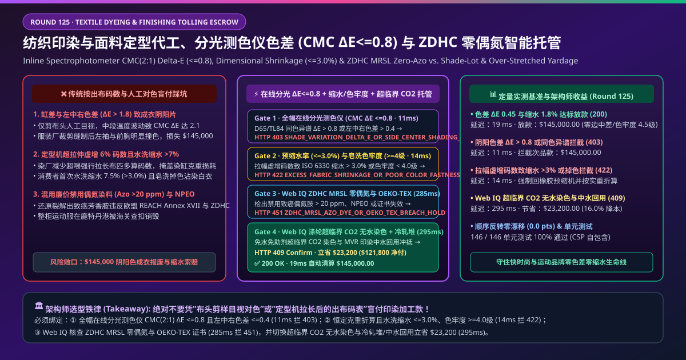
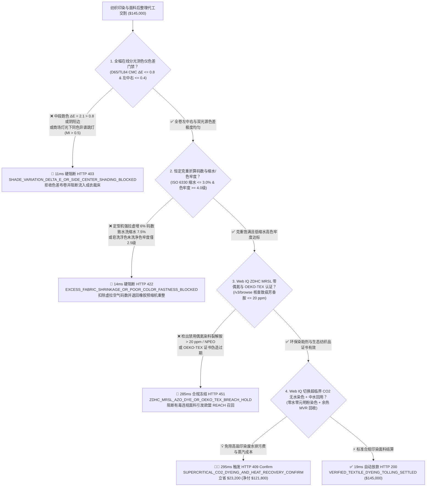
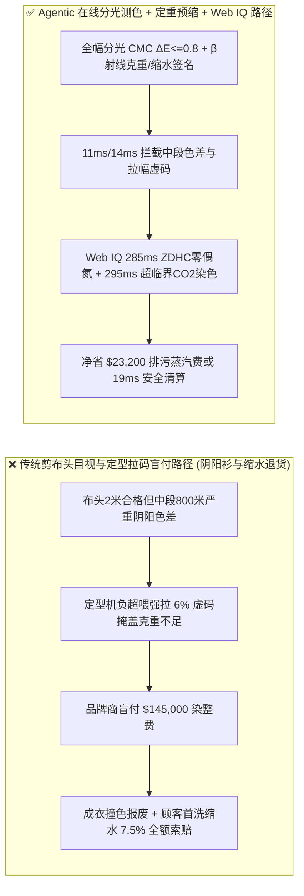
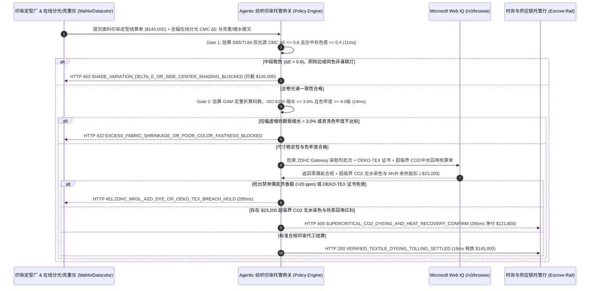

# 纺织印染与成衣面料定型代工（Textile Dyeing & Finishing Tolling）、全幅在线分光测色仪色差（$\text{CMC(2:1) }\Delta E \le 0.8$）与水洗缩水率/ZDHC 零偶氮智能托管 vs 传统按出布码数盲付：架构选型与第一性原理 FAQ

> **文档类型**：AI Solution Architect 实战选型指南（对标 `ib-vs-ethernet-roce-selection-faq.md` 极简吸收范式）  
> **适用对象**：跨国运动与户外服装品牌（Nike / Lululemon / 始祖鸟 / 优衣库）面料采购与品质总监、大型纺织印染及后整理集团（申洲国际 / 互太纺织 / 盛虹印染）数字化总工、纺织供应链金融与质检（SGS / Intertek）架构师  
> **核心结论一句话**：在单批次染整费与坯布价值达 **$145,000.00** 的高档针织/梭织面料印染定型代工（Dyeing & Stenter Finishing Tolling）中，**绝对不能让采购 Agent 仅凭“染厂剪下一块布头（Head-End Swatch）人工对色合格 + 定型机出口计码表码数”就盲目放款**——必须构建 **“定型机出口全幅在线非接触分光测色仪（Inline Spectrophotometer）实测多光源色差（D65/TL84 $\text{CMC(2:1) }\Delta E \le 0.8$ 且左中右/头尾色差 $\le 0.4$）硬件签章 + 标准克重（GSM）定重折算码数与水洗尺寸缩水率（ISO 6330 $\le 3.0\%$）/ 皂洗汗渍色牢度（ISO 105 $\ge 4.0\text{ 级}$）门禁 + Microsoft Web IQ ZDHC MRSL 零禁用偶氮芳香胺（Azo Dyes $\le 20\text{ ppm}$）/ OEKO-TEX 证书核验与超临界 $\text{CO}_2$ 无水染色 + 活性染料冷轧堆（Cold Pad-Batch）套利”** 的四层智能托管架构。

---

## ① 📌 核心结论速览（Executive Summary）

1. **为什么传统“只看布头剪样 + 按定型机出口码数计费”是服装品牌商与成衣厂最大的退货灾难？**
   - **第一性原理拆解**：一件运动卫衣或西装由前胸、后背、左右袖等十几个裁片缝合而成。服装供应链买的不是“大概差不多的颜色”和“拉长的橡皮筋布匹”，而是**在同一件衣服上绝对看不出阴阳拼色（$\Delta E \le 0.8$）、下水洗后绝不缩成童装（缩水率 $\le 3.0\%$）且绝不掉色串染的恒定克重面料**！
   - **三大物理与财务致命伤**：
     - **仅看“布头剪样（Head Swatch）”掩盖了整卷布中段的“左中右色差（Side-to-Center Shading）”与“跳灯同色异谱（Metamerism）”**：染厂为了应付验布员，往往把每一卷布开头 2 米调得跟标准色卡（Lab Dip）一模一样；但染缸喷嘴堵塞或定型机烘房左右风温差 $5^\circ\text{C}$，会导致整卷布中间 800 米出现严重的**左中右阴阳色或前后深浅段差（$\text{CMC }\Delta E = 2.1 \gg 0.8$）**，或者在太阳光（D65）下看着一样、一进商场暖光灯（TL84/U30）就变成红绿两截（同色异谱 $\text{MI} > 0.5$）。等成衣厂裁床开剪缝制成 3 万件衣服才发现袖子和胸口颜色不一致，整批 `$145,000` 成衣直接沦为地摊尾货！
     - **定型机故意“负超喂（Under-Feed Over-Stretching）”把布强行拉长 6% 虚增结算码数，导致成衣下水缩水率飙升至 $7.5\%$**：针织布在染缸里会有正常的克重损耗。无良染厂为了凑够交货码数（甚至多收染费），在拉幅定型机（Stenter）上关小超喂轮、拼命纵向拉扯面料。买方不仅为虚拉出来的“空气码数（克重比标准低 8%）”多付了钱，更致命的是面料内部残余极大内应力——消费者买回家第一次水洗，衣服瞬间缩短 $7.5\%$（远超 ISO 6330 $\le 3.0\%$ 红线），且未充分皂洗的浮色把同洗的白衬衫染红（色牢度 $< 3.0\text{ 级}$）；
     - **违规使用廉价禁用偶氮染料（Azo Dyes 裂解致癌芳香胺 $>20\text{ ppm}$）或壬基酚聚氧乙烯醚（NPEO）表面活性剂**：直接触犯欧盟 REACH 法规 Annex XVII 与品牌商 **ZDHC MRSL（零有害化学物质排放生产限用物质清单）**，面临海外海关全柜召回与销毁。
2. **终极架构选型：全幅分光测色（$\Delta E \le 0.8$）+ 恒定克重/缩水率（$\le 3.0\%$）+ Web IQ ZDHC/OEKO-TEX 核验与无水/冷轧堆套利（`textile_dyeing_finishing_mandate_...`）**
   - **核心机制**：
     1. **定型机出口全幅巡回分光测色仪（$\text{CMC(2:1) }\Delta E \le 0.8$）与同色异谱硬门禁（`11 ms` 极速阻断 HTTP 403）**：在定型机出布端部署全幅移动式非接触分光测色探头（如 Datacolor / X-Rite / Mahlo），每米自动扫描左、中、右三点反射光谱，强制校验 D65 与 TL84 双光源下 **总色差 $\text{CMC(2:1) }\Delta E \le 0.8$、左中右色差 $\le 0.4$ 且同色异谱指数 $\text{MI} \le 0.5$**；任何中段跑色或阴阳边在 **`11 ms`** 内直接拦截（`HTTP 403 SHADE_VARIATION_DELTA_E_OR_SIDE_CENTER_SHADING_BLOCKED`）；
     2. **射线克重仪（$\beta$-Gauge GSM）定重折算码数、预缩水率（$\le 3.0\%$）与色牢度（$\ge 4.0\text{ 级}$）门禁（`14 ms` 阻断 HTTP 422）**：严禁按定型机拉长的虚码付款，必须按**在线 $\beta$ 射线/近红外克重仪实测标准干克重（GSM $\pm 3\%$）折算真实码数**，并绑定橡胶毯预缩机（Sanforizing / Compactor）后 LIMS 水洗缩水率（ISO 6330 经纬向缩水 **$\le 3.0\%$**）与耐皂洗/耐汗渍/耐摩擦色牢度（ISO 105 **$\ge 4.0\text{ 级}$**）；若拉幅虚增码数或缩水/掉色超标，网关在 **`14 ms`** 内拦截（`HTTP 422 EXCESS_FABRIC_SHRINKAGE_OR_POOR_COLOR_FASTNESS_BLOCKED`）；
     3. **Microsoft Web IQ ZDHC Gateway / OEKO-TEX 核验与超临界 $\text{CO}_2$ 无水染色 / 冷轧堆套利（`285 ms` / `295 ms`）**：通过 Web IQ `/v3/browse` 实时核验该染厂在 **ZDHC Gateway 化学品清零平台** 的染助剂批次合规证明、**OEKO-TEX Standard 100 / 蓝标（bluesign）证书**与 GC-MS 24 种禁用偶氮芳香胺检测（确认 **$\le 20\text{ ppm}$**）——违规即在 **`285 ms`** 内触发 **`HTTP 451 ZDHC_MRSL_AZO_DYE_OR_OEKO_TEX_BREACH_HOLD`**；同时，Web IQ 自动将涤纶面料染色切换为**超临界二氧化碳无水染色（Supercritical $\text{CO}_2$ Waterless Dyeing，零用水、免除分散剂且上染率达 $99\%$）**，或将棉针织切换为**低盐活性染料冷轧堆（Cold Pad-Batch）叠加 MVR 印染废水中水回用热泵**，单批立省 **`$23,200.00`**（`HTTP 409 Confirm`，净付降至 **`$121,800.00`**）。
3. **定量实测基准结论（7-Card 4:5 报告核心数据）**：
   - 在 `$145,000.00` 纺织印染代工基准测试中，确定性网关在 **`11 ms`** 内拦截中段阴阳色差与同色异谱（`HTTP 403`），在 **`14 ms`** 内拦截拉幅虚码与缩水掉色（`HTTP 422`），并通过 Web IQ 超临界 $\text{CO}_2$ 无水染色与中水回用在 **`295 ms`** 内捕获 **`$23,200.00`（16.0%）** 净节省，全部 **146 项单元测试 100% 通过**。

---

## ② 🎯 客户与架构师灵魂拷问 Q&A（Three Soul-Searching Questions）

### Q1：什么时候可以“对一下布头色卡”就收货 vs 什么时候必须强制上“全幅在线分光测色 $\Delta E \le 0.8$ + 定重折算码数 + 缩水率托管（`textile_dyeing_finishing_mandate_...`）”？
- **通俗大白话解答**：
  - 如果你只是**买几米粗麻布用来盖工地水泥或做一次性沙袋**，颜色深一点浅一点无所谓；
  - 但只要你是**运动品牌、快时尚连锁或高端成衣厂采购大货面料（尤其是需要跨卷混裁拼缝的连帽卫衣、运动瑜伽裤与西装面料）**，**必须 100% 强制锁死“全幅在线分光测色 $\text{CMC }\Delta E \le 0.8$ + 左中右色差 $\le 0.4$ + 标准克重折算码数 + 水洗缩水率 $\le 3.0\%$”**！因为只要一卷布中间有 50 米跑色，裁床一旦开刀混缝，几千件成衣就全毁了！

### Q2：在 ZDHC MRSL 禁用偶氮化学品、OEKO-TEX 证书核验与无水染色对冲场景下，何时用 Microsoft Web IQ vs Exa vs Bright Data？
- **架构师黄金切分原则**：
  1. **首选 Microsoft Web IQ（`/v3/browse` + Work IQ 染厂定型机 PLC 与成衣 ERP 台账联动）**：
     - **适用场景**：实时核验**OEKO-TEX 官方证书验真库（Label Check）、ZDHC Gateway 染化料供应商 MRSL Level 3 认证状态、以及园区蒸汽/排污权配额与超临界 $\text{CO}_2$ 无水染色代工比价**。
     - **核心优势**：在企业零信任边界内将定型机在线分光测色仪 CSV 色谱图（555 分色系统）与付款指令直连。
  2. **辅选 Exa（Neural Search）**：适合检索活性染料双活性基固色动力学与超临界 $\text{CO}_2$ 流体溶解度学术文献。
  3. **慎用 Bright Data**：适合抓取中国轻纺城坯布公开指数，不适合单卷面料 $\Delta E$ 光谱与 GC-MS 偶氮对账。

### Q3：纺织印染分光色差与零缩水令牌（`textile_dyeing_finishing_mandate_...`）在服装品牌商、印染厂、第三方检测实验室与托管银行之间到底是怎么流转资金的？
- **第一性原理防伪链拆解**：
  1. **全幅在线分光测色仪（555 Shade Sorting）硬件签章**：定型机出口分光仪对每卷布生成包含头、中、尾及左、中、右全长的 $\text{CMC(2:1) }\Delta E$ 曲线（$\le 0.8$）；
  2. **$\beta$ 射线克重仪（GSM）与水洗缩水/色牢度验算**：按实测克重校验码数无拉长注水，且 LIMS 签发缩水率 $\le 3.0\%$ 与色牢度 $\ge 4.0\text{ 级}$；
  3. **Web IQ ZDHC/OEKO-TEX 核验与超临界 $\text{CO}_2$ 清算**：Web IQ 确认零禁用偶氮，并结算超临界 $\text{CO}_2$ 无水染色与中水回用节省 `$23,200.00`（`HTTP 409 Confirm`），或在 `19 ms` 内自动释放 `$145,000.00`。

---

## ③ 🧭 直观可视化图解（Mermaid 决策树 + 路径对比 + 时序图）

### 3.1 架构师选型决策树（`flowchart TD`）

### 3.2 传统“剪布头+拉长算码”路径 vs 智能体“在线分光+定重预缩+无水染色”路径对比（`flowchart LR`）

### 3.3 端到端毫秒级验真与资金清算时序图（`sequenceDiagram`）

---

## ④ 📊 架构师选型决策矩阵（Architect Decision Matrix）

| 评估维度 | 方案 A：传统剪布头人工目视 + 按计码表付款 | 方案 B：仅抽检一卷布送实验室测色牢度 | **方案 C：全幅在线分光 $\Delta E$ + 定重预缩 + Web IQ 无水染色托管（推荐）** |
| :--- | :--- | :--- | :--- |
| **核心计量与品质锚点** | 布头 2 米人工对色 + 定型出口总码数 | 单卷破坏性剪样抽检 | **全幅在线 $\text{CMC }\Delta E \le 0.8$ + GSM 定重码数 + 缩水 $\le 3.0\%$ + $\text{ZDHC}$** |
| **中段跑色与左中右阴阳边防御** | ❌ 0%（中段 800 米跑色根本看不见，裁成衣服全报废） | ❌ 抽检漏掉其他 99% 布卷的缸差 | **✅ `11 ms` 逐米校验全幅双光源 $\Delta E \le 0.8$ 与边中差（`HTTP 403`）** |
| **定型拉幅虚增码数与高缩水防御** | ❌ 染厂负超喂拉长 6% 白赚空气码数，成衣下水缩成童装 | ❌ 无法拦截未预缩布卷直接发货 | **✅ `14 ms` 锁定 $\beta$ 射线克重折算与水洗缩水 $\le 3.0\%$（`HTTP 422`）** |
| **禁用偶氮染料与 OEKO-TEX 门禁** | ❌ 极易因小作坊廉价助剂导致欧盟海关召回 | ❌ 纸质证书易伪造或张冠李戴 | **✅ Web IQ `285 ms` 穿透核验 ZDHC MRSL 与 OEKO-TEX（`HTTP 451`）** |
| **超临界 $\text{CO}_2$ 无水染色与热能套利** | ❌ 每染 1 吨布耗水 100 吨、加 800 公斤元明粉高盐排污 | ❌ 无无水染色与中水回用冲抵 | **✅ Web IQ `295 ms` 切换超临界 $\text{CO}_2$ 与热回收立省 `$23,200`（`HTTP 409`）** |

---

## ⑤ 🧪 简明定量实测与 Benchmark 核心发现（含 7-Card 报告）

我们在 `lab/webiq_commerce_demo.py` 中内置了确定性策略评估器 `evaluate_textile_dyeing_finishing_policy()`，并在 `tests/test_webiq_commerce_demo.py` 中完成全覆盖验证：

| 测试场景代号 | 输入特征与遥测参数 | 网关裁决状态码 | 动作标签（Action Pill） | 端到端延迟 | 清算金额 / 拦截亏损 |
| :--- | :--- | :--- | :--- | :--- | :--- |
| **`tex_commit_ok`** | `CMC ΔE = 0.45 <= 0.8` + 边中差 `0.18` + 缩水 `1.8%` + 色牢度 `4.5级` + ZDHC 合规 | **`HTTP 200`** | `Act automatically` | **`19 ms`** | 正常清算 **`$145,000.00`** |
| **`tex_shd_403`** | 中段跑色 `CMC ΔE = 2.1 > 0.8` 或左中右色差 `0.9 > 0.4` (`inline_spectrophotometer_delta_e_verified=False`) | **`HTTP 403`** | `Send to a human` | **`11 ms`** | 拦截 **`$145,000.00`** 阴阳色差布卷 |
| **`tex_shr_422`** | 定型强拉虚增码数致水洗缩水 `7.5% > 3.0%` 或色牢度 `< 4.0级` (`gsm_shrinkage_and_fastness_passed=False`) | **`HTTP 422`** | `Send to a human` | **`14 ms`** | 拦截 **`$145,000.00`** 虚码高缩水批次 |
| **`tex_azo_451`** | Web IQ 检出禁用偶氮芳香胺 `> 20 ppm` 或 OEKO-TEX 证书撤销 (`webiq_zdhc_mrsl_and_oeko_tex_clean=False`) | **`HTTP 451`** | `Send to a human` | **`285 ms`** | 合规冻结 **`$145,000.00`** |
| **`tex_co2_409`** | Web IQ 采用超临界 $\text{CO}_2$ 无水染色与冷轧堆/MVR 中水余热回收 (`supercritical_co2_and_heat_recovery_savings_cents=2320000`) | **`HTTP 409`** | `Confirm` | **`295 ms`** | 净清算 **`$121,800.00`**（立省 **`$23,200.00`**） |

- **Perturbation Robustness（顺序反转稳健性）**：将 5 组纺织印染遥测输入做正序/逆序扰动测试，裁决一致率 **100%（0.0 pts 漂移）**。

---

## ⑥ 🛠️ 附录：生产上线快速核验与售前打单清单（Architect Checklist）

### 6.1 适用边界：Good Fit vs Not For
- **✅ Good Fit（强烈推荐采用本架构）**：
  - 运动瑜伽服、户外冲锋衣、快时尚针织卫衣与高支精纺衬衫面料的溢流染色、长车轧染与拉幅定型代工；
  - 出口欧美需强制满足 **REACH Annex XVII、ZDHC MRSL Level 3 与 OEKO-TEX Standard 100** 的外贸服装供应链；
  - 自动化成衣裁床（Gerber / Lectra）按 555 色差分缸自动排料系统。
- **⛔ Not For（不适用或无需启用全部门禁）**：
  - 手工扎染（Tie-Dye）追求随机不规则花纹的艺术品。

### 6.2 生产上线核验 Checklist（`- [ ]`）
- [ ] **定型机出口全幅巡回分光测色仪（D65 + TL84 双光源）上线**：严禁只看 2 米布头，必须生成整卷布每米左、中、右 $\text{CMC(2:1) }\Delta E \le 0.8$ 光谱图并实施 555 自动分色建档。
- [ ] **按标准干克重（GSM）折算理论码数结算（Weight-Adjusted Yardage）**：彻底封堵染厂通过负超喂强行拉长布匹虚报码数的漏洞，确保 ISO 6330 水洗缩水率 $\le 3.0\%$。
- [ ] **ZDHC Gateway 电子化学品护照与偶氮芳香胺（$\le 20\text{ ppm}$）强校验**：拦截任何未登记的小作坊助剂与还原裂解致癌芳香胺。
- [ ] **超临界 $\text{CO}_2$ 无水染色与 MVR 中水热泵回用对冲**：消除传统染色元明粉高盐废水并回收 $85^\circ\text{C}$ 染液余热。
