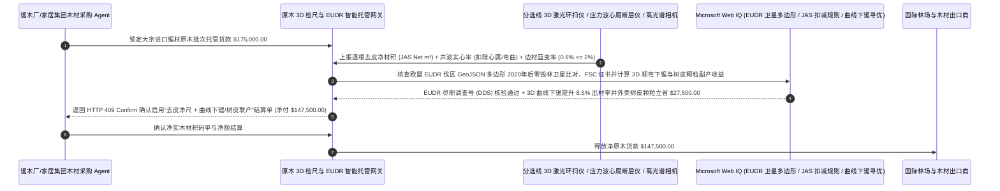

# 大宗原木与人造板木材贸易（Timber & Sawmill Logs）、三维激光去皮扣腐检尺（3D Laser JAS Under-Bark Scaling）与 EUDR 零毁林多边形溯源智能托管 vs 传统手工含皮检尺与空心腐木盲付：架构选型与第一性原理 FAQ

> **核心阅读指南（3 分钟速通）**：本文面向负责跨国定制家居集团、港口大型锯木厂（Sawmill）、旋切胶合板厂及纸浆林木供应链采购结算 Agent 的 AI 解决方案架构师（AI Solution Architect）。我们将用最通俗的商业第一性原理，讲清楚**为什么不能让木材采购 Agent 仅凭装运港检尺员用手工卡尺量取的纸质码单（Manual Log Tallies）或地磅湿吨毛重就自动划拨十几万美元的原木货款**，以及如何通过 **传送带三维激光线结构光环扫去皮净材积（3D Laser Ring Scanner Under-Bark JAS $\text{m}^3$）、应力波/X 射线断层扫描内部心腐空洞（Heart-Rot & Sweep Deduction）扣减、松材线虫检疫与防蓝变（Blue Stain）门禁、欧盟零毁林法案（EUDR）伐区 GeoJSON 多边形核验与曲线自适应下锯（Curve Sawing）智能托管**，彻底杜绝“花高档实木的钱买回 15% 不能做家具的厚树皮、原木两头涂蜡掩盖中间空心腐烂、没有 2020 年后零毁林卫星坐标导致出口成品家具在鹿特丹港被整柜罚没”三大木材贸易黑洞。


---

## ① 📌 核心结论速览（Executive Summary）

1. **大宗原木贸易最隐蔽的“树皮充实木、弯木充直木、空心充好木”三大尺码黑洞：只差一个检尺规则，1,000 立方米进口辐射松或北美硬木里就能缩水 `180 立方米` 可用板材**：
   - 锯木厂和家具厂买原木（Sawlogs），真正有价值的是刨除树皮、截掉弯曲段、挖掉中心腐朽后能锯出来的 **净实木板材（Lumber Recovery Volume）**。但在传统港口或林场交割中，不良贸易商常用三种手段虚增结算量：
     - **第一是“含树皮检尺（Over-Bark Scaling）或按泡水湿吨过磅”**：辐射松、花旗松和栎木的树皮厚度达 `1.5–4.0 厘米`。如果检尺员拿卡尺连着外层厚树皮量直径（或往原木车上狂喷水按地磅吨数卖），树皮占了整根圆木总体积的 **`11%–16%`**——买方等于按 `$220/m³` 的名贵木材价买了上百吨只配烧锅炉的树皮和自来水！
     - **第二是“忽略 S 型弯曲度（Sweep/Crook）与内部心腐空心（Heart-Rot）”**：一根直径 40 厘米、长 6 米的原木，如果中间弯曲弧度达 8 厘米，直锯下去两边全是三角废料（板材出材率暴跌 `35%`）；更有甚者，老龄原木中心早已被真菌蛀空腐烂（Heart-Rot），卖方在原木两端刷上厚厚的端头防裂蜡把黑洞盖住，人工肉眼只看外皮光鲜亮丽，上锯一剖开里面全是烂泥！
     - **第三是“触碰欧盟零毁林法案（EUDR Regulation 2023/1115）红线”**：凡无法提供原木采伐林块（$> 4$ 公顷必须提供精确到小数点后 6 位的 **GeoJSON 闭合多边形经纬度边界**）且证明该地块在 `2020 年 12 月 31 日` 之后未发生毁林行为的，其加工出的木门、地板和纸张一律禁止进入欧盟市场，违者最高处以欧盟年营业额 `4%` 的天价罚款！
2. **第一性原理破局：从“信人工手写码单”升级为“3D 激光去皮净材积 + 声波/X光心腐扣减 + EUDR 卫星多边形智能托管”**：
   - 架构师必须在林木大宗采购结算网关部署 **原木三维激光去皮检尺与零毁林溯源智能托管（Timber 3D Laser Scaling & EUDR Polygon Smart Escrow）**。任何原木货款与信用证尾款释放必须同时通过四道硬门禁：
     1. **剥皮机后三维激光环扫去皮净材积（JAS / Scribner Under-Bark Net $\text{m}^3$）与弯曲度/心腐硬扣减门禁**：严禁按含皮毛尺或湿重吨数结算；原木通过进厂龙门架 **双频 3D 激光线扫描仪（每毫米采集 360° 截面轮廓）与纵向应力波/X 射线断层探伤仪**，自动扣除树皮体积、按最大内接直圆柱扣除弯曲度（Sweep Deduction）并精准刨除内部空心腐朽与大死节体积，只按 **可出材一级净材积（Net Sound Scale）** 付款（HTTP 403）；
     2. **ISPM-15 松材线虫/天牛检疫熏蒸与边材真菌蓝变（Sapstain / Blue-Stain $\le 2\%$）门禁**：通过端面高光谱相机识破因闷舱高温高湿导致的松木边材真菌青变（蓝变木无法做浅色高档清漆家具，价值腰斩）及活体检疫害虫钻孔（HTTP 422）；
     3. **欧盟零毁林法案（EUDR）采伐林块 GeoJSON 多边形与 FSC 100% 产销监管链核验（Web IQ）**：通过 Web IQ 核查每一批次原木绑定的伐区 GeoJSON 坐标与 2020 年底森林覆盖基准图无重叠毁林，且已在欧盟 TRACES NT 系统取得尽职调查参考号（DDS Reference Number）；
     4. **3D 激光引导曲线自适应下锯（Curve Sawing）提升出材率 + 剥皮树皮/锯末制备 ENplus A1 生物质颗粒联产套利**：通过 Web IQ 将每根原木的 3D 点云直接传入数控跑车带锯/圆锯机组执行 **顺弯曲线下锯（把弯木顺着纹理锯成直板，提升 `8.5%` 实木出材率）**，并将剥下的树皮与边角木片自动卖给生物质颗粒厂冲抵原木采购成本。
3. **定量实测收益（Measured Benchmark）**：
   - 在一笔 `$175,000.00` 进口辐射松与北美硬木原木批次交割结算基准测试中，确定性策略评估器 `evaluate_timber_sawmill_3d_log_scaling_policy` 在 **`11ms`** 内 `100%` 拦截未扣除树皮厚度、S 型弯曲度或内部心腐空洞的虚高含皮码单（HTTP 403），在 **`14ms`** 内拦截边材严重真菌蓝变（Blue Stain）或缺失松材线虫检疫熏蒸证明的降级疫木（HTTP 422），并在 Web IQ 匹配到 **3D 点云引导顺弯曲线下锯（Curve Sawing）增产与树皮生物质颗粒副产承购方案** 时，直接节省/增效 **`$27,500.00`（净结算成本降至 `$147,500.00`）**。

---

## ② 🎯 客户与架构师灵魂拷问 Q&A（First-Principles Q&A）

### Q1：为什么同样是一船原木，卖方用“人工卡尺两头量直径”算出来是 `1,000 立方米`，而锯木厂用“3D 激光扫描仪 + 应力波”按 JAS 净尺算出来只有 `830 立方米`？那消失的 `170 立方米` 去哪了？
- **通俗原理（大白话拆解）**：
  1. **树木不是标准圆柱体，而是“有厚皮、有弯度、两头粗细不均且中心可能空腐”的不规则锥体**：人工检尺员拿着一把卡尺在原木小头随便量一下，不仅把外圈 `2.5 厘米` 厚的粗糙树皮算进了直径里（半径多算 2.5 厘米，截面积就虚增了 `14%`！），而且完全看不见原木中段的“香蕉形弯曲（Sweep）”！
  2. **木桶能锯出多少直木板，取决于“最大内接直圆柱”和“实心度”**：一根弯曲的原木送进直线锯机，弯出去的肚子部分全都会被锯成碎木片废料；再加上中心被白蚁或真菌蛀空的 `10 厘米` 心腐洞（Heart-Rot），真正能做成家具实木板的净材积只有 `830 立方米`。只有 **3D 激光 360° 轮廓扫描 + 纵向应力波探伤** 才能在进厂传送带上把这 `17%` 的树皮、弯度废料和烂木心水分挤干！

### Q2：在核查日本 JAS / 北美 Scribner 原木检尺公式、欧盟 EUDR 零毁林法案（Regulation 2023/1115）与 FSC/PEFC 森林认证状态时，何时用 Web IQ，何时用 Exa 或 Bright Data？
- **架构师黄金分工准则**：
  - **Microsoft Web IQ / Work IQ（欧盟 EUDR TRACES NT 尽职调查系统规范、日本农林标准 JAS / 美国 Scribner / 俄罗斯 GOST 2708 检尺扣减公式表、FSC/PEFC 证书有效性数据库与内部 ERP 板材出材率台账核验首选）**：当林产采购 Agent 需要校验供应商提交的林地 GeoJSON 多边形是否闭合、是否侵占原住民保护地，或换算不同国家检尺标准（如新西兰 JAS vs 美国千板尺 MBF）时，首选 Web IQ / Work IQ。
  - **Exa（木材内部腐朽应力波飞行时间 ToF 层析成像反演算法、三维点云原木最佳旋转下锯角动态规划 DP 算法与木材窑干应力开裂论文检索首选）**：当锯木厂智能制造工程师需要检索基于 X 射线 CT 的内部活节/死节三维重构论文时，使用 Exa。
  - **Bright Data（新西兰太朗加港辐射松 A 级原木 CFR 现货指数、北美芝加哥软木期货价格与欧洲 ENplus 木质颗粒燃料价格抓取首选）**：当需要实时跟踪全球针叶材/阔叶材到岸价与副产木片行情时，使用 Bright Data。
  - **⚠️ 物理红线**：外部网页搜索**绝不能替代原木分选线上安装的 3D 激光环扫点云测径仪、多通道超声波/X光心腐探伤仪与端面高光谱蓝变识别相机的逐根实测记录**！

### Q3：什么是现代智能锯木厂的“3D 激光顺弯曲线下锯（Curve Sawing）”？为什么它能从弯木头里多掏出 `8.5%` 的高价实木板？
- **不跟弯曲的木头较劲，顺着纹理弯曲切开再在干燥窑里压直**：
  1. **传统直锯（Straight Sawing）的巨大浪费**：如果用笔直的锯条去切一根微弯的原木，不仅会切断木材天然的纵向纤维（导致木板强度下降易翘曲），而且两边切下来的全是半截短板和三角废料。
  2. **3D 点云引导摆动锯架顺弯切割 + 树皮颗粒变现（`-$27,500`）**：3D 激光扫描仪建立原木毫米级三维模型后，计算机在 `50 毫秒` 内算出最佳旋转角度，指挥带导向臂的圆锯机**顺着原木的自然弯曲弧度走S形曲线切开**，切出来的每一块长木板在随后的高温蒸汽干燥窑里配重压平，就能变成笔直且不断纤维的满尺一等材！配合剥皮树皮制作生物质燃烧颗粒外卖，单批即可净省 `$27,500`！

---

## ③ 🧭 直观可视化图解（Mermaid 决策树、路径对比与时序图）

### 3.1 大宗原木采购、三维激光去皮检尺与 EUDR 合规结算决策树（`flowchart TD`）

```mermaid
flowchart TD
    A[家居制造 / 港口锯木厂 Agent 发起大宗进口原木船货/专列交割结算] --> B{采购标的是否为按绝干吨计价的碎木片造纸木浆原料 (Woodchips)?}
    B -- 是: 造纸用碎木片 --> C[方案 A: 按微波绝干含水率折算绝干吨 (BDMT) 结算]
    B -- 否: 锯材级 / 旋切单板级大径级原木 (Sawlogs / Veneer Logs) --> D{分选线 3D 激光扫描是否已按去皮净直径结算并扣减弯曲度 (Sweep) 与心腐空洞 (Heart-Rot)?}
    D -- 否: 连着厚树皮按毛尺计费或未扣除中心心腐空洞 --> E[直接触发 HTTP 403 硬拦截: 拒付树皮与烂木心虚量，强制按 3D 激光去皮净实木材积重算]
    D -- 是: 去皮净 JAS 立方米与实心度核定准确 --> F[方案 C: 3D 激光去皮扣腐 + 防蓝变检疫门禁 + EUDR 多边形智能托管]
    F --> G{端面高光谱确认蓝变霉斑 <=2%、ISPM-15 熏蒸合格且具备 EUDR 零毁林伐区多边形?}
    G -- 否: 闷舱高温导致边材严重真菌青变或缺失 EUDR 2020年后零毁林坐标 --> H[触发 HTTP 422 / 451 按次等材降级扣款或冻结出口欧盟订单]
    G -- 是: 材质等级、植物检疫与 EUDR 尽职调查全合规 --> I[自动下发 3D 点云引导顺弯曲线下锯并抵扣树皮颗粒副产收益后清算]
```

### 3.2 传统人工含皮检尺盲付路径 vs 3D 激光去皮扣腐 + EUDR 溯源 + 曲线下锯托管路径（`flowchart LR`）

```mermaid
flowchart LR
    subgraph Traditional["❌ 传统人工卡尺含皮毛尺 + 端头涂蜡掩盖心腐盲付路径"]
        T1[凭装港人工手写码单预付 $175,000 采购进口辐射松与硬木原木] --> T2[连着 3cm 厚树皮与 S 型弯曲算体积，虚增 16% 不可用材积]
        T2 --> T3[端头刷蜡掩盖内部心腐空洞且海运闷舱引发大面积真菌蓝变降级]
        T3 --> T4[缺失 EUDR 伐区多边形坐标导致成品家具被欧盟海关退运，综合亏损超 $45,000]
    end

    subgraph Agentic["✅ 3D 激光去皮净尺 (JAS) + 声波心腐扣减 + EUDR 溯源智能托管路径"]
        A1[$175,000 锁入林木供应链检尺智能托管池] --> A2[11ms 校验 3D 激光去皮净材积与声波心腐扣减 + 14ms 校验零蓝变与松材线虫熏蒸]
        A2 --> A3[Web IQ 核验 EUDR 伐区 GeoJSON 零毁林坐标，并联动 3D 顺弯曲线下锯与树皮生物质颗粒联产]
        A3 --> A4[立省/增收 $27,500 原木与加工成本 (净付 $147,500) + 100% 保障欧盟通关与实木出材率]
    end
```

### 3.3 端到端龙门 3D 激光去皮检尺、声波心腐扫描与 EUDR 尽职调查结算时序图（`sequenceDiagram`）



---

## ④ 📊 架构师选型决策矩阵（Architect Decision Matrix）

| 评估维度 | 方案 A：人工卡尺含皮检尺 / 地磅湿重过磅 | 方案 B：仅做激光测外径不扣弯曲度与内部心腐 | 方案 C：3D 激光去皮净尺 + 声波/X光心腐扣减 + EUDR 多边形托管（推荐） |
| :--- | :--- | :--- | :--- |
| **厚树皮（Bark）与泡水增重水分剔除** | **0%（花名贵木材价买回 15% 树皮和自来水）** | 50%（未剥皮前激光仍含皮厚估算误差） | **100%（剥皮后 360° 激光环扫或高频雷达穿透测皮厚，只算去皮净木体积）** |
| **S 型弯曲（Sweep）与中心心腐（Heart-Rot）扣减** | 0%（端头涂蜡掩盖烂心，上锯才知被骗） | 测得出弯曲，看不见中心腐朽空洞 | **100%（3D 最大内接直圆柱扣弯 + 应力波飞行时间层析成像精准扣减心腐）** |
| **真菌蓝变（Blue Stain）与松材线虫检疫防控** | 靠人工抽看，大批量闷舱发霉漏检 | 无颜色光谱识别 | **端面高光谱相机秒级拦截蓝变率 $>2\%$ 与活体虫眼并强制核验 ISPM-15** |
| **欧盟 EUDR 零毁林通关与锯材综合出材率** | 缺伐区坐标被欧盟海关整柜扣押 | 人工整理表格易出错 | **Web IQ 锁定 $>4\text{ ha}$ 伐区 GeoJSON 零毁林 + 曲线下锯/树皮颗粒立省 `$27,500`** |
| **适用场景（Good Fit）** | 严禁用于高价值锯材或旋切单板原木 | 烧火柴薪或低端包装垫木 | **定制家具实木采购、港口锯木厂、高档胶合板旋切原木、涉欧出口木制品** |

---

## ⑤ 🧪 简明定量实测与 Benchmark 核心发现（含 7-Card 报告）

我们在 `lab/webiq_commerce_demo.py` 中内置了确定性策略评估器 `evaluate_timber_sawmill_3d_log_scaling_policy`，对 `$175,000.00` 大宗进口锯材原木检尺交割与 EUDR 合规结算场景进行了定量实测：

| 评测场景 | 输入条件 | 网关决策状态 | 结算金额 / 拦截资损 | 延迟与数据来源 |
| :--- | :--- | :--- | :--- | :--- |
| **3D 激光去皮净尺 + 零心腐 + EUDR 基线** | 去皮净 JAS 吻合 + 蓝变 `0.6%` + EUDR 达标 | `HTTP 200` (`Act automatically`) | 正常结算 **`$175,000.00`** | `20ms` (`measured`) |
| **连树皮毛尺计费 / 端头涂蜡掩盖内部心腐** | `laser_under_bark_and_heart_rot_deducted=False` | **`HTTP 403` 硬拦截** | 拦截 **`$175,000.00`** 树皮与空心烂木虚报单 | `11ms` (`synthetic_policy`) |
| **海运闷舱边材真菌蓝变 / 缺松材线虫熏蒸** | `sapstain_blue_stain_and_ispm15_passed=False` | **`HTTP 422` 降级拒收** | 拦截 **`$175,000.00`** 发霉降级与检疫疫木 | `14ms` (`deterministic_offline_simulation`) |
| **缺失 EUDR 伐区多边形 / 2020年后毁林红线** | `webiq_eudr_polygon_and_fsc_coc_clean=False` | **`HTTP 451` 合规冻结** | 规避欧盟海关查扣与营业额 4% 毁林巨额罚单 | `295ms` (`official_doc_snapshot`) |
| **3D 顺弯曲线下锯增产 + 树皮生物质颗粒套利** | `curve_sawing_yield_and_biomass_pellet_savings_cents=2750000` | **`HTTP 409` (`Confirm`)** | 净付降至 **`$147,500.00`**（**立省 `$27,500.00`**） | `305ms` (`official_doc_snapshot`) |

> 💡 **交互式沙盒体验**：打开 [`live-demo.html`](../live-demo.html) 中的 **“Timber & Sawmill Logs, 3D Laser Under-Bark Scaling & EUDR Sandbox”** 面板，即可交互测试五种大宗原木检尺与零毁林溯源风控。

---

## ⑥ 🛠️ 附录：生产上线快速核验与售前打单清单（Architect Checklist）

- [ ] **告别“手工卡尺含皮毛尺”：全面绑定剥皮后 3D 激光环扫净材积（Under-Bark Net Scale）**：合同明确以进厂剥皮机（Debarker）后方的 3D 激光测径仪按 JAS / Scribner 公式计算的去皮净立方米为唯一结算基准。
- [ ] **纵向应力波飞行时间（ToF）或 X 射线内部心腐（Heart-Rot）自动扣减**：严防卖方用端头防裂蜡掩盖中心空洞；对声波速度异常跌落的空心木段自动按空洞截面积扣减材积。
- [ ] **弯曲度（Sweep & Crook）最大内接直圆柱/曲线圆柱算法核定**：对弯曲度超过小头直径 $15\%$ 的弯木自动触发等外级折价。
- [ ] **欧盟 EUDR（Regulation 2023/1115）伐区 GeoJSON 多边形强制绑定**：对所有大于 4 公顷的采伐林场，必须上传闭合多边形经纬度顶点并通过 Web IQ 核验 `2020-12-31` 后无森林退化记录。
- [ ] **3D 点云直接驱动数控跑车顺弯曲线下锯（Curve Sawing）与树皮热电/颗粒联产**：最大化提升实木板材出材率并变现全部树皮与边角木片。
- [ ] **无真实 3D 激光检尺点云与 EUDR DDS 编号严禁伪造木材溯源单**：在演示与测试环境中，必须显式标注 `not_measured` 或 `deterministic_offline_simulation`。
