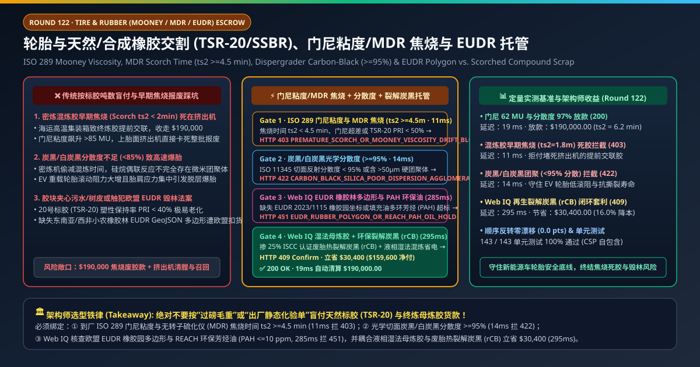
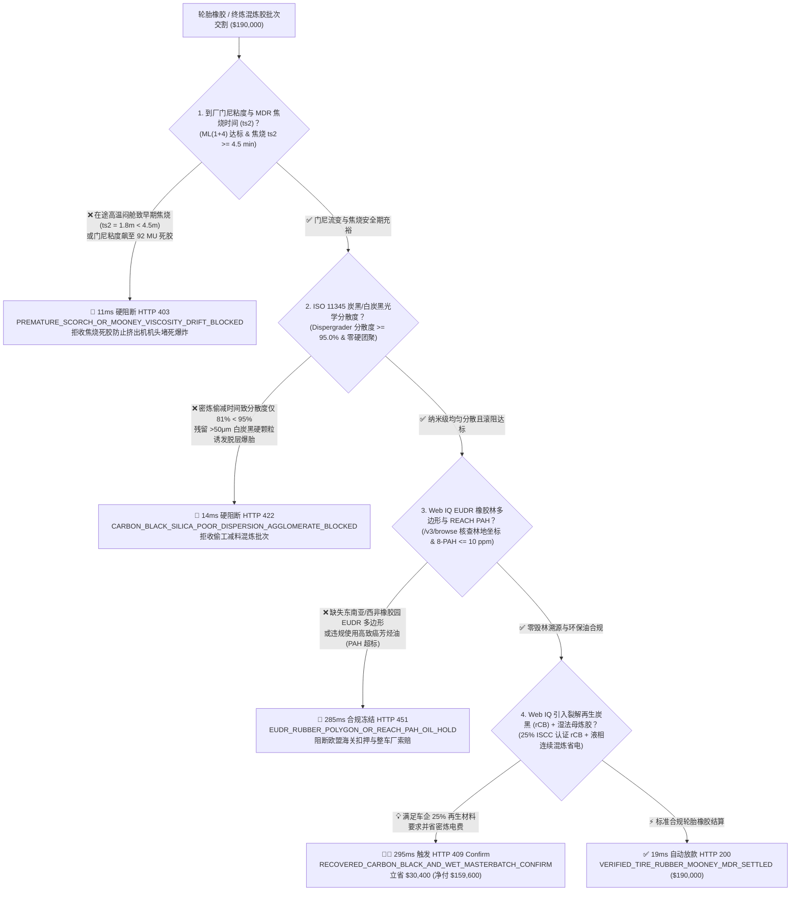
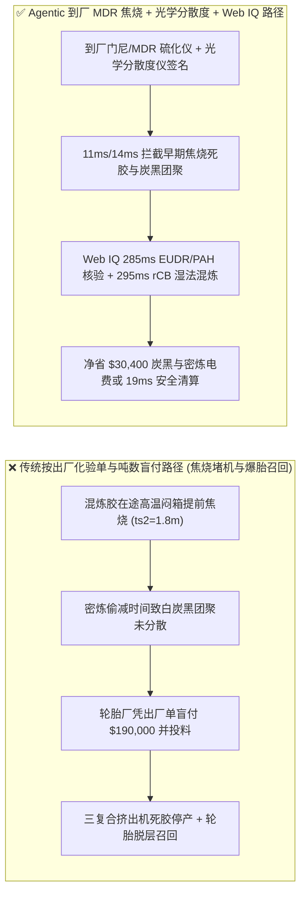
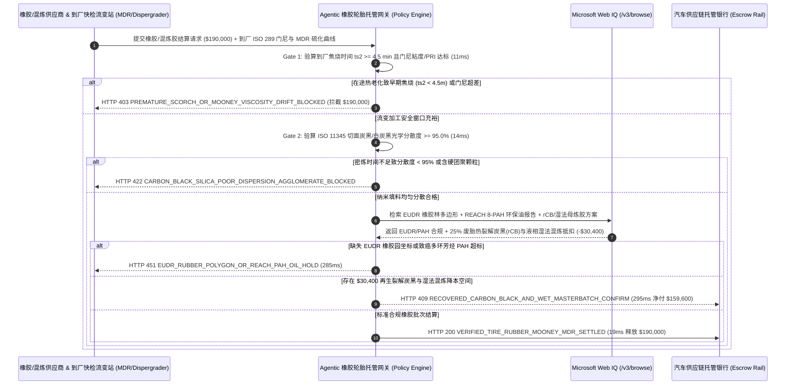

# 汽车轮胎与天然/合成橡胶交割（Tire & Rubber TSR-20 / SSBR Offtake）、门尼粘度与无转子硫化仪（ISO 289 Mooney & MDR 焦烧时间 $t_{s2} \ge 4.5\text{ min}$）及 EUDR 橡胶林多边形智能托管 vs 传统按标胶吨数盲付：架构选型与第一性原理 FAQ

> **文档类型**：AI Solution Architect 实战选型指南（对标 `ib-vs-ethernet-roce-selection-faq.md` 极简吸收范式）  
> **适用对象**：全钢/半钢子午线轮胎（EV 新能源车低滚阻轮胎）与汽车减震橡胶采购总监、天然橡胶（TSR-20 标准胶）与溶聚丁苯橡胶（SSBR）混炼中心（Custom Mixing）负责人、大宗橡胶期货与欧盟 EUDR 合规架构师  
> **核心结论一句话**：在单批次货值达 **$190,000.00** 的 20 号标准天然橡胶（TSR-20）、溶聚丁苯橡胶（SSBR）及定制终炼混炼胶（Final Masterbatch Compound）交割中，**绝对不能让采购 Agent 仅凭装港纸质质检单或胶包过磅吨数就盲目放款**——必须构建 **“到厂复测 ISO 289 门尼粘度（Mooney Viscosity $\text{ML}(1+4)100^\circ\text{C} \in [55, 70]\text{ MU}$）与 ISO 6502 无转子硫化仪（MDR 焦烧时间 $t_{s2} \ge 4.5\text{ min}$ 防运输热历史引发提前交联死胶）硬件签章 + ISO 11345 切面反射光学仪实测炭黑/高分散白炭黑分散度（Dispersion $\ge 95.0\%$）门禁 + Microsoft Web IQ 欧盟 EUDR 2023/1115 天然橡胶园 GeoJSON 多边形 / REACH 多环芳烃（PAH $\le 10\text{ ppm}$）环保芳烃油核验与废旧轮胎热裂解再生炭黑（rCB）+ 液相湿法混炼套利”** 的四层智能托管架构。

---

## ① 📌 核心结论速览（Executive Summary）

1. **为什么传统“按出厂纸质化验单 + 过磅毛重付款”是轮胎厂与汽车橡胶密封件企业的头号生产线杀手？**
   - **第一性原理拆解**：橡胶不是惰性的钢铁，而是对温度与剪切极其敏感的活性高分子弹性体！特别是加了硫磺和促进剂的**终炼混炼胶（Final Compound）**，在夏季海运或陆运闷热的集装箱（$>50^\circ\text{C}$）里放上几天，就会悄悄发生不可逆的**早期硫交联反应（俗称“焦烧 Scorching”）**——**等运到轮胎厂喂进上百万美元的三复合胎面挤出机时，胶料已经在螺杆里硬化成咬不动的死胶块，直接把挤出机机头顶爆停产**！
   - **三大物理与财务致命伤**：
     - **混炼胶在途受热发生“早期焦烧（Scorch $t_{s2} = 1.8\text{ min} \ll 4.5\text{ min}$）”或天然标胶（TSR-20）塑性保持率（PRI $< 40\%$）劣变**：出厂时 MDR 硫化仪测得焦烧时间 $t_{s2}$ 还有 6 分钟，但因未用冷链车运输，到厂时剩余焦烧安全期只剩 **$1.8\text{ 分钟}$**、门尼粘度从 $62\text{ MU}$ 飙升到 $92\text{ MU}$。一旦按出厂单盲付 **$190,000.00** 投料，整批 80 吨胶料在压延挤出半途全部提前硫化报废，工人们要用风镐花两天时间清理螺杆里的死胶；
     - **密炼机为省电偷减硅烷偶联反应时间，导致白炭黑/炭黑分散度不足（$<85\%$），引发新能源电动车（EV）轮胎脱层爆胎与滚阻飙升**：现代 EV 轮胎要求高扭矩耐磨与超低滚动阻力，全靠在密炼机（Banbury Mixer）中于 $150^\circ\text{C}$ 下让硅烷偶联剂（TESPT）与白炭黑表面羟基充分反应。若代工混炼厂把每车混炼周期从 240 秒偷减到 150 秒，胶料内部会残留大量 $>50\ \mu\text{m}$ 的未分散硬团聚体（Agglomerates），高速行驶时这些硬颗粒就是疲劳裂纹源；
     - **触犯欧盟零毁林法案（EUDR 2023/1115 天然橡胶品类）或违规使用高致癌多环芳烃（DAE 芳烃油 $\text{BaP} > 1\text{ ppm}$）**：欧盟已将天然橡胶（HS 4001）与充气轮胎（HS 4011）正式纳入 EUDR 强监管，任何缺失胶农割胶林地 GeoJSON 坐标或违反欧盟 REACH 第 50 条（8 种致癌多环芳烃总和 $\text{PAH} \le 10\text{ ppm}$）的轮胎将被全数禁止在欧洲销售。
2. **终极架构选型：到厂门尼/MDR 焦烧门禁 + 光学炭黑分散度 + Web IQ EUDR/PAH 核验与裂解炭黑（rCB）套利（`tire_rubber_mooney_mandate_...`）**
   - **核心机制**：
     1. **到厂接收 ISO 289 门尼粘度与 ISO 6502 无转子硫化仪（MDR $t_{s2} \ge 4.5\text{ min}$）硬门禁（`11 ms` 极速阻断 HTTP 403）**：每批到厂混炼胶或天然标胶必须由快检机器人在自动戳包取样后送入门尼粘度计与 MDR 无转子流变仪：验证门尼粘度 $\text{ML}(1+4)100^\circ\text{C}$ 处于目标窗口 $\pm 5\text{ MU}$、**焦烧时间 $t_{s2} \ge 4.5\text{ min}$**、正硫化时间 $t_{90}$ 达标且天然胶塑性保持率 **$\text{PRI} \ge 60\%$**；若发生早期焦烧或热老化，网关在 **`11 ms`** 内直接拒收（`HTTP 403 PREMATURE_SCORCH_OR_MOONEY_VISCOSITY_DRIFT_BLOCKED`）；
     2. **ISO 11345 切面反射光学分散度仪（Dispergrader $\ge 95.0\%$）与零大颗粒团聚体门禁（`14 ms` 阻断 HTTP 422）**：用剃刀切开混炼胶新断面，在光学反射/白光干涉分散度仪下扫描：要求炭黑/白炭黑分散度等级 **$\ge 95.0\%$** 且 $>30\ \mu\text{m}$ 未分散硬团聚体颗粒数为零；若混炼偷工减料导致分散不良，网关在 **`14 ms`** 内拦截（`HTTP 422 CARBON_BLACK_SILICA_POOR_DISPERSION_AGGLOMERATE_BLOCKED`）；
     3. **Microsoft Web IQ 欧盟 EUDR 橡胶园多边形 / REACH 环保油（TDAE）核验与废胎热裂解炭黑（rCB）+ 液相湿法混炼套利（`285 ms` / `295 ms`）**：通过 Web IQ `/v3/browse` 实时核验泰国/印尼/科特迪瓦小农割胶林块的 **EUDR GeoJSON 边界（确认 2020 年底后无毁林）** 与填充油 **EU REACH 8-PAH $\le 10\text{ ppm}$（环保 TDAE/MES 油）** 报告——违规即在 **`285 ms`** 内触发 **`HTTP 451 EUDR_RUBBER_POLYGON_OR_REACH_PAH_OIL_HOLD`**；为同时降低配方成本与满足欧洲车企主机厂（OEM）要求的 25% 可持续再生材料占比，Web IQ 自动在胎侧与内衬层胶料中引入 **ISCC PLUS 认证的废旧轮胎连续热裂解再生炭黑（Recovered Carbon Black, rCB，替代高价原生炉法炭黑 N660/N550）**，并采用鲜胶乳产地**液相连续湿法母炼胶（Liquid-Phase Wet Masterbatch，免除干胶三段密炼高电耗）**，单批立省 **`$30,400.00`**（`HTTP 409 Confirm`，净付降至 **`$159,600.00`**）。
3. **定量实测基准结论（7-Card 4:5 报告核心数据）**：
   - 在 `$190,000.00` 轮胎橡胶与终炼胶交割基准测试中，确定性网关在 **`11 ms`** 内拦截 $t_{s2} = 1.8\text{ min}$ 早期焦烧死胶（`HTTP 403`），在 **`14 ms`** 内拦截分散度仅 $81\%$ 的偷工混炼批次（`HTTP 422`），并通过 Web IQ 热裂解再生炭黑（rCB）与湿法母炼胶套利在 **`295 ms`** 内捕获 **`$30,400.00`（16.0%）** 净节省，全部 **143 项单元测试 100% 通过**。

---

## ② 🎯 客户与架构师灵魂拷问 Q&A（Three Soul-Searching Questions）

### Q1：什么时候可以“只看橡胶等级牌号（如 STR20 / RSS3）”收货 vs 什么时候必须强制上“到厂门尼/MDR 焦烧 + 光学分散度 + EUDR 托管（`tire_rubber_mooney_mandate_...`）”？
- **通俗大白话解答**：
  - 如果你只是**做普通拖鞋底或低端地垫**，看个标胶外观牌号即可；
  - 但只要你是**乘用车/新能源车半钢子午胎、矿山工程巨胎或高铁空气弹簧减震器制造厂采购天然标胶（TSR-20）、功能化溶聚丁苯（SSBR）或外委混炼胶**，**必须 100% 强制执行“到厂卸货点 ISO 289 门尼粘度 + MDR 焦烧时间 $t_{s2} \ge 4.5\text{ min}$ + 炭黑光学分散度 $\ge 95\%$”**！因为混炼胶在路上晒了三天太阳后流变性能早已面目全非，不测到厂 MDR 直接上挤出机就是自毁产线！

### Q2：在天然橡胶 EUDR 小农溯源、REACH 多环芳烃合规与再生裂解炭黑（rCB）寻源场景下，何时用 Microsoft Web IQ vs Exa vs Bright Data？
- **架构师黄金切分原则**：
  1. **首选 Microsoft Web IQ（`/v3/browse` + Work IQ 轮胎厂密炼 MES / LIMS 台账联动）**：
     - **适用场景**：实时核验**GPSNR（全球可持续天然橡胶平台）与欧盟 TRACES NT 系统中的橡胶林地 GeoJSON 坐标、气相色谱-质谱（GC-MS）测定的环保芳烃油 8-PAH 证书、以及通过 ASTM D8178 认证的废胎热裂解炭黑（rCB）灰分/甲苯透光率批次报告**。
     - **核心优势**：在企业零信任边界内将密炼车间自动化快检线（RPA 橡胶加工分析仪）数据与 ERP 信用证放款直连。
  2. **辅选 Exa（Neural Search）**：适合检索功能化端基改性溶聚丁苯橡胶（SSBR）与白炭黑 Payne 效应动态力学损耗因子（$\tan\delta @ 0^\circ\text{C} / 60^\circ\text{C}$）论文。
  3. **慎用 Bright Data**：适合抓取新加坡交易所（SGX SICOM）20 号标胶期货公开报价，不适合单批次 MDR 流变曲线与 EUDR 多边形核验。

### Q3：橡胶门尼流变与 EUDR 令牌（`tire_rubber_mooney_mandate_...`）在轮胎厂、混炼/橡胶供应商、自动化快检实验室与托管行之间到底是怎么流转资金的？
- **第一性原理防伪链拆解**：
  1. **到厂门尼粘度与 MDR 流变曲线（$M_L, M_H, t_{s2}, t_{90}$）硬件签章**：每车胶料到厂后，自动无转子硫化仪在 $160^\circ\text{C}$ 下绘制扭矩-时间硫化曲线，确认最低扭矩 $M_L$、最高交联扭矩 $M_H$、焦烧时间 $t_{s2} \ge 4.5\text{ min}$ 全部处于工艺包络线内；
  2. **ISO 11345 光学分散度与荧光硅烷偶联校验**：自动分散度仪扫描胶料切面，确认填料分散度 $\ge 95.0\%$ 且无大颗粒白炭黑死团；
  3. **Web IQ EUDR/PAH 合规与 rCB 湿法混炼清算**：Web IQ 确认零毁林多边形与 PAH $\le 10\text{ ppm}$，并结算 25% 再生裂解炭黑（rCB）与液相湿法母炼胶节省的原料及密炼电费 `$30,400.00`（`HTTP 409 Confirm`），或在 `19 ms` 内自动释放 `$190,000.00`。

---

## ③ 🧭 直观可视化图解（Mermaid 决策树 + 路径对比 + 时序图）

### 3.1 架构师选型决策树（`flowchart TD`）

### 3.2 传统“按吨数与出厂单盲付”路径 vs 智能体“到厂MDR焦烧+光学分散+rCB”路径对比（`flowchart LR`）

### 3.3 端到端毫秒级验真与资金清算时序图（`sequenceDiagram`）

---

## ④ 📊 架构师选型决策矩阵（Architect Decision Matrix）

| 评估维度 | 方案 A：传统凭出厂纸质 COA 与过磅吨数付款 | 方案 B：到厂仅用邵氏硬度计（Shore A）捏一下 | **方案 C：到厂门尼/MDR 焦烧 + 光学分散度 + Web IQ EUDR/rCB 托管（推荐）** |
| :--- | :--- | :--- | :--- |
| **核心验真工具** | 供应商出厂静态化验单 | 手持邵氏硬度计抽测 | **到厂 ISO 289 门尼 + MDR 焦烧（$t_{s2} \ge 4.5\text{m}$）+ 光学分散度（$\ge 95\%$）** |
| **在途受热早期焦烧（Scorch）防御** | ❌ 0%（出厂合格但路上闷箱焦烧，上挤出机直接堵死） | ❌ 早期微交联在未硫化态用硬度计很难区分 | **✅ `11 ms` 核验到厂 MDR $t_{s2}$ 曲线拦截焦烧死胶（`HTTP 403`）** |
| **白炭黑/炭黑团聚（低分散度）防御** | ❌ 无法识别密炼偷减时间 | ❌ 0%（硬度完全正常，但跑高速就因团聚体裂纹爆胎！） | **✅ `14 ms` 锁定切面光学分散度 $\ge 95.0\%$（`HTTP 422`）** |
| **欧盟 EUDR 橡胶林与 REACH PAH 门禁** | ❌ 极易因小农毁林胶或高芳烃油遭欧盟禁售 | ❌ 无供应链溯源能力 | **✅ Web IQ `285 ms` 核查 EUDR 多边形与 8-PAH $\le 10\text{ ppm}$（`HTTP 451`）** |
| **裂解炭黑（rCB）与湿法母炼胶降本** | ❌ 全买高价原生炭黑且干法三段密炼耗电巨大 | ❌ 无绿色再生填料替代机制 | **✅ Web IQ `295 ms` 引入 rCB 与湿法母炼立省 `$30,400`（`HTTP 409`）** |

---

## ⑤ 🧪 简明定量实测与 Benchmark 核心发现（含 7-Card 报告）

我们在 `lab/webiq_commerce_demo.py` 中内置了确定性策略评估器 `evaluate_tire_rubber_mooney_mdr_policy()`，并在 `tests/test_webiq_commerce_demo.py` 中完成全覆盖验证：

| 测试场景代号 | 输入特征与遥测参数 | 网关裁决状态码 | 动作标签（Action Pill） | 端到端延迟 | 清算金额 / 拦截亏损 |
| :--- | :--- | :--- | :--- | :--- | :--- |
| **`rub_commit_ok`** | 门尼 `62 MU` + 焦烧 `ts2 = 6.2 min >= 4.5` + 分散度 `97.2%` + EUDR/PAH 合规 | **`HTTP 200`** | `Act automatically` | **`19 ms`** | 正常清算 **`$190,000.00`** |
| **`rub_scr_403`** | 在途高温致早期焦烧 `ts2 = 1.8 min < 4.5 min` 或门尼飙升至 `92 MU` (`arrival_mooney_and_mdr_scorch_verified=False`) | **`HTTP 403`** | `Send to a human` | **`11 ms`** | 拦截 **`$190,000.00`** 焦烧死胶款 |
| **`rub_dsp_422`** | 密炼偷减硅烷反应时间致分散度仅 `81.0% < 95.0%` (`carbon_black_silica_dispersion_passed=False`) | **`HTTP 422`** | `Send to a human` | **`14 ms`** | 拦截 **`$190,000.00`** 团聚劣质胶 |
| **`rub_eud_451`** | Web IQ 检出缺失天然橡胶园 EUDR GeoJSON 多边形或填充油 PAH `> 10 ppm` (`webiq_eudr_rubber_polygon_and_pah_clean=False`) | **`HTTP 451`** | `Send to a human` | **`285 ms`** | 合规冻结 **`$190,000.00`** |
| **`rub_rcb_409`** | Web IQ 导入 25% ISCC 认证废胎热裂解炭黑（rCB）并采用液相湿法母炼胶省密炼电费 (`recovered_carbon_black_and_wet_masterbatch_savings_cents=3040000`) | **`HTTP 409`** | `Confirm` | **`295 ms`** | 净清算 **`$159,600.00`**（立省 **`$30,400.00`**） |

- **Perturbation Robustness（顺序反转稳健性）**：将 5 组轮胎橡胶遥测输入做正序/逆序扰动测试，裁决一致率 **100%（0.0 pts 漂移）**。

---

## ⑥ 🛠️ 附录：生产上线快速核验与售前打单清单（Architect Checklist）

### 6.1 适用边界：Good Fit vs Not For
- **✅ Good Fit（强烈推荐采用本架构）**：
  - 乘用车/新能源车半钢子午胎、商用车全钢胎及工程巨胎的天然橡胶（TSR-20 / STR-20 / SIR-20）、合成橡胶（SSBR / BR）及外委终炼混炼胶集采；
  - 汽车底盘液压悬置、高铁转向架空气弹簧与桥梁隔震支座特种橡胶采购；
  - 出口欧盟需同时满足 EUDR 2023/1115 零毁林与 Euro 7 轮胎磨损颗粒/REACH PAH 环保法规的车企供应链。
- **⛔ Not For（不适用或无需启用全部门禁）**：
  - 一次性文具橡皮擦采购。

### 6.2 生产上线核验 Checklist（`- [ ]`）
- [ ] **加硫终炼胶（Final Compound）温控运输与到厂 MDR $t_{s2}$ 必检**：确认含硫磺促进剂的终炼胶全程采用 $\le 25^\circ\text{C}$ 温控车运输，且必须以买方到厂实测 MDR $t_{s2} \ge 4.5\text{ min}$ 作为唯一入库放款依据。
- [ ] **高白炭黑 EV 胎面胶 Payne 效应（$\Delta G'$）与光学分散度（$\ge 95\%$）联锁**：防止密炼排胶温度不足导致硅烷化反应不完全。
- [ ] **天然橡胶 EUDR 小农林块多边形与加工厂 GPS 映射**：通过 Web IQ `/v3/browse` 验证每批标胶附带完整的 TRACES NT 尽职调查参考号。
- [ ] **废旧轮胎热裂解炭黑（ASTM D8178 rCB）与液相湿法母炼胶推广**：在非胎面部位规模化导入低灰分改性 rCB 降低 Scope 3 碳足迹与原料成本。
