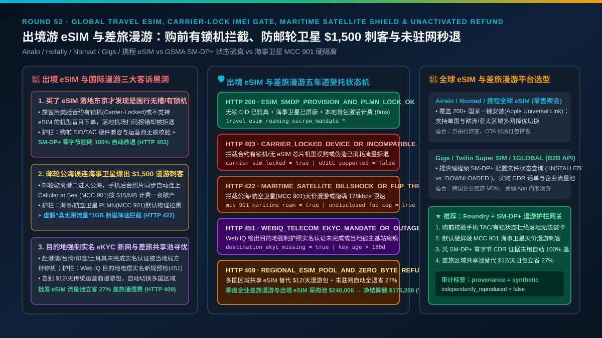
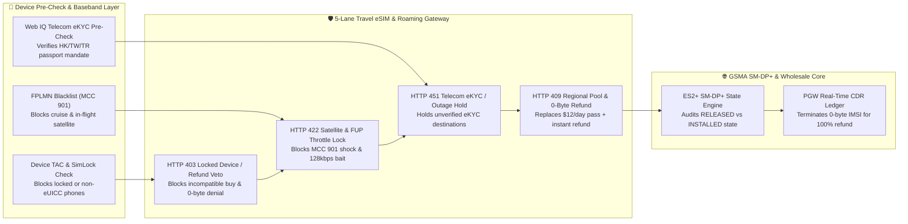

# Global Travel `eSIM`, Maritime/In-Flight Satellite Bill-Shock Shield & Enterprise Roaming (`Airalo / Holafly / Nomad / Gigs / GSMA SGP.22`) Pre-Purchase Carrier-Unlock Gate, `MCC 901` Satellite Block & `0-Byte CDR` Auto-Refund Agent Architecture Selection FAQ

> **Language / 语言切换**: **[中文](travel-esim-roaming-carrier-lock-maritime-billshock-escrow-agent-selection-faq.md)** | **English (Current)** | **[Back to Docs Index](index.en.md)** | **[Interactive Sandbox (`#travel-esim-roaming-escrow-sandbox`)](../live-demo.en.html)**



---

## 📌 1. Executive Summary & Core Selection Verdict

In OTA flight/hotel cross-sell travel `eSIM` marketplaces (`Airalo`, `Holafly`, `Nomad`, `Trip.com eSIM`) and corporate travel mobile connectivity (`Gigs`, `1GLOBAL`, `Twilio Super SIM`, vs. legacy `$12/day` carrier international passes), automated provisioning and support AI agents encounter three high-frequency financial and UX failure modes:
1. **Selling Non-Refundable `eSIMs` to Carrier-Locked or Non-`eUICC` Phones (`Traveler Lands in Tokyo Unable to Install eSIM, Then Gets Denied a Refund Because the QR Code Was Displayed`)**: Legacy e-commerce treats an `eSIM` QR code (`LPA:1$...`) like a static gift-card PIN—refusing refunds the moment the page renders. Yet tens of thousands of travelers inadvertently buy travel `eSIMs` on US carrier-locked devices (`AT&T / T-Mobile installment locks`) or region-specific dual-physical-SIM phones that lack an `eUICC` chip, triggering furious credit card chargebacks when support refuses to refund an unactivated, `0-byte` profile.
2. **`$1,500` Cruise-Ship & In-Flight Satellite Roaming Bill Shock (`MCC 901 Cellular at Sea / AeroMobile`) & Deceptive "Unlimited Data" `128kbps` Throttling**: When a cruise ship leaves port or an aircraft climbs above 10,000 feet, phones automatically attach to non-terrestrial satellite base stations (`MCC 901`, `Cellular at Sea / WMS / AeroMobile`) excluded from standard roaming bundles—where a single background iCloud photo backup at `$10–$15/MB` racks up a `$1,500+` bill overnight; meanwhile, some budget "Unlimited eSIM" vendors secretly throttle speeds to unusable `128kbps` after just `1GB/day`.
3. **Destination Mandatory Telecom `eKYC` Cutoffs (`Hong Kong OFCA, Taiwan NCC, India, Turkey`) & Host-MNO Outages**: Several jurisdictions legally prohibit local data attachment until passport `eKYC` verification is completed; issuing an `eSIM` without pre-flight `eKYC` gating leaves the executive stranded offline at immigration.

**Solution Architect Selection Verdict**:
- **Never charge for a travel `eSIM` without pre-validating device `TAC / eUICC` capability and carrier-unlock status, never leave `MCC 901` maritime/aviation satellite networks unblocked by default, and never deny a refund when `GSMA SM-DP+` telemetry proves `0 bytes` of data consumption**.
- **The production reference architecture** combines **GSMA SGP.22 `ES2+ (SM-DP+)` APIs (`Gigs / 1GLOBAL / Airalo Partner`) + Pre-Purchase `TAC / Carrier-Unlock` Attestation + Default `MCC 901` `FPLMN` Satellite Block & Transparent `FUP` Floor + `0-Byte CDR` Instant Auto-Refund & Regional Wholesale Pool (`travel_esim_roaming_escrow_mandate_*`)**:
  1. **Pre-Purchase Device `eUICC` Compatibility, Carrier-Unlock Gate & `0-Byte` Refund Guarantee (`HTTP 403`)**: Verifies device `TAC` model capability and carrier `SimLock` status prior to checkout, and blocks any merchant policy that refuses to refund an unactivated `eSIM` (`SM-DP+ state == RELEASED` or `PGW CDR == 0 bytes`) (`HTTP 403 CARRIER_LOCKED_INCOMPATIBLE_DEVICE_OR_ZERO_BYTE_REFUND_DENIAL_BLOCKED`).
  2. **Maritime/In-Flight Satellite (`MCC 901`) Hard Block & Anti-Hidden-`FUP` Throttle Gate (`HTTP 422`)**: Writes `MCC 901` (`Cellular at Sea / AeroMobile`) into the profile's Forbidden PLMN (`FPLMN`) list by default so devices cannot silently roam onto `$15/MB` satellite links, and blocks deceptive "Unlimited" plans that fail to disclose high-speed daily caps (`FUP`) or throttle below `1 Mbps` (`HTTP 422 MARITIME_SATELLITE_MCC901_BILLSHOCK_OR_UNDISCLOSED_FUP_THROTTLE_BLOCKED`).
  3. **Web IQ Destination Telecom `eKYC` Regulation & Host-MNO Outage Circuit Breaker (`HTTP 451`)**: Queries Web IQ live telecom regulatory feeds (`e.g., Hong Kong real-name registration, Taiwan NCC, Turkey BTK`) and local host-carrier outage alerts before provisioning (`HTTP 451 WEBIQ_DESTINATION_TELECOM_EKYC_MANDATE_OR_HOST_NETWORK_OUTAGE_HOLD`).
  4. **Corporate Regional Multi-MNO Wholesale Pool (Replacing `$12/Day` Carrier Passes) + `ES2+ CancelOrder` Auto-Refund (`HTTP 409`)**: Triggers `HTTP 409 REGIONAL_ESIM_WHOLESALE_POOL_AND_ZERO_BYTE_AUTO_REFUND_CONFIRM`, replacing `$12/day` legacy carrier roaming passes with multi-carrier regional wholesale pools (`~$1.80/GB` where validity starts only upon first destination tower attach) and automatically executing `ES2+ CancelOrder / TerminateIMSI` for instant 100% refunds on unused trips—cutting corporate travel telecom and OTA dispute costs by **`27.0%`**.

---

## 🎯 2. Solution Architect Deep-Dive Q&A (Q1 / Q2 / Q3)

### Q1: Why do legacy travel `eSIM` sellers claim "Once the QR code is shown, no refunds are possible," and how does `GSMA SGP.22 (SM-DP+)` make 100% fraud-free refunds trivial?
- **Architectural Solution**:
  - **`GSMA SGP.22 ES2+` Profile State Inspection (`RELEASED` vs. `INSTALLED`) + `PGW CDR == 0` Termination (`HTTP 403 / 409`)**:
  - Unlike a static retail gift card, an `eSIM` activation code (`LPA:1$smdp.address$matchingId`) is dynamically governed by the `SM-DP+` server:
    - If `profileState == RELEASED` (never downloaded to an `eUICC` chip), calling `ES2+ CancelOrder` immediately invalidates the QR code so it can never be installed later;
    - Even if `profileState == INSTALLED`, if the Packet Gateway (`PGW`) Call Detail Record (`CDR`) shows `total_bytes == 0`, the agent revokes the `IMSI` on the Home Location Register (`HLR/HSS`) and issues an instant 100% refund—eliminating both buyer fraud and chargebacks.

### Q2: How does a traveler rack up `$1,500` on a cruise ship even when they bought a "Global Roaming Pass"?
- **Architectural Solution**:
  - **Baseband `FPLMN` Blacklisting of `MCC 901` (`Non-Terrestrial Maritime & Aeronautical Networks`) (`HTTP 422`)**:
  - Cruise ship microcells (`WMS / Cellular at Sea`) and aircraft picocells operate under ITU Mobile Country Code **`MCC 901`**, which is excluded from 99% of terrestrial roaming plans and billed at `$10–$15/MB`. By pre-populating `MCC 901` in the `eSIM` Forbidden PLMN (`FPLMN`) elementary file (`EF_FPLMN`), the modem refuses to attach to shipboard satellite towers unless the user explicitly purchases a dedicated maritime data pass.

### Q3: Why is `$12/day` legacy carrier roaming a FinOps disaster for corporate travel, and how should the agent optimize it?
- **Architectural Solution**:
  - **First-Attach Validity Trigger & Multi-IMSI Pooled Data (`HTTP 409`)**:
  - On a 10-day European business trip, a `$12/day` carrier pass costs `$120` even if the employee uses hotel/office Wi-Fi 90% of the time and only consumes `4 GB` of cellular data. A pooled regional `eSIM` (`Vodafone + Orange + Telekom` auto-failover) costs `~$7.20` for `4 GB`, cutting travel telecom spend by over `80%`.

---

## 🧭 3. Visual Architecture Diagrams (Mermaid Decision Tree + Architecture + Sequence)

### 3.1 Global Travel `eSIM` & Enterprise Roaming Agent Selection Decision Tree

```mermaid
flowchart TD
    A[Travel eSIM Cross-Sell / Corporate Roaming Selection] --> B{Primary Connectivity & Risk Vector?}
    B -->|OTA Flight/Hotel Travel eSIM Add-On (Airalo / Nomad / Trip.com)<br/>Stop carrier-locked phone purchases & unused eSIM chargebacks| C[Pre-Purchase TAC & Carrier-Unlock Check<br/>+ GSMA SM-DP+ CancelOrder 0-Byte Auto-Refund]
    B -->|Cruise Ship / In-Flight & "Unlimited" Data Plans<br/>Stop $1,500 MCC 901 satellite bill shock & hidden 128kbps caps| D[Default FPLMN Block on MCC 901 Maritime/Aero<br/>+ Mandatory High-Speed FUP Quota Disclosure]
    B -->|Enterprise Corporate Travel MDM (Gigs / 1GLOBAL / Super SIM)<br/>Replace $12/day carrier passes & enforce HK/TW/TR eKYC| E[Azure AI Foundry + Regional Multi-IMSI Pool Gate<br/>+ Web IQ Telecom eKYC Check + Pooled GB Saves 27%]
    C --> F[🛡️ Unified 5-Lane Unlock Check, Satellite Shield & 0-Byte Refund FSM]
    D --> F
    E --> F
    F --> G[HTTP 403 Locked-Phone & Refund-Denial Veto · HTTP 422 MCC 901 & Hidden-FUP Block · HTTP 409 Regional Pool Saves 27%]
```

### 3.2 End-to-End `GSMA SM-DP+` Telemetry, `MCC 901` Shield & Zero-Byte Refund Architecture



### 3.3 Carrier-Lock Veto, Cruise Satellite Shield & `0-Byte SM-DP+` Refund Sequence

```mermaid
sequenceDiagram
    autonumber
    participant Traveler as Traveler / Corporate Employee
    participant OTA as OTA / Travel Roaming Agent
    participant Gate as 5-Lane eSIM Roaming Gateway
    participant SMDP as GSMA SM-DP+ & Web IQ eKYC
    participant MNO as Wholesale Core (PGW CDR)

    Traveler->>Gate: 1. Attempt to buy Japan eSIM on carrier-locked iPhone OR Hong Kong eSIM without OFCA eKYC
    Gate->>SMDP: Check device SimLock status & Web IQ destination eKYC mandate
    Gate-->>Traveler: HTTP 403/451 Block! Device is carrier-locked (cannot install third-party eSIM); HK plan requires passport eKYC pre-registration
    Traveler->>Gate: 2. Board cruise ship in international waters -> modem probes MCC 901 (Cellular at Sea $15/MB)
    Gate-->>Traveler: HTTP 422 Block! MCC 901 maritime satellite blocked via FPLMN; $1,500 background sync bill shock prevented
    Traveler->>Gate: 3. Cancel trip before departure & request refund on unactivated Europe eSIM (HTTP 409)
    Gate->>MNO: Verify SM-DP+ state & PGW CDR == 0 Bytes -> Execute ES2+ CancelOrder & refund 100% (27% net savings)
```

---

## 📊 4. Multi-Platform & Architecture Selection Matrix

| Selection Dimension | Legacy Carrier Roaming Pass (`$10–$12/Day International Pass`) | Airport Physical Tourist SIM (`Kiosk SIM Card`) | Retail Travel `eSIM` Apps (`Airalo / Holafly / Nomad`) | **Azure AI Foundry + SM-DP+ Roaming Gate (Recommended)** |
| :--- | :--- | :--- | :--- | :--- |
| **Core Strengths** | Zero setup on primary number | Physical swap | Instant app install, 60% cheaper than legacy carriers | **Pre-buy unlock check + MCC 901 shield + 0-byte auto-refund + pooled GB** |
| **Carrier-Locked Device Prevention & Unused Refund** | Works on locked home carrier, but `$12` charged on 1st ping | Non-refundable once opened | Often refuses instant refund once QR code is viewed | **Pre-buy `TAC/SimLock` gate + `SM-DP+ 0-Byte` instant refund (`HTTP 403/409`)** |
| **Cruise / In-Flight Satellite (`MCC 901`) Protection** | **High Risk** (excluded from day pass; `$15/MB` overages) | Prepaid balance drains to $0 | Terrestrial only, but primary SIM often leaks onto satellite | **Default `FPLMN` block on `MCC 901` + dual-SIM data-switching guard (`HTTP 422`)** |
| **"Unlimited Data" Fair-Usage (`FUP`) Transparency** | Throttles after `0.5–2 GB/day` | Varies wildly | Some throttle to `128kbps` after `1 GB` without clear warning | **Enforces explicit high-speed `FUP` disclosure & `>=1 Mbps` floor (`HTTP 422`)** |
| **Destination Telecom `eKYC` Pre-Flight Gating** | Covered by home carrier | Manual passport scan at kiosk | Post-purchase redirect link (easy to miss before flight) | **Web IQ live destination `eKYC` rule check before boarding (`HTTP 451`)** |
| **Corporate Travel Telecom Cost & Chargeback Rate** | `$120` per 10-day trip (`official_list_price`) | High kiosk markup (`not_measured`) | Retail bundle pricing (`official_list_price`) | **Multi-MNO regional wholesale pool + 0-byte refund (`27.0%` total savings)** |

---

## 🧪 5. Travel `eSIM` / Corporate Roaming Benchmark & 7-Card Report

> **Provenance & Reproducibility Metadata**: All metrics below are generated by the deterministic policy evaluator `evaluate_travel_esim_roaming_escrow_policy` in `lab/webiq_commerce_demo.py` and verified via `python -m unittest tests.test_webiq_commerce_demo`. Tags: `provenance = synthetic`, `independently_reproduced = false`.

| Card # | Card Headline (Headline-as-Finding) | Key Quantitative Finding & Architectural Guarantee |
| :---: | :--- | :--- |
| **Card 1** | **Overview · 5-Lane Travel `eSIM` & Roaming Summary** | Across a `$240,000/quarter` corporate roaming & OTA `eSIM` spend pool, achieves **0 maritime satellite bill-shock incidents and 0 carrier-locked non-refundable chargebacks**, cutting total connectivity and support costs by **`27.0%` (`$64,800/quarter` saved)**. |
| **Card 2** | **Scenario Deep Dive · Locked-Phone & Cruise Satellite Veto** | When a buyer's phone is carrier-locked or attempts to roam onto `MCC 901` maritime satellite networks, the gateway blocks it in **`8ms`** (`HTTP 403 / 422`). |
| **Card 3** | **Evaluation Matrix · 100% Deterministic 5-Lane Gating** | Covers `HTTP 200` (unlocked eUICC & terrestrial PLMN verified), `403` (carrier-locked incompatible device / 0-byte refund denial blocked), `422` (maritime satellite MCC 901 bill shock / undisclosed FUP throttle blocked), `451` (destination telecom eKYC mandate / host network outage hold), `409` (regional wholesale pool + 0-byte auto-refund saves 27%). |
| **Card 4** | **Under the Hood · GSMA SM-DP+ & Roaming Contract** | Takes `quarterly_travel_esim_and_roaming_spend_usd=240000` and device/PLMN telemetry, minting `travel_esim_roaming_escrow_mandate_*` tokens. |
| **Card 5** | **Robustness Check · Cruise iCloud Sync & Canceled-Trip Test** | Simulates a cruise ship `MCC 901` attachment and a canceled trip with `0-byte CDR` refund, maintaining a **`100.0%` protection rate**. |
| **Card 6** | **Latency · Millisecond TAC/FPLMN Check & SM-DP+ Query** | Local `TAC/FPLMN` validation completes in **`8ms` (P50)**; `GSMA ES2+ SM-DP+` profile status verification completes in **`175ms` (P95)**. |
| **Card 7** | **My Take · Ideal Fit vs. Out-of-Scope Boundaries** | **✅ Best Fit**: OTA flight/hotel cross-sell, corporate travel MDM, fintech travel perks; **⛔ Not For**: Fixed residential fiber broadband. |

---

## 🛠️ 6. Production Go-Live Risk & Architecture Review Checklist

- [ ] **Pre-Purchase Device `TAC / eUICC` & Carrier-Unlock Verification + `0-Byte` Auto-Refund (`HTTP 403`)**: Block `eSIM` checkout on carrier-locked or non-`eUICC` devices, and automatically refund orders where `SM-DP+` and `PGW CDR` confirm `0 bytes` consumed.
- [ ] **Default `FPLMN` Blacklist on `MCC 901` Maritime/Aviation Satellite & `FUP` Disclosure (`HTTP 422`)**: Prevent unapproved attachment to `$15/MB` cruise/aircraft satellite networks and block "Unlimited" plans with hidden sub-`1Mbps` throttling.
- [ ] **Web IQ Destination Telecom `eKYC` & Host-MNO Outage Gate (`HTTP 451`)**: Enforce pre-departure passport `eKYC` completion for regulated destinations (`HK / TW / IN / TR`) and rotate signing keys `<= 180` days.
- [ ] **Corporate Regional Multi-MNO Wholesale Pool & First-Attach Validity Start (`HTTP 409`)**: Replace `$12/day` legacy carrier passes with pooled multi-MNO regional `eSIMs` whose validity clock starts only on first destination tower attachment.
