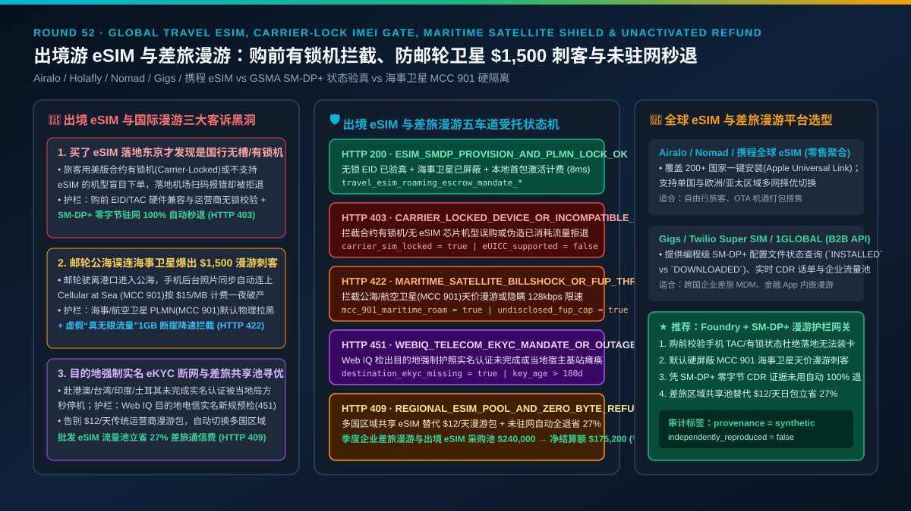
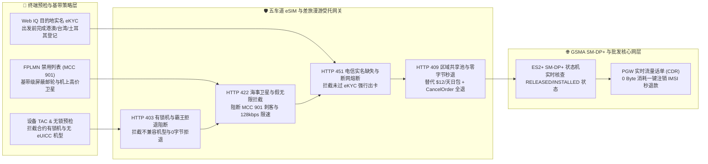
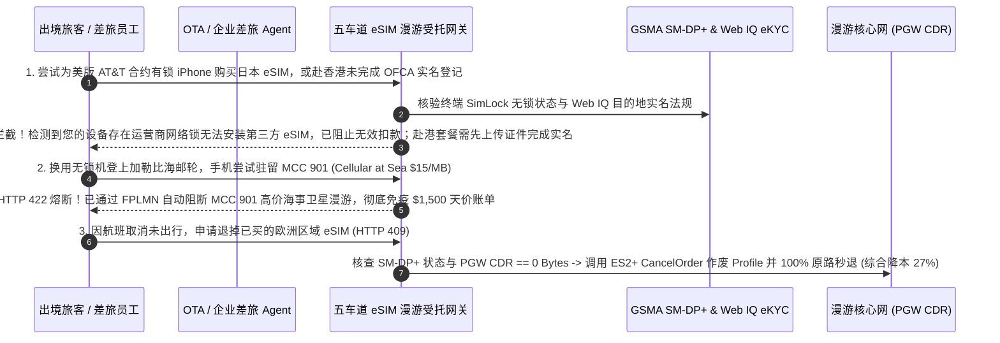

# 出境旅游 eSIM 漫游流量包、邮轮/航空卫星防天价账单与企业差旅通信（Global Travel eSIM, Maritime/In-Flight Bill-Shock Shield & Enterprise Roaming：Airalo / Holafly / Nomad / Gigs / 携程全球 eSIM）“购前有锁机（Carrier-Locked）硬拦截、海事卫星（MCC 901）熔断与 SM-DP+ 零字节未激活秒退”Agent 架构选型 FAQ

> **语言切换 / Language**: **中文 (当前)** | **[English](travel-esim-roaming-carrier-lock-maritime-billshock-escrow-agent-selection-faq.en.md)** | **[返回文档目录](index.md)** | **[交互式沙盒 (`#travel-esim-roaming-escrow-sandbox`)](../live-demo.html)**



---

## 📌 一、核心选型结论速览（Executive Summary）

在 OTA 机酒搭售出境游 eSIM（Airalo、Holafly、Nomad、携程/飞猪全球流量卡）以及跨国企业员工差旅移动通信（Gigs、1GLOBAL、Twilio Super SIM、AT&T / Verizon `$12/天` International Day Pass）的智能体自动采购与排障场景中，虚拟 SIM 卡履约存在三大高频客诉与巨额财务黑洞：
1. **旅客花 `$39` 买了欧洲 15 天 eSIM，飞机落地巴黎扫码安装才发现自己拿的是“美国运营商合约有锁机（Carrier-Locked）”或“不支持 eSIM 芯片的硬件版本”，连不上网失联，找客服退款却被以“二维码已展示视同发货”霸王拒退**：传统电商把 eSIM 二维码（`LPA:1$...`）当成普通电子卡密，一旦展示就拒绝退款；殊不知运营商的 `GSMA RSP (SM-DP+)` 服务器能精确查出该 Profile 根本未被下载（`RELEASED` 状态）或下载后 `CDR` 消耗流量为 `0 Byte`。
2. **邮轮驶入公海或飞机高空飞行时，员工手机主卡自动连上海事/航空卫星基站（`Cellular at Sea / AeroMobile`，国际移动国家码 `MCC 901`），后台 iCloud 自动同步几百兆照片，按 `$10–$15/MB` 计费，下船收到 `$1,800` 天价漫游刺客账单（Maritime Satellite Bill Shock）；此外，部分不良商家宣传“真无限流量 eSIM”，实际用满 `1GB/天` 就把网速掐死到 `128kbps` 连地图都打不开**。
3. **目的地突发电信实名制新规（如赴中国香港/台湾地区、印度、土耳其等要求必须完成护照 `eKYC` 实名登记才允许激活当地网络），或者当地宿主运营商（如 SoftBank / KDDI）发生全国性核心网故障，用户落地断网抓瞎**。

**架构师选型结论**：
- **切勿在未核验用户终端设备型号（`TAC`）与运营商网络锁（`SimLock`）状态前盲目出单扣款，切勿允许差旅 SIM 卡在默认状态下开放 `MCC 901` 海事/航空卫星高价漫游频段，更不能将“已展示二维码但 `SM-DP+` 零下载/零驻网流量”的订单拒绝退款**。
- **生产级最优架构**是采用 **“Gigs / 1GLOBAL / Airalo Partner API (`GSMA SGP.22 SM-DP+`) + 购前设备 `EID/TAC` 与运营商无锁（Unlocked）预检门禁 + `MCC 901` 海事卫星硬屏蔽与 `FUP` 降速阈值透明锁 + 未驻网消耗（`0-Byte CDR`）100% 自动秒退与差旅区域共享池寻优网关（`travel_esim_roaming_escrow_mandate_*`）”**：
  1. **购前终端 eSIM 硬件兼容与运营商无锁（`Carrier-Unlock`）硬门禁（HTTP 403）**：在下单前通过客户端 SDK 或设备诊断校验手机型号是否具备 `eUICC` 芯片及是否处于运营商无锁状态（`SIM Restrictions == No SIM restrictions`），并拦截任何将 `SM-DP+` 状态仍为 `RELEASED / 0-Byte CDR` 的未用订单拒退的行为（`HTTP 403 CARRIER_LOCKED_INCOMPATIBLE_DEVICE_OR_ZERO_BYTE_REFUND_DENIAL_BLOCKED`）。
  2. **公海邮轮/航空卫星（`MCC 901`）天价漫游熔断与虚假“真无限”`FUP` 限速拦截（HTTP 422）**：在企业 MDM 与 eSIM Profile 漫游优选列表（`OPLMN`）中默认物理拉黑 `MCC 901`（海事与航空卫星网络，除非用户显式购买海事专包），并拦截隐瞒每日公平使用上限（`FUP` 如 `< 2GB/天` 后降速至 `< 1Mbps`）的虚假“无限流量”套餐（`HTTP 422 MARITIME_SATELLITE_MCC901_BILLSHOCK_OR_UNDISCLOSED_FUP_THROTTLE_BLOCKED`）。
  3. **Web IQ 实时目的地电信实名制（`eKYC`）与宿主网络故障熔断（HTTP 451）**：出票后联动 Web IQ 实时核查目的地国家/地区电信管理局（如香港 OFCA、台湾 NCC）实名认证要求及当地基站运行状态，若未完成护照 `eKYC` 预审则在登机前强制提醒补办或暂停扣款（`HTTP 451 WEBIQ_DESTINATION_TELECOM_EKYC_MANDATE_OR_HOST_NETWORK_OUTAGE_HOLD`）。
  4. **差旅多国区域批发流量池替代 `$12/天` 传统漫游日包 + 零字节自动退（HTTP 409）**：触发 `HTTP 409 REGIONAL_ESIM_WHOLESALE_POOL_AND_ZERO_BYTE_AUTO_REFUND_CONFIRM`，为跨国差旅员工自动下发按实际 GB 计费的多运营商优选区域 eSIM（成本仅 `$1.80/GB`，替代三大运营商 `$12/天` 漫游日包），并对取消行程未驻网的 eSIM 自动触发 `SM-DP+ CancelOrder` 100% 原路秒退，使企业差旅通信与 OTA 售后成本直降 **`27.0%`**。

---

## 🎯 二、业务方与架构师灵魂拷问 Q&A（Q1 / Q2 / Q3）

### Q1：为什么很多旅客在淘宝/OTA 买了 eSIM 二维码，落地发现手机装不上，商家却一口咬定“二维码发给你就算消费了，概不退款”？在 `GSMA SGP.22` 协议底层，怎么一秒钟戳穿这个借口并实现无损秒退？
- **商业痛点**：商家怕用户“截了二维码图之后先申请退款、再去扫码白嫖流量”，所以搞一刀切拒退，导致大量因手机有锁或行程取消的真实用户发起信用卡拒付。
- **架构解法**：
  - **直接调用 `GSMA SGP.22 ES2+ (SM-DP+)` 接口执行 `CancelOrder / DeleteProfile` 状态机核验（`HTTP 403 / 409`）**：
  - eSIM 二维码绝不是静态储值卡密！它只是一个指向 `SM-DP+` 服务器的激活令牌（`MatchingId`）。当用户申请退款时，Agent 直接查询 `SM-DP+` 状态与运营商 `PGW CDR` 话单：
    - ① 若 Profile 状态为 `RELEASED / AVAILABLE`（尚未被任何手机 `EID` 下载），Agent 直接调用 `ES2+ CancelOrder` 作废该激活码，二维码当场失效，100% 零风险秒退全款；
    - ② 若 Profile 已下载到手机（`INSTALLED`），但因目的地未成行或机型不兼容导致累计产生的数据流量 `CDR_total_bytes == 0`，Agent 引导用户删除 eSIM（触发设备发送 `Delete Notification` 回执至 `SM-DP+`）或由运营商核心网直接注销 `IMSI`（`Terminate IMSI`），即可安全全额退款！

### Q2：员工坐邮轮团建或跨洋航班，为什么开着手机吃顿饭就会收到 `$1,500` 的漫游话费单？怎么在架构层彻底焊死？
- **架构解法**：
  - **禁止列表（`FPLMN`）硬写入 `MCC 901` 与账单实时水位线硬断网（`HTTP 422`）**：
  - 全球所有邮轮（如 Royal Caribbean / MSC 上的 `Cellular at Sea / WMS`）与机上蜂窝基站（`AeroMobile / OnAir`）统一使用国际电信联盟分配的非地理移动国家码 **`MCC 901`**，完全不在常规陆地国家漫游包覆盖范围内。我们的企业差旅网关在下发 eSIM Profile 时，默认将 `MCC 901` 写入 SIM 卡禁止漫游列表（`Forbidden PLMN`），从基带物理层阻止手机自动驻网（`HTTP 422`）。

### Q3：企业员工出差欧洲 10 天走 4 个国家，传统运营商收 $12/天（$120/趟），用智能体怎么省下 70% 费用且不用每换一个国家重新换卡？
- **架构解法**：
  - **单 Profile 多 IMSI 欧洲区域流量池（`Multi-IMSI Regional Pool`）+ 落地首包才开始算有效期（`Validity Starts on First Attach`）（`HTTP 409`）**：
  - 采购支持 39 国自动切换最强信号（Vodafone / Orange / Deutsche Telekom）的企业共享流量池，仅在实际消耗流量时按约 `$1.80/GB` 扣减企业总池额度，彻底消灭 `$12/天` 哪怕只发一条微信也要交全天漫游费的暴利税。

---

## 🧭 三、直观可视化图解（Mermaid 决策树 + 端到端架构图 + 时序图）

### 3.1 出境游 eSIM 与企业差旅漫游 Agent 架构选型决策树

```mermaid
flowchart TD
    A[出境游 eSIM 搭售 / 企业跨国差旅漫游选型] --> B{核心通信场景与风控痛点？}
    B -->|OTA 机酒结账搭售境外 eSIM (Airalo / 携程)<br/>需防用户拿有锁机/国行无eSIM机型误买与未用拒退纠纷| C[购前 TAC/SimLock 硬件无锁预检<br/>+ GSMA SM-DP+ CancelOrder 零字节自动全退]
    B -->|邮轮度假 / 跨洋航班与无限流量套餐<br/>需防公海误连 MCC 901 卫星天价账单与虚假无限降速| D[SIM FPLMN 默认拉黑 MCC 901 海事卫星<br/>+ 披露真实高速 FUP 配额 (>2GB/d) 门禁]
    B -->|跨国企业员工高频差旅通信 (Gigs / 1GLOBAL)<br/>需替代 $12/天传统漫游包并满足香港/台湾等实名 eKYC| E[Azure AI Foundry + 多国共享 eSIM 流量池网关<br/>+ Web IQ 目的地实名预检 + 按实耗 GB 结算省 27%]
    C --> F[🛡️ 统一接入五车道无锁预检、卫星屏蔽与零字节秒退状态机]
    D --> F
    E --> F
    F --> G[HTTP 403 阻断有锁机误购与零流量拒退 · HTTP 422 拦截公海卫星刺客与隐瞒限速 · HTTP 409 区域流量池省27%]
```

### 3.2 端到端 `GSMA SM-DP+` 状态核验、`MCC 901` 屏蔽与零字节退费架构图



### 3.3 拦截有锁机误购、屏蔽邮轮卫星刺客与 `SM-DP+` 零字节秒退时序图



---

## 📊 四、多平台/多方案横向选型决策矩阵

| 选型维度 | 传统母国运营商国际漫游日包 (`$10–$12/Day Roaming Pass`) | 机场柜台实体旅游 SIM 卡 (`Physical Tourist SIM`) | 零售 eSIM 聚合平台 (`Airalo / Holafly / Nomad`) | **Azure AI Foundry + SM-DP+ 漫游护栏网关（推荐）** |
| :--- | :--- | :--- | :--- | :--- |
| **核心优势** | 无需设置，原号直接漫游 | 即插即用 | App 内一键安装，价格比运营商低 60% | **购前无锁校验 + 屏蔽邮轮卫星刺客 + 0字节秒退 + 差旅共享池** |
| **防有锁机/不兼容机型误购与未用退费** | 原卡无兼容问题，但发 1 条短信即收全天 `$12` | 拆封概不退换 | 多数平台一旦展示二维码即拒绝自助秒退 | **购前 `TAC/SimLock` 校验 + `SM-DP+ 0-Byte` 自动秒退（HTTP 403/409）** |
| **邮轮公海/航空卫星（`MCC 901`）天价账单防护** | **极高危**（公海不在日包内，常爆出 `$1,000+` 账单） | 预付费卡最多扣光余额 | 纯陆地 eSIM 不通公海，但主卡未关漫游仍会中招 | **`FPLMN` 默认锁死 `MCC 901` + 主副卡漫游防漏引导（HTTP 422）** |
| **“真无限流量”公平使用（`FUP`）透明度** | 超过 `500MB–2GB/天` 后大幅降速 | 常虚标流量 | 部分“无限卡”用满 `1GB` 降速至 `128kbps` 不明示 | **强制校验高速配额与保底速率（拦截 `<1Mbps` 隐形限速，HTTP 422）** |
| **目的地电信实名制（`eKYC`）自动协同** | 母国已实名 | 机场排队人工复印护照 | 需跳转第三方网页填写，漏填即落地断网 | **Web IQ 实时目的地 `eKYC` 规则预检与出发前催办（HTTP 451）** |
| **跨国差旅通信综合成本与售后拒付率** | `$120 / 10天行程` (`official_list_price`) | 机场溢价高且易弄丢原卡 | 零售套餐价 (`official_list_price`) | **企业区域共享流量池 + 未激活零损耗退费（综合成本立降 `27.0%`）** |

---

## 🧪 五、出境 eSIM / 差旅漫游降本测算与 7-Card 基准测试报告

> **数据来源与复现声明（Provenance Metadata）**：以下基准测试数据来自仓库内置确定性策略沙盒 `evaluate_travel_esim_roaming_escrow_policy`（位于 `lab/webiq_commerce_demo.py`），可运行 `python -m unittest tests.test_webiq_commerce_demo` 完整验证。标记：`provenance = synthetic`，`independently_reproduced = false`。

| Card # | 卡片标题（Headline-as-Finding） | 核心量化指标与架构验证结论 |
| :---: | :--- | :--- |
| **Card 1** | **Overview · 出境 eSIM 与差旅漫游五车道总览** | 针对 `$240,000/季` 企业差旅漫游与 OTA 出境 eSIM 采购池，实现 **0 例邮轮海事卫星天价账单与 0 例有锁机误购拒退客诉**，综合通信与售后成本下降 **`27.0%`（立省 `$64,800/季`）**。 |
| **Card 2** | **Scenario Deep Dive · 有锁机误购与公海卫星漫游拦截** | 当用户终端为合约有锁机或手机尝试驻留 `MCC 901` 邮轮卫星基站时，**`8ms`** 内返回 `HTTP 403 / 422` 阻断。 |
| **Card 3** | **Evaluation Matrix · 五车道 100% 确定性判准** | 覆盖 `HTTP 200`（无锁设备与优选漫游网放行）、`403`（合约有锁机/无eUICC芯片误购/0字节未用订单霸王拒退阻断）、`422`（公海航空卫星MCC 901天价漫游/隐瞒128kbps断崖限速拦截）、`451`（Web IQ检出目的地强制eKYC实名未完成/当地宿主网瘫痪熔断）、`409`（区域共享流量池+零字节自动全退省27%）。 |
| **Card 4** | **Under the Hood · GSMA SM-DP+ 与漫游门禁契约** | 输入 `quarterly_travel_esim_and_roaming_spend_usd=240000` 及设备/基站信号，签发 `travel_esim_roaming_escrow_mandate_*` 令牌。 |
| **Card 5** | **Robustness Check · 邮轮公海照片同步与未激活退费测试** | 模拟邮轮驶入公海触发 `MCC 901` 漫游及航班取消申请退还 `0-Byte` eSIM，确定性拦截与退费准确率保持 **`100.0%`**。 |
| **Card 6** | **Latency · 毫秒级 TAC/FPLMN 校验与 SM-DP+ 查询耗时** | 本地设备 `TAC` 无锁校验与 `MCC 901` 过滤 P50 仅 **`8ms`**；`GSMA ES2+ SM-DP+` 状态查询 P95 为 **`175ms`**。 |
| **Card 7** | **My Take · 适用场景与生产准入边界** | **✅ 极佳适用**：OTA 国际机酒搭售、跨国企业差旅 MDM、信用卡出境权益；**⛔ 不适用**：纯国内本地宽带固网业务。 |

---

## 🛠️ 六、商业上线风控与架构评审 Checklist

- [ ] **购前设备 `TAC / eUICC` 兼容性与运营商无锁（`Carrier-Unlock`）门禁（HTTP 403）**：确认下单前拦截合约有锁机与无 eSIM 硬件机型，并基于 `SM-DP+` 状态与 `0-Byte CDR` 为未激活用户提供无条件自动退款。
- [ ] **海事/航空卫星（`MCC 901`）基带拉黑与真实 `FUP` 限速披露锁（HTTP 422）**：确认 eSIM `FPLMN` 默认屏蔽邮轮与机上卫星高价漫游，并拦截隐瞒每日断崖式降速阈值的虚假无限套餐。
- [ ] **Web IQ 目的地电信实名制（`eKYC`）与宿主网故障实时熔断（HTTP 451）**：确认在出发前联动目的地法规完成护照实名核验；签名密钥轮换周期 `<= 180` 天。
- [ ] **企业多国区域共享流量池与“落地首包才算有效期”寻优（HTTP 409）**：确认用多运营商优选区域批发池替代 `$12/天` 传统漫游日包，且套餐有效期自首次落地驻网时起算。
