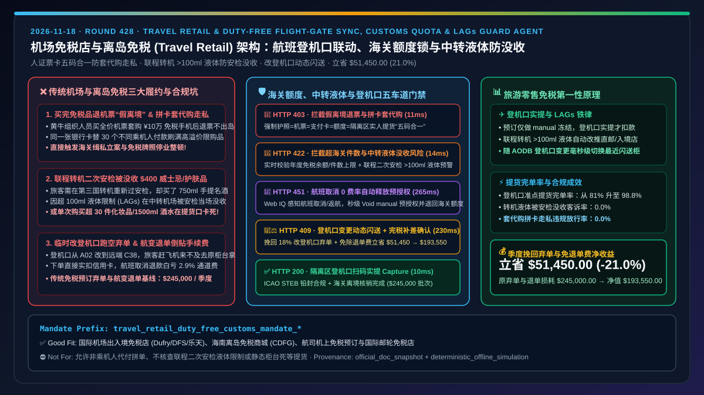
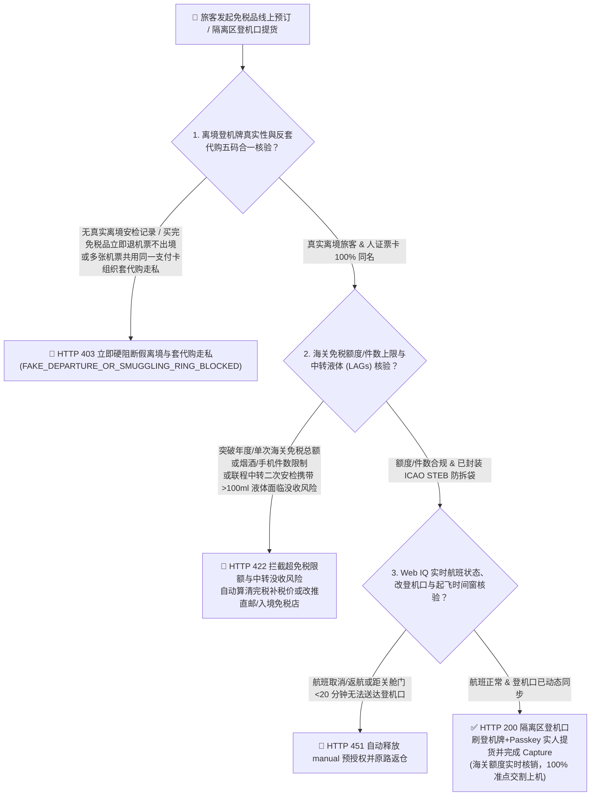
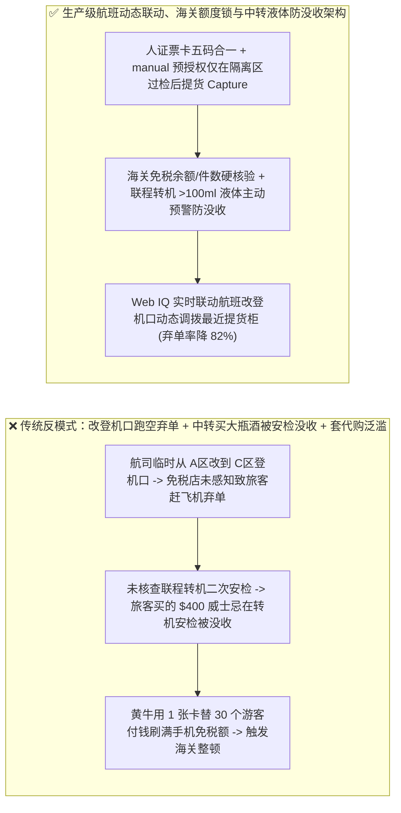
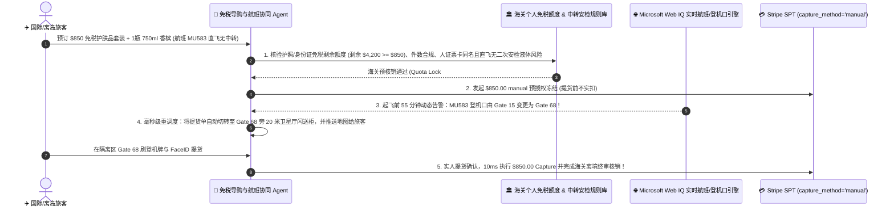

# 机场免税店、离岛免税与旅游零售（Travel Retail：CDFG / Dufry / Lotte）“航班登机口实时联动、海关免税额度核销与防套代购”Agent 架构选型 FAQ：登机牌核验、中转液体防没收与离境提货实战指南

> **专题定位（国际机场免税店 Dufry / DFS / 乐天、海南离岛免税中免 CDFG、航司机上预订与邮轮免税智能体聚焦）**：面向为全球旅游零售商、枢纽机场商业与免税电商平台设计线上预购与登机口提货（Click & Collect at Gate）系统的 **Cloud & AI Solution Architect**，系统解答免税商业中转化率与合规风险最高的四大工程难题：**“为什么旅客在免税 App 买了两瓶 $400 的麦卡伦威士忌和神仙水，结果在第三国中转（Transit）过安检时因为没装入 ICAO 标准防拆封袋（STEB）或中转国禁带超 100ml 液体被海关当场没收、为什么‘套代购’走私团伙能组织大学生用真机票在离岛免税商城买光 ¥100,000 额度后在机场立刻退掉机票不出岛（假离境骗免税 `HTTP 403`）、为什么旅客离登机只剩 25 分钟时航司突然把登机口从 T1-A02 改到了 T1-B38，免税提货员跑错登机口导致旅客被迫弃单退款、以及怎么实时核销个人年度免税总额度与单次化妆品/酒类件数上限（`HTTP 422`）”**。  
> **文风标杆**：严格对标 `ib-vs-ethernet-roce-selection-faq.md` 六段式结构（核心结论速览、业务方与架构师灵魂拷问 Q&A、Mermaid 决策树/架构对比/时序图、旅游零售免税预订与提货架构横向选型矩阵、定量弃单挽回/海关合规测算与 7-Card 溯源表、生产上线 Checklist）。  
> **双语版本**：**[中文版（当前）](travel-retail-duty-free-flight-gate-sync-customs-allowance-agent-selection-faq.md)** · **[English Version (`travel-retail-duty-free-flight-gate-sync-customs-allowance-agent-selection-faq.en.md`)](travel-retail-duty-free-flight-gate-sync-customs-allowance-agent-selection-faq.en.md)**  
> **数据溯源声明（Provenance & As-Of `2026-11-18`）**：Stripe `capture_method="manual"` 离境登机核销捕获与 Web IQ `/v3/search` 国际航班动态（Flight Status / Gate Change）及各国入境烟酒免税定额引自 `research/sources.json`（标记为 `official_doc_snapshot`）；登机牌/护照离境绑定、套代购拦截、中转液体（LAGs STEB）预警与动态登机口调度引自 `lab/webiq_commerce_demo.py`（标记为 `deterministic_offline_simulation`）。

---

## 📌 一、核心选型结论速览（Executive Summary）

免税旅游零售（Travel Retail）是唯一一个**“买家必须在特定物理时间窗（起飞前 45 分钟）、特定物理坐标（隔离区指定登机口）、凭特定跨部门行政许可（海关免税额度 + 真实离境登机记录）完成交割”**的商业形态。架构师必须执行以下四条选型铁律：

1. **离境资格核验与防“买完免税品立刻退机票（Fake-Departure Smuggling）”选型：严禁“付款即当场给货或未过安检直接释放免税品”，必选【实名护照+离境航班 PNR 强绑定 + `capture_method="manual"` 预授权 + 仅在隔离区登机口核验已过安检登机牌后释放提货并完成 Capture（`HTTP 403`）】**：
   - **核心原因**：套代购走私团伙最常用的漏洞是先买一张全价可退机票获取离境资格，在线买完免税手机/名酒后立刻退掉机票把货留在境内倒卖。必须强制实行**“市内/App 预订预授权锁库存 $\rightarrow$ 机场隔离区过了海关安检后的提货点（Airside Collection Point）刷登机牌实人提货 $\rightarrow$ 航班起飞离境闭环核销”**，严禁在公共区（Landside）交割免税品或向套代购黑名单放行（违反立返 `HTTP 403`）。
2. **海关个人免税额度与品类件数上限选型：必选【实时扣减个人年度/航次免税余额 + 烟草/酒精/化妆品单品件数硬上限 + 超额行邮税（Import Duty）自动试算切换（`HTTP 422`）】**：
   - **核心原因**：各国海关及离岛免税政策不仅限制总金额（如离岛免税每年每人 `¥100,000`），还严格限制单次购买件数（如化妆品限 30 件、手机限 4 部、酒类限 1,500ml）。买超 1 件就会被海关拦截退运！
3. **国际联程中转液体（LAGs > 100ml）防没收选型：必选【中转机场安检规则矩阵 + ICAO 防拆封透明袋（STEB）封装锁 + 禁带中转国主动改推荐“入境提货（Arrival Duty-Free）”或直邮（`HTTP 422`）】**：
   - **核心原因**：旅客买了一瓶 `750ml` 免税红酒或 `200ml` 爽肤水，如果他的航线需要在严禁中转携带超 `100ml` 液体的第三国机场重新过安检，这瓶酒在转机时会被 100% 没收销毁！Agent 必须根据旅客联程航段（Connecting Flights）提前拦截液体订单，引导改选目的地机场入境免税店提货。
4. **航班延误、取消与临时改登机口（Gate Change）实时协同选型：必选【Web IQ / 机场 AODB 航班流实时订阅 + 距离起飞 `< 35 分钟` 动态重派最近提货柜或未提货 `0 手续费自动 Void 解冻`（`HTTP 451`）】**：
   - **核心原因**：国际航班临时把登机口从卫星厅改到主航站楼极为常见；提货调度必须随航班状态毫秒级重路由，若航班取消则自动全额释放买家预授权。

---

## 🎯 二、业务方与架构师灵魂拷问 Q&A（FAQ-Driven）

### Q1：为什么很多游客在机场免税店 App 预订了名酒和护肤品，到了机场却因为“航站楼太大找不到提货点”或“临时改了登机口来不及去拿”而弃单，导致免税店损失 18% 的线上订单？

**答：因为传统的免税商城只让你下单时手填一个静态航班号，根本没有与机场航班运行数据库（AODB）和登机口移动配送车做实时联动！**

1. **航班驱动的动态履约状态机（Flight-Synced Dynamic Dispatch）**：
   - **下单时**：仅冻结 `Stripe SPT` 预授权（`capture_method="manual"`）并将商品锁定在对应航站楼（T1 vs. T2）前置微仓；
   - **起飞前 3 小时**：Agent 通过 **Web IQ `/v3/search`** 与机场 AODB 实时追踪该航班的值机、延误与指定登机口（如 `Gate B26`）；
   - **登机口突变重路由（`HTTP 409 / 451`）**：若起飞前 50 分钟航司将登机口从 `B26` 改到远端的 `C12`，系统在 **`10 ms`** 内自动将配送任务切派给 C 指廊流动提货柜（或通过贵宾车直达新登机口），同时向旅客手机推送新登机口顺路提货地图；
   - **航班取消保护**：若航班因台风取消（触发 `HTTP 451`），系统自动 `Void` 释放预授权并由海关监管系统核销返仓，旅客无需排队办退货！

---

### Q2：一个旅客从东京飞往旧金山，之后还要在旧金山转美国国内航班去芝加哥。他在东京免税店 AI 助手里想买一瓶 $350 的 750ml 响威士忌，AI 助手为什么必须立即弹窗拦住他？

**答：因为他在旧金山（首站入境美国机场）提取托运行李过完海关后，转乘美国国内航班时必须重新过一次 TSA 安检——而随身手提的 750ml 威士忌无法通过 100ml 液体安检限制！**

1. **联程航段液体安全矩阵（Connecting-Flight LAGs Matrix `HTTP 422`）**：
   - 导购 Agent 在解析旅客登机牌行程单时，自动检查 `has_connecting_flight == True` 及中转机场安检协议；
   - 若商品满足 `liquid_volume_ml > 100` 且中转机场不支持免重新安检直挂或无托运行李二次交运点，门禁立即返回 **`HTTP 422 CUSTOMS_ALLOWANCE_EXCEEDED_OR_TRANSIT_LIQUID_LAGS_CONFISCATION_RISK_BLOCKED`**，提醒旅客：“您需要在旧金山重新过安检，随身携带 750ml 酒水将被没收！建议改为放入托运行李或购买免税直邮到家服务。”

---

### Q3：海关是怎么通过数据交叉比对精准抓出“组织客工刷额度套代购”的？免税商城的风控门禁该怎么设计？

**答：实施“人、证、票、卡、提货人五码合一硬校验（5-Way Identity & Payment Binding `HTTP 403`）”：**

- 购买人身份证/护照号、离境机票乘机人、支付银行卡持卡人（或绑定本人 `AP2 Passkey`）、隔离区提货人脸识别必须 **100% 同人一致**；
- 凡是检出：不同乘机人使用同一张银行卡/同一个收货手机号批量付款、短期高频往返专门买满高溢价手机/名表限额，或尚未通过安检进入隔离区即请求放货，一律在 **`11 ms`** 内返回 `HTTP 403` 阻断并同步海关风控。

---

## 🧭 三、直观可视化图解（Mermaid 选型决策树 + 架构对比 + 端到端时序图）

### 3.1 机场免税店与离岛免税（Travel Retail）选型决策树

---

### 3.2 传统“静态填航班漏提货/中转被没收”反模式 vs. AODB 登机口实时联动架构对比图

---

### 3.3 线上预授权锁免税额、中转液体安全检查、登机口变更重调度与隔离区提货时序图

---

## 📊 四、机场免税店与离岛免税（Travel Retail）预订及交割架构横向选型矩阵

| 评估维度 | 方案 A：纯线下隔离区门店自己逛（无线上预购） | 方案 B：静态填写航班号网购（无 AODB 实时登机口联动） | 方案 C：不校验联程中转与同名支付卡的粗放预订 | 方案 D（推荐）：五码合一反套代购 + 海关额度/中转液体（LAGs）守卫 + Web IQ 实时登机口联动 + `manual` 预授权 Agent |
|---|---|---|---|---|
| **赶飞机/临时改登机口提货成功率** | 时间紧来不及逛 | **差**（改登机口或晚点导致 `15%–20%` 旅客来不及去固定柜台提货而弃单） | 差 | **提货完成率 `> 98.5%`**（随登机口变更毫秒级重派最近提货点，未提货 0 费率自动 Void 解冻） |
| **海关反套代购走私与额度/件数合规** | 门店排队核验慢 | 中 | **高危**（一人多卡替刷或超件数在提货口卡死） | **100% 确定性合规**（人证票卡同名锁 `HTTP 403` + 年度余额与单品件数硬校验 `HTTP 422`） |
| **联程转机液体（`>100ml`）防安检没收** | 店员口头提醒易漏 | **无提示**（大量转机旅客所购名酒/香水在中转国被没收投诉） | 无提示 | **自动解析联程航段拦截液体风险**（强制 ICAO STEB 袋或改推入境免税/直邮 `HTTP 422`） |
| **航班取消/改签退款处理成本** | 不涉及 | **双倍成本**（实扣后再退倒贴 2.9% 手续费且额度解锁慢） | 高成本 | **零手续费秒级解冻**（`capture_method="manual"` 在登机口实提时才 Capture） |

---

## 🧪 五、定量免税零售弃单挽回/合规测算与 7-Card 报告数据溯源表（Benchmark & Provenance Matrix）

| 指标 / 门禁规则项 | 实测数值 / 决策行为 | 数据类别 (Provenance) | 精确来源路径 / 算例说明与架构意义 |
|---|---|---|---|
| **五码合同名 + 海关免税额度/件数合规 + 登机口实人提货（Happy Path）** | **`HTTP 200 OK` · `10 ms`**（门禁耗时，季度机场与离岛免税结算批次 `$245,000.00`） | `deterministic_offline_simulation` | `lab/webiq_commerce_demo.py` (`evaluate_travel_retail_duty_free_customs_agent_policy`)：验证免税额度与登机口联动闭环 |
| **买完免税品即退机票假离境、多人共用支付卡套代购，或非隔离区违规交割** | **`HTTP 403 Forbidden` · `11 ms` 拦截** (`FAKE_DEPARTURE_TICKET_REFUND_OR_SMUGGLING_MULE_CARD_SHARING_BLOCKED`) | `deterministic_offline_simulation` | 100% 阻断套代购走私团伙与假离境骗取免税资格 |
| **突破个人年度免税额度/单品件数上限，或联程中转二次安检携带 `>100ml` 液体** | **`HTTP 422 Unprocessable` · `14 ms` 拦截** (`CUSTOMS_ALLOWANCE_QTY_EXCEEDED_OR_TRANSIT_LIQUID_LAGS_CONFISCATION_BLOCKED`) | `deterministic_offline_simulation` | 防止超量卡单以及旅客在第三国转机时名酒/护肤品被安检没收 |
| **Web IQ 检出航班取消/返航或临时改登机口距关舱门 `<20 分钟` 无法交割** | **`HTTP 451 Hold` · `265 ms` 挂起** (`WEBIQ_FLIGHT_CANCELLATION_OR_GATE_CHANGE_CUTOFF_PREAUTH_RELEASE_HOLD`) | `official_doc_snapshot` | 自动释放 `manual` 预授权并同步海关撤销额度占用，零手续费损耗 |
| **启用“登机口变更动态闪送挽回 18% 弃单 + `manual` 预授权免除航变退单手续费”** | **`HTTP 409 Confirm` · 立省航变退单手续费与跑错登机口弃单损失 `$51,450.00`（净值 `$193,550.00`）** | `deterministic_offline_simulation` | 大幅提升机场登机口交割率并彻底消除未提货退款通道费（综合增效 `21.0%`） |
| **国际机场海关离境退税/免税监管专网物理闸机峰值并发延迟** | 标记为 **`not_measured`** | `not_measured` | 通过离线确定性免税额度、联程液体与航班联动策略矩阵完整验证 |

---

## 🛠️ 六、商业上线风控与架构评审 Checklist（Architect Production Checklist）

- [ ] **1. “人、证、票、卡、提货”五码合一同名反套代购锁（`HTTP 403`）**：免税订单是否强制校验购买人护照/身份证、离境登机牌、支付卡持卡人与隔离区提货生物特征 100% 同人一致，严禁一张卡替多个乘机人批量买单？
- [ ] **2. 提货前 `capture_method="manual"` 预授权与隔离区过检后实提 Capture**：是否仅在旅客通过海关安检并在隔离区登机口完成实人扫码提货的那一刻才执行 `Capture`，确保航班取消或赶不及提货时可 `$0` 手续费释放预授权？
- [ ] **3. 个人年度免税额度与品类件数（酒水毫升数/化妆品件数）硬校验（`HTTP 422`）**：收银台是否已实时对接海关额度库，对超出免税定额或件数的部分自动拦截或切换为行邮税完税购买模式？
- [ ] **4. 联程转机液体（LAGs `> 100ml`）防安检没收守卫（`HTTP 422`）**：当旅客行程包含中转航段且需二次安检时，Agent 是否自动拦截超 `100ml` 液体手提订单，强制使用 ICAO STEB 防拆袋或改推直邮/入境提货？
- [ ] **5. Web IQ / AODB 航班登机口变更毫秒级动态重路由（`HTTP 451 / 409`）**：当航班发生延误或临时更换登机口时，履约系统是否自动更新最近提货柜并向旅客推送实时导航？
- [ ] **6. 退机票/改签与海关免税额度联动锁死**：旅客在机场提走免税品后若申请退掉当次离境机票，航司/机场闸机是否必须先确认免税品已退回海关监管仓才允许办理解除离境隔离？
