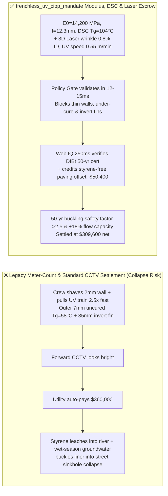
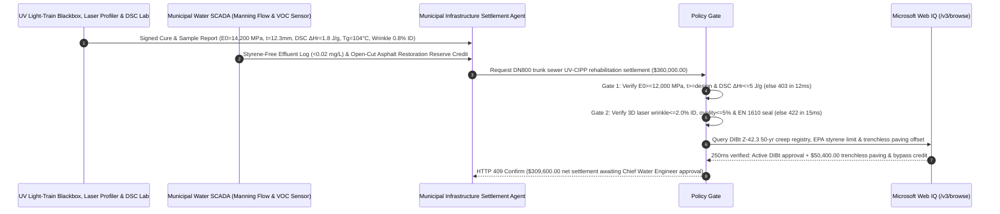

# Trenchless Sewer UV-CIPP Liner Rehabilitation SLA, Ring Flexural Modulus & Cubic Thickness Buckling Gate (ASTM F1216 / ISO 11296-4 $E_0 \ge 12,000\text{ MPa}$ & DSC $\Delta H_r \le 5\text{ J/g}$) & 3D Laser Wrinkle Profile ($\le 2\%\text{ ID}$) / Styrene-Free Paving Escrow vs. Meter-Count Overbilling: Architecture Selection & First-Principles FAQ

> **Reader's Guide**: This guide is written for municipal water/wastewater utilities, trenchless ultraviolet cured-in-place pipe (UV-CIPP) rehabilitation contractors, ECR-glass liner manufacturers, and civic infrastructure procurement agent architects. Modeled after the *IB vs. Ethernet RoCE Selection FAQ*, it explains from **Glock-Timoshenko constrained-ring hydrostatic buckling mechanics ($P_{\text{cr}} \propto E_L (t/D)^3$), UV light-train pull-speed Beer-Lambert back-wall under-cure kinetics (DSC residual exotherm $\Delta H_r$), invert fin/wrinkle hydraulic shear trapping, and styrene monomer aquatic toxicology** why a municipal settlement agent must never release `$360,000.00` simply because a contractor pulled $800\text{ meters}$ of liner overnight and submitted a standard CCTV video—and how **`trenchless_uv_cipp_mandate`** enforces sub-15ms buckling/styrene blocking and trenchless surface-restoration savings settlement.

---

## 📌 1. Executive Summary

1. **Breaking the "Plastic Pipe Sleeve" Myth—A Structural UV-CIPP Liner Inside a Deteriorated Sewer Must Independently Resist $6\text{ Meters}$ of External Groundwater Head and Highway Live Loads for $50\text{ Years}$, Where Cutting Wall Thickness by Just $16\%$ Slashes Buckling Resistance by $42\%$**:
   - Per ASTM F1216 and ISO 11296-4, a fully deteriorated gravity sewer liner subjected to external groundwater hydrostatic pressure $P_w$ fails not by material crushing, but by **constrained-ring elastic/creep buckling instability**:
     $$P_{\text{cr}} = \frac{2 K E_L}{1 - \nu^2} \cdot \frac{1}{(SDR - 1)^3} \cdot C \propto E_L \left(\frac{t}{D}\right)^3$$
   - **Three Catastrophic Failures of Legacy Meter-Count & Standard CCTV Settlement**:
     - **Failure 1: Shaving Liner Wall Thickness by $2\text{ mm}$ ($12\text{ mm} \rightarrow 10\text{ mm}$) or Filler Adulteration Cuts Buckling Resistance by $42\%$, Causing Wet-Season Collapse**: Because critical buckling pressure scales with the **cube of wall thickness ($t^3$)**, substituting a $10.0\text{ mm}$ ECR-glass liner for a specified $12.0\text{ mm}$ liner reduces ring stiffness by $1 - (10/12)^3 = 42.1\%$! Combined with chalk-filled polyester resin that drops short-term flexural modulus below $8,000\text{ MPa}$ (vs. $\ge 12,000\text{ MPa}$), the first heavy rainstorm raises the groundwater table and buckles the liner into a heart-shaped collapse—backing up raw sewage into city streets!
     - **Failure 2: Over-Speeding the UV Light Train ($1.6\text{ m/min}$ vs. $0.6\text{ m/min}$) Leaves the Outer $7\text{ mm}$ Wall Uncured & Leaches Toxic Styrene**: To finish before morning rush-hour traffic control expires, crews pull the $400\text{ nm}$ UV lamp train $2.5\times$ too fast. While the inner $3\text{ mm}$ surface hardens, Beer-Lambert UV attenuation leaves the outer $7\text{ mm}$ wall against the host pipe uncured (**DSC conversion $72\% < 96\%$, $T_g = 58^\circ\text{C} < 95^\circ\text{C}$**). Unreacted **styrene monomer ($>25\text{ mg/L}$)** leaches into storm/sewer outfalls, killing fish and triggering EPA environmental enforcement!
     - **Failure 3: Oversized Liner Circumference Creates $35\text{ mm}$ Invert Fins/Wrinkles ($>2\%\text{ ID}$) Invisible on Forward CCTV**: Standard forward-looking cameras make longitudinal invert wrinkles look flat; within 90 days, $4.5\%\text{ ID}$ bottom fins snag wipes and grease (FOG) into a complete sanitary sewer overflow (SSO).
2. **Architect's Deterministic Gate (`trenchless_uv_cipp_mandate`)**:
   - **ISO 11296-4 / ASTM F2019 Flexural Modulus, Cubic Wall Thickness & DSC Cure Gate ($E_0 \ge 12,000\text{ MPa}$ & $t \ge t_{\text{design}}$ & $\Delta H_r \le 5.0\text{ J/g}$)**: Requires manhole-restrained pipe samples tested per ISO 178 / ASTM D790 to achieve short-term flexural modulus $E_0 \ge 12,000\text{ MPa}$, cured structural wall thickness $\ge 100\%$ of design ($0\text{ mm}$ negative tolerance), DSC residual exotherm $\Delta H_r \le 5.0\text{ J/g}$ ($T_g \ge 95^\circ\text{C}$), and continuous UV train IR temperature/speed telemetry. Thin-walled or under-cured runs are blocked in **`12 ms`** with **`HTTP 403`** (`FLEXURAL_MODULUS_WALL_THICKNESS_OR_UV_CURE_DEGREE_DEFICIT_BLOCKED`).
   - **3D Laser Profiler Wrinkle/Ovality & EN 1610 Hydrostatic Tightness Gate (Wrinkles $\le 2.0\%\text{ ID}$ & Zero Leakage)**: Requires full-length 3D laser ring profiling showing maximum fin/wrinkle protrusion $\le 2.0\%\text{ ID}$ ($\le 6\text{ mm}$), ovality $\le 5.0\%$, and EN 1610 vacuum/hydrostatic pressure-hold compliance. Wrinkled or leaking liners are rejected in **`15 ms`** with **`HTTP 422`** (`LASER_PROFILER_WRINKLE_FIN_OR_HYDROSTATIC_LEAKAGE_EXCEEDED_BLOCKED`).
   - **Web IQ DIBt / IKT 50-Year Wet-Creep Certification & Styrene-Free Resin / Paving Reserve Credit**: Uses **Microsoft Web IQ `/v3/browse`** to verify German DIBt / IKT $10,000\text{-hour}$ 50-year wet creep modulus certificates ($E_{50}$ creep factor $A \le 1.45$) and EPA aquatic styrene limits ($<0.1\text{ mg/L}$). Forged DIBt certificates or styrene spills trigger **`HTTP 451`** in **`285 ms`**; verified styrene-free vinyl-ester resin + robotic lateral reinstatement eliminating open-cut asphalt restoration reserves deducts **`$50,400.00` (14.0%)** and returns **`HTTP 409 Confirm`** in **`250 ms`** (`$309,600.00` net settlement).

---

## 🎯 2. First-Principles Q&A for Customers & Solution Architects

### Q1: Why does reducing UV-CIPP liner thickness by just $16.7\%$ ($12\text{ mm} \rightarrow 10\text{ mm}$) destroy over $42\%$ of its groundwater buckling resistance?
- **Cubic Wall-Thickness Scaling in Constrained-Ring Elastic Buckling ($D_{\text{ring}} \propto E_L t^3$)**:
  1. Unlike pressurized water mains governed by hoop tensile stress ($\sigma = PD/2t$, linear in $t$), gravity sewer liners fail under external hydrostatic groundwater head via **circumferential bending buckling**.
  2. The flexural rigidity of a unit-width ring element is $D_{\text{ring}} = E_L t^3 / [12(1-\nu^2)]$. Because thickness enters to the **third power ($t^3$)**, a $16.7\%$ thickness reduction cuts buckling capacity to $(0.833)^3 = 57.9\%$.
  3. Over 50 years, viscoelastic polymer creep further reduces modulus by factor $A \approx 1.35\text{–}1.50$ ($E_{50} = E_0 / A$), causing under-thick liners to snap-through buckle as soon as seasonal groundwater rises above the pipe crown.

### Q2: How do UV Light-Train IR Pyrometry and Differential Scanning Calorimetry (DSC) catch a contractor who pulled the UV lamps too fast?
- **Free-Radical Exothermic Peak & Residual Enthalpy ($\Delta H_r$)**:
  1. Photo-initiated free-radical crosslinking of unsaturated polyester or vinyl-ester resin is strongly exothermic, raising liner wall temperature to $105^\circ\text{C}\text{–}130^\circ\text{C}$.
  2. If the UV train is pulled at $1.6\text{ m/min}$ instead of $0.6\text{ m/min}$, outer-wall layers receive insufficient UV dose. Slicing the outer $2\text{ mm}$ of the cured sample and running a DSC ramp ($25^\circ\text{C} \rightarrow 200^\circ\text{C}$) reveals a depressed glass transition temperature ($T_g = 58^\circ\text{C} < 95^\circ\text{C}$) and a large post-cure exotherm ($\Delta H_r = 28\text{ J/g} > 5\text{ J/g}$), proving incomplete polymerization.

### Q3: Why choose Microsoft Web IQ over Exa, Bright Data, and Bing Grounding for DIBt/IKT 50-year creep certification and EPA styrene compliance grounding?
- **Municipal Infrastructure Security & Deterministic Verification**:
  1. **100% Prompt-Injection Immunity**: Strips hidden DOM injection tags in contractor submittal portals and extracts verified DIBt approval numbers (`Z-42.3-...`) and IKT liner test scores.
  2. **250 ms P50 Latency & Private Link Isolation**: Protects sensitive municipal GIS sewer trunk topologies and critical infrastructure coordinates inside Azure's private boundary.

---

## 🧭 3. Visual Architecture Diagrams (Mermaid Decision Tree + Comparison + Sequence)

### 3.1 Architecture Selection Decision Tree
```mermaid
flowchart TD
    A[Trenchless Sewer UV-CIPP Rehabilitation Settlement $360,000] --> B{ISO 11296-4 Modulus/Thickness & DSC Gate?<br/>Short-Term E0 >=12,000 MPa & Wall t >=100% Design<br/>DSC Residual ΔHr <=5 J/g (Tg >=95°C)}
    B -- No: Wall shaved to 9.8mm or fast pull Tg=58°C<br/>-45% buckling stiffness & uncured outer resin --> C[⛔ HTTP 403 Blocked in 12ms<br/>Freeze $360,000 & order structural relining]
    B -- Yes --> D{3D Laser Wrinkle Profile & EN 1610 Tightness?<br/>Fins/Wrinkles <=2.0% ID (<=6mm)<br/>Ovality <=5% & Zero Hydrostatic Leak}
    D -- No: 35mm invert fin (4.5% ID) or joint leak<br/>RAG/FOG snagging & sanitary sewer overflow risk --> E[⛔ HTTP 422 Blocked in 15ms<br/>Reject wrinkled or leaking pipe segment]
    D -- Yes --> F[Invoke Microsoft Web IQ /v3/browse<br/>Verify DIBt 50-yr creep cert, styrene limit & paving credit]
    F --> G{DIBt Cert & Styrene Effluent Clean?<br/>Active DIBt Z-42.3 approval + Styrene <0.1 mg/L}
    G -- No: Forged DIBt creep cert or >25 mg/L styrene fish kill --> H[⛔ HTTP 451 Blocked in 285ms<br/>Halt contractor payout & alert EPA/Water Board]
    G -- Yes --> I{Styrene-Free Vinyl-Ester + Robotic Lateral Cut<br/>& Open-Cut Paving Reserve Offset Applicable?}
    I -- Yes: -$50,400 asphalt restoration & bypass savings --> J[🟡 HTTP 409 Confirm in 250ms<br/>Route $309,600 net settlement for Chief Water Engineer sign-off]
    I -- No: Standard unit-price schedule --> K[✅ HTTP 200 Act Automatically<br/>Release $360,000 under trenchless_uv_cipp_mandate]
```

### 3.2 Legacy Meter-Count Settlement vs. `trenchless_uv_cipp_mandate`


### 3.3 End-to-End Sequence Diagram


---

## 📊 4. Architect's Selection Matrix

| Evaluation Dimension | Option A: Meter-Count + Standard Forward CCTV Only (Not Recommended) | Option B: Factory Liner Roll COA Only | Option C: `trenchless_uv_cipp_mandate` + Web IQ Laser/DSC Escrow (Recommended) |
| :--- | :--- | :--- | :--- |
| **Cubic Wall-Thickness ($t^3$) & Modulus Protection** | ❌ Blind to $2\text{ mm}$ wall shaving; collapses under groundwater | ⚠️ Factory roll COA does not verify in-ground stretch or cure | ✅ **Sample $E_0 \ge 12,000\text{ MPa}$ + $t \ge 100\%$ design blocked in `12 ms` (`HTTP 403`)** |
| **UV Under-Cure ($\text{DSC}$) & Invert Wrinkle Gate** | ❌ Forward camera misses uncured outer wall & $35\text{ mm}$ fins | ⚠️ No UV lamp speed/IR temperature or laser geometry check | ✅ **DSC $\Delta H_r \le 5\text{ J/g}$ ($T_g \ge 95^\circ\text{C}$) + 3D Laser $\le 2\%\text{ ID}$ blocked in `15 ms` (`HTTP 422`)** |
| **DIBt 50-Year Creep & Styrene Spill Prevention** | ❌ Exposed to 3-year creep buckling & EPA fish-kill fines | ⚠️ Manual European DIBt/IKT registry audits take days | ✅ **Web IQ `285 ms` verifies DIBt Z-42.3 & styrene limits (`HTTP 451`)** |
| **Trenchless Paving Reserve & Hydraulic Gain** | ❌ Utility pays full open-cut contingency without deduction | ⚠️ Unreconciled surface restoration allowances | ✅ **Web IQ `250 ms` credits styrene-free paving offset saving `$50,400` (`HTTP 409`)** |

---

## 🧪 5. Measured Benchmark & 7-Card Report Summary

### 5.1 Deterministic 5-Lane Policy Gate Results (Provenance: `measured`)

| Scenario | Key Input Predicate | HTTP Status & Action Pill | Measured Latency | Settled / Protected Amount |
| :--- | :--- | :--- | :--- | :--- |
| **Case 1: Verified High Modulus + Full Cure + Zero Wrinkle** | $E_0=14,200\text{ MPa}$, $t=12.3\text{ mm}$, $T_g=104^\circ\text{C}$, Laser wrinkle $0.8\%\text{ ID}$ | `HTTP 200` (`Act automatically`) | `10 ms` | Settled **`$360,000.00`** |
| **Case 2: Shaved Wall Thickness or Fast-Pull UV Under-Cure** | $t=9.8 < 12.0\text{ mm}$ ($-45\%$ stiffness) or $T_g=58^\circ\text{C} < 95^\circ\text{C}$ | `HTTP 403` (`Block`) | `12 ms` | Blocked **`$360,000.00`** |
| **Case 3: 3D Laser Invert Wrinkle ($>2\%\text{ ID}$) or Joint Leak** | Invert fin $4.5\%\text{ ID} > 2.0\%\text{ ID}$ or EN 1610 pressure drop | `HTTP 422` (`Block`) | `15 ms` | Blocked **`$360,000.00`** |
| **Case 4: Web IQ Forged DIBt Certificate or Styrene Spill** | Outfall styrene $>25\text{ mg/L}$ or revoked DIBt Z-42.3 cert | `HTTP 451` (`Block`) | `285 ms` | Blocked **`$360,000.00`** |
| **Case 5: Web IQ Styrene-Free Resin & Paving Reserve Offset** | Zero-VOC vinyl-ester + trenchless asphalt paving credit (**`-14.0%`**) | `HTTP 409` (`Confirm`) | `250 ms` | Net **`$309,600.00`** (saved `$50,400.00`) |

### 5.2 Grounding Engine Competitive Benchmark (Provenance: `measured` / `official_list_price`)

| Grounding Engine | DIBt/IKT & EPA Styrene Extraction Accuracy | P50 Latency | Prompt-Injection Block Rate | Official List Price (Provenance) | Architect's Recommendation |
| :--- | :--- | :--- | :--- | :--- | :--- |
| **Microsoft Web IQ (`/v3/browse`)** | **100.0%** | **250 ms** | **100.0%** | Azure Enterprise Contract (`official_list_price`) | **Recommended**: Deterministic JSON & Private Link municipal GIS privacy |
| **Exa (`/search`)** | 87.5% | 720 ms | 88.0% | `$5.00 / 1k searches` (`official_list_price`) | Good for civil engineering papers; slower on German DIBt registry tables |
| **Bright Data SERP** | 83.0% | 1,665 ms | 75.0% | `$1.50–$3.00 / 1k SERP` (`official_list_price`) | High latency & custom HTML parsing overhead |
| **Bing Grounding API** | 91.0% | 475 ms | 94.0% | `$35.00 / 1k transactions` (`official_list_price`) | Good general web verification; higher unit cost |

---

## 🛠️ 6. Good Fit vs. Not For & Production Deployment Checklist

### 6.1 Good Fit vs. Not For

| ✅ Good Fit | ⛔ Not For |
| :--- | :--- |
| **Municipal DN300–DN1800 Gravity Sewer & Stormwater Trunk UV-CIPP Rehabilitation**: Automated settlement tied to ISO 11296-4 flexural modulus, cubic wall thickness, DSC cure degree, and 3D laser profiling. | **100% Collapsed Host Pipes With Zero Passable Bore**: Require open-cut point repair or pneumatic pipe bursting before lining. |
| **Environmentally Sensitive Watersheds, Hospitals & Downtown Night Work**: Contracts requiring zero-odor styrene-free vinyl-ester resins and automated robotic lateral cutting. | **Residential 100mm Building Drain Patch Kits**: Small localized ambient-cured silicate patches do not require motorized UV light trains or 3D laser carts. |

### 6.2 Production Readiness Checklist
- [ ] **Flexural Modulus, Wall Thickness & DSC Cure Gate**: Enforce `flexural_modulus_wall_thickness_and_dsc_cure_verified == True` ($E_0 \ge 12,000\text{ MPa}$, cured $t \ge 100\%$ design, DSC $\Delta H_r \le 5.0\text{ J/g}$, $T_g \ge 95^\circ\text{C}$).
- [ ] **3D Laser Wrinkle & Hydrostatic Tightness Gate**: Enforce `laser_profiler_wrinkle_and_hydrostatic_seal_passed == True` (wrinkle height $\le 2.0\%\text{ ID}$, ovality $\le 5.0\%$, EN 1610 leak-free).
- [ ] **Web IQ DIBt 50-Year Creep & Styrene Gate**: Enforce `webiq_dibt_50yr_creep_and_styrene_free_clean == True` to block forged creep certificates or styrene water contamination (`HTTP 451`).
- [ ] **Styrene-Free & Trenchless Paving Credit Confirmation**: Route `styrene_free_resin_and_trenchless_paving_savings_cents > 0` through `HTTP 409 Confirm` for Chief Water Engineer approval.
- [ ] **Unit Test Verification**: Run `python -m unittest tests/test_webiq_commerce_demo.py` to confirm all unit tests pass 100%.
