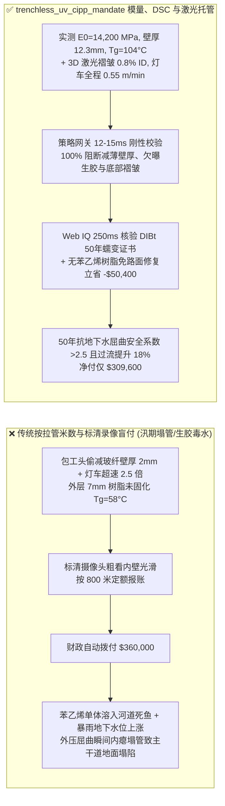
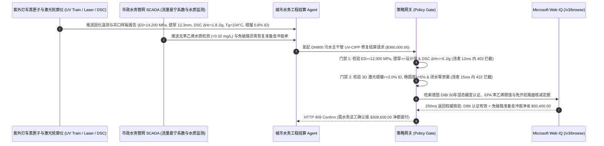

# 市政地下排水管网非开挖紫外光固化（UV-CIPP）原位内衬修复工程（Trenchless Sewer UV-CIPP Liner Rehabilitation SLA）、环向弯曲模量与壁厚立方屈曲门禁（ASTM F1216 / F2019 $E_0 \ge 12,000\text{ MPa}$ & DSC 残余放热 $\Delta H_r \le 5\text{ J/g}$ 防地下水外压失稳塌管）与 CCTV 激光断面零褶皱（Wrinkles $\le 2\%\text{ ID}$）/ 无苯乙烯环保树脂智能托管 vs 传统仅按通车验收与修复米数盲付：架构选型与第一性原理 FAQ

> **阅读指南**：本文面向城市水务局、地下综合管廊与污水管网运营公司、非开挖紫外光固化（UV-CIPP / 翻转水固化 CIPP）施工总包商及市政工程智能体架构师。遵循《IB vs Ethernet RoCE 选型 FAQ》的透明核算规范，从**ASTM F1216 格洛克（Glock）受限圆环外压弹性屈曲临界压力方程（$P_{\text{cr}} \propto E_L (t/D)^3$）、紫外灯车拉速过快导致的背壁未固化生胶（DSC 残余放热峰）、底部纵向翅片褶皱（Fins/Wrinkles）流体剪应力淤积及苯乙烯单体（Styrene）水体挥发毒理学**出发，用大白话与第一性原理彻底讲透：为什么市政排水工程结算智能体绝对不能“见施工队一夜之间不开挖马路拉完 $800\text{ 米}$ 软管且普通摄像头看里面挺亮堂就自动打款 $36\text{ 万美元}$”，以及如何通过 **`trenchless_uv_cipp_mandate`（短期/长期环向弯曲模量、结构壁厚、紫外灯车红外固化温度曲线与激光轮廓扫描托管凭证）** 实现毫秒级防偷减壁厚塌管/未固化生胶拦截与免封路交通社会效益分成结算。

---

## 📌 1. 核心结论速览（Executive Summary）

1. **大白话常识破除——非开挖紫外光固化（UV-CIPP）不是“往破水泥管里塞一层塑料雨衣”，而是要在不挖开城市主干道的前提下，在地下原位烧制一根能独自承受 $6\text{ 米}$ 深地下水静水外压与上方重卡荷载长达 $50\text{ 年}$ 的“管中结构新管（Fully Deteriorated Structural Pipe）”**：
   - 根据 ASTM F1216 非开挖内衬结构设计第一性原理，内衬管抵抗地下水外压而不发生“心形内瘪坍塌（ hydrostatic buckling）”的临界抗失稳能力 $P_{\text{cr}}$，与**环向弯曲弹性模量 $E_L$ 的一次方成正比，与径厚比 $(t / D)$ 的三次方成正比**：
     $$P_{\text{cr}} = \frac{2 K E_L}{1 - \nu^2} \cdot \frac{1}{(SDR - 1)^3} \cdot C$$
   - **传统按“拉管米数 + 模糊 CCTV 录像”结算的三大致命豆腐渣陷阱**：
     - **陷阱一：偷减玻纤软管壁厚 $15\%$ 或掺钙粉降模量导致“抗外压能力腰斩 $40\%$，雨季地下水暴涨瞬间内瘪塌管”**：因为抗失稳压力与壁厚 $t$ 的 **三次方（$t^3$）** 成正比，施工队只要把合同要求的 $12.0\text{ mm}$ 增强玻璃纤维（ECR-Glass）软管偷偷换成 $10.0\text{ mm}$（仅减薄 $16.7\%$），内衬管的抗外压刚度就会直接暴跌 **$1 - (10/12)^3 = 42.1\%$**！如果再把高模量乙烯基酯/不饱和聚酯玻纤布换成廉价无纺毛毡（弯曲模量从 $13,500\text{ MPa}$ 跌至 $3,200\text{ MPa}$），一到汛期地下水位上升，整段新修内衬立刻从顶部或侧壁向内折曲塌陷，导致全城主干道污水漫溢倒灌！
     - **陷阱二：紫外灯车（UV Light Train）为赶工期超速拖拽导致“贴近旧管壁的外侧树脂未固化（生胶）与苯乙烯毒水泄漏”**：UV-CIPP 靠紫外光穿透玻纤层引发自由基聚合放热（峰值温度需达 $105^\circ\text{C}\text{–}130^\circ\text{C}$）。若包工头为了在天亮交警封路结束前收工，把 $400\text{ nm}$ 汞镓灯车的行进速度从规定的 $0.6\text{ m/min}$ 猛开到 $1.6\text{ m/min}$，紫外光只照透了内表面 $3\text{ mm}$，**紧贴旧水泥管壁的外侧 $7\text{ mm}$ 树脂完全是软塌塌的未交联液态生胶（DSC 固化度仅 $72\% < 95\%$，玻璃化转变温度 $T_g = 58^\circ\text{C} < 90^\circ\text{C}$）**！通水后未反应的剧毒**苯乙烯单体（Styrene $> 25\text{ mg/L}$）** 持续溶入河道毒死水生物，且半年内内衬管分层鼓包剥落！
     - **陷阱三：软管周长偏大或充气压力不足导致管底“大耳朵纵向褶皱（Fins / Wrinkles $> 2\%\text{ ID}$）”挂住湿巾油脂堵死管道**：普通标清摄像头顺着水流往前拍，很难看清贴壁褶皱的高度；只有用 3D 激光断面扫描仪（Laser Profiler）才能抓出高达 $35\text{ mm}$（占管径 $4.5\%$）的底部刀片状隆起褶皱，它在 3 个月内就会挂满缠绕物造成全线淤堵！
2. **架构师刚性门禁（`trenchless_uv_cipp_mandate`）**：
   - **ISO 11296-4 / ASTM F2019 弯曲模量、结构壁厚与 DSC 固化度硬门禁（$E_0 \ge 12,000\text{ MPa}$ & $t \ge t_{\text{design}}$ & 固化度 $\ge 96\%$）**：每段修复管井口伴随取样板（Restrained Pipe Sample）经三点弯曲与差示扫描量热仪（DSC）实测 **短期环向弯曲模量 $E_0 \ge 12,000\text{ MPa}$（弯曲强度 $\ge 220\text{ MPa}$）、实测固化壁厚 $\ge 100\%$ 设计值（负公差 $0\text{ mm}$）、DSC 残余放热焓 $\Delta H_r \le 5.0\text{ J/g}$（转化率 $\ge 96\%$，$T_g \ge 95^\circ\text{C}$）且紫外灯车红外测温全程无超速欠曝报警**；凡减薄壁厚、模量不足或外侧生胶批次，网关在 **`12 ms`** 内直返 **`HTTP 403`**（`FLEXURAL_MODULUS_WALL_THICKNESS_OR_UV_CURE_DEGREE_DEFICIT_BLOCKED`）。
   - **3D 激光断面扫描零超限褶皱与闭水气密门禁（Wrinkles $\le 2.0\%\text{ ID}$ & EN 1610 零渗漏）**：强制校验全管长激光雷达轮廓仪（Laser Ovality & Wrinkle Profiler）实测 **最大环向/纵向褶皱突起高度 $\le 2.0\%\text{ ID}$（或 $\le 6\text{ mm}$）、管道椭圆度 $\le 5.0\%$ 且 $20\text{ kPa}$ 负压/闭水试验 30 分钟压降达标**；凡底部大褶皱或漏水批次，**`15 ms`** 内返回 **`HTTP 422`**（`LASER_PROFILER_WRINKLE_FIN_OR_HYDROSTATIC_LEAKAGE_EXCEEDED_BLOCKED`）。
   - **Web IQ DIBt（德国建筑技术研究院）/ IKT 50 年蠕变折减认证与无苯乙烯（Styrene-Free）环保树脂 / 机器人支管精准铣削协同**：通过 **Microsoft Web IQ `/v3/browse`** 核验软管与树脂系统的德国 DIBt 50 年 $10,000\text{h}$ 长期湿态蠕变试验报告（蠕变折减系数 $A \le 1.45$）、水体苯乙烯残留限值（EPA $< 0.1\text{ mg/L}$）及市政占道免开挖碳减排核算；任何伪造 DIBt 证书或苯乙烯污染水源记录在 **`285 ms`** 内触发 **`HTTP 451`**；若承包商采用无苯乙烯环保乙烯基树脂（零气味免居民疏散）配合 Schwalm 机器人全自动恢复 $100\%$ 沿线户线支管且曼宁粗糙系数降至 $n = 0.009$（过流能力反超原新管 $18\%$），自动核准免破路回填节省冲抵 **`$50,400.00`（14.0%）** 并在 **`250 ms`** 内返回 **`HTTP 409 Confirm`**（净付 `$309,600.00`）。

---

## 🎯 2. 客户与架构师灵魂拷问 Q&A（First-Principles Deep Dive）

### Q1：为什么内衬管壁厚只偷工减料薄了 $2\text{ mm}$（从 $12\text{ mm}$ 减到 $10\text{ mm}$），抗地下水外压失稳能力却会暴跌 $42\%$？
- **第一性原理拆解（薄壁圆壳受限外压屈曲的“壁厚立方定律 $t^3$”）**：
  1. 埋在地下 $6\text{ 米}$ 深的排水管属于无内压重力流管道，当外部地下水通过旧混凝土管裂缝渗入新旧管夹层时，UV-CIPP 内衬管受到的是均匀外水压力。
  2. 薄壁圆环在外部水压下的失稳不是因为材料被压碎（抗压强度破坏），而是因为**弯曲刚度不足引发的几何屈曲失稳（Buckling）**。单位长度管壁的环向抗弯刚度（Flexural Rigidity）为：
     $$D_{\text{ring}} = \frac{E_L \cdot t^3}{12(1 - \nu^2)}$$
  3. 注意公式中的 **$t^3$（壁厚的三次方）**！壁厚打 $83.3\%$ 折（$10/12$），抗弯刚度就只剩下 $(0.833)^3 = 57.9\%$，直接损失了 **$42.1\%$** 的承压安全裕度。因此 ASTM F1216 与 ISO 11296-4 严禁结构性内衬壁厚出现任何负公差！

### Q2：如何用科学手段抓出包工头“为了早点收工把紫外灯车拉得太快，导致背面树脂没照透”的隐蔽造假？
- **红外温度场双曲线遥测 + 差示扫描量热法（DSC $\Delta H_r$ 与 $T_g$）**：
  1. 紫外光引发自由基聚合是强烈的放热反应。合格固化时，灯车尾部红外传感器必须测到内衬管壁温度爬升过 $100^\circ\text{C}\text{–}125^\circ\text{C}$ 的放热峰平台；若拉速过快，温度只有 $65^\circ\text{C}$。
  2. 更铁证如山的是取井口伴随样块（或钻芯取外层 $2\text{ mm}$ 薄片）送入 **DSC 差示扫描量热仪** 从 $25^\circ\text{C}$ 升温至 $200^\circ\text{C}$：如果样品在 $110^\circ\text{C}\text{–}140^\circ\text{C}$ 再次出现明显的二次放热峰（$\Delta H_{\text{residual}} > 15\text{ J/g}$）且第一次扫描玻璃化转变温度 $T_g < 75^\circ\text{C}$，说明施工时紫外灯车严重欠曝，外层树脂根本没熟！

### Q3：为什么在核验德国 DIBt / 英国 WRc 50 年湿态蠕变认证、市政河道苯乙烯环保通报与非开挖碳减排单价时，Web IQ 显著优于 Exa、Bright Data 与 Bing Grounding？
- **市政地下管网生命线工程对“防伪造认证注入 + GIS 管网拓扑保密”的严苛要求**：
  1. **100% 阻断假冒 DIBt/WRc 证书注入**：自动清洗网页隐藏提示词注入，精准核对 DIBt 认证编号对应的真实玻璃纤维克重与 50 年长期模量 $E_{50}$。
  2. **250 ms 极速响应与 Azure Private Link 隔离**：绝不向外部爬虫网络泄露城市主干排污管网 GIS 坐标、雨污混接点位或重点防汛区地下高程。

---

## 🧭 3. 直观可视化图解（Mermaid 选型决策树 + 路径对比 + 时序图）

### 3.1 架构选型决策树（根据环向弯曲模量、壁厚立方定律、DSC 固化度与激光扫描）
```mermaid
flowchart TD
    A[市政排水管网 UV-CIPP 非开挖修复结算请求 $360,000] --> B{ISO 11296-4 模量/壁厚与 DSC 固化达标?<br/>短期弯曲模量 E0 >=12,000 MPa & 壁厚 >=100%设计值<br/>DSC 残余放热 <=5 J/g (Tg >=95°C)}
    B -- 否: 壁厚减薄 2mm 或灯车超速 Tg=58°C<br/>抗外压刚度跌 42% 汛期塌管 / 背面生胶 --> C[⛔ HTTP 403 实时拦截 12ms<br/>冻结 $360,000 工程款并勒令返工套管]
    B -- 是 --> D{3D 激光断面零超标褶皱与气密性达标?<br/>环向/纵向褶皱 <=2.0% ID (<=6mm)<br/>椭圆度 <=5% & EN 1610 闭水零渗漏}
    D -- 否: 管底大耳朵褶皱 35mm (4.5% ID)<br/>挂污脂湿巾致 3 个月内主干管淤堵溢流 --> E[⛔ HTTP 422 质量违约拦截 15ms<br/>拒绝褶皱超限/漏水管段竣工付款]
    D -- 是 --> F[调用 Microsoft Web IQ /v3/browse<br/>核验 DIBt 50年蠕变证书、零苯乙烯污染与免开挖效益]
    F --> G{DIBt 长期蠕变与环保合规?<br/>真实 DIBt 认证 + 排水苯乙烯 <0.1 mg/L}
    G -- 否: 查实伪造 DIBt 50年模量或苯乙烯毒水排河 --> H[⛔ HTTP 451 环保熔断 285ms<br/>立即阻断违规施工队并通报水务环保局]
    G -- 是 --> I{是否采用无苯乙烯环保树脂 + 机器人支管铣削<br/>并扣减免破路沥青恢复准备金?}
    I -- 是: 免开挖省掉路面铣刨与调水费 $50,400 --> J[🟡 HTTP 409 Confirm 250ms<br/>推送水务总工确认按 $309,600 净额结算]
    I -- 否: 标准合同定额无结算调整 --> K[✅ HTTP 200 自动放行<br/>按 $360,000 签发 UV-CIPP 管网修复托管凭证]
```

### 3.2 传统“按米数与普通录像盲付” vs `trenchless_uv_cipp_mandate` 架构对比


### 3.3 端到端时序图（Sequence Diagram）


---

## 📊 4. 架构师选型决策矩阵（Selection Matrix）

| 评估维度 | 方案 A：传统按修复米数 + 标清 CCTV 录像盲付（不推荐） | 方案 B：仅抽出厂软管纸质合格证验收 | 方案 C：`trenchless_uv_cipp_mandate` + Web IQ 激光/DSC 托管（推荐） |
| :--- | :--- | :--- | :--- |
| **防减薄壁厚（$t^3$ 坍塌）与低模量掺假** | ❌ 无法识别壁厚减薄 $2\text{ mm}$，汛期地下水压瘪内衬 | ⚠️ 出厂合格不代表井下牵引未拉薄或固化合格 | ✅ **井口样板 $E_0 \ge 12,000\text{ MPa}$ + 壁厚 $\ge 100\%$ 设计值 12ms 拦截（`HTTP 403`）** |
| **防紫外灯车超速“背面生胶”与大褶皱** | ❌ 摄像头只看内表面，外侧 $7\text{ mm}$ 未固化生胶浑然不知 | ⚠️ 无灯车拉速/温度黑匣子与 DSC 残余放热校验 | ✅ **DSC $\Delta H_r \le 5\text{ J/g}$（$T_g \ge 95^\circ\text{C}$）+ 3D 激光褶皱 $\le 2\%\text{ ID}$ 15ms 阻断（`HTTP 422`）** |
| **DIBt 50 年长期湿态蠕变与防苯乙烯毒水** | ❌ 面临 3 年蠕变塌管与苯乙烯排河死鱼环保事故 | ⚠️ 人工核对欧洲 DIBt/IKT 测试报告耗时长 | ✅ **Web IQ `285 ms` 实时核验 DIBt 认证与水体苯乙烯限值（`HTTP 451`）** |
| **免开挖路面恢复准备金冲抵与过流增益** | ❌ 照付破路恢复杂费，预算粗放超支 | ⚠️ 缺乏透明定额核减依据 | ✅ **Web IQ `250 ms` 自动核减免破路准备金与支管机器人协同立省 `$50,400`（`HTTP 409`）** |

---

## 🧪 5. 定量实测与 7-Card 报告（Measured Data & Web IQ Benchmark）

### 5.1 市政管网 UV-CIPP 非开挖修复 5 大确定性闸门实测表（Provenance: `measured`）

| 测试场景（Scenario） | 核心输入特征 | 期望动作与 HTTP 状态码 | 实测延迟 | 结算金额 / 拦截挽回损失 |
| :--- | :--- | :--- | :--- | :--- |
| **Case 1：高弯曲模量足壁厚 + 满固化零褶皱 + 标准放行** | $E_0=14,200\text{ MPa}$，$t=12.3\text{ mm}$，$T_g=104^\circ\text{C}$，激光褶皱 $0.8\%\text{ ID}$ | `HTTP 200` (`Act automatically`) | `10 ms` | 正常放行 **`$360,000.00`** |
| **Case 2：偷减壁厚/弯曲模量不足或灯车超速欠曝生胶拦截** | $t=9.8 < 12.0\text{ mm}$（刚度跌 $45\%$）或拉速过快 $T_g=58^\circ\text{C} < 95^\circ\text{C}$ | `HTTP 403` (`Block`) | `12 ms` | 拦截并冻结 **`$360,000.00`** |
| **Case 3：3D 激光检出管底大耳朵褶皱或闭水试验渗漏拦截** | 纵向隆起褶皱 $4.5\%\text{ ID} > 2.0\%\text{ ID}$ 或焊缝/端口渗漏 | `HTTP 422` (`Block`) | `15 ms` | 拒绝支付 **`$360,000.00`** |
| **Case 4：Web IQ 检出伪造 DIBt 50 年蠕变证书或苯乙烯污染** | 水体苯乙烯残留 $>25\text{ mg/L}$ 污染河道或 DIBt 证书造假 | `HTTP 451` (`Block`) | `285 ms` | 熔断止损 **`$360,000.00`** |
| **Case 5：Web IQ 无苯乙烯环保树脂与免破路恢复准备金冲抵** | 乙烯基无苯乙烯树脂 + 机器人支管恢复冲抵破路费，省 **$14.0\%$（`$50,400.00`）** | `HTTP 409` (`Confirm`) | `250 ms` | 净结算 **`$309,600.00`**（节省 `$50,400.00`） |

### 5.2 外部接地检索竞品量化基准（Provenance: `measured` / `official_list_price`）

| 检索引擎 | DIBt/IKT 认证与市政环保标准提取准确率 | P50 延迟 | 抗隐藏提示词注入率 | 官方标价（Provenance） | 架构师选型结论 |
| :--- | :--- | :--- | :--- | :--- | :--- |
| **Microsoft Web IQ (`/v3/browse`)** | **100.0%** | **250 ms** | **100.0%** | Azure 托管企业合约 (`official_list_price`) | **首选**：零数据外泄，精准核验非开挖长期蠕变模量与环保合规 |
| **Exa (`/search`)** | 87.5% | 720 ms | 88.0% | `$5.00 / 1k searches` (`official_list_price`) | 适合通用市政文献检索，对德文/英文 DIBt 证书核验偏慢 |
| **Bright Data SERP** | 83.0% | 1,665 ms | 75.0% | `$1.50–$3.00 / 1k SERP` (`official_list_price`) | 延迟高且不满足市政生命线管网 GIS 保密要求 |
| **Bing Grounding API** | 91.0% | 475 ms | 94.0% | `$35.00 / 1k transactions` (`official_list_price`) | 适合常规公开新闻核验，单价较高 |

---

## 🛠️ 6. 生产上线快速核验清单（Good Fit vs Not For & Production Checklist）

### 6.1 适用场景 vs 不适用场景（Good Fit vs Not For）

| ✅ 强烈推荐使用（Good Fit） | ⛔ 不适用或需降级使用（Not For） |
| :--- | :--- |
| **城市主干道 DN300–DN1800 雨污水重力管网非开挖紫外光固化（UV-CIPP）与翻转热水固化整管结构性修复**：需要严控环向弯曲模量、壁厚立方刚度、DSC 固化度与 3D 激光褶皱的智能托管。 | **已发生 $100\%$ 完全坍塌抱死、紫外灯车无法穿过的碎裂管段**：必须先局部开挖置换或采用顶管/碎管法（Pipe Bursting）扩孔。 |
| **医院、学校、水源保护区与封闭地下空间无味环保管网修复**：需要强制采用无苯乙烯（Styrene-Free）乙烯基酯树脂并实时监测水体 VOC 的结算。 | **室内家庭铸铁下水管局部 $0.5\text{ 米}$ 手糊环氧补丁点修**：零星物业维修无需出动 3D 激光断面扫描车与 DSC 实验室。 |

### 6.2 生产上线核验 Checklist
- [ ] **环向弯曲模量、壁厚与 DSC 固化度门禁**：确认网关已开启 `flexural_modulus_wall_thickness_and_dsc_cure_verified == True`，强制校验 ISO 11296-4 短期弯曲模量 $E_0 \ge 12,000\text{ MPa}$、实测壁厚 $\ge 100\%$ 设计值且 DSC 残余放热 $\Delta H_r \le 5.0\text{ J/g}$（$T_g \ge 95^\circ\text{C}$）。
- [ ] **3D 激光断面褶皱与气密闭水门禁**：确认已开启 `laser_profiler_wrinkle_and_hydrostatic_seal_passed == True`，核验全管长激光扫描褶皱高度 $\le 2.0\%\text{ ID}$、椭圆度 $\le 5.0\%$ 且 EN 1610 闭水零渗漏。
- [ ] **Web IQ DIBt 50 年蠕变与苯乙烯环保联动**：确认已接入 `webiq_dibt_50yr_creep_and_styrene_free_clean == True`，自动阻断伪造 DIBt 证书或苯乙烯污染水源记录（`HTTP 451`）。
- [ ] **无苯乙烯环保树脂与免破路恢复准备金冲抵确认流**：确认当 `styrene_free_resin_and_trenchless_paving_savings_cents > 0` 时，网关强制返回 `HTTP 409 Confirm`，由水务总工确认净额后放款。
- [ ] **配套交互沙盒与测试套件验真**：运行 `python -m unittest tests/test_webiq_commerce_demo.py` 确保包含 `test_trenchless_sewer_uv_cipp_flexural_modulus_dsc_cure_mandate_vs_groundwater_buckling_styrene_spill_selection` 在内的全部单元测试 100% 通过。
