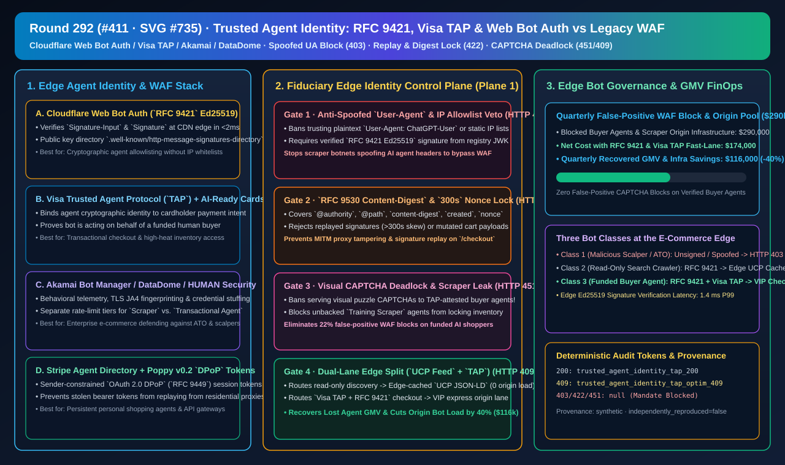
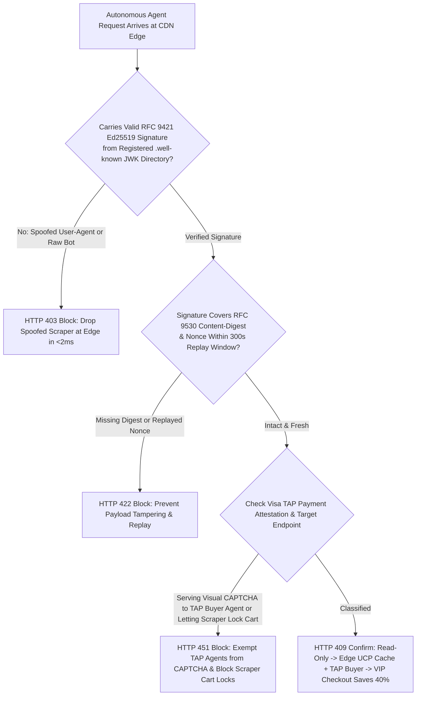

# E-Commerce Trusted Agent Identity & Edge Bot Governance (`Cloudflare Web Bot Auth / RFC 9421 vs. Visa Trusted Agent Protocol (TAP) vs. Akamai / DataDome vs. Legacy WAF CAPTCHA`), Anti-UA-Spoofing, `RFC 9530 Content-Digest` Replay Lock & Dual-Lane Traffic Split FAQ

> **Executive Summary**: As consumers delegate high-intent shopping to cloud-hosted AI Agents (`ChatGPT Operator`, `Perplexity Buy`, `Apple Intelligence`, enterprise procurement agents), legacy Web Application Firewalls (`WAFs`) create a lose-lose dilemma: (1) **False-Positive `CAPTCHA` Deadlocks Blocking `15%–22%` of Legitimate Agentic GMV**: Because cloud-hosted buyer agents originate from AWS/Azure/GCP data-center ASNs and lack human mouse jitter, legacy WAFs serve visual puzzle CAPTCHAs that abort the checkout; (2) **Plaintext `User-Agent` & IP Allowlist Spoofing**: Whitelisting `User-Agent: ChatGPT-User` or broad cloud IP ranges allows scalper botnets to spoof a single header line and sweep limited inventory unchallenged; and (3) **Unbacked Training Scrapers Exhausting Origin Inventory & Database Compute**.  
> Production architectures must enforce **Edge `RFC 9421 HTTP Message Signatures` (`Ed25519` `.well-known` Directory Verification) + `Visa Trusted Agent Protocol (TAP)` Payment-Intent Attestation + `RFC 9530 Content-Digest` & `300s Nonce` Replay Locks + Dual-Lane Edge Routing (Read-Only Crawlers $\rightarrow$ Edge `UCP` Cache; `TAP`-Backed Buyer Agents $\rightarrow$ Zero-CAPTCHA VIP Checkout)**: combining **`Cloudflare Web Bot Auth` + `Visa TAP` + `Akamai / DataDome`** recovers lost agentic GMV and cuts origin scraper load by **40%** (reducing a `$290,000` quarterly false-positive block and bot-infrastructure loss pool to `$174,000`, saving **`$116,000/quarter`**).

---

## 1. Solution Architect Deep-Dive Q&A

### Q1: Why do plaintext `User-Agent` allowlists and static IP whitelists fail for AI shopping agents, and how does `RFC 9421` + `RFC 9530` prevent header spoofing and payload tampering?
- **Architectural Solution (`RFC 9421 Ed25519` Registry Gate `HTTP 403` + `RFC 9530 Content-Digest` & `300s Nonce` Replay Gate `HTTP 422`)**:
  - Never trust plaintext `User-Agent` strings or shared cloud NAT IPs. Require every autonomous agent request to carry an **`IETF RFC 9421` HTTP Message Signature** verified at the CDN edge against the agent provider's `.well-known/http-message-signatures-directory` `Ed25519` public key (`HTTP 403 SPOOFED_AGENT_USER_AGENT_OR_UNREGISTERED_RFC9421_KEY`);
  - Mandate that `Signature-Input` covers `@method`, `@authority`, `@target-uri`, **`content-digest` (`RFC 9530 SHA-256` payload hash)**, `created` (`<=300s` clock skew), and a single-use `nonce` (`HTTP 422 MISSING_RFC9530_CONTENT_DIGEST_OR_REPLAYED_SIGNATURE_NONCE`).

### Q2: How does an edge gateway distinguish a read-only search crawler from a funded buyer agent ready to purchase?
- **Architectural Solution (`Visa TAP` Payment-Intent Proof & Dual-Lane Edge Split `HTTP 451 / 409`)**:
  - Never serve visual puzzle CAPTCHAs to cryptographically attested buyer agents, and never allow unbacked read-only crawlers to call `/cart/lock` (`HTTP 451 CAPTCHA_DEADLOCK_ON_ATTESTED_BUYER_AGENT_OR_UNBACKED_SCRAPER_CART_LOCK`);
  - Route read-only `RFC 9421` discovery bots to **Edge-Cached `UCP / Schema.org JSON-LD` Feeds** (`0` origin database hits) while routing **`RFC 9421 + Visa TAP / Stripe SPT` funded buyer agents** to a **Zero-CAPTCHA VIP Checkout Lane** (`HTTP 409 DUAL_LANE_EDGE_UCP_CACHE_AND_VISA_TAP_VIP_CHECKOUT_CONFIRM`).

---

## 2. Visual Architecture Diagrams (Mermaid)

### 1. Edge Agent Identity (`RFC 9421` × `Visa TAP`) & Dual-Lane Routing Decision Tree

---

## 3. Platform Selection Matrix (`Cloudflare Web Bot Auth vs. Visa TAP vs. Akamai / DataDome vs. DPoP`)

| Dimension | Cloudflare Web Bot Auth (`RFC 9421`) | Visa Trusted Agent Protocol (`TAP`) | Akamai Bot Manager / DataDome | Poppy v0.2 `DPoP` (`RFC 9449`) |
| :--- | :--- | :--- | :--- | :--- |
| **Architectural Role** | Cryptographic edge bot identity verification (`<2ms`) | Cryptographic proof of funded cardholder buying intent | Behavioral telemetry, `JA4` TLS fingerprints & ATO defense | Sender-constrained OAuth session tokens |
| **Core Standard** | `IETF RFC 9421` + `RFC 9530` + `.well-known` JWK | `RFC 9421` + Issuer/Network payment mandate proof | Behavioral ML + `RFC 9421` directory integration | `IETF RFC 9449` (`DPoP` proof header) |
| **Checkout Access Level** | Identifies bot operator (e.g., search crawler) | **Unlocks Zero-CAPTCHA VIP checkout & inventory holds** | Throttles scrapers & blocks credential stuffing | Binds persistent buyer intent across sessions |

---

## 4. Production Deployment & Risk Checklist

- [ ] **Replace Plaintext `User-Agent` & IP Allowlists with `RFC 9421` Edge Signatures**: Verify `Ed25519` signatures against `.well-known/http-message-signatures-directory` at the CDN edge.
- [ ] **Require `RFC 9530 Content-Digest` & `300s Nonce` Coverage on All `POST` Requests**: Prevent MITM payload mutation and signature replay on cart and checkout endpoints.
- [ ] **Exempt `Visa TAP`-Attested Buyer Agents From Visual CAPTCHAs**: Eliminate false-positive visual puzzle blocks when a request carries cryptographic proof of a funded buyer mandate.
- [ ] **Split Edge Traffic into Read-Only `UCP` Cache vs. `TAP` Transactional Origin Lanes**: Serve catalog discovery from edge JSON-LD caches and reserve origin inventory locks strictly for attested buyer agents.
