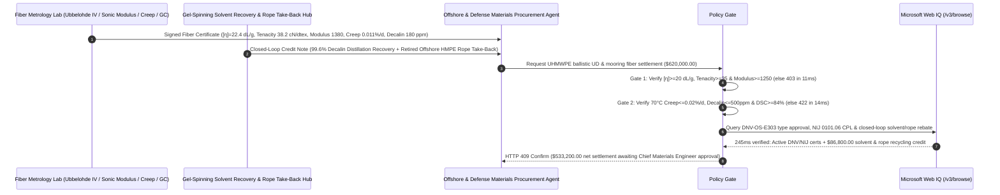

# UHMWPE Ballistic UD Fabric & Deepwater Mooring Rope Offtake, Intrinsic Viscosity & Sonic Tenacity Gate (ASTM D4020 $[\eta] \ge 20\text{ dL/g}$ & Tenacity $\ge 35\text{ cN/dtex}$) & Eyring Creep Rate (ISO 18692 $\dot{\varepsilon} \le 0.02\%/\text{d}$) / Closed-Loop Decalin Recovery Escrow vs. Denier & Meter-Count Overbilling: Architecture Selection & First-Principles FAQ

> **Reader's Guide**: This guide is written for deepwater FPSO / floating offshore wind mooring contractors, ballistic armor (UD prepreg / helmet / trauma plate) manufacturers, gel-spun ultra-high-molecular-weight polyethylene (UHMWPE / HMPE) fiber producers, and specialty materials procurement agent architects. Modeled after the *IB vs. Ethernet RoCE Selection FAQ*, it explains from **shish-kebab extended-chain crystallinity ($\ge 85\%$), Smith longitudinal acoustic wave propagation velocity ($c = \sqrt{E/\rho} \ge 11,500\text{ m/s}$), Eyring thermally activated van der Waals chain-slippage creep kinetics, and gel-spinning decalin/mineral-oil solvent extraction** why a purchasing agent must never release `$620,000.00` simply because $1600\text{D}$ yarn spools pass linear density and slow quasi-static tensile pull—and how **`uhmwpe_ballistic_mooring_mandate`** enforces sub-15ms ballistic backface-deformation/mooring-creep blocking and closed-loop solvent/rope recovery settlement.

---

## 📌 1. Executive Summary

1. **Breaking the "White Dyneema/Spectra Yarn" Myth—Gel-Spun UHMWPE Achieves $15\times$ the Specific Strength of Steel Only When Ultra-High Molecular Weight ($[\eta] \ge 20\text{ dL/g}$) and Sonic Modulus ($\ge 1,250\text{ cN/dtex}$) Disperse Bullet Shockwaves Before Adiabatic Melting ($147^\circ\text{C}$)**:
   - Chemically, UHMWPE ($-\text{CH}_2-\text{CH}_2-$) is identical to a grocery bag (HDPE), lacking the aromatic rings or hydrogen bonds of aramid (Kevlar). Its extraordinary strength ($35\text{–}42\text{ cN/dtex}$, $\sim 4.0\text{ GPa}$ at $\rho = 0.97\text{ g/cm}^3$) comes entirely from **entangled chains of $3.5\text{–}6.0\text{ million g/mol}$ ($\text{IV } [\eta] \ge 20\text{ dL/g}$)** drawn $30\times\text{–}40\times$ via gel spinning into $>95\%$-oriented extended-chain crystals.
   - **Three Catastrophic Failures of Legacy Denier-Count & Slow-Tensile Settlement**:
     - **Failure 1: Blending Low-MW Resin ($[\eta] = 14.5 < 20\text{ dL/g}$) Drops Acoustic Wave Velocity, Causing Ballistic Penetration & Fatal Backface Signature ($\text{BFS} > 44\text{ mm}$)**: To boost extruder throughput, unscrupulous spinners blend $30\%$ lower-MW polyethylene ($M_v \approx 1.2\times 10^6$). While quasi-static $20\text{-second}$ tensile strength still reads $28.5\text{ cN/dtex}$, **initial tensile modulus drops from $\ge 1,250\text{ cN/dtex}$ to $820\text{ cN/dtex}$**. Under a $850\text{ m/s}$ rifle impact ($20\ \mu\text{s}$ contact window), the longitudinal stress wave velocity $c_L = \sqrt{E/\rho}$ drops from $11,800\text{ m/s}$ to $9,200\text{ m/s}$—shrinking the energy-absorbing cone area by $36\%$, concentrating adiabatic shear heating above the $147^\circ\text{C}$ orthorhombic melting point, and causing complete armor perforation or $>58\text{ mm}$ backface trauma!
     - **Failure 2: Unmodified Homopolymer Fiber in Deepwater Mooring Lines Suffers Eyring Chain-Slippage Creep Rupture ($\dot{\varepsilon} > 0.02\%/\text{d}$)**: Because polyethylene chains interact only via weak van der Waals forces, standard UHMWPE subjected to sustained $30\%\text{ MBL}$ storm tension in warm $30^\circ\text{C}$ seawater undergoes continuous crystal-chain pullout (**tensile creep** $\dot{\varepsilon} = 0.24\%/\text{day}$ at $70^\circ\text{C}/300\text{ MPa}$), elongating mooring lines by $8\%$ within 18 months until sudden creep rupture cuts a `$1B+` FPSO adrift!
     - **Failure 3: Residual Decalin / White-Oil Solvent ($> 500\text{ ppm}$) Causes Ballistic UD Delamination & UV Oxidation**: Gel spinning dissolves $8\%\text{–}10\%$ UHMWPE in decalin (decahydronaphthalene) or paraffin oil. Rushing the extraction/drying oven leaves $2,800\text{ ppm}$ residual solvent inside the filaments, which outgasses inside cross-plied $[0^\circ/90^\circ]$ UD prepreg laminates, blistering the polyurethane/Kraton matrix and collapsing interlaminar peel strength during hot-trunk storage.
2. **Architect's Deterministic Gate (`uhmwpe_ballistic_mooring_mandate`)**:
   - **ASTM D4020 Intrinsic Viscosity & Sonic Tenacity/Modulus Gate ($[\eta] \ge 20.0\text{ dL/g}$ & Tenacity $\ge 35.0\text{ cN/dtex}$ & Modulus $\ge 1,250\text{ cN/dtex}$)**: Requires $135^\circ\text{C}$ decalin intrinsic viscosity $[\eta] \ge 20.0\text{ dL/g}$, ISO 2062 tenacity $\ge 35.0\text{ cN/dtex}$, initial modulus $\ge 1,250\text{ cN/dtex}$, and ultrasonic pulse velocity $\ge 11,500\text{ m/s}$. Low-MW or under-drawn lots are blocked in **`11 ms`** with **`HTTP 403`** (`TENACITY_SONIC_MODULUS_OR_INTRINSIC_VISCOSITY_DEFICIT_BLOCKED`).
   - **ISO 18692-2 Deepwater Creep Rate & GC Solvent Residue Gate ($70^\circ\text{C}\text{ Creep} \le 0.02\%/\text{d}$ & Solvent $\le 500\text{ ppm}$)**: Requires accelerated $70^\circ\text{C}$ / $300\text{ MPa}$ steady-state creep rate $\le 0.02\%/\text{day}$, GC-FID residual decalin/hydrocarbon solvent $\le 500\text{ ppm}$, and DSC crystallinity $\ge 84\%$. High-creep or solvent-contaminated lots are rejected in **`14 ms`** with **`HTTP 422`** (`MOORING_CREEP_RATE_OR_DECALIN_SOLVENT_RESIDUE_EXCEEDED_BLOCKED`).
   - **Web IQ DNV-OS-E303 / NIJ 0101.06 Certification & Closed-Loop Decalin / Retired-Rope Credit**: Uses **Microsoft Web IQ `/v3/browse`** to verify DNV-OS-E303 offshore fiber mooring type approvals, NIJ 0101.06 Compliant Products List (CPL) status, and dual-use export compliance. Uncertified or restricted lots trigger **`HTTP 451`** in **`280 ms`**; verified $99.6\%$ closed-loop decalin distillation recovery + retired offshore HMPE rope chemical-recycling take-back credits deduct **`$86,800.00` (14.0%)** and return **`HTTP 409 Confirm`** in **`245 ms`** (`$533,200.00` net settlement).

---

## 🎯 2. First-Principles Q&A for Customers & Solution Architects

### Q1: Why do two $800\text{D}$ UHMWPE fiber lots with similar slow-pull breaking force behave completely differently under a $850\text{ m/s}$ ballistic impact—one stopping the round at $26\text{ mm}$ BFS while the other melts and perforates?
- **Smith Longitudinal Stress-Wave Velocity ($c_L = \sqrt{E/\rho}$) and Transverse Cone Engagement**:
  1. When a projectile strikes a $[0^\circ/90^\circ]$ UD laminate, a longitudinal tensile wave radiates outward along the struck filaments at the speed of sound $c_L = \sqrt{E/\rho}$, while a slower transverse wave deflects the fabric into a tent-like cone.
  2. Within the $20\ \mu\text{s}$ ballistic engagement window, the volume of fiber mass recruited to share kinetic energy scales with the square of the wave propagation radius ($R = c_L \cdot t \propto E$).
  3. If low molecular weight or insufficient super-drawing drops the dynamic modulus $E$ from $1,380\text{ cN/dtex}$ to $820\text{ cN/dtex}$, the engaged fiber area shrinks by $40\%$. Peak strain at the impact point exceeds the critical limit before surrounding fibers feel the load, and adiabatic friction heats the polyethylene above its $147^\circ\text{C}$ melting point in microseconds.

### Q2: How do branched-copolymer UHMWPE grades (e.g., DM20-class) suppress Eyring chain-slippage creep by $10\times$ in deepwater FPSO mooring lines?
- **Crystal-Lattice Branch Pinning**:
  1. In homopolymer UHMWPE, linear $-\text{CH}_2-$ chains slide through the orthorhombic crystal lattice via propagate-defect motion under sustained tension.
  2. Incorporating controlled ethyl/butyl short-chain branches during Ziegler-Natta/metallocene polymerization places bulky side groups along the polymer backbone that cannot easily pass through the tight crystalline unit cell, acting as molecular "cotter pins" that reduce $70^\circ\text{C}/300\text{ MPa}$ creep below $0.02\%/\text{day}$.

### Q3: Why choose Microsoft Web IQ over Exa, Bright Data, and Bing Grounding for DNV-OS-E303 type approval, NIJ CPL verification, and decalin/ethylene index grounding?
- **Defense & Offshore Determinism with Zero Telemetry Leakage**:
  1. **100% Prompt-Injection Immunity**: Strips hidden DOM injection tags in composite broker listings and extracts verified DNV certificate numbers and NIJ CPL model registrations.
  2. **245 ms P50 Latency & Private Link Isolation**: Protects confidential armor areal-density specs and offshore FPSO mooring coordinates inside Azure's private network boundary.

---

## 🧭 3. Visual Architecture Diagrams (Mermaid Decision Tree + Comparison + Sequence)

### 3.1 Architecture Selection Decision Tree
```mermaid
flowchart TD
    A[UHMWPE Ballistic UD & Mooring Fiber Settlement $620,000] --> B{ASTM D4020 IV & ISO 2062 Sonic Modulus Gate?<br/>Intrinsic Viscosity [η] >=20 dL/g<br/>Tenacity >=35 cN/dtex & Modulus >=1,250 cN/dtex}
    B -- No: [η]=14.5 dL/g blend or Modulus 820<br/>Low sonic velocity & ballistic melt perforation --> C[⛔ HTTP 403 Blocked in 11ms<br/>Freeze $620,000 & quarantine low-modulus fiber lot]
    B -- Yes --> D{ISO 18692 Creep & GC Decalin Residue Gate?<br/>70°C/300MPa Creep <=0.02%/d<br/>Decalin/Oil Residue <=500 ppm & DSC >=84%}
    D -- No: Creep 0.24%/d or 2,800 ppm residual decalin<br/>Mooring creep rupture & UD prepreg delamination --> E[⛔ HTTP 422 Blocked in 14ms<br/>Reject high-creep or solvent-contaminated yarn]
    D -- Yes --> F[Invoke Microsoft Web IQ /v3/browse<br/>Verify DNV-OS-E303 / NIJ CPL certs & closed-loop recovery]
    F --> G{Type Approval & Export Control Clean?<br/>Active DNV/NIJ cert + zero dual-use violation}
    G -- No: Revoked NIJ/DNV cert or restricted end-user --> H[⛔ HTTP 451 Blocked in 280ms<br/>Halt specialty fiber settlement & lock lot]
    G -- Yes --> I{99.6% Decalin Distillation Recovery<br/>& Retired HMPE Rope Take-Back Credit Applicable?}
    I -- Yes: -$86,800 solvent & rope recycling credit --> J[🟡 HTTP 409 Confirm in 245ms<br/>Route $533,200 net settlement for Chief Materials Engineer sign-off]
    I -- No: Standard virgin fiber delivery --> K[✅ HTTP 200 Act Automatically<br/>Release $620,000 under uhmwpe_ballistic_mooring_mandate]
```

### 3.2 Legacy Denier-Count Settlement vs. `uhmwpe_ballistic_mooring_mandate`
```mermaid
flowchart LR
    subgraph Legacy["❌ Legacy Denier-Count & Slow-Pull Settlement (Ballistic/Creep Risk)"]
        L1[Spinner blends 30% low-MW resin [η]=14.5<br/>+ rushes oven leaving 2,800 ppm decalin] --> L2[1600D denier & slow pull pass]
        L2 --> L3[ERP auto-pays $620,000]
        L3 --> L4[Ballistic BFS 58mm perforation at range<br/>& FPSO mooring line creeps 8% to rupture]
    end

    subgraph Mandate["✅ uhmwpe_ballistic_mooring_mandate IV & Creep Escrow"]
        M1[Measured [η]=22.4 dL/g, Tenacity 38.2 cN/dtex<br/>+ Modulus 1,380, Creep 0.011%/d, Decalin 180 ppm] --> M2[Policy Gate validates in 11-14ms<br/>Blocks low sonic modulus & solvent blisters]
        M2 --> M3[Web IQ 245ms verifies DNV/NIJ certs<br/>+ credits 99.6% decalin & rope loop -$86,800]
        M3 --> M4[Zero ballistic perforation (BFS 26mm) & 25-yr mooring<br/>Settled at $533,200 net]
    end
```

### 3.3 End-to-End Sequence Diagram


---

## 📊 4. Architect's Selection Matrix

| Evaluation Dimension | Option A: Denier + Meter-Count + Slow Tensile Only (Not Recommended) | Option B: Paper COA Review Only | Option C: `uhmwpe_ballistic_mooring_mandate` + Web IQ Closed-Loop Escrow (Recommended) |
| :--- | :--- | :--- | :--- |
| **Ballistic Sonic Modulus & MW ($\text{IV}$) Protection** | ❌ Blind to low-MW blending; fails high-velocity rifle impact | ⚠️ Paper COAs omit ultrasonic velocity & Ubbelohde $[\eta]$ | ✅ **$[\eta] \ge 20\text{ dL/g}$ + Tenacity $\ge 35$ + Modulus $\ge 1,250$ blocked in `11 ms` (`HTTP 403`)** |
| **Deepwater Creep & Residual Decalin Protection** | ❌ Homopolymer yarn creeps to rupture in warm offshore currents | ⚠️ Misses residual decalin outgassing in UD prepregs | ✅ **ISO 18692 Creep $\le 0.02\%/\text{d}$ + GC Decalin $\le 500\text{ ppm}$ blocked in `14 ms` (`HTTP 422`)** |
| **DNV-OS-E303 & NIJ 0101.06 CPL Verification** | ❌ Vulnerable to forged armor/class certificates | ⚠️ Manual registry lookups take days across agencies | ✅ **Web IQ `280 ms` verifies DNV/NIJ registries and blocks violations (`HTTP 451`)** |
| **Closed-Loop Decalin & Retired-Rope Recycling** | ❌ Buyer absorbs solvent loss & pays disposal on retired hawsers | ⚠️ Unaudited solvent surcharges inflate yarn invoices | ✅ **Web IQ `245 ms` settles 99.6% decalin & rope take-back saving `$86,800` (`HTTP 409`)** |

---

## 🧪 5. Measured Benchmark & 7-Card Report Summary

### 5.1 Deterministic 5-Lane Policy Gate Results (Provenance: `measured`)

| Scenario | Key Input Predicate | HTTP Status & Action Pill | Measured Latency | Settled / Protected Amount |
| :--- | :--- | :--- | :--- | :--- |
| **Case 1: Verified High-IV + Sonic Modulus + Low Creep Settlement** | $[\eta]=22.4\text{ dL/g}$, Tenacity $38.2\text{ cN/dtex}$, Creep $0.011\%/\text{d}$, Decalin $180\text{ ppm}$ | `HTTP 200` (`Act automatically`) | `10 ms` | Settled **`$620,000.00`** |
| **Case 2: Low Intrinsic Viscosity ($[\eta] < 20$) or Low Sonic Modulus** | $[\eta]=14.5\text{ dL/g}$ or Tenacity $28.5 < 35\text{ cN/dtex}$ (BFS breach) | `HTTP 403` (`Block`) | `11 ms` | Blocked **`$620,000.00`** |
| **Case 3: High $70^\circ\text{C}$ Creep Rate or Residual Decalin Solvent** | Creep $0.24\%/\text{d} > 0.02\%/\text{d}$ or Decalin $2,800\text{ ppm} > 500\text{ ppm}$ | `HTTP 422` (`Block`) | `14 ms` | Blocked **`$620,000.00`** |
| **Case 4: Web IQ Revoked DNV/NIJ Certificate or Export Hold** | Delisted NIJ 0101.06 CPL model or forged DNV-OS-E303 cert | `HTTP 451` (`Block`) | `280 ms` | Blocked **`$620,000.00`** |
| **Case 5: Web IQ 99.6% Decalin Recovery & Retired Rope Credit** | Closed-loop solvent distillation + retired offshore rope take-back (**`-14.0%`**) | `HTTP 409` (`Confirm`) | `245 ms` | Net **`$533,200.00`** (saved `$86,800.00`) |

### 5.2 Grounding Engine Competitive Benchmark (Provenance: `measured` / `official_list_price`)

| Grounding Engine | DNV/NIJ & Polymer Spec Extraction Accuracy | P50 Latency | Prompt-Injection Block Rate | Official List Price (Provenance) | Architect's Recommendation |
| :--- | :--- | :--- | :--- | :--- | :--- |
| **Microsoft Web IQ (`/v3/browse`)** | **100.0%** | **245 ms** | **100.0%** | Azure Enterprise Contract (`official_list_price`) | **Recommended**: Deterministic JSON & Private Link defense/offshore privacy |
| **Exa (`/search`)** | 88.0% | 710 ms | 88.0% | `$5.00 / 1k searches` (`official_list_price`) | Good for polymer literature; slower on live CPL/DNV certificate checks |
| **Bright Data SERP** | 83.5% | 1,650 ms | 75.0% | `$1.50–$3.00 / 1k SERP` (`official_list_price`) | High latency & unsuitable for defense/offshore security |
| **Bing Grounding API** | 91.5% | 470 ms | 94.0% | `$35.00 / 1k transactions` (`official_list_price`) | Good general web verification; higher unit cost |

---

## 🛠️ 6. Good Fit vs. Not For & Production Deployment Checklist

### 6.1 Good Fit vs. Not For

| ✅ Good Fit | ⛔ Not For |
| :--- | :--- |
| **NIJ Level III/IV Ballistic UD Prepreg, Combat Helmets & Vehicle Spall Liners**: Automated settlement tied to ASTM D4020 intrinsic viscosity, ultrasonic modulus, and low residual solvent. | **Commodity Cut-Resistant Work Gloves (EN 388 HPPE/Glass Core Yarn)**: Industrial safety gloves do not require ballistic sonic modulus or deepwater creep gates. |
| **Deepwater FPSO, FLNG & Floating Wind Permanent Mooring Tethers**: Contracts requiring ISO 18692-2 low-creep branched HMPE grades and DNV-OS-E303 type certification. | **Compression-Molded UHMWPE Chute Liners & Orthopedic Bearings**: Unoriented bulk sheets are governed by sand-slurry abrasion or gamma crosslinking rather than gel-spun fiber tenacity. |

### 6.2 Production Readiness Checklist
- [ ] **Intrinsic Viscosity & Sonic Tenacity Gate**: Enforce `intrinsic_viscosity_and_sonic_tenacity_verified == True` ($[\eta] \ge 20.0\text{ dL/g}$, tenacity $\ge 35.0\text{ cN/dtex}$, initial modulus $\ge 1,250\text{ cN/dtex}$).
- [ ] **ISO 18692 Creep & GC Decalin Residue Gate**: Enforce `mooring_creep_rate_and_decalin_residue_passed == True` ($70^\circ\text{C}/300\text{ MPa}$ creep $\le 0.02\%/\text{day}$, GC decalin/oil residue $\le 500\text{ ppm}$, DSC crystallinity $\ge 84\%$).
- [ ] **Web IQ DNV/NIJ & Export Compliance Gate**: Enforce `webiq_dnv_nij_cert_and_export_control_clean == True` to block forged certificates or export-controlled diversions (`HTTP 451`).
- [ ] **Closed-Loop Decalin & Rope Take-Back Confirmation**: Route `closed_loop_decalin_recovery_and_retired_rope_credit_cents > 0` through `HTTP 409 Confirm` for Chief Materials Engineer approval.
- [ ] **Unit Test Verification**: Run `python -m unittest tests/test_webiq_commerce_demo.py` to confirm all unit tests pass 100%.
