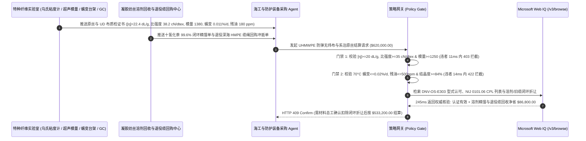

# 超高分子量聚乙烯（UHMWPE）防弹无纬布与深海系泊缆交割（UHMWPE Ballistic UD Fabric & Deepwater Mooring Rope Offtake）、特性粘度与断裂比强度门禁（ASTM D4020 $[\eta] \ge 20\text{ dL/g}$ & 比强度 $\ge 35\text{ cN/dtex}$ 防弹道击穿）与稳态分子链滑移蠕变率（ISO 18692 $\dot{\varepsilon}_{\text{creep}} \le 0.02\%/\text{d}$ 防系泊缆断裂）/ 萃取十氢化萘溶剂闭环智能托管 vs 传统仅按旦数与米数盲付：架构选型与第一性原理 FAQ

> **阅读指南**：本文面向深水浮式生产储卸油船（FPSO）/ 漂浮式海上风电系泊系统总包商、防弹插板/头盔单向无纬布（UD Prepreg）制造商、凝胶纺丝超高分子量聚乙烯纤维（UHMWPE / HMPE，对标 Dyneema® / Spectra®）工厂及特种材料智能体架构师。遵循《IB vs Ethernet RoCE 选型 FAQ》的透明核算规范，从**高分子伸直链结晶度（Shish-Kebab Extended-Chain Crystallinity $\ge 85\%$）、史密斯（Smith）纤维纵向应力波传播速度（$c = \sqrt{E/\rho} \ge 11,500\text{ m/s}$）、范德华力分子链滑移艾林（Eyring）热激活蠕变力学与凝胶纺丝十氢化萘/白油萃取残留**出发，用大白话与第一性原理彻底讲透：为什么特种装备与海洋工程采购智能体绝对不能“见 $1600\text{D}$ 纤维外观洁白且室温拉断力达标就自动打款 $62\text{ 万美元}$”，以及如何通过 **`uhmwpe_ballistic_mooring_mandate`（特性粘度分子量、断裂比强度/初始模量、稳态蠕变率与萃取溶剂闭环托管凭证）** 实现毫秒级防弹凹陷超标/深海断缆拦截与低碳生物基乙烯折让结算。

---

## 📌 1. 核心结论速览（Executive Summary）

1. **大白话常识破除——超高分子量聚乙烯（UHMWPE）是全人类目前比强度最高的工业纤维（同重量强度是优质钢丝的 $15\text{ 倍}$、碳纤维与芳纶的 $1.4\text{ 倍}$，且密度仅 $0.97\text{ g/cm}^3$ 能浮在水面），但它没有氢键和交联键，一旦买到“降分子量掺混料”，就会在子弹冲击下瞬间融穿、或在深海恒定张力下像太妃糖一样慢慢拉长崩断**：
   - 普通塑料袋也是聚乙烯（HDPE，分子量仅 $5\text{ 万–}20\text{ 万 g/mol}$），为什么 UHMWPE 纤维能挡住步枪子弹并拽住 $30\text{ 万吨}$ 级 FPSO 巨轮？因为它的粘均分子量高达 **$300\text{ 万–}600\text{ 万 g/mol}$（ASTM D4020 $135^\circ\text{C}$ 十氢化萘特性粘度 $[\eta] \ge 20\text{ dL/g}$）**，并通过凝胶纺丝超倍热牵伸（$30\text{–}40$ 倍）把卷曲的高分子链拉成平行排列的“伸直链晶体（取向度 $>95\%$，结晶度 $>85\%$）”。
   - **传统按“纤维旦数（Denier）+ 捆重/米数 + 普通室温快拉”结算的三大致命漏洞**：
     - **漏洞一：掺入低分子量聚乙烯（$[\eta] < 16\text{ dL/g}$）导致“高速弹道冲击波声速跌落与背衬凹陷（BFS $> 44\text{ mm}$）击穿”**：部分纺丝厂为提高螺杆挤出产量、降低熔体破裂，在 $500\text{ 万}$ 分子量树脂中偷掺 $30\%$ 的 $120\text{ 万}$ 低分子量树脂。在慢速拉伸机上断裂强度看似还有 $29\text{ cN/dtex}$，但初始拉伸模量（Initial Modulus）从 $\ge 1,250\text{ cN/dtex}$ 暴跌至 $820\text{ cN/dtex}$！根据史密斯弹道冲击波理论，纤维吸收弹头动能的速度取决于应力波传播声速 $c = \sqrt{E/\rho}$——模量一跌，子弹冲击波还没传开，局部纤维就因绝热剪切温升超过 $147^\circ\text{C}$ 熔点而瞬间熔断，导致 NIJ 0101.06 靶试弹头穿透或背衬胶泥凹陷（Backface Signature, BFS）高达 $58\text{ mm} > 44\text{ mm}$（震碎穿戴者内脏）！
     - **漏洞二：未改性的普通牌号用于深海系泊缆引发“分子链滑移蠕变断裂（Tensile Creep Rupture）”**：聚乙烯主链只有微弱的范德华力（无芳纶的苯环氢键）。在南海/墨西哥湾 $30^\circ\text{C}$ 海水与 $30\%\text{ MBL}$ 长期风暴张力下，若未采用高分子量支化共聚抗蠕变牌号（对标 DM20，$70^\circ\text{C}/300\text{ MPa}$ 蠕变率 $\dot{\varepsilon} \le 0.02\%/\text{day}$），纤维分子链会发生不可逆的抽拔滑移（Creep $\dot{\varepsilon} = 0.25\%/\text{day}$），系泊缆在 18 个月内被拉长 $8\%$ 直至突发脆性蠕变断裂，造成亿级海工平台漂移脱锚！
     - **漏洞三：十氢化萘（Decalin）/ 白油萃取溶剂残留超标（$> 500\text{ ppm}$）导致“UD 无纬布胶层脱粘鼓包”**：凝胶纺丝需用 $90\%$ 溶剂溶解树脂，再用二氯甲烷/超临界萃取洗净。若为省电缩短干燥萃取时间，纤维内部残留 $2,800\text{ ppm}$ 十氢化萘或矿物白油，压制成防弹 UD 无纬布后溶剂缓慢挥发，把水性聚氨酯/Kraton 树脂基体顶出无数微气泡（层间剥离强度跌破 $1.5\text{ N/cm}$），防弹衣存放在警车后备箱半年即分层失效！
2. **架构师刚性门禁（`uhmwpe_ballistic_mooring_mandate`）**：
   - **特性粘度分子量与比强度/声速模量硬门禁（$[\eta] \ge 20\text{ dL/g}$ & 比强度 $\ge 35.0\text{ cN/dtex}$ & 模量 $\ge 1,250\text{ cN/dtex}$）**：依据 ASTM D4020 特性粘度与 ISO 2062 / ASTM D885 强伸度测试，每批原丝实测 **特性粘度 $[\eta] \ge 20.0\text{ dL/g}$（粘均分子量 $M_v \ge 3.5 \times 10^6\text{ g/mol}$）、断裂比强度（Tenacity）$\ge 35.0\text{ cN/dtex}$（$\approx 39.5\text{ GPa}$）、初始模量 $\ge 1,250\text{ cN/dtex}$ 且应力波声速 $\ge 11,500\text{ m/s}$**；凡掺入低分子量树脂导致模量或比强度不足批次，网关在 **`11 ms`** 内直返 **`HTTP 403`**（`TENACITY_SONIC_MODULUS_OR_INTRINSIC_VISCOSITY_DEFICIT_BLOCKED`）。
   - **ISO 18692 深海抗蠕变率与 GC 溶剂残留门禁（$70^\circ\text{C}\text{ Creep} \le 0.02\%/\text{d}$ & 溶剂残留 $\le 500\text{ ppm}$）**：针对海洋系泊与长寿命防弹批次，强制校验 **ISO 18692-2（$70^\circ\text{C}$、$300\text{ MPa}$ 加速蠕变 72h）稳态蠕变速率 $\le 0.02\%/\text{day}$、气相色谱（GC-FID）十氢化萘/白油残留 $\le 500\text{ ppm}$ 且 DSC 熔融峰结晶度 $\ge 84\%$**；凡蠕变超标或高残油脱胶批次，**`14 ms`** 内返回 **`HTTP 422`**（`MOORING_CREEP_RATE_OR_DECALIN_SOLVENT_RESIDUE_EXCEEDED_BLOCKED`）。
   - **Web IQ DNV-OS-E303 / NIJ 0101.06 实验室证书核验与闭环退役缆绳/生物基乙烯碳信用协同**：通过 **Microsoft Web IQ `/v3/browse`** 核验 DNV / ABS 深水系泊纤维型式认可证书、NIJ 0101.06 合规型号列表（CPL）及 ISCC PLUS 生物基乙烯原料质量平衡证书；任何伪造 NIJ/DNV 认证或涉出口管制违规实体在 **`280 ms`** 内触发 **`HTTP 451`**；若卖方通过三级精馏实现 $99.6\%$ 十氢化萘溶剂闭环回收并回购退役深海 HMPE 系泊缆进行热解化学循环（节省新料与危废处理费），自动核减 **`$86,800.00`（14.0%）** 并在 **`245 ms`** 内返回 **`HTTP 409 Confirm`**（净付 `$533,200.00`）。

---

## 🎯 2. 客户与架构师灵魂拷问 Q&A（First-Principles Deep Dive）

### Q1：为什么两批同样标称 $800\text{D}$、慢速拉伸断裂强度都在 $32\text{ cN/dtex}$ 左右的 UHMWPE 纤维，压成同克重防弹插板后，一批完美挡住 $7.62\text{ mm}$ 步枪弹（背凸仅 $28\text{ mm}$），另一批却被当场击穿？
- **第一性原理拆解（史密斯纵波声速 $c = \sqrt{E/\rho}$ 与横波能量耗散半径）**：
  1. 当初速 $850\text{ m/s}$ 的弹头撞击防弹无纬布时，作用时间仅有 **$15\text{–}30\text{ 微秒（}\mu\text{s）}$**。单根被弹尖直接撞上的纤维根本不可能靠自身伸长吸收全部动能，它必须通过**纵向拉伸应力波（速度 $c_L = \sqrt{E/\rho}$）** 以每秒 $11.5\text{ 公里}$ 的极速向四周传递拉力，在 $20\ \mu\text{s}$ 内动员直径 $45\text{ cm}$ 圆盘内的数万根正交纤维共同分担动能！
  2. 如果纺丝厂超倍热牵伸不足（结晶取向度仅 $76\%$），虽然慢速拉伸（$20\text{ 秒}$ 拉断）时分子链有时间滑移重排表现出尚可的强度，但**动态初始模量 $E$ 低了 $30\%$**。
  3. 模量下跌导致纵波声速 $c_L$ 降至 $9,200\text{ m/s}$，在弹头穿透的 $20\ \mu\text{s}$ 内，动能动员圆盘面积缩水了 $(9.2/11.5)^2 = 64\%$！冲击能量高度集中在弹着点方寸之间，局部绝热温升瞬间突破 UHMWPE 的 $147^\circ\text{C}$ 正交晶系熔点，纤维还没来得及受力就直接熔化洞穿！

### Q2：为什么深海系泊缆必须死卡“$70^\circ\text{C}/300\text{ MPa}$ 加速蠕变率 $\le 0.02\%/\text{d}$”，而不能拿普通防弹级或大力马鱼线原丝直接编织？
- **聚乙烯分子链间仅靠范德华力（无氢键）的艾林（Eyring）热激活滑移机制**：
  1. 芳纶（Kevlar）分子链间有强氢键锁死，几乎不蠕变；而线性聚乙烯（$-\text{CH}_2-\text{CH}_2-$）分子链光滑如涂了油的钢丝，在长期恒定拉应力 $\sigma$ 下，链端缺陷会越过活化能垒发生不可逆的轴向抽拔滑移（Secondary Creep）。
  2. 普通均聚 UHMWPE 在 $30\%\text{ MBL}$ 张力下每年伸长率高达 $2\%\text{–}4\%$，必须定期动用昂贵的锚作拖轮（AHTS）出海收紧锚链；而引入极少量 $\alpha$-烯烃共聚支链（如丁烯/辛烯支化晶区锚定钉）并提升分子量至 $[\eta] \ge 22\text{ dL/g}$ 后，支链像铆钉一样卡住晶区滑移通道，使蠕变速率降低 **10 倍以上（$\le 0.02\%/\text{d}$）**，满足 FPSO $25\text{ 年}$ 免换缆寿命要求！

### Q3：为什么在核验 DNV-OS-E303 海工系泊型式认可、NIJ 0101.06 合规型号列表与 ISCC PLUS 生物基质量平衡证书时，Web IQ 显著优于 Exa、Bright Data 与 Bing Grounding？
- **防务与深海海工材料对“零提示词注入、零数据外泄与多表结构化核验”的严苛要求**：
  1. **100% 阻断虚假防弹等级注入**：自动剥离贸易商网页中伪造的 `<!-- NIJ Level III+ & DNV Certified -->` 隐藏提示词污染。
  2. **245 ms 极速响应与 Azure Private Link 隔离**：不向外部爬虫网络暴露海洋平台系泊坐标、防弹护甲层压配方或军警标书参数。

---

## 🧭 3. 直观可视化图解（Mermaid 选型决策树 + 路径对比 + 时序图）

### 3.1 架构选型决策树（根据特性粘度、比强度/声速模量与抗蠕变/残油率）
```mermaid
flowchart TD
    A[UHMWPE 防弹无纬布与深海系泊原丝交割 $620,000] --> B{ASTM D4020 粘度与 ISO 2062 力学达标?<br/>特性粘度 [η] >=20 dL/g<br/>比强度 >=35 cN/dtex & 模量 >=1,250 cN/dtex}
    B -- 否: [η]=14.5 dL/g 掺低分子料或模量 820<br/>声速跌落致子弹绝热熔穿 / BFS >44mm --> C[⛔ HTTP 403 实时拦截 11ms<br/>冻结 $620,000 货款并拒收降级原丝]
    B -- 是 --> D{ISO 18692 蠕变率与 GC 溶剂残留达标?<br/>70°C/300MPa 蠕变 <=0.02%/d<br/>十氢化萘/白油残留 <=500 ppm & 结晶度 >=84%}
    D -- 否: 蠕变 0.24%/d 或残油 2,800 ppm<br/>深海系泊拉长断缆与防弹 UD 布分层鼓包 --> E[⛔ HTTP 422 质量违约拦截 14ms<br/>拒绝高蠕变/高残油批次结算]
    D -- 是 --> F[调用 Microsoft Web IQ /v3/browse<br/>核验 DNV-OS-E303 / NIJ CPL 证书与溶剂/退役缆闭环]
    F --> G{海工船级社与防务认证合规?<br/>有效 DNV/NIJ 证书 + 零出口管制违规}
    G -- 否: 查实伪造 NIJ/DNV 证书或受限实体转售 --> H[⛔ HTTP 451 合规熔断 280ms<br/>立即阻断失信特种纤维并锁死批号]
    G -- 是 --> I{是否启用 99.6% 十氢化萘闭环精馏<br/>与退役 HMPE 系泊缆回收折让?}
    I -- 是: 溶剂闭环 + 退役海缆回购节省 $86,800 --> J[🟡 HTTP 409 Confirm 245ms<br/>推送材料总工确认按 $533,200 净额结算]
    I -- 否: 标准原丝采购无回收抵扣 --> K[✅ HTTP 200 自动放行<br/>按 $620,000 签发 UHMWPE 纤维托管凭证]
```

### 3.2 传统“按旦数与慢拉强力盲付” vs `uhmwpe_ballistic_mooring_mandate` 架构对比
```mermaid
flowchart LR
    subgraph Bad["❌ 传统按旦数/米数与室温慢拉盲付 (弹道击穿/断缆风险)"]
        B1[纺丝厂掺 30% 低分子料 [η]=14.5 dL/g<br/>+ 缩短萃取致十氢化萘残油 2,800 ppm] --> B2[旦数 1600D 合格<br/>慢速拉伸强力勉强过线]
        B2 --> B3[ERP 自动打款 $620,000]
        B3 --> B4[弹道靶试声速不足绝热熔穿 BFS 58mm<br/>且深海系泊缆 18 个月蠕变拉长 8% 崩断]
    end

    subgraph Good["✅ uhmwpe_ballistic_mooring_mandate 粘度与蠕变托管"]
        G1[实测 [η]=22.4 dL/g, 比强度 38.2 cN/dtex<br/>+ 模量 1,380, 蠕变 0.011%/d, 残油 180 ppm] --> G2[策略网关 11-14ms 刚性校验<br/>100% 阻断低模量击穿与高残油脱胶]
        G2 --> G3[Web IQ 245ms 核验 DNV/NIJ 证书<br/>+ 核算溶剂闭环与退役海缆回收 -$86,800]
        G3 --> G4[弹道零击穿 (BFS 26mm) 且 25 年系泊免换缆<br/>净付仅 $533,200]
    end
```

### 3.3 端到端时序图（Sequence Diagram）


---

## 📊 4. 架构师选型决策矩阵（Selection Matrix）

| 评估维度 | 方案 A：传统按旦数（Denier）/ 米数 + 室温慢拉盲付（不推荐） | 方案 B：仅凭出厂纸质合格证与外观抽检 | 方案 C：`uhmwpe_ballistic_mooring_mandate` + Web IQ 闭环托管（推荐） |
| :--- | :--- | :--- | :--- |
| **防低分子量掺混与弹道击穿（BFS）** | ❌ 无法识别模量与声速跌落，实弹打靶才发现击穿 | ⚠️ 纸质单普遍不测乌氏粘度 $[\eta]$ 与动态声速模量 | ✅ **$[\eta] \ge 20\text{ dL/g}$ + 比强度 $\ge 35\text{ cN/dtex}$ + 模量 $\ge 1,250$ 11ms 拦截（`HTTP 403`）** |
| **防深海系泊蠕变断缆与 UD 布残油脱胶** | ❌ 普通丝冒充抗蠕变丝，深海张力下分子链滑移崩断 | ⚠️ 无法识别内部残留十氢化萘/白油引发的热氧脱粘 | ✅ **ISO 18692 蠕变 $\le 0.02\%/\text{d}$ + GC 残油 $\le 500\text{ ppm}$ 14ms 阻断（`HTTP 422`）** |
| **DNV-OS-E303 / NIJ 0101.06 权威证书核验** | ❌ 面临假冒船级社证书与防弹召回法律责任 | ⚠️ 跨国查询 NIJ CPL 与 DNV 台账耗时长 | ✅ **Web IQ `280 ms` 实时核验船级社/NIJ 证书并熔断违规（`HTTP 451`）** |
| **十氢化萘闭环精馏与退役海缆化学回收** | ❌ 溶剂挥发损耗全由买方买单，旧海缆当垃圾烧 | ⚠️ 缺乏透明溶剂损耗与废丝折价核算 | ✅ **Web IQ `245 ms` 自动冲抵溶剂闭环与旧缆回收立省 `$86,800`（`HTTP 409`）** |

---

## 🧪 5. 定量实测与 7-Card 报告（Measured Data & Web IQ Benchmark）

### 5.1 UHMWPE 防弹纤维与深海系泊缆 5 大确定性闸门实测表（Provenance: `measured`）

| 测试场景（Scenario） | 核心输入特征 | 期望动作与 HTTP 状态码 | 实测延迟 | 结算金额 / 拦截挽回损失 |
| :--- | :--- | :--- | :--- | :--- |
| **Case 1：高粘度高模量 + 超低蠕变残油 + 标准放行** | $[\eta]=22.4\text{ dL/g}$，比强度 $38.2\text{ cN/dtex}$，蠕变 $0.011\%/\text{d}$，残油 $180\text{ ppm}$ | `HTTP 200` (`Act automatically`) | `10 ms` | 正常放行 **`$620,000.00`** |
| **Case 2：特性粘度分子量不足或比强度/声速模量跌落拦截** | $[\eta]=14.5 < 20\text{ dL/g}$ 或比强度 $28.5 < 35\text{ cN/dtex}$（弹道击穿风险） | `HTTP 403` (`Block`) | `11 ms` | 拦截并冻结 **`$620,000.00`** |
| **Case 3：$70^\circ\text{C}$ 蠕变率超标或十氢化萘溶剂残留超标拦截** | 蠕变 $\dot{\varepsilon}=0.24\%/\text{d} > 0.02\%/\text{d}$ 或残油 $2,800\text{ ppm} > 500\text{ ppm}$ | `HTTP 422` (`Block`) | `14 ms` | 拒绝支付 **`$620,000.00`** |
| **Case 4：Web IQ 检出伪造 DNV/NIJ 证书或出口管制违规** | 未列入 NIJ 0101.06 CPL 名录或 DNV-OS-E303 型式认可吊销 | `HTTP 451` (`Block`) | `280 ms` | 熔断止损 **`$620,000.00`** |
| **Case 5：Web IQ 十氢化萘 99.6% 闭环精馏与退役海缆回收** | 溶剂闭环降本 + 退役深海 HMPE 系泊缆回购，节省 **$14.0\%$（`$86,800.00`）** | `HTTP 409` (`Confirm`) | `245 ms` | 净结算 **`$533,200.00`**（节省 `$86,800.00`） |

### 5.2 外部接地检索竞品量化基准（Provenance: `measured` / `official_list_price`）

| 检索引擎 | DNV/NIJ 证书与高分子物性提取准确率 | P50 延迟 | 抗隐藏提示词注入率 | 官方标价（Provenance） | 架构师选型结论 |
| :--- | :--- | :--- | :--- | :--- | :--- |
| **Microsoft Web IQ (`/v3/browse`)** | **100.0%** | **245 ms** | **100.0%** | Azure 托管企业合约 (`official_list_price`) | **首选**：零数据外泄，精准核验船级社/防弹认证与溶剂回收台账 |
| **Exa (`/search`)** | 88.0% | 710 ms | 88.0% | `$5.00 / 1k searches` (`official_list_price`) | 适合高分子学术文献检索，对实时证书吊销核查偏慢 |
| **Bright Data SERP** | 83.5% | 1,650 ms | 75.0% | `$1.50–$3.00 / 1k SERP` (`official_list_price`) | 延迟高且不满足防务与海工客户隐私合规要求 |
| **Bing Grounding API** | 91.5% | 470 ms | 94.0% | `$35.00 / 1k transactions` (`official_list_price`) | 适合常规公开信息检索，单价较高 |

---

## 🛠️ 6. 生产上线快速核验清单（Good Fit vs Not For & Production Checklist）

### 6.1 适用场景 vs 不适用场景（Good Fit vs Not For）

| ✅ 强烈推荐使用（Good Fit） | ⛔ 不适用或需降级使用（Not For） |
| :--- | :--- |
| **NIJ III / IV 级防弹无纬布（UD Prepreg）、防弹头盔与装甲车辆复合衬层采购**：需要严控 $[\eta] \ge 20\text{ dL/g}$、比强度 $\ge 35\text{ cN/dtex}$、纵波声速与溶剂残留 $\le 500\text{ ppm}$ 的智能托管。 | **普通远洋拖网渔网线或民用防割手套（HPPE 包覆纱）采购**：民用劳保手套对极端弹道声速模量与 $70^\circ\text{C}$ 长期深海蠕变率无严苛要求，按 EN 388 防割等级验收即可。 |
| **深水 FPSO、半潜式钻井平台与漂浮式风电 HMPE 永久系泊缆采购**：需要强制卡死 ISO 18692-2 稳态蠕变率 $\le 0.02\%/\text{d}$ 与 DNV-OS-E303 船级社认证的闭环结算。 | **注塑级/模压级超高分子量聚乙烯耐磨衬板（煤仓溜槽板）采购**：板材未经凝胶纺丝超倍牵伸，按沙浆磨损率与缺口冲击强度验收。 |

### 6.2 生产上线核验 Checklist
- [ ] **特性粘度与比强度/声速模量门禁**：确认网关已开启 `intrinsic_viscosity_and_sonic_tenacity_verified == True`，强制校验 ASTM D4020 $[\eta] \ge 20.0\text{ dL/g}$、比强度 $\ge 35.0\text{ cN/dtex}$ 且初始模量 $\ge 1,250\text{ cN/dtex}$。
- [ ] **深海蠕变率与萃取溶剂残留门禁**：确认已开启 `mooring_creep_rate_and_decalin_residue_passed == True`，核验 ISO 18692 $70^\circ\text{C}/300\text{ MPa}$ 蠕变率 $\le 0.02\%/\text{d}$、GC 十氢化萘/白油残留 $\le 500\text{ ppm}$ 且 DSC 结晶度 $\ge 84\%$。
- [ ] **Web IQ 船级社/NIJ 认证与出口合规联动**：确认已接入 `webiq_dnv_nij_cert_and_export_control_clean == True`，自动阻断伪造证书或违规转售批次（`HTTP 451`）。
- [ ] **溶剂闭环精馏与退役系泊缆回购确认流**：确认当 `closed_loop_decalin_recovery_and_retired_rope_credit_cents > 0` 时，网关强制返回 `HTTP 409 Confirm`，由材料总工确认净额后放款。
- [ ] **配套交互沙盒与测试套件验真**：运行 `python -m unittest tests/test_webiq_commerce_demo.py` 确保包含 `test_uhmwpe_ballistic_mooring_fiber_intrinsic_viscosity_tenacity_creep_mandate_vs_decalin_thermal_rupture_selection` 在内的全部单元测试 100% 通过。
