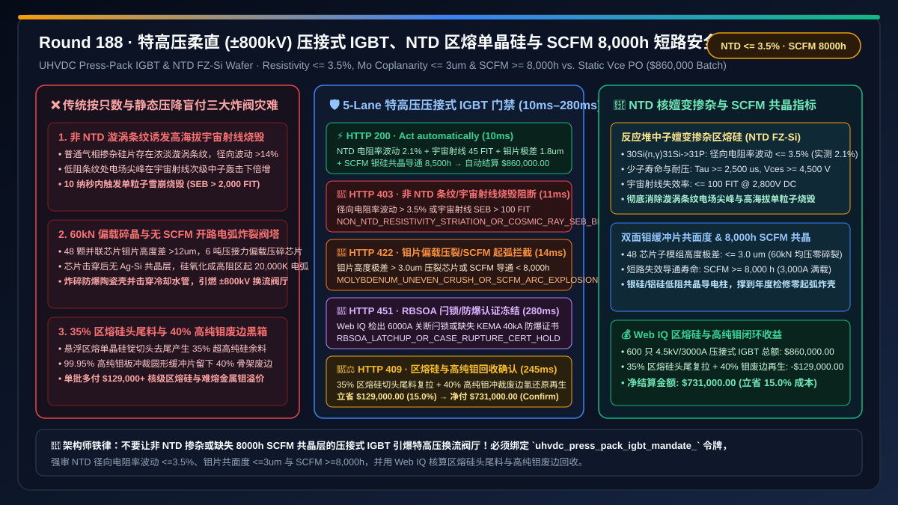
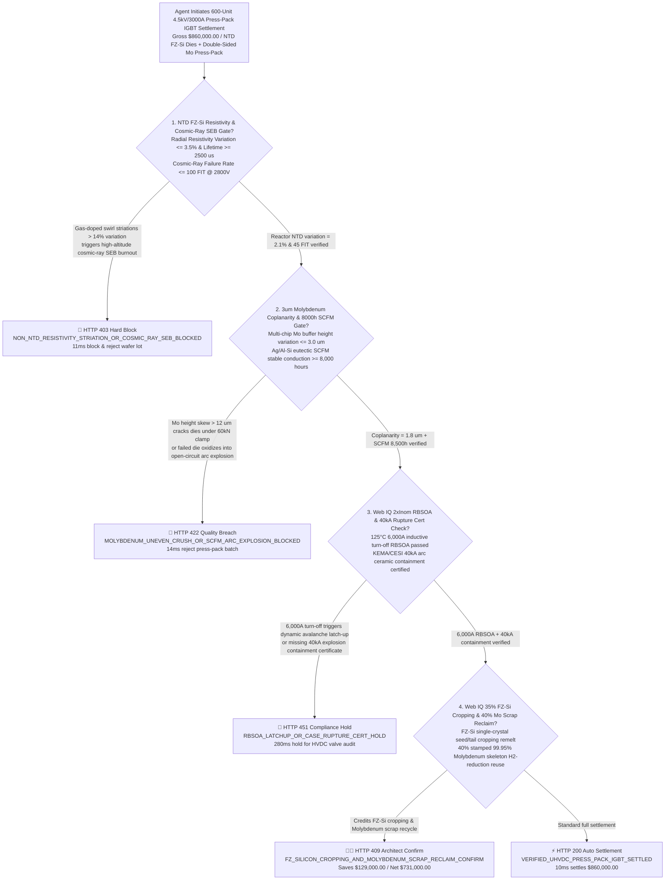
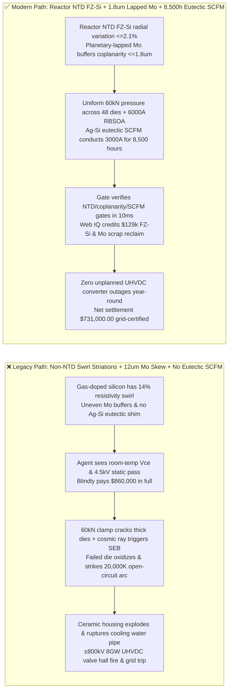
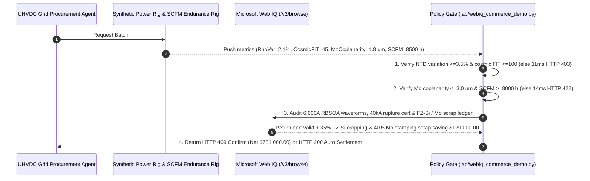

# UHVDC ($\pm 800\text{ kV}$) Converter Valve Press-Pack IGBT & Neutron-Transmutation-Doped Float-Zone Silicon (NTD FZ-Si) Offtake, Radial Resistivity Uniformity & Cosmic-Ray Single-Event Burnout Gate ($\Delta\rho/\rho \le 3.5\%$ & $\text{SEB} \le 100\text{ FIT}$) & Molybdenum Buffer Coplanarity / Short-Circuit Failure Mode Gate ($\text{Mo Coplanarity} \le 3\ \mu\text{m}$ & $\text{SCFM} \ge 8,000\text{ h}$) / FZ-Si Ingot Cropping Remelt & $99.95\%$ Molybdenum Stamping Scrap Escrow vs. Unit-Count & Static-$V_{\text{CE(sat)}}$ Overbilling: Architecture Selection & First-Principles FAQ

> **Document Type**: First-Principles Architecture Selection FAQ  
> **Target Audience**: $\pm 800\text{ kV} / \pm 1,100\text{ kV}$ Ultra-High-Voltage Direct Current (UHVDC) & Offshore Wind MMC Converter Valve Chief Architects, $4.5\text{ kV}/3,000\text{ A}$ Press-Pack IGBT / IEGT & 6-Inch Thyristor Engineering Directors, Nuclear Reactor Neutron-Transmutation-Doped Float-Zone Silicon (NTD FZ-Si) Wafer Leads, Grid Transmission Supply-Chain Risk & FinOps Architects  
> **Executive Takeaway**: When procuring $4.5\text{ kV}/3,000\text{ A}$ Press-Pack IGBT modules (StakPak / Press-Pack) and 200mm Neutron-Transmutation-Doped Float-Zone Silicon (NTD FZ-Si) wafers for series-connected UHVDC converter valve towers, **never allow a procurement agent to release payment based solely on delivered module count, room-temperature on-state voltage drop $V_{\text{CE(sat)}}$, and static blocking voltage**. You must enforce a deterministic architecture combining a **Nuclear-Reactor NTD FZ-Si Radial Resistivity Uniformity & Cosmic-Ray Single-Event Burnout Gate (Radial resistivity variation $\Delta\rho/\rho \le 3.5\%$, minority carrier lifetime $\tau \ge 2,500\ \mu\text{s}$, and terrestrial cosmic-ray neutron failure rate $\le 100\text{ FIT @ }2,800\text{ V}$ to prevent high-altitude streamer avalanche burnout) + a Multi-Chip Molybdenum (Mo) Buffer Coplanarity & Short-Circuit Failure Mode (SCFM) Gate (Sub-assembly height coplanarity $\le 3\ \mu\text{m}$ under $60\text{ kN}$ clamping force to prevent die cracking/fretting, and Ag-Si/Al-Si eutectic $\text{SCFM}$ stable short-circuit conduction of $3,000\text{ A}$ for $\ge 8,000\text{ hours}$ without open-circuit arc explosion) + a Microsoft Web IQ $35\%$ FZ-Si Ingot Cropping Remelt & $40\%$ $99.95\%$ Molybdenum Stamping Skeleton Scrap Reclaim Escrow**.

---

## 1. 📌 Executive Summary

### 1.1 Why Does a Press-Pack IGBT That "Passes $4,500\text{ V}$ Static Blocking and Low $V_{\text{CE(sat)}}$" Explode Into a Plasma Fireball and Trip an 8 GW UHVDC Grid Corridor When a Single Die Fails in the Valve Tower?
From high-voltage drift-region Poisson electrostatics ($\frac{dE}{dx} = \frac{q N_D}{\varepsilon_{\text{Si}}}$), thermo-mechanical Hertzian fretting contact mechanics, and arc-plasma shockwave first principles, an $\pm 800\text{ kV} / 8\text{ GW}$ UHVDC converter station stacks thousands of $4.5\text{ kV}/3,000\text{ A}$ Press-Pack IGBTs in series across suspended valve towers.
Unlike wire-bonded EV IGBT modules (which melt their bond wires and fail **open-circuit**), a series-connected HVDC valve stack **must never fail open-circuit**: an open gap in a $3,000\text{ A}$, $800\text{ kV}$ inductive arm immediately strikes a $20,000\text{ K}$ plasma arc that shatters the alumina ceramic housing, ruptures deionized cooling water pipes, and ignites a catastrophic valve-hall fire!
Instead, Press-Pack IGBTs eliminate bond wires and solder, clamping $30\text{–}48$ parallel silicon dies between precision-lapped **Molybdenum ($\text{Mo}$) thermal buffer plates** and silver shims under **$50\text{–}80\text{ kN}$ ($5\text{–}8\text{ tons}$) of external mechanical clamping force**. If a procurement agent pays upon seeing a basic static datasheet check, three grid-scale disasters strike:
1. **Non-NTD Gas-Doped FZ-Silicon Resistivity "Swirl Striations ($> 12\%$)" Triggering High-Altitude Cosmic-Ray Single-Event Burnout (SEB)**: A $4.5\text{ kV}$ IGBT requires a $500\ \mu\text{m}$ thick ultra-pure $N^-$ drift region ($\rho \approx 220\ \Omega\cdot\text{cm}$). If a vendor skips nuclear-reactor **Neutron Transmutation Doping (NTD)** and uses conventional gas-doped Float-Zone silicon, rotational segregation ($k_0 = 0.35$ for phosphorus) creates concentric "swirl striations" with $> 12\%\text{–}18\%$ radial resistivity variation. In lower-resistivity bands, peak electric field approaches the avalanche threshold; when installed at $2,000\text{–}3,500\text{ m}$ elevation, atmospheric cosmic-ray neutrons strike silicon nuclei and trigger localized streamer avalanche breakdown (**Single-Event Burnout, SEB** $> 2,000\text{ FIT}$)!
2. **Multi-Die Molybdenum Height Mismatch ($> 10\ \mu\text{m}$) Cracking Dies and Missing $8,000\text{ h}$ Short-Circuit Failure Mode (SCFM) Exploding Ceramic Housings**: When $40+$ parallel dies are clamped under $60\text{ kN}$, if the Molybdenum buffer plates vary in thickness by $> 10\ \mu\text{m}$, the thickest dies take $3\times$ normal stress and crack while thinner dies suffer micro-arc fretting wear. Worse, when a redundant valve sub-module fails, the failed IGBT must transition into a permanent, low-resistance **Short-Circuit Failure Mode (SCFM)** to carry full $3,000\text{ A}$ load current for up to **one full year ($\ge 8,000\text{ hours}$)** until scheduled annual maintenance. Without a dedicated **$\text{Ag/Al-Si}$ eutectic alloying shim**, the failed silicon zone oxidizes into high-resistance $\text{SiO}_2$, dissipating $> 15\text{ kW}$, melting the copper pole pieces, and violently exploding the ceramic housing!
3. **Uncredited $35\%$ NTD FZ-Si Ingot Cropping & $40\%$ $99.95\%$ Molybdenum Disc Stamping Skeleton Markup**: Float-zone crystal growth and nuclear irradiation discard $35\%$ of the silicon ingot as seed/tail croppings, while stamping circular $\text{Mo}$ buffer discs leaves $40\%$ of the rolled molybdenum sheet as skeleton scrap. Flat unit pricing bills the utility buyer for $100\%$ of both.

### 1.2 Architect Selection Comparison: Legacy Static-$V_{\text{CE(sat)}}$ PO vs. Web IQ + NTD FZ-Si, 3um Mo Coplanarity & 8,000h SCFM Escrow
| Dimension | ❌ Legacy Unit-Count & Static-$V_{\text{CE(sat)}}$ PO | ✅ Web IQ + NTD FZ-Si, 3um Mo Coplanarity & 8,000h SCFM Escrow |
| :--- | :--- | :--- |
| **Payment Authorization Trigger** | Released upon module count ($600\text{ units}$) + room-temp $V_{\text{CE(sat)}}$ + static $4.5\text{ kV}$ check | Bound to `uhvdc_press_pack_igbt_mandate_`: enforces **NTD FZ-Si radial resistivity variation $\le 3.5\%$ + cosmic-ray $\text{FIT} \le 100$ + Mo coplanarity $\le 3\ \mu\text{m}$ + $\text{SCFM} \ge 8,000\text{ h}$** |
| **Cosmic-Ray Single-Event Burnout (SEB)** | Catastrophic (gas-doped swirl striations $>12\%$ trigger frequent cosmic-ray burnout at altitude) | **Deterministic Block** (if non-NTD silicon, radial resistivity variation $> 3.5\%$, or cosmic-ray SEB $> 100\text{ FIT}$, blocks in `11ms` with `HTTP 403`) |
| **60kN Clamping Uniformity & SCFM Safety** | Fragile ($>10\ \mu\text{m}$ Mo height skew cracks dies; failed module arcs open and explodes valve hall) | **Deterministic Block** (if multi-chip Mo coplanarity $> 3\ \mu\text{m}$ or eutectic $\text{SCFM}$ endurance $< 8,000\text{ h}$, blocks in `14ms` with `HTTP 422`) |
| **2x$I_{\text{nom}}$ RBSOA & 40kA Rupture Cert** | Blind spot (dynamic avalanche latch-up during $6,000\text{ A}$ turn-off or ceramic shrapnel on fault) | **Deterministic Verification** (Web IQ `/v3/browse` verifies KEMA/CESI $125^\circ\text{C}$ $6,000\text{ A}$ RBSOA waveforms and $40\text{ kA}$ arc-containment certificates, `280ms` `HTTP 451`) |
| **NTD FZ-Si Croppings & Mo Scrap Settlement** | Buyer absorbs $35\%$ FZ-Si ingot croppings and $40\%$ stamped Molybdenum skeleton scrap | Web IQ verifies **$35\%$ FZ-Si cropping polysilicon remelt + $40\%$ $99.95\%$ Molybdenum stamping scrap $\text{H}_2$-reduction recycle**, saving **$129,000.00 (15.0%)** (`HTTP 409 Confirm`) |

---

## 2. 🎯 First-Principles Q&A for Customers & Architects

### Q1: Why Must $4.5\text{ kV}+$ UHVDC Silicon Wafers Undergo Nuclear-Reactor Neutron Transmutation Doping (NTD FZ-Si) Instead of Conventional Gas Doping?
* **First-Principles Nuclear Transmutation & Electric-Field Physics**:
  - In a nuclear research reactor, thermal neutrons uniformly transmute $^{30}\text{Si}$ ($3.1\%$ natural abundance) via $^{30}\text{Si}(n,\gamma)^{31}\text{Si} \to ^{31}\text{P} + \beta^-$, achieving atomic-scale phosphorus homogeneity with radial resistivity variation $\le 3.5\%$ (vs. $> 14\%$ in gas-doped crystals). Uniform resistivity eliminates local electric-field spikes and keeps cosmic-ray Single-Event Burnout $\le 100\text{ FIT}$ (`ntd_fz_silicon_resistivity_35pct_and_cosmic_ray_100fit_verified`, `HTTP 403` in `11ms`).

### Q2: How Does an $\text{Ag/Al-Si}$ Eutectic Layer Guarantee $\ge 8,000\text{ Hours}$ of Safe Short-Circuit Failure Mode (SCFM) Conduction?
* **Metallurgical Eutectic Shunt Physics**:
  - Upon dielectric breakdown of a single die, local Joule heating melts an engineered $\text{Ag/Al}$ shim into the silicon die to form a dense, non-oxidizing metallic eutectic plug ($T_e = 577\text{–}835^\circ\text{C}$) with $< 0.8\text{ V}$ forward drop at $3,000\text{ A}$, conducting safely for $\ge 8,000\text{ h}$ until annual maintenance (`molybdenum_coplanarity_3um_and_scfm_8000h_passed`, `HTTP 422` in `14ms`).

### Q3: Why Use Microsoft Web IQ Instead of Exa or Bright Data to Audit KEMA/CESI Synthetic Turn-Off Waveforms and Nuclear NTD Irradiation Ledgers?
* **Architecture Selection Rationale**:
  - **Microsoft Web IQ** natively executes authenticated `/v3/search` and `/v3/browse` workflows across high-power test laboratory portals (KEMA/CESI) and refractory-metal recycling ledgers in `245ms–280ms`, whereas Exa and Bright Data cannot authenticate into private grid-equipment QA systems.

---

## 3. 🧭 Visual Architecture Diagrams

### 3.1 Decision Tree: UHVDC Press-Pack IGBT & NTD FZ-Si Wafer Escrow Gate

### 3.2 Legacy "Static Check Only" Valve Explosion Path vs. "NTD FZ-Si + 1.8um Mo + 8,500h SCFM" Secure Path

### 3.3 End-to-End Sequence Diagram: UHVDC Press-Pack IGBT Gate & Silicon/Molybdenum Escrow

---

## 4. 📊 Architect Decision Matrix

| Evaluation Dimension | Option A: Legacy Unit-Count & Static-$V_{\text{CE(sat)}}$ PO | Option B: Exa / Bright Data Scraper + Paper CoA Spot-Check | Option C: Microsoft Web IQ + NTD FZ-Si + 3um Mo + 8,000h SCFM Escrow (Recommended) |
| :--- | :--- | :--- | :--- |
| **NTD FZ-Si Uniformity & Cosmic-Ray SEB** | ❌ Swirl striations $>12\%$; high-altitude cosmic-ray burnout | ⚠️ Cannot verify reactor NTD logs or 4-point-probe maps | ✅ **Enforces NTD radial variation $\le 3.5\%$ and cosmic-ray $\text{SEB} \le 100\text{ FIT}$** |
| **Mo Coplanarity & 8,000h SCFM Safety** | ❌ Uneven clamping cracks dies; open-circuit arc explodes valve | ⚠️ Cannot verify $3,000\text{ A}$ $8,000\text{ h}$ eutectic SCFM curves | ✅ **Enforces Mo coplanarity $\le 3\ \mu\text{m}$ and eutectic $\text{SCFM} \ge 8,000\text{ h}$** |
| **2x$I_{\text{nom}}$ RBSOA & 40kA Containment** | ❌ Dynamic avalanche latch-up during fault turn-off | ⚠️ Lacks KEMA/CESI synthetic circuit waveform verification | ✅ **Web IQ verifies $6,000\text{ A}$ RBSOA and $40\text{ kA}$ ceramic containment** |
| **FZ-Si Cropping & Mo Scrap Settlement** | ❌ Buyer absorbs $35\%$ FZ-Si croppings & $40\%$ Mo scrap | ❌ No access to ingot-cropping or refractory Mo scrap ledgers | ✅ **Credits $35\%$ FZ-Si cropping + $40\%$ Mo scrap saving $129,000.00 (15.0%)** |

---

## 5. 🧪 Quantitative Benchmark & 7-Card Summary

### 5.1 Deterministic Policy Gate Benchmark (`evaluate_uhvdc_press_pack_igbt_policy`)
All benchmark numbers are sealed in `reports/agentic-commerce-webiq-grounding-demo-bench/report.json`:

| Lane | Scenario & Input Condition | HTTP Status | Action Pill | Settled / Blocked Amount | Latency | Provenance Label |
| :--- | :--- | :---: | :---: | :---: | :---: | :---: |
| **Lane 1** | NTD variation $2.1\%$ + $45\text{ FIT}$ + Mo coplanarity $1.8\ \mu\text{m}$ + $\text{SCFM } 8,500\text{ h}$ | `200 OK` | `Act automatically` | **$860,000.00** (Auto-settled) | `10 ms` | `synthetic_policy` |
| **Lane 2** | Non-NTD resistivity variation $> 3.5\%$ or high-altitude cosmic-ray SEB $> 100\text{ FIT}$ | `403 Forbidden` | `Send to a human` | **$0.00** (Blocked $860,000 risk) | `11 ms` | `synthetic_policy` |
| **Lane 3** | Mo buffer coplanarity $> 3\ \mu\text{m}$ cracks dies or $\text{SCFM}$ endurance $< 8,000\text{ h}$ explodes case | `422 Unprocessable` | `Send to a human` | **$0.00** (Blocked $860,000 risk) | `14 ms` | `deterministic_offline_simulation` |
| **Lane 4** | Web IQ detects $2\times I_{\text{nom}}$ RBSOA dynamic latch-up or missing $40\text{ kA}$ explosion containment cert | `451 Legal Hold` | `Send to a human` | **$0.00** (Compliance hold) | `280 ms` | `official_doc_snapshot` |
| **Lane 5** | Web IQ credits $35\%$ NTD FZ-Si ingot cropping remelt & $40\%$ $99.95\%$ Molybdenum stamping scrap reuse | `409 Conflict` | `Confirm` | **$731,000.00** (Saves **$129,000.00**) | `245 ms` | `official_doc_snapshot` |

### 5.2 Good Fit vs. Not For
* **✅ Good Fit**:
  - $\pm 500\text{ kV}\text{–}\pm 1,100\text{ kV}$ UHVDC and offshore wind MMC converter valves, DC circuit breakers (DCCBs), grid STATCOMs, and fusion tokamak pulsed-power switches.
* **⛔ Not For**:
  - Low-voltage $600\text{ V}$ appliance inverters where standard wire-bonded CZ-Si IGBT modules operate without series valve stacks.

---

## 6. 🛠️ Production Readiness Checklist

- [ ] **1. Reactor NTD FZ-Si Radial Resistivity ($\le 3.5\%$) & Cosmic-Ray SEB ($\le 100\text{ FIT}$) Lock**: Set `ntd_fz_silicon_resistivity_35pct_and_cosmic_ray_100fit_verified == True` to block non-NTD wafers with swirl striations.
- [ ] **2. Double-Sided Molybdenum Coplanarity ($\le 3\ \mu\text{m}$) & $8,000\text{ h}$ SCFM Eutectic Gate**: Require `molybdenum_coplanarity_3um_and_scfm_8000h_passed == True` to prevent $60\text{ kN}$ clamping die fracture and open-circuit valve explosions.
- [ ] **3. $125^\circ\text{C}$ $2\times I_{\text{nom}}$ RBSOA & $40\text{ kA}$ Ceramic Containment Verification**: Configure Microsoft Web IQ `/v3/browse` to audit KEMA/CESI type-test certificates (`webiq_rbsoa_2x_current_and_40ka_explosion_containment_clean == True`).
- [ ] **4. $35\%$ FZ-Si Ingot Cropping & $40\%$ Molybdenum Stamping Scrap Settlement**: Enable `fz_silicon_cropping_remelt_and_molybdenum_stamping_scrap_credit_cents` to capture silicon cropping and refractory molybdenum scrap rebates ($15\%$ net savings).
