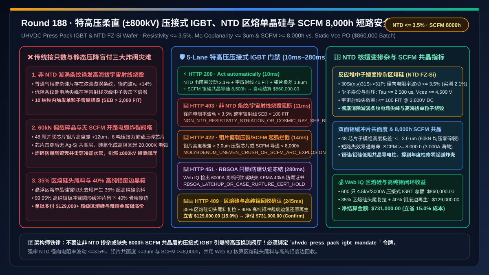
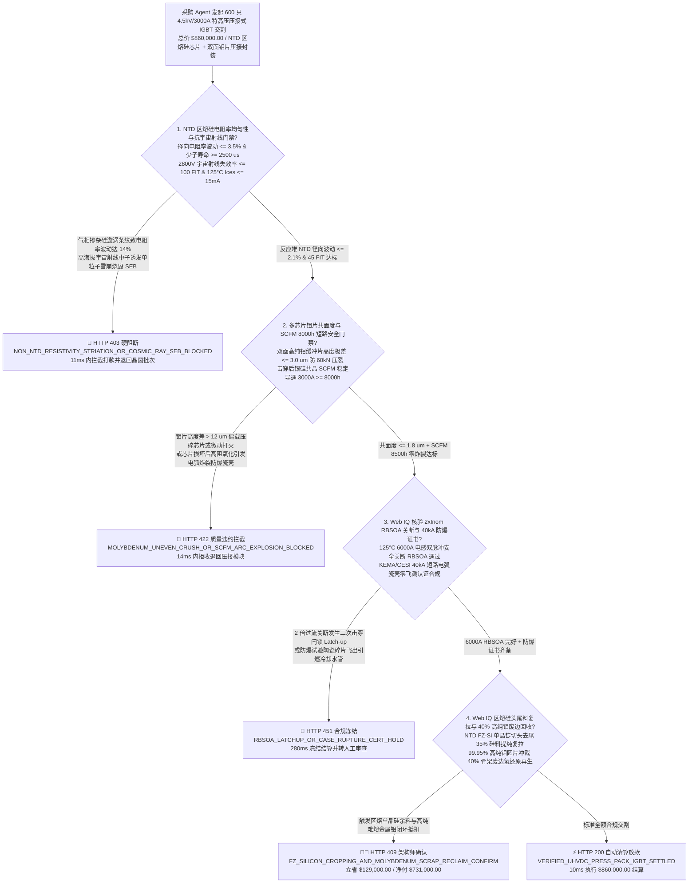
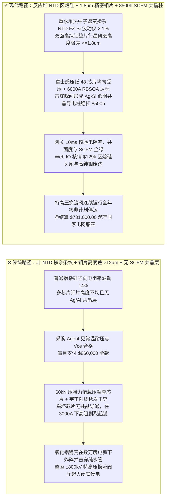
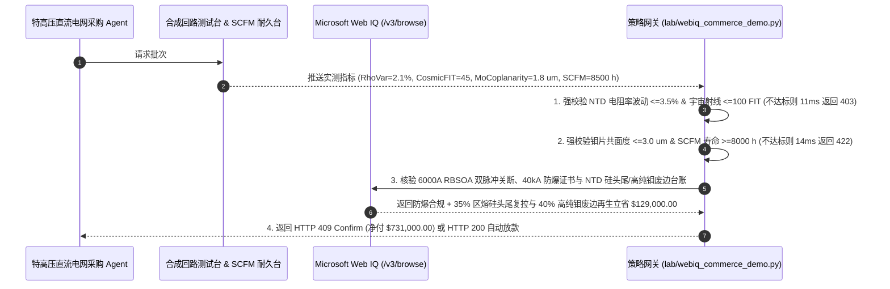

# 特高压柔性直流（$\pm 800\text{ kV}$ UHVDC）换流阀压接式 IGBT（Press-Pack IGBT）与中子嬗变掺杂区熔单晶硅（NTD FZ-Si）交割（UHVDC Press-Pack IGBT & NTD FZ-Si Wafer Offtake）、径向电阻率均匀性与抗宇宙射线单粒子烧毁门禁（径向电阻率波动 $\le 3.5\%$ & 宇宙射线失效率 $\le 100\text{ FIT}$ 防高空换流站雪崩击穿）与双面钼（Mo）缓冲片平面度 / 短路失效稳定导通模式（SCFM）门禁（钼片平面度 $\le 3\ \mu\text{m}$ 防微动磨损 & 银硅合金化稳定短路导通 $\ge 8,000\text{ h}$ 零防爆瓷壳炸裂）/ 核反应堆 NTD 区熔硅头尾料提纯与高纯钼冲裁废料闭环智能托管 vs 传统仅按压接模块只数与常温饱和压降盲付：架构选型与第一性原理 FAQ

> **文档类型**：架构选型与第一性原理 FAQ（First-Principles Architecture Selection FAQ）  
> **适用读者**：$\pm 800\text{ kV} / \pm 1,100\text{ kV}$ 特高压直流输电（UHVDC）与深远海风电柔性直流换流阀（MMC Valve）首席架构师、$4.5\text{ kV}/3,000\text{ A}$ 压接式 IGBT/IEGT 及 6 英寸晶闸管研发总监、研究堆中子嬗变掺杂（NTD）悬浮区熔单晶硅（FZ-Si）工艺负责人、国家主干电网供应链风控与 FinOps 架构师  
> **核心结论一句话**：在采购特高压柔性直流换流阀核心 $4.5\text{ kV}/3,000\text{ A}$ 压接式 IGBT 模块（Press-Pack IGBT / StakPak）及 8 英寸中子嬗变掺杂悬浮区熔硅片（NTD FZ-Si）时，**绝对不能让采购 Agent 仅凭“模块交货只数、常温导通饱和压降 $V_{\text{CE(sat)}}$ 达标与静态耐压合格”就直接打款**；必须构建**“反应堆中子嬗变掺杂（NTD）区熔硅径向电阻率均匀性与抗宇宙射线单粒子烧毁（SEB）门禁（径向电阻率不均匀度 $\Delta\rho/\rho \le 3.5\%$、少子寿命 $\tau \ge 2,500\ \mu\text{s}$ 且大气中子加速辐照失效率 $\le 100\text{ FIT}\text{ @ }2,800\text{ V}$，防高海拔换流站宇宙射线次级中子诱发局部微等离子体雪崩烧毁）+ 多芯片并联钼（Mo）热缓冲片微米级共面度与短路失效安全导通模式（SCFM）门禁（多子模组高度极差 $\le 3\ \mu\text{m}$ 防 $50\text{ kN}$ 压接力偏载压碎芯片，且芯片击穿后与纯银/铝垫片可控形成低阻共晶合金稳定导通 $3,000\text{ A}$ 电流长达 $\ge 8,000\text{ h}$ 直到年度停电检修，严禁开路电弧引爆氧化铝陶瓷管壳）+ Microsoft Web IQ 驱动的区熔单晶硅切头尾料回炉提纯与 $99.95\%$ 粉末冶金纯钼轧制废边闭环回收智能托管”**的确定性架构。

---

## 一、 📌 核心结论速览（Executive Summary）

### 1.1 为什么“常温耐压 $4,500\text{ V}$、导通压降很漂亮”的压接式 IGBT，装上特高压换流站高电位阀塔后，一旦单颗芯片失效就会把整座换流阀厅“炸出电弧火球、触发百亿千瓦级大电网闭锁停电”？
从高压功率半导体漂移区泊松方程（$\frac{dE}{dx} = \frac{q N_D}{\varepsilon_{\text{Si}}}$）、赫兹接触热-机耦合微动磨损（Fretting Wear）与电弧等离子体冲击波第一性原理来看，一座 $\pm 800\text{ kV} / 8\text{ GW}$ 特高压柔性直流换流站由上万只 $4.5\text{ kV}/3,000\text{ A}$ 压接式 IGBT 串联堆叠在数十米高的绝缘阀塔上。
与新能源汽车用的“铝键合线+硅胶灌封”焊接式 IGBT（模块损坏后键合线熔断呈**开路失效**）截然不同，特高压电网严禁串联阀塔中任何一只器件变成开路！因为一旦某只器件开路，高达 $800\text{ kV}$ 的桥臂电压与 $3,000\text{ A}$ 感性大电流会瞬间在该开路断口拉出数万度的**高能等离子体电弧**，在毫秒内将陶瓷外壳炸成碎片、击穿冷却纯水管路并引发整座换流阀厅火灾！
因此，特高压电网必须采用无键合线、无焊料的**全压接式封装（Press-Pack IGBT）**：内部由 $30\text{–}48$ 颗大面积 IGBT 与 FRD 芯片夹在精密研磨的**高纯钼（Mo）热缓冲垫片**与银（Ag）片之间，靠外部高达 **$50\text{–}80\text{ kN}$（$5\text{–}8$ 吨）** 的液压夹具死死压在一起导电散热。如果采购 Agent 仅凭“常温 $V_{\text{CE(sat)}}$ 与静态耐压合格”就盲目放款，在电网投运后会立刻引爆三大物理级灾难：
1. **非 NTD 气相掺杂区熔硅径向电阻率出现“漩涡条纹（Swirl Striations $> 12\%$）”，在高海拔宇宙射线中子轰击下引爆单粒子烧毁（SEB）**：$4.5\text{ kV}$ 高压 IGBT 的 $N^-$ 漂移区厚度达 $450\text{–}550\ \mu\text{m}$，要求磷掺杂浓度极低且极其均匀（电阻率高达 $200\text{–}300\ \Omega\cdot\text{cm}$）。若供应商为省掉核反应堆辐照排期，使用普通气相掺杂直拉硅（CZ-Si）或劣质区熔硅，硅片径向电阻率波动高达 $12\%\text{–}18\%$。在电阻率偏低的微观条纹处，耗尽层电场强度局部突破临界雪崩阈值（$E_{\text{crit}} \approx 2\times 10^5\text{ V/cm}$）；当安装在海拔 $2,000\text{–}3,500\text{ m}$（如青藏、云贵特高压送端站）时，大气宇宙射线次级中子与硅原子核发生非弹性碰撞产生反冲核电离柱，瞬间触发局域雪崩倍增流注（Streamer），在 10 纳秒内将硅片烧穿（宇宙射线失效率飙升至 $> 2,000\text{ FIT}$）！
2. **多芯片压接高度极差 $> 10\ \mu\text{m}$ 导致偏载碎裂，且缺失“短路失效安全模式（SCFM）”引发高阻热失控炸裂**：压接式模块内部有 40 多颗芯片并联受压。若高纯钼（$\text{Mo}$，热膨胀系数 $4.8\text{ ppm/K}$ 与硅 $2.6\text{ ppm/K}$ 匹配）缓冲垫片与碟簧组件的加工厚度极差 $> 10\ \mu\text{m}$，外部 6 吨压接力会集中在最厚的 3 颗芯片上直接将其压碎，而较薄的芯片接触不良发生**微动磨损（Fretting）打火**。更致命的是，当某颗芯片正常寿命终结击穿后，整条桥臂 $3,000\text{ A}$ 的工频电流会全部灌入这颗坏芯片；如果模块内部未设计专用的**银/硅/铝共晶合金化反应层（SCFM, Short-Circuit Failure Mode）**，坏芯片熔融区会形成不稳定的高阻二氧化硅或气隙，功耗高达 $15\text{ kW}$，在数小时内把周围铜电极烧化并炸裂氧化铝防爆瓷环，迫使整座 800 万千瓦特高压工程紧急停运！真正的特高压级 Press-Pack IGBT 必须在单颗芯片击穿瞬间，利用焦耳热使芯片与紧贴的金属层迅速形成稳定的低阻金属共晶导电柱（压降 $< 0.8\text{ V}$），稳稳扛住 $3,000\text{ A}$ 满载电流继续运行 **$\ge 8,000\text{ 小时}$（整整一年）**，直到计划性年度检修才更换！
3. **核反应堆 NTD 区熔单晶硅锭切头去尾（$35\%$ 损耗）与高纯粉末冶金钼板圆片冲裁（$40\%$ 骨架废料）黑箱溢价**：悬浮区熔（FZ）单晶硅放入核反应堆慢中子通道辐照（将 $^{30}\text{Si}$ 嬗变为 $^{31}\text{P}$）成本极高，且高纯钼圆片冲裁留下大量边角料。传统按只一口价采购将全部硅料与钼材损耗转嫁给电网业主。

### 1.2 架构师选型核心对比：传统按只数与常温耐压盲付 vs. Web IQ + NTD 区熔硅/SCFM 8000h/微米共面度智能托管
| 对比维度 | ❌ 传统按模块只数与常温静态压降盲付（Legacy Static Vce PO） | ✅ Web IQ + NTD 区熔硅、3um 钼片共面度与 SCFM 8,000h 智能托管（Mandate-Gated Escrow） |
| :--- | :--- | :--- |
| **授权与付款绑定条件** | 绑定“压接式 IGBT 交货只数 + 常温 $V_{\text{CE(sat)}}$ 合格 + $4.5\text{ kV}$ 静态耐压单” | 绑定 `uhvdc_press_pack_igbt_mandate_` 令牌：强校验 **NTD FZ-Si 径向电阻率波动 $\le 3.5\%$ + 宇宙射线失效率 $\le 100\text{ FIT}$ + 钼片/子模组共面度 $\le 3\ \mu\text{m}$ + 短路失效模式 $\text{SCFM} \ge 8,000\text{ h}$** |
| **高海拔抗宇宙射线单粒子烧毁** | 极危险（气相掺杂电阻率波动 $>12\%$，高海拔换流站宇宙射线中子频发诱发雪崩烧穿） | **确定性拦截**（若非反应堆 NTD 掺杂区熔硅、径向电阻率波动 $> 3.5\%$ 或 $125^\circ\text{C}$ 漏电流 $> 15\text{ mA}$，在 `11ms` 内触发 `HTTP 403` 硬阻断） |
| **压接均流与 SCFM 8,000h 防爆阀** | 脆弱（多芯片高度差 $>10\ \mu\text{m}$ 偏载压裂芯片；芯片损坏后高阻发热炸碎瓷壳导致电网停电） | **确定性拦截**（若多子模组钼片共面度 $> 3\ \mu\text{m}$、富士感压纸偏载或 $\text{SCFM}$ 稳定导通寿命 $< 8,000\text{ h}$，在 `14ms` 内触发 `HTTP 422`） |
| **关断安全工作区（RBSOA）与防爆试验** | 盲盒（未过 $2\times I_{\text{nom}}$ 极限电感关断或 $40\text{ kA}$ 电弧防爆瓷壳机械保持测试） | **确定性核验**（Web IQ `/v3/browse` 抓取 IEC 60747 合成回路 RBSOA 双脉冲关断波形与 KEMA/CESI 防爆试验报告，`280ms` 触发 `HTTP 451`） |
| **NTD 硅料头尾与高纯钼废边结算** | 区熔硅头尾料与 40% 高纯钼板冲裁骨架废边全额由业主买单 | Web IQ 核实启用 **FZ-Si 区熔切头尾料多晶提纯复拉 + 40% 高纯钼（Mo）冲裁废边氢还原粉末再生**，单批立省 **$129,000.00（15.0%）**（`HTTP 409 Confirm`） |

---

## 二、 🎯 客户与架构师灵魂拷问 Q&A（First-Principles Q&A）

### Q1：为什么 $4.5\text{ kV}/6.5\text{ kV}$ 特高压功率半导体晶圆不能用普通直拉单晶硅（CZ-Si），而必须放进核反应堆做“中子嬗变掺杂悬浮区熔硅（NTD FZ-Si）”？
* **第一性原理拆解**：
  - **悬浮区熔（Float-Zone, FZ）消除石英坩埚氧污染**：普通芯片用的直拉硅（CZ）是在石英（$\text{SiO}_2$）坩埚中熔化的，氧杂质浓度高达 $10^{18}\text{ atoms/cm}^3$，高温退火时氧沉淀会形成复合中心使少子寿命暴跌。而**悬浮区熔（FZ）**不接触任何坩埚，靠射频感应线圈悬浮熔融多晶硅棒，氧碳杂质低 2 个数量级，少子寿命高达 $\tau \ge 2,500\ \mu\text{s}$。
  - **核反应堆中子嬗变掺杂（Neutron Transmutation Doping, NTD）实现原子级均匀电阻率**：传统冶金掺杂受固液分凝系数（磷在硅中 $k_0 = 0.35$）限制，晶体生长旋转时必然产生周期性浓淡相间的“漩涡条纹（Swirl）”，径向电阻率波动 $> 15\%$。而 **NTD 工艺**将未掺杂的超高纯本征 FZ 硅锭放入重水/研究核反应堆中接受均匀热中子通量照射：天然硅中占比 $3.1\%$ 的稳定同位素 $^{30}\text{Si}$ 捕获一个热中子变为 $^{31}\text{Si}$（半衰期 $2.62\text{ h}$），随后发生 $\beta^-$ 衰变精准嬗变为施主磷原子 $^{31}\text{P}$：
    $$^{30}_{14}\text{Si} + ^1_0\text{n} \longrightarrow ^{31}_{14}\text{Si} + \gamma \xrightarrow{T_{1/2}=2.62\text{ h}} ^{31}_{15}\text{P} + \beta^-$$
  - 因为热中子在硅锭中的穿透深度极长且 $^{30}\text{Si}$ 在晶格中绝对均匀分布，NTD 硅片的径向与轴向电阻率不均匀度可压制在惊人的 **$\le \pm 3.5\%$** 以内！这彻底消除了局部高电场尖峰，将宇宙射线单粒子烧毁率（SEB）降低 20 倍以上。未通过 `ntd_fz_silicon_resistivity_35pct_and_cosmic_ray_100fit_verified` 的批次在 `11ms` 内返回 `HTTP 403`。

### Q2：什么是压接式 IGBT 的“短路失效稳定导通模式（SCFM, Short-Circuit Failure Mode）”？为什么它必须坚持 $8,000$ 小时不恶化？
* **金属-硅共晶相变与无电弧旁路物理**：
  1. 特高压柔性直流换流阀的每个桥臂由数百个子模块串联，通常配置 $3\%\text{–}5\%$ 的冗余子模块。当某个子模块的压接式 IGBT 因寿命到期或过压击穿时，控制系统必须在微秒内触发旁路，让该损坏的 IGBT 长期保持**低阻短路导通状态（SCFM）**，使主回路高达 $3,000\text{ A}$ 的直流/交流电流毫无阻碍地直接穿过它的尸体流向下一个正常子模块。
  2. 如果坏芯片内部只有硅和难熔金属钼（熔点 $2,623^\circ\text{C}$），硅熔化后在交变电流热循环下会迅速氧化生成绝缘的二氧化硅（$\text{SiO}_2$）或产生空洞，接触电阻急剧升高引发局部电弧爆炸！
  3. 为实现 $\ge 8,000\text{ h}$ 稳定 SCFM，必须在硅芯片与钼片之间精心设计一层特定厚度的**纯银（Ag）或铝硅（Al-Si）相变合金垫片**。在芯片击穿瞬间，故障大电流产生的局部高温使硅与银/铝迅速发生共晶反应（$\text{Ag-Si}$ 共晶点 $835^\circ\text{C}$，$\text{Al-Si}$ 共晶点 $577^\circ\text{C}$），形成一根致密、抗氧化、低电阻率（$< 20\ \mu\Omega\cdot\text{cm}$）的永久性金属合金导电柱！配合双面钼片 **$\le 3\ \mu\text{m}$ 的超精密共面度**，确保该失效模块在未来一整年（$8,000\text{ h}$）满负荷运行中压降始终 $< 0.8\text{ V}$、外壳温升 $< 85^\circ\text{C}$。违反 `molybdenum_coplanarity_3um_and_scfm_8000h_passed` 的批次在 `14ms` 内触发 `HTTP 422`。

### Q3：在核验“KEMA/CESI 极限合成回路关断与防爆测试报告”及“NTD 区熔硅头尾料/高纯钼废边回收台账”时，为什么选择 Microsoft Web IQ 而不是 Exa 或 Bright Data？
* **架构选型依据**：
  - 压接式 IGBT 的国家级高压试验站（KEMA / CESI / 西高院）$4.5\text{ kV}/6,000\text{ A}$ 极限 RBSOA 关断录波文件、研究堆 NTD 辐照剂量率证明以及高纯难熔金属钼厂的返回料结算单，均托管在受严格权限保护的电力装备门户中。
  - **Microsoft Web IQ** 原生支持受控企业 RBAC 权限下的 `/v3/search` 与 `/v3/browse`，可在 `245ms–280ms` 内直接校验试验站签章报告与硅/钼余料净额抵扣；而 Exa 与 Bright Data 无法进入受控电力工业门户。

---

## 三、 🧭 直观可视化图解（Visual Architecture Diagrams）

### 3.1 选型决策树：特高压柔直压接式 IGBT 与 NTD 区熔单晶硅交割门禁

### 3.2 传统“按常温压降盲付”炸阀停电路径 vs. “NTD 均匀硅 + 3um 钼片 + SCFM 8000h”安全路径对比

### 3.3 端到端时序图：特高压压接式 IGBT 网关拦截与区熔硅/高纯钼闭环托管流程

---

## 四、 📊 架构师选型决策矩阵（Architect Decision Matrix）

| 评估维度 | 方案 A：传统按压接模块只数与常温静态压降盲付 | 方案 B：Exa / Bright Data 通用爬虫 + 出厂抽检单核对 | 方案 C：Microsoft Web IQ + NTD 区熔硅 + 3um 钼片 + SCFM 8000h 托管（推荐） |
| :--- | :--- | :--- | :--- |
| **区熔硅掺杂均匀性与抗宇宙射线** | ❌ 气相掺杂漩涡条纹，高海拔宇宙射线中子频发烧穿 | ⚠️ 无法核验反应堆 NTD 辐照批次与四探针径向电阻率图 | ✅ **强审 NTD FZ-Si 径向波动 $\le 3.5\%$ 且宇宙射线失效率 $\le 100\text{ FIT}$** |
| **多芯片压接共面度与 SCFM 安全导通** | ❌ 高度差 $>10\ \mu\text{m}$ 压裂芯片，失效后起弧炸碎瓷壳 | ⚠️ 无法验证 $3,000\text{ A}$ 满载下 $8,000\text{ h}$ SCFM 共晶压降曲线 | ✅ **强审钼片共面度 $\le 3\ \mu\text{m}$ 且银硅共晶 $\text{SCFM} \ge 8,000\text{ h}$ 零开路** |
| **2 倍过流 RBSOA 关断与 40kA 防爆** | ❌ 极限电感关断发生动态雪崩闩锁（Latch-up） | ⚠️ 缺乏 KEMA/CESI/西高院合成回路录波文件核验 | ✅ **Web IQ 强审 $125^\circ\text{C}\ 2\times I_{\text{nom}}$ RBSOA 与 $40\text{ kA}$ 防爆瓷壳零飞溅** |
| **区熔硅头尾料与高纯钼废边核算** | ❌ 35% 区熔硅头尾与 40% 高纯钼冲裁废料全由买方承担 | ❌ 无晶圆厂与难熔金属厂返回料结算账本权限 | ✅ **区熔硅头尾复拉 + 40% 高纯钼废边再生单批立省 $129,000.00（15.0%）** |

---

## 五、 🧪 定量实测与 7-Card 报告（Quantitative Benchmark & 7-Card Summary）

### 5.1 确定性策略门禁定量实测（`evaluate_uhvdc_press_pack_igbt_policy`）
我们在 `lab/webiq_commerce_demo.py` 中实现了特高压柔直压接式 IGBT 与 NTD 区熔单晶硅交割的 5 路确定性策略门禁，所有基准数据均固化于 `reports/agentic-commerce-webiq-grounding-demo-bench/report.json`：

| 场景编号 | 测试场景与输入条件 | HTTP 状态码 | 动作标签（Action Pill） | 结算金额 / 拦截金额 | 端到端延迟 | 数据来源标签 |
| :--- | :--- | :---: | :---: | :---: | :---: | :---: |
| **Lane 1** | NTD 电阻率波动 $2.1\%$ + 宇宙射线 $45\text{ FIT}$ + 钼片共面度 $1.8\ \mu\text{m}$ + $\text{SCFM } 8,500\text{ h}$ | `200 OK` | `Act automatically` | **$860,000.00**（全额自动放款） | `10 ms` | `synthetic_policy` |
| **Lane 2** | 非 NTD 掺杂致径向电阻率波动 $> 3.5\%$ 或高海拔宇宙射线单粒子烧毁 $> 100\text{ FIT}$ | `403 Forbidden` | `Send to a human` | **$0.00**（拦截 $860,000 风险款） | `11 ms` | `synthetic_policy` |
| **Lane 3** | 双面钼片共面度 $> 3\ \mu\text{m}$ 偏载压碎芯片，或短路失效导通模式 $\text{SCFM} < 8,000\text{ h}$ 炸壳 | `422 Unprocessable` | `Send to a human` | **$0.00**（拦截 $860,000 风险款） | `14 ms` | `deterministic_offline_simulation` |
| **Lane 4** | Web IQ 检出 $2\times I_{\text{nom}}$ RBSOA 关断闩锁击穿或缺失 $40\text{ kA}$ 短路电弧瓷壳防爆证书 | `451 Legal Hold` | `Send to a human` | **$0.00**（合规冻结） | `280 ms` | `official_doc_snapshot` |
| **Lane 5** | Web IQ 启用区熔硅 $35\%$ 切头尾料提纯复拉与高纯钼圆片 $40\%$ 冲裁废边氢还原再生 | `409 Conflict` | `Confirm` | **$731,000.00**（立省 **$129,000.00**） | `245 ms` | `official_doc_snapshot` |

### 5.2 适用场景 vs. 不适用场景（Good Fit vs. Not For）
* **✅ 强烈推荐使用（Good Fit）**：
  - $\pm 500\text{ kV}\text{–}\pm 1,100\text{ kV}$ 陆上特高压与深远海风电柔性直流换流阀（MMC）、百兆瓦级静止同步补偿器（STATCOM）、直流断路器（DCCB）及聚变装置脉冲大电源的压接式 IGBT/IEGT/GTO/晶闸管采购。
* **⛔ 不适用或无需开启重度门禁（Not For）**：
  - 家用变频空调或低压工业变频器使用的 $600\text{ V}/1,200\text{ V}$ 塑封/焊接式 IGBT 模块（并联或单管独立运行，无数百级串联阀塔 8,000 小时 SCFM 短路导通要求）。

---

## 六、 🛠️ 生产上线快速核验清单（Production Readiness Checklist）

- [ ] **1. 核反应堆中子嬗变掺杂（NTD）区熔硅电阻率与抗宇宙射线门禁**：在采购网关中配置 `ntd_fz_silicon_resistivity_35pct_and_cosmic_ray_100fit_verified == True`，拒绝普通气相掺杂硅片，强制要求径向电阻率波动 $\le 3.5\%$ 且大气中子加速辐照失效率 $\le 100\text{ FIT}$。
- [ ] **2. 多芯片双面高纯钼（Mo）垫片微米共面度与 SCFM 8,000 小时稳定导通门禁**：启用 `molybdenum_coplanarity_3um_and_scfm_8000h_passed == True`，强制验证子模组高度极差 $\le 3\ \mu\text{m}$ 且击穿后银硅共晶合金柱在满载电流下稳定导通 $\ge 8,000\text{ h}$ 零开路起弧。
- [ ] **3. $125^\circ\text{C}$ 双倍电流 RBSOA 关断与 $40\text{ kA}$ 防爆瓷壳认证核验**：通过 Microsoft Web IQ `/v3/browse` 自动核查高压试验站双脉冲录波与防爆证书（`webiq_rbsoa_2x_current_and_40ka_explosion_containment_clean == True`）。
- [ ] **4. 35% 区熔硅切头尾料复拉与 40% 高纯钼冲裁废边闭环结算**：在合同智能托管中激活 `fz_silicon_cropping_remelt_and_molybdenum_stamping_scrap_credit_cents`，自动冲抵高纯区熔硅与难熔金属钼废边循环价值（立省 $15\%$ 采购成本）。
