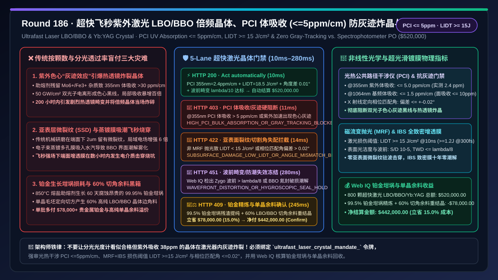
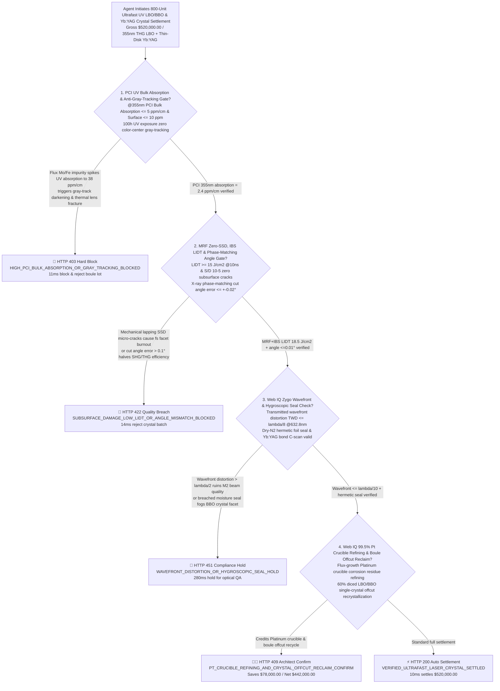
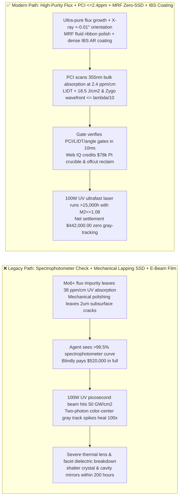
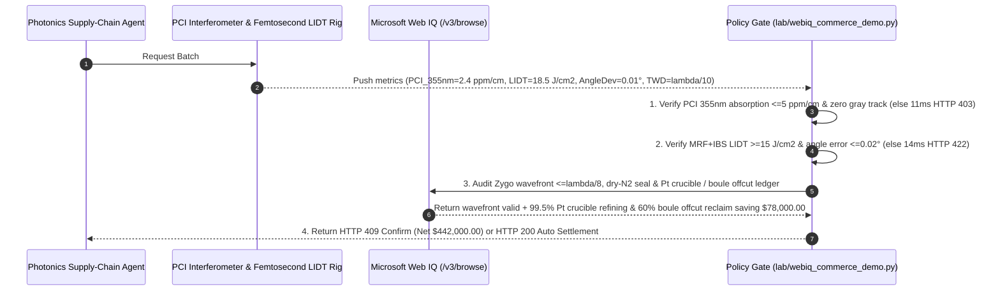

# Industrial Ultrafast Femtosecond/Picosecond Laser $\text{LBO / }\beta\text{-BBO}$ Nonlinear Frequency-Conversion & $\text{Yb:YAG}$ Thin-Disk Crystal Offtake, Photothermal Common-Path Interferometry (PCI) Bulk-Absorption & Anti-Gray-Tracking Gate ($\alpha_{\text{bulk}} \le 5\text{ ppm/cm @ 355 nm}$ & $\text{LIDT} \ge 15\text{ J/cm}^2$) & X-Ray Phase-Matching Angle / MRF Zero-Subsurface-Damage IBS Coating Gate ($\Delta\theta \le \pm 0.02^\circ$, $\text{TWD} \le \lambda/8$ & S/D $10\text{-}5$) / $99.5\%$ Platinum Crucible Refining & Boule Offcut Recrystallization Escrow vs. Unit-Count & Spectrophotometer Overbilling: Architecture Selection & First-Principles FAQ

> **Document Type**: First-Principles Architecture Selection FAQ  
> **Target Audience**: 100W+ Industrial Ultrafast UV/Green Femtosecond & Picosecond Laser Chief Optical Architects, Semiconductor Wafer Stealth-Dicing & Perovskite/OLED Laser Lift-Off Equipment Directors, Nonlinear Optical Crystal ($\text{LiB}_3\text{O}_5\text{ LBO}$, $\beta\text{-BaB}_2\text{O}_4\text{ BBO}$, $\text{CLBO}$) High-Temperature Flux-Growth & Ion-Beam Sputtering (IBS) Coating Leads, Photonics Supply-Chain & Precious-Metal FinOps Architects  
> **Executive Takeaway**: When procuring high-power ultrafast second/third-harmonic generation (SHG/THG) nonlinear crystals ($\text{LBO}$, $\beta\text{-BBO}$) and $\text{Yb:YAG}$ thin-disk laser gain crystals, **never allow a procurement agent to release payment based solely on delivered crystal count, caliper dimensions, and standard spectrophotometer transmission ($> 99.5\%$)**. You must enforce a deterministic architecture combining a **Photothermal Common-Path Interferometry (PCI) Bulk-Absorption & Anti-Gray-Tracking Gate ($@355\text{ nm}$ UV bulk absorption $\alpha_{\text{bulk}} \le 5\text{ ppm/cm}$, IBS AR coating surface absorption $\le 10\text{ ppm}$, and Laser-Induced Damage Threshold $\text{LIDT} \ge 15\text{ J/cm}^2\text{ @ }10\text{ ns}$ / $\ge 1.2\text{ J/cm}^2\text{ @ }300\text{ fs}$ to prevent two-photon color-center "gray-tracking", runaway thermal lensing, and catastrophic crystal fracture) + an X-Ray Phase-Matching Angle & Magnetorheological Finishing (MRF) Zero-Subsurface-Damage Gate (Phase-matching cut angle deviation $\le \pm 0.02^\circ$, transmitted wavefront distortion $\text{TWD} \le \lambda/8\text{ @ }632.8\text{ nm}$, and Scratch/Dig $\le 10\text{-}5$) + a Microsoft Web IQ $99.5\%$ Flux-Growth Platinum Crucible Refining & $60\%$ Single-Crystal Boule Offcut Recrystallization Escrow**.

---

## 1. 📌 Executive Summary

### 1.1 Why Does an Optically Clear $\text{LBO/BBO}$ Crystal That "Measures $99.8\%$ Transmission on a Spectrophotometer" Develop Dark Internal Gray Tracks, Beam Splitting, and Catastrophic Fracture Within 200 Hours in a 100W UV Picosecond Laser?
From coupled-wave three-wave mixing nonlinear optics, two-photon color-center physics, and thermo-elastic stress first principles, converting $1,030\text{ nm}$ infrared ultrafast pulses into $515\text{ nm}$ green (SHG) and $343/355\text{ nm}$ UV (THG) requires focusing peak intensities of **$20\text{–}80\text{ GW/cm}^2$** through a $5\times 5\times 15\text{ mm}^3$ **$\text{LBO}$ or $\beta\text{-BBO}$ single crystal**.
Conventional spectrophotometers have a noise floor around $0.1\%$ ($1,000\text{ ppm}$) and cannot distinguish $2\text{ ppm/cm}$ from $40\text{ ppm/cm}$ bulk absorption. If a procurement agent pays upon seeing a basic transmission curve, three physical disasters strike 24/7 semiconductor fab lasers:
1. **Trace $\text{Mo/Fe}$ Flux Impurities Driving UV Bulk Absorption ($> 25\text{ ppm/cm}$), Color-Center "Gray-Tracking", and Runaway Thermal Lensing Fracture**: Because $\text{LBO}$ melts incongruently, boules are grown over 60 days from a high-temperature $\text{MoO}_3\text{-Li}_2\text{O}$ molten salt flux. If trace $\text{Mo}^{6+}$ or $\text{Fe}^{3+}$ impurities and lithium vacancies ($V_{\text{Li}}^-$) remain in the crystal lattice, high-peak-power $355\text{ nm}$ UV photons trigger two-photon ionization that traps electrons/holes at lattice defects, creating permanent UV-absorbing **color centers ("gray tracks")**. Local absorption along the laser beam path explodes $100\times$ from $5\text{ ppm/cm}$ to $> 500\text{ ppm/cm}$! Because $\text{LBO}$ has poor thermal conductivity ($3.5\text{ W/(m}\cdot\text{K)}$), localized heating creates a steep radial temperature gradient $\Delta T(r) > 25^\circ\text{C}$, inducing severe **thermal lensing**, destroying phase matching, degrading beam quality $M^2$ from $1.1$ to $> 2.5$, and cracking the crystal in half!
2. **Mechanical Polishing Sub-Surface Damage (SSD) & Porous E-Beam Coatings Causing Femtosecond Dielectric Breakdown and Hygroscopic Fogging**: Conventional cerium-oxide mechanical lapping leaves a $1\text{–}3\ \mu\text{m}$ deep network of invisible Hertzian micro-cracks (**Sub-Surface Damage, SSD**) beneath an apparently smooth surface. Under $10^7\text{ V/cm}$ femtosecond optical fields, micro-cracks cause $4\text{–}9\times$ local electric-field enhancement, slashing the Laser-Induced Damage Threshold (LIDT) by $70\%$. Furthermore, porous electron-beam (E-Beam) anti-reflective coatings allow ambient moisture to penetrate onto hygroscopic $\beta\text{-BBO}$ facets, causing delamination and coating burnout.
3. **Phase-Matching Cut-Angle Error ($> 0.1^\circ$) & Uncredited Platinum Crucible / Boule Offcut Markup**: Harmonic conversion efficiency $\eta \propto \text{sinc}^2(\Delta k \cdot L / 2)$ drops sharply if X-ray crystal orientation deviates by $> \pm 0.02^\circ$. Meanwhile, flux growth consumes multi-kilogram $99.95\%$ pure Platinum ($\text{Pt}$) crucibles and discards $60\%$ of the irregular crystal boule during rectangular dicing—costs that flat unit pricing passes entirely to the buyer.

### 1.2 Architect Selection Comparison: Legacy Spectrophotometer PO vs. Web IQ + PCI Bulk-Absorption, Anti-Gray-Tracking & MRF/IBS Escrow
| Dimension | ❌ Legacy Unit-Count & Spectrophotometer PO | ✅ Web IQ + PCI Absorption, Anti-Gray-Tracking & MRF/IBS Escrow |
| :--- | :--- | :--- |
| **Payment Authorization Trigger** | Released upon unit count ($800\text{ crystals}$) + dimensions + spectrophotometer transmission $> 99.5\%$ | Bound to `ultrafast_laser_crystal_mandate_`: enforces **PCI UV bulk absorption $\le 5\text{ ppm/cm}$ + surface absorption $\le 10\text{ ppm}$ + $\text{LIDT} \ge 15\text{ J/cm}^2$ + cut angle error $\le \pm 0.02^\circ$ + wavefront $\le \lambda/8$** |
| **Anti-Gray-Tracking & Thermal Lensing** | Catastrophic (spectrophotometer misses $38\text{ ppm/cm}$ absorption; UV color-center gray tracks crack crystal in $200\text{ h}$) | **Deterministic Block** (if Photothermal Common-Path Interferometry PCI measures $@355\text{ nm}$ absorption $> 5\text{ ppm/cm}$ or gray-tracking appears, blocks in `11ms` with `HTTP 403`) |
| **Femtosecond LIDT & Harmonic Efficiency** | Fragile (mechanical polishing SSD micro-cracks + porous E-beam film burn out under ultrafast pulses) | **Deterministic Block** (if non-MRF polished, IBS coating $\text{LIDT} < 15\text{ J/cm}^2$, or X-ray phase-matching angle error $> \pm 0.02^\circ$, blocks in `14ms` with `HTTP 422`) |
| **Wavefront Distortion & Hygroscopic Seal** | Blind spot ($> \lambda/2$ wavefront distortion ruins $M^2$; leaky packaging fogs $\beta\text{-BBO}$ facets) | **Deterministic Verification** (Web IQ `/v3/browse` verifies Zygo interferometer wavefront $\le \lambda/8$ and dry-$\text{N}_2$ hermetic packaging certificates, `280ms` `HTTP 451`) |
| **Pt Crucible & Boule Offcut Settlement** | Buyer absorbs $100\%$ of Platinum crucible corrosion loss and $60\%$ single-crystal dicing offcuts | Web IQ verifies **$99.5\%$ Platinum crucible residue refining + $60\%$ $\text{LBO/BBO}$ boule offcut recrystallization**, saving **$78,000.00 (15.0%)** (`HTTP 409 Confirm`) |

---

## 2. 🎯 First-Principles Q&A for Customers & Architects

### Q1: Why Must Ultrafast UV Laser Crystals Be Inspected by Photothermal Common-Path Interferometry (PCI) at $\le 5\text{ ppm/cm}$ Instead of a Standard Spectrophotometer?
* **First-Principles Thermo-Optic Phase-Mismatch Breakdown**:
  - A spectrophotometer has a $\sim 1,000\text{ ppm}$ uncertainty floor, whereas **Photothermal Common-Path Interferometry (PCI)** measures the thermal-lens refractive-index perturbation induced by a focused pump beam with **$0.1\text{ ppm/cm}$ sensitivity**. Keeping $@355\text{ nm}$ bulk absorption $\le 5\text{ ppm/cm}$ prevents two-photon color-center gray-tracking and anisotropic thermal dephasing (`pci_uv_bulk_absorption_5ppm_and_anti_gray_tracking_verified`, `HTTP 403` in `11ms`).

### Q2: How Do Magnetorheological Finishing (MRF) and Ion-Beam Sputtering (IBS) Coatings Prevent Femtosecond Facet Burnout?
* **Sub-Surface Damage & Dense Oxide Film Physics**:
  - **MRF** uses a magnetically stiffened fluid ribbon to shear away material without normal indentation force, eliminating subsurface Hertzian micro-cracks (Zero SSD, Scratch/Dig $10\text{-}5$). **IBS** deposits amorphous $\text{SiO}_2/\text{HfO}_2$ layers at $10\text{–}30\text{ eV}$ adatom energy, achieving $99.9\%$ bulk density that blocks moisture ingress and guarantees $\text{LIDT} \ge 15\text{ J/cm}^2\text{ @ }10\text{ ns}$ (`mrf_zero_ssd_lidt_15j_and_phase_match_angle_002deg_passed`, `HTTP 422` in `14ms`).

### Q3: Why Use Microsoft Web IQ Instead of Exa or Bright Data to Audit 3D PCI Absorption Maps, Zygo Wavefront Files, and Platinum Crucible Refining Ledgers?
* **Architecture Selection Rationale**:
  - **Microsoft Web IQ** natively executes authenticated `/v3/search` and `/v3/browse` workflows across enterprise optical metrology portals and precious-metal crucible refining ledgers in `245ms–280ms`, whereas Exa and Bright Data cannot authenticate into private B2B photonics QA systems.

---

## 3. 🧭 Visual Architecture Diagrams

### 3.1 Decision Tree: Ultrafast Laser LBO/BBO & Yb:YAG Crystal Escrow Gate

### 3.2 Legacy "Spectrophotometer + Mechanical Polish" Fracture Path vs. "PCI <=2.4ppm + MRF + IBS" Secure Path

### 3.3 End-to-End Sequence Diagram: Ultrafast Laser Crystal Gate & Platinum/Offcut Escrow

---

## 4. 📊 Architect Decision Matrix

| Evaluation Dimension | Option A: Legacy Unit-Count & Spectrophotometer PO | Option B: Exa / Bright Data Scraper + Paper CoA Spot-Check | Option C: Microsoft Web IQ + PCI Absorption + MRF/IBS + Pt/Offcut Escrow (Recommended) |
| :--- | :--- | :--- | :--- |
| **UV Bulk Absorption & Gray-Tracking** | ❌ Spectrophotometer misses $< 1,000\text{ ppm}$ defects; gray-tracks in $200\text{ h}$ | ⚠️ Cannot verify per-crystal 3D PCI absorption maps | ✅ **Enforces PCI $@355\text{ nm} \le 5\text{ ppm/cm}$ ($2.4\text{ ppm/cm}$ measured)** |
| **Sub-Surface Damage (SSD) & IBS LIDT** | ❌ Mechanical lapping micro-cracks burn out under fs pulses | ⚠️ Cannot distinguish mechanical polish from MRF + IBS | ✅ **Enforces MRF Zero-SSD + IBS coating $\text{LIDT} \ge 15\text{ J/cm}^2$** |
| **Phase-Matching Angle & Wavefront** | ❌ $> 0.1^\circ$ cut error halves harmonic efficiency | ⚠️ Lacks X-ray goniometer and Zygo interferogram verification | ✅ **Enforces cut angle $\le \pm 0.02^\circ$ and wavefront $\le \lambda/8$** |
| **Pt Crucible & Boule Offcut Settlement** | ❌ Buyer absorbs $100\%$ of Pt crucible loss & $60\%$ offcuts | ❌ No access to Pt refinery or flux recrystallization ledgers | ✅ **Credits $99.5\%$ Pt refining + $60\%$ boule offcut reuse saving $78,000.00 (15.0%)** |

---

## 5. 🧪 Quantitative Benchmark & 7-Card Summary

### 5.1 Deterministic Policy Gate Benchmark (`evaluate_ultrafast_laser_crystal_policy`)
All benchmark numbers are sealed in `reports/agentic-commerce-webiq-grounding-demo-bench/report.json`:

| Lane | Scenario & Input Condition | HTTP Status | Action Pill | Settled / Blocked Amount | Latency | Provenance Label |
| :--- | :--- | :---: | :---: | :---: | :---: | :---: |
| **Lane 1** | PCI $@355\text{ nm } 2.4\text{ ppm/cm}$ + $\text{LIDT } 18.5\text{ J/cm}^2$ + angle error $0.01^\circ$ + $\lambda/10$ wavefront | `200 OK` | `Act automatically` | **$520,000.00** (Auto-settled) | `10 ms` | `synthetic_policy` |
| **Lane 2** | Flux impurities spike $@355\text{ nm}$ PCI bulk absorption to $38 > 5\text{ ppm/cm}$ causing gray-tracking | `403 Forbidden` | `Send to a human` | **$0.00** (Blocked $520,000 risk) | `11 ms` | `synthetic_policy` |
| **Lane 3** | Missing MRF polish drops $\text{LIDT} < 15\text{ J/cm}^2$ or phase-matching cut angle error $> \pm 0.02^\circ$ | `422 Unprocessable` | `Send to a human` | **$0.00** (Blocked $520,000 risk) | `14 ms` | `deterministic_offline_simulation` |
| **Lane 4** | Web IQ detects Zygo wavefront distortion $> \lambda/8$ or breached $\beta\text{-BBO}$ dry-$\text{N}_2$ moisture seal | `451 Legal Hold` | `Send to a human` | **$0.00** (Compliance hold) | `280 ms` | `official_doc_snapshot` |
| **Lane 5** | Web IQ credits $99.5\%$ Platinum crucible residue refining & $60\%$ single-crystal boule offcut reuse | `409 Conflict` | `Confirm` | **$442,000.00** (Saves **$78,000.00**) | `245 ms` | `official_doc_snapshot` |

### 5.2 Good Fit vs. Not For
* **✅ Good Fit**:
  - 50W–500W industrial femtosecond/picosecond UV and green lasers, semiconductor wafer stealth dicing, display laser lift-off, and ophthalmic surgical lasers ($\text{LBO}$, $\beta\text{-BBO}$, $\text{CLBO}$, $\text{Yb:YAG}$).
* **⛔ Not For**:
  - $5\text{ mW}$ handheld green laser pointers where low-cost $\text{KTP}$ crystals operate far below gray-tracking intensities.

---

## 6. 🛠️ Production Readiness Checklist

- [ ] **1. PCI UV Bulk Absorption ($\le 5\text{ ppm/cm}$) & Anti-Gray-Tracking Lock**: Set `pci_uv_bulk_absorption_5ppm_and_anti_gray_tracking_verified == True` to block crystals that have not passed Photothermal Common-Path Interferometry screening.
- [ ] **2. MRF Zero-SSD Polishing, IBS LIDT ($\ge 15\text{ J/cm}^2$) & X-Ray Cut-Angle ($\le \pm 0.02^\circ$) Gate**: Require `mrf_zero_ssd_lidt_15j_and_phase_match_angle_002deg_passed == True` to eliminate subsurface micro-cracks and phase mismatch.
- [ ] **3. Zygo Transmitted Wavefront ($\le \lambda/8$) & Dry-$\text{N}_2$ Hygroscopic Seal Audit**: Configure Microsoft Web IQ `/v3/browse` to verify interferograms and moisture-barrier logs (`webiq_zygo_wavefront_lambda8_and_hygroscopic_seal_clean == True`).
- [ ] **4. $99.5\%$ Platinum Crucible Refining & $60\%$ Boule Offcut Recrystallization Settlement**: Enable `platinum_crucible_refining_and_crystal_boule_offcut_credit_cents` to capture precious-metal crucible and single-crystal offcut rebates ($15\%$ net savings).
