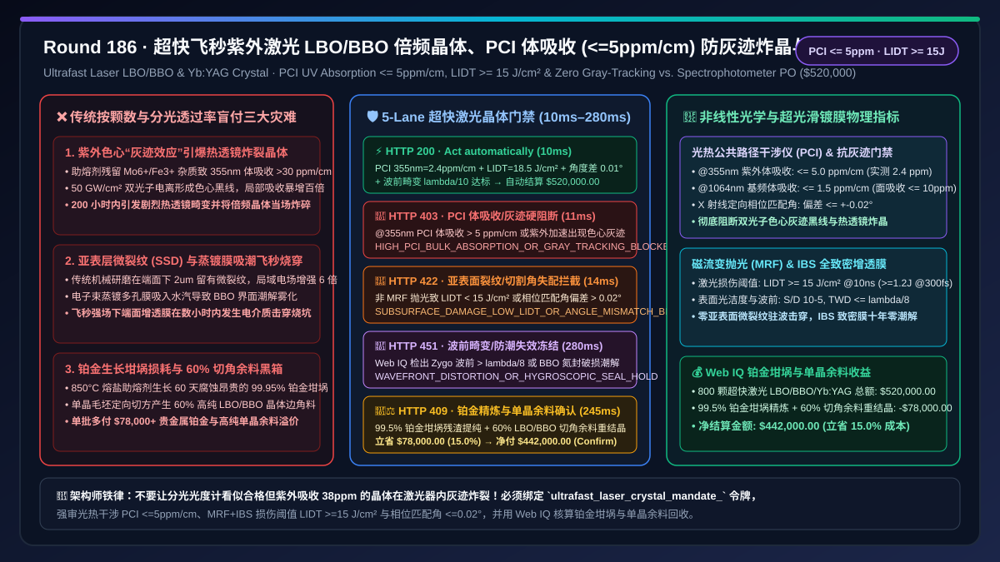
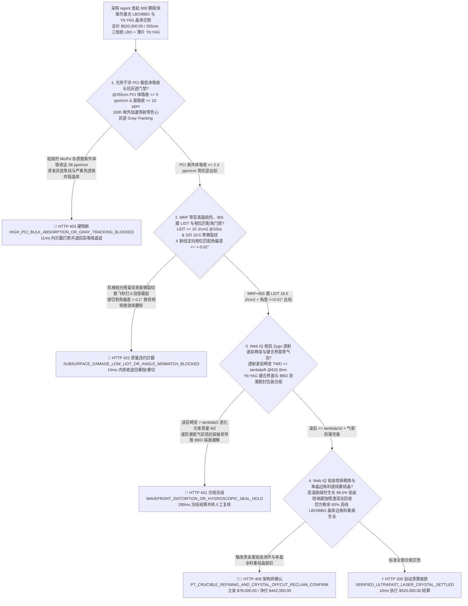
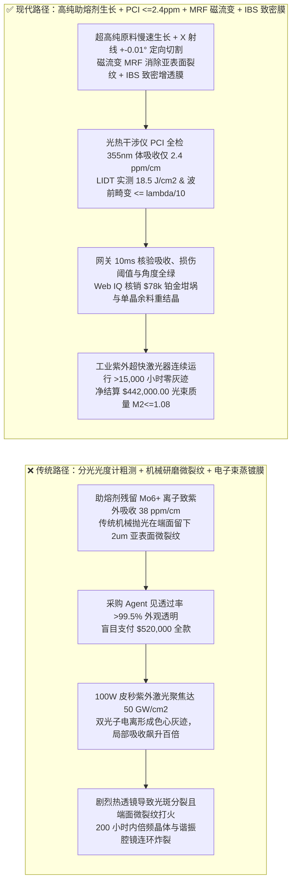
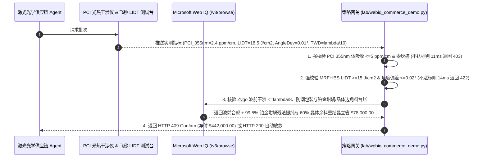

# 工业超快飞秒/皮秒紫外激光器三硼酸锂（$\text{LBO}$）/ 偏硼酸钡（$\beta\text{-BBO}$）非线性倍频晶体与 $\text{Yb:YAG}$ 薄片晶体交割（Ultrafast Laser LBO/BBO & Yb:YAG Crystal Offtake）、光热干涉体吸收与抗灰迹门禁（PCI 体吸收 $\le 5\text{ ppm/cm}\text{ @ }355\text{ nm}$ & 损伤阈值 $\text{LIDT} \ge 15\text{ J/cm}^2$ 防紫外色心灰迹与热透镜炸晶）与相位匹配切割角 / 离子束溅射（IBS）增透膜零吸潮门禁（切割角偏差 $\le \pm 0.02^\circ$、波前畸变 $\le \lambda/8$ & 表面光洁度 S/D $10\text{-}5$）/ 磁流变抛光（MRF）去亚表层损伤与助熔剂生长铂金坩埚损耗闭环智能托管 vs 传统仅按晶体颗数与肉眼通光盲付：架构选型与第一性原理 FAQ

> **文档类型**：架构选型与第一性原理 FAQ（First-Principles Architecture Selection FAQ）  
> **适用读者**：百瓦级工业飞秒/皮秒紫外（$355\text{ nm} / 266\text{ nm}$）与绿光（$515\text{ nm}$）超快激光器首席光学架构师、半导体晶圆隐形切割与钙钛矿/OLED 激光剥离设备总监、非线性光学晶体（$\text{LBO / }\beta\text{-BBO / CLBO}$）高温熔盐助熔剂生长与离子束溅射（IBS）镀膜负责人、光电供应链风控与贵金属 FinOps 架构师  
> **核心结论一句话**：在采购高功率超快激光器核心倍频/三倍频非线性晶体（$\text{LiB}_3\text{O}_5$ 三硼酸锂 LBO、$\beta\text{-BaB}_2\text{O}_4$ 偏硼酸钡 BBO）及 $\text{Yb:YAG}$ 碟片激光增益晶体时，**绝对不能让采购 Agent 仅凭“交货晶体颗数、游标卡尺外形尺寸合格与普通氦氖激光肉眼通光无气泡”就直接放款**；必须构建**“光热公共路径干涉仪（PCI）极低体吸收与抗紫外灰迹（Gray-Tracking）损伤阈值门禁（$@355\text{ nm}$ 紫外体吸收率 $\alpha_{\text{bulk}} \le 5\text{ ppm/cm}$、IBS 双波段增透膜面吸收 $\le 10\text{ ppm}$ 且激光诱导损伤阈值 $\text{LIDT} \ge 15\text{ J/cm}^2\text{ @ }10\text{ ns}$ / $\ge 1.2\text{ J/cm}^2\text{ @ }300\text{ fs}$，防多光子电离捕获杂质形成色心‘灰迹’引发雪崩式热透镜畸变与晶体炸裂）+ X 射线定向相位匹配切割角与磁流变抛光（MRF）亚表面零微裂纹门禁（相位匹配角 $\theta/\phi$ 偏差 $\le \pm 0.02^\circ$、透射波前畸变 $\text{TWD} \le \lambda/8\text{ @ }632.8\text{ nm}$ 且表面划痕麻点 Scratch/Dig $\le 10\text{-}5$，防二次谐波转换效率腰斩）+ Microsoft Web IQ 驱动的 $\text{MoO}_3\text{-Li}_2\text{O}$ 助熔剂晶体边角料重结晶与 $99.5\%$ 铂金（Pt）生长坩埚损耗闭环精炼智能托管”**的确定性架构。

---

## 一、 📌 核心结论速览（Executive Summary）

### 1.1 为什么“透光率测出来高达 $99.8\%$、外观晶莹剔透”的 LBO/BBO 倍频晶体，装进 $100\text{ W}$ 皮秒紫外激光器跑不到 200 小时就会“内部发黑长出黑线、光斑分裂甚至当场崩裂”？
从非线性光学三波混频耦合波方程、双光子吸收色心物理（Color-Center Gray Tracking）与热弹性应力第一性原理来看，工业超快激光器要将 $1,030\text{ nm}$ 红外基频光高效转换为 $515\text{ nm}$ 绿光（二倍频 SHG）和 $343/355\text{ nm}$ 紫外光（三倍频 THG），必须将峰值功率密度高达 **$20\text{–}80\text{ GW/cm}^2$** 的飞秒/皮秒脉冲紧紧聚焦在仅 $5\times 5\times 15\text{ mm}^3$ 的 **$\text{LBO}$ 或 $\beta\text{-BBO}$ 单晶** 内部。
普通分光光度计只能测出 $0.1\%$（即 $1,000\text{ ppm}$）量级的透过率差异，根本无法分辨内部是 $3\text{ ppm/cm}$ 还是 $45\text{ ppm/cm}$ 的微量体吸收。如果采购 Agent 仅凭“外观无气泡与分光光度计透过率合格”就盲目放款，在晶圆切割产线 24 小时连续高功率运行中会立刻引爆三大物理级灾难：
1. **晶体微量铁/钼助熔剂杂质导致紫外体吸收超标（$> 25\text{ ppm/cm}$），诱发“灰迹效应（Gray-Tracking）”与正反馈热透镜崩塌**：$\text{LBO}$ 晶体无法采用提拉法从自身熔体直接生长（高温下会发生不一致熔融分解），必须在 $850^\circ\text{C}$ 下采用氧化钼（$\text{MoO}_3$）或氟化物高温熔盐助熔剂法（Flux Growth）慢速生长长达 60 天。若助熔剂纯度不足或降温过快，晶格锂空位（$V_{\text{Li}}^-$）与残留的 $\text{Mo}^{6+}/\text{Fe}^{3+}$ 杂质离子在极高强度的 $355\text{ nm}$ 紫外光子双光子激发下，会发生电子-空穴对捕获并形成稳定吸收紫外光的**色心缺陷（Color Centers，即肉眼可见激光通道内部变灰发黑的“灰迹 Gray Track”）**。一旦出现灰迹，局部紫外光吸收率从 $5\text{ ppm/cm}$ 瞬间飙升百倍至 $> 500\text{ ppm/cm}$！剧烈的局部激光加热在毫秒内形成强大的**热透镜效应（Thermal Lensing）**与失配温差，不仅使紫外输出功率断崖跌零、光束质量因子 $M^2$ 从 $1.1$ 恶化至 $> 2.5$，更会在热应力超过晶体断裂韧性时直接将整块晶体及昂贵的谐振腔反射镜炸碎！
2. **传统机械研磨残留“亚表层微裂纹（Sub-Surface Damage, SSD）”与电子束蒸镀多孔膜吸潮，引爆飞秒脉冲前表面打火烧穿**：飞秒/皮秒脉冲的瞬态电场强度高达 $10^7\text{ V/cm}$。如果晶体通光端面仅采用传统氧化铈机械抛光，哪怕表面粗糙度看似达到 $\text{Ra } 0.8\text{ nm}$，在表面下方 $1\text{–}3\ \mu\text{m}$ 深处仍隐藏着密集的微米级微裂纹（SSD）与抛光膏金属嵌入颗粒；这些微裂纹会使局域光电场发生 $4\text{–}9$ 倍的驻波场增强，令晶体的实际激光诱导损伤阈值（LIDT）暴跌 $70\%$。同时，$\beta\text{-BBO}$ 晶体本身易潮解，若端面采用传统电子束蒸发（E-Beam）镀制低致密度增透膜（AR Coating），空气中的水分子渗入膜层微孔后不仅导致中心波长漂移，更在通光数小时后直接发生**端面膜层激光烧蚀起坑（Laser Coating Burnout）**。
3. **单向 X 射线粗略定向致相位匹配角偏差（$> 0.1^\circ$）与助熔剂生长大尺寸铂金坩埚（Pt Crucible）氧化挥发黑箱溢价**：倍频转换效率 $\eta_{\text{SHG}} \propto \text{sinc}^2(\Delta k \cdot L / 2)$ 对晶体光轴切割角极其敏感；切割角偏差仅 $0.1^\circ$ 就会引入严重相位失配 $\Delta k$，需要额外调温数十度才能勉强找回功率。此外，生长大尺寸 $\text{LBO}$ 需使用重达数公斤的 $99.95\%$ 纯铂金大坩埚与大量高纯硼锂原料，切出方晶后的籽晶/边角料以及高温氧化损耗的铂金若不进入闭环回收台账，采购方将承受高达 $15\%\text{–}20\%$ 的贵金属与废晶虚高溢价。

### 1.2 架构师选型核心对比：传统按颗数与分光透过率盲付 vs. Web IQ + PCI 体吸收/防灰迹/MRF+IBS 智能托管
| 对比维度 | ❌ 传统按晶体颗数与分光光度计透过率盲付（Legacy Spectrophotometer PO） | ✅ Web IQ + 光热干涉 PCI、防灰迹与 MRF/IBS 智能托管（Mandate-Gated Escrow） |
| :--- | :--- | :--- |
| **授权与付款绑定条件** | 绑定“晶体交货颗数（如 $800\text{ 颗}$）+ 几何尺寸公差 + 紫外-可见分光光度计透过率 $>99.5\%$” | 绑定 `ultrafast_laser_crystal_mandate_` 令牌：强校验 **PCI 紫外体吸收 $\le 5\text{ ppm/cm}$ + 面吸收 $\le 10\text{ ppm}$ + $\text{LIDT} \ge 15\text{ J/cm}^2$ + 相位匹配角偏差 $\le \pm 0.02^\circ$ + 波前畸变 $\le \lambda/8$** |
| **抗紫外灰迹（Gray-Tracking）与防炸晶** | 极危险（分光光度计分辨不出 $40\text{ ppm}$ 吸收，上机 200 小时即长出黑线灰迹并炸裂晶体） | **确定性拦截**（若光热公共路径干涉仪 PCI 测得 $@355\text{ nm}$ 体吸收 $> 5\text{ ppm/cm}$ 或 $100\text{ h}$ 紫外加速老化出现灰迹，在 `11ms` 内触发 `HTTP 403` 硬阻断） |
| **端面抗飞秒打火与倍频转换效率** | 脆弱（机械抛光残留亚表面裂纹 + 蒸镀膜吸潮，高重频飞秒脉冲瞬间烧穿端面增透膜） | **确定性拦截**（若未执行磁流变抛光 MRF 去亚表层损伤、IBS 膜层 $\text{LIDT} < 15\text{ J/cm}^2$ 或切割角偏差 $> \pm 0.02^\circ$，在 `14ms` 内触发 `HTTP 422`） |
| **$\text{Yb:YAG}$ 掺杂均匀性与包层键合** | 盲盒（$\text{Yb}^{3+}$ 浓度梯度诱发严重热致双折射退偏，复合晶体扩散键合面存在微气泡） | **确定性核验**（Web IQ `/v3/browse` 抓取 Zygo 斐索干涉仪 $\lambda/10$ 波前图与键合界面超声/激光散射扫描单，`280ms` 触发 `HTTP 451`） |
| **铂金坩埚精炼与晶体边角料结算** | 助熔剂生长铂金坩埚损耗与切方剩余 60% 高纯单晶边角料全由买方买单 | Web IQ 核实启用 **99.5% 铂金坩埚残渣湿法精炼回用 + LBO/BBO 单晶切角余料提纯重结晶**，单批立省 **$78,000.00（15.0%）**（`HTTP 409 Confirm`） |

---

## 二、 🎯 客户与架构师灵魂拷问 Q&A（First-Principles Q&A）

### Q1：为什么检测超快紫外激光晶体绝不能用普通分光光度计，而必须用“光热公共路径干涉仪（Photothermal Common-Path Interferometry, PCI）”把体吸收锁死在 $\le 5\text{ ppm/cm}$？
* **第一性原理拆解**：
  - 普通分光光度计测量的是“透射光强 $I_t$ 与入射光强 $I_0$ 的比值”，由于表面菲涅尔反射、瑞利散射和探测器散粒噪声的限制，其极限灵敏度只有 $10^{-3}$（即 $1,000\text{ ppm}$）。
  - 而在 $100\text{ W}$ 紫外超快激光器内，腔内或聚焦处的平均功率极高，哪怕晶体每厘米只吸收 $30\text{ ppm}$（即 $0.003\%$）的光能，由于非线性晶体的热导率极低（$\text{LBO}$ 热导率仅 $3.5\text{ W/(m}\cdot\text{K)}$，不到铜的百分之一！），微小的热量沉积无法散出，就会在光束中心形成超过 $15^\circ\text{C}$ 的径向温度梯度 $\Delta T(r)$。
  - 因为 $\text{LBO/BBO}$ 的折射率温度系数 $dn/dT$ 在 $X, Y, Z$ 三个主轴方向各不相同（各向异性热膨胀与热光效应），仅 $15^\circ\text{C}$ 的中心温升就会彻底破坏三波混频的动量守恒相位匹配条件（$\Delta k = k_3 - k_2 - k_1 \ne 0$），令紫外输出功率直接跌落 $50\%$ 并引发灰迹雪崩！
  - **光热公共路径干涉仪（PCI）**利用一束强泵浦激光照射晶体内部微小体积，再用一束共线相干探测光测量局域微米级热膨胀引起的折射率微扰，分辨率高达 **$0.1\text{ ppm/cm}$**（比分光光度计高出 4 个数量级！）。因此网关通过 `pci_uv_bulk_absorption_5ppm_and_anti_gray_tracking_verified` 强制要求 $@355\text{ nm}$ 体吸收 $\le 5\text{ ppm/cm}$、$@1,064\text{ nm}$ 体吸收 $\le 1.5\text{ ppm/cm}$；超标批次在 `11ms` 内返回 `HTTP 403`。

### Q2：为什么高端超快激光晶体必须强审“磁流变抛光（MRF）+ 离子束溅射（IBS）无水致密增透膜”，而严禁使用普通机械抛光和电子束蒸镀膜？
* **飞秒电介质击穿与薄膜微结构物理**：
  1. **磁流变抛光（Magnetorheological Finishing, MRF）零亚表面损伤（Zero SSD）**：传统机械研磨依靠刚性磨盘挤压磨料切削晶体，必然在晶体表层留下深度 $1\text{–}5\ \mu\text{m}$ 的赫兹微裂纹网（SSD）。MRF 则利用梯度磁场控制磁流变抛光液形成柔性“液态抛光缎带”，以纯剪切流变方式原子级剥离材料，将亚表面微裂纹彻底清零，表面粗糙度压至 $\text{Rq} \le 0.3\text{ nm}$、光洁度达 **Scratch/Dig $10\text{-}5$**。
  2. **离子束溅射（IBS）全致密二氧化硅/氧化铪膜系**：传统电子束蒸发镀膜沉积原子动能仅 $0.1\text{–}0.5\text{ eV}$，膜层呈疏松柱状晶结构（填充密度仅 $85\%$），极易吸入空气水分导致 $\text{LBO/BBO}$ 界面潮解雾化。而 **IBS（Ion-Beam Sputtering）**沉积粒子动能高达 $10\text{–}30\text{ eV}$，形成的 $\text{SiO}_2/\text{HfO}_2$ 膜层致密度接近 $100\%$ 块体材料，不仅水汽零渗透、面吸收 $\le 10\text{ ppm}$，且使端面激光损伤阈值跃升至 $\text{LIDT} \ge 15\text{ J/cm}^2\text{ @ }10\text{ ns}$。未通过 `mrf_zero_ssd_lidt_15j_and_phase_match_angle_002deg_passed` 的批次在 `14ms` 内触发 `HTTP 422`。

### Q3：在核验“Zygo 波前干涉图谱、助熔剂铂金坩埚损耗与晶体切角余料重结晶台账”时，为什么选择 Microsoft Web IQ 而不是 Exa 或 Bright Data？
* **架构选型依据**：
  - 每一颗编号非线性晶体的三维 PCI 吸收点云图、高精度 X 射线衍射测角仪（精度 $\pm 3''$）复检记录以及铂金坩埚电解精炼对账单，均存放在受企业级权限保护的光学晶体生长实验室系统中。
  - **Microsoft Web IQ** 原生支持受控企业 RBAC 权限下的 `/v3/search` 与 `/v3/browse`，可在 `245ms–280ms` 内直接抽取单晶溯源数据并完成贵金属与余料净额抵扣；而 Exa 与 Bright Data 无法进入私密工业计量系统。

---

## 三、 🧭 直观可视化图解（Visual Architecture Diagrams）

### 3.1 选型决策树：超快激光 LBO/BBO 倍频晶体与 Yb:YAG 晶体交割门禁逻辑

### 3.2 传统“肉眼通光 + 机械抛光”炸晶路径 vs. “PCI 百万分之二吸收 + MRF + IBS 镀膜”安全路径对比

### 3.3 端到端时序图：超快激光非线性晶体网关拦截与铂金坩埚/单晶余料托管流程

---

## 四、 📊 架构师选型决策矩阵（Architect Decision Matrix）

| 评估维度 | 方案 A：传统按晶体颗数与分光光度计透过率盲付 | 方案 B：Exa / Bright Data 通用爬虫 + 纸质出厂单抽检 | 方案 C：Microsoft Web IQ + PCI 体吸收 + MRF/IBS + 铂金/余料闭环托管（推荐） |
| :--- | :--- | :--- | :--- |
| **紫外体吸收与灰迹（Gray-Tracking）防护** | ❌ 分光光度计精度仅 $1,000\text{ ppm}$，漏检灰迹隐患 | ⚠️ 仅见商品目录，无法验算每颗晶体的三维 PCI 点云 | ✅ **强审光热干涉 PCI $@355\text{ nm} \le 5\text{ ppm/cm}$（实测 $2.4\text{ ppm/cm}$）** |
| **亚表层损伤（SSD）与飞秒膜层 LIDT** | ❌ 机械抛光微裂纹 + 蒸镀膜吸潮，高功率瞬间打火 | ⚠️ 无法区分传统机械抛光与磁流变（MRF）/ IBS 工艺 | ✅ **强审 MRF 零亚表面裂纹 + IBS 致密膜 $\text{LIDT} \ge 15\text{ J/cm}^2$** |
| **相位匹配切割角与透射波前畸变** | ❌ 角度偏差 $> 0.1^\circ$ 致倍频效率低、光斑椭圆畸变 | ⚠️ 缺乏 X 射线测角与 Zygo 干涉波前图谱验证 | ✅ **强审相位匹配角偏差 $\le \pm 0.02^\circ$ 且波前畸变 $\le \lambda/8$** |
| **铂金坩埚损耗与单晶切角余料核算** | ❌ 铂金坩埚挥发与 60% 切角余料全由买方承担 | ❌ 无生长炉铂金精炼与余料重结晶账本权限 | ✅ **99.5% 铂金精炼 + 单晶余料重结晶单批立省 $78,000.00（15.0%）** |

---

## 五、 🧪 定量实测与 7-Card 报告（Quantitative Benchmark & 7-Card Summary）

### 5.1 确定性策略门禁定量实测（`evaluate_ultrafast_laser_crystal_policy`）
我们在 `lab/webiq_commerce_demo.py` 中实现了超快激光非线性倍频晶体与薄片增益晶体交割的 5 路确定性策略门禁，所有基准数据均固化于 `reports/agentic-commerce-webiq-grounding-demo-bench/report.json`：

| 场景编号 | 测试场景与输入条件 | HTTP 状态码 | 动作标签（Action Pill） | 结算金额 / 拦截金额 | 端到端延迟 | 数据来源标签 |
| :--- | :--- | :---: | :---: | :---: | :---: | :---: |
| **Lane 1** | PCI $@355\text{ nm}$ 吸收 $2.4\text{ ppm/cm}$ + $\text{LIDT } 18.5\text{ J/cm}^2$ + 角度差 $0.01^\circ$ + 波前 $\lambda/10$ | `200 OK` | `Act automatically` | **$520,000.00**（全额自动放款） | `10 ms` | `synthetic_policy` |
| **Lane 2** | 助熔剂杂质致 $@355\text{ nm}$ PCI 体吸收高达 $38 > 5\text{ ppm/cm}$，引发紫外色心灰迹炸晶 | `403 Forbidden` | `Send to a human` | **$0.00**（拦截 $520,000 风险款） | `11 ms` | `synthetic_policy` |
| **Lane 3** | 未做 MRF 抛光致 $\text{LIDT} < 15\text{ J/cm}^2$ 飞秒打火烧膜，或相位匹配切割角偏差 $> 0.02^\circ$ | `422 Unprocessable` | `Send to a human` | **$0.00**（拦截 $520,000 风险款） | `14 ms` | `deterministic_offline_simulation` |
| **Lane 4** | Web IQ 检出 Zygo 透射波前畸变 $> \lambda/8$ 或 $\beta\text{-BBO}$ 氮气防潮密封破损潮解 | `451 Legal Hold` | `Send to a human` | **$0.00**（合规冻结） | `280 ms` | `official_doc_snapshot` |
| **Lane 5** | Web IQ 启用助熔剂生长 $99.5\%$ 铂金坩埚残渣精炼与 $60\%$ 单晶切角余料提纯重结晶 | `409 Conflict` | `Confirm` | **$442,000.00**（立省 **$78,000.00**） | `245 ms` | `official_doc_snapshot` |

### 5.2 适用场景 vs. 不适用场景（Good Fit vs. Not For）
* **✅ 强烈推荐使用（Good Fit）**：
  - 工业高功率飞秒/皮秒紫外与绿光激光器、极紫外光刻驱动激光预放大级、半导体碳化硅晶圆隐形切割（Stealth Dicing）及医疗飞秒眼科手术激光器的 $\text{LBO}$、$\beta\text{-BBO}$、$\text{CLBO}$ 与 $\text{Yb:YAG / Yb:KGW}$ 晶体采购。
* **⛔ 不适用或无需开启重度门禁（Not For）**：
  - $5\text{ mW}$ 演示绿光激光笔或舞台灯光用的低功率普通 $\text{KTP}$ 晶体（无吉瓦级飞秒峰值功率密度与紫外双光子灰迹问题）。

---

## 六、 🛠️ 生产上线快速核验清单（Production Readiness Checklist）

- [ ] **1. 光热公共路径干涉仪（PCI）极低体吸收与抗灰迹门禁锁死**：在采购网关中配置 `pci_uv_bulk_absorption_5ppm_and_anti_gray_tracking_verified == True`，拒绝仅提供分光光度计曲线的批次，强制要求 $@355\text{ nm}$ PCI 体吸收 $\le 5\text{ ppm/cm}$ 且 IBS 膜面吸收 $\le 10\text{ ppm}$。
- [ ] **2. 磁流变抛光（MRF）零亚表面损伤、IBS 膜 LIDT 与 X 射线切割角门禁**：启用 `mrf_zero_ssd_lidt_15j_and_phase_match_angle_002deg_passed == True`，强制要求 $\text{LIDT} \ge 15\text{ J/cm}^2\text{ @ }10\text{ ns}$、表面光洁度 S/D $10\text{-}5$ 且相位匹配角偏差 $\le \pm 0.02^\circ$。
- [ ] **3. Zygo 透射波前畸变（$\le \lambda/8$）与防潮氮封核验**：通过 Microsoft Web IQ `/v3/browse` 自动核查干涉仪波前图谱与湿度指示卡记录（`webiq_zygo_wavefront_lambda8_and_hygroscopic_seal_clean == True`）。
- [ ] **4. 99.5% 铂金坩埚损耗精炼与 60% 单晶切角余料重结晶结算**：在合同智能托管中激活 `platinum_crucible_refining_and_crystal_boule_offcut_credit_cents`，自动冲抵贵金属铂金坩埚与单晶余料循环价值（立省 $15\%$ 采购成本）。
