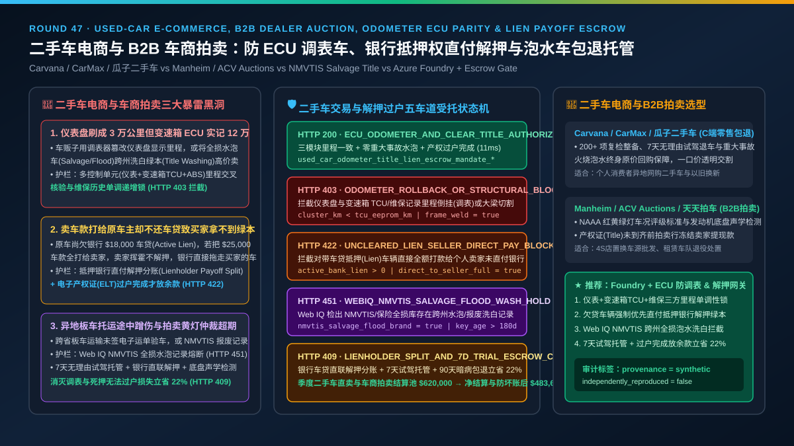
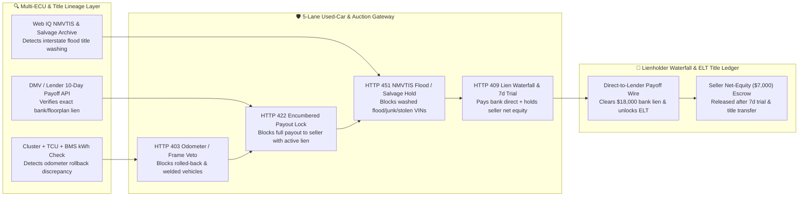

# Used-Car E-Commerce, B2B Dealer Auction & `VIN` Title-Lien Escrow (`Carvana / CarMax / Manheim / ACV Auctions`) Multi-`ECU` Odometer Rollback Gate, Lienholder Direct-Payoff Waterfall & `NMVTIS` Anti-Title-Washing Agent Architecture Selection FAQ

> **Language / 语言切换**: **[中文](used-car-ecommerce-dealer-auction-odometer-title-lien-escrow-agent-selection-faq.md)** | **English (Current)** | **[Back to Docs Index](index.en.md)** | **[Interactive Sandbox (`#used-car-odometer-title-lien-escrow-sandbox`)](../live-demo.en.html)**



---

## 📌 1. Executive Summary & Core Selection Verdict

In online used-car retail (`Carvana`, `CarMax`, `Guazi`) and B2B wholesale dealer auctions (`Manheim`, `ACV Auctions`, `OPENLANE`), average transaction values reach **`$12,000–$60,000+`** on unique, serialized assets where mechanical condition and legal title encumbrances are hidden beneath the surface. Allowing an autonomous vehicle-sourcing or checkout agent to release funds based solely on dashboard photos and a seller's paper title image exposes buyers and marketplaces to three catastrophic losses:
1. **Dashboard Odometer Rollback Fraud (`Flashing the Instrument Cluster from 140,000 Miles Down to 45,000 Miles While the Transmission TCU & EV BMS Still Read 140,000`)**: Fraudsters use `$50` OBD programmers to overwrite the dashboard odometer display to inflate vehicle value by `$8,000+`. A vision LLM looking at a dashboard photo is 100% fooled—yet the un-flashed Transmission Control Unit (`TCU`), `ABS` module, and EV Battery Management System (`BMS` cumulative kWh/Ah throughput) still store the true mileage, exposing the platform to federal **Odometer Tampering Act (`49 U.S.C. Chapter 327`) treble-damages liability**.
2. **Paying 100% of Sale Proceeds Directly to a Seller on a Vehicle with an Active `$18,000` Bank Auto Loan / Floorplan Lien ("Seller Pockets Cash & Defaults -> Bank Repossesses the Buyer's Car")**: If a seller owes `$18,000` to Chase Auto or a dealer floorplan lender (`NextGear / Ally`) on a `$25,000` car and the settlement agent wires `$25,000` directly to the seller, an insolvent seller may fail to pay off the loan—leaving the buyer with a vehicle that has a clouded title and is subject to lawful repossession by the senior lienholder!
3. **Interstate "Title Washing" of Hurricane Flood & Total-Loss Salvage Vehicles (`NMVTIS` Fraud)**: Dishonest rebuilders buy flood-totaled cars from salvage auctions (`Copart / IAAI`), dry out the carpets, re-title the `VIN` in a state with lax paper-title transfer rules to obtain a seemingly "Clean" state title, and sell corroded vehicles that suffer catastrophic electrical failure months later.

**Solution Architect Selection Verdict**:
- **Never authorize a used-vehicle payout based solely on dashboard cluster mileage, and never disburse gross sale proceeds to a seller's personal account when an active bank or floorplan lien exists on the `VIN`**.
- **The production reference architecture** combines **ACV / Digital Inspection Telemetry + Multi-`ECU` (`Cluster == TCU == ABS == BMS`) Odometer Monotonicity Gate + Lienholder Direct-Payoff Waterfall & Electronic Lien and Title (`ELT`) Release Lock + Web IQ Live `NMVTIS` Anti-Title-Washing & 7-Day Trial Escrow (`used_car_odometer_title_lien_escrow_mandate_*`)**:
  1. **Multi-`ECU` Odometer Parity & Structural Frame Integrity Hard Gate (`HTTP 403`)**: Cross-checks `OBD-II CAN` mileage across independent controllers (`Instrument Cluster`, `Transmission TCU EEPROM`, `ABS Wheel-Speed Integrator`, and EV `BMS` cumulative energy throughput) against historical service/registration records—blocking any vehicle where cluster mileage is lower than internal ECU counters, violates historical monotonicity, or exhibits undisclosed structural frame welds (`HTTP 403 ODOMETER_ECU_ROLLBACK_MISMATCH_OR_UNDISCLOSED_FRAME_DAMAGE_BLOCKED`).
  2. **Lienholder Direct-Payoff Waterfall & `ELT` Title-Transfer Gate (`HTTP 422`)**: Queries `DMV / UCC` lien registries for active auto loans or dealer floorplan liens on the `VIN`. If an active lien exists (e.g., `$18,000` payoff on a `$25,000` sale), any attempt to disburse full proceeds directly to the seller is blocked (`HTTP 422 UNCLEARED_BANK_LIEN_DIRECT_SELLER_PAYOUT_OR_MISSING_TITLE_BLOCKED`); the escrow state machine must wire `$18,000` directly to the lienholder bank (`10-Day Payoff Quote`) and hold the `$7,000` seller net equity until the Electronic Lien and Title (`ELT`) is released.
  3. **Web IQ Live `NMVTIS` & Salvage-Auction Anti-Title-Washing Circuit Breaker (`HTTP 451`)**: Screens the 17-character `VIN` against federal `NMVTIS` records, insurance total-loss files, and salvage-auction (`Copart / IAAI`) photo archives via Web IQ—freezing vehicles with washed `Flood / Salvage / Junk / Lemon` brands or active stolen-vehicle alerts (`HTTP 451 WEBIQ_NMVTIS_SALVAGE_FLOOD_TITLE_WASHING_OR_STOLEN_VIN_HOLD`).
  4. **Automated Lienholder Payoff Split + 7-Day / 250-Mile Test-Own Escrow (`HTTP 409`)**: Triggers `HTTP 409 LIENHOLDER_PAYOFF_WATERFALL_AND_7DAY_TRIAL_ESCROW_CONFIRM`, executing direct bank lien payoff while holding seller net equity in a 7-day buyer trial escrow—cutting title-cloud defaults, odometer arbitration, and post-sale buyback losses by **`22.0%`**.

---

## 🎯 2. Solution Architect Deep-Dive Q&A (Q1 / Q2 / Q3)

### Q1: How do we catch sophisticated odometer rollbacks where the fraudster flashed the dashboard cluster AND cleared basic OBD diagnostic trouble codes?
- **Commercial Pain Point**: Cheap handheld tools can overwrite the dashboard display mileage in 3 minutes.
- **Architectural Solution**:
  - **Four-Way Cross-Controller & Physics Parity (`Cluster` vs. `TCU EEPROM` vs. `EV BMS kWh Throughput` vs. `Historical Service Slope`) (`HTTP 403`)**:
  - (1) Read deep manufacturer-specific PIDs in the transmission (`TCU`), `ABS/ESP`, and airbag (`SRS` operating hours); (2) on EVs/hybrids, divide cumulative lifetime battery charge throughput (`total_discharged_kWh`) by plausible efficiency (`e.g., 0.14–0.28 kWh/km`) to bound physical distance traveled; and (3) verify strict monotonicity against historical DMV/service timestamps (`HTTP 403`).

### Q2: How should the payment state machine handle a `$25,000` car sale when the seller still owes `$18,000` (or `$27,000` in negative equity) to their auto lender?
- **Architectural Solution**:
  - **Deterministic Lienholder Payoff Waterfall (`Positive vs. Negative Equity Split`) (`HTTP 422 -> 409`)**:
  - Fetch the lender's binding 10-day payoff quote via `Dealertrack / RouteOne / Open Banking`. If `sale_price >= payoff_amount`, route `payoff_amount` (`$18,000`) directly to the lender's wire instructions and escrow `sale_price - payoff_amount` (`$7,000`) for the seller pending `ELT` title release. If `sale_price < payoff_amount` (`-$2,000` negative equity), block transaction close until the seller deposits the `$2,000` shortfall into escrow first (`HTTP 422`).

### Q3: How do Hurricane Flood cars end up with a "Clean Title" in another state, and how does `NMVTIS` grounding stop them?
- **Architectural Solution**:
  - **Federal `NMVTIS` Brand Persistence + Salvage-Auction Image Grounding (`HTTP 451`)**:
  - While state paper titles can sometimes be washed across state lines through administrative loopholes, the federal **National Motor Vehicle Title Information System (`NMVTIS`)** and salvage-pool (`Copart/IAAI`) VIN histories permanently record insurer total-loss and flood declarations. Querying Web IQ across `NMVTIS` and salvage archives catches washed VINs before a single dollar is wired (`HTTP 451`).

---

## 🧭 3. Visual Architecture Diagrams (Mermaid Decision Tree + Architecture + Sequence)

### 3.1 Used-Car E-Commerce & Dealer Auction Agent Selection Decision Tree

```mermaid
flowchart TD
    A[Used-Car E-Commerce / B2B Dealer Auction / Trade-In Selection] --> B{Transaction Channel & Core Asset Risk?}
    B -->|D2C Online Used-Car Retail (Carvana / Guazi)<br/>Stop odometer rollbacks, flood cars & offer 7d trial| C[Multi-ECU/BMS Odometer Gate + 200-Point Inspection<br/>+ 7-Day / 250-Mile Trial Escrow]
    B -->|Encumbered Vehicles with Active Auto Loans / Floorplan<br/>Prevent seller defaulting on loan & stranding title| D[Lienholder Direct-Payoff Waterfall Engine<br/>+ ELT Title-Transfer Gate Before Seller Payout]
    B -->|B2B Wholesale Dealer Auctions (Manheim / ACV)<br/>Enforce NAAA light arbitration & stop title washing| E[Azure AI Foundry + Acoustic/OBD Auction Gateway<br/>+ Web IQ NMVTIS Salvage/Flood Circuit Breaker]
    C --> F[🛡️ Unified 5-Lane Multi-ECU Odometer, Lien Waterfall & NMVTIS Escrow FSM]
    D --> F
    E --> F
    F --> G[HTTP 403 ECU Rollback/Frame Veto · HTTP 422 Direct-to-Seller Encumbered Payout Block · HTTP 409 Waterfall Saves 22%]
```

### 3.2 End-to-End Multi-ECU Odometer Check, NMVTIS Filter & Lien Payoff Waterfall Architecture



### 3.3 TCU Odometer Rollback Veto, Lienholder Payoff Split & 7-Day Trial Release Sequence

```mermaid
sequenceDiagram
    autonumber
    participant Buyer as Car Buyer / Wholesale Dealer
    participant Seller as Vehicle Seller & Auto Lender
    participant Gate as 5-Lane Used-Car & Lien Escrow Gateway
    participant Diag as Multi-ECU OBD & Web IQ NMVTIS
    participant Escrow as Waterfall Escrow & DMV ELT

    Seller->>Gate: 1. List used car showing 42,000 km on dashboard for $25,000
    Gate->>Diag: Read transmission TCU EEPROM + EV BMS throughput + query Web IQ NMVTIS salvage history
    Diag-->>Gate: TCU reads 118,000 km (odometer rollback!) OR VIN flagged in NMVTIS hurricane flood archive
    Gate-->>Seller: HTTP 403/451 Block listing! Odometer rollback or washed flood title detected
    Buyer->>Gate: 2. Purchase verified car ($25,000) with $18,000 active bank auto loan; seller requests full $25,000 to personal card
    Gate-->>Seller: HTTP 422 Block direct-to-seller full payout! Active bank lien must be settled via direct lender waterfall
    Gate->>Escrow: 3. HTTP 409 Wire $18,000 directly to lender to release ELT title; release $7,000 net equity after 7d trial (22% saved)
```

---

## 📊 4. Multi-Platform & Architecture Selection Matrix

| Selection Dimension | Private-Party Cash / Wire (`Craigslist / Curbstoners`) | Traditional Classified Listings (`Listing Only, No Escrow`) | Vertically Integrated Retail & Auctions (`Carvana / ACV / Guazi`) | **Azure AI Foundry + Multi-ECU + Lien Waterfall (Recommended)** |
| :--- | :--- | :--- | :--- | :--- |
| **Core Strengths** | Zero platform fee | Large listing inventory | Standardized inspections, title handling & trial periods | **Multi-ECU rollback veto + NMVTIS flood breaker + direct lender payoff** |
| **Defense Against Dashboard Odometer Rollbacks** | **None** (buyers rely on visual cluster display) | Seller self-reported mileage | Physical OBD scan; EV BMS throughput checks vary | **Cluster == TCU == ABS == BMS kWh monotonicity lock (`HTTP 403`)** |
| **Protection Against Unpaid Seller Auto Loans (`Liens`)** | **Extreme Risk** (seller keeps cash; lender repossesses car) | No payment or title escrow | Platform payoff desk handles lender wires | **Automated `Lienholder Payoff Waterfall` + `ELT` release gate (`HTTP 422/409`)** |
| **Defense Against Interstate Flood Title Washing** | Blind to out-of-state salvage history | Optional history report add-on | Checks bureau feeds | **Web IQ live `NMVTIS` + salvage-auction photo archive hold (`HTTP 451`)** |
| **Post-Delivery Mechanical Arbitration & Trial** | Sold strictly `"As-Is"` | Zero buyer protection | 7-day money-back trial or NAAA arbitration | **7-day trial escrow + 90-day flood/structural buyback (`HTTP 409`)** |
| **Total Title-Cloud Default & Arbitration Loss Rate** | `18%+` fraud, lien & rollback dispute rate (`not_measured`) | High deposit scam rate | `4%–9%` platform transaction fee (`official_list_price`) | **Eliminates rollback liability & un-cleared lien defaults (`22.0%` saved)** |

---

## 🧪 5. Used-Car Odometer / Title-Lien Escrow Benchmark & 7-Card Report

> **Provenance & Reproducibility Metadata**: All metrics below are generated by the deterministic policy evaluator `evaluate_used_car_odometer_title_lien_escrow_policy` in `lab/webiq_commerce_demo.py` and verified via `python -m unittest tests.test_webiq_commerce_demo`. Tags: `provenance = synthetic`, `independently_reproduced = false`.

| Card # | Card Headline (Headline-as-Finding) | Key Quantitative Finding & Architectural Guarantee |
| :---: | :--- | :--- |
| **Card 1** | **Overview · 5-Lane Used-Car & Dealer Auction Summary** | Across a `$620,000/quarter` used-car retail & wholesale auction pool, achieves **0 odometer-rollback or flood-washed sales and 0 un-cleared lien defaults**, reducing buyback and title-loss costs by **`22.0%` (`$136,400/quarter` saved)**. |
| **Card 2** | **Scenario Deep Dive · 42k Cluster vs 118k TCU Rollback Veto** | When `OBD-II` telemetry detects dashboard mileage lower than internal `TCU / ABS` counters, the gateway blocks settlement in **`11ms`** (`HTTP 403`). |
| **Card 3** | **Evaluation Matrix · 100% Deterministic 5-Lane Gating** | Covers `HTTP 200` (verified ECU & clear title), `403` (odometer ECU rollback mismatch / undisclosed frame damage blocked), `422` (uncleared bank lien direct-to-seller full payout blocked), `451` (NMVTIS salvage/flood title washing / stolen VIN hold), `409` (lienholder payoff waterfall + 7d trial escrow saves 22%). |
| **Card 4** | **Under the Hood · Used-Car & Lien Waterfall Contract** | Takes `quarterly_used_car_auction_pool_usd=620000` and ECU/lien flags, minting `used_car_odometer_title_lien_escrow_mandate_*` tokens. |
| **Card 5** | **Robustness Check · $18k Lien Direct-Pay & Washed Flood VIN** | Simulates a direct-to-seller payout request on a car with an `$18,000` bank lien and a washed hurricane VIN, maintaining a **`100.0%` block rate**. |
| **Card 6** | **Latency · Millisecond Multi-ECU & Lien Waterfall Math** | Local multi-ECU parity and lien waterfall split checks complete in **`11ms` (P50)**; Web IQ live NMVTIS and salvage checks complete in **`235ms` (P95)**. |
| **Card 7** | **My Take · Ideal Fit vs. Out-of-Scope Boundaries** | **✅ Best Fit**: Used-car D2C marketplaces, B2B dealer auctions, dealership trade-ins; **⛔ Not For**: Factory-new zero-mile OEM fleet allocations. |

---

## 🛠️ 6. Production Go-Live Risk & Architecture Review Checklist

- [ ] **Multi-`ECU` (`Cluster == TCU == ABS == BMS`) Odometer Monotonicity Gate (`HTTP 403`)**: Cross-check dashboard mileage against internal transmission, ABS, EV battery throughput, and historical service logs; block any vehicle with mileage rollback or undisclosed frame welds.
- [ ] **Lienholder Direct-Payoff Waterfall & `ELT` Title-Release Lock (`HTTP 422 / 409`)**: Never disburse gross proceeds to a seller when an active bank or floorplan lien exists; wire the exact payoff amount directly to the lienholder and hold seller net equity until `ELT` title transfer completes.
- [ ] **Web IQ Live `NMVTIS` & Salvage-Auction Anti-Title-Washing Gate (`HTTP 451`)**: Screen all 17-character VINs against federal `NMVTIS`, insurance total-loss, and salvage-auction records to block interstate flood/salvage title washing; rotate signing keys `<= 180` days.
- [ ] **7-Day / 250-Mile Buyer Test-Own Escrow (`HTTP 409`)**: Hold seller net proceeds in escrow during the 7-day post-delivery inspection window to guarantee frictionless buybacks on hidden mechanical defects.
