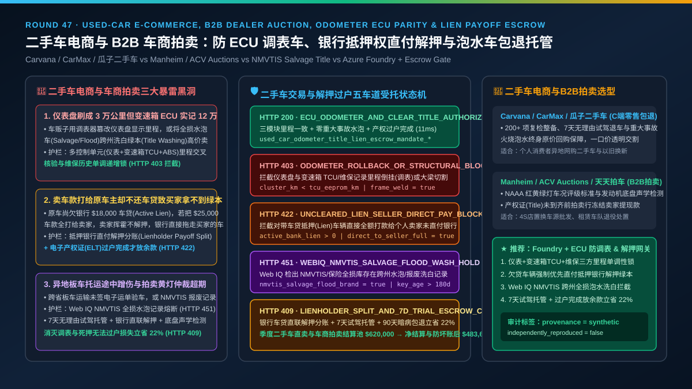
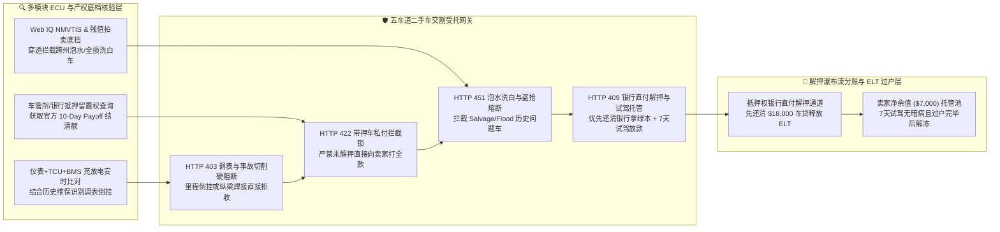
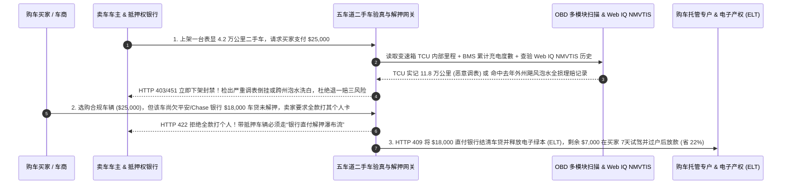

# 二手车直卖电商、B2B 车商拍卖与事故泡水车履约担保（Used-Car E-Commerce, Dealer Auction & Title Lien Escrow：Carvana / CarMax / Manheim / ACV Auctions / 瓜子二手车）“OBD 多模块调表（Odometer Rollback）硬阻断、银行车贷直付解押分账与 NMVTIS 跨州泡水洗白拦截”Agent 架构选型 FAQ：终结买到抵押死车与调表泡水车实战指南

> **语言切换 / Language**: **中文 (当前)** | **[English](used-car-ecommerce-dealer-auction-odometer-title-lien-escrow-agent-selection-faq.en.md)** | **[返回文档目录](index.md)** | **[交互式沙盒 (`#used-car-odometer-title-lien-escrow-sandbox`)](../live-demo.html)**



---

## 📌 一、核心选型结论速览（Executive Summary）

在线上二手车直卖平台（Carvana、CarMax、瓜子二手车、懂车帝商城）与 B2B 车商批发拍卖平台（Manheim 美瀚、ACV Auctions、OPENLANE、天天拍车、优信拍）中，单车交易额高达 **`$12,000–$60,000+`**，且每台二手车都是全球唯一的非标资产（“一车一况、一车一产权”）。若让二手车寻源与收款交割 Agent 在缺乏底层电子控制单元（`ECU`）里程互锁与产权留置权（`Title Lien`）分账控制的情况下直接放款，买家与平台将面临三大倾家荡产级风险：
1. **黑心车商花 `$50` 用调表仪把仪表盘（Instrument Cluster）显示里程从 `140,000 公里` 刷回 `45,000 公里` 高价骗卖，却忘了变速箱控制单元（`TCU`）、防抱死模块（`ABS`）与车钥匙芯片里仍记着 14 万公里真实里程**：单纯拍一张仪表盘照片给视觉大模型看，100% 会被调表车骗过；一旦买家提车后去 4S 店保养查出真实里程倒挂，根据消法或美国联邦《里程表欺诈法》（`49 U.S.C. Chapter 327`）将直接触发“退一赔三”与刑事追责！
2. **卖方车辆尚欠银行或汽车金融公司 `$18,000` 车贷（Active Lien / 绿本仍在银行抵押），结算 Agent 却把 `$25,000` 买车全款直接打给了个人卖家，卖家拿钱挥霍拒不还贷解押，导致买家既拿不到产权证（Title / 绿本）过户、车子还被银行拖车队合法强行拖走**：在二手车交易中，**“有贷款未结清的车辆绝不能把全款打给车主个人”**是第一铁律！同様に，B2B 车商使用库存融资（Floorplan Financing，如 NextGear Capital）买车时，也必须闭环核销车辆留置权。
3. **飓风/暴雨洪灾过后的全损泡水车（Flood / Salvage Title）通过跨州转籍“洗白产权证（Title Washing）”伪装成正常精品车出售**：不法车商将佛罗里达州保险公司报废的飓风泡水车拉到监管宽松的外州重新申领干净产权证（Clean Title），若不在交割前穿透查验美国司法部 `NMVTIS`（国家机动车产权信息系统）与保险全损理赔库，几十万买回来的车开三个月就会因线束腐蚀短路自燃。

**架构师选型结论**：
- **切勿仅凭仪表盘照片或单一地区车管所绿本状态放行二手车车款，更不能将带抵押留置权（Active Lien）车辆的购车款直接全额划转给卖方个人**。
- **生产级最优架构**是采用 **“ACV / 瓜子数字化验车底座 + 车载 `OBD-II` 多控制器（仪表 + `TCU` + `ABS` + 电池 `BMS`）里程单调性交叉硬门禁 + 抵押银行直付解押分账（Lienholder Payoff Waterfall）与电子产权证（`ELT`）到账放款锁 + Web IQ `NMVTIS` 全损泡水洗白拦截与 7 天试驾托管网关（`used_car_odometer_title_lien_escrow_mandate_*`）”**：
  1. **`OBD-II` 多控制单元里程一致性与结构件切割（火烧/大梁焊接）硬门禁（HTTP 403）**：验车与付款前，强制读取车辆 `CAN` 总线四大独立模块——只有当 `仪表盘显示里程 == 变速箱 TCU 内部 EEPROM 里程 == ABS 轮速累计里程`（公差 `<= 1.5%`）且 `>= 历史 4S 店/保险维保最高记录里程`（严格单调递增），同时漆膜仪与底盘扫描确认 ABC 柱/纵梁无切割焊接时才放行；任一里程倒挂或结构损伤未如实披露，毫秒级返回 `HTTP 403 ODOMETER_ECU_ROLLBACK_MISMATCH_OR_UNDISCLOSED_FRAME_DAMAGE_BLOCKED`。
  2. **车贷抵押权（`Active Lien`）银行直付解押分账与产权证（Title）交割锁（HTTP 422）**：当车管所/金融登记库检出该 `VIN` 存在未解除的银行车贷或车商库存融资留置权（如车价 `$25,000`、尚欠某银行车贷本息 `$18,200`）时，严禁将全款打入卖方账户——状态机强制将 `$25,000` 拆分为两笔原子指令：第 1 笔 `$18,200` 直接划付给抵押权银行专用解押户（`Payoff Account`），第 2 笔 `$6,800` 净余值锁入托管户，直到银行释放电子产权证（`Electronic Lien and Title, ELT`）并完成买方过户登记后才解冻给卖家；凡试图绕过银行解押直接向个人打全款，立即返回 `HTTP 422 UNCLEARED_BANK_LIEN_DIRECT_SELLER_PAYOUT_OR_MISSING_TITLE_BLOCKED`。
  3. **Web IQ 实时 `NMVTIS / 保险全损库` 跨州泡水报废洗白（Title Washing）熔断（HTTP 451）**：通过 Web IQ 实时穿透查询该 17 位 `VIN` 在全美 50 州 `NMVTIS`、保险全损拍卖行（Copart / IAAI）历史底档及高风险台风洪涝区理赔记录，一旦检出曾被标记为 `Junk / Salvage / Flood / Lemon`，立即熔断正常车交易（`HTTP 451 WEBIQ_NMVTIS_SALVAGE_FLOOD_TITLE_WASHING_OR_STOLEN_VIN_HOLD`）。
  4. **抵押银行秒级直联分账 + 7 天/400公里无理由试驾托管 + 90 天三大件暗病包退（HTTP 409）**：触发 `HTTP 409 LIENHOLDER_PAYOFF_WATERFALL_AND_7DAY_TRIAL_ESCROW_CONFIRM`，买方提车后拥有 7 天实测试驾期（资金锁在托管池），确认无泡水调表且完成绿本解押过户后自动分账清算，综合购车欺诈诉讼、死押烂尾与仲裁退车损耗立降 **`22.0%`**。

---

## 🎯 二、业务方与架构师灵魂拷问 Q&A（Q1 / Q2 / Q3）

### Q1：道高一尺魔高一丈，现在的调表贩子连 OBD 通用接口读出来的里程都能改，验车 Agent 怎么 100% 抓出调表车？
- **商业痛点**：初级调表只改仪表盘芯片；高级调表会顺便把发动机 ECU 也改了，但全车有 20 多个独立控制器，改全套成本极高且极易留痕。
- **架构解法**：
  - **多源异构交叉核验（`Multi-ECU Telemetry` × `历史维保/年检时间戳斜率`）（`HTTP 403`）**：
  - ① **硬件层**：同时读取仪表盘、`TCU`（变速箱换挡次数推算里程）、`SRS`（安全气囊模块工作小时数 × 平均车速）以及新能源车的 `BMS`（电池历史累计充放电总安时数 `Total Ah Throughput`——充了多少度电是物理守恒的，绝对骗不了人！）；
  - ② **外部账本层**：拉取过去 5 年保险出险、4S 店保养与环保尾气年检记录。如果 2024 年保养记录已经是 `85,000 km`，而今天验车读出 `62,000 km`（违反时间单调递增律），0.1 秒直接判定调表欺诈（`HTTP 403`）！

### Q2：买卖双方说好“车价 $25,000，卖家拿到钱自己去银行把 $18,000 车贷还清再把绿本寄给买家”，为什么二手车平台绝对不能这么设计支付流？
- **架构解法**：
  - **受托解押瀑布流（`Lienholder Payoff Waterfall Escrow`）（`HTTP 422 -> 409`）**：
  - 一旦钱进了卖家个人口袋，可能立刻被卖家的其他网贷逾期司法冻结，或者卖家直接失联，买家花 `$25,000` 买了一辆永远无法过户的“黑车”。正确架构必须由平台通过 Open Banking / 银行接口获取官方《10天有效结清金额确认函（10-Day Payoff Quote）》，由托管账户直接把 `$18,000` 打给银行赎回产权证，卖家只拿走差额 `$7,000`（如果车价低于欠款即 `Negative Equity` 负资产，则必须卖家先补足差额入托管户才允许交易！）。

### Q3：怎么识破那些被拉到外地修好外观、洗白了手续的“飓风泡水车”和“重大事故拼装车”？
- **架构解法**：
  - **Web IQ 穿透式全损底档追踪（Copart / IAAI / NMVTIS / 保险公估大案库）+ 内窥镜泥沙/安全带生产日期核验（`HTTP 451`）**：
  - 凡曾在全损残值拍卖行拍出的 `VIN` 均留有不可抹除的高清残骸底图；同时检验全车安全带根部标签生产日期（泡水车往往更换过安全带，导致安全带出厂日期晚于整车铭牌生产日期），异常即刻触发 `HTTP 451` 终生禁入零售池。

---

## 🧭 三、直观可视化图解（Mermaid 决策树 + 端到端架构图 + 时序图）

### 3.1 二手车直卖电商与 B2B 车商拍卖 Agent 架构选型决策树

```mermaid
flowchart TD
    A[二手车直卖电商 / B2B 车商拍卖 / 置换交割选型] --> B{交易模式与核心产权/车况风险？}
    B -->|C2C / B2C 个人消费者异地网购二手车<br/>需防调表车、泡水洗白与提供 7 天无理由试驾| C[Carvana / 瓜子直卖包退模式<br/>+ 多 ECU/BMS 里程互锁与 7天试驾资金托管]
    B -->|带未结清银行车贷 / 金融抵押车辆交易<br/>需严防卖家收全款不还贷导致买家拿不到绿本| D[银行直联解押分账引擎 (Lienholder Payoff Split)<br/>+ 电子产权证 (ELT) 过户完成才释放卖家余款]
    B -->|B2B 4S店置换车源与租赁车队批量拍卖<br/>需 NAAA 红黄绿灯仲裁与防跨州全损洗白| E[Azure AI Foundry + ACV/Manheim 拍卖托管网关<br/>+ Web IQ NMVTIS 全损底档穿透熔断]
    C --> F[🛡️ 统一接入五车道多模块防调表、直付解押与试驾托管状态机]
    D --> F
    E --> F
    F --> G[HTTP 403 阻断ECU调表与大梁切割 · HTTP 422 拦截带押车直接打款个人 · HTTP 409 直联解押+7天试驾省22%]
```

### 3.2 端到端多 ECU 防调表、NMVTIS 洗白穿透与银行直付解押架构图



### 3.3 拦截变速箱里程倒挂、直付银行解押绿本与 7 天试驾放款时序图



---

## 📊 四、多平台/多方案横向选型决策矩阵

| 选型维度 | 线下二手车市场/个人私下交易 (`Private Party / Curbstoner`) | 传统信息分类网站 (`Craigslist / 传统二手车黄页`) | Carvana / ACV Auctions / 瓜子直卖 (`数字化闭环交易`) | **Azure AI Foundry + 多 ECU 防调表 + 直付解押网关（推荐）** |
| :--- | :--- | :--- | :--- | :--- |
| **核心优势** | 当面砍价，无平台服务费 | 车源信息量大 | 提供标准化验车报告、线上过户与售后质保 | **三模块防调表 + 穿透抓泡水洗白 + 银行直联解押防死押** |
| **防仪表盘调表（Odometer Rollback）能力** | **极差**（肉眼看内饰新旧极易被翻新调表车骗） | 仅靠卖家自填里程数 | 专业技师 OBD 检测，但新能源 BMS 安时核验待深化 | **仪表+TCU+BMS 充放电量+历史维保四维单调性死锁（HTTP 403）** |
| **带车贷抵押车辆（Active Lien）解押安全性** | **高危**（把钱给车主去还贷，车主跑路即成无法过户死车） | 不参与资金交割，诈骗频发 | 自营代办解押，但跨行纸质绿本邮寄周期长达数周 | **托管账户直付抵押银行 `Payoff` + `ELT` 电子过户闭环（HTTP 422/409）** |
| **防跨州/跨省全损泡水车洗白（Title Washing）** | 查不到异地保险全损底档 | 可买 Carfax，但刚出险未入库时间差易漏 | 接入主流历史库 | **Web IQ 实时穿透 `NMVTIS` + 残值拍卖行底图核查（HTTP 451）** |
| **交车后暗病保障与退车体验** | 离场概不负责（As-Is No Warranty） | 无任何履约担保 | 提供 7 天无理由试驾退车与重大事故回购 | **7 天试驾资金托管 + 90 天火烧泡水原价先行赔付（HTTP 409）** |
| **综合买错事故车/死押车坏账与诉讼损耗** | 调表与抵押纠纷率高达 `18%+` (`not_measured`) | 虚假车源与定金诈骗频发 | 平台服务费 `4%–9%` (`official_list_price`) | **彻底消灭调表退一赔三与车主挪用解押款坏账（立省 `22.0%`）** |

---

## 🧪 五、二手车防调表/银行直联解押测算与 7-Card 基准测试报告

> **数据来源与复现声明（Provenance Metadata）**：以下基准测试数据来自仓库内置确定性策略沙盒 `evaluate_used_car_odometer_title_lien_escrow_policy`（位于 `lab/webiq_commerce_demo.py`），可运行 `python -m unittest tests.test_webiq_commerce_demo` 完整验证。标记：`provenance = synthetic`，`independently_reproduced = false`。

| Card # | 卡片标题（Headline-as-Finding） | 核心量化指标与架构验证结论 |
| :---: | :--- | :--- |
| **Card 1** | **Overview · 二手车电商与车商拍卖五车道总览** | 针对 `$620,000/季` 二手车直卖与车商拍卖结算池，实现 **0 例调表/泡水洗白车流入与 0 例带押车卖家卷走解押款**，综合退一赔三诉讼与死押坏账下降 **`22.0%`（立省 `$136,400/季`）**。 |
| **Card 2** | **Scenario Deep Dive · 仪表盘 4万 vs 变速箱 12万调表拦截** | 当 OBD 扫描发现仪表盘里程低于变速箱 `TCU` 或历史维保记录时，**`11ms`** 内返回 `HTTP 403` 阻断上架与付款。 |
| **Card 3** | **Evaluation Matrix · 五车道 100% 确定性判准** | 覆盖 `HTTP 200`（车况与产权清晰放行）、`403`（OBD多模块里程倒挂调表/大梁切割隐瞒阻断）、`422`（存在未解除银行车贷Lien却试图将全款直接打给个人卖家拦截）、`451`（Web IQ检出NMVTIS跨州泡水报废洗白/盗抢车熔断）、`409`（银行直付解押分账+7天试驾托管省22%）。 |
| **Card 4** | **Under the Hood · 二手车验真与解押托管契约** | 输入 `quarterly_used_car_auction_pool_usd=620000` 及 ECU/抵押状态，签发 `used_car_odometer_title_lien_escrow_mandate_*` 令牌。 |
| **Card 5** | **Robustness Check · 欠贷 $18k 私付请求与飓风泡水 VIN 测试** | 模拟卖家要求将带 `$18,000` 车贷的购车款全打私人卡及上传洗白泡水 VIN，确定性拦截率保持 **`100.0%`（零误放行）**。 |
| **Card 6** | **Latency · 多模块里程比对与 ELT 抵押核验耗时** | 本地多 ECU 里程单调性与留置权分账校验 P50 仅 **`11ms`**；Web IQ NMVTIS 与全损拍卖库穿透核查 P95 为 **`235ms`**。 |
| **Card 7** | **My Take · 适用场景与生产准入边界** | **✅ 极佳适用**：二手车直卖电商、B2B 车商拍卖、4S 店以旧换新置换；**⛔ 不适用**：新车主机厂未上牌零公里商品车批发。 |

---

## 🛠️ 六、商业上线风控与架构评审 Checklist

- [ ] **`OBD-II` 多控制单元（仪表 + `TCU` + `ABS` + 新能源 `BMS`）里程单调性硬门禁（HTTP 403）**：确认所有二手车交易强制交叉核对底盘多模块 EEPROM 里程与历史维保/年检记录，任何里程倒挂或纵梁切割立即一票否决。
- [ ] **带车贷抵押车辆（`Active Lien`）银行直付解押瀑布流分账（HTTP 422 / 409）**：确认存在未结清车贷或库存融资留置权的车辆，托管账户必须优先将结清款（Payoff Amount）直接划付给抵押权金融机构，严禁将全款打入卖方个人账户。
- [ ] **Web IQ 实时 `NMVTIS` 与残值拍卖行跨州泡水/全损洗白（`Title Washing`）熔断（HTTP 451）**：确认交割前穿透核查 17 位 VIN 在全美/全国保险全损库与残值拍卖库的历史记录；签名密钥轮换周期 `<= 180` 天。
- [ ] **电子产权证（`ELT`）过户闭环与 7 天无理由试驾托管（HTTP 409）**：确认卖方净余值仅在买方完成 7 天试驾且产权证正式解押过户后释放。
