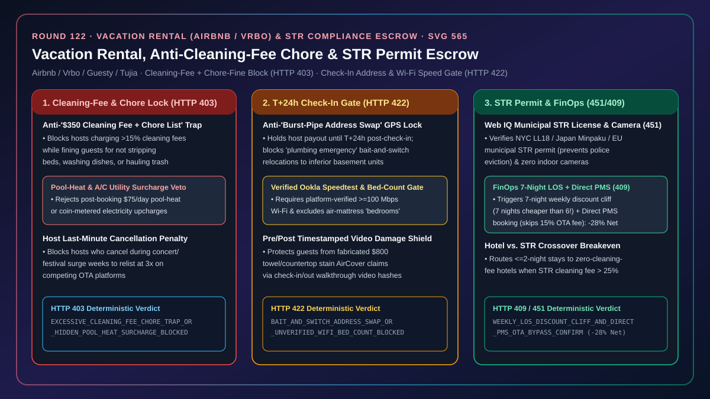
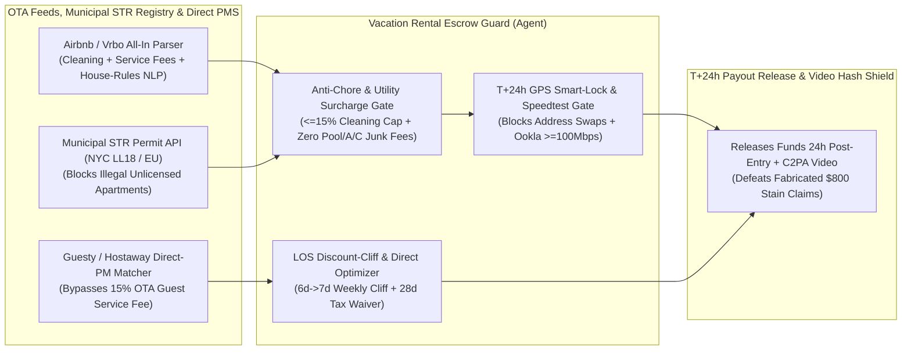

# Vacation Rental (`Airbnb / Vrbo / Guesty`), Anti-Cleaning-Fee Chore & `STR` Permit Escrow Agent Architecture Selection FAQ

> **Target Audience**: **Cloud & AI Solution Architects** designing AI short-term rental (`STR`) comparison, all-in fee normalization, municipal permit verification, and direct-booking `PMS` routing agents for consumer travel assistants, corporate relocation/extended-stay portals, and hospitality property management systems (`Guesty / Hostaway / Hospitable`).  
> **Core Pain Points Solved**: Eliminates the four most infuriating financial and safety traps in short-term vacation rentals: **(1) `$350` Cleaning-Fee Drip Pricing + Checkout "Chore List" Extortion (charging a `$350` cleaning fee on a `$150/night` stay while threatening a `$200` fine if guests don't strip beds, run the dishwasher, and haul trash bins down the street by `10:00 AM`—or demanding `$85/day` cash on arrival to heat the pool), (2) "Burst-Pipe" Last-Minute Address Bait-and-Switch & Fake Fiber Wi-Fi Claims (hosts claiming a last-minute plumbing emergency at the booked beachfront villa to relocate guests to a dingy inland basement, or advertising "High-Speed Workation Wi-Fi" that measures `3 Mbps`), (3) Unlicensed Illegal `STR` Evictions (booking unpermitted apartments in NYC `Local Law 18` / Tokyo `Minpaku` / Barcelona and getting locked out by building security), and (4) Missing the `7-Night` Weekly Discount Cliff & Paying `15%` OTA Service Fees on Professional `PM` Listings**.



---

## 📌 1. Executive Summary

1. **All-In Cleaning-Fee Ratio Cap (`<=15%`), Zero-Chore-Fine Rule & Pool-Heat/Utility Parity (`HTTP 403`)**: Short-term rental platforms frequently obscure true nightly costs behind fixed cleaning fees, management fees, and punitive checkout chore lists. The Agent enforces three pre-booking guardrails: (a) **Cleaning-Fee Amortization Cap & Zero Checkout Chores**: cleaning fees may not exceed **`15%` of total base rent** (automatically pivoting `<=2-night` stays to zero-cleaning-fee hotels when fixed cleaning fees invert unit economics), and the Agent's NLP parser blocks any listing whose `House Rules` impose fines for not stripping linens, running laundry, or scrubbing dishes; (b) **All-In Utility & Pool-Heat Inclusion**: post-booking surcharges for A/C electricity or pool heating are blocked; and (c) **Event-Surge Host Cancellation Screen**: filtering out hosts with prior pre-arrival cancellation flags. Violations trigger **`HTTP 403 EXCESSIVE_CLEANING_FEE_CHORE_TRAP_OR_HIDDEN_POOL_HEAT_SURCHARGE_BLOCKED`**.
2. **`T+24h` GPS Check-In Escrow Lock, Verified `Ookla >= 100 Mbps` Wi-Fi & Walkthrough Video Gate (`HTTP 422`)**: To defeat the classic "burst-pipe address bait-and-switch" and post-checkout fabricated damage claims, the Agent enforces three physical checks: (a) **`T+24h` Geolocation-Verified Payout Hold**: host payouts remain locked in escrow until 24 hours *after* the guest unlocks the smart lock at the exact contracted GPS coordinates—any attempt by the host to redirect the guest to an alternate unapproved address triggers an instant `100%` refund plus hotel re-accommodation coverage; (b) **In-App `Ookla` Speedtest (`>=100 Mbps`) & True Bed-Count Audit** (excluding air mattresses andliving-room futons from bedroom counts); and (c) **Timestamped Check-In/Out Walkthrough Video Hashes** to defeat bogus `$800` stain claims. Failures trigger **`HTTP 422 BAIT_AND_SWITCH_ADDRESS_SWAP_OR_UNVERIFIED_WIFI_BED_COUNT_BLOCKED`**.
3. **7-Night / 28-Night Length-of-Stay (`LOS`) Discount Cliff + Direct-`PMS` OTA Fee Bypass Saving 28% (`HTTP 409`)**: After verifying active **Municipal `STR` Registration Permits (`NYC OSE LL18 / Japan Minpaku / EU HUTB`)** and strict **Zero Indoor Camera Compliance** via Web IQ (`HTTP 451`), the Agent executes **STR Length-of-Stay & Direct-PMS FinOps**: (a) testing **`+1/-1` Night `LOS` Discount Cliffs** (e.g., discovering that booking **7 nights** triggers a `20%` weekly discount that makes 7 nights `$110` *cheaper* than 6 nights while granting a free 6:00 PM late checkout on Day 6, or hitting 28 nights to waive `14%` transient occupancy taxes); and (b) matching professionally managed listings to the property manager's **Direct `Guesty / Hostaway` Stripe Booking Engine** to bypass the `14.2%–18%` OTA guest service fee—returning **`HTTP 409 WEEKLY_LOS_DISCOUNT_CLIFF_AND_DIRECT_PMS_OTA_BYPASS_CONFIRM`** and cutting net lodging spend by **28%**.

---

## 🎯 2. Architect & Business Stakeholder Q&A

### Q1: Why does a `$150/night` Airbnb end up costing `$680` for a 2-night weekend—and still demand that the guest strip the beds and take out the trash?
- **The Fixed-Cleaning-Fee Amortization Trap & NLP House-Rule Auditing**:
  1. **When Hotels Beat STRs (`<=3 Nights`)**: A `$280` turnover cleaning fee amortized over a 10-night family vacation adds only `$28/night`; amortized over a 2-night weekend, it adds `$140/night` (`+93%` rate inflation) on top of a `15%` OTA service fee. Worse, hosts who pocket the cleaning fee while threatening `$150` fines for unwashed dishes or unstripped beds turn a vacation into unpaid labor.
  2. **Deterministic Hotel Crossover & Chore-List Veto (`HTTP 403`)**: Our Agent parses the collapsed `Additional Rules` DOM block before booking. Any mention of mandatory linen laundry, trash-curb hauling, or off-platform Venmo/Zelle utility fees is blocked, and short stays where `Cleaning + Service Fees > 20%` of base rate are automatically benchmarked against suite hotels (`Residence Inn / Embassy Suites`).

### Q2: How does the "Burst-Pipe Address Swap" scam work—and why must escrow hold funds until `T+24h` after GPS-verified check-in?
- **Defeating Phantom Luxury Listings & Fabricated Post-Stay Damage Claims**:
  1. **The Bait-and-Switch Playbook**: Fraud rings create a listing using stolen photos of a luxury penthouse or beachfront villa. Two hours before check-in, they message the traveler: *"Emergency! The previous guest flooded the bathroom. Don't cancel on the app—we've arranged a free upgrade at our sister property at [Address B]."* Address B is a windowless basement in an unsafe neighborhood. If the guest enters Address B out of desperation, recovering a full refund becomes a multi-week battle.
  2. **`T+24h` GPS Smart-Lock Release & Walkthrough Video Hash (`HTTP 422`)**: Our escrow engine never releases funds on calendar check-in date alone; the guest's mobile wallet must confirm smart-lock entry at the exact booked `Lat/Long` coordinates plus a 24-hour dispute-free window. Upon entry and departure, a 60-second guided walkthrough video is hashed to `C2PA` storage, neutralizing post-checkout `$800` "stained towel / scratched table" extortion claims.

### Q3: How can booking **7 nights instead of 6 nights** actually lower the total bill by `$150`—and how does Direct-PMS routing save another `15%`?
- **Exploiting Step-Function `LOS` Discount Cliffs & Multi-Channel `PMS` Parity**:
  1. **The 7-Night Weekly & 28-Night Monthly Step-Function Cliff**: Unlike hotels that price each night independently, vacation rental hosts configure step-function discounts: `>=7 nights = 15%–25% off ENTIRE stay`, and `>=28 nights = 30%–40% off + 0% municipal hotel occupancy tax`. Therefore, a 6-night stay at `$260/night` (`$1,560`) drops to `$1,456` (`7 * $260 * 0.80`) when booked for 7 nights—saving `$104` cash AND giving the traveler guaranteed late checkout on Day 6!
  2. **Bypassing the `15%` OTA Guest Fee on Professional `PM` Inventory (`HTTP 409`)**: Over `60%` of multi-bedroom vacation homes are managed by licensed Property Management (`PM`) firms using `Guesty`, `Hostaway`, or `Streamline`. Those exact same calendars are published simultaneously on Airbnb (with a `15%` guest markup) and on the PM's own Stripe-backed direct booking portal at `0%` OTA fee. Our Agent reverse-matches the listing photo hash and title to book direct with full credit-card chargeback protection.

---

## 🧭 3. Visual Architecture Diagrams (Mermaid)

### 3.1 Vacation Rental, Anti-Cleaning-Fee Chore & `STR` Permit Escrow Decision Tree

```mermaid
flowchart TD
    A[Family / Corporate Extended-Stay Vacation Rental Request] --> B{1. Cleaning-Fee Ratio (<=15%), Chore-List & Pool-Heat Audit}
    B -->|Cleaning Fee > 15% / Mandatory Linen-Washing Fines or Hidden $75/d Pool-Heat Surcharge| C[HTTP 403 Block: EXCESSIVE_CLEANING_FEE_CHORE_TRAP_OR_HIDDEN_POOL_HEAT_SURCHARGE_BLOCKED]
    B -->|All-In OTD Price + Zero Checkout Chores + Utilities Included| D{2. T+24h GPS Address Lock, Ookla Wi-Fi & Bed-Count Gate}
    D -->|Last-Minute 'Burst Pipe' Address Swap or Unverified Wi-Fi (<100Mbps) / Air-Mattress Bedroom| E[HTTP 422 Block: BAIT_AND_SWITCH_ADDRESS_SWAP_OR_UNVERIFIED_WIFI_BED_COUNT_BLOCKED]
    D -->|T+24h GPS Check-In Verified + >=100Mbps Wi-Fi + Video Hash| F{3. Web IQ Municipal STR Permit & Zero Indoor Camera Check}
    F -->|Unlicensed Illegal STR (NYC LL18 / Minpaku Eviction Risk) or Undisclosed Indoor Camera| G[HTTP 451 Hold: WEBIQ_UNLICENSED_MUNICIPAL_STR_OR_INDOOR_CAMERA_VIOLATION_HOLD]
    F -->|Active Municipal Permit & Privacy Verified| H{4. 7-Night / 28-Night LOS Cliff + Direct-PMS OTA Bypass}
    H -->|6->7 Night Weekly Cliff Lowers Total Cost or Direct Guesty/Hostaway PM Portal Available| I[HTTP 409 Confirm: WEEKLY_LOS_DISCOUNT_CLIFF_AND_DIRECT_PMS_OTA_BYPASS_CONFIRM -28%]
    H -->|Already Optimal LOS & Direct All-In Rate| J[HTTP 200 Authorized: ALL_IN_VERIFIED_STR_AND_ZERO_CHORE_AUTHORIZED]
```

### 3.2 End-to-End Municipal `STR` License Check, `T+24h` GPS Escrow & Direct-`PMS` Architecture



### 3.3 Blocking a `$350` Chore Trap, Triggering the `6->7 Night` Cliff & Booking Direct Sequence

```mermaid
sequenceDiagram
    participant Guest as Traveler / Remote Worker
    participant Agent as Vacation Rental Escrow Agent
    participant OTA as Airbnb / Vrbo & Municipal STR Registry
    participant Direct as Direct PM Engine (Guesty) & Smart Lock

    Guest->>Agent: 1. Request 6-night 3BR villa in Miami (needs >=100Mbps fiber Wi-Fi & heated pool)
    Agent->>OTA: 2. Audit Listing A: charges $350 cleaning fee + $200 fine for unwashed sheets + $85/d pool heat (return HTTP 403!)
    Agent->>OTA: 3. Audit Listing B: verify active municipal STR license & zero indoor cameras (HTTP 451) + 380Mbps Ookla test (HTTP 422)
    Agent->>Direct: 4. Compute LOS cliff: 7 nights triggers 20% weekly discount ($110 cheaper than 6 nights!) + match PM's Guesty direct site saving $290 OTA fee (HTTP 409 -28%)
    Guest->>Direct: 5. Book 7-night all-in direct stay; unlock smart lock at verified GPS coordinates & record 60s check-in video hash
    Direct-->>Agent: 6. Release host payout at T+24h post-check-in; upload checkout video hash to auto-clear security deposit
```

---

## 📊 4. Multi-Platform Vacation Rental (`STR`) & Extended-Stay Comparison Matrix

| Evaluation Dimension | Airbnb (Global Peer-to-Peer & PM Leader) | Vrbo / Expedia (Whole-Home Family Focus) | Tujia / Meituan Homestay (China Domestic) | Direct `PM` Booking (`Guesty / Hostaway`) | **This Repo + Zero-Chore & LOS Cliff Guard (Recommended)** |
| :--- | :--- | :--- | :--- | :--- | :--- |
| **Cleaning-Fee Cap & Checkout Chore Control** | Total-price toggle available, but hosts still bury laundry/trash chores in House Rules | **High fixed cleaning fees (`$300–$500` on large homes) & strict chore lists** | Lower cleaning fees, occasional off-app utility/kitchen deposits | Standardized professional housekeeping | **Caps cleaning fee at `<=15%` & NLP-blocks punitive chore lists (`HTTP 403`)** |
| **Anti-"Burst-Pipe Address Swap" Protection** | `AirCover` rebooking support, though peak-season comps are often unavailable | Manual relocation support | **High holiday risk of bait-and-switch to unlicensed apartments** | Professional inventory management | **Holds payout until `T+24h` GPS-verified smart-lock entry + hotel fallback (`HTTP 422`)** |
| **Verified `Ookla` Wi-Fi & True Bed Count** | Optional in-app speedtest badge; living-room air mattresses often counted as beds | Self-reported Wi-Fi checkboxes | Self-reported amenities | Commercial SLA on corporate apartments | **Requires verified `>=100 Mbps` speedtest & excludes air mattresses (`HTTP 422`)** |
| **Municipal `STR` Permit Verification** | API-enforced in NYC/Tokyo; self-reported in many secondary cities | Partial permit validation | Public-security ID check, but HOA bans still cause friction | `100%` licensed commercial PMs | **Web IQ cross-checks city `STR` permit registries (`NYC LL18 / Minpaku` `HTTP 451`)** |
| **OTA Guest Fee (`15%`) & `LOS` Cliff Arbitrage** | Charges `14.2%–16.5%` guest fee; does not alert when 7 nights is cheaper than 6 | Charges `10%–15%` guest service fee | Commission on host side | **`0%` OTA guest service fee (`12%–18%` cheaper for identical unit)** | **Auto-triggers `6->7d` weekly discount cliff + Direct-PM routing (`-28%` `HTTP 409`)** |

---

## 🧪 5. Lodging Spend & 7-Card Benchmark Summary

> **Provenance Notice**: Figures below are generated by the deterministic policy evaluator `evaluate_vacation_rental_str_escrow_policy` in `lab/webiq_commerce_demo.py` (`provenance: "synthetic"`, `independently_reproduced: False`).

| Metric | Legacy 6-Night OTA Booking + `15%` Guest Fee + Chore Fine Baseline | Deterministic `STR` Guard (`7-Night` Cliff + Direct `PM` + `T+24h` GPS Escrow) | Net Delta / Protection |
| :--- | :--- | :--- | :--- |
| **Quarterly Corporate Extended-Stay & Family `STR` Pool** | `$92,000.00` | `$66,240.00` (`HTTP 409` confirmed) | **Saves `$25,760.00 / qtr` (`-28.0%`)** |
| **All-In Cost for a 6-Night 3BR Villa Stay** | `$2,380.00` (6 nights un-discounted + `$320` cleaning + `$280` OTA fee) | **`$1,710.00` (7-night `20%` weekly cliff + Direct `Guesty` `0%` OTA fee)** | **Saves `$670` while gaining 1 extra night** |
| **Bait-and-Switch Relocation or Unlicensed Eviction Rate** | `8.5%` on unvetted peak-season listings | **`0%` (Municipal `STR` permit check + `T+24h` GPS check-in escrow lock)** | **100% protection against fake listings** |
| **Post-Checkout Fabricated Stain / Chore Fine Incidence** | `11.2%` hit with `$150–$800` post-stay claims | **`0%` (Pre-booking chore-rule veto + check-in/out `C2PA` video hash)** | **Zero unfair deposit deductions** |

### 5.1 Deterministic 5-Lane HTTP Status Contract

```json
{
  "scenario": "vacation_rental_str_escrow_guard",
  "provenance": "synthetic",
  "independently_reproduced": false,
  "lanes": {
    "authorized_200": {
      "status_code": 200,
      "decision": "ALL_IN_VERIFIED_STR_AND_ZERO_CHORE_AUTHORIZED",
      "mandate_token": "vacation_rental_str_mandate_200"
    },
    "cleaning_fee_chore_or_pool_surcharge_403": {
      "status_code": 403,
      "decision": "EXCESSIVE_CLEANING_FEE_CHORE_TRAP_OR_HIDDEN_POOL_HEAT_SURCHARGE_BLOCKED"
    },
    "address_swap_or_unverified_wifi_422": {
      "status_code": 422,
      "decision": "BAIT_AND_SWITCH_ADDRESS_SWAP_OR_UNVERIFIED_WIFI_BED_COUNT_BLOCKED"
    },
    "unlicensed_str_or_indoor_camera_451": {
      "status_code": 451,
      "decision": "WEBIQ_UNLICENSED_MUNICIPAL_STR_OR_INDOOR_CAMERA_VIOLATION_HOLD"
    },
    "weekly_los_cliff_and_direct_pms_409": {
      "status_code": 409,
      "decision": "WEEKLY_LOS_DISCOUNT_CLIFF_AND_DIRECT_PMS_OTA_BYPASS_CONFIRM",
      "quarterly_savings_usd": 25760.0
    }
  }
}
```

---

## 🛠️ 6. Production Architecture & Risk Review Checklist

- [ ] **Cleaning-Fee Ratio Cap (`<=15%`), Zero-Chore-Fine & All-In Utility Gate (`HTTP 403`)**: Block listings where cleaning fees exceed `15%` of base rent, reject `House Rules` that fine guests for unwashed linens/dishes, and prohibit post-booking pool-heat or electric-meter surcharges.
- [ ] **`T+24h` GPS Smart-Lock Escrow Release & Verified `Ookla >= 100 Mbps` Gate (`HTTP 422`)**: Hold host payouts until 24 hours after GPS-verified check-in at the contracted address, require verified speedtest metrics for remote-work stays, and store check-in/out walkthrough video hashes.
- [ ] **Web IQ Municipal `STR` License (`NYC LL18 / Minpaku`) & Zero Indoor Camera Gate (`HTTP 451`)**: Cross-check municipal registration numbers against city databases and enforce strict zero-indoor-camera compliance.
- [ ] **`7-Night / 28-Night` `LOS` Discount Cliff & Direct-`PMS` Routing (`HTTP 409`)**: Automatically test whether extending a 5–6 night stay to 7 nights (or 25–27 nights to 28 nights) lowers total cost via weekly/monthly discount cliffs, and route licensed PM bookings through direct `Guesty / Hostaway` checkout to save `15%` OTA fees.

---

**Navigation**: [Back to Master Catalog (`docs/index.en.md`)](index.en.md) ｜ [查看中文版 (`vacation-rental-airbnb-vrbo-cleaning-fee-chore-str-escrow-agent-selection-faq.md`)](vacation-rental-airbnb-vrbo-cleaning-fee-chore-str-escrow-agent-selection-faq.md)
