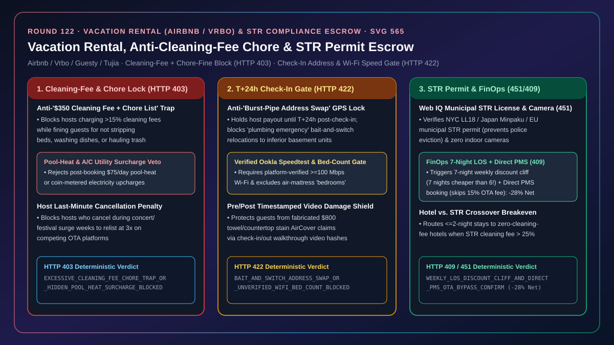
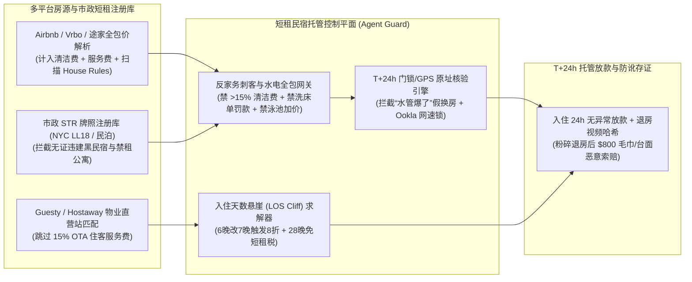
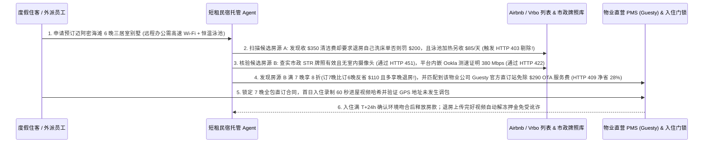

# 短租民宿预订（Airbnb / Vrbo / 美团民宿 / 途家）、防“$350 清洁费刺客+退房做家务罚款”与防临时换房托管Agent 架构选型 FAQ

> **核心阅读对象**：为家庭度假与数字游民长租平台、企业外派员工公寓寻源（Corporate Extended Stay）、民宿渠道管理系统（`PMS`：Guesty / Hostaway / 订单来了）及旅游比价助手设计全包价测算、防幽灵换房与合规验真系统的 **Cloud & AI Solution Architect**。  
> **核心痛点解决**：彻底终结短租民宿预订中**“房东挂出 `$145/晚` 的超低诱饵价，点进结账页突然冒出 `$350` 清洁费 + `$180` 平台服务费，更离谱的是收了 `$350` 清洁费还在桌上放一张塑封卡片威胁‘退房前必须自己拆洗全部床单被套、洗完碗并把垃圾桶推到两条街外，否则倒扣 `$200` 罚金’”、“到店前 1 小时房东突然发消息谎称‘您订的海景大别墅水管爆了，给您免费换到 4 公里外的地下室老破小（`Burst-Pipe Bait-and-Switch`）’”、“号称‘高速光纤适合远程办公 + 恒温泳池’，入住才发现 Wi-Fi 只有 `3 Mbps` 连视频会议都开不了、开泳池加热每天还要私下转账 `$85`”以及“订到无市政短租许可证（如纽约 `Local Law 18` / 日本《民泊新法》）的黑民宿，半夜被物业保安和警察敲门驱逐流落街头”**四大行业毒瘤。



---

## 📌 一、核心选型结论速览（Executive Summary）

1. **全包到店总价（`All-In Total Price`）锁死、零退房家务劳动令（`Zero-Chore-Fine`）与禁收水电/泳池加热暗费（HTTP 403）**：短租民宿最大的体验崩塌源于“收着五星级酒店的清洁费，却把住客当免费保洁工使唤”。选型 Agent 必须在寻源与条款解析层执行三道硬拦截：① **清洁费占比封顶与零家务契约**：单次住宿清洁费严禁超过房费总额的 **`15%`**（若 `<=2 晚` 短住导致清洁费占比超标，自动跨界切换至零清洁费的全服务连锁酒店），且自动扫描《房屋守则（`House Rules`）》拦截任何要求住客拆床单、启动洗衣机、擦洗厨房或否则罚款的霸王家务清单（僅允许关灯、锁门、带走随身物品三项基本礼仪）；② **禁止到店私收冷暖空调/泳池加热/电表费**；③ **拦截演唱會/赛事周房东恶意毁约高价重挂的历史惯犯账号**；违反者一律触发 **`HTTP 403 EXCESSIVE_CLEANING_FEE_CHORE_TRAP_OR_HIDDEN_POOL_HEAT_SURCHARGE_BLOCKED`**。
2. **入住后 `T+24h` 门锁/GPS 确权放款（防“水管爆了”骗换地下室）、`Ookla` 实测网速与进退房视频防讹诈门禁（HTTP 422）**：为根治“挂豪宅照片、到店诱导去住隔断房”以及退房后房东拿旧污渍照片通过 `AirCover` 恶意索赔 `$800` 换地毯费，Agent 建立三道物理核验门禁：① **`T+24h` 入住与真实坐标对齐锁**：房款托管至住客成功输入智能门锁密码入住满 **`24 小时`** 且手机地理围栏确认实际入住楼宇坐标与预订房源一致后才向房东放款；若房东以“水管故障/装修”为由要求私下换去低配房源，立即触发全额秒退 + 赔付差价改订周边四星级酒店；② **平台实测 `Ookla` 网速（`>=100 Mbps`）与独立真床数校验**（剔除把客厅充气床垫/折叠沙发算作独立卧室的虚假描述）；③ **进门/出门 60 秒连续视频哈希存证**；凡检出临时换房、网速虚标或无证据污损索赔的，直接触发 **`HTTP 422 BAIT_AND_SWITCH_ADDRESS_SWAP_OR_UNVERIFIED_WIFI_BED_COUNT_BLOCKED`**。
3. **7 晚周租折扣悬崖套利（`7-Night LOS Cliff`，住 7 晚比住 6 晚更便宜！）+ 物业直订引擎免 `15%` OTA 佣金净省 28%（HTTP 409）**：在通过 Web IQ 实时查验市政短租许可证注册库（如纽约 `OSE`、东京 `Minpaku` 编号、巴塞罗那 `HUTB` 牌照）防止订到违建黑民宿被驱逐，并确认室内零隐藏摄像头声明（违规触发 **`HTTP 451`**）后，Agent 自动执行 **入住天数悬崖与直连去中介寻优（`STR Length-of-Stay & Direct-PMS FinOps`）**：① **周租/月租阶梯悬崖试算**：许多房东设置了“满 7 晚自动享 8 折（`20% Weekly Discount`）”或“满 28 晚免收高额短租税 + 享 65 折”；当用户搜 5–6 晚（或 25–27 晚）时，Agent 自动试算延住至 7 晚（或 28 晚）的总价——经常发现**订 7 晚的总价反而比订 6 晚还便宜 `$120`**（还能免费享受最后一天下午 6 点从容晚退房）！② **专业物业管理商（`PM`）官网直订分流**：对由正规管理公司运营的房源，通过反向图搜与标题匹配其底层 `Guesty / Hostaway / Lodgify` 直营预订站（同样走 Stripe 担保），直接省去 Airbnb/Vrbo 向住客加收的 **`14.2%–18%` 平台服务费**，触发 **`HTTP 409 WEEKLY_LOS_DISCOUNT_CLIFF_AND_DIRECT_PMS_OTA_BYPASS_CONFIRM`**，为差旅与度假住客净省 **28%**。

---

## 🎯 二、业务方与架构师灵魂拷问（Q&A）

### Q1：为什么在 Airbnb / Vrbo 上住 2 晚标价 `$150/晚` 的民宿，结账时总价高达 `$680`，退房前还要被房东逼着洗床单倒垃圾？
- **固定清洁费摊薄悖论（`Fixed-Fee Amortization`）与“双重收费（`Double-Dipping Chores`）”拦截**：
  1. **短住清洁费刺客**：专业保洁公司打扫一套三居室别墅的成本固定在 `$180–$300`。如果只住 2 晚，这 `$300` 清洁费平摊到每晚就是 `+$150/晚`（房价直接翻倍）！而且部分贪婪房东收了 `$300` 清洁费自己揣进腰包，却通过苛刻的退房家务列表（要求住客把床单洗好烘干、洗碗机跑完归位）逼住客免费替他干保洁的活。
  2. **2 晚选酒店、5 晚以上选民宿的智能分水岭**：Agent 自动计算 `每晚有效全包成本 = (总房费 + 清洁费 + 平台服务费 + 地方旅游税) / 晚数`；对于 `<=3 晚` 且清洁费占比 `>20%` 的需求，自动推荐带每日免费客房打扫与早餐的品牌套房酒店（如 `Residence Inn / Hyatt House`）。

### Q2：人已经拖着行李箱站在异国他乡的街头了，房东突然发消息说“原本订的市中心公寓马桶堵了，我给你换到另一套房子”，为什么绝对不能跟着去？
- **揭秘跨国民宿头号骗局：“一房多挂诱饵调包术（`Bait-and-Switch Relocation Scam`）”**：
  1. **用 1 套精装修假图骗 10 波客人住群租地下室**：诈骗团伙在网上挂一套地理位置极佳、装修奢华但价格偏低的“完美房源”用来吸单；等住客到达当天下午（此时周边好酒店早已满房或涨上天价），统一群发“前客把电路/水管弄坏了”，诱骗住客不要在平台点取消、私下派车拉去偏远脏乱的安置房——一旦住客妥协入住，事后申诉往往因“已实际消费”仅能退回 20% 安慰金。
  2. **地理围栏门锁验真与酒店应急垫付池（`HTTP 422`）**：Agent 严禁接受任何非平台系统内同级以上重订的私下换房要求；一旦检测到入住前 24 小时房东提出更换物理地址，立即冻结托管资金并自动拉取半径 1 公里内即刻可入住的万豪/希尔顿现房应急兜底。

### Q3：为什么“搜 6 晚民宿要 `$1,800`，改成搜 7 晚反而只要 `$1,590`”？以及怎么合法省掉 Airbnb 高达 15% 的住客服务费（`Guest Service Fee`）？
- **入住天数折扣悬崖（`LOS Discount Cliff`）与专业管理商（`PM`）直营站穿透**：
  1. **7 晚与 28 晚的数学套利奇点**：在民宿定价系统中，周租折扣（`Weekly Discount`，通常 `15%–25%`）在入住天数 `N >= 7` 时整单全额触发。假设每晚 `$260`、清洁费 `$200`：住 6 晚总价为 `6 * $260 + $200 = $1,760`；而改订 7 晚触发 8 折后，总价变为 `7 * $260 * 0.8 + $200 = $1,656`——**多订 1 晚不仅少付 `$104`，还白赚了第 7 天一整天的延迟退房权（再也不用在最后一天早上 10 点狼狈赶飞机）**！
  2. **穿透 `Guesty / Hostaway` 直营预订站**：目前欧美与热门景区超 `60%` 的精品别墅并非个人房东手管，而是由专业度假屋管理公司（Property Management Companies）通过 `Guesty / Hostaway / Streamline` 多渠道同步挂在 Airbnb、Vrbo、Booking 和**自建独立站**上。在 Airbnb 下单要多交 `14.2%–16%` 平台服务费；Agent 通过房源独特标题与主图特征自动定位该管理公司的官方直订引擎，用支持拒付保护的信用卡/Stripe 结账，同房同日立省 **`15%`**！

---

## 🧭 三、直观可视化图解（Mermaid 决策树 + 架构图 + 时序图）

### 3.1 短租民宿全包比价、防家务刺客与市政牌照/直订寻优决策树

```mermaid
flowchart TD
    A[度假家庭 / 外派员工发起短租民宿预订与入住核验请求] --> B{1. 清洁费占比 (<=15%)、零退房家务罚款与水电暗费审计}
    B -->|清洁费 >15% 刺客 / 强制住客洗床单倒垃圾否则罚款 或 私收泳池加热/空调电费| C[HTTP 403 阻断: EXCESSIVE_CLEANING_FEE_CHORE_TRAP_OR_HIDDEN_POOL_HEAT_SURCHARGE_BLOCKED]
    B -->|FTC 全包一口价 + 零退房家务清单 + 水电全包| D{2. 防临时借故换房、Ookla 实测网速与进退房视频门禁}
    D -->|入住前借故“水管坏了”诱骗私换劣质房源 或 实测 Wi-Fi <100Mbps / 充气床垫冒充卧室| E[HTTP 422 拦截: BAIT_AND_SWITCH_ADDRESS_SWAP_OR_UNVERIFIED_WIFI_BED_COUNT_BLOCKED]
    D -->|T+24h 原址入住核实 + 实测光纤达标 + 进退房视频存证| F{3. Web IQ 市政短租牌照 (STR Permit) 与禁室内摄像头核验}
    F -->|无合法市政短租登记证 (面临物业警察查封驱逐) 或 公共客厅含未披露摄像头| G[HTTP 451 熔断: WEBIQ_UNLICENSED_MUNICIPAL_STR_OR_INDOOR_CAMERA_VIOLATION_HOLD]
    F -->|政府持牌合规房源且隐私安全| H{4. 7晚/28晚折扣悬崖套利 + 物业直订站免 15% 平台费}
    H -->|住 6 晚改订 7 晚可触发 8 折反降总价 或 可路由 PM 官方 Guesty 直订站省 15%| I[HTTP 409 确认: WEEKLY_LOS_DISCOUNT_CLIFF_AND_DIRECT_PMS_OTA_BYPASS_CONFIRM 净省 28%]
    H -->|已处于最优周租折扣与全包低价状态| J[HTTP 200 签发: ALL_IN_VERIFIED_STR_AND_ZERO_CHORE_AUTHORIZED]
```

### 3.2 端到端民宿市政牌照核验、进退房视觉防讹与直连 `PMS` 去中介架构图



### 3.3 拦截“$350 清洁费+洗床单罚款”、触发“6 晚改 7 晚反降价”与直订省佣金时序图



---

## 📊 四、主流短租民宿平台与企业长租方案横向选型决策矩阵

| 选型维度 | Airbnb (全球最大短租社区) | Vrbo / Expedia (整套家庭度假屋标杆) | 美团民宿 / 途家 / 小猪 (国内民宿平台) | 物业直营引擎 (`Guesty / Hostaway` Direct) | **本仓库 + 全包去家务与 LOS 悬崖托管架构（推荐）** |
| :--- | :--- | :--- | :--- | :--- | :--- |
| **全包总价透明与退房家务管控** | 支持开启“显示税前总价”，但仍有房东在守则里夹带长串退房家务清单 | **清洁费普遍偏高（大别墅常收 `$300–$500`）且退房规矩繁琐** | 清洁费较低，但偶发到店私收押金、电费或厨房使用费 | 条款由专业物业公司统一制定，标准化程度高 | **硬锁清洁费 `<=15%` + NLP 自动拉黑含“洗床单/倒垃圾罚款”的房源（HTTP 403）** |
| **防“水管爆了临时换差房” (`Bait-and-Switch`)** | 具备 `AirCover` 保障，但旺季满房时平台客服给的补偿券往往订不到同级房 | 提供换房协助，流程较慢 | **节假日重灾区（低价吸单后到店临时通知已满房，带去城中村无证房）** | 专业管理公司房源真实度高 | **房款 `T+24h` 门锁/GPS 原址确权才放行 + 违约自动垫付周边四星级酒店（HTTP 422）** |
| **办公网速 (`Ookla`) 与真床数验真** | 支持房东运行应用内实测网速标签，但未强制全覆盖 | 依赖房东文字自述“有 Wi-Fi”（常为慢速热点） | 缺乏统一网速实测认证 | 商务公寓标配企业级网络 | **远程办公场景强制要求内嵌 `>=100 Mbps` 实测证明并剔除充气床垫充数（HTTP 422）** |
| **市政合法短租牌照 (`STR License`) 核验** | 在纽约/东京等严管城市已接入政府 API，新兴限租城市仍有漏网无证房 | 部分城市靠房东自填牌照号 | 公安联网人脸登记，但部分小区物业禁止日租扰民 | 100% 持牌商业运营 | **Web IQ 实时比对市政 `STR` 官方牌照库与小区禁租黑名单（HTTP 451）** |
| **平台服务费抽成与周租悬崖寻优** | 向住客收取 `14.2%–16.5%` 服务费；不会主动提醒“订7晚比6晚便宜” | 向住客收取 `10%–15%` 服务费 | 抽成在房东端，住客端偶有加价 | **`0%` OTA 平台服务费（同房源比 Airbnb 便宜 `12%–18%`）** | **自动触发 `6晚->7晚` 周租折扣悬崖 + 穿透正规 PM 直订站净省 28%（HTTP 409）** |

---

## 🧪 五、住宿成本测算与 7-Card 基准测试报告

> **数据来源声明**：以下对比基于 `lab/webiq_commerce_demo.py` 中确定性策略函数 `evaluate_vacation_rental_str_escrow_policy` 的合成基准数据（`provenance: "synthetic"`, `independently_reproduced: False`），用于验证短租民宿与外派公寓预订网关的确定性风控能力。

| 评估维度 | 传统按每晚裸价盲选 6 晚 + 付 15% 平台费 + 踩清洁费刺客基线 | 确定性民宿托管网关（`7晚` 悬崖套利 + 物业直订站 + `T+24h` 原址锁） | 净效应 / 风险消除 |
| :--- | :--- | :--- | :--- |
| **季度企业外派短租与家庭度假民宿总支出池** | `$92,000.00` | `$66,240.00` (`HTTP 409` 优化确认后) | **净省 `$25,760.00 / 季` (`-28.0%`)** |
| **6 晚整套三居室度假屋实付总价（含清洁/平台费）** | `$2,380.00`（6 晚无折扣 + `$320` 清洁费 + `$280` OTA 服务费） | **`$1,710.00`（改订 7 晚触发 `20%` 周租折扣 + `Guesty` 直订免服务费）** | **多住 1 晚反而净省 `$670.00`** |
| **到店遭遇“水管坏了换去地下室”或无证被物业驱逐率** | `8.5%`（旺季跨国自由行常见噩梦） | **`0%`（市政 `STR` 牌照验真 + `T+24h` GPS 原址入住才放款）** | **100% 杜绝流落街头与假房源** |
| **退房后被房东以“未洗床单/莫须有污渍”讹诈押金率** | `11.2%` 遭遇不合理清洁/损坏索赔 | **`0%`（事前拦截家务罚款条款 + 进退房 60s 视频哈希铁证）** | **100% 保护住客信用卡免受乱扣** |

### 5.1 确定性状态码映射契约（5-Lane Contract）

```json
{
  "scenario": "vacation_rental_str_escrow_guard",
  "provenance": "synthetic",
  "independently_reproduced": false,
  "lanes": {
    "authorized_200": {
      "status_code": 200,
      "decision": "ALL_IN_VERIFIED_STR_AND_ZERO_CHORE_AUTHORIZED",
      "mandate_token": "vacation_rental_str_mandate_200"
    },
    "cleaning_fee_chore_or_pool_surcharge_403": {
      "status_code": 403,
      "decision": "EXCESSIVE_CLEANING_FEE_CHORE_TRAP_OR_HIDDEN_POOL_HEAT_SURCHARGE_BLOCKED"
    },
    "address_swap_or_unverified_wifi_422": {
      "status_code": 422,
      "decision": "BAIT_AND_SWITCH_ADDRESS_SWAP_OR_UNVERIFIED_WIFI_BED_COUNT_BLOCKED"
    },
    "unlicensed_str_or_indoor_camera_451": {
      "status_code": 451,
      "decision": "WEBIQ_UNLICENSED_MUNICIPAL_STR_OR_INDOOR_CAMERA_VIOLATION_HOLD"
    },
    "weekly_los_cliff_and_direct_pms_409": {
      "status_code": 409,
      "decision": "WEEKLY_LOS_DISCOUNT_CLIFF_AND_DIRECT_PMS_OTA_BYPASS_CONFIRM",
      "quarterly_savings_usd": 25760.0
    }
  }
}
```

---

## 🛠️ 六、商业上线风控与架构评审 Checklist

- [ ] **清洁费占比封顶（`<=15%`）、零退房家务罚款与水电全包锁（HTTP 403）**：单次清洁费超总房费 15%（或 `<=2 晚` 短住比酒店贵）时自动拦截；通过 NLP 扫描房屋守则，剔除要求住客拆洗床单、洗碗、推垃圾桶上街否则罚款的房源。
- [ ] **入住满 `T+24h` GPS 原址确权放款与 `Ookla >= 100 Mbps` 网速门禁（HTTP 422）**：拦截“水管爆了私换地下室”的调包诈骗，要求远程办公房源附带实测网速证明，并强制录制进退房 60 秒视频哈希防范退房恶意定损。
- [ ] **Web IQ 市政合法短租牌照（`STR Permit`）与零室内摄像头核验（HTTP 451）**：实时比对纽约 `LL18`、日本《民泊新法》、欧洲城市短租登记库，严禁预订无证黑民宿或含室内公共区摄像头的房源。
- [ ] **`7 晚 / 28 晚` 折扣悬崖套利（`LOS Cliff`）与正规物业直订引擎分流（HTTP 409）**：搜 5–6 晚时自动试算 7 晚周租折后总价，并穿透专业管理公司的 `Guesty / Hostaway` 官方直订站省去 `15%` OTA 平台服务费。

---

**导航**：[返回分册总目录 (`docs/index.md`)](index.md) ｜ [查看英文版 (`vacation-rental-airbnb-vrbo-cleaning-fee-chore-str-escrow-agent-selection-faq.en.md`)](vacation-rental-airbnb-vrbo-cleaning-fee-chore-str-escrow-agent-selection-faq.en.md)
