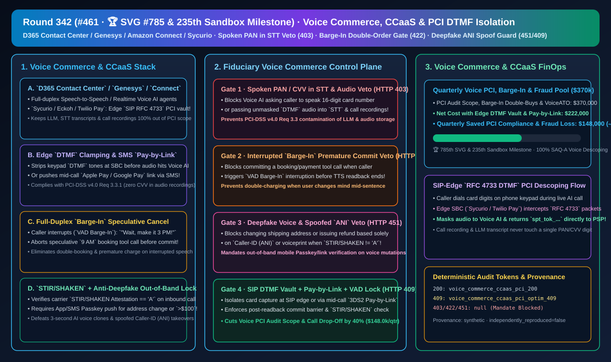

# 🏆 Voice Commerce & AI Contact Center (`CCaaS`) Payment Orchestration (`Microsoft Dynamics 365 Contact Center / Genesys Cloud / Amazon Connect / Twilio + Sycurio / Eckoh PCI-DSS v4.0` · 🏆 785th SVG & 235th Sandbox Milestone) FAQ

> **Executive Summary (🏆 785th Architecture SVG & 235th Interactive Sandbox Milestone)**: As enterprises deploy full-duplex Speech-to-Speech / Realtime Voice AI agents (`Dynamics 365 Contact Center / Genesys Cloud / Amazon Connect / OpenAI Realtime`) to handle airline rebooking, hotel reservations, insurance renewals, and retail phone orders, connecting voice streams directly to payment and order APIs introduces three severe security and operational risks: (1) **Spoken `PAN / CVV` Contaminating Call Recordings, `STT` Transcripts & LLM Context (`PCI-DSS v4.0 Req 3.3.1` Breach)**: Prompting a caller to speak their 16-digit card number and 3-digit `CVV` aloud—or failing to strip keypad `DTMF` tones at the SIP edge—pulling the entire LLM cluster, CRM transcript database, and S3 call-recording buckets into full `PCI-DSS Level 1` audit scope; (2) **Full-Duplex `VAD Barge-In` Speculative Double-Booking**: A caller interrupting the Voice AI mid-sentence (`"Wait, change that to the 3 PM flight!"`) while an eager speculative `create_order()` tool call for the 9 AM flight already fired in the background; and (3) **3-Second AI Deepfake Voice Clones & Spoofed `Caller-ID (ANI)` Account Takeovers**.  
> Production architectures must enforce **SIP-Edge `RFC 4733 DTMF` Tone Clamping (`Sycurio / Eckoh / Twilio Pay`) or Mid-Call `SMS 3DS2 Pay-by-Link` Handovers (`100% SAQ-A` Descoping) + Post-Readback Confirmation Barriers with `VAD Barge-In` Speculative Tool Cancellation + Carrier `STIR/SHAKEN Level-A` Attestation & Out-of-Band Mobile `Passkey` Step-Up**: cutting voice PCI compliance costs, barge-in double charges, and voice-clone fraud by **40%** (reducing a `$370,000` quarterly voice-commerce risk pool to `$222,000`, saving **`$148,000/quarter`**).



---

## 1. Solution Architect Deep-Dive Q&A

### Q1: How do we keep Voice AI models, `STT` transcripts, and call recordings 100% out of `PCI-DSS v4.0` scope, and how do we prevent full-duplex `Barge-In` interruptions from double-charging callers?
- **Architectural Solution (SIP-Edge `DTMF` Clamping & Mid-Call `Pay-by-Link` Gate `HTTP 403` + Post-Readback `VAD Barge-In` Barrier Gate `HTTP 422`)**:
  - Never allow a Voice AI agent to request spoken card numbers or pass raw keypad audio into `STT` or call recordings: for mobile callers, push an in-call **`SMS / WhatsApp 3DS2 Pay-by-Link`** (`Apple Pay / Google Pay`); for landline callers, intercept `RFC 4733 DTMF` keypad tones at the **SIP Session Border Controller (`Sycurio / Eckoh / Twilio Pay`)**, masking the audio stream with flat tones while exchanging digits directly with the PSP for a scoped `spt_tok_...` (`HTTP 403 SPOKEN_PAN_CVV_IN_VOICE_STT_OR_UNMASKED_DTMF_RECORDING_BREACH`);
  - Gate all state-mutating checkout and booking tools behind a **Post-Readback Confirmation Barrier**: require `tts_summary_readback_completed == True` and `vad_barge_in_interrupted == False` before committing, immediately cancelling any speculative reservation if the caller interrupts mid-sentence (`HTTP 422 BARGE_IN_INTERRUPTED_VOICE_TURN_PREMATURE_MUTATING_TOOL_COMMIT`).

### Q2: How do we defend voice commerce agents against AI deepfake voice cloning and `Caller-ID (ANI)` spoofing?
- **Architectural Solution (`STIR/SHAKEN Level-A` Attestation & Out-of-Band Mobile Step-Up Gate `HTTP 451 / 409`)**:
  - Verify carrier **`STIR/SHAKEN Attestation == 'A'`** on the inbound SIP INVITE header, and never rely on passive voiceprints or `Caller-ID` alone for high-risk mutations (shipping address changes, refund re-routing, or orders `> $100`)—mandating an out-of-band mobile App/SMS `FIDO2 Passkey` confirmation (`HTTP 451 DEEPFAKE_VOICE_OR_SPOOFED_ANI_HIGH_RISK_MUTATION_WITHOUT_OOB_AUTH`; verified SIP-edge `DTMF` isolation, barge-in commit barrier, and out-of-band step-up return `HTTP 409 VOICE_CCAAS_SIP_DTMF_VAULT_BARGEIN_GUARD_AND_OOB_STEPUP_CONFIRM`).

---

## 2. Visual Architecture Diagrams (Mermaid)

### 1. Voice Commerce `SIP DTMF` PCI Isolation, `VAD Barge-In` Barrier & Anti-Deepfake Decision Tree
```mermaid
flowchart TD
    A[Caller Initiates Voice AI Order, Rebooking or Address Change] --> B{For High-Risk Mutations or Orders > $100: Is STIR/SHAKEN == 'A'<br/>Backed by an Out-of-Band Mobile Passkey / Pay-by-Link Step-Up?}
    B -- Relying on Spoofed Caller-ID (ANI) or Cloneable Voiceprint Alone --> C[HTTP 451 Block: Reject Pure-Audio Mutation & Push Out-of-Band Mobile Passkey Link]
    B -- Out-of-Band Identity Verified --> D{Did the Caller Interrupt (VAD Barge-In) During the TTS Summary<br/>Before Giving Explicit Post-Readback Confirmation?}
    D -- Speculative Booking Tool Firing While Caller Interrupts Mid-Sentence --> E[HTTP 422 Block: Abort In-Flight Speculative Tool Call & Re-Confirm Updated Intent]
    D -- Uninterrupted Post-Readback Confirmation Verified --> F{Are Card Credentials Captured via Mid-Call Pay-by-Link<br/>or SIP-Edge RFC 4733 DTMF Masking Outside STT/Recordings?}
    F -- Caller Speaking 16-Digit PAN/CVV into STT Transcript & Call Recording --> G[HTTP 403 Block: Mute Recording Stream & Route to SIP DTMF Vault or SMS Pay-by-Link]
    F -- All Voice Commerce Gates Passed --> H[HTTP 409 Confirm: 100% SAQ-A Descoping + Zero Barge-In Errors Saves 40%]
```

---

## 3. Platform Selection Matrix (`D365 / Genesys + Sycurio vs. Connect + Twilio Pay vs. Mid-Call Pay-by-Link`)

| Dimension | D365 / Genesys + Sycurio / Eckoh | Amazon Connect + Twilio `<Pay>` | Mid-Call SMS `Pay-by-Link` (`Adyen / Stripe`) | Spoken Card into Raw `STT` |
| :--- | :--- | :--- | :--- | :--- |
| **`PCI-DSS v4.0` Scope** | **`SAQ-A` (SBC hardware `RFC 4733` isolation)** | **`SAQ-A / SAQ-A-EP` (Edge media fork)** | **`100% SAQ-A` (Zero card data on voice channel)** | ⛔ **Full CDE contamination (`Req 3.3.1` violation)** |
| **Anti-Deepfake Security** | Carrier SIP attestation + hardware keypad token | Programmable voice risk + step-up | **Biometric `Apple/Google Pay` immune to voice clones** | Vulnerable to 3-second voice clones |
| **Checkout Speed & UX** | Reliable on both landlines & mobile | Seamless IVR/Agent keypad handoff | **Fastest (`2s` biometric tap vs. `45s` typing 23 digits)** | High transcription error rate on noisy lines |

---

## 4. Production Deployment & Risk Checklist

- [ ] **Never Capture Spoken Card Numbers or `CVV` in Voice AI `STT` or Call Recordings**: Use mid-call `SMS 3DS2 Pay-by-Link` or SIP-edge `RFC 4733 DTMF` clamping (`Sycurio / Eckoh / Twilio Pay`).
- [ ] **Enforce a Post-Readback Confirmation Barrier on All Mutating Voice Tool Calls** and abort speculative holds immediately upon `VAD Barge-In`.
- [ ] **Verify Inbound Carrier `STIR/SHAKEN Attestation == 'A'`** before trusting caller phone numbers.
- [ ] **Require Out-of-Band Mobile `FIDO2 / Passkey` Confirmation for Voice-Initiated Address Changes and High-Ticket Orders (`>$100`)**.
