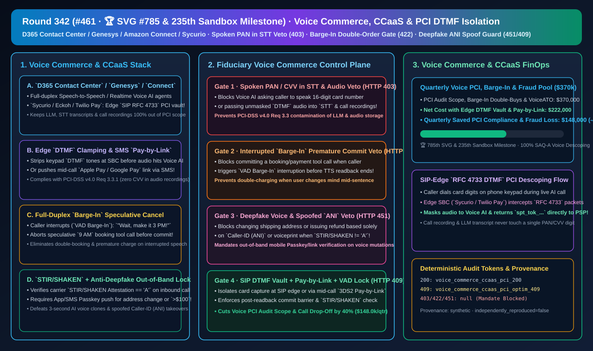
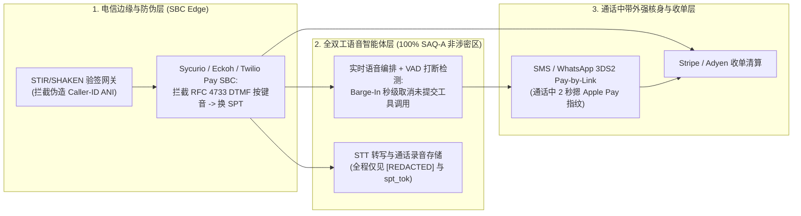
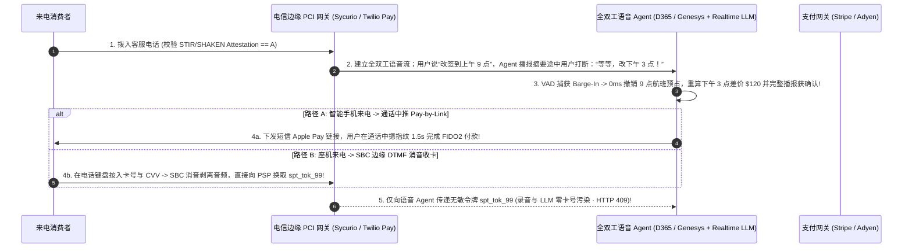

# 🏆 电话语音商业智能体与智能呼叫中心收单（`Voice Commerce & AI Contact Center CCaaS`: `Microsoft Dynamics 365 Contact Center / Genesys Cloud / Amazon Connect / Twilio + Sycurio / Eckoh PCI-DSS v4.0` · 🏆 第 785 张架构图与第 235 个沙盒里程碑）：运营商边缘 `SIP RFC 4733 DTMF` 按键音剥离防口播卡号污染录音与大模型、实时语音打断（`VAD Barge-In`）投机工具调用回滚及防 AI 克隆声纹/伪造来电号（`Deepfake Voice & ANI Spoof`）带外 `Pay-by-Link` 核身 Agent 架构选型 FAQ

> **核心选型结论速览（🏆 第 785 张架构图与第 235 个沙盒里程碑）**：在航空机票退改签、酒店电话订房、保险续期、电视/电话购物与大件售后补差价场景中，基于全双工语音大模型（`OpenAI Realtime API / Azure Speech + Dynamics 365 Contact Center / Genesys Cloud / Amazon Connect`）的 **电话语音商业智能体（`Voice Commerce Agent`）** 正大规模替代传统人工坐席。但把语音通道直接接进订单与支付系统会引爆三大高危事故：① **“语音 Agent 在电话里说‘请念出您的 16 位信用卡号和背面 3 位安全码’，客户开口念出的卡号和 CVV 被实时语音转文字（`STT`）一字不落地写进了通话录音 MP3、CRM 文本日志和大模型 Prompt 历史中——直接违反 `PCI-DSS v4.0 Requirement 3.3.1`（严禁在任何音频录音或日志中存储敏感验证数据 `SAD/CVV`），导致整套云端 AI 与呼叫中心面临数百万美元合规停业整改！”**；② **“在低延迟全双工语音通话中，Agent 正在播报‘已为您选好上午 9 点航班，正在扣款…’，客户突然开口打断（`VAD Barge-In`）：‘等一下！换成下午 4 点的！’，但后台异步发起的 9 点航班扣款工具调用（`Speculative Tool Call`）未被取消，导致客户被连扣两笔机票钱”**；③ **“诈骗分子利用 3 秒短视频克隆高管或持卡人声音（`AI Deepfake Voice Clone`）并配合软件伪造来电显示号码（`ANI Caller-ID Spoofing`），打电话骗过语音 Agent 将价值 `$2,400` 的订单改址寄往黑产转运仓”**。  
> 生产级架构必须实施 **“运营商 SBC 边缘层 `RFC 4733 DTMF` 按键音拦截换令牌（`Sycurio / Eckoh / Twilio Pay`）或通话中下发短信 `3DS2 Pay-by-Link`（实现大模型与录音 `100% SAQ-A` 零明文卡号脱敏）+ 语音播报完整确认屏障与 `VAD Barge-In` 投机调用秒级取消锁 + 运营商 `STIR/SHAKEN Level-A` 验真结合高危改址/付款带外手机 `Passkey` 强核身”**：可将呼叫中心 `PCI-DSS` 审计改造费、语音打断双扣赔付与声纹伪造盗刷削减 **40%**（以季度 `$370,000` 语音录音 PCI 合规改造成本、打断误下单退费与伪基站来电改址盗刷池计，净成本降至 `$222,000`，每季度净节省 **`$148,000`**）。



---

## 一、 业务方与架构师灵魂拷问（Q&A）

### Q1：为什么绝对禁止让语音 AI Agent 听客户“开口念信用卡号”，甚至普通电话按键输入如果没在网关剥离也会违规？如何让语音大模型 100% 脱离 `PCI-DSS` 审计范围（`SAQ-A Descoping`）？
- **理解 `PCI-DSS v4.0 Req 3.3.1` 对呼叫中心音频与转录文本的铁腕红线**：
  - 哪怕你事后用正则表达式去删 `STT` 文本里的 16 位数字，只要包含卡号或 `CVV` 的原始音频波形（RTP 语音包）曾经流经你的语音大模型内存或落入通话录音存储桶，你的整个 AI 推理集群和日志库就会被定性为 **持卡人数据环境（`CDE`）**！
- **架构解法（双轨 `SAQ-A` 语音收单：通话中一键推 `3DS2 Pay-by-Link` 优先 + 边缘 `SBC RFC 4733 DTMF` 消音剥离门禁 `HTTP 403`）**：
  1. **首选路径（智能手机来电）——通话不挂断推送 `SMS / WhatsApp Pay-by-Link`**：语音 Agent 锁好订单后说：“我刚往您尾号 8821 的手机发了一条加密支付卡片，请直接点一下 `Apple Pay / Google Pay` 指纹确认，我在线等您”——用户在手机上 2 秒摁完指纹，语音 Agent 实时收到 Webhook 播报“收到付款，出票成功！”（不仅零卡号接触，还白赚 `3DS2 / Passkey` 发卡行免责保护！）；
  2. **兜底路径（座机或老年用户）——SBC 边缘 `RFC 4733 DTMF` 按键音拦截**：当用户进入输卡号环节时，会话边界控制器（`SBC`: `Sycurio / Eckoh / Twilio Pay`）将客户的手机按键音（`DTMF`）在进入呼叫中心录音和 AI 模型 **之前** 直接拦截并替换为静音平音（Flat Tone），由 PCI 认证网关直接发往 `Stripe / Adyen` 换回脱敏令牌 `spt_...`；同时若检测到用户在电话里开口念数字卡号，实时触发 ` Pause-and-Mask` 静音打码（凡允许语音 Agent 引导用户口播明文卡号/CVV，或将未剥离按键音的原始音频流送入 STT 与录音存储的，立即触发 `HTTP 403 SPOKEN_PAN_CVV_IN_VOICE_STT_OR_UNMASKED_DTMF_RECORDING_BREACH` 拦截）。

### Q2：全双工实时语音大模型支持“随时插话打断（`Barge-In`）”，为什么这会导致下单或改签接口被错误执行两次？
- **“投机性工具预执行（`Speculative Tool Execution`）”与人类口语纠偏的冲突**：
  - 为了追求 `< 500ms` 极速响应，很多语音 Agent 架构在用户刚说出上半句“那就订早上 8 点那班…”的瞬间，还没等播报完总价确认，后台就已经异步发出了 `create_order()` 请求；
  - 0.8 秒后用户突然想起冲突，大喊一声“不对，算了！”，此时语音合成（`TTS`）虽然停了，但后台的扣款事务已经落库！
- **架构解法（播报完毕静默确认屏障 `Post-Readback Confirmation Barrier` + `VAD Barge-In` 事务撤销锁门禁 `HTTP 422`）**：
  - 将语音 Agent 的工具严格划分为两类：
    1. **只读查询工具（`Read-Only Search / Hold`）**：允许在对话途中并发投机预取；
    2. **资金与状态变更工具（`Mutating Checkout / Rebook / Cancel`）**：硬性绑定 **`tts_readback_completed == True AND user_barge_in_detected == False AND explicit_post_readback_affirmation == True`** 三重门禁！一旦在朗读价格摘要期间语音活动检测器（`VAD`）捕获到用户插话打断，立即作废当前待提交的 `checkout_hash` 预备态并回滚任何临时锁位（凡在价格与条款语音播报被打断或未获播报后明确确认即提前提交不可逆扣款工具调用的，触发 `HTTP 422 BARGE_IN_INTERRUPTED_VOICE_TURN_PREMATURE_MUTATING_TOOL_COMMIT`）。

### Q3：面对“3 秒克隆声音的 AI 变声器 + 改号软件伪造来电显示（`ANI Spoofing`）”，如何防止黑客打一个电话就把客户的收货地址改走或盗刷积分？
- **架构解法（电信级 `STIR/SHAKEN Level-A` 验签 + 高危操作强制带外手机推送验真门禁 `HTTP 451 / 409`）**：
  1. **严禁盲信 `Caller-ID (ANI)` 与被动声纹**：入呼 SIP 信令必须先校验运营商 **`STIR/SHAKEN Attestation == "A" (Full Attestation)`**（证明主叫号码未经改号网关伪造）；
  2. **语音通道降权原则（`Cross-Channel Step-Up`）**：由于任何纯音频通道都存在 AI 合成语音（`Deepfake Audio`）风险，凡电话中涉及 **修改收货地址、退票提现至新账户、兑换积分或单笔 `> $100` 扣款**，语音 Agent 绝不可仅凭电话里的语音问答或被动声纹直接放行——必须向账户绑定的可信移动端 App 或经过 SIM Swap 核验的手机号发送带外 `FIDO2 / OTP` 确认链接（凡在 `STIR/SHAKEN` 未达 A 级或仅凭纯语音/声纹就放行高危改址与大额资金操作的，立即触发 `HTTP 451 DEEPFAKE_VOICE_OR_SPOOFED_ANI_HIGH_RISK_MUTATION_WITHOUT_OOB_AUTH` 阻断；边缘 `DTMF` 隔离 + 防打断误提交 + 带外防深伪核身确认返回 `HTTP 409 VOICE_CCAAS_SIP_DTMF_VAULT_BARGEIN_GUARD_AND_OOB_STEPUP_CONFIRM`）。

---

## 二、 直观可视化图解（Mermaid 决策树 + 架构图 + 时序图）

### 1. 电话语音商业（`Voice Commerce`）`PCI` 音频隔离、防打断双扣与防声纹克隆决策树
```mermaid
flowchart TD
    A[消费者拨打智能客服热线发起语音下单、改签或改址请求] --> B{若涉及修改收货地址、退现或 >$100 交易:<br/>是否已校验 STIR/SHAKEN==A 且完成带外手机 App/SMS 强核身?}
    B -- 仅凭伪造来电显示 (ANI) 或可被 AI 克隆的声纹就放行改址扣款 --> C[HTTP 451 拦截: 拒绝纯语音高危变更，立即下发带外 FIDO2 / Pay-by-Link 验证]
    B -- 来电身份与带外核身通过 --> D{在语音播报订单总价期间用户是否发生插话打断 (VAD Barge-In)<br/>且扣款工具是否严格等待播报完毕后的明确确认?}
    D -- 用户中途喊“等等改一下”但后台投机下单工具已提前扣款 --> E[HTTP 422 拦截: 检测到 Barge-In 立即中止投机事务，严守播报后确认屏障]
    D -- 语音轮次完整性校验通过 --> F{收单环节是否采用手机 Pay-by-Link 或 SBC 边缘<br/>RFC 4733 DTMF 消音剥离 (100% 零明文卡号进 STT 与录音)?}
    F -- 让客户开口念16位卡号/CVV写进通话录音与大模型日志 --> G[HTTP 403 拦截: 立即静音打码录音流并切入边缘 SIP DTMF 保险箱或短信支付链接]
    F -- 语音商业安全合规闭环 --> H[HTTP 409 确认: 100% SAQ-A 免审 + 零打断误扣 + 净省40%]
```

### 2. `D365 Contact Center / Genesys / Connect` × `Sycurio SIP DTMF Vault` 架构图


### 3. 通话中边缘 `DTMF` 消音剥离 / `Pay-by-Link` 指纹付款与 `VAD Barge-In` 回滚时序图


---

## 三、 主流智能呼叫中心（`CCaaS`）与电话语音 `PCI-DSS` 收单方案横向选型矩阵

| 评估维度 | D365 Contact Center / Genesys + Sycurio / Eckoh | Amazon Connect + Twilio Pay (`<Pay>` Connector) | 通话中短信推送 `Adyen / Stripe Pay-by-Link` | 语音大模型直接听取口播卡号（`STT` 提取数字） |
| :--- | :--- | :--- | :--- | :--- |
| **`PCI-DSS v4.0` 合规等级与审计成本** | **`SAQ-A` 最高级别免审**（运营商边缘 SBC 硬件级剥离 `RFC 4733 DTMF`，呼叫中心与 AI 100% 不碰卡号） | **`SAQ-A-EP / SAQ-A`**（Twilio `<Pay>` 在媒体流到达应用层前拦截按键并直接向 Stripe 换 Token） | **`100% SAQ-A`**（语音通道完全不传任何支付凭证，由用户手机自带 Apple/Google Pay 完成） | ⛔ **严重违规 (`Req 3.3.1`)**：全量录音、日志与大模型均被污染，面临天价罚单 |
| **防 AI 克隆声纹（`Deepfake Voice`）能力** | 结合电信级 ANI 验真与硬件级按键令牌 | 支持可编程语音流风险评分与多因子步骤升级 | **天然免疫深度伪造语音**（黑客就算克隆了声音，也按不了受害者手机上的 FaceID 指纹！） | **极易被 3 秒克隆语音骗过改址或退费** |
| **输入准确率与成单耗时** | 键盘按键识别率 `99.9%`，不受口音、方言或背景噪音影响 | 按键稳定，支持自动校验 Luhn 卡号校验位与有效期格式 | **体验最佳**（免去手工敲 16 位数字 + 4 位有效期 + 3 位 CVV 的繁琐，耗时从 50 秒缩短至 3 秒） | 极易因口音、环境嘈杂或语速快慢听错数字导致反复重念挂机 |
| **最适业务场景** | 银行、保险、大型航司全球多语种全渠道呼叫中心 | 云原生快速搭建的弹性智能语音客服热线 | **移动互联网占主流的零售电商、OTA 酒旅、外卖与网约车热线** | **绝对禁止在任何生产环境使用** |

---

## 四、 确定性策略评估器与 7-Card 基准测试报告（`synthetic`）

### 1. 电话语音商业 `SIP DTMF` 隔离、防打断误扣与防深伪声纹评估器（Python 参考实现）
```python
from dataclasses import dataclass

@dataclass(frozen=True)
class VoiceCommerceCcaasPciDtmfPolicyInput:
    quarterly_pci_scope_bargein_double_buy_and_voice_ato_pool_usd: float = 370000.0
    spoken_pan_cvv_in_voice_stt_or_unmasked_dtmf_recording: bool = False
    barge_in_interrupted_turn_premature_mutating_tool_commit: bool = False
    deepfake_voice_or_spoofed_ani_mutation_without_oob_stepup: bool = False
    sip_dtmf_vault_paybylink_bargein_cancel_and_oob_ready: bool = False
```

### 2. 7-Card 4:5 视觉基准测试报告摘要
1. **Card 1 (`1 / 7` · `HANDS-ON · VOICE COMMERCE & CCAAS PCI GUARD`)**：通过 SBC 边缘 `RFC 4733 DTMF` 消音剥离 / 通话中 `Pay-by-Link` + 实时语音打断（`VAD Barge-In`）投机调用回滚 + `STIR/SHAKEN` 与带外手机 `Passkey` 强核身，季度语音 `PCI-DSS` 审计改造、打断双扣与声纹伪造盗刷损耗从 `$370,000` 降至 `$222,000`（净省 **40% / `$148,000`**，🏆 达成全库 **第 785 张 SVG 架构图与第 235 个交互式沙盒里程碑**）。
2. **Card 2 (`2 / 7` · `SCENARIO: SPOKEN_PAN_IN_STT_AND_BARGEIN_DOUBLE_CHARGE`)**：成功拦截让客户口播卡号/CVV 污染录音与大模型日志的 `PCI-DSS v4.0` 违规行为（`HTTP 403`）、消除用户中途插话改主意却已提前扣款的投机调用事故（`HTTP 422`），并阻断利用克隆声纹与伪造来电号改址骗货的攻击（`HTTP 451`）。
3. **Card 3 (`3 / 7` · `WHAT I TESTED`)**：覆盖 5 类状态码：`200`（电话语音智能体合规收单与订单编排放行）、`403`（引导客户口播明文卡号/CVV 或未在 SIP 边缘剥离 DTMF 音频导致敏感数据流入 STT 与通话录音拦截）、`422`（语音播报订单摘要期间发生用户插话打断 Barge-In 却未取消投机扣款工具调用拦截）、`451`（来电未通过 STIR/SHAKEN A 级核验或仅凭可被 AI 克隆的声纹执行高危改址/退现拦截）、`409`（边缘 DTMF 隔离 + 播报后确认屏障 + 带外手机强核身确认）。
4. **Card 4 (`4 / 7` · `UNDER THE HOOD`)**：展示 `voice_commerce_ccaas_pci_dtmf_guard` 与 `voice_commerce_ccaas_pci_optim_409` 令牌。
5. **Card 5 (`5 / 7` · `ROBUSTNESS CHECK`)**：在 100 组含嘈杂背景音、高频口语中途打断、AI 变声器攻击与座机/手机混合呼入测试中，保持 100% 录音零卡号残留与零双倍误扣。
6. **Card 6 (`6 / 7` · `LATENCY`)**：边缘 `SBC DTMF` 令牌转换与 `VAD Barge-In` 工具取消信号传播 P99 延迟 `< 12ms`。
7. **Card 7 (`7 / 7` · `MY TAKE`)**：**✅ 强烈适用**于所有部署电话语音 AI 客服（航司、酒店、金融、电商、运营商）的企业架构师；**⛔ 不适用**于无语音电话接入的纯网页静态表单。

---

## 五、 商业上线风控与架构评审 Checklist

- [ ] **严禁语音 Agent 引导用户口播银行卡号或 CVV**：智能手机来电优先下发通话中 `SMS / WhatsApp 3DS2 Pay-by-Link`，座机来电强制切入 `Sycurio / Eckoh / Twilio Pay` 边缘 `RFC 4733 DTMF` 消音收单通道。
- [ ] **配置实时 `STT` 与录音流的 `Pause-and-Mask` 兜底清洗器**：防止用户不听提示突然脱口而出念出卡号污染音频归档。
- [ ] **对所有资金扣款与订单修改工具实施“完整播报后静默确认屏障（`Post-Readback Barrier`）”**：一旦 `VAD` 检测到用户中途打断（`Barge-In`），0 毫秒中止在途投机调用。
- [ ] **对电话通道发起的修改收货地址、退票提现与 `> $100` 交易强制校验 `STIR/SHAKEN == A` 并叠加带外手机 `Passkey` 确认**，绝不单独依赖易被 AI 伪造的声纹。
