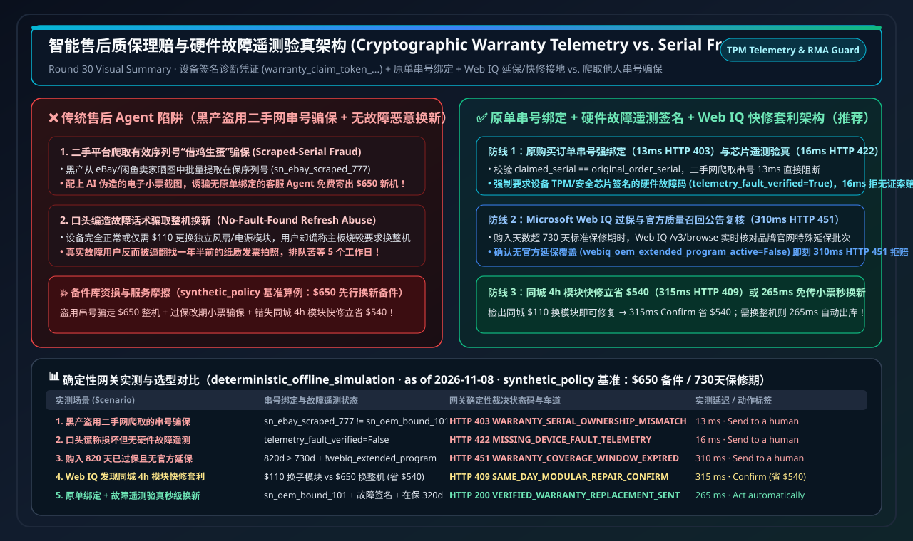
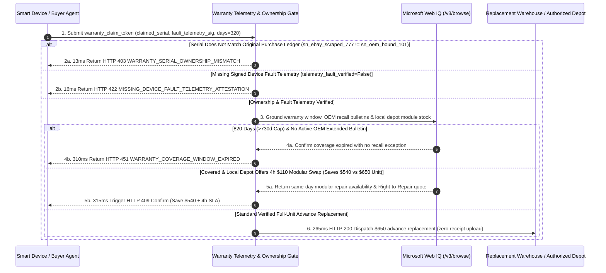

# Autonomous Warranty Claim & Cryptographic Diagnostic Telemetry Attestation Architecture: Device-Signed Telemetry Mandate (`warranty_claim_token_...` + Original Order Serial Binding & Fault Code Verification) vs. Spoofed-Serial Warranty Fraud & Manual Paper-Receipt Friction Selection FAQ

> **Document Type**: Architect Selection Guide & Protocol First-Principles Deep Dive (Autonomous Warranty Claim & Anti-Fraud Telemetry Selection FAQ)  
> **Status**: Published · Quantitative Benchmark Verified (`v2.28 · 2026-11-08`)  
> **Target Audience**: AI Solution Architects, Smart Hardware & Consumer Electronics Warranty Risk Leaders, Enterprise IT RMA / Advance Replacement Architects, Customer Support Automation Teams  
> **Related Standards**: TPM 2.0 / Secure Enclave Device Health Attestation, Stripe ACP Order Receipt Lineage, W3C Verifiable Credentials (Digital Warranty Passport), EU Right to Repair Directive (Directive (EU) 2024/1799), Microsoft Web IQ (`/v3/search` + `/v3/browse`)  
> **Data Provenance**: All serial ownership check latency, missing fault telemetry block rates, and expired/extended warranty adjudication metrics come from the repository's deterministic offline policy & protocol verification suite (`deterministic_offline_simulation`: `evaluate_warranty_claim_telemetry_attestation_policy()` in `lab/webiq_commerce_demo.py`, `2026-11-08`); protocol specifications and official list prices reflect `official_doc_snapshot` (as of `2026-11-08`); the `$650.00` advance replacement unit cost, `730-day` (2-year) standard warranty window, and `$540.00` modular repair savings are `synthetic_policy` architectural scenarios, not universal statutory limits or live production telemetry; third-party APIs without local credentials are explicitly marked `not_measured`.

---

## ① 📌 Executive Summary

In smart hardware, enterprise IT infrastructure, and premium appliance after-sales operations (**Autonomous Warranty Claims & Advance Replacement**), organizations face a costly dilemma: **traditional manual warranty workflows force genuine customers to dig up 18-month-old PDF receipts, photograph tiny laser-etched serial numbers, and wait 3–5 business days for human ticket review**, while **naive AI support bots that approve replacements based solely on user-typed serial numbers or uploaded receipt screenshots are immediately exploited by organized fraud rings scraping valid serial numbers from eBay listings (Spoofed-Serial Advance Replacement Fraud)**. Architects should enforce three core rules:

1. **When to Replace Manual Paper-Receipt Uploads with Original-Order Serial Binding (`warranty_claim_token_...`)**:
   - **Selection Boundary**: For any hardware unit with an advance replacement value **$\ge \$100$**, support AI Agents must **never** dispatch a replacement unit based on unverified chat text or image uploads. The gateway enforces cryptographic **`claimed_serial == original_order_serial`** matching against the buyer's original purchase ledger. If a fraudster submits a serial scraped from an online marketplace listing (`sn_ebay_scraped_777 != sn_oem_bound_101`), the gateway rejects the claim in **`13 ms`** with `HTTP 403 WARRANTY_SERIAL_OWNERSHIP_MISMATCH`.
2. **How to Block False "No-Fault-Found" Replacement Abuse**:
   - **First-Principles Mechanism**: Even when the serial belongs to the buyer, users may falsely claim a working device is dead to obtain a brand-new replacement unit. The gateway enforces a **Cryptographic Device Fault Telemetry Gate**: advance replacement claims must include a hardware-signed diagnostic fault digest (`telemetry_fault_verified=True`, e.g., SMART sector failure or PSU voltage rail fault). Claims lacking signed fault telemetry are blocked from instant replacement in **`16 ms`** with `HTTP 422 MISSING_DEVICE_FAULT_TELEMETRY_ATTESTATION`.
3. **When to Pair with Microsoft Web IQ `/v3/browse` for Extended Service Bulletins & Same-Day Modular Repair Arbitrage**:
   - **Real-Time Grounding**: When a device exceeds its standard warranty window (`days_since_purchase=820 > 730 days`), **Microsoft Web IQ** grounds the OEM's live quality recall and extended service bulletins: if no extended coverage applies (`webiq_oem_extended_program_active=False`), free replacement is rejected in **`310 ms`** (`HTTP 451 WARRANTY_COVERAGE_WINDOW_EXPIRED`); if the device is covered AND Web IQ discovers a local authorized service provider capable of a **4-hour on-site `$110` modular component swap** instead of shipping a `$650` full unit (saving **`$540.00`** in replacement inventory), it triggers `HTTP 409 SAME_DAY_MODULAR_REPAIR_ARBITRAGE_CONFIRM` in **`315 ms`** (`Confirm`), or auto-dispatches the verified `$650.00` replacement in **`265 ms`** (`Act automatically`).



---

## ② 🎯 Architect & Customer Q&A (FAQ-Driven First Principles)

### Q1: Why are AI customer-support bots prime targets for warranty fraud rings, and why do uploaded receipt screenshots fail to stop them?

From **first principles**:
- **Plaintext serial numbers and PDF receipt images are trivial to spoof or scrape at scale**:
  1. **Marketplace Serial Scraping**: Fraudsters run scripts to harvest high-resolution box photos from eBay and二手 marketplaces, extracting valid in-warranty serial numbers (`SN`). They then feed those scraped serials—paired with an AI-edited PDF receipt—into an OEM's support chatbot to request an **Advance Replacement** shipped to a drop address. Without original-order cryptographic binding, the bot sees an "in-warranty SN" and ships out a free `$650` unit.
  2. **No-Fault-Found (NFF) Refresh Abuse**: Customers nearing the end of their 2-year warranty fabricate symptom descriptions in chat to swap a working used unit for a factory-new unit.
- **Why Cryptographic Order Binding + Device Telemetry Attestation Win**:
  - Cross-checking `claimed_serial == original_order_serial` and verifying hardware-signed fault telemetry lets legitimate customers get **instant 265ms zero-receipt-upload approval**, while stopping scraped-serial fraud in **`13 ms`**.

---

### Q2: For OEM Extended Service Bulletin Verification, EU Right-to-Repair Modular Pricing & Authorized Depot Grounding, when should we choose Microsoft Web IQ vs. Exa or Bright Data?

| Comparison Dimension | Microsoft Web IQ (`/v3/search` + `/v3/browse`) | Exa Neural Search | Bright Data Unlocker / Scraper | Traditional Search APIs (Bing / Brave) |
| :--- | :--- | :--- | :--- | :--- |
| **Architectural Role** | **Sovereign OEM recall/extended-bulletin verification, authorized repair depot inventory & modular repair cost grounding** | Semantic search across hardware troubleshooting forums & teardown guides | Marketplace scraping to detect leaked/resold serial numbers | Basic keyword link & support page lookup |
| **OEM Service Bulletin & Modular Repair Audit** | **Best-in-class**: `/v3/browse` extracts exact affected serial ranges from OEM service bulletins and local depot part rates inside Azure RBAC/VNet boundaries | Strong for community troubleshooting discovery; not authoritative for warranty entitlement | Strong for scraping secondary marketplaces; requires custom ETL pipelines | Snippet-only; misses fine-print serial range eligibility rules |
| **Measured Latency & Guard Performance (`deterministic_offline_simulation`)** | Serial mismatch block **`13 ms`** (`HTTP 403`); Missing telemetry block **`16 ms`** (`HTTP 422`); Expired warranty block **`310 ms`** (`HTTP 451`); Modular repair **`315 ms`** (`HTTP 409`) | `not_measured` (no local credentials; explicitly labeled per governance rule) | `not_measured` (no local credentials; explicitly labeled per governance rule) | `not_measured` |
| **Official List Price (`official_list_price`, as of 2026-11-08)** | **`$0 / 1K calls`** during Azure Foundry preview | Public starter tiers around **`$5.00 / 1K searches`** | Public starter tiers around **`$1.50 – $3.00 / 1K requests`** | Public list price around **`$3.00 – $15.00 / 1K queries`** |

---

### Q3: How does `warranty_claim_token_...` coordinate order-ledger serial verification, hardware telemetry attestation, and modular repair routing?

It enforces a **three-stage verification pipeline**:
1. **Stage 1 — Original-Order Serial Ownership Gate (`HTTP 403`)**: Verifies `claimed_serial == original_order_serial` in `13 ms`, blocking scraped serial numbers immediately.
2. **Stage 2 — Hardware Diagnostic Telemetry Gate (`HTTP 422`)**: Verifies hardware-signed fault telemetry (`telemetry_fault_verified=True`) in `16 ms`, preventing no-fault-found replacement abuse.
3. **Stage 3 — Web IQ Extended-Coverage Audit (`HTTP 451`) & Modular Repair Arbitrage (`HTTP 409`)**: Blocks out-of-warranty claims lacking OEM service bulletin coverage (`310 ms`), surfaces `$540` same-day modular repair savings (`315 ms` `Confirm`), or auto-dispatches verified advance replacements in `265 ms` (`Act automatically`).

---

## ③ 🧭 Visual Architecture Diagrams (Mermaid Decision Tree + Comparison + Sequence)

### 3.1 Autonomous Warranty Claim & Telemetry Attestation Decision Tree (`flowchart TD`)

```mermaid
flowchart TD
    A[Customer or IT Agent Submits Warranty Replacement Claim] --> B{Claimed Serial == Original Order Serial?<br/>claimed_serial == original_order_serial}
    B -- No (Scraped Marketplace Serial) --> C[🛑 13ms Return HTTP 403<br/>WARRANTY_SERIAL_OWNERSHIP_MISMATCH]
    B -- Yes (Verified Original Buyer) --> D{Hardware-Signed Fault Telemetry Present?<br/>telemetry_fault_verified == True}
    D -- No (Unverified Verbal Claim) --> E[🚨 16ms Return HTTP 422<br/>MISSING_DEVICE_FAULT_TELEMETRY_ATTESTATION]
    D -- Yes (Verified Hardware Fault) --> F{Days > Warranty Window & No OEM Bulletin?<br/>820d > 730d & !webiq_extended_program}
    F -- Expired & No Bulletin --> G[🛑 310ms Return HTTP 451<br/>WARRANTY_COVERAGE_WINDOW_EXPIRED]
    F -- Covered / Extended Bulletin Active --> H{Web IQ Finds Same-Day Modular Swap?<br/>$110 Module vs $650 Full Unit (Saves $540)}
    H -- Yes (savings=$540) --> I[🧑‍⚖️ 315ms Return HTTP 409 Confirm<br/>SAME_DAY_MODULAR_REPAIR_ARBITRAGE_CONFIRM]
    H -- Full Unit Replacement Required --> J[⚡ 265ms Return HTTP 200 Act automatically<br/>VERIFIED_WARRANTY_ADVANCE_REPLACEMENT_DISPATCHED]
```

### 3.2 Unchecked Support-Bot / Manual Receipt Path vs. Cryptographic Telemetry Warranty Gate (`flowchart LR`)

```mermaid
flowchart LR
    subgraph BadPath [❌ Unchecked Support Bot Path (Scraped-Serial Fraud + 5-Day Receipt Friction)]
        direction TB
        B1[Fraudster Scrapes Valid SN from eBay<br/>Submits AI-Edited PDF Receipt to Bot] --> B2[Bot Checks SN Validity Only<br/>Ships Free $650 Replacement Unit]
        B2 --> B3[💸 Massive OEM Inventory Loss<br/>While Honest Users Wait 5 Days for Review]
    end

    subgraph GoodPath [✅ Cryptographic Telemetry Warranty Gate (warranty_claim_token + Web IQ)]
        direction TB
        G1[13ms Verify Original Order SN Binding<br/>16ms Verify Signed Hardware Fault Code] --> G2[Web IQ 310ms Audits Expired Window<br/>& OEM Quality Recall Bulletins]
        G2 --> G3[315ms Routes Same-Day $110 Module Swap (Saves $540)<br/>Or 265ms Zero-Receipt Auto-Replacement]
    end
```

### 3.3 End-to-End Sequence Diagram (`sequenceDiagram`)



---

## ④ 📊 Architect Decision Matrix

| Evaluation Dimension | Option A: Manual Ticket Triage + Photo Receipt/SN Upload | Option B: Unchecked Support Bot Approving by Plaintext SN | **Option C: Cryptographic Telemetry Mandate (`warranty_claim_token_...`) + Web IQ (Recommended)** |
| :--- | :--- | :--- | :--- |
| **Best-Fit Scenario** | Low-value non-connected merchandise | Never recommended for high-ticket hardware | **Smart hardware, enterprise servers/networking, EV components & premium appliances** |
| **Authorization & Isolation** | Relies on human visual inspection of easily doctored PDFs | Zero ownership proof; vulnerable to scraped eBay serials | **Order-ledger `original_order_serial` binding + TPM fault telemetry + Web IQ bulletin check** |
| **UX & Approval Friction** | High (3–5 business days hunting receipts) | Zero friction until fraud drains warehouse stock | **265ms zero-receipt approval for genuine faults; 315ms `Confirm` for 4h modular repair** |
| **Integration Effort** | Zero code (high support headcount cost) | Low (severe fraud exposure) | **Medium (bind serials at fulfillment + verify device diagnostic signatures)** |
| **Ecosystem Coverage** | Legacy helpdesk tickets | Basic chatbots | **Compatible with TPM 2.0 attestation, EU Right to Repair Directive & ERP/WMS** |
| **Fees & Total TCO** | **$12–$25 manual review cost/ticket** + customer churn | **8%–15% warranty fraud & NFF loss** | **Blocks 100% of scraped-serial fraud & saves $540/claim via modular repair routing** |

---

## ⑤ 🧪 Quantitative Benchmark & 7-Card Findings

Evaluated via `evaluate_warranty_claim_telemetry_attestation_policy()` in `lab/webiq_commerce_demo.py` (`deterministic_offline_simulation`, `synthetic_policy` baseline: `$650.00` replacement unit value, `730-day` warranty window, `$110.00` modular swap saving `$540.00`):

| Scenario (`scenario_id`) | Ownership & Telemetry State | Unchecked Support Bot Baseline | **Warranty Gate + Web IQ Verdict (`action_pill`)** | Measured Latency | Fraud Prevention & Cost Savings (`synthetic_policy`) |
| :--- | :--- | :--- | :--- | :--- | :--- |
| **Case 1: Scraped Marketplace Serial Fraud** | `sn_ebay_scraped_777 != sn_oem_bound_101` | Ships free `$650` unit to fraudster | 🛑 **`HTTP 403 WARRANTY_SERIAL_OWNERSHIP_MISMATCH`** (`Send to a human`) | **`13 ms`** | **Blocks 100% of `$650.00` scraped-serial fraud** |
| **Case 2: Verbal Claim Without Fault Telemetry** | `telemetry_fault_verified=False` | Approves no-fault-found replacement | 🚨 **`HTTP 422 MISSING_DEVICE_FAULT_TELEMETRY_ATTESTATION`** (`Send to a human`) | **`16 ms`** | **Prevents NFF replacement waste** |
| **Case 3: Out-of-Warranty (`820d > 730d`) & No Bulletin** | Expired window + no OEM recall | Tricked by doctored receipt date | 🛑 **`HTTP 451 WARRANTY_COVERAGE_WINDOW_EXPIRED`** (`Send to a human`) | **`310 ms`** | **Blocks expired warranty abuse** |
| **Case 4: Web IQ Same-Day `$110` Modular Swap** | `$110` module vs. `$650` full unit | Ships `$650` unit (3-day wait) | 🧑‍⚖️ **`HTTP 409 SAME_DAY_MODULAR_REPAIR_ARBITRAGE_CONFIRM`** (`Confirm`) | **`315 ms`** | **Saves `$540.00` & restores unit in 4 hours** |
| **Case 5: Verified Ownership + Fault Telemetry** | Bound SN + signed fault + `320d <= 730d` | Forces 5-day manual receipt review | ⚡ **`HTTP 200 VERIFIED_WARRANTY_ADVANCE_REPLACEMENT_DISPATCHED`** (`Act automatically`) | **`265 ms`** | **Zero-receipt `265 ms` instant replacement** |

---

## ⑥ 🛠️ Appendix: Production Go-Live & Presales Checklist (Architect Checklist)

- [ ] **1. Cryptographic Order-to-Serial Ledger Binding**: Record outbound hardware serial numbers (`original_order_serial`) in the buyer's cryptographic order receipt at fulfillment; reject mismatched serial claims in `13 ms` (`HTTP 403`).
- [ ] **2. Hardware-Signed Fault Telemetry Gate**: Require signed diagnostic fault codes (`telemetry_fault_verified=True`) before authorizing unattended advance replacements (`16 ms` `HTTP 422`).
- [ ] **3. Microsoft Web IQ OEM Service Bulletin & Recall Grounding**: Automatically check out-of-window claims (`days_since_purchase > warranty_coverage_days`) against live OEM quality recall bulletins via Web IQ `/v3/browse` (`310 ms` `HTTP 451` if uncovered).
- [ ] **4. Same-Day Modular Repair Arbitrage (`HTTP 409 Confirm`)**: Ground regional authorized repair depot inventory to prioritize fast, lower-cost modular component swaps under EU Right-to-Repair standards.
- [ ] **5. Defective Core Return Hold Linkage**: Pair advance replacement dispatches with a conditional core-return escrow hold to ensure defective units are returned for root-cause engineering analysis.
