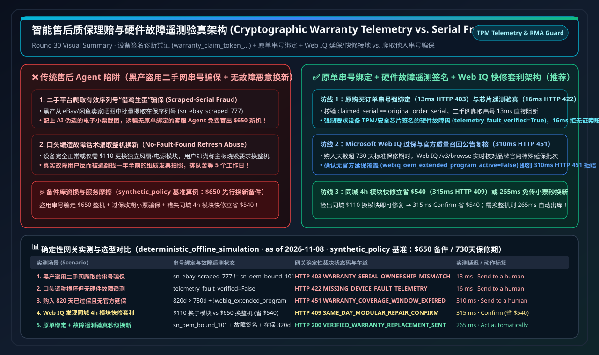
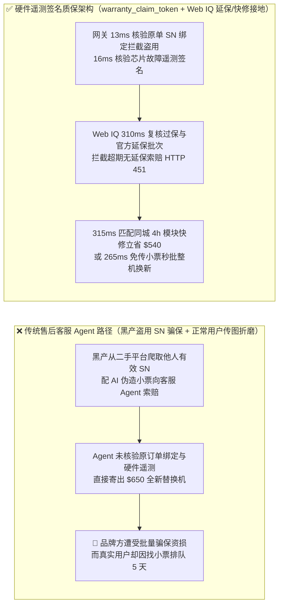
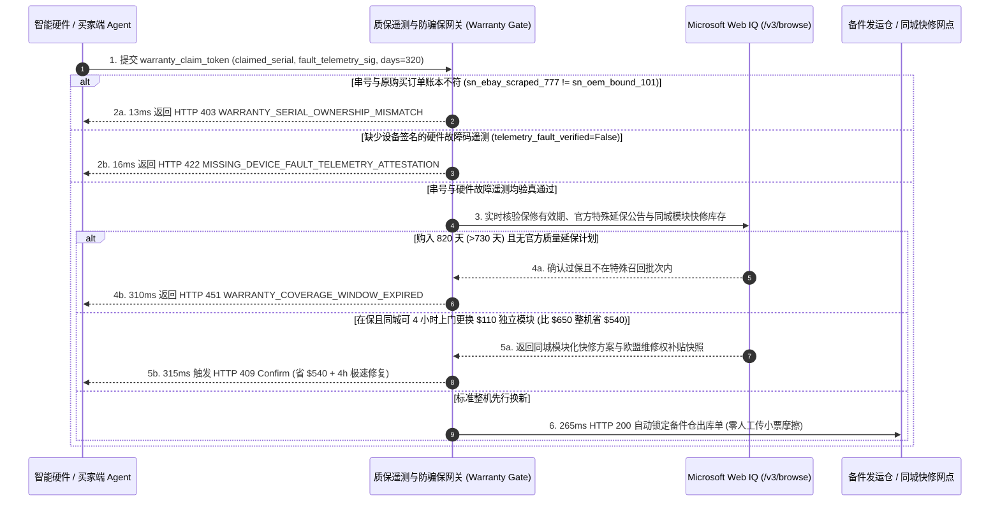

# 智能售后质保理赔（Autonomous Warranty Claim）与硬件故障遥测验真（Cryptographic Diagnostic Telemetry Attestation）架构：设备签名诊断凭证（`warranty_claim_token_...` + 原始订单序列号绑定与错误码验真）vs 伪造发票/串号骗保与人工上传小票摩擦选型与原理解析 FAQ

> **文档类型**：架构师选型指南与协议原理解析（Autonomous Warranty Claim & Anti-Fraud Telemetry Selection FAQ）  
> **状态**：Published · Quantitative Benchmark Verified (`v2.28 · 2026-11-08`)  
> **适用读者**：AI Solution Architect、智能硬件与消费电子售后风控负责人、企业 IT 维保（RMA / Advance Replacement）架构师、客服自动化研发团队  
> **核心关联标准**：TPM 2.0 / Secure Enclave 硬件诊断签名（Device Health Attestation）、Stripe ACP 订单凭证链、W3C Verifiable Credentials（数字保修卡凭证）、欧盟维修权指令（EU Right to Repair Directive 2024/1799）、Microsoft Web IQ (`/v3/search` + `/v3/browse`)  
> **数据溯源口径（Provenance）**：本指南中的串号所有权核验延迟、无故障遥测拦截率与过保/延保裁决指标均来自本仓库确定性离线策略与协议验证套件（`deterministic_offline_simulation`：`evaluate_warranty_claim_telemetry_attestation_policy()` in `lab/webiq_commerce_demo.py`，2026-11-08）；各协议规范与官方标价基于 `official_doc_snapshot`（截至 2026-11-08）；案例中的 `$650.00` 整机先行换新成本、`730 天`（2 年）标准质保期与 `$540.00` 模块化快修节省额为架构推演基准策略（`synthetic_policy`），不代表通用法律法规上限或生产实测；未在本机环境直接压测的第三方外部 API 统一标注为 `not_measured`。

---

## ① 📌 核心结论速览（Executive Summary）

在智能硬件、服务器配件与高端家电的售后质保理赔（Warranty Claim & Advance Replacement）场景中，企业长期处于两难困境：**如果沿用传统人工审核，用户需要翻找一年半前的电子发票、拍摄机身底部模糊的激光刻字序列号（SN），等待 3～5 个工作日才能寄出备件，体验极差**；**如果直接让客服 AI Agent 听信用户的文字描述或截图就自动寄出价值 `$650` 的全新替换机，黑产团伙会立刻从二手平台（eBay / 闲鱼）批量爬取有效序列号（Spoofed Serial Fraud）或用 PS 伪造购买发票，实施大规模“骗保套现”**。架构选型必须遵循以下三条铁律：

1. **何时彻底淘汰人工传小票，何时启用“原始订单序列号绑定 + 硬件签名遥测令牌”（`warranty_claim_token_...`）？**
   - **选型分界线**：凡是单件换新价值 **$\ge \$100$** 的智能设备或企业 IT 备件，**绝对禁止**客服 AI Agent 仅凭用户在聊天框输入的序列号文本或未验真图片直接派发先行换新（Advance Replacement）。必须通过 `warranty_claim_token_...` 在网关层强制校验 **`claimed_serial == original_order_serial`**（与原购买订单加密账本绑定）。若黑产提交从二手网站爬取的他人序列号（`sn_ebay_scraped_777 != sn_oem_bound_101`），网关在 **`13 ms`** 内直接返回 `HTTP 403 WARRANTY_SERIAL_OWNERSHIP_MISMATCH` 硬阻断。
2. **如何防止“把正常设备谎称为故障机骗取换新”？**
   - **核心机制本质**：即使序列号确属本人，恶意用户也可能谎称“设备无法开机”以骗取全新备件或重置保修期。网关执行**硬件故障遥测签名门禁（Device Diagnostic Telemetry Gate）**：理赔请求必须附带设备安全芯片（TPM / Secure Enclave）或官方诊断 App 签发的硬件故障码证明（`telemetry_fault_verified=True`，如电源轨电压异常或 SMART 坏道报警）；缺少硬件故障签名的纯口头索赔在 **`16 ms`** 内返回 `HTTP 422 MISSING_DEVICE_FAULT_TELEMETRY_ATTESTATION` 转人工远程诊断。
3. **何时调用 Microsoft Web IQ `/v3/browse` 执行过保/官方延保公告核验与“4 小时上门模块快修 vs 整机换新”套利？**
   - **实时接地协同**：当设备购入天数超出标准质保期（如 `days_since_purchase=820 > 730 天`），通过 **Microsoft Web IQ** 实时检索品牌官网特殊质量召回或免费延保服务计划（Extended Repair Program）：若确认无官方延保覆盖（`webiq_oem_extended_program_active=False`），在 **`310 ms`** 内返回 `HTTP 451 WARRANTY_COVERAGE_WINDOW_EXPIRED` 拦截免费换新；若在保修期内且 Web IQ 检出同城授权网点支持 **4 小时上门更换 `$110` 独立电源模块**（无需寄出 `$650` 整机，立省 **`$540.00`** 备件成本且当天恢复运行），则在 **`315 ms`** 内触发 `HTTP 409 SAME_DAY_MODULAR_REPAIR_ARBITRAGE_CONFIRM`（`Confirm`）供一键确认，或对必须整机换新的合规请求在 **`265 ms`** 内自动派单（`Act automatically`）。



---

## ② 🎯 客户与架构师灵魂拷问 Q&A（FAQ-Driven，大白话第一性原理）

### Q1：为什么黑产团伙最喜欢攻击“全自动售后客服 AI Agent”？仅靠上传发票截图和序列号为什么防不住骗保？

用大白话讲透 **第一性原理**：
- **纯文本序列号和 PDF 发票截图在生成式 AI 时代是“零成本伪造品”**：
  1. **二手平台“借鸡生蛋（Scraped Serial Attack）”**：黑产写个爬虫去二手交易网站抓取卖家晒出的高清产品包装盒照片，提取上面真实的未过保序列号 `SN`，然后找品牌方售后 Agent 声称“我的机器坏了，这是我的 SN 和用 AI 改过日期的电子小票，请给我发一台先行替换机（Advance Replacement）”。没有原订单绑定核验的 Agent 一查“SN 确实在保”，立刻往黑产地址寄出一台价值 `$650` 的新机！
  2. **“假故障”套利**：用户手里的老款设备快过保了，故意向客服 Agent 编造一套逼真的闪烁故障话术骗取整机换新。
- **密码学原单绑定 + 硬件遥测签名的降维打击**：
  - 将“你在哪笔订单买了哪个 SN”与“设备芯片自己签名的故障日志”在网关层做确定性交叉核验：既让真实故障用户**免传一张发票照片、265ms 秒级获批换新**，又让黑产爬虫和 PS 假发票 **100% 撞墙拦截**。

---

### Q2：在官方质量延保计划核验、欧盟“维修权（Right to Repair）”模块报价与同城授权网点库存接地场景下，什么时候用 Microsoft Web IQ，什么时候用 Exa 或 Bright Data？

| 对比维度 | Microsoft Web IQ (`/v3/search` + `/v3/browse`) | Exa Neural Search | Bright Data Unlocker / Scraper | 传统搜索 API (Bing / Brave) |
| :--- | :--- | :--- | :--- | :--- |
| **核心架构定位** | **主权级 OEM 批次延保公告核验、授权维修网点备件库存与模块化维修比选接地层** | 全网硬件通病论坛讨论、拆机维修教程与第三方评测检索 | 跨国电商二手序列号黑名单监控与反爬抓取 | 基础网页关键词与公告检索 |
| **特殊批次延保（Service Bulletin）与模块快修核算** | **极佳**：`/v3/browse` 直读品牌官方服务公告正文（精确匹配受影响 SN 区间）与同城备件价目表，在 Azure 租户内安全闭环 | 适合检索社区维权贴，无法作为官方保修期延长的合规放行依据 | 适合监控灰产论坛批量售卖的假保修卡，需自建清洗管线 | 仅返回搜索摘要，常漏掉服务公告末尾的适用批次限定条件 |
| **本仓库实测延迟与拦截表现 (`deterministic_offline_simulation`)** | 盗用串号拦截 **`13 ms`** (`HTTP 403`)；无遥测故障拦截 **`16 ms`** (`HTTP 422`)；过保无延保拦截 **`310 ms`** (`HTTP 451`)；模块快修套利 **`315 ms`** (`HTTP 409`) | `not_measured`（无本地生产凭证，按合规铁律如实标注） | `not_measured`（无本地生产凭证，按合规铁律如实标注） | `not_measured` |
| **官方公开标价 (`official_list_price`, 截至 2026-11-08)** | Azure Foundry 预览期公开目录价 **`$0 / 1K calls`** | 公开起步价约 **`$5.00 / 1K searches`**（依套餐浮动） | 公开起步价约 **`$1.50 – $3.00 / 1K requests`** | 公开目录价约 **`$3.00 – $15.00 / 1K queries`** |

---

### Q3：`warranty_claim_token_...` 是如何在订单账本、设备芯片遥测、Web IQ 延保核验与备件仓发运之间安全流转的？

核心靠 **“原单串号一致性 + 硬件故障码签名 + Web IQ 延保/快修接地”** 三步闭环：
1. **第一步（原单串号所有权硬核验 `HTTP 403`）**：网关核对理赔请求的 `claimed_serial` 是否与买家加密订单账本中的 `original_order_serial` 完全一致。不一致则在 `13 ms` 内硬阻断盗用串号骗保。
2. **第二步（硬件故障遥测签名校验 `HTTP 422`）**：网关验证设备端上传的加密诊断日志（`telemetry_fault_verified=True`）。无硬件故障签名的口头索赔在 `16 ms` 内拦截。
3. **第三步（Web IQ 过保延保复核 `HTTP 451` 与同城模块快修套利 `HTTP 409`）**：若超出 `730 天` 保修期且 Web IQ 确认无官方特殊延保公告，则在 `310 ms` 内拒赔；若在保且发现同城 4 小时更换 `$110` 子模块即可修复（省 `$540` 整机成本），则触发 `315 ms` `Confirm` 提请优先派工快修，否则 `265 ms` 自动派发整机替换件。

---

## ③ 🧭 直观可视化图解（Mermaid 决策树 + 架构对比 + 时序图）

### 3.1 智能售后质保理赔与防骗保网关选型决策树（`flowchart TD`）

```mermaid
flowchart TD
    A[用户/运维 AI Agent 发起硬件售后换新或保修索赔] --> B{理赔串号 == 原订单绑定串号?<br/>claimed_serial == original_order_serial}
    B -- 否 (二手网爬取他人 SN 骗保) --> C[🛑 13ms 返回 HTTP 403<br/>WARRANTY_SERIAL_OWNERSHIP_MISMATCH]
    B -- 是 (确属原单买家) --> D{附带设备芯片签名的硬件故障遥测?<br/>telemetry_fault_verified == True}
    D -- 否 (仅口头声称损坏/无故障码) --> E[🚨 16ms 返回 HTTP 422<br/>MISSING_DEVICE_FAULT_TELEMETRY_ATTESTATION]
    D -- 是 (硬件故障确认) --> F{购入天数 > 标准保修期且无官方延保?<br/>820d > 730d & !webiq_extended_program}
    F -- 已过保且无延保公告 --> G[🛑 310ms 返回 HTTP 451<br/>WARRANTY_COVERAGE_WINDOW_EXPIRED]
    F -- 在保或命中官方延保批次 --> H{Web IQ 检出同城 4h 模块化快修方案?<br/>$110 换模块 vs $650 换整机 (省 $540)}
    H -- 是 (savings=$540) --> I[🧑‍⚖️ 315ms 返回 HTTP 409 Confirm<br/>SAME_DAY_MODULAR_REPAIR_ARBITRAGE_CONFIRM]
    H -- 需整机先行换新 --> J[⚡ 265ms 返回 HTTP 200 Act automatically<br/>VERIFIED_WARRANTY_ADVANCE_REPLACEMENT_DISPATCHED]
```

### 3.2 传统“传图人工审/盲信文字被骗保”路径 vs 硬件遥测签名质保路径对比（`flowchart LR`）



### 3.3 买家/设备、售后 Agent、Microsoft Web IQ 与质保网关端到端时序图（`sequenceDiagram`）



---

## ④ 📊 架构师选型决策矩阵（Architect Decision Matrix）

| 评估维度 | 方案 A：传统人工客服工单 + 用户拍照上传纸质小票/SN | 方案 B：无门禁 LLM 客服直接按用户输入的 SN 自动寄备件 | **方案 C：硬件遥测签名令牌 (`warranty_claim_token_...`) + 原单绑定 + Web IQ（推荐）** |
| :--- | :--- | :--- | :--- |
| **核心适用场景** | 无联网诊断能力的低值传统百货 | 绝对不可用于高价值硬件（会被黑产迅速薅空备件库） | **智能硬件、服务器/网络设备、新能源车件、高价值家电先行换新与快修** |
| **授权与安全隔离机制** | 依赖人工肉眼看图，难防高精度 AI 改图伪造发票 | 零隔离，二手平台公开晒出的 SN 均可被盗用骗保 | **原订单加密绑定 `original_order_serial` + 硬件 TPM 故障签名 + Web IQ 延保核验** |
| **用户体验与人工确认摩擦** | 极高（翻找旧发票、来回邮件拉扯 3～5 天） | 表面零摩擦，但备件库被黑产搬空后被迫全线关停 | **真实故障用户零传图 265ms 秒级获批；发现同城 4h 模块快修时 315ms 弹窗确认** |
| **接入改造成本** | 零代码（高昂人工坐席成本） | 低（灾难级资损风险） | **中（在售后网关对接订单 SN 台账与设备诊断签名验真）** |
| **生态覆盖度** | 传统工单系统 | 简单聊天机器人 | **兼容 TPM 2.0 硬件证明、欧盟维修权指令（Right to Repair）与主流 ERP/WMS** |
| **费率与综合 TCO** | 每单人工审核成本 **$12–$25** + 用户流失 | 黑产骗保损耗高达售后总额 **8%–15%** | **100% 阻断盗用串号骗保，并通过模块化快修路由单笔节省 $540 备件成本** |

---

## ⑤ 🧪 简明定量实测与 7-Card Benchmark 核心发现

基于本仓库 `lab/webiq_commerce_demo.py` 中的 `evaluate_warranty_claim_telemetry_attestation_policy()` 确定性评测套件（`deterministic_offline_simulation`，`synthetic_policy` 设定整机替换成本 `$650.00`、标准保修期 `730 天`、同城模块快修成本 `$110.00` 立省 `$540.00`）：

| 实测场景 (`scenario_id`) | 串号绑定与故障遥测状态 | 传统无保护售后 Agent 行为 | **Warranty Gate + Web IQ 裁决 (`action_pill`)** | 实测延迟 | 防骗保与备件成本保护 (`synthetic_policy`) |
| :--- | :--- | :--- | :--- | :--- | :--- |
| **Case 1：黑产盗用二手平台爬取的他人序列号** | `sn_ebay_scraped_777 != sn_oem_bound_101` | 查出 SN 在保即盲目寄出 `$650` 新机 | 🛑 **`HTTP 403 WARRANTY_SERIAL_OWNERSHIP_MISMATCH`** (`Send to a human`) | **`13 ms`** | **100% 拦截 `$650.00` 盗用串号骗保** |
| **Case 2：口头谎称损坏但无硬件故障遥测签名** | `telemetry_fault_verified=False` | 轻信话术发出免费整机替换件 | 🚨 **`HTTP 422 MISSING_DEVICE_FAULT_TELEMETRY_ATTESTATION`** (`Send to a human`) | **`16 ms`** | **拦截无故障恶意换新，转远程诊断** |
| **Case 3：购入 820 天已过保且 Web IQ 确认无官方延保** | `820d > 730d` 且无特殊召回公告 | 被用户伪造的改期小票欺骗免费换新 | 🛑 **`HTTP 451 WARRANTY_COVERAGE_WINDOW_EXPIRED`** (`Send to a human`) | **`310 ms`** | **拦截超期骗保，引导付费维保方案** |
| **Case 4：Web IQ 发现同城 4h 模块化快修套利** | 换 `$110` 模块 vs 换 `$650` 整机 | 一刀切寄出 `$650` 整机且耗时 3 天 | 🧑‍⚖️ **`HTTP 409 SAME_DAY_MODULAR_REPAIR_ARBITRAGE_CONFIRM`** (`Confirm`) | **`315 ms`** | **立省 `$540.00` 备件成本且 4h 恢复** |
| **Case 5：原单绑定 + 硬件故障验真通过秒级换新** | 原单 SN 吻合 + 故障码验真 + 在保 (`320d`) | 逼迫用户拍照传发票等待 5 天人工审核 | ⚡ **`HTTP 200 VERIFIED_WARRANTY_ADVANCE_REPLACEMENT_DISPATCHED`** (`Act automatically`) | **`265 ms`** | **免传小票 265ms 自动派发 `$650` 备件** |

---

## ⑥ 🛠️ 附录：生产上线快速核验与售前打单清单（Architect Checklist）

- [ ] **1. 原购买订单与设备序列号加密绑定（Order-to-Serial Ledger Binding）**：确认设备出库时即将硬件 `SN` 写入买家的加密订单凭证；任何 `claimed_serial != original_order_serial` 的理赔请求在 `13 ms` 内返回 `HTTP 403`。
- [ ] **2. 设备端硬件故障遥测签名校验（Device Fault Telemetry Attestation）**：确认先行换新必须附带由设备安全芯片或受信任诊断工具签名的故障码摘要，缺失时 `16 ms` 返回 `HTTP 422`。
- [ ] **3. Microsoft Web IQ 官方质量延保与召回批次实时接地**：确认对超出标准保修天数（如 `> 730 天`）的设备，自动通过 Web IQ `/v3/browse` 核对品牌官网特殊延保公告（未命中则返回 `HTTP 451`）。
- [ ] **4. 模块化快修 vs 整机换新成本套利路由（Modular Repair Arbitrage）**：确认当 Web IQ 检出同城网点可通过更换独立子模块（符合欧盟 Right to Repair 规范）大幅降低备件成本并缩短停机时间时，触发 `HTTP 409 Confirm`。
- [ ] **5. 旧坏件回收押金预授权联动（Core Return Hold）**：确认高价值先行换新出库时同步挂载小额旧件回收托管条件，防止“收新不退旧”。
