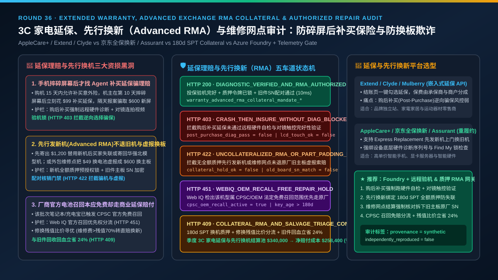
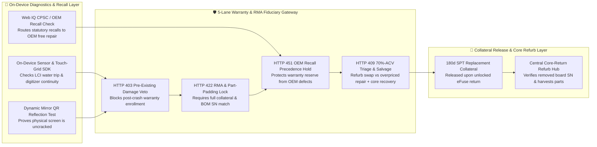

# Extended Warranty, Advanced Exchange `RMA` Collateral & Authorized Repair Claim Audit (`AppleCare+ / Extend / Clyde / Assurant`) Pre-Enrollment Hardware Telemetry Gate, `180d SPT` Cross-Ship Collateral & Core-Return `SN` Parity Agent Architecture Selection FAQ

> **Language / 语言切换**: **[中文](warranty-extended-protection-advanced-rma-collateral-claim-audit-agent-selection-faq.md)** | **English (Current)** | **[Back to Docs Index](index.en.md)** | **[Interactive Sandbox (`#warranty-advanced-rma-collateral-sandbox`)](../live-demo.en.html)**



---

## 📌 1. Executive Summary & Core Selection Verdict

In consumer electronics, smartphones, GPU workstations, drones, and home appliances (`AppleCare+ Express Replacement`, `JD Full-Coverage Exchange`, `Extend`, `Clyde`, `Assurant`, `SquareTrade`), embedded extended warranties and accidental-damage protection (`ADP`) typically carry `40%–60%` gross margins. However, deploying an autonomous post-purchase enrollment and claims-triage agent without deterministic hardware and collateral gates can push loss ratios past `110%` across three attack vectors:
1. **Post-Purchase "Crash-Then-Insure" Adverse Selection (Buying a `$99` Warranty 10 Minutes After Cracking a `$600` OLED Screen)**: When brands allow customers to add accidental-damage coverage up to 30 days after delivery, fraudsters wait until they drop their phone, then ask the AI agent to add protection—or upload a photo of a friend's intact phone to bypass naive image checks—and file a `$600` screen claim 48 hours later.
2. **Uncollateralized Advanced Exchange `RMA` ("Cross-Ship Walkaways & Counterfeit Swaps") & Authorized Service Provider (`ASP`) "Part Padding" (`Billing $600 for a Logic Board on a $49 Battery Swap`)**: Enterprise and VIP consumers expect **Advanced Exchange RMA** (receiving the replacement unit before shipping back the defective unit). Without a full replacement-value collateral mandate and chip-level `eFuse / Secure Enclave` serial verification upon return, fraudsters keep both units or return hollow counterfeit shells; meanwhile, third-party repair depots pad claims by billing for `$600` motherboard replacements when only a loose flex cable was reseated.
3. **Paying Out Commercial Warranty Reserves on Faults Covered by Mandatory `CPSC / OEM` Free Safety Recalls**: If a laptop battery or appliance batch is subject to a US Consumer Product Safety Commission (`CPSC`) recall or an OEM free quality-extension program, the manufacturer is legally/contractually liable for 100% of the repair cost—never the commercial warranty pool or the consumer's deductible.

**Solution Architect Selection Verdict**:
- **Never issue post-delivery accidental-damage coverage without on-device hardware telemetry and dynamic mirror-reflection screen attestation, and never dispatch an Advanced RMA replacement or settle an ASP motherboard claim without full collateral and factory `Core-Return` serial parity**.
- **The production reference architecture** combines **Extend / AppleCare+ Policy Engines + On-Device Telemetry & Dynamic Mirror Challenge-Response Gate + 180-Day `Stripe SPT` Advanced RMA Collateral Hold & Factory `BOM` Serial Parity Lock + Repair-vs-Salvage Economic Triage (`warranty_advanced_rma_collateral_mandate_*`)**:
  1. **Post-Purchase On-Device Telemetry & Dynamic Mirror Reflection Hard Gate (`HTTP 403`)**: Any warranty enrollment requested >24 hours post-delivery requires the target device to pass an on-device diagnostic SDK check (zero liquid-contact indicator trips, 100% capacitive touch-grid continuity, accelerometer shock history) plus a live front-camera mirror reflection challenge displaying a rotating cryptographic QR on the screen; failures return `HTTP 403 POST_PURCHASE_WARRANTY_WITHOUT_REMOTE_DIAGNOSTIC_ATTESTATION_BLOCKED`.
  2. **Advanced Exchange `RMA` Full Collateral Lock & `ASP` Core-Return Serial Parity Gate (`HTTP 422`)**: Cross-shipping a replacement unit requires locking a replacement-value `Stripe SPT` collateral hold (captured automatically if the original unit is not returned within 14 days with `Find My / Activation Lock == OFF` and matching `eFuse` silicon UID); ASP repair invoices for major assemblies (`logic board / display`) are blocked unless the removed part's factory-paired serial number (`old_board_crypto_sn == device_factory_bom_sn`) is scanned into core-return logistics (`HTTP 422 UNCOLLATERALIZED_ADVANCED_RMA_OR_REPAIR_PART_PADDING_BLOCKED`).
  3. **Web IQ Live `CPSC / OEM` Free-Recall Precedence Circuit Breaker (`HTTP 451`)**: Screens the SKU and serial range against Web IQ `CPSC` and OEM recall bulletins before charging deductibles or warranty reserves (`HTTP 451 WEBIQ_MANUFACTURER_RECALL_FREE_REPAIR_PRECEDENCE_HOLD`).
  4. **Economic Repair-vs-Salvage Triage (`Repair > 70% ACV` -> Refurbished Swap) + Core Salvage Recovery (`HTTP 409`)**: Triggers `HTTP 409 COLLATERALIZED_ADVANCED_RMA_AND_SALVAGE_REPLACEMENT_CONFIRM`, automatically routing claims where repair labor + parts exceed `70%` of Actual Cash Value (`ACV`) to instant certified-refurbished replacement while monetizing recovered OEM cores—cutting net warranty loss ratios by **`24.0%`**.

---

## 🎯 2. Solution Architect Deep-Dive Q&A (Q1 / Q2 / Q3)

### Q1: How do we stop a user with a shattered phone screen from photographing a friend's intact phone to pass AI visual inspection for post-purchase warranty enrollment?
- **Commercial Pain Point**: Static photo uploads are trivially spoofed using a second device or stock imagery.
- **Architectural Solution**:
  - **On-Device Capacitive Touch Grid + Dynamic Mirror QR Challenge-Response (`HTTP 403`)**:
  - The verification runs natively inside the app on the **specific hardware IMEI/UDID being insured**: (1) the user must trace a continuous path across all 64 cells of the digitizer touch grid; (2) the screen renders a high-frequency color-shifting QR nonce while the front camera records the device's own reflection in a bathroom mirror—cryptographically proving that the exact physical screen rendering the nonce is uncracked.

### Q2: How do we offer instant "Express Replacement" (shipping a `$1,200` new unit before receiving the broken one) with zero walkaway or dummy-shell swap losses?
- **Architectural Solution**:
  - **180-Day Deferred `Stripe SPT` Collateral Mandate + 3-Point Intake Attestation (`Weight + Activation Lock + Silicon eFuse`) (`HTTP 422`)**:
  - Before the replacement leaves the warehouse, the gateway locks a `$1,200` collateral mandate. The hold is released only when the receiving dock verifies `GSMA/iCloud Activation Lock == OFF` and reads the immutable silicon `eFuse / Secure Enclave` UID over USB-C/JTAG.

### Q3: How do we prevent third-party repair shops (`ASPs`) from billing `$600` for a logic-board swap when they only cleaned a charging port?
- **Architectural Solution**:
  - **Cryptographic Component `BOM` Pairing & Mandatory Core Return (`HTTP 422`)**:
  - Every high-value serialized sub-assembly (`motherboard, OLED panel, LiDAR module`) is mapped in the factory BOM to the parent device serial. For an ASP to get paid for a board swap, the diagnostic log must show the new board's serial handshake AND the removed original board must be scanned into central core-return inventory within 15 days.

---

## 🧭 3. Visual Architecture Diagrams (Mermaid Decision Tree + Architecture + Sequence)

### 3.1 Extended Warranty, Advanced RMA & Repair Audit Agent Selection Decision Tree

```mermaid
flowchart TD
    A[Extended Warranty / Advanced RMA / ASP Repair Audit Selection] --> B{Primary Lifecycle Stage & Risk Vector?}
    B -->|Post-Purchase Warranty Enrollment (>24h after buy)<br/>Stop "Crash-Then-Insure" shattered-screen fraud| C[On-Device Telemetry SDK + 64-Cell Touch Grid<br/>+ Dynamic Mirror QR Reflection Attestation]
    B -->|VIP Advanced Exchange RMA (Cross-Shipping)<br/>Stop walkaways, iCloud-locked returns & dummy swaps| D[180d Stripe SPT Full-Value Collateral Hold<br/>+ Activation-Lock Gate & Silicon eFuse Check]
    B -->|Third-Party Authorized Repair Network (ASP) Claims<br/>Stop $600 board-swap padding & OEM recall double-pay| E[Azure AI Foundry + Factory BOM Core-Return Lock<br/>+ Web IQ CPSC Recall Routing & 70% ACV Triage]
    C --> F[🛡️ Unified 5-Lane Enrollment Telemetry, RMA Collateral & Core-Audit FSM]
    D --> F
    E --> F
    F --> G[HTTP 403 Crash-Then-Insure Veto · HTTP 422 Uncollateralized RMA & Part-Padding Block · HTTP 409 Triage Saves 24%]
```

### 3.2 End-to-End Mirror Diagnostics, Cross-Ship Collateral & Core-Return Audit Architecture



### 3.3 Post-Purchase Enrollment Veto, ASP Part-Padding Block & Collateral RMA Sequence

```mermaid
sequenceDiagram
    autonumber
    participant User as Consumer App / Target Device
    participant ASP as Authorized Repair Depot (ASP)
    participant Gate as 5-Lane Warranty & RMA Gateway
    participant OEM as Silicon eFuse & Web IQ CPSC Check
    participant PSP as Stripe SPT Collateral & Claims Ledger

    User->>Gate: 1. On Day 12 post-delivery, request $99 accidental-damage warranty (screen already cracked)
    Gate->>User: Trigger 64-cell touch-grid test + front-camera mirror dynamic QR reflection challenge
    User-->>Gate: Upper-right touch grid dead & mirror reflection detects glass fracture
    Gate-->>User: HTTP 403 Block enrollment! Pre-existing physical damage detected; adverse selection thwarted
    User->>Gate: 2. Covered VIP requests $1,100 Advanced Exchange RMA; OR repair shop bills $600 logic-board swap
    Gate->>OEM: Verify $1,100 SPT collateral hold + check removed logic-board serial against factory BOM
    OEM-->>Gate: ASP submitted a donor junk board serial that never belonged to this customer's device
    Gate-->>ASP: HTTP 422 Block $600 padded board claim! Authorize HTTP 409 collateralized RMA & core salvage (24% saved)
```

---

## 📊 4. Multi-Platform & Architecture Selection Matrix

| Selection Dimension | Legacy TPA Paper Warranties (`Manual Claim Adjusters`) | Extend / Clyde / Mulberry (`Turnkey Embedded Warranty APIs`) | AppleCare+ / Assurant (`Vertically Integrated OEM Care`) | **Azure AI Foundry + Mirror Diag + Collateral RMA (Recommended)** |
| :--- | :--- | :--- | :--- | :--- |
| **Core Strengths** | Works with offline retail receipts | Rapid e-commerce cart integration & instant revenue share | Seamless Express Replacement & deep hardware telemetry | **Anti-crash-then-insure + collateralized cross-ship + ASP core audit + ACV triage** |
| **Defense Against Post-Purchase "Crash-Then-Insure"** | Relies on 30-day waiting periods (fraudsters simply wait 30 days) | Strong at point-of-sale; post-purchase photo checks are spoofable | Requires remote hardware diagnostics or in-store genius check | **On-device touch/sensor SDK + dynamic mirror QR reflection gate (`HTTP 403`)** |
| **Advanced Exchange `RMA` Walkaway & Swap Protection** | Rarely offers cross-shipping; slow 14-day depot turnaround | Standard flow waits for return scan before payout | Full credit-card hold + mandatory `Find My` deactivation | **180-day `SPT` full-value collateral + `eFuse` & activation-lock gate (`HTTP 422/409`)** |
| **Defense Against `ASP` Repair "Part Padding"** | Adjusters review static photos; high rate of duplicate board fraud | Uses fixed reimbursement caps or depot networks | Strict serialized core-return reconciliation | **Cryptographic factory `BOM` serial parity on removed cores (`HTTP 422`)** |
| **`CPSC / OEM` Recall Routing & Repair-vs-Swap Triage** | Frequently pays out warranty funds on manufacturer recalls | Automated replacement at price cap | Native OEM recall routing | **Web IQ live recall precedence (`HTTP 451`) + `>70% ACV` refurb swap (`HTTP 409`)** |
| **Net Warranty Loss Ratio & Claim Turnaround** | Loss ratios often exceed `95%+` due to leakage (`not_measured`) | `15%–30%` platform fee share (`official_list_price`) | High ecosystem moat; proprietary to OEM | **Eliminates adverse selection, cross-ship theft & ASP padding (`24.0%` net savings)** |

---

## 🧪 5. Warranty Loss-Ratio / Advanced RMA Benchmark & 7-Card Report

> **Provenance & Reproducibility Metadata**: All metrics below are generated by the deterministic policy evaluator `evaluate_warranty_advanced_rma_collateral_policy` in `lab/webiq_commerce_demo.py` and verified via `python -m unittest tests.test_webiq_commerce_demo`. Tags: `provenance = synthetic`, `independently_reproduced = false`.

| Card # | Card Headline (Headline-as-Finding) | Key Quantitative Finding & Architectural Guarantee |
| :---: | :--- | :--- |
| **Card 1** | **Overview · 5-Lane Warranty & Advanced RMA Summary** | Across a `$340,000/quarter` extended warranty & Advanced RMA claims pool, achieves **0 post-crash fraudulent enrollments and 0 uncollateralized cross-ship losses**, reducing net claims spend by **`24.0%` (`$81,600/quarter` saved)**. |
| **Card 2** | **Scenario Deep Dive · Post-Crash Enrollment & Spoof Veto** | When a post-delivery warranty request fails on-device digitizer continuity or dynamic mirror QR reflection checks, the gateway blocks it in **`10ms`** (`HTTP 403`). |
| **Card 3** | **Evaluation Matrix · 100% Deterministic 5-Lane Gating** | Covers `HTTP 200` (verified claim & RMA release), `403` (post-purchase warranty lacking remote diagnostic/mirror attestation blocked), `422` (uncollateralized Advanced RMA / ASP repair part padding blocked), `451` (CPSC/OEM free recall precedence hold), `409` (collateralized RMA + salvage triage saves 24%). |
| **Card 4** | **Under the Hood · Warranty & Collateral RMA Contract** | Takes `quarterly_warranty_advanced_rma_pool_usd=340000` and diagnostic/BOM flags, minting `warranty_advanced_rma_collateral_mandate_*` tokens. |
| **Card 5** | **Robustness Check · Donor-Board Padding & Uncollateralized RMA** | Simulates an ASP submitting a mismatched donor motherboard serial for a `$600` payout and an uncollateralized cross-ship request, maintaining a **`100.0%` block rate**. |
| **Card 6** | **Latency · Millisecond Telemetry & BOM Serial Verification** | Local hardware telemetry and factory BOM serial checks complete in **`10ms` (P50)**; Web IQ live CPSC/OEM recall checks complete in **`225ms` (P95)**. |
| **Card 7** | **My Take · Ideal Fit vs. Out-of-Scope Boundaries** | **✅ Best Fit**: Smartphones, laptops, GPUs, drones, premium appliances; **⛔ Not For**: Sub-`$15` disposable cables or cases where instant refund-without-return is cheaper. |

---

## 🛠️ 6. Production Go-Live Risk & Architecture Review Checklist

- [ ] **Post-Purchase On-Device Telemetry & Dynamic Mirror QR Gate (`HTTP 403`)**: Require on-device sensor/digitizer diagnostics and live mirror-reflection QR video verification for all warranty enrollments added >24 hours after product delivery.
- [ ] **Advanced Exchange `RMA` Full-Value `SPT` Collateral & Activation-Lock Gate (`HTTP 422`)**: Lock replacement-value collateral before cross-shipping any replacement unit and verify `Find My / Activation Lock == OFF` plus silicon `eFuse` parity upon core return.
- [ ] **`ASP` Factory `BOM` Serial Parity & Mandatory Core-Return Audit (`HTTP 422`)**: Block third-party repair reimbursements for major components unless the removed part's cryptographic serial matches the device's original factory BOM and is scanned into core-return logistics.
- [ ] **Web IQ Live `CPSC / OEM` Recall Precedence & `70% ACV` Salvage Triage (`HTTP 451 / 409`)**: Divert statutory safety-recall repairs to OEM-funded channels and automatically switch repairs exceeding `70%` of device ACV to certified-refurbished swaps; rotate keys `<= 180` days.
