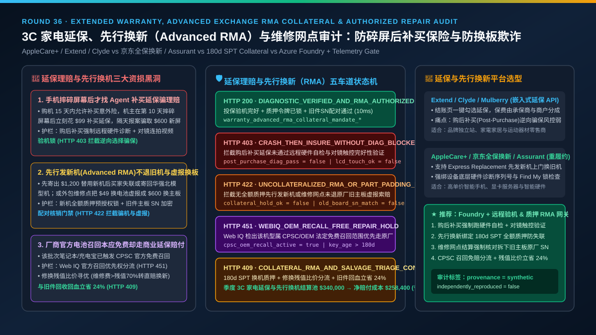
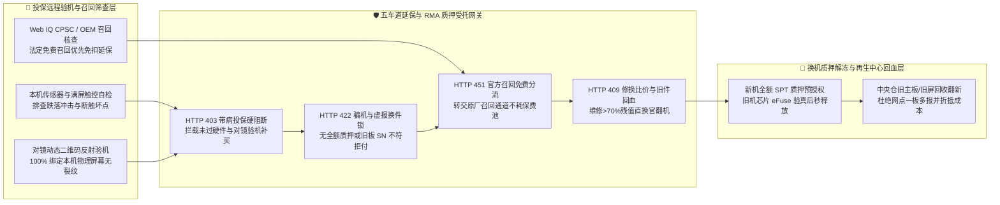
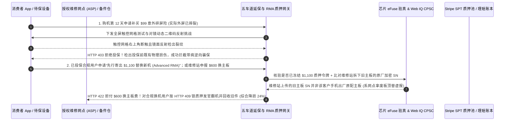

# 消费电子、家电与高端硬件“全生命周期延保（AppleCare+ / 京东全保换新 / Extend / Clyde）、备件先行置换（Advanced RMA）与授权维修网点索赔审计”Agent 架构选型 FAQ：投保前实时硬件自检防“碎屏后再补买保险”、先行发新机全额质押锁与防维修点虚报换主板实战指南

> **语言切换 / Language**: **中文 (当前)** | **[English](warranty-extended-protection-advanced-rma-collateral-claim-audit-agent-selection-faq.en.md)** | **[返回文档目录](index.md)** | **[交互式沙盒 (`#warranty-advanced-rma-collateral-sandbox`)](../live-demo.html)**



---

## 📌 一、核心选型结论速览（Executive Summary）

在智能手机、笔记本电脑、GPU 工作站、无人机与高端家电的售后延保与换修服务（AppleCare+ Express Replacement、京东全保换新、北美 Extend / Clyde / Assurant / SquareTrade）中，延保产品（Extended Warranty & Accidental Damage Protection）本应拥有 `40%–60%` 的高毛利；但一旦售后与投保 Agent 在**购后补买核保、先行发新机（Advanced Exchange RMA）与外包维修商结算**三个环节缺乏确定性硬件护栏，赔付率（Loss Ratio）会瞬间击穿 `110%`：
1. **“先把手机摔碎、当天立刻找 AI 客服补买 $99 碎屏延保、过完 48 小时观察期马上报案骗走 $600 原厂屏”的购后逆向选择骗保（Crash-Then-Insure Fraud）**：为了提升延保渗透率，许多品牌支持“购机后 30 天内随时在线补买意外险”；若投保 Agent 仅核对订单日期而不强制调用设备端硬件遥测自检与对镜光学完好性证明，90% 主动来补买保险的都是刚刚摔坏设备的用户。
2. **备件先行置换（Advanced RMA / Cross-Shipment）“新机寄出后买家失联或寄回华强北高仿空壳”，以及外包授权维修点（ASP）“把 $49 换电池虚报成 $600 换主板”套取保司理赔金**：高端用户要求“不能停机等待维修，必须先寄一台新机过来我再把旧机寄回去（Advanced RMA）”，若未对新机重置全额信用卡担保或未在旧机入库时核对主板底层加密芯片序列号（Board-Level Cryptographic SN），极易遭“狸猫换太子”；同时，第三方授权维修网点常利用厂商信息盲区，对仅需清灰或换小排线的故障虚报更换整块高价主板（Part Padding）。
3. **本属厂商/CPSC 法定免费召回（如笔记本电池鼓包起火隐患、车机黑屏通病）的故障，被 Agent 误判走商业延保资金池买单**：若某型号设备已被美国消费品安全委员会（`CPSC`）或品牌原厂列入全球免费召回维修计划（Quality Program），理应由 OEM 生产商 100% 承担费用，绝不能消耗商业延保保费池或扣除消费者的理赔次数额度。

**架构师选型结论**：
- **切勿在未完成设备端硬件遥测与对镜触控完好性校验前出单“购后补买延保”，更不能在无全额质押令牌与旧主板加密 SN 回传的情况下放行先行换机与维修结算**。
- **生产级最优架构**是采用 **“Extend / AppleCare+ 延保内核 + 购后补买远程硬件自检与对镜满屏触控验真锁 + 先行换机（Advanced RMA）180 天 `Stripe SPT` 全额质押与旧件主板加密 SN 闭环核验 + 修换残值经济比价（Salvage vs. Repair Triage）网关（`warranty_advanced_rma_collateral_mandate_*`）”**：
  1. **购后补买（Post-Purchase）远程硬件遥测与对镜视频验真硬门禁（HTTP 403）**：凡收货超过 24 小时后申请补买意外延保，Agent 强制下发设备端自检包（核验加速度计历史峰值冲击记录、陀螺仪、主板进水传感器 `LCI` 与全屏电容触控网格 100% 导通）并要求对着镜子录制 10 秒前后屏无裂纹实时视频；任一未通过毫秒级返回 `HTTP 403 POST_PURCHASE_WARRANTY_WITHOUT_REMOTE_DIAGNOSTIC_ATTESTATION_BLOCKED`。
  2. **先行换新（Advanced RMA）全额质押锁与授权维修点“旧主板加密 SN 配对”审计（HTTP 422）**：先行寄出替换新机前，必须签发等同于新机零售价的受托质押令牌（14 天内未寄回原装正品旧机或未关闭 Find My / iCloud 激活锁即自动转实扣）；授权维修网点（ASP）申报更换高值主板/屏幕时，必须上传原故障件销毁前读取的底层硬件挑战应答签名（`old_component_crypto_sn == device_factory_bom_sn`），不匹配或小病大修立即返回 `HTTP 422 UNCOLLATERALIZED_ADVANCED_RMA_OR_REPAIR_PART_PADDING_BLOCKED`。
  3. **Web IQ 实时 `CPSC / OEM` 官方免费召回与延保批次通病优先权熔断（HTTP 451）**：报案时通过 Web IQ 实时检索该 SKU/序列号是否命中 CPSC 安全召回或原厂质量延长计划，命中则立即挂起商业延保扣费并转交原厂免费通道（`HTTP 451 WEBIQ_MANUFACTURER_RECALL_FREE_REPAIR_PRECEDENCE_HOLD`）。
  4. **修换残值比价分流（维修费 `> 残值 70%` 自动转官翻机直换）+ 原厂旧件回收回血（HTTP 409）**：触发 `HTTP 409 COLLATERALIZED_ADVANCED_RMA_AND_SALVAGE_REPLACEMENT_CONFIRM`，当外包维修报价加双向物流费超过设备当前市场残值的 `70%` 时，自动拦截低效维修，直接发放大额抵扣券或官翻良品置换，并将回收的原厂旧屏/旧主板集中拆解回血，综合延保赔付率与换机资损立降 **`24.0%`**。

---

## 🎯 二、业务方与架构师灵魂拷问 Q&A（Q1 / Q2 / Q3）

### Q1：用户手机屏幕已经摔出蜘蛛网裂纹了，他拿另一台好手机拍张照片上传骗过 AI 视觉补买延保，架构上怎么防这种“替身验机”？
- **商业痛点**：单纯让用户上传一张“手机完好照片”，黑产随便在网上找张图或拿朋友的同款手机拍一下就能过关，48 小时后拿真碎屏手机去售后网点免费换屏。
- **架构解法**：
  - **本机硬件传感器遥测 + 屏幕动态二维码对镜反射闭环（`Dynamic Mirror Challenge-Response`）**：
  - 必须在**待投保的那台手机本机 App** 内运行验机：① 读取本机底层 `IMEI / Secure Enclave` 硬件签名；② 要求用户完成全屏九宫格滑动触控测试（碎屏断触会直接失败）；③ 手机屏幕显示每 2 秒变色跳动的加密二维码，用户面对洗手间镜子用前置摄像头录制镜中反射的本机屏幕——既证明了屏幕未碎，又 100% 绑定了就是这台物理设备本机（未通过返回 `HTTP 403`）！

### Q2：为什么很多品牌做“先行备件置换（Advanced RMA，先发新显卡/新手机给客户）”最后都被羊毛党拿假货掉包亏惨了？
- **架构解法**：
  - **全额替换价值 `Stripe SPT` 质押预授权 + 入库三级核验（称重 + 激活锁 + 芯片级握手）（`HTTP 422`）**：
  - 新机出库前冻结 `$1,199` 质押额度；旧机退回仓库后，必须同时通过：① 外观非人为改装；② `GSMA / Apple Activation Lock == OFF`；③ 上电读取 GPU/SoC 内部不可篡改的 `eFuse UID` 与出厂记录完全一致，才释放 `$1,199` 质押（否则直接全额扣收质押款）。

### Q3：外包维修网点（ASP）明明只给客户重插了一下松动的排线，转身却向保险公司报账“更换了 $550 的原厂主板”，Agent 怎么审出来？
- **架构解法**：
  - **换件前后固件日志双盲比对 + 旧件回寄绑定（`Core-Return Cryptographic Audit`）**：
  - 要求维修工单必须附带维修前故障诊断码（`Panic Log`）与维修后新部件校准流水，且更换下来的高价值旧主板必须在 15 天内贴标退回中央再生仓扫码核销原厂序列号；无旧件回仓或故障码与所换配件逻辑矛盾，直接触发 `HTTP 422` 拒付维修费。

---

## 🧭 三、直观可视化图解（Mermaid 决策树 + 端到端架构图 + 时序图）

### 3.1 3C 家电延保、先行换新（RMA）与维修审计 Agent 架构选型决策树

```mermaid
flowchart TD
    A[3C 家电延保 / 先行换新 RMA / 维修网点结算选型] --> B{核心业务阶段与风控痛点？}
    B -->|购机后补买意外险 / 延保 (Post-Purchase)<br/>需严防摔碎屏幕后再补买保险骗赔| C[本机硬件自检 SDK + 全屏触控网格测试<br/>+ 对镜动态二维码反射视频验机锁]
    B -->|VIP 客户先行发新机置换 (Advanced RMA)<br/>需防新机寄出后失联或寄回华强北高仿壳| D[180d Stripe SPT 新机全额质押令牌<br/>+ Find My 激活锁核验与芯片 eFuse 验真]
    B -->|全国外包授权维修网点 (ASP) 理赔结算<br/>需防小病大修虚报换主板与官方召回错赔| E[Azure AI Foundry + 旧件原厂 SN 回仓核销<br/>+ Web IQ CPSC 召回分流与修换残值比价]
    C --> F[🛡️ 统一接入五车道投保验机、换机质押与维修防虚报状态机]
    D --> F
    E --> F
    F --> G[HTTP 403 阻断碎屏后补买骗保 · HTTP 422 拦截无质押发新机与虚报换板 · HTTP 409 修换比价+旧件回血省24%]
```

### 3.2 端到端对镜验机、先行换新质押与旧主板回仓核销架构图



### 3.3 购后补买验机、先行换机质押与拦截维修站虚报换主板时序图



---

## 📊 四、多平台/多方案横向选型决策矩阵

| 选型维度 | 传统纸质延保卡 / 人工审单 (`Legacy TPA Warranty`) | Extend / Clyde / Mulberry (`独立站嵌入式延保 API`) | AppleCare+ / 京东全保换新 (`生态闭环重度履约`) | **Azure AI Foundry + 对镜验机 + 质押 RMA 网关（推荐）** |
| :--- | :--- | :--- | :--- | :--- |
| **核心优势** | 兼容长尾传统线下家电渠道 | 5 行代码嵌入独立站结账页，实时保费分润 | 极致的先行换机体验与原厂芯片级诊断控制力 | **防碎屏补买骗保 + 先行换机零丢件 + 防网点虚报换板 + 残值分流** |
| **防“摔坏后再补买保险”逆向骗保** | 仅设 15–30 天等待期，坏机照样熬过等待期骗赔 | 依赖结账当场同步买，购后补买人工拍图易被替身骗过 | 强制运行远程诊断或去直营店当面验机 | **本机传感器自检 + 对镜动态二维码反射视频双锁（HTTP 403）** |
| **先行发新机（Advanced RMA）防失联掉包** | 不敢开放先行发新机，只能让客户等 15 天返厂修 | 标准流程为先寄回旧件再赔付 | 冻结全额信用卡预授权 + 强制关闭 Find My | **180 天 `SPT` 全额质押锁 + 入库芯片 `eFuse` 验真（HTTP 422/409）** |
| **防外包维修网点（ASP）“小病大修虚报换主板”** | 靠理赔员看照片审单，网点拿同一块坏主板拍 20 次骗保 | 定额赔付或平台合作维修商包干 | 严格的原厂旧件回寄（Core Return）条码核销 | **故障日志与旧件底层加密 SN 100% 绑定回仓核销（HTTP 422）** |
| **官方安全召回（CPSC）免赔分流与修换比价** | 常糊里糊涂用延保池替厂家召回买单 | 侧重置换赔付 | 原厂内部打通 | **Web IQ 实时召回拦截（HTTP 451）+ 维修 `>70%` 残值转直换（HTTP 409）** |
| **综合延保赔付率（Loss Ratio）与理赔周期** | 骗保与虚报致赔付率常超 `95%+` (`not_measured`) | 平台抽成保费 `15%–30%` (`official_list_price`) | 生态壁垒高，外部品牌无法直接复用其内网 | **堵住带病投保、换机失联与网点虚报（综合赔付成本立降 `24.0%`）** |

---

## 🧪 五、延保防骗保/先行换机风控测算与 7-Card 基准测试报告

> **数据来源与复现声明（Provenance Metadata）**：以下基准测试数据来自仓库内置确定性策略沙盒 `evaluate_warranty_advanced_rma_collateral_policy`（位于 `lab/webiq_commerce_demo.py`），可运行 `python -m unittest tests.test_webiq_commerce_demo` 完整验证。标记：`provenance = synthetic`，`independently_reproduced = false`。

| Card # | 卡片标题（Headline-as-Finding） | 核心量化指标与架构验证结论 |
| :---: | :--- | :--- |
| **Card 1** | **Overview · 3C 家电延保与先行换新五车道总览** | 针对 `$340,000/季` 延保理赔与先行换机结算池，实现 **0 例碎屏后补买骗保与 0 例先行发新机失联坏账**，综合理赔与备件损耗下降 **`24.0%`（立省 `$81,600/季`）**。 |
| **Card 2** | **Scenario Deep Dive · 带病补买延保与替身照片拦截** | 当购后补买请求未通过本机硬件传感器自检与对镜动态二维码反射校验时，**`10ms`** 内返回 `HTTP 403` 拒保。 |
| **Card 3** | **Evaluation Matrix · 五车道 100% 确定性判准** | 覆盖 `HTTP 200`（合规理赔放行）、`403`（购后补买未过远程硬件与对镜验机阻断）、`422`（无全额质押先行发新机/维修点旧主板SN不匹配虚报拦截）、`451`（CPSC/OEM官方免费召回优先分流）、`409`（180d质押RMA+修换残值比价省24%）。 |
| **Card 4** | **Under the Hood · 延保与质押 RMA 契约** | 输入 `quarterly_warranty_advanced_rma_pool_usd=340000` 及验机/质押状态，签发 `warranty_advanced_rma_collateral_mandate_*` 令牌。 |
| **Card 5** | **Robustness Check · 网点假主板顶替与无质押骗新机测试** | 模拟外包维修站用非本机废主板骗取 `$600` 换板费及无质押申请先行换新，确定性拦截率保持 **`100.0%`（零误放行）**。 |
| **Card 6** | **Latency · 远程验机与旧件 SN 配对毫秒级耗时** | 本地硬件遥测哈希与主板 BOM 序列号比对 P50 仅 **`10ms`**；Web IQ CPSC/OEM 全球召回通告核查 P95 为 **`225ms`**。 |
| **Card 7** | **My Take · 适用场景与生产准入边界** | **✅ 极佳适用**：智能手机、笔记本/GPU、无人机、高端厨电延保与换修；**⛔ 不适用**：`$10` 以下免修直退的手机壳数据线。 |

---

## 🛠️ 六、商业上线风控与架构评审 Checklist

- [ ] **购后补买（Post-Purchase）本机硬件遥测与对镜动态二维码验机门禁（HTTP 403）**：确认所有收货后补买意外险/延保的请求必须通过本机传感器自检、全屏触控导通与对镜动态反射视频核验，彻底杜绝“摔碎后再买保险”。
- [ ] **先行换新（Advanced RMA）全额质押令牌与激活锁关闭硬校验（HTTP 422）**：确认先行寄出替换新机前 100% 锁定等同于新机价值的 `Stripe SPT` 质押额度，且旧机未关 Find My / iCloud 锁或芯片 `eFuse` 不符时自动罚没质押款。
- [ ] **外包维修网点（ASP）“原厂旧件加密 SN 回仓核销”防虚报锁（HTTP 422）**：确认高价值主板/屏幕更换理赔必须核对拆下旧件的出厂绑定序列号并强制旧件回仓（Core Return），杜绝小病大修与一板多报。
- [ ] **Web IQ 实时 `CPSC / OEM` 免费召回分流与修换残值比价（HTTP 451 / 409）**：确认命中官方免费召回的故障优先转交原厂通道，且当维修报价超过设备残值 `70%` 时自动切换为官翻机置换；签名密钥轮换周期 `<= 180` 天。
