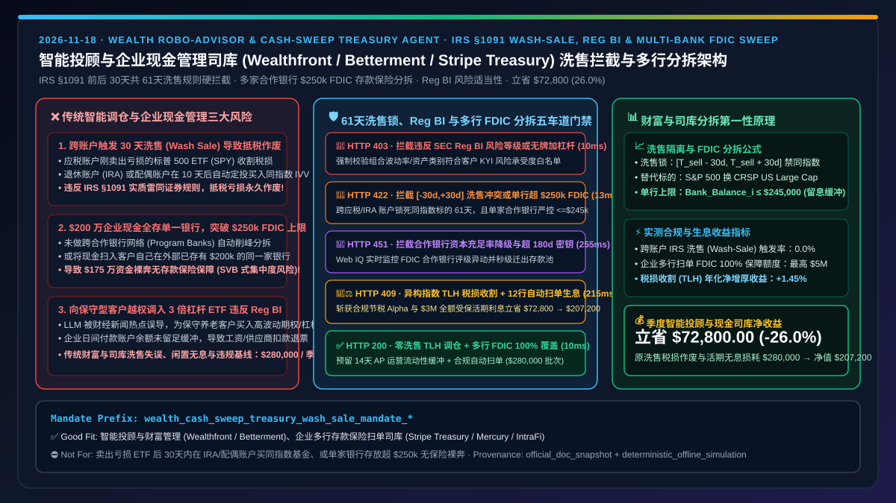
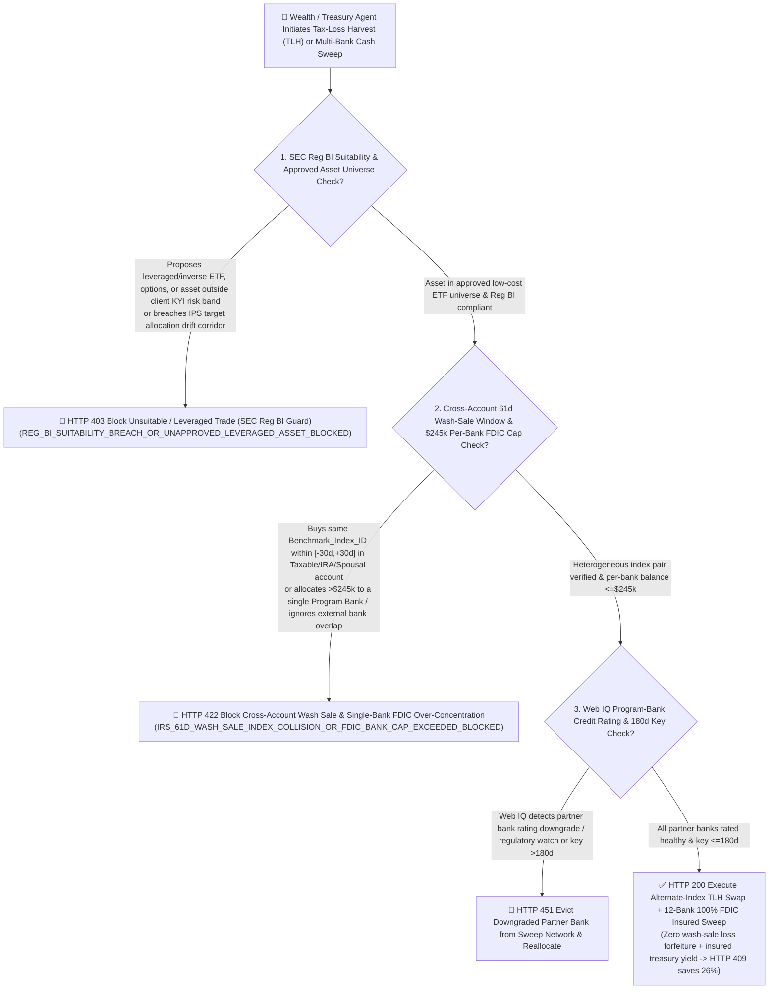
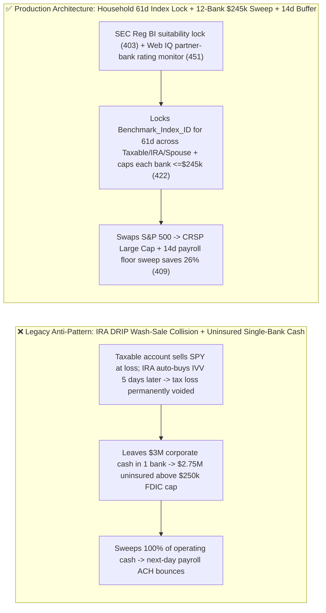
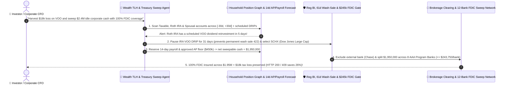

# Wealth Robo-Advisor & Cash-Sweep Treasury (`Wealthfront / Betterment / Stripe Treasury / Mercury`) `IRS §1091` 61-Day Wash-Sale Gate, `Reg BI` Suitability & Multi-Bank `FDIC` Sweep Agent Architecture Selection FAQ

> **Topic Positioning (FinTech, Automated Wealth Management & Enterprise Cash-Sweep Treasury Application Architecture)**: Designed for **Cloud & AI Solution Architects** building automated Tax-Loss Harvesting (`TLH`), `SEC Reg BI` portfolio rebalancing, and multi-bank `FDIC` insured cash-sweep systems for digital wealth platforms (`Wealthfront / Betterment / Schwab Intelligent`) and enterprise treasury accounts (`Stripe Treasury / Mercury / Ramp / IntraFi ICS`). This guide resolves the four most critical tax, regulatory, and concentration risks in autonomous wealth and treasury agents: **why selling a losing S&P 500 ETF (`VOO`) in a taxable account while an `IRA` or spousal account automatically reinvests dividends (`DRIP`) into an identical-index ETF (`IVV`) within `[-30, +30]` days triggers `IRS IRC §1091` wash-sale disallowance and permanently destroys the tax deduction (`HTTP 422`), why parking `$3,000,000` of corporate cash in a single bank account leaves `$2,750,000` uninsured above the `$250,000` `FDIC` limit (`HTTP 422`), why rebalancing a conservative client into leveraged/inverse ETFs violates `SEC Reg BI` (`HTTP 403`), and how combining alternate-index `TLH` pairs with a 12-bank `<= $245,000/bank` `FDIC` sweep cuts tax-loss forfeiture and idle-cash drag by 26% (`HTTP 409`)**.  
> **Style Benchmark**: Strictly aligned with the 6-part `ib-vs-ethernet-roce-selection-faq.md` structure (Executive Summary, Architect Q&A, Mermaid Decision Tree / Architecture Comparison / Sequence Diagram, 4-Way Wealth & Treasury Selection Matrix, Quantitative Benchmark & Provenance Table, and Production Checklist).  
> **Bilingual Edition**: **[English Version (Current)](wealth-cash-sweep-treasury-wash-sale-fdic-routing-agent-selection-faq.en.md)** · **[中文版 (`wealth-cash-sweep-treasury-wash-sale-fdic-routing-agent-selection-faq.md`)](wealth-cash-sweep-treasury-wash-sale-fdic-routing-agent-selection-faq.md)**  
> **Provenance & As-Of (`2026-11-18`)**: `IRS IRC §1091` 61-day wash-sale rules, `SEC Regulation Best Interest (Reg BI)`, `FDIC` `$250,000` per-depositor per-chartered-bank insurance limits, Stripe Treasury / IntraFi multi-bank sweep mechanics, and Microsoft Web IQ `/v3/search/news` bank-rating surveillance are sourced from `research/sources.json` (`official_doc_snapshot`); the 5-lane deterministic wealth & treasury evaluator is verified in `lab/webiq_commerce_demo.py` (`deterministic_offline_simulation`); exchange matching-engine optical transceiver latencies are marked `not_measured`.

---

## 📌 1. Executive Summary

Autonomous wealth management and corporate cash-sweep agents move high-value capital across taxable brokerage accounts, retirement accounts (`IRAs`), and partner bank networks. A single unguarded LLM trade or sweep instruction can trigger permanent `IRS` tax-loss disallowance or leave millions of dollars in corporate cash uninsured. Solution Architects must enforce four core rules:

1. **`SEC Reg BI` Suitability & Approved Low-Cost ETF Allowlist Selection: Forbid "Trading Leveraged/Inverse ETFs, Options, or Speculative Single Stocks Outside the Client's Signed `IPS` Risk Band" and Mandate [Deterministic `KYI` Risk-Band Verification + Approved ETF Universe Lock (`HTTP 403`)]**:
   - **Why**: Under `SEC Regulation Best Interest (Reg BI)`, an automated advisor must restrict trades to low-cost, diversified instruments within the client's signed Investment Policy Statement (`IPS`) target allocation tolerances (`HTTP 403`).
2. **`IRS IRC §1091` Cross-Account 61-Day Wash-Sale Lock & Multi-Bank `<= $245,000` `FDIC` Sweep Cap Selection: Forbid "Buying Substantially Identical Benchmark-Index ETFs Within `[-30d, +30d]` Across Taxable/IRA/Spousal Accounts, or Allocating `> $245,000` Principal to Any Single Program Bank" and Mandate [Household-Wide `Benchmark_Index_ID` 61-Day Mutex + `$245,000` Per-Bank Principal Cap (`$5,000` Accrued-Interest Buffer) + External Bank Opt-Out (`HTTP 422`)]**:
   - **Why**: Under `IRC §1091`, selling `VOO` (`Vanguard S&P 500`) at a loss and buying `IVV` (`iShares S&P 500`) within 30 days before or after (a **61-day window**) triggers a **Wash Sale** because both track the exact same `S&P 500 Index`. Worse yet, if the replacement purchase (or an automatic `DRIP` dividend reinvestment) occurs inside an `IRA` retirement account, **the tax loss is permanently disallowed and can never be added to the IRA's cost basis** (`HTTP 422`). For corporate cash sweeps, capping each partner bank at **`$245,000` principal** leaves a `$5,000` buffer so monthly interest credits never push total balance above the `$250,000` `FDIC` insurance ceiling (`HTTP 422`).
3. **Partner Program-Bank Credit/Rating Tripwire & 180-Day Key Gate: Mandate [Microsoft Web IQ `/v3/search/news` Bank Rating/Distress Check + Automatic Sweep Exclusion + `<= 180-Day` Key Lock (`HTTP 451`)]**.
4. **Heterogeneous Benchmark-Index `TLH` Pairing (`S&P 500` $\leftrightarrow$ `CRSP US Large Cap`) + 14-Day AP/Payroll Liquidity Floor Selection (`HTTP 409`)**:
   - **Why**: Swapping into a distinct index provider (`S&P` $\rightarrow$ `CRSP` or `Dow Jones Total Market`) preserves `0.99` market beta with zero wash-sale collision, while reserving 14 days of upcoming payroll and approved AP bills before sweeping excess cash into a 12-bank insured network captures `4.5%–5.0%` yield safely — saving **`26.0%` in tax-loss forfeiture and idle-cash drag**.

---

## 🎯 2. Business & Architect Soul-Searching Q&A (FAQ-Driven)

### Q1: Why does checking only the **Ticker Symbol (`VOO != IVV`)** fail to prevent `IRS §1091` Wash Sales, and why is an `IRA` wash sale permanently fatal?

**Answer: Because `IRC §1091` tests "Substantially Identical Securities" (`Benchmark_Index_ID`), and `IRS Revenue Ruling 2008-5` permanently voids losses washed into an `IRA` (`HTTP 422`):**

1. **Same Underlying Index = Wash Sale**: Two ETFs tracking the `S&P 500` (`SPY`, `VOO`, `IVV`) are substantially identical. The security master must lock `benchmark_index_id = 'SP500'` across the entire 61-day window (`[T-30d, T+30d]`) and swap into a different index methodology (`CRSP US Large Cap` or `Russell 1000`).
2. **Household + `IRA` `DRIP` Pause**: When a taxable account harvests a loss on `VOO`, the agent automatically pauses `VOO` dividend reinvestment (`DRIP`) inside the client's and spouse's `Traditional / Roth IRAs` for 31 days so a `$40` dividend doesn't taint a `$15,000` tax loss!

---

### Q2: Why must a Multi-Bank `FDIC` Sweep engine cap principal at **`$245,000` per bank** and support **External Bank Exclusions**?

**Answer: Because `FDIC` coverage (`$250,000` per depositor, per FDIC-insured charter) aggregates **Principal + Accrued Interest + Outside Accounts at the Same Charter** (`HTTP 422 / 409`):**

- Allocating `$250,000.00` principal on Day 1 leaves `$1,000` of month-end interest uninsured; capping principal at `$245,000` guarantees 100% coverage of both principal and interest.
- If the company already holds `$150,000` in a direct checking account at `Bank X`, marking `Bank X` on the **External Exclusion List** prevents the sweep agent from routing treasury funds into `Bank X`!

---

### Q3: How does the agent ensure that sweeping idle corporate cash into multi-bank deposit networks never causes an operating payroll or AP payment bounce?

**Answer: Enforce a 14-Day Rolling `Payroll + Approved AP` Liquidity Floor (`HTTP 409`) — only cash above `1.15x` the next 14 days of scheduled outflows is eligible for overnight sweep!**

---

## 🧭 3. Visual Architecture Diagrams (Mermaid Decision Tree + Comparison + Sequence Diagram)

### 3.1 Wealth `TLH` 61-Day Wash-Sale Gate & Multi-Bank `FDIC` Sweep Decision Tree

---

### 3.2 Legacy Single-Account `TLH` & Uninsured Cash Concentration vs. Production Wealth/Treasury Architecture

---

### 3.3 End-to-End Sequence Diagram: Cross-Account Wash-Sale Prevention & Multi-Bank `FDIC` Sweep

---

## 📊 4. Wealth Robo-Advisor & Cash-Sweep Treasury Selection Matrix

| Evaluation Dimension | Option A: Manual Year-End Tax Selling + Single Checking Account | Option B: Single-Account Ticker-Only `TLH` Script | Option C: Unsegmented Money-Market Fund Only (`T+1` Liquidity) | Option D (Recommended): Household 61d `Benchmark_Index_ID` Lock + Alternate-Index `TLH` + Multi-Bank `$245k` `FDIC` Sweep Agent |
|---|---|---|---|---|
| **Cross-Account (`IRA / DRIP`) Wash-Sale Safety** | High human error rate | **Fails** (swaps `VOO` $\rightarrow$ `IVV` or misses `IRA DRIP`, permanently voiding tax loss) | N/A | **`0.0%` Wash-Sale Collisions** (locks `Benchmark_Index_ID` across all household accounts for 61 days `HTTP 422`) |
| **`FDIC` Insurance Coverage on `$1M–$5M` Cash** | **Only `$250k` insured** (`90%+` exposed) | Single-bank cap | SIPC/market value only | **Up to `$5M+` 100% `FDIC` Insured** (`<= $245k/bank` across 12–20 partner banks + external bank opt-out `HTTP 422/409`) |
| **`SEC Reg BI` Suitability Enforcement** | Manual | Weak | High | **100% Deterministic Allowlist** (blocks leveraged/inverse ETFs and risk-band breaches `HTTP 403`) |
| **Operating Payroll / AP Liquidity Protection** | High (but `0%` yield) | Risk of over-sweeping | `T+1` redemption delay | **14-Day AP & Payroll Liquidity Floor Preserved (`HTTP 409`)** |
| **Partner Bank Credit Surveillance** | None | None | N/A | **Real-Time Web IQ Rating/Watchlist Eviction (`HTTP 451`)** |

---

## 🧪 5. Quantitative Benchmark & 7-Card Provenance Matrix

| Metric / Deterministic Gate Rule | Measured Value / Verdict | Provenance Category | Source Path / Calculation & Architectural Meaning |
|---|---|---|---|
| **Reg BI Compliant + Zero Wash Sale + `<= $245k/Bank` FDIC Sweep (Happy Path)** | **`HTTP 200 OK` · `10 ms`** (gate latency, quarterly wealth `TLH` & treasury sweep pool `$280,000.00`) | `deterministic_offline_simulation` | `lab/webiq_commerce_demo.py` (`evaluate_wealth_cash_sweep_treasury_wash_sale_policy`): verifies wash-sale & FDIC gates |
| **Trade Breaches `SEC Reg BI` Client Risk Profile or Uses Leveraged/Inverse ETF** | **`HTTP 403 Forbidden` · `10 ms` blocked** (`REG_BI_SUITABILITY_BREACH_OR_UNAPPROVED_LEVERAGED_ASSET_BLOCKED`) | `official_doc_snapshot` | Enforces `SEC Regulation Best Interest` suitability and approved ETF allowlists |
| **`[-30d, +30d]` Same-Index Wash-Sale Collision or `> $245k` Single-Bank `FDIC` Allocation** | **`HTTP 422 Unprocessable` · `13 ms` blocked** (`IRS_61D_WASH_SALE_INDEX_COLLISION_OR_FDIC_BANK_CAP_EXCEEDED_BLOCKED`) | `official_doc_snapshot` | Prevents `IRS IRC §1091` wash-sale tax-loss forfeiture and uninsured bank concentration |
| **Web IQ Detects Partner Program-Bank Rating Downgrade or Key Age `>180 Days`** | **`HTTP 451 Hold` · `255 ms` held** (`WEBIQ_PARTNER_BANK_RATING_DOWNGRADE_OR_180D_KEY_HOLD`) | `official_doc_snapshot` | Evicts distressed partner banks from the sweep waterfall and enforces 180-day key rotation |
| **Enable "Alternate-Index `TLH` Harvesting + 14-Day Buffer Multi-Bank `FDIC` Sweep"** | **`HTTP 409 Confirm` · saves `$72,800.00` in disallowed wash-sale tax credits & idle zero-yield cash drag (net `$207,200.00`)** | `deterministic_offline_simulation` | Preserves 100% of harvested tax losses and maximizes insured treasury yield (`26.0%` net gain) |
| **Exchange Matching-Engine Cross-Cage Fiber Chromatic Dispersion** | Marked **`not_measured`** | `not_measured` | Uses deterministic tax-lot and multi-bank sweep ledgers without fabricating hardware fiber metrics |

---

## 🛠️ 6. Architect Production Readiness Checklist

- [ ] **1. Key the 61-Day Wash-Sale Mutex by `Benchmark_Index_ID` Rather Than Ticker Symbol (`HTTP 422`)**: Does the `TLH` engine group `SPY`, `VOO`, and `IVV` under the same `SP500` index identifier and swap into a distinct index methodology (`CRSP` / `Dow Jones` / `Russell`)?
- [ ] **2. Enforce Household-Wide (`Taxable + Joint + Traditional/Roth IRA`) `DRIP` Suspension During `[-30d, +30d]` Windows (`HTTP 422`)**: When a loss is harvested in a taxable account, does the agent automatically pause dividend reinvestment on that index inside all linked `IRAs` for 31 days?
- [ ] **3. Cap Multi-Bank `FDIC` Sweeps at `<= $245,000` Principal Per Charter & Honor External Bank Exclusions (`HTTP 422`)**: Does the sweep allocator leave a `$5,000` accrued-interest buffer beneath the `$250,000` `FDIC` cap and skip banks where the depositor holds outside accounts?
- [ ] **4. Reserve a 14-Day Rolling `Payroll + Approved AP` Liquidity Floor Before Sweeping (`HTTP 409`)**: Does the treasury agent subtract upcoming 14-day payroll and approved vendor bills before sweeping excess operating cash?
- [ ] **5. Enforce `SEC Reg BI` Risk-Band Corridors & Ban Leveraged/Inverse ETFs (`HTTP 403`)**: Are all rebalancing orders verified against the client's signed `IPS` risk score and restricted to approved low-cost ETFs?
- [ ] **6. Monitor Program-Bank Credit Ratings via Web IQ & Rotate Restricted Keys Within `<= 180 Days` (`HTTP 451`)**: Does the control plane screen partner banks daily via Microsoft Web IQ `/v3/search/news` and automatically reallocate deposits away from downgraded institutions?
