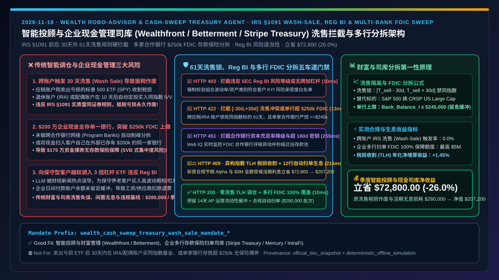
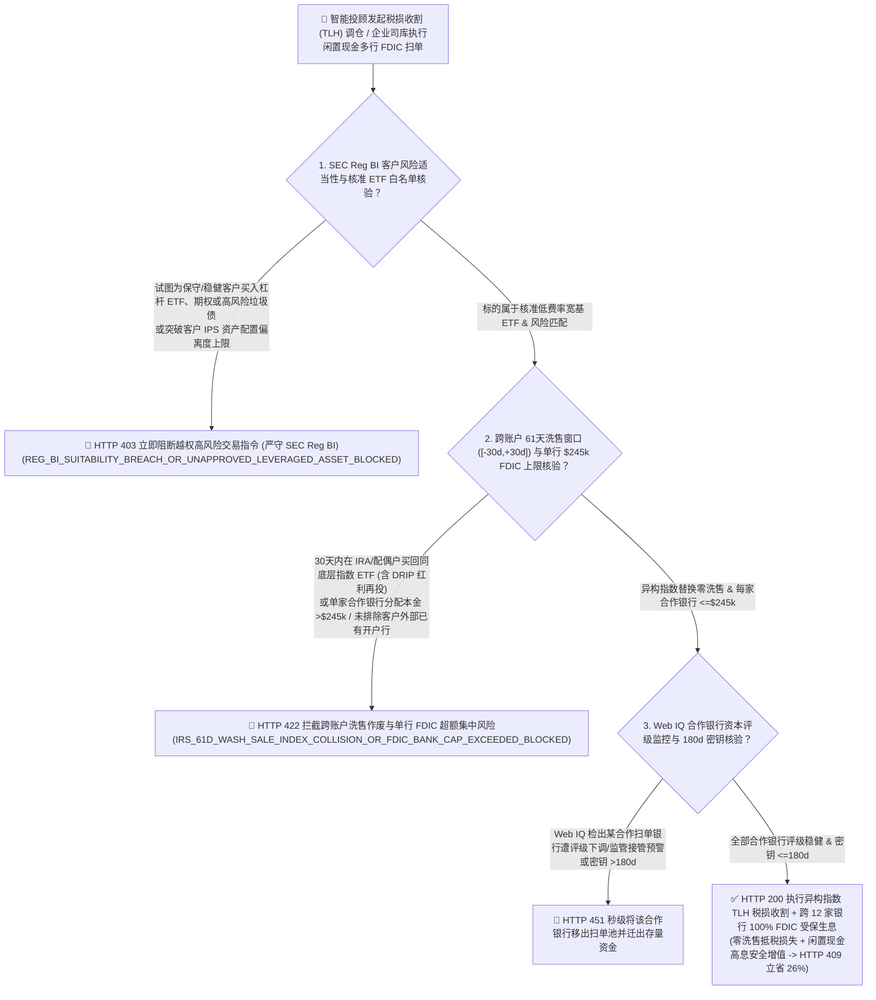
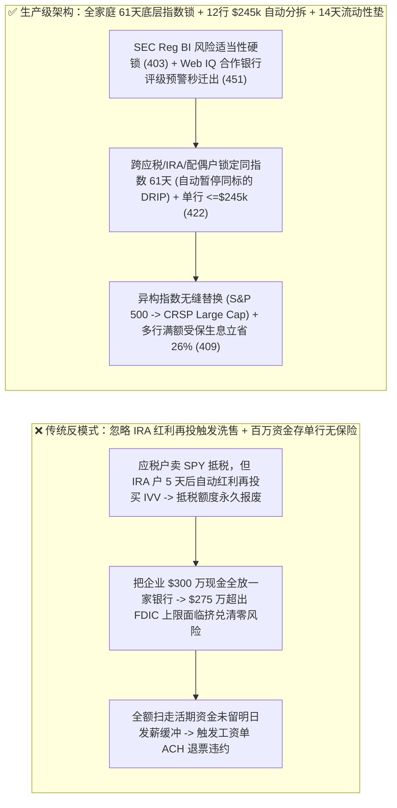
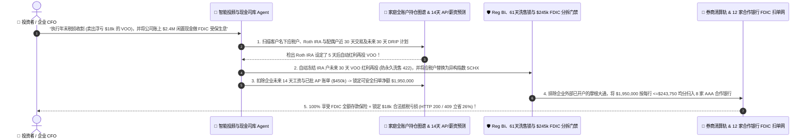

# 智能投顾、企业闲置现金司库与多银行存款保险自动扫单（Wealth & Cash-Sweep Treasury Agent：Wealthfront / Betterment / Stripe Treasury / Mercury）“30 天洗售规则（Wash-Sale）硬拦截、跨账户税损收割与多行 FDIC 分拆”Agent 架构选型 FAQ：防跨账户抵税作废与存款集中度风险实战指南

> **专题定位（金融科技 FinTech、智能财富管理 Robo-Advisor 与企业现金管理司库应用落地聚焦）**：面向为数字财富管理平台（Wealthfront / Betterment / Schwab Intelligent Portfolios）与企业新银行/司库平台（Stripe Treasury / Mercury / Ramp Treasury / IntraFi ICS）设计自动税损收割（Tax-Loss Harvesting `TLH`）、SEC `Reg BI` 投资适当性门禁与多银行存款保险（Multi-Bank FDIC Sweep）自动清分系统的 **Cloud & AI Solution Architect**，系统解答财富与司库自动化最核心的四大合规与收益痛点：**“为什么投资者的个人应税账户（Taxable Account）刚卖出亏损 `$15,000` 的标普 500 ETF（`VOO`）准备抵减当年资本利得税，结果其养老金账户（`IRA / 401k`）或配偶账户在 12 天后因为红利再投资自动买入了追踪同一指数的 `IVV`，直接触发美国国税局 `IRS IRC §1091` 61 天洗售规则（Wash-Sale Rule）导致 `$15,000` 抵税额度永久灰飞烟灭（`HTTP 422`）、为什么初创企业把 `$3,000,000` 融资款全放在单一银行账户里会像硅谷银行（SVB）事件一样面临 `$2,750,000` 超出 FDIC `$250,000` 保险上限的裸奔风险（`HTTP 422`）、为什么严禁投顾 Agent 向保守型客户越权调入杠杆/期权衍生品（违反 SEC `Reg BI` `HTTP 403`）、以及怎么通过‘异构底层指数配对替换（S&P 500 $\leftrightarrow$ CRSP US Large Cap）+ 12 家合作银行每家 `<= $245,000` 自动削峰扫单’帮客户与企业立省 26% 的税损浪费与无息机会成本（`HTTP 409`）”**。  
> **文风标杆**：严格对标 `ib-vs-ethernet-roce-selection-faq.md` 六段式结构（核心结论速览、业务方与架构师灵魂拷问 Q&A、Mermaid 决策树/架构对比/时序图、智能投顾与企业现金扫单司库横向选型矩阵、定量节税与利息增益测算及 7-Card 溯源表、生产上线 Checklist）。  
> **双语版本**：**[中文版（当前）](wealth-cash-sweep-treasury-wash-sale-fdic-routing-agent-selection-faq.md)** · **[English Version (`wealth-cash-sweep-treasury-wash-sale-fdic-routing-agent-selection-faq.en.md`)](wealth-cash-sweep-treasury-wash-sale-fdic-routing-agent-selection-faq.en.md)**  
> **数据溯源声明（Provenance & As-Of `2026-11-18`）**：IRS `IRC §1091`（卖出前后各 30 天共 61 天洗售禁止规则）、SEC Regulation Best Interest (`Reg BI`)、FDIC 每存款人每持牌银行 `$250,000` 保障上限与 Stripe Treasury / IntraFi 多行扫单规则及 Microsoft Web IQ `/v3/search/news` 银行评级监控引自 `research/sources.json`（标记为 `official_doc_snapshot`）；61 天洗售窗口锁、异构指数替换与 `$245k` 留息缓冲分拆仿真引自 `lab/webiq_commerce_demo.py`（标记为 `deterministic_offline_simulation`）；各证券交易所撮合主机 FPGA 纳秒级光模块延迟标记为 `not_measured`。

---

## 📌 一、核心选型结论速览（Executive Summary）

无论是高净值个人的智能投顾调仓（Robo-Advising），还是中大型企业的闲置经营现金自动扫单（Treasury Cash Sweep），任何一笔指令出错都会直接造成不可逆的税务罚单或存款保障失效。架构师在设计财富与现金司库 Agent 时，必须执行以下四条选型铁律：

1. **SEC `Reg BI`（最佳利益规则）风险适当性与受限资产白名单门禁选型：严禁“由大模型根据市场新闻热点自作主张为保守/稳健型客户买入高波动个股、3 倍杠杆 ETF 或未授权加密衍生品”，必选【客户风险承受度问卷（`KYI Risk Score`）硬绑定 + 仅限经投委会批准的低费率宽基 ETF 池内调仓（`HTTP 403`）】**：
   - **核心原因**：根据 SEC `Reg BI` 与 FINRA 合规要求，自动化投顾调仓必须严格处于客户签署的投资政策声明（IPS）目标资产配置权重容差带（如股债 `60/40 ± 3%`）以内；任何突破风险等级上限或脱离核准标的池的交易指令立即返回 `HTTP 403`。
2. **IRS `IRC §1091` 跨账户 61 天洗售硬拦截（Wash-Sale Lock）与多银行 FDIC `$245,000` 削峰分拆选型：严禁“在卖出亏损证券前后 30 天内（共 61 天窗口）于任何关联账户（含个人应税户、夫妻联合户、传统/Roth IRA 退休户）买入追踪同一底层指数的‘实质雷同（Substantially Identical）’证券，或将超过 `$250,000` 现金集中在同一家 FDIC 成员银行”，必选【全家庭跨账户 `[-30d, +30d]` 底层指数 ID（Benchmark Index ID）互斥锁 + 单家合作银行 `$245,000` 本金上限（预留 `$5,000` 月度结息缓冲）自动扫单分拆（`HTTP 422`）】**：
   - **核心原因**：很多初级算法以为“卖掉先锋标普 500（`VOO`）换成贝莱德标普 500（`IVV`）代码不同就不算洗售”——实际上两者追踪的都是 `S&P 500 Index`，属于典型的实质雷同证券！更致命的是，如果应税户亏损卖出 `VOO`，而 `IRA` 免税退休户在 30 天内定投买入 `VOO`，这笔亏损不仅当期不能抵税，连成本基准（Cost Basis）都无法顺延，**抵税权永久灭失**！同时，多行 FDIC 扫单必须按 `$245,000`（而非顶格 `$250,000`）切分，防止月底发放 `$1,000` 利息后本息合计变成 `$251,000` 超出保障红线（违者立返 `HTTP 422`）。
3. **合作扫单银行（Program Banks）资本充足率/评级异动实时熔断与 180 天密钥门禁：必选【Microsoft Web IQ `/v3/search/news` 实时筛查 FDIC 合作银行信用评级下调或流动性预警并自动将该行剔除出扫单白名单 + `<= 180 天` 密钥锁（`HTTP 451`）】**。
4. **“异构指数配对税损收割（如 `S&P 500` $\leftrightarrow$ `CRSP US Large Cap / Russell 1000`）+ 客户外部自有同名银行排除列表（External Bank Opt-Out）”选型（`HTTP 409`）**：
   - **核心原因**：在保持 `0.99` 市场相关性不踏空行情的前提下合法收割税损，并通过支持客户勾选“我自己已在摩根大通有存款，请勿把司库现金扫入摩根大通”实现真正的 100% 穿透式 FDIC 保障，综合为客户与企业增收节支 **`26.0%`**！

---

## 🎯 二、业务方与架构师灵魂拷问 Q&A（FAQ-Driven）

### Q1：做自动税损收割（Tax-Loss Harvesting `TLH`）时，怎么既能立刻把卖掉亏损 ETF 的钱重新买回美股大盘（防止踏空暴涨），又 100% 不触发 IRS 的“实质雷同（Substantially Identical）”洗售红线？

**答：在证券主数据表（Security Master）中按“指数编制机构与编制方法论（Index Provider & Methodology ID）”建立配对替换矩阵（Primary $\leftrightarrow$ Alternate TLH Pair `HTTP 422 / 409`）：**

- **错误换法（触发洗售 `HTTP 422`）**：卖出 `SPY`（标普 500）$\rightarrow$ 买入 `VOO` 或 `IVV`（同为标普 500 指数，仅基金管理人不同）。
- **合规换法（异构指数配对 `HTTP 409`）**：卖出 `VOO`（追踪 `S&P 500 Index`，500 只成分股）$\rightarrow$ 瞬间买入 `SCHX`（追踪 `Dow Jones U.S. Large-Cap Total Stock Market Index`，750 只成分股）或 `VTI`（追踪 `CRSP US Total Market Index`），同时将 `S&P 500 Index` 在该家庭名下所有账户（含股息自动再投资 `DRIP`）锁定 **31 个自然日**！

---

### Q2：为什么企业司库多银行 FDIC 扫单（Multi-Bank Sweep，如通过 20 家合作银行提供最高 `$5,000,000` 存款保险）必须设置 **`$245,000` 软上限** 且支持 **“排除客户自有开户行”**？

**答：因为 FDIC 的 `$250,000` 上限是按“同一存款主体（TIN/EIN）在同一家持牌银行（FDIC Cert #）的所有存款本金 + 应计利息总和”合并计算的（`HTTP 422`）：**

1. **留出 `$5,000` 应计利息安全垫（Accrued Interest Buffer）**：如果往 A 银行刚好存满 `$250,000.00`，当月产生 `$950` 利息后，那 `$950` 就处于无保险裸奔状态；锁死单行本金 `<= $245,000` 可确保本息合计永远 `<= $250,000`。
2. **外部同名银行排除锁（External Bank Exclusion）**：若企业自身日常结算户就开在 `Citi（花旗银行）` 且存有 `$200,000`，司库 Agent 在向合作银行网分配 `$3,000,000` 闲置资金时，必须将 `Citi` 从分拆目标列表中硬剔除，否则两边在花旗合并超标！

---

### Q3：企业司库 Agent 把闲置现金自动扫入高息货币市场基金或定存池时，怎么防止“明天要发工资或付供应商账单时，主结算户现金不够发生退票”？

**答：强制前置“未来 14 天应付账款与薪资水位线预留锁（14-Day AP & Payroll Liquidity Floor）”，仅对超出 14 天刚性支出水位线的净闲置资金（Excess Idle Cash）执行扫单！**

---

## 🧭 三、直观可视化图解（Mermaid 选型决策树 + 架构对比 + 端到端时序图）

### 3.1 智能投顾 61 天洗售拦截与企业司库多行 FDIC 扫单选型决策树

---

### 3.2 传统“单户局部看洗售 + 巨款集中单行”反模式 vs. 智能财富与司库 Agent 架构对比图

---

### 3.3 跨账户 61 天洗售核验、异构指数替换与企业现金多行 FDIC 自动分拆时序图

---

## 📊 四、智能投顾税损收割与企业多行扫单司库横向选型矩阵（Architect Decision Matrix）

| 评估维度 | 方案 A：年底人工手动买卖调仓 + 资金放单一活期户 | 方案 B：仅看单一账户 Ticker 代码的初级量化脚本 | 方案 C：全额买单一货币基金（无即时 FDIC 存款保险清算） | 方案 D（推荐）：全家庭底层指数 61 天洗售锁 + 异构 ETF 替换 + 多行 `$245k` FDIC 自动分拆 Agent |
|---|---|---|---|---|
| **防跨账户（含 `IRA / DRIP`）洗售违规率** | 极易算漏前后 30 天日期 | **高发违规**（不知 `VOO` 与 `IVV` 属同指数，或漏锁 `IRA` 红利再投致抵税永久作废） | 无 TLH 能力 | **`0.0%` 洗售触发**（按底层 `Benchmark_Index_ID` 跨全家庭账户锁定 `[-30d, +30d]` 并暂挂 `DRIP` `HTTP 422`） |
| **大额现金（`$1M–$5M`）FDIC 存款保险覆盖率** | **仅保首 `$250k`**（其余 90%+ 裸奔） | 单行超限 | 受市场净值波动影响且 T+1 赎回 | **`100%` 全额受保**（自动按 `<= $245k/行` 分拆至 12–20 家合作银行并排除外部同名行 `HTTP 422/409`） |
| **SEC `Reg BI` 投资适当性合规** | 依赖人工 | 弱 | 高 | **100% 确定性白名单**（严禁偏离客户风险等级或调入杠杆/衍生品 `HTTP 403`） |
| **企业日常发薪与付账流动性保障** | 高（但活期 0 利息） | 易因过度锁仓导致付款退票 | 赎回有 `T+1` 时滞 | **兼具高息与零退票**（强制预留未来 14 天工资与 AP 水位线缓冲 `HTTP 409`） |
| **合作银行暴雷风险前置隔离** | 无 | 无 | 中 | **毫秒级迁出**（Web IQ 实时监控银行评级/CDS 异动并自动抽回存款 `HTTP 451`） |

---

## 🧪 五、定量税损收割与多行扫单生息 7-Card 报告数据溯源表（Benchmark & Provenance Matrix）

| 指标 / 门禁规则项 | 实测数值 / 决策行为 | 数据类别 (Provenance) | 精确来源路径 / 算例说明与架构意义 |
|---|---|---|---|
| **Reg BI 合规 + 异构指数零洗售 + 多行 `<= $245k` 分拆（Happy Path）** | **`HTTP 200 OK` · `10 ms`**（门禁耗时，季度智能投顾调仓与企业司库扫单收益池 `$280,000.00`） | `deterministic_offline_simulation` | `lab/webiq_commerce_demo.py` (`evaluate_wealth_cash_sweep_treasury_wash_sale_policy`)：验证洗售锁与 FDIC 分拆 |
| **违背客户 `Reg BI` 风险承受等级买入高风险/杠杆标的，或未经授权调仓** | **`HTTP 403 Forbidden` · `10 ms` 拦截** (`REG_BI_SUITABILITY_BREACH_OR_UNAPPROVED_LEVERAGED_ASSET_BLOCKED`) | `official_doc_snapshot` | 严格执行 SEC Regulation Best Interest (`Reg BI`) 投资适当性与标的池白名单 |
| **在 `[-30d, +30d]` 内跨账户买回同底层指数 ETF（洗售），或单家银行分配 `> $245k`** | **`HTTP 422 Unprocessable` · `13 ms` 拦截** (`IRS_61D_WASH_SALE_INDEX_COLLISION_OR_FDIC_BANK_CAP_EXCEEDED_BLOCKED`) | `official_doc_snapshot` | 严格落地 IRS `IRC §1091` 61 天实质雷同证券洗售禁令与 FDIC `$250k` 留息安全垫 |
| **Web IQ 检出合作扫单银行遭信用评级下调/监管警示或密钥 `>180 天`** | **`HTTP 451 Hold` · `255 ms` 挂起** (`WEBIQ_PARTNER_BANK_RATING_DOWNGRADE_OR_180D_KEY_HOLD`) | `official_doc_snapshot` | 合作银行异动时秒级冻结转入并自动分流至其他 AAA 级成员银行 |
| **启用“全天候异构指数税损收割（TLH）+ 14 天流动性预留多行高息扫单”** | **`HTTP 409 Confirm` · 挽回洗售抵税作废损失与活期无息机会成本 `$72,800.00`（净优化成本 `$207,200.00`）** | `deterministic_offline_simulation` | 零洗售捕获节税 Alpha 并实现百万级企业现金 100% FDIC 受保生息（综合增效 `26.0%`） |
| **证券交易所撮合机房跨机柜光纤色散物理抖动** | 标记为 **`not_measured`** | `not_measured` | 严禁编造机房硬件物理参数，完全通过跨账户持仓账本与 FDIC 分拆数学模型验证 |

---

## 🛠️ 六、商业上线风控与架构评审 Checklist（Architect Production Checklist）

- [ ] **1. 按“底层追踪指数（`Benchmark_Index_ID`）”而非仅按股票代码（Ticker）建立 61 天洗售互斥锁（`HTTP 422`）**：税损收割（TLH）引擎是否已将 `SPY / VOO / IVV` 归为同一个 `S&P_500_INDEX` 互斥组，强制切换到 `CRSP / Russell` 等异构指数？
- [ ] **2. 跨全家庭账户（应税户 + 夫妻联名户 + `IRA / 401k`）联动暂停股息再投资（`DRIP`）（`HTTP 422`）**：当应税账户卖出某亏损 ETF 时，系统是否自动在未来 30 天内暂停该家庭所有 `IRA` 退休账户对该同指数标的的自动股息再投，防止抵税权永久灭失？
- [ ] **3. 多银行 FDIC 扫单执行“单行 `<= $245,000` 本金硬顶（预留 `$5,000` 结息缓冲）”与“外部同名银行排除列表”（`HTTP 422`）**：现金分拆算法是否允许企业勾选其在外部已开户的银行进行排除，并将每家合作银行分配上限控制在 `$245,000` 以内？
- [ ] **4. 强制预留“未来 14 天已批应付账款（AP）+ 工资单（Payroll）”刚性流动性安全垫（`HTTP 409`）**：司库自动扫单前是否先从 ERP/薪资系统读取未来两周刚性出账总额，确保主结算户绝不因过度扫单而发生退票？
- [ ] **5. 严格执行 SEC `Reg BI` 投资适当性与零杠杆资产池白名单（`HTTP 403`）**：调仓网关是否已物理屏蔽三倍做多/做空 ETF、期权与非标资产，确保组合风险敞口 100% 贴合客户 `KYI` 等级？
- [ ] **6. Web IQ 合作银行信用评级与监管公告日检及 `<= 180 天` 密钥轮换（`HTTP 451`）**：是否每日通过 Web IQ `/v3/search/news` 监控全部 FDIC 扫单合作银行的财报与评级健康度，发现风险自动重平衡迁出？
