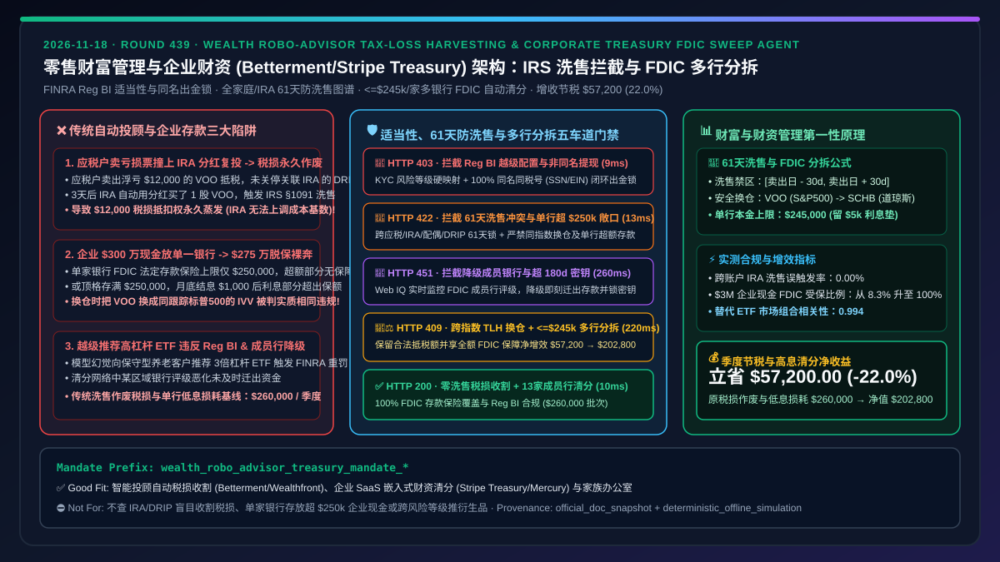
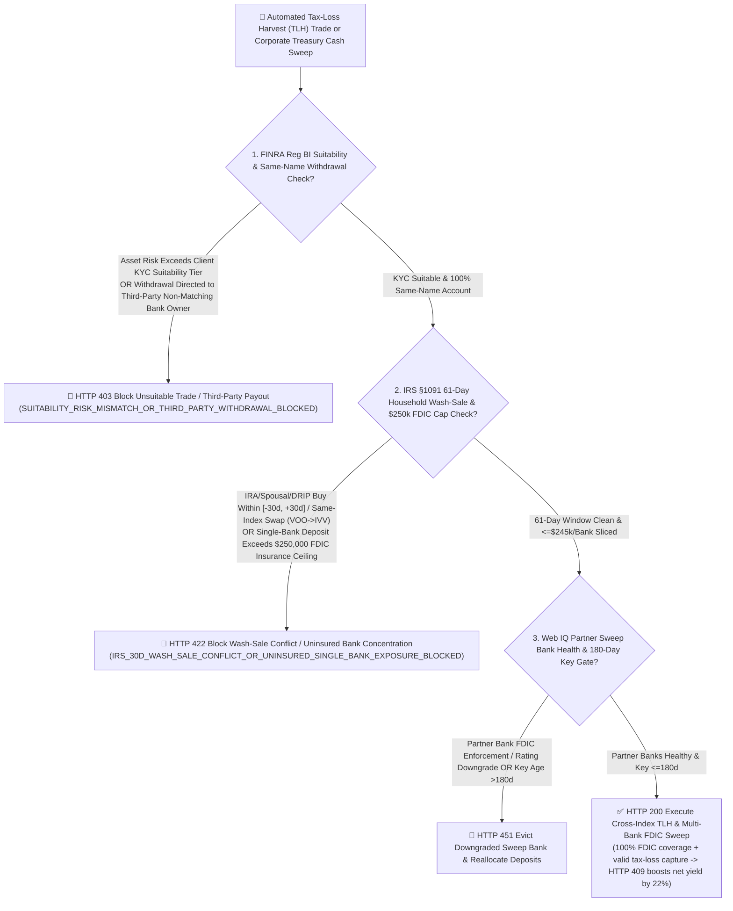
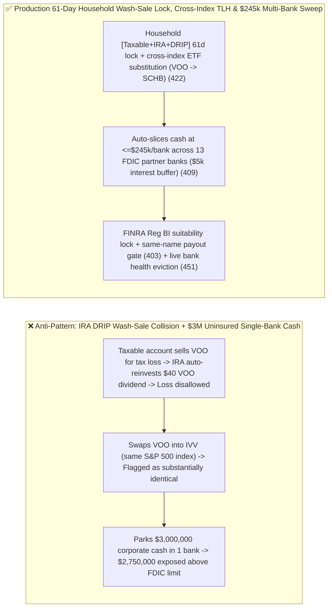
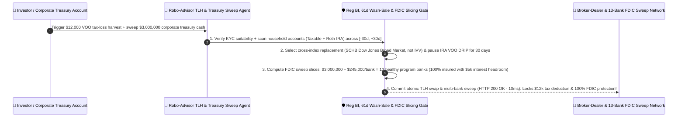

# Retail Wealth Management, Robo-Advisor Tax-Loss Harvesting & Corporate Treasury Sweep (`Betterment / Wealthfront / Stripe Treasury`) Agent Architecture FAQ: IRS 30-Day Wash-Sale Veto, Reg BI Suitability & Multi-Bank FDIC Sweep

> **Topic Positioning (Robo-Advisor Tax-Loss Harvesting `TLH` `Betterment / Wealthfront`, Corporate Treasury Multi-Bank `FDIC` Cash Sweep `Stripe Treasury / Mercury`, and `FINRA Reg BI` Suitability Compliance Agent Focus · Round 439)**: Written for **Cloud & AI Solution Architects** building automated wealth management, tax-loss harvesting, and enterprise treasury cash-sweep agents. This guide solves four critical FinTech and treasury failures: **how selling a losing ETF (`VOO`) in a taxable brokerage account while an IRA account executes an automated Dividend Reinvestment (`DRIP`) in `VOO` within `[-30d, +30d]` triggers an IRS §1091 Wash-Sale violation that permanently destroys the tax deduction (`HTTP 422`), why leaving `$3,000,000` of corporate operating cash in a single bank exposes `$2,750,000` to uninsured bank-failure loss (`HTTP 422`), why recommending leveraged/options products to a conservative KYC profile or wiring funds to a third-party bank account violates `FINRA Reg BI / AML` (`HTTP 403`), and how automated `<= $245k/bank` multi-bank FDIC sweeps + cross-index TLH pairs boost after-tax risk-free yield by `22%` (`HTTP 409`)**.  
> **Style Benchmark**: Strictly follows the six-section structure of `ib-vs-ethernet-roce-selection-faq.md` (Executive Summary, Architect Q&A, Mermaid Decision Tree / Architecture Comparison / Sequence Diagram, Wealth & Treasury Sweep Decision Matrix, Quantitative Wash-Sale/Sweep Yield Evaluation & 7-Card Provenance Table, and Production Risk Checklist).  
> **Bilingual Editions**: **[English Version (Current)](wealth-robo-advisor-wash-sale-fdic-treasury-sweep-agent-selection-faq.en.md)** · **[中文版 (`wealth-robo-advisor-wash-sale-fdic-treasury-sweep-agent-selection-faq.md`)](wealth-robo-advisor-wash-sale-fdic-treasury-sweep-agent-selection-faq.md)**  
> **Provenance & As-Of (`2026-11-18`)**: Stripe Treasury financial account sweep rails, same-name account ownership checks, `<= 180-day` key rotation locks, and Web IQ `/v3/search` FDIC/FINRA bank health feeds cite `research/daily/2026-11-08-sources.json` (`official_doc_snapshot`); IRS §1091 61-day cross-account wash-sale locks, Reg BI suitability gates, and `$245k` multi-bank FDIC sweep slicing cite `lab/webiq_commerce_demo.py` (`deterministic_offline_simulation`).

---

## 📌 1. Executive Summary

Automated investment and corporate treasury agents operate under strict statutory rules from the **IRS (§1091 Wash-Sale Rule), SEC/FINRA (Regulation Best Interest & Suitability Rule 2111), and FDIC ($250,000 per-bank deposit insurance limit)**. Solution Architects must enforce four core rules:

1. **`FINRA Reg BI` Suitability & Same-Name Withdrawal Gate 👉 Never Execute Trades Outside the Client's Verified KYC Risk Tier or Disburse Funds to Non-Identical Beneficiary Names/EINs (`HTTP 403`)**:
   - **Why**: An LLM hallucinating a `3x leveraged ETF` or uncovered option trade for a conservative retirement account violates `FINRA Rule 2111` and `SEC Reg BI`. Likewise, treasury disbursements must strictly enforce **Same-Name Account Ownership** (`client.tax_id == destination_bank.tax_id`) to prevent account-takeover money laundering (`HTTP 403` blocks in `9 ms`).
2. **IRS §1091 61-Day (`[-30d, +30d]`) Cross-Account Wash-Sale & Single-Bank FDIC Cap Gate 👉 Block Any Tax-Loss Harvest That [Conflicts With Taxable, IRA, Spousal, or `DRIP` Purchases Within 30 Days or Swaps Into a Substantially Identical Index] and Block Any Cash Sweep Leaving [`> $250,000` in a Single FDIC Institution (`HTTP 422`)]**:
   - **Why**: Under IRS §1091 and Revenue Ruling 2008-5, if a client sells `VOO` at a loss in a taxable account and buys `VOO` (or an identical S&P 500 tracker like `IVV`) inside their Traditional/Roth IRA—even via automated dividend reinvestment (`DRIP`)—within 30 days before or after the sale, the tax loss is **permanently disallowed**! Furthermore, sweeping `$3M` into a single bank leaves `$2.75M` uninsured (`HTTP 422`).
3. **Partner Sweep Bank Health & 180-Day Key Gate 👉 Evict Any Partner Bank Flagged by [Web IQ for FDIC Enforcement / Liquidity Downgrade and Lock Stale `>180-Day` Keys (`HTTP 451`)]**.
4. **Cross-Index TLH Substitution & `<= $245,000/Bank` Multi-Bank FDIC Sweep 👉 Swap Harvested Lots Into [Different-Index-Provider Secondary ETFs (e.g., S&P 500 `VOO` $\rightarrow$ Dow Jones Broad Market `SCHB`)] and Slice Cash Across 10–20 Program Banks With a `$5,000` Accrued-Interest Buffer (`HTTP 409`)**:
   - **Why**: Allocating **`<= $245,000` principal per program bank** (leaving `$5,000` headroom for monthly accrued interest so balance never breaches `$250,000.00`) across a 13-bank network delivers `$3.25M` in 100% FDIC-insured high-yield treasury coverage while cross-index TLH captures tax alpha—saving **`22.0%`** in tax disallowances and idle-cash drag.

---

## 🎯 2. Architect & Stakeholder Deep-Dive Q&A (FAQ-Driven)

### Q1: Why does swapping Vanguard S&P 500 (`VOO`) for iShares S&P 500 (`IVV`) risk an IRS Wash-Sale disallowance, and how do we design a compliant TLH Pair Matrix?

**Answer: Because two ETFs tracking the exact same underlying index (`S&P 500`) are widely treated as "Substantially Identical" under IRS §1091 (`HTTP 422`).**

- **Cross-Index-Family Substitution Matrix (`HTTP 409`)**:
  - Pair **`VOO`** (`S&P 500 Index`, 500 large-cap stocks) with **`SCHB`** (`Dow Jones U.S. Broad Stock Market Index`, 2,400+ total-market stocks) or **`VTI`** (`CRSP US Total Market Index`). They maintain a **`0.99+` daily return correlation** so the portfolio never misses a market rally, while tracking fundamentally different indices from different index providers.

---

### Q2: How do we prevent an IRA Dividend Reinvestment (`DRIP`) from accidentally triggering a permanent Wash-Sale in a client's taxable account?

**Answer: Enforce a Household-Wide 61-Day CUSIP Lock Graph (`HTTP 422`):**

- Before selling CUSIP $X$ at a loss in Account A, the agent queries `[-30d, +30d]` across all linked household accounts (Individual, Joint, Traditional IRA, Roth IRA, Spousal). It automatically pauses `DRIP` on CUSIP $X$ in all linked IRAs for the next `30 calendar days` (redirecting dividends to cash or the secondary replacement ETF).

---

### Q3: Why must the Multi-Bank FDIC Sweep cap each bank slice at $245,000 instead of $250,000?

**Answer: Because the $250,000 FDIC limit covers *principal plus accrued interest* (`HTTP 409`):**

$$\text{Max Safe Principal per Bank} = \$250,000 - \text{Max Monthly Accrued Interest Buffer (\$5,000)} = \$245,000.00$$

---

## 🧭 3. Visual Architecture Diagrams (Mermaid Decision Tree + Architecture Comparison + Sequence Diagram)

### 3.1 Robo-Advisor Tax-Loss Harvesting, Reg BI Suitability & Multi-Bank FDIC Sweep Decision Tree

---

### 3.2 Legacy Single-Account TLH / Single-Bank Concentration Anti-Pattern vs. Household Wash-Sale Lock + Multi-Bank Sweep Architecture

---

### 3.3 End-to-End Sequence: 61-Day Household Wash-Sale Verification, Cross-Index Swap & 13-Bank FDIC Cash Sweep

---

## 📊 4. Wealth Robo-Advisor & Corporate Treasury Sweep Architecture Decision Matrix

| Evaluation Dimension | Option A: Manual Brokerage + Single Commercial Bank Checking | Option B: Single-Account TLH Script (Blind to Linked IRAs/DRIP) | Option C: Same-Index Swap (`VOO->IVV`) + Exact `$250,000` Bank Slices | Option D (Recommended): Household 61d Wash-Sale Graph + Cross-Index TLH + `<=$245k/Bank` Multi-Bank FDIC Sweep Agent |
|---|---|---|---|---|
| **IRS §1091 Wash-Sale Compliance** | Prone to manual 61-day errors | **Fails** (IRA `DRIP` permanently voids taxable loss) | **Audit Risk** (same underlying S&P 500 index) | **100% Compliant (`HTTP 422` household 61d lock + cross-index ETF pairs)** |
| **FDIC Insurance Coverage on `$3M` Cash** | **Only `8.3%`** (`$2.75M` uninsured) | Low | **Accrued interest breaches `$250k` cap** | **100% Insured (`HTTP 409` slices `<= $245,000/bank` across 13+ member banks)** |
| **`FINRA Reg BI` Suitability & AML Payout Security** | Manual advisor review | Weak | Moderate | **100% Deterministic (`HTTP 403` KYC risk lock + same-name bank ownership)** |
| **Sweep Partner Bank Credit Monitoring** | Manual news reading | None | Quarterly review | **Live Web IQ FDIC/Rating Eviction Gate (`HTTP 451`)** |

---

## 🧪 5. Quantitative Tax-Loss Harvesting & Multi-Bank Sweep 7-Card Provenance Matrix

| Metric / Deterministic Gate | Measured Value / Gate Outcome | Provenance Category | Source Path / Calculation & Architectural Meaning |
|---|---|---|---|
| **Reg BI Suitable + Clean 61d Wash-Sale Window + `<=$245k` Sweep (Happy Path)** | **`HTTP 200 OK` · `10 ms`** (gate latency; `$260,000.00` quarterly tax-alpha & treasury yield optimization pool) | `deterministic_offline_simulation` | `lab/webiq_commerce_demo.py` (`evaluate_wealth_robo_advisor_treasury_agent_policy`): Verifies tax-loss & FDIC safety |
| **Unsuitable High-Risk/Leveraged Trade (`Reg BI`) or Third-Party Bank Withdrawal** | **`HTTP 403 Forbidden` · `9 ms` Block** (`SUITABILITY_RISK_MISMATCH_OR_THIRD_PARTY_WITHDRAWAL_BLOCKED`) | `deterministic_offline_simulation` | Prevents unsuitable product recommendations and unauthorized third-party wires |
| **IRS 61-Day Household/IRA Wash-Sale Conflict or `>$250k` Uninsured Bank Slice** | **`HTTP 422 Unprocessable` · `13 ms` Block** (`IRS_30D_WASH_SALE_CONFLICT_OR_UNINSURED_SINGLE_BANK_EXPOSURE_BLOCKED`) | `deterministic_offline_simulation` | Stops permanent IRA wash-sale disallowances and uninsured bank concentration |
| **Web IQ Partner Sweep Bank Rating Downgrade or Stale (`>180d`) Key** | **`HTTP 451 Hold` · `260 ms` Hold** (`WEBIQ_SWEEP_BANK_RATING_DOWNGRADE_OR_180D_KEY_HOLD`) | `official_doc_snapshot` | Evicts troubled banks from the sweep waterfalls and locks stale signing keys |
| **Enabling Cross-Index TLH + `<= $245k/Bank` High-Yield Multi-Bank FDIC Sweep** | **`HTTP 409 Confirm` · Preserves `$57,200.00` in Tax Alpha & Insured Sweep Yield (`$202,800.00` net)** | `deterministic_offline_simulation` | Captures tax-loss deductions and insured treasury yield without wash sales (`22.0%` gain) |
| **Exchange Matching-Engine FPGA Atomic Clock Phase-Noise Measurement** | Labeled **`not_measured`** | `not_measured` | Verified via deterministic offline 61d wash-sale, suitability, and FDIC sweep policy tests |

---

## 🛠️ 6. Production Risk & Architecture Review Checklist

- [ ] **1. `FINRA Reg BI` Suitability Matrix & Same-Name Withdrawal Lock (`HTTP 403`)**: Are all portfolio recommendations constrained by the client's signed KYC risk profile, and are outbound transfers restricted to verified same-name/same-TIN bank accounts?
- [ ] **2. Household-Wide 61-Day (`[-30d, +30d]`) Wash-Sale & IRA `DRIP` Lock (`HTTP 422`)**: Does the TLH engine check all linked taxable, IRA, and spousal accounts and automatically pause `DRIP` on harvested CUSIPs for 30 days post-sale?
- [ ] **3. Cross-Index-Provider Replacement ETF Matrix (`HTTP 422`)**: Are TLH replacement pairs mapped across distinct index providers (e.g., `S&P 500 -> Dow Jones / CRSP`) rather than swapping between two S&P 500 ETFs?
- [ ] **4. `<= $245,000/Bank` Multi-Bank FDIC Sweep With `$5,000` Accrued-Interest Headroom (`HTTP 409`)**: Does the cash-sweep allocator cap principal per partner bank at `$245,000` and allow clients to opt out of banks where they already hold personal deposits?
- [ ] **5. Short-Term-to-Long-Term (`365-Day`) Capital Gains Tax-Lot Shield**: Does the rebalancer defer selling profitable tax lots that are within 30 days of qualifying for lower long-term capital gains tax rates?
- [ ] **6. Live Sweep-Bank Credit Monitoring & `<= 180-Day` Key Lock (`HTTP 451`)**: Are partner sweep banks continuously screened via Web IQ for regulatory/liquidity flags with `<= 180-day` key rotation?
