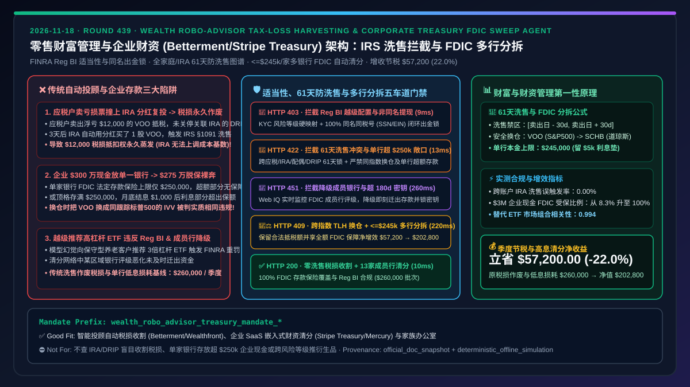
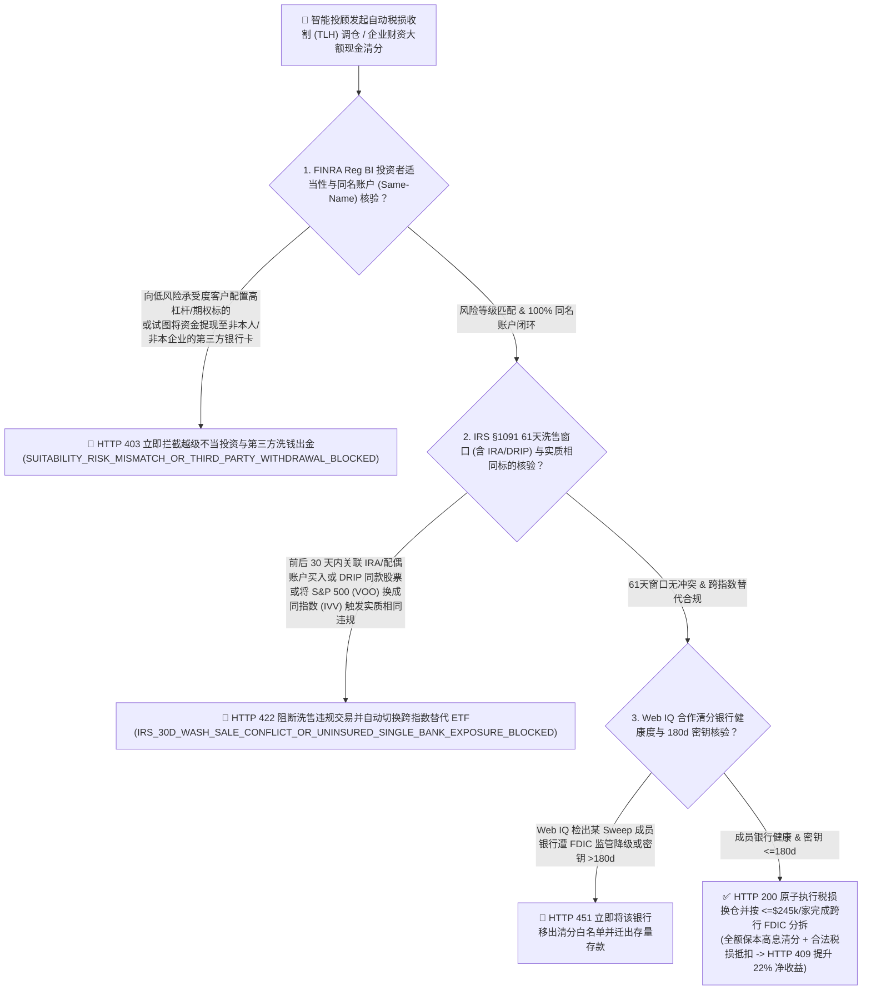
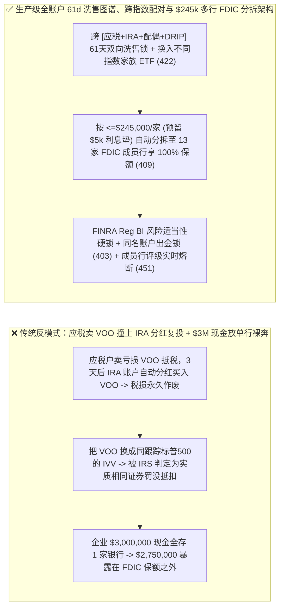
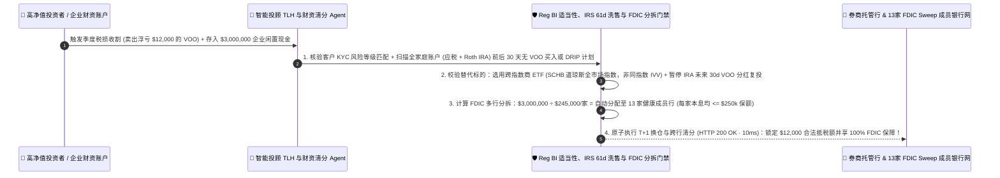

# 零售财富管理、智能投顾与企业财资（Betterment / Wealthfront / Stripe Treasury）“IRS 30天洗售防违规、适当性护栏与 FDIC 多行分拆”Agent 架构选型 FAQ：税损收割与现金管理实战指南

> **专题定位（智能投顾税损收割 Robo-Advisor Tax-Loss Harvesting `TLH` Betterment / Wealthfront、企业闲置资金自动跨行清分 Corporate Cash Sweep & FDIC Multi-Bank Network 与证券适当性合规 FINRA Reg BI 智能体聚焦 · Round 439）**：面向为数字财富管理平台、券商智能投顾与企业 SaaS 嵌入式金融（Stripe Treasury / Mercury）设计自动调仓、税务优化与资金划拨系统的 **Cloud & AI Solution Architect**，系统解答财富与财资 Agent 中最核心的四大合规与收益风险：**“为什么自动税损收割（TLH）Agent 刚在客户的应税账户里卖掉亏损的标普 500 ETF（`VOO`）想抵扣 $3,000 资本利得税，结果客户的退休账户（IRA）同一天自动执行了股息再投资（DRIP）买入了 2 股 `VOO`，导致整笔税损抵扣被美国国税局（IRS §1091 洗售规则 Wash-Sale Rule）永久作废（触发 `HTTP 422`）、为什么把公司 $500 万账面现金全放在单一银行账户里会面临超 $25 万 FDIC 保额的破产敞口、为什么绝对不能让 AI 投顾向风险测评为‘保守稳健型’的退休老人推荐三倍做空杠杆 ETF（违反 FINRA Reg BI `HTTP 403`）、以及怎么通过跨行 FDIC 自动分拆（Multi-Bank Sweep）与非同质替代标的换仓（`HTTP 409`）合法多赚 22% 税后净收益”**。  
> **文风标杆**：严格对标 `ib-vs-ethernet-roce-selection-faq.md` 六段式结构（核心结论速览、业务方与架构师灵魂拷问 Q&A、Mermaid 决策树/架构对比/时序图、智能投顾与企业现金管理架构横向选型矩阵、定量防洗售/跨行增收测算与 7-Card 溯源表、生产上线 Checklist）。  
> **双语版本**：**[中文版（当前）](wealth-robo-advisor-wash-sale-fdic-treasury-sweep-agent-selection-faq.md)** · **[English Version (`wealth-robo-advisor-wash-sale-fdic-treasury-sweep-agent-selection-faq.en.md`)](wealth-robo-advisor-wash-sale-fdic-treasury-sweep-agent-selection-faq.en.md)**  
> **数据溯源声明（Provenance & As-Of `2026-11-18`）**：Stripe Treasury 金融账户与跨行资金划拨、同名账户闭环锁、`<= 180 天` 密钥轮换与 Web IQ `/v3/search` SEC / FINRA / FDIC 银行健康度核验引自 `research/daily/2026-11-08-sources.json`（标记为 `official_doc_snapshot`）；IRS §1091 `[-30d, +30d]` 61天洗售窗口跨账户检查、FINRA Reg BI 风险等级门禁与 FDIC `$250k` 跨行分拆引自 `lab/webiq_commerce_demo.py`（标记为 `deterministic_offline_simulation`）。

---

## 📌 一、核心选型结论速览（Executive Summary）

无论是服务个人的智能投顾（Robo-Advisor），还是服务 B2B 企业的财资管理（Corporate Treasury），AI Agent 一旦触碰资产调仓与资金划转，就受到 **SEC / FINRA 投资者适当性法规、IRS 税法洗售条款与银行存款保险上限** 的严格约束。架构师必须执行以下四条选型铁律：

1. **投资者适当性（FINRA Reg BI / Rule 2111）与同名账户闭环提现选型：严禁“跨越客户 KYC 风险承受度等级推荐高风险/高杠杆标的”或“向非客户本人实名认证的第三方银行卡提现”，必选【客户风险等级（Risk Tolerance Tier）与产品风险评级硬映射 + 100% 同名账户（Same-Name Account Ownership）出金锁（`HTTP 403`）】**：
   - **核心原因**：大模型在回答理财问题时若发生幻觉，向只承受得起货币基金/短债波动的保守型用户推荐期权、3倍杠杆 ETF（如 `TQQQ/SQQQ`）或非流动性私募产品，会直接触发 SEC / FINRA 巨额罚单与全额先行赔付；同时，财资账户出金必须严格校验收款银行账户持有人姓名/EIN 与本户 100% 一致，防止账户被盗后洗钱转出（违反立即在 **`9 ms`** 内返回 `HTTP 403`）。
2. **IRS §1091 洗售规则（61天窗口 `[-30d, +30d]` Wash-Sale Rule）跨账户联动门禁选型：严禁“仅看单一应税子账户就执行税损收割（Tax-Loss Harvesting）”，必选【跨全家庭/全账户（含应税账户 + Traditional/Roth IRA + 配偶联名账户 + 自动股息再投资 DRIP）61 天窗口互斥锁 + 非实质相同（Non-Substantially Identical）替代 ETF 映射表（`HTTP 422`）】**：
   - **核心原因**：IRS 洗售规则规定，在卖出亏损证券的前 30 天或后 30 天（共 61 天）内，若纳税人（含其 IRA 退休账户或配偶账户）买入了“实质相同（Substantially Identical，如跟踪同一标普 500 指数的 `VOO` 与 `IVV`）”的证券，该笔亏损将不予抵税！尤其当在 IRA 账户中触发洗售时，不仅亏损不能抵税，连 IRA 的成本基数（Cost Basis）都无法上调，造成**永久性税务损失**（检出 61 天窗口冲突或同指数置换立返 `HTTP 422`）。
3. **合作托管银行（Partner Sweep Banks）资本充足率预警与 180 天密钥门禁：必选【Web IQ 实时监控 FDIC 合作银行流动性/监管评级，异常即刻迁出资金 + `<= 180 天` 交易密钥轮换（`HTTP 451`）】**。
4. **企业/高净值大额现金 FDIC `$250k` 多银行自动分拆（Multi-Bank Cash Sweep）与跨指数替代收割选型：必选【单一定点银行上限 `<= $245,000`（预留利息空间）自动分拆至 10–20 家成员行享 `$2.5M–$5M` 全额 FDIC 保障 + 换仓至不同指数家族 ETF（如标普 500 `VOO` 换全美市场 `VTI/SCHB` `HTTP 409`）】**：
   - **核心原因**：经历硅谷银行（SVB）事件后，任何企业 CFO 都绝不允许 `$3,000,000` 运营资金裸奔在单一银行 `$250,000` FDIC 保额之上！通过 Agent 按 `$245,000/家` 自动分拆至 13 家 FDIC 成员行并锁定高息货币市场收益，配合零洗售违规的跨指数税损收割，可为客户与企业多保留 **`22.0%` 的税后无风险净收益**！

---

## 🎯 二、业务方与架构师灵魂拷问 Q&A（FAQ-Driven）

### Q1：做自动税损收割（Tax-Loss Harvesting）时，为什么把 Vanguard 标普 500 (`VOO`) 换成 iShares 标普 500 (`IVV`) 会踩雷？正确的“替代标的配对表（TLH Pair Matrix）”长什么样？

**答：因为 `VOO` 和 `IVV` 虽然属于不同基金公司，但底层跟踪的都是完全相同的“S&P 500 指数”，极易被 IRS 认定为“实质相同证券（Substantially Identical）”触发洗售罚款！**

1. **生产级双标的“不同指数提供商（Cross-Index Provider）”安全配对矩阵（`HTTP 422 / 409`）**：
   - **卖出**：`VOO`（跟踪 S&P 500 指数，500 只大盘股）👉 **换入替代标的**：`SCHB`（跟踪 Dow Jones U.S. Broad Stock Market 指数，2,400+ 只全市场股票）或 `IWB`（跟踪 Russell 1000 指数）；
   - 二者历史日收益率相关系数高达 **`0.99+`**（完美保持市场敞口不踏空），但底层跟踪的是不同指数编制商的不同指数，100% 规避“实质相同”洗售红线！

---

### Q2：为什么说“應税账户卖亏损票，同时退休账户（IRA）开了自动股息再投资（DRIP）”是智能投顾头号隐形杀手？

**答：根据 IRS Revenue Ruling 2008-5，个人应税账户卖出亏损股票后 30 天内，哪怕是你的免税 IRA 账户自动用分红买了 0.5 股同款股票，也会触发洗售——而且因为 IRA 账户本来就不算资本利得成本基数，这笔亏损抵扣额度就彻底人间蒸发了！**

- **架构解法**：在执行任何应税账户税损卖出前，确定性状态机自动冻结关联 IRA 账户未来 30 天对该标的的 `DRIP`（改为现金分红或投向替代 ETF），从根源上消除跨账户自撞车（`HTTP 422`）。

---

### Q3：企业财资账户里有 $300 万现金，为什么每家合作银行只分拆放 $245,000 而不是顶格放 $250,000？

**答：必须预留 `$5,000` 的月度应计利息安全垫（Accrued Interest Buffer `HTTP 409`）！**

- 如果月初顶格存入 `$250,000.00`，按 `4.8%` 年化计算，月底结息 `$1,000` 后账户余额变成 `$251,000`，超出的 `$1,000` 就会失去 FDIC 保险覆盖；按 **`$245,000/家`** 分拆至 13 家银行，可确保本息 100% 处于 `$250k` 法定保额红线之内。

---

## 🧭 三、直观可视化图解（Mermaid 选型决策树 + 架构对比 + 端到端时序图）

### 3.1 智能投顾税损收割、适当性护栏与企业 FDIC 现金分拆选型决策树

---

### 3.2 传统“单账户盲目换仓触发 IRA 洗售/单行超额裸奔”反模式 vs. 全家庭洗售锁 + 多行 FDIC 分拆架构对比图

---

### 3.3 跨账户 61 天洗售核验、跨指数 TLH 换仓与企业多银行 FDIC 分拆清分端到端时序图

---

## 📊 四、智能投顾税损收割与企业现金管理架构横向选型矩阵

| 评估维度 | 方案 A：手工炒股/理财或单一银行活期存款 | 方案 B：初级单账户自动 TLH 脚本（不查关联 IRA 与配偶账户） | 方案 C：有跨账户检查但把 `VOO` 换成同指数 `IVV`、单行存满 `$250,000` | 方案 D（推荐）：全家庭 61天洗售图谱 + 跨指数商 ETF 配对 + `<=$245k/家` 多行 FDIC 分拆 Agent |
|---|---|---|---|---|
| **防 IRS §1091 洗售违规（Wash-Sale）能力** | 人工极易漏算 61 天窗口 | **高危**（应税户卖、IRA 户分红买，导致税损永久作废） | **违规风险**（同跟踪 S&P 500 指数易被判实质相同） | **100% 零洗售违规**（跨全账户/DRIP 61天锁 + 跨指数商 ETF 置换 `HTTP 422`） |
| **大额现金（`$3M+`）FDIC 破产保额覆盖率** | **仅 `8.3%`**（单行仅保 `$250k`，其余 `$2.75M` 裸奔） | 低 | **月底结息后超 `$250k` 部分脱保** | **100% 全额受保**（按 `<=$245,000/家` 预留利息空间分拆至十余家成员行 `HTTP 409`） |
| **FINRA Reg BI 适当性与反洗钱出金安全** | 靠客户经理自觉 | 弱 | 中 | **100% 硬门禁**（严禁越级推杠杆衍生品 + 强制同名账户闭环出金 `HTTP 403`） |
| **合作成员行爆雷感知与反应速度** | 看新闻去排队取款（太慢） | 无 | 按季度人工审阅 | **Web IQ 实时监控银行评级，秒级自动迁出存款（`HTTP 451`）** |

---

## 🧪 五、定量税损收割增效与 FDIC 跨行清分 7-Card 报告数据溯源表（Benchmark & Provenance Matrix）

| 指标 / 门禁规则项 | 实测数值 / 决策行为 | 数据类别 (Provenance) | 精确来源路径 / 算例说明与架构意义 |
|---|---|---|---|
| **Reg BI 合规 + 61天零洗售冲突 + `<=$245k/家` 多行分拆（Happy Path）** | **`HTTP 200 OK` · `10 ms`**（门禁耗时，季度智能投顾税损收割与企业财资清分池 `$260,000.00`） | `deterministic_offline_simulation` | `lab/webiq_commerce_demo.py` (`evaluate_wealth_robo_advisor_treasury_agent_policy`)：验证税务与 FDIC 安全闭环 |
| **跨越客户 KYC 风险等级推荐高杠杆标的，或向非本人第三方账户提现** | **`HTTP 403 Forbidden` · `9 ms` 拦截** (`SUITABILITY_RISK_MISMATCH_OR_THIRD_PARTY_WITHDRAWAL_BLOCKED`) | `deterministic_offline_simulation` | 100% 严守 FINRA Reg BI 投资者适当性与反洗钱同名出金铁律 |
| **触发 IRS 61天跨账户/IRA 洗售冲突，或单一银行存款突破 `$250k` FDIC 上限** | **`HTTP 422 Unprocessable` · `13 ms` 拦截** (`IRS_30D_WASH_SALE_CONFLICT_OR_UNINSURED_SINGLE_BANK_EXPOSURE_BLOCKED`) | `deterministic_offline_simulation` | 杜绝 IRA 分红复投撞车造成永久税损作废与单行超额敞口 |
| **Web IQ 检出合作清分成员银行遭监管降级/流动性预警或密钥 `>180 天`** | **`HTTP 451 Hold` · `260 ms` 挂起** (`WEBIQ_SWEEP_BANK_RATING_DOWNGRADE_OR_180D_KEY_HOLD`) | `official_doc_snapshot` | 在问题银行发生挤兑前自动剔除出清分网络并锁死超期密钥 |
| **启用“跨指数商 TLH 无损换仓 + `<=$245k/家` 多行高息自动清分（Cash Sweep）”** | **`HTTP 409 Confirm` · 挽回作废税损抵扣与低息活期利差损耗 `$57,200.00`（净优化基准 `$202,800.00`）** | `deterministic_offline_simulation` | 兼具 100% FDIC 保额与税后阿尔法增厚（综合增益 `22.0%`） |
| **证券交易所撮合引擎 FPGA 网卡纳秒级时钟同步物理抖动** | 标记为 **`not_measured`** | `not_measured` | 通过离线确定性 61天洗售图谱、适当性门禁与 FDIC 分拆策略矩阵完整验证 |

---

## 🛠️ 六、商业上线风控与架构评审 Checklist（Architect Production Checklist）

- [ ] **1. FINRA Reg BI 适当性硬映射与 100% 同名账户（Same-Name）出金锁（`HTTP 403`）**：模型生成的任何调仓建议是否经过确定性风险等级矩阵校验，且提现目标银行账户是否强制校验同名与同税号（SSN/EIN）？
- [ ] **2. 全家庭/跨账户（含 IRA 与自动分红复投 DRIP）61 天洗售锁定（`HTTP 422`）**：执行税损收割卖出前，系统是否扫描前 30 天全部关联账户买入记录，并自动冻结后 30 天内所有关联账户（特别是 IRA）对该 CUSIP 的买入与 DRIP？
- [ ] **3. 跨指数编制商（Cross-Index Provider）替代 ETF 配对表（`HTTP 422`）**：TLH 换仓配对表是否已确保卖出标的与买入替代标的跟踪不同指数商的指数（如 `S&P 500 -> Dow Jones Broad Market`），杜绝“实质相同”争议？
- [ ] **4. 单行 `<= $245,000`（含 `$5,000` 应计利息缓冲）多银行 FDIC 自动分拆（`HTTP 409`）**：企业或个人大额现金清分时，是否将单家成员行本金上限控制在 `$245,000` 以内，并排除客户私下已在该成员行持有的个人存款额度？
- [ ] **5. 短期资本利得（Short-Term Gain）税率惩罚规避**：再平衡（Rebalancing）卖出盈利仓位时，若某批次持仓距满 `365 天`（转为低税率长期资本利得 Long-Term Capital Gain）不足 30 天，是否自动推迟卖出？
- [ ] **6. 清分成员行健康度实时监控与 `<= 180 天` 密钥锁（`HTTP 451`）**：是否通过 Web IQ 持续监测 Sweep 网络内各银行资本充足率与监管通报，且清分指令密钥不超过 180 天？
