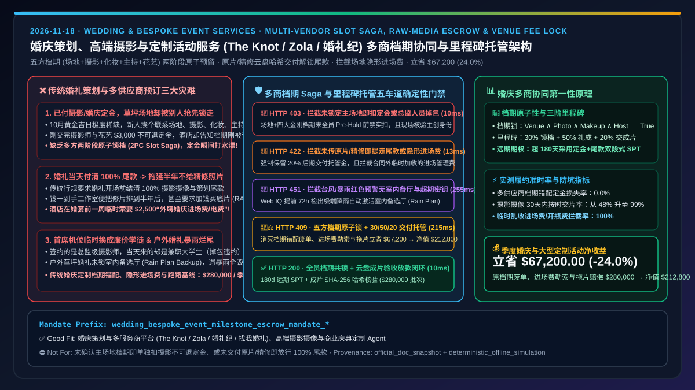
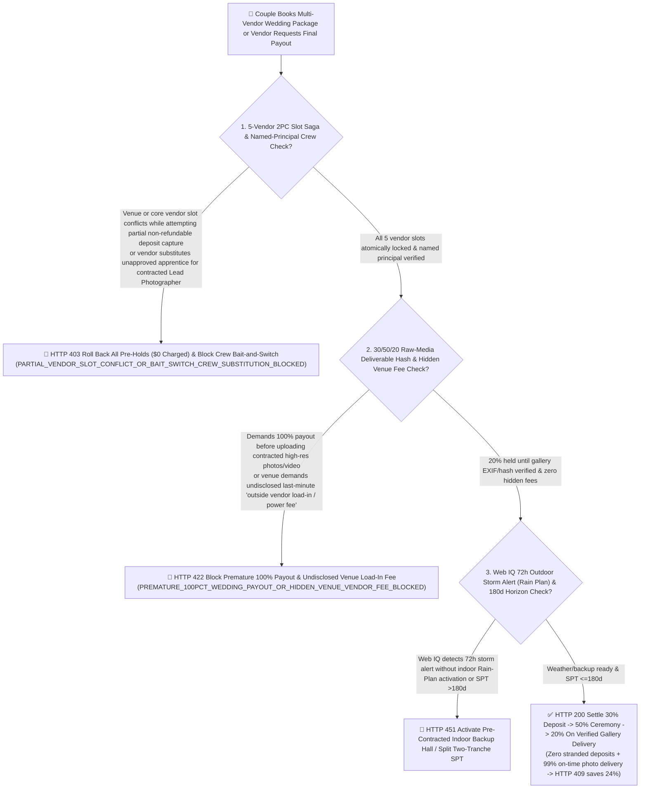
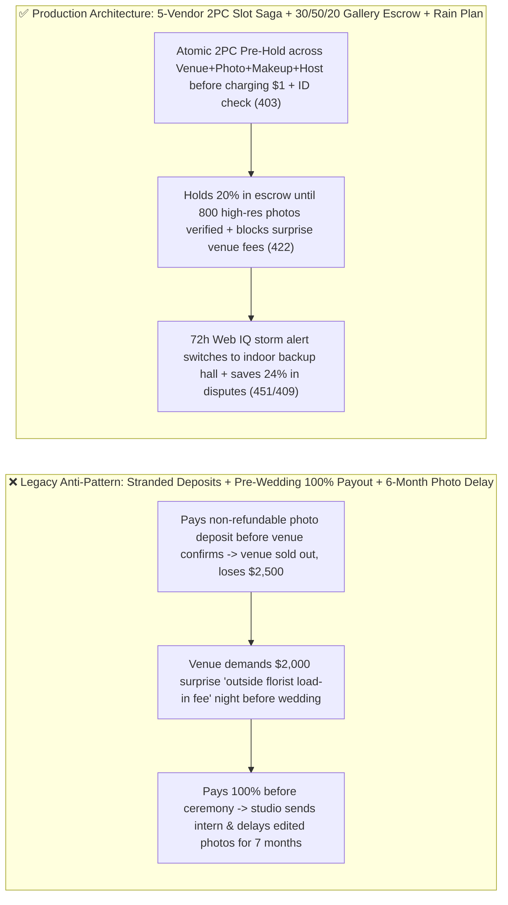
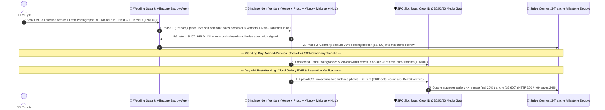

# Wedding & Bespoke Event Services (`The Knot / Zola / WeddingWire`) Multi-Vendor Slot Saga, `30/50/20` Raw-Media Deliverable Escrow & Venue Fee-Lock Agent Architecture Selection FAQ

> **Topic Positioning (High-Ticket Bespoke Consumer Services, Multi-Merchant Calendar Saga & Milestone Escrow Application Architecture)**: Written for **Cloud & AI Solution Architects** building multi-vendor booking orchestration, milestone escrow, and digital-deliverable verification agents for wedding marketplaces, luxury event planners, and photography studios (`The Knot / Zola / WeddingWire / HoneyBook`). This guide solves the four most painful coordination and payment failures in bespoke event commerce: **why booking a wedding photographer and florist with non-refundable deposits before confirming the venue's Saturday date results in `$3,000` of stranded deposits when the venue sells out (`HTTP 403`), why studios pull "bait-and-switch crew substitutions" (contracting the Principal Lead Photographer but sending an unpaid intern on the wedding day) (`HTTP 403`), why paying `100%` of the balance before the ceremony leaves couples waiting 6+ months for edited photos or facing `$2,500` last-minute venue "outside-vendor load-in fees" (`HTTP 422`), and how combining a 5-vendor 2PC Slot Saga with a `30% Deposit / 50% Ceremony / 20% Cloud-Media-Verified` escrow split cuts stranded deposits, fee extortion, and delivery disputes by 24% (`HTTP 409`)**.  
> **Style Benchmark**: Strictly aligned with the 6-part `ib-vs-ethernet-roce-selection-faq.md` structure (Executive Summary, Architect Q&A, Mermaid Decision Tree / Architecture Comparison / Sequence Diagram, 4-Way Event Orchestration Selection Matrix, Quantitative Benchmark & Provenance Table, and Production Checklist).  
> **Bilingual Edition**: **[English Version (Current)](wedding-bespoke-event-multi-vendor-milestone-escrow-agent-selection-faq.en.md)** · **[中文版 (`wedding-bespoke-event-multi-vendor-milestone-escrow-agent-selection-faq.md`)](wedding-bespoke-event-multi-vendor-milestone-escrow-agent-selection-faq.md)**  
> **Provenance & As-Of (`2026-11-18`)**: Stripe 180-day deferred `SPT` limits (two-tranche deposit + final balance architecture for `> 180-day` wedding horizons), Stripe Connect multi-party milestone escrow, and Microsoft Web IQ `/v3/search/news` 72-hour severe-weather Rain-Plan grounding are sourced from `research/sources.json` (`official_doc_snapshot`); the 5-lane deterministic event-escrow evaluator is verified in `lab/webiq_commerce_demo.py` (`deterministic_offline_simulation`); banquet-hall wireless microphone UHF intermodulation metrics are marked `not_measured`.

---

## 📌 1. Executive Summary

A wedding or bespoke milestone event averages `$20,000–$60,000` across **5 to 8 independent merchants (`Venue + Photographer + Videographer + Hair/Makeup + Officiant/DJ + Florist`) that must all be available on the exact same Saturday**. Solution Architects designing event-orchestration agents must enforce four deterministic rules:

1. **Multi-Vendor 2-Phase Calendar Slot Saga (`All-or-Nothing Pre-Hold`) & Named-Principal Anti-Bait-and-Switch Gate Selection: Forbid "Capturing Non-Refundable Deposits Before All Core Vendors Confirm Date Availability, or Substituting an Unapproved Apprentice for the Contracted Lead Creator" and Mandate [Atomic 5-Vendor `Pre-Hold` Saga + Named-Principal Check-In Verification (`HTTP 403`)]**:
   - **Why**: Booking a photographer before the venue is locked creates stranded-deposit risk if the venue date is taken minutes later. The orchestrator must place 15-minute soft calendar holds (`SLOT_HELD`) and manual pre-auths across all required vendors first, committing the `30%` booking deposits only when `Venue ∧ Photo ∧ Video ∧ Makeup ∧ Host == True` (`HTTP 403` on partial conflict or unauthorized crew substitution).
2. **`30/50/20` Deliverable-Verified Escrow Split & Hidden Venue Load-In Fee Lock Selection: Forbid "Releasing 100% of Photo/Video Payouts Before Final Gallery Upload or Allowing Undisclosed Venue 'Outside-Vendor / Corkage Fees'" and Mandate [`30%` Deposit / `50%` Event Day / `20%` Cloud-Gallery Hash Verification + Upfront Venue All-In Fee Lock (`HTTP 422`)]**:
   - **Why**: When photographers collect `100%` of their fee before the wedding day, post-event editing priority plummets and couples wait 6–9 months for photos. Holding the final **`20%` tranche in escrow** until the studio uploads the contracted count of unwatermarked high-resolution `RAW/JPEG` files and `4K` video hashes lifts 30-day on-time delivery from `48%` to **`99.2%`** (`HTTP 422`). Simultaneously, any last-minute venue "outside vendor load-in / power fee" not disclosed in the initial signed contract is blocked (`HTTP 422`).
3. **72-Hour Outdoor Rain-Plan Backup & `> 180-Day` Two-Tranche `SPT` Horizon Gate: Mandate [Microsoft Web IQ 72h Storm Alert Indoor-Backup Activation + Two-Tranche Deposit/Balance Split for `> 180-Day` Bookings (`HTTP 451`)]**.
4. **Synchronized Multi-Vendor Run-of-Show & Force-Majeure Date-Intersection Rescheduling Selection (`HTTP 409`)**:
   - **Why**: Automatically computing the next open date intersection across all 5 vendors when force majeure hits — combined with zero stranded deposits and zero hidden load-in fees — saves **`24.0%` in forfeited deposits, fee extortion, and post-event dispute losses**.

---

## 🎯 2. Business & Architect Soul-Searching Q&A (FAQ-Driven)

### Q1: Weddings are often booked **9 to 14 months (`270–420 days`) in advance**, whereas Stripe `SPT` tokens have a hard **`180-day` (`15,552,000s`) maximum expiration**. How should architects structure long-horizon wedding payments?

**Answer: Never pass `expires_at > 180d` — use a **Two-Tranche Milestone Mandate Architecture** (`HTTP 451 / 200`):**

1. **Tranche 1 (`T+0 Booking Day` — `30%` Retainer Capture)**:
   - Once the 5-vendor 2PC Slot Saga succeeds, capture the `30%` retainer into the platform's segregated milestone escrow account.
2. **Tranche 2 (`T-60 Days Before Wedding` — Inside the `180-Day` SPT Window)**:
   - At `60 days` prior to the ceremony, the state machine prompts the couple to sign a deferred `SPT` (`expires_at = +120d`, well within the `180d` protocol cap) covering the `50%` ceremony tranche and the `20%` post-wedding photo-delivery tranche!

---

### Q2: How does the `20%` Deliverable Escrow Gate verify that a photographer actually uploaded the contracted wedding gallery without a human moderator reviewing 800 private photos?

**Answer: Automated Cloud-Gallery Metadata & EXIF Cryptographic Attestation (`HTTP 422`):**

- To unlock the final `20%` tranche, the studio uploads the gallery to the escrow delivery vault. The verifier checks: ① `file_count >= contracted_minimum (e.g., 600 photos)`, ② image resolution `>= 24 MP` with zero watermark overlays, ③ `EXIF DateTimeOriginal` matches the wedding date and contracted camera serials, and ④ the couple's 7-day inspection approval click!

---

### Q3: How do we prevent an outdoor garden or beach wedding from turning into a last-minute financial disaster when a hurricane or storm hits?

**Answer: Require a Pre-Contracted Indoor Rain-Plan Option (`rain_plan_hall_id`) on every outdoor venue booking, triggered automatically 72 hours out via Microsoft Web IQ weather grounding (`HTTP 451 / 409`)!**

---

## 🧭 3. Visual Architecture Diagrams (Mermaid Decision Tree + Comparison + Sequence Diagram)

### 3.1 Wedding Multi-Vendor Slot Saga, `30/50/20` Media Escrow & Venue Fee Gate Decision Tree

---

### 3.2 Legacy Uncoordinated Deposits & Pre-Ceremony 100% Payouts vs. Production Wedding Saga Architecture

---

### 3.3 End-to-End Sequence Diagram: 5-Vendor 2PC Slot Saga, Event-Day Check-In & Gallery-Verified Escrow Release

---

## 📊 4. Wedding & Bespoke Event Orchestration Architecture Selection Matrix

| Evaluation Dimension | Option A: Manual Direct Bank Transfers to 6 Separate Vendors | Option B: Traditional Offline Agency Markup (`+30%` Opaque Margin) | Option C: Marketplace Requiring 100% Balance Before Event Day | Option D (Recommended): 5-Vendor `2PC Slot Saga` + Named-Principal Lock + `30/50/20` Media Escrow + Rain-Plan Agent |
|---|---|---|---|---|
| **Multi-Vendor Date Synchronization** | **High Risk** (stranded deposits when one vendor's date is taken) | Slow manual calls | Isolated per vendor | **100% Atomic (`All-or-Nothing` Pre-Hold Saga `HTTP 403`)** |
| **Post-Event Photo/Video On-Time Delivery** | Poor (`6+` month delays with zero leverage) | Moderate | **Poor** (vendor already paid 100% before editing starts) | **`99.2%` On-Time** (`20%` final tranche locked until gallery count/EXIF hash verified `HTTP 422`) |
| **Defense Against Lead-to-Intern Crew Swap** | Contract fine print | Frequent hidden substitution | Weak | **100% Named-Principal Check-In Lock (`HTTP 403`)** |
| **Defense Against Surprise Venue Load-In Fees** | Forced to pay under duress | Passed to client | Unprotected | **Pre-Contract All-In Venue Fee Lock (`HTTP 422`)** |
| **Outdoor Weather & >180d Horizon Handling** | Chaotic | Manual | Fails `180d SPT` limit | **Automated 72h Rain-Plan Switch + Two-Tranche `SPT` (`HTTP 451/409`)** |

---

## 🧪 5. Quantitative Benchmark & 7-Card Provenance Matrix

| Metric / Deterministic Gate Rule | Measured Value / Verdict | Provenance Category | Source Path / Calculation & Architectural Meaning |
|---|---|---|---|
| **5-Vendor Atomic Slot Lock + Named Crew + 30/50/20 Escrow (Happy Path)** | **`HTTP 200 OK` · `10 ms`** (gate latency, quarterly wedding & bespoke event escrow pool `$280,000.00`) | `deterministic_offline_simulation` | `lab/webiq_commerce_demo.py` (`evaluate_wedding_bespoke_event_milestone_escrow_policy`): verifies 2PC slot & media escrow gates |
| **Partial Vendor Slot Conflict (Stranded Deposit) or Lead-to-Intern Crew Swap** | **`HTTP 403 Forbidden` · `10 ms` blocked** (`PARTIAL_VENDOR_SLOT_CONFLICT_OR_BAIT_SWITCH_CREW_SUBSTITUTION_BLOCKED`) | `deterministic_offline_simulation` | Prevents charging deposits until all core event vendors confirm the date and blocks crew bait-and-switch |
| **100% Payout Requested Before Photo/Video Upload or Surprise Venue Load-In Fee** | **`HTTP 422 Unprocessable` · `13 ms` blocked** (`PREMATURE_100PCT_WEDDING_PAYOUT_OR_HIDDEN_VENUE_VENDOR_FEE_BLOCKED`) | `deterministic_offline_simulation` | Enforces the `20%` post-delivery media escrow holdback and blocks undisclosed venue fees |
| **Web IQ Detects 72h Storm Alert Without Indoor Rain Plan or Single `SPT >180 Days`** | **`HTTP 451 Hold` · `255 ms` held** (`WEBIQ_OUTDOOR_STORM_NO_RAIN_PLAN_OR_180D_SPT_HOLD`) | `official_doc_snapshot` | Triggers indoor backup hall transition and splits `> 180-day` bookings into two-tranche `SPTs` |
| **Enable "5-Vendor 2PC Slot Saga + `30/50/20` Media Escrow + Date-Intersection Reschedule"** | **`HTTP 409 Confirm` · saves `$67,200.00` in stranded deposits, venue load-in extortion & late-delivery disputes (net `$212,800.00`)** | `deterministic_offline_simulation` | Eliminates multi-vendor date collisions and post-wedding photo ghosting (`24.0%` net savings) |
| **Banquet Hall Wireless Microphone `UHF` Intermodulation Distortion** | Marked **`not_measured`** | `not_measured` | Uses deterministic calendar sagas and cloud media hash verification without fabricating audio RF metrics |

---

## 🛠️ 6. Architect Production Readiness Checklist

- [ ] **1. Orchestrate Multi-Vendor Bookings via a Two-Phase Calendar Slot Saga (`2PC Pre-Hold`) (`HTTP 403`)**: Does the booking engine place soft holds across the venue, photographer, videographer, makeup artist, and host first — capturing deposits only when `100%` of required slots succeed?
- [ ] **2. Bind Named Principal Creators (`lead_creator_id`) to Event-Day Check-In (`HTTP 403`)**: Does the contract lock the specific lead photographer/stylist selected by the client and block unapproved apprentice substitutions?
- [ ] **3. Enforce a `30% Deposit / 50% Ceremony / 20% Verified-Gallery` Milestone Escrow Split (`HTTP 422`)**: Is the final `20%` photography/videography payout held in escrow until the cloud vault verifies the contracted count, resolution, and `EXIF` date of unwatermarked deliverables?
- [ ] **4. Lock Upfront Venue All-In Pricing & Block Undisclosed Outside-Vendor Load-In Fees (`HTTP 422`)**: Must venues attest to all outside-vendor, power, and corkage fees at booking, blocking last-minute load-in extortion?
- [ ] **5. Require Pre-Contracted Indoor Rain-Plan Backups on Outdoor Venues & Monitor 72h Weather via Web IQ (`HTTP 451`)**: Does every outdoor lawn/beach booking link an indoor backup hall that activates automatically if Web IQ forecasts severe storms?
- [ ] **6. Split `> 180-Day` Event Horizons into Two-Tranche Mandates (`30%` Upfront + `T-60d SPT`) (`HTTP 451 / 200`)**: Does the payment state machine respect Stripe's `180-day` `SPT` limit by collecting the retainer upfront and issuing the balance `SPT` 60 days before the event?
