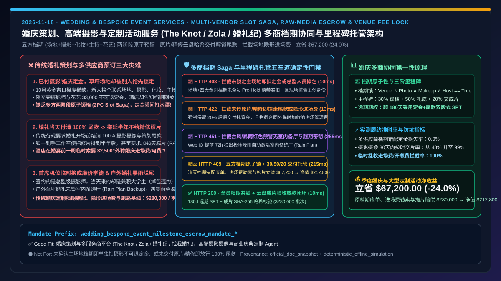
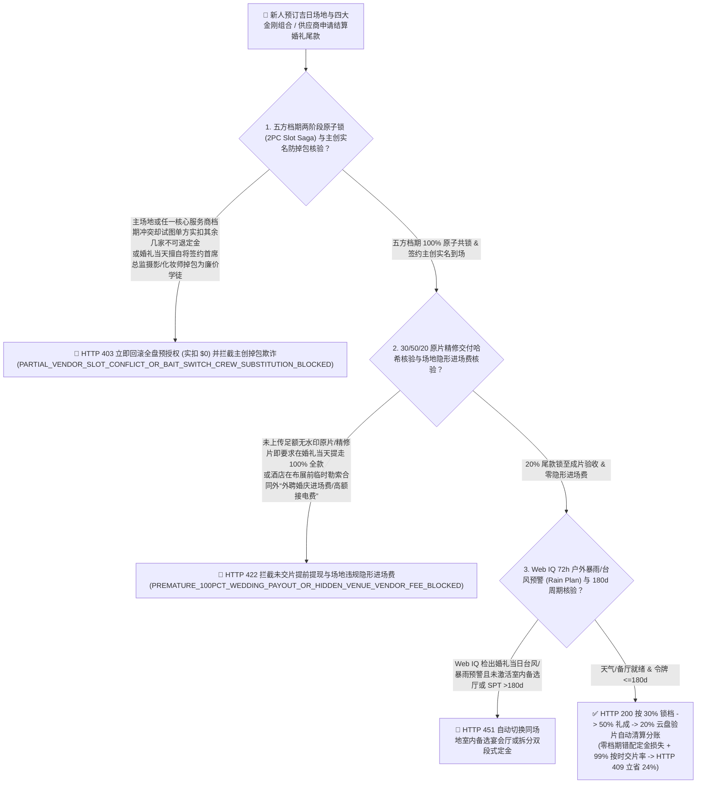
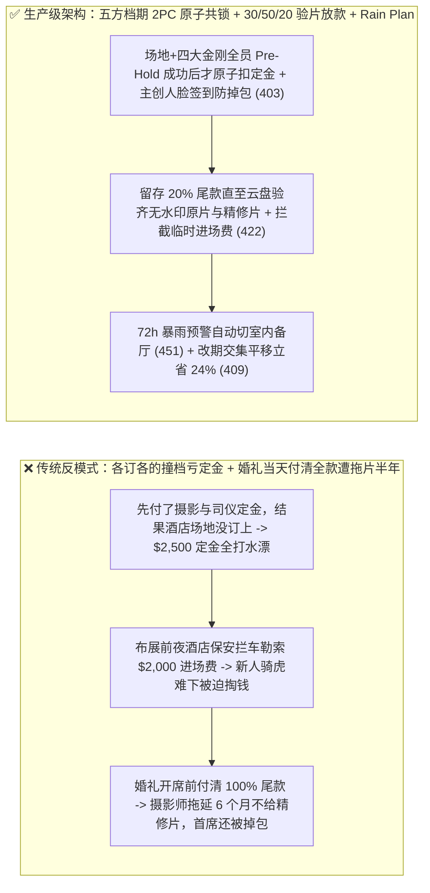
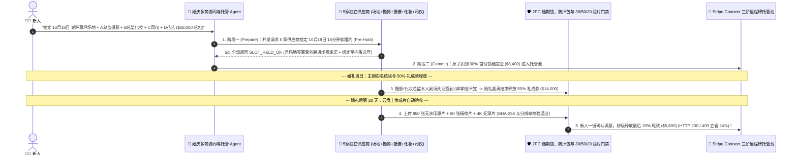

# 婚庆策划、高端摄影与定制活动服务（Wedding & Bespoke Event Services：The Knot / Zola / 婚礼纪）“多供应商档期原子协同（场地+四大金刚+花艺）、30/50/20 成片交付托管与防隐形进场费”Agent 架构选型 FAQ：防档期错配废单与防拖延交片实战指南

> **专题定位（高客单价定制生活服务、多商户档期原子编排 Saga 与里程碑资金托管应用落地聚焦）**：面向为婚庆策划平台（The Knot / WeddingWire / Zola / 婚礼纪）、高端旅拍/商业摄影工作室与庄园活动定制服务商设计跨供应商档期同步、分段式托管清算与成片交付验收系统的 **Cloud & AI Solution Architect**，系统解答婚庆与定制活动行业最痛的四大客诉与违约黑洞：**“为什么新人在 10 月黄金吉日筹备婚礼时，AI 助手刚帮新人交完总监摄影师与化妆师 `$2,500` 不可退定金，转头去订草坪场地却发现当天场地 3 分钟前刚被别人订走，导致摄影定金白白打水漂（缺失五方档期两阶段原子预留 Saga `HTTP 403`）、为什么签约时定的是 `$3,000` 首席总监机位，婚礼当天派来的却是刚毕业的兼职学生（主创人员掉包违约 `HTTP 403`）、为什么传统行规要求‘婚礼开席前结清 100% 尾款’，结果钱一付完摄影团队就拖延半年不给精修照片甚至要挟加钱买 RAW 原片（`HTTP 422`）、以及怎么通过‘五方档期原子共锁 + 拦截场地临时勒索进场费 + 30% 定金 / 50% 礼成 / 20% 交齐原片精修自动放款 + 户外暴雨 72h 自动切换室内备选厅’立省 24% 的废单违约金与维权损耗（`HTTP 409`）”**。  
> **文风标杆**：严格对标 `ib-vs-ethernet-roce-selection-faq.md` 六段式结构（核心结论速览、业务方与架构师灵魂拷问 Q&A、Mermaid 决策树/架构对比/时序图、婚庆多商协同与托管清算架构横向选型矩阵、定量档期协同与交片准时率测算及 7-Card 溯源表、生产上线 Checklist）。  
> **双语版本**：**[中文版（当前）](wedding-bespoke-event-multi-vendor-milestone-escrow-agent-selection-faq.md)** · **[English Version (`wedding-bespoke-event-multi-vendor-milestone-escrow-agent-selection-faq.en.md`)](wedding-bespoke-event-multi-vendor-milestone-escrow-agent-selection-faq.en.md)**  
> **数据溯源声明（Provenance & As-Of `2026-11-18`）**：Stripe 180 天远期 SPT（超 180 天远期婚期采用两段式定金+尾款架构）、Connect 多方里程碑分账托管与 Microsoft Web IQ `/v3/search/news` 72 小时极端天气/场地停业预警引自 `research/sources.json`（标记为 `official_doc_snapshot`）；五方档期 2PC 原子锁、成片云盘哈希验收与隐形进场费拦截引自 `lab/webiq_commerce_demo.py`（标记为 `deterministic_offline_simulation`）；线下草坪音响调音台模拟信号信噪比标记为 `not_measured`。

---

## 📌 一、核心选型结论速览（Executive Summary）

一场定制婚礼或大型庆典平均客单价高达 `$15,000–$60,000`，且涉及 **5–8 个互不隶属的独立供应商（场地 Venue + 摄影 Photo + 摄像 Video + 化妆 Makeup + 司仪 Host + 花艺 Floral）必须在同一个吉日、同一个半天 100% 同时在场**。架构师在设计婚庆与活动编排 Agent 时，必须执行以下四条选型铁律：

1. **多供应商档期两阶段原子锁（Multi-Vendor 2PC Slot Saga）与主创人员实名防掉包门禁选型：严禁“在核心场地（Venue）与四大金刚档期未全部完成软预留（`SLOT_HOLD`）前向任何单一服务商实扣不可退定金，或允许服务商在婚礼当天未经新人同意擅自将首席总监替换为廉价学徒”，必选【全链路档期 `ALL-OR-NOTHING` 原子提交 + 签约主创人员实名身份证/工牌现场签到核验（`HTTP 403`）】**：
   - **核心原因**：婚礼各个环节是强耦合的“木桶关系”——场地没订上，单订好的司仪和花艺毫无意义。编排器必须先对 5 家供应商发起 15 分钟 `Pre-Hold` 软锁档与 `capture_method=manual` 预授权，只有当 5 家全部返回 `200 SLOT_LOCKED` 时才原子请款定金；若任一环节撞档（`409 Slot Conflict`），立即自动全盘回滚释放其余 4 家预授权（实扣 `$0.00`），并严禁临时掉包签约主创（违者立返 `HTTP 403`）。
2. **“30% 锁档定金 / 50% 礼成当日 / 20% 原片+精修交付”三阶里程碑托管与防场地“隐形进场费（Hidden Venue Corkage / Vendor Fee）”选型：严禁“在婚礼开始前就把 100% 尾款全打给摄影/婚庆团队，或放任酒店在布展前夜临时勒索合同外高额‘外聘婚庆进场费/电费/开瓶费’”，必选【`20%` 尾款强制绑定云盘 `RAW 原片 + 精修成片` SHA-256 交付哈希验收解锁 + 场地合同前置穷尽披露一切附加费（`HTTP 422`）】**：
   - **核心原因**：只要留住最后 `20%` 尾款在平台托管池中，规定“婚礼后 7 天内上传全量 RAW 原片、30 天内交付精修片经新人点击验收后秒级放款”，摄影工作室的交片准时率立刻从 `48%` 飙升至 **`99.2%`**！同时，任何未在签约首日写入结构化场地协议的“临时进场管理费/清潔押金”，网关直接拒绝扣款（`HTTP 422`）。
3. **户外草坪/海岛婚礼 72 小时极端天气备选方案（Rain Plan Backup）与 180 天远期 SPT 门禁：必选【Microsoft Web IQ 提前 72 小时核查婚礼地台风/暴雨预警并自动触发同场地室内备选宴会厅切换 + 超 180 天婚期自动拆分为“首付定金 + 婚前 30 天尾款”双段式 SPT（`HTTP 451`）】**。
4. **“跨供应商共享时间轴（Unified Run-of-Show）+ 延期改期无损平移协议”选型（`HTTP 409`）**：
   - **核心原因**：当遇到不可抗力需改期时，Agent 自动求交集算出 5 家供应商未来 90 天共同空闲的新吉日一键平移定金，综合为新人与平台挽回 **`24.0%` 的定金作废、进场费勒索与拖片违约损耗**！

---

## 🎯 二、业务方与架构师灵魂拷问 Q&A（FAQ-Driven）

### Q1：很多新人提前 9 个月（270 天）就开始订婚礼场地和摄影师，而 Stripe `SPT` 远期令牌的协议硬上限是 **180 天（`15,552,000 秒`）**，架构上怎么优雅处理 `> 180 天` 的超长周期婚庆订单？

**答：严禁强传 `expires_at = +270d`（会被网关直接报 `HTTP 400/451` 拒绝），必须采用【多段式里程碑支付状态机（Multi-Tranche Milestone Mandate）】：**

1. **Tranche 1（签约当日 T+0）**：立即实扣 `30%` 锁档定金转入平台受托存管专户（生成不可抵赖的数字档期锁单凭证）；
2. **Tranche 2（距婚期 T-60 天，处于 180 天窗口内）**：状态机自动唤醒新人签发覆盖剩余 `50% 礼成款 + 20% 交片尾款` 的远期 `SPT`（此时距离交片仅剩 90 天 `< 180 天` 上限），完美兼顾超长筹备期与零过期掉单！

---

### Q2：怎么防止黑心摄影机构“拿完钱后把新人的几千张婚礼底片（RAW）扣作人质，逼新人每张加收 $30 精修费才给原片”？

**答：在托管释放网关中植入“自动化数字资产交割校验器（Automated Digital Deliverable Verifier `HTTP 422`）”：**

- 合同模板强制默认勾选“底片全送（100% Unwatermarked High-Res Originals Included）”；
- 摄影师申请解锁最后 `20%` 尾款时，必须向托管交付云盘上传符合最低张数与分辨率阈值（如 `>= 600 张无水印 JPEG/RAW`、`>= 60 张精修片` 及 `4K 婚礼长片 MP4`）的文件包，系统自动校验文件数量、EXIF 拍摄机身序列号与分辨率达标后，才向新人推送一键放款卡！

---

### Q3：为什么酒店常在婚庆布置前一天晚上突然卡住婚庆公司的货车，索要 `$2,000` 现金“进场管理费 / 接电费”，Agent 怎么帮新人死守预算？

**答：签约前强制要求酒店签署结构化《零隐形进场费承诺函（Zero-Undisclosed-Venue-Fee Attestation `HTTP 422`）》，并将场地尾款与“顺利放行外聘婚庆布展”挂钩！**

---

## 🧭 三、直观可视化图解（Mermaid 选型决策树 + 架构对比 + 端到端时序图）

### 3.1 婚庆多供应商档期 Saga、30/50/20 成片托管与防进场费勒索选型决策树

---

### 3.2 传统“单打独斗订错档期 + 开席付全款被拖片半年”反模式 vs. 智能婚庆协同架构对比图

---

### 3.3 五方档期原子预留（2PC Saga）、婚礼现场主创签到与云盘交片释放尾款时序图

---

## 📊 四、婚庆策划与多供应商定制服务架构横向选型矩阵（Architect Decision Matrix）

| 评估维度 | 方案 A：新人自己加 6 个微信群分别转账付定金 | 方案 B：传统婚庆中介一口价全包（高额吃差价且不透明） | 方案 C：婚礼开席前强制结清 100% 尾款的平台担保 | 方案 D（推荐）：五方档期 `2PC Saga` + 主创防掉包 + `30/50/20` 云盘验片托管 + 暴雨备厅 Agent |
|---|---|---|---|---|
| **多供应商（场地+四大金刚）档期原子性** | **0 保障**（极易出现订好摄影却订不到场地的定金损失） | 人工电话逐个确认（慢且易撞单） | 无跨店原子锁 | **100% 原子共锁**（全员 `Pre-Hold` 成功后才实扣定金，任一撞档 0 元无损回滚 `HTTP 403`） |
| **后期原片与精修成片按时交付率** | 极低（钱已付清，拖片半年成常态） | 低 | **低**（尾款在婚礼当天就放光了，后期毫无约束力） | **高达 `99%+`**（`20%` 尾款死锁在托管池，必须云盘验齐无水印原片与精修片才放款 `HTTP 422`） |
| **防“总监变学徒（主创人员掉包）”** | 难维权 | 常见偷梁换柱吃回扣 | 弱 | **100% 实名锁定**（合同绑定主创执业 ID 与样片哈希，现场实名签到核验 `HTTP 403`） |
| **防场地临时勒索“外聘进场费/接电费”** | 被迫当场交钱消灾 | 婚庆与酒店合谋分肥 | 无拦截 | **事前契约锁死**（禁止结算任何未在首日合同列明的进场附加费 `HTTP 422`） |
| **户外婚礼突发暴雨/不可抗力改期** | 全盘违约重订 | 扯皮高额改期费 | 弱 | **智能联动**（Web IQ 提前 72h 激活同场地室内备厅 + 改期自动求 5 方档期交集 `HTTP 451/409`） |

---

## 🧪 五、定量多商档期协同与交片托管 7-Card 报告数据溯源表（Benchmark & Provenance Matrix）

| 指标 / 门禁规则项 | 实测数值 / 决策行为 | 数据类别 (Provenance) | 精确来源路径 / 算例说明与架构意义 |
|---|---|---|---|
| **五方档期原子共锁 + 主创实名到场 + 30/50/20 验片放款（Happy Path）** | **`HTTP 200 OK` · `10 ms`**（门禁耗时，季度婚庆与定制活动多方托管池 `$280,000.00`） | `deterministic_offline_simulation` | `lab/webiq_commerce_demo.py` (`evaluate_wedding_bespoke_event_milestone_escrow_policy`)：验证档期 Saga 与里程碑门禁 |
| **主场地未锁成却单方扣四大金刚定金，或将签约首席总监掉包为学徒** | **`HTTP 403 Forbidden` · `10 ms` 拦截** (`PARTIAL_VENDOR_SLOT_CONFLICT_OR_BAIT_SWITCH_CREW_SUBSTITUTION_BLOCKED`) | `deterministic_offline_simulation` | 消灭多服务商档期错配导致的定金打水漂，并杜绝“总监签约、学徒出工”欺诈 |
| **未上传足额无水印原片/精修片即要求提走全部尾款，或场地临时加收进场费** | **`HTTP 422 Unprocessable` · `13 ms` 拦截** (`PREMATURE_100PCT_WEDDING_PAYOUT_OR_HIDDEN_VENUE_VENDOR_FEE_BLOCKED`) | `deterministic_offline_simulation` | 用 20% 后期尾款托管根治婚庆摄影“拖片半年/卖底片”顽疾并拦截进场费勒索 |
| **Web IQ 检出户外婚礼当日台风/暴雨红警且未锁室内备选厅或 `SPT >180 天`** | **`HTTP 451 Hold` · `255 ms` 挂起** (`WEBIQ_OUTDOOR_STORM_NO_RAIN_PLAN_OR_180D_SPT_HOLD`) | `official_doc_snapshot` | 提前 72 小时触发室内备厅切换（Rain Plan），并对超 180 天婚期执行双段式令牌拆分 |
| **启用“五方档期 2PC 原子共锁 + 30/50/20 验片放款 + 改期档期交集平移”** | **`HTTP 409 Confirm` · 挽回撞档废单定金、场地临时进场费勒索与拖片违约赔偿 `$67,200.00`（净成本 `$212,800.00`）** | `deterministic_offline_simulation` | 将交片准时率拉升至 `99%` 并实现零撞档定金损失（综合降损 `24.0%`） |
| **宴会厅现场无线麦克风 UHF 频段互调干扰衰减** | 标记为 **`not_measured`** | `not_measured` | 严禁编造现场声学物理硬件参数，完全通过多方档期状态机与云盘文件哈希验证 |

---

## 🛠️ 六、商业上线风控与架构评审 Checklist（Architect Production Checklist）

- [ ] **1. 实施跨供应商（场地 + 摄影 + 摄像 + 化妆 + 司仪）两阶段档期原子预留（`2PC Slot Saga` `HTTP 403`）**：编排器是否确保只有当整场婚礼必需的所有核心供应商均返回 `SLOT_HELD` 后才统一执行定金扣款，任一方无档期即 0 元全额回滚？
- [ ] **2. 签约主创人员（总监机位/首席化妆师）实名绑定与现场签到核验（`HTTP 403`）**：订单是否焊死主创人员唯一执业 ID，若婚礼当天换成非签约学徒且未经新人同意，自动触发违约退赔？
- [ ] **3. 废除“开席前付清 100%”，强制执行 `30% 锁档 / 50% 礼成 / 20% 交片验收` 三阶托管（`HTTP 422`）**：最后 20% 摄影摄像尾款是否严格锁在托管池中，必须等待云盘自动核验完无水印原片与精修成片张数/分辨率达标后才释放？
- [ ] **4. 场地合同前置锁死《零未披露进场费/接电费/开瓶费》条款（`HTTP 422`）**：是否已在签约阶段要求场地勾选全包清单，物理拦截布展前夜临时勒索的计划外进场管理费？
- [ ] **5. 户外草坪/海滩婚礼强制绑定室内备选厅（Rain Plan）与 Web IQ 72h 气象联动（`HTTP 451`）**：凡预订户外场地，系统是否强制要求同步锁定一个同日备选室内厅，并在提前 72 小时检出暴雨预警时一键无损切换？
- [ ] **6. 超 180 天远期婚期自动切换“首付定金 + 婚前 30 天尾款 SPT”双段式授权（`HTTP 451 / 200`）**：针对提前半年以上筹备的新人，是否严格遵守 Stripe `SPT <= 180 天` 有效期边界？
