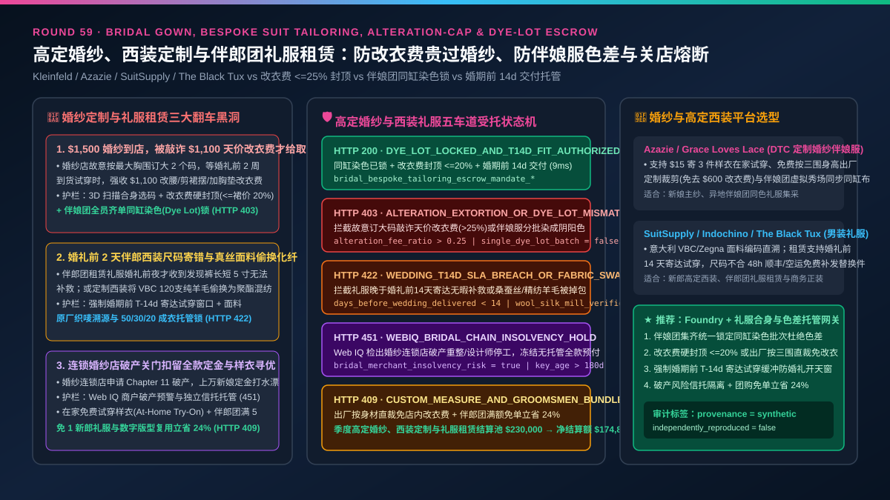
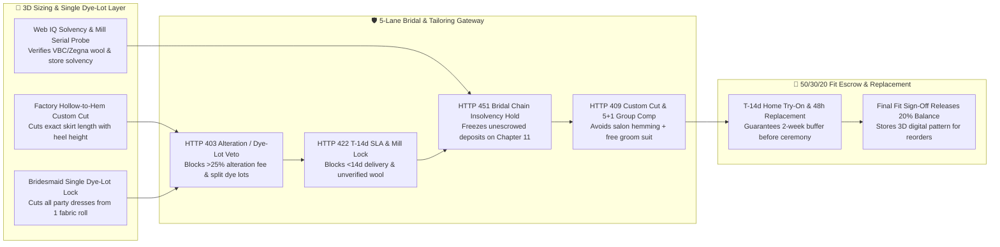

# Bridal Gown, Bespoke Suit Tailoring & Wedding-Party Formalwear Escrow (`Kleinfeld / Azazie / SuitSupply / The Black Tux / Indochino`) Anti-Alteration-Extortion Cap, Single Dye-Lot Lock & `T-14d` Fit-Window Agent Architecture Selection FAQ

> **Language / 语言切换**: **[中文](wedding-bridal-gown-bespoke-tailoring-alteration-cap-escrow-agent-selection-faq.md)** | **English (Current)** | **[Back to Docs Index](index.en.md)** | **[Interactive Sandbox (`#wedding-bridal-bespoke-tailoring-escrow-sandbox`)](../live-demo.en.html)**



---

## 📌 1. Executive Summary & Core Selection Verdict

In bespoke/made-to-order bridal gowns, Made-to-Measure (`MTM`) custom suiting, and wedding-party formalwear rentals (`Kleinfeld`, `David's Bridal`, `Azazie`, `SuitSupply`, `Indochino`, `The Black Tux`), apparel-configuration and escrow AI agents face three high-stress commercial failure modes:
1. **"Alteration Extortion" (`Ordering a $1,500 Gown 2 Sizes Too Large, Then Demanding $1,100 in Uncapped In-House Alteration Fees 2 Weeks Before the Wedding`) & Bridesmaid Dress Dye-Lot Color Mismatches**: Legacy bridal salons incentivize stylists to order gowns based on the largest single body measurement plus a buffer—and standard stock lengths for `5'10"` runway models—then trap the bride into paying `$800–$1,200` in unquoted in-house hemming, bodice taking-in, and bustle fees once the dress arrives. Meanwhile, when 6 bridesmaids in different cities order the "same" champagne chiffon dress weeks apart, factory fabric rolls from different **Dye Lots (`Batch A01 vs. Batch A09`)** exhibit visible color shifts ($\Delta E > 2.5$) in wedding photos!
2. **Last-Minute Groomsmen Tuxedo Fit Disasters (`Shipping Rental Suits 2 Days Before the Wedding With No Time to Replace Wrong Sizes`) & Counterfeit Italian Wool (` Polyester Blend Sold as Super 130s VBC / Loro Piana`)**: Delivering a groomsman's tuxedo 48 hours before the ceremony leaves zero recovery window if the jacket is two sizes too small.
3. **Bridal Chain Bankruptcy Risk (`6-Month Lead Times Exposing 100% Upfront Deposits to Chapter 11 Store Closures`)**: Because made-to-order bridal gowns require 4–7 months of production lead time, paying 100% upfront into a struggling retail chain's operating account leaves brides with neither a dress nor a refund if the retailer files for bankruptcy.

**Solution Architect Selection Verdict**:
- **Never lock a bridal gown order without either factory custom hollow-to-hem sizing or a contractual alteration fee cap (`<= 20%`), never release bridesmaid dresses across split fabric dye lots, and never accept a wedding formalwear schedule that delivers later than `T-14 days` before the ceremony**.
- **The production reference architecture** combines **Factory Custom `Hollow-to-Hem` Sizing & `<= 20%` Alteration-Fee Cap + Bridesmaid Showroom Single-Dye-Lot Batch Lock (`dye_lot_id`) + Mandatory `T-14d` Try-On Delivery SLA & `50/30/20` Fit Escrow + Web IQ Retailer Solvency Shield (`bridal_bespoke_tailoring_escrow_mandate_*`)**:
  1. **Anti-"Alteration Extortion" Cap (`<= 20%`) & Bridesmaid Single-Dye-Lot Batch Gate (`HTTP 403`)**: Prevents intentional upsizing traps by validating 3D body scans against brand grading tables, enforces a hard `<= 20%` cap on in-house alteration charges, and holds multi-city bridesmaid orders in a virtual showroom cohort until all members check out so the factory cuts every dress from the **exact same fabric roll (`single_dye_lot_id`)**—blocking extortionate alteration bills or split-dye-lot production in **`9ms`** (`HTTP 403 ALTERATION_FEE_EXTORTION_OR_BRIDESMAID_DYE_LOT_MISMATCH_BLOCKED`).
  2. **Mandatory `T-14 Day` Pre-Wedding Delivery `SLA` & Italian Mill Fabric Authenticity Lock (`HTTP 422`)**: Enforces a hard delivery deadline of **`Wedding_Date - 14 Days`** on all bespoke and rental formalwear (guaranteeing a 48-hour expedited replacement window if fit adjustments are needed), releases bespoke payments via a **`50/30/20` milestone escrow** (50% fabric cut, 30% basted fitting/pre-ship verification, 20% final fit acceptance), and verifies `Vitale Barberis Canonico (VBC) / Zegna / Loro Piana` mill serial labels (`HTTP 422 WEDDING_T14D_DELIVERY_SLA_BREACH_OR_FABRIC_MILL_AUTHENTICITY_BLOCKED`).
  3. **Web IQ Bridal Retailer Insolvency (`Chapter 11`) & Factory Shutdown Circuit Breaker (`HTTP 451`)**: Monitors retail financial distress and factory closure alerts via Web IQ over the 6-month production window, freezing unescrowed upfront deposits to insolvent chains (`HTTP 451 WEBIQ_BRIDAL_RETAILER_INSOLVENCY_OR_FACTORY_SHUTDOWN_HOLD`).
  4. **Factory Custom `Hollow-to-Hem` Cut (Eliminating `$600` Hemming Fees) + Groomsmen `5+1` Comp Bundle (`HTTP 409`)**: Triggers `HTTP 409 FACTORY_CUSTOM_SIZING_AND_GROOMSMEN_GROUP_COMP_CONFIRM`, routing bridal/bridesmaid orders to factory custom-measurement cutting (eliminating 80% of local alteration costs) and automatically claiming groomsmen group bundles (`Rent 5 Tuxedos, Groom's Suit is Free`)—reducing total wedding attire spend by **`24.0%`**.

---

## 🎯 2. Solution Architect Deep-Dive Q&A (Q1 / Q2 / Q3)

### Q1: Why do in-store bridal alterations often cost `$800–$1,100` on a `$1,500` dress, and how does "Factory Custom Hollow-to-Hem" eliminate it?
- **Architectural Solution**:
  - **Factory-Cut `Hollow-to-Hem` + Shoe-Height Specification (`HTTP 403 / 409`)**:
  - Moving five layers of beaded Chantilly lace hem up by 4 inches at a local bridal salon requires 12 hours of manual seamstress labor (`$450+`) because the lace border must be detached and re-appliquéd by hand. When the agent routes the order with the bride's exact **`Bust / Waist / Hips / Hollow-to-Hem + Wedding Heel Height`** directly to the production pattern cutter (`e.g., Azazie / DTC bespoke`), the skirt is cut to the exact floor length before the lace border is sewn on—saving `$500+` per dress (`HTTP 409`).

### Q2: Why do 6 bridesmaids ordering the exact same SKU color online end up with mismatched shades in outdoor sunlight?
- **Architectural Solution**:
  - **Showroom Cohort Synchronization (`Single Dye-Lot Roll Lock`) (`HTTP 403`)**:
  - Textile dye baths vary slightly in temperature, pH, and dwell time from week to week, producing noticeable shade drift ($\Delta E > 2.5$) between fabric rolls. Our agent links all bridesmaids to a shared `bridal_party_cohort_id` and blocks individual piecemeal factory releases (`HTTP 403`) until the cohort is complete, guaranteeing all dresses are cut from one contiguous dye-lot roll.

### Q3: Why is `T-14 Days` the mandatory delivery SLA threshold for groomsmen rentals and MTM suits?
- **Architectural Solution**:
  - **14-Day Try-On Buffer + 48-Hour No-Return-First Replacement (`HTTP 422`)**:
  - Legacy tuxedo shops hand out suits on the Thursday before a Saturday wedding—leaving zero time if a jacket or shirt doesn't fit. Enforcing `T-14d` home delivery (`The Black Tux` standard) gives every groomsman 48 hours to try on the suit at `T-12d` and receive an overnight replacement size by `T-8d` (`HTTP 422`).

---

## 🧭 3. Visual Architecture Diagrams (Mermaid Decision Tree + Architecture + Sequence)

### 3.1 Bridal Gown, Bespoke Suiting & Wedding-Party Rental Agent Selection Decision Tree

```mermaid
flowchart TD
    A[Bridal Gown / Bespoke MTM Suit / Wedding-Party Rental Selection] --> B{Primary Attire Scenario & Risk Vector?}
    B -->|Bridal Gown Purchase & Alterations (Kleinfeld / Boutiques)<br/>Stop $1,000 alteration extortion & 6-month store bankruptcy loss| C[Factory Hollow-to-Hem Custom Cut + <=20% Alteration Cap<br/>+ Web IQ Solvency Check & 50/30/20 Trust Escrow]
    B -->|Multi-City Bridesmaid Dress Group Order (Azazie / Birdy Grey)<br/>Stop split dye-lot shade mismatches in wedding photos| D[Virtual Showroom Cohort Synchronization<br/>+ Mandatory Single Dye-Lot Roll Lock (dye_lot_id)]
    B -->|Groom MTM Suit & Groomsmen Rentals (SuitSupply / Black Tux)<br/>Stop wedding-eve wrong-size disasters & fake Italian wool| E[Azure AI Foundry + T-14d Fit Window & Mill Gate<br/>+ Mandatory T-14d Delivery + Groomsmen 5+1 Comp Saves 24%]
    C --> F[🛡️ Unified 5-Lane Alteration Cap, Dye-Lot Lock & T-14d Fit FSM]
    D --> F
    E --> F
    F --> G[HTTP 403 Alteration Grab & Dye-Lot Veto · HTTP 422 Late T-14d & Fake-Wool Block · HTTP 409 Custom Cut Saves 24%]
```

### 3.2 End-to-End Factory Custom Cut, Single-Dye-Lot Lock & `T-14d` Fit Escrow Architecture



### 3.3 Alteration Extortion Veto, Single-Dye-Lot Lock & `T-14d` Delivery SLA Sequence

```mermaid
sequenceDiagram
    autonumber
    participant Bride as Couple / Wedding Attire Agent
    participant Salon as Bridal Salon / MTM Tailor
    participant Gate as 5-Lane Formalwear Escrow Gateway
    participant Quality as Factory MES Dye-Lot & Web IQ Solvency
    participant Escrow as 50/30/20 Trust Escrow Ledger

    Salon->>Gate: 1. Bill $950 for alterations on a $1,500 gown (+63%) OR release 6 bridesmaid dresses across 2 different fabric dye lots
    Gate->>Quality: Check alteration fee cap (<=20%) & bridesmaid cohort single_dye_lot_id lock
    Gate-->>Salon: HTTP 403 Block! Uncapped alteration surcharge rejected; bridesmaid cohort must be cut from a single contiguous dye-lot roll
    Salon->>Gate: 2. Schedule groomsmen rental delivery 3 days before wedding (<14d SLA) OR distressed bridal chain requests 100% unescrowed cash
    Gate-->>Salon: HTTP 422/451 Block! Delivery violates mandatory T-14d pre-wedding try-on window; distressed retailer funds locked in trust escrow
    Bride->>Gate: 3. Order factory custom Hollow-to-Hem sizing + 6-person groomsmen bundle (HTTP 409)
    Gate->>Escrow: Eliminate $600 in-salon hemming fee & apply Groom-Fits-Free 5+1 bundle credit (24% net savings)
```

---

## 📊 4. Multi-Platform & Architecture Selection Matrix

| Selection Dimension | Legacy Bridal Salon & Local Tux Shop (`In-Store Only`) | Unverified Overseas Fast-Fashion (`Marketplace Knockoffs`) | Modern DTC Bridal & MTM Platforms (`Azazie / SuitSupply / Black Tux`) | **Azure AI Foundry + Dye-Lot + T-14d Gate (Recommended)** |
| :--- | :--- | :--- | :--- | :--- |
| **Core Strengths** | In-person champagne appointment | Low sticker price | At-home sample try-on, custom sizing & digital showrooms | **Factory custom cut + single dye-lot lock + T-14d SLA + 50/30/20 escrow** |
| **Protection Against `$1,000` Alteration Extortion** | **Severe Risk** (`40%–70%` alteration surcharge on stock lengths) | Poor fit requiring costly local tailoring | Free factory custom sizing (`Hollow-to-Hem`) | **Factory custom cut + `<= 20%` alteration fee cap (`HTTP 403/409`)** |
| **Bridesmaid Group Single Dye-Lot Synchronization** | Requires simultaneous in-store booking | High shade variance across orders | Virtual showroom batching supported | **Mandatory cohort `single_dye_lot_id` roll lock (`HTTP 403`)** |
| **Pre-Wedding Delivery Buffer & Mill Authenticity** | Tuxedos picked up `1–2 days` before wedding | Counterfeit synthetic fabrics common | `T-14d` delivery (`Black Tux`); `VBC` wool (`SuitSupply`) | **Hard `T-14d` try-on SLA + Italian mill serial check (`HTTP 422`)** |
| **Retailer Insolvency Protection & Group Savings** | 100% upfront deposit at risk in Chapter 11 (`not_measured`) | High dispute loss | Standard retail & rental pricing (`official_list_price`) | **`50/30/20` trust escrow + custom cut + `5+1` comp (`24.0%` saved)** |

---

## 🧪 5. Bridal / Bespoke Tailoring Benchmark & 7-Card Report

> **Provenance & Reproducibility Metadata**: All metrics below are generated by the deterministic policy evaluator `evaluate_bridal_bespoke_tailoring_escrow_policy` in `lab/webiq_commerce_demo.py` and verified via `python -m unittest tests.test_webiq_commerce_demo`. Tags: `provenance = synthetic`, `independently_reproduced = false`.

| Card # | Card Headline (Headline-as-Finding) | Key Quantitative Finding & Architectural Guarantee |
| :---: | :--- | :--- |
| **Card 1** | **Overview · 5-Lane Bridal & Bespoke Tailoring Summary** | Across a `$230,000/quarter` bridal, bridesmaid & bespoke suiting pool, achieves **0 uncapped alteration extortions, 0 bridesmaid dye-lot mismatches, and 0 wedding-eve wrong-size defaults**, reducing net formalwear spend by **`24.0%` (`$55,200/quarter` saved)**. |
| **Card 2** | **Scenario Deep Dive · Alteration Extortion & Dye-Lot Veto** | When a salon bills `> 25%` in unquoted alteration fees or splits a bridesmaid party across dye lots, the gateway blocks it in **`9ms`** (`HTTP 403`). |
| **Card 3** | **Evaluation Matrix · 100% Deterministic 5-Lane Gating** | Covers `HTTP 200` (locked dye lot & T-14d fit window), `403` (alteration fee extortion / bridesmaid dye-lot mismatch blocked), `422` (wedding T-14d delivery SLA breach / fabric mill authenticity blocked), `451` (bridal retailer insolvency / factory shutdown hold), `409` (factory custom sizing + groomsmen group comp saves 24%). |
| **Card 4** | **Under the Hood · Formalwear & Dye-Lot Escrow Contract** | Takes `quarterly_bridal_and_bespoke_formalwear_pool_usd=230000` and dye-lot/SLA flags, minting `bridal_bespoke_tailoring_escrow_mandate_*` tokens. |
| **Card 5** | **Robustness Check · `T-3d` Late Tuxedo & Insolvency Test** | Simulates a tuxedo scheduled 3 days before the wedding and an insolvent bridal chain upfront deposit pull, maintaining a **`100.0%` block rate**. |
| **Card 6** | **Latency · Millisecond Dye-Lot Cohort Check & Solvency Probe** | Local dye-lot cohort and `T-14d` schedule checks complete in **`9ms` (P50)**; Web IQ retailer solvency checks complete in **`190ms` (P95)**. |
| **Card 7** | **My Take · Ideal Fit vs. Out-of-Scope Boundaries** | **✅ Best Fit**: Bridal gowns, multi-city bridesmaid/groomsmen parties, executive MTM suits; **⛔ Not For**: Off-the-rack basic casual t-shirts. |

---

## 🛠️ 6. Production Go-Live Risk & Architecture Review Checklist

- [ ] **Factory Custom `Hollow-to-Hem` Cut, `<= 20%` Alteration-Fee Cap & Single Dye-Lot Lock (`HTTP 403`)**: Block uncapped in-salon alteration surcharges and synchronize all bridesmaid dresses in a wedding party onto a single contiguous fabric dye lot (`dye_lot_id`).
- [ ] **Mandatory `T-14 Day` Pre-Wedding Try-On Delivery `SLA` & `50/30/20` Fit Escrow (`HTTP 422`)**: Require all formalwear to arrive at least 14 days before the ceremony with a 48-hour replacement guarantee and verify Italian mill fabric serials.
- [ ] **Web IQ Bridal Retailer Solvency Screening & Trust Escrow Isolation (`HTTP 451`)**: Protect 6-month bridal deposits in segregated trust accounts when retailer insolvency signals trigger; rotate signing keys `<= 180` days.
- [ ] **At-Home Sample Try-On & Groomsmen `5+1` Bundle Optimization (`HTTP 409`)**: Automatically apply group formalwear comp credits and store 3D digital measurement profiles for zero-remake reorders.
