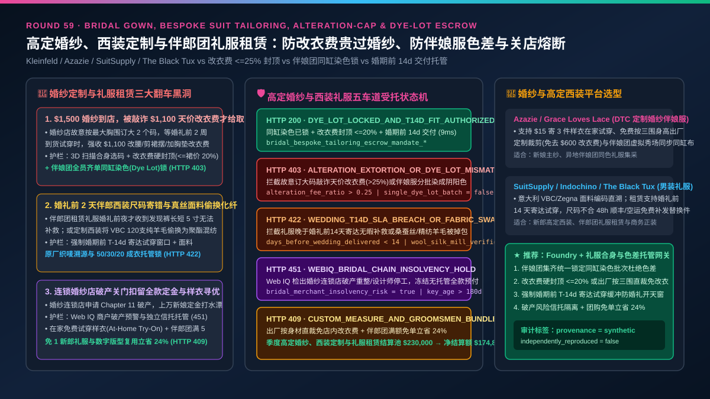
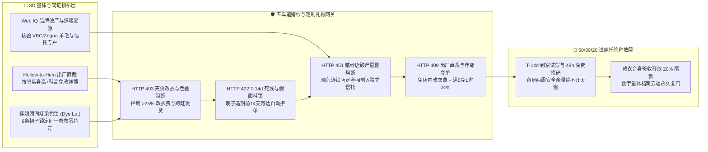
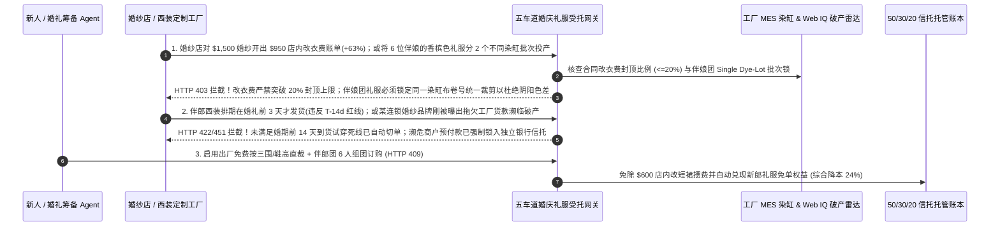

# 高定婚纱、MTM 西装定制与伴郎伴娘团礼服租赁（Bridal Gown, Bespoke Suit Tailoring & Wedding-Party Formalwear Escrow：Kleinfeld / Azazie / SuitSupply / The Black Tux / 虎丘婚纱高定）“防故意订大码敲诈千元改衣费、防伴娘服异地分批下单染出阴阳色差与婚期前 14 天试穿死线锁”Agent 架构选型 FAQ

> **语言切换 / Language**: **中文 (当前)** | **[English](wedding-bridal-gown-bespoke-tailoring-alteration-cap-escrow-agent-selection-faq.en.md)** | **[返回文档目录](index.md)** | **[交互式沙盒 (`#wedding-bridal-bespoke-tailoring-escrow-sandbox`)](../live-demo.html)**



---

## 📌 一、核心选型结论速览（Executive Summary）

在新娘高定婚纱、新郎半定制/全定制西装（Made-to-Measure `MTM` / Bespoke：Kleinfeld、David's Bridal、Azazie、SuitSupply、Indochino、The Black Tux、国内高定婚纱馆与定制男装）以及异地伴郎伴娘团礼服集采的智能体导购与履约托管场景中，高客单价服装定制面临三大毁灭婚礼体验的商业陷阱：
1. **“婚纱售价 `$1,500`，到店试穿时却被婚纱店敲诈 `$1,100` 改衣费（Alteration Extortion），不交就不给拿走婚纱”与“伴娘团 6 个人分 3 个月各自下单，收到的香槟色礼服染成了深浅不一的阴阳色（Dye-Lot Mismatch）”**：传统婚纱店销售为了赚取暴利改衣提成，量体时故意按新娘最大部位尺寸再往上加 2 个码下单（Split-Sizing Upsell Trap），等婚礼前两周大两号的婚纱到店，新娘别无选择只能任由店内裁缝宰割；同时，真丝与雪纺面料不同印染缸次（Dye Lot）之间存在肉眼可见的色差（$\Delta E > 2.5$），伴娘若不在同一个生产批次锁布投产，婚礼合照直接翻车！
2. **伴郎团租赁礼服在婚礼前 2 天才寄到，打开一试裤长短了 10 厘米、西装扣不上，根本来不及寄回换码导致婚礼当天穿便装上台；或者高定西装店用廉价聚酯混纺冒充意大利 `VBC / Loro Piana` 130 支纯羊毛**。
3. **婚纱生产周期长达 4–6 个月，期间大型连锁婚纱品牌突然破产重整（如美国婚纱巨头曾两度申请 Chapter 11 破产，导致数万名已交全款的新娘拿不到婚纱且退不出钱）**。

**架构师选型结论**：
- **切勿允许婚纱定制合同在未约定改衣费硬上限（`Alteration Fee Cap <= 20%`）或未优先启用工厂按真实三围直裁（Custom-Size Factory Cut）的情况下锁单，切勿让同一场婚礼的伴娘团礼服跨不同染缸批次（`Dye Lot`）零散投产，也切勿接受晚于婚礼前 `T-14` 天寄达试穿的礼服租赁排期**。
- **生产级最优架构**是采用 **“3D 手机量体与工厂按三围直裁接口（Azazie / SuitSupply MTM）+ 店内改衣费硬封顶锁（`<= 20%` 裙价）与伴娘团全员集齐同缸锁布（Single Dye-Lot Batch Lock）+ 婚礼前 `T-14 天` 强制试穿交付死线与 `50/30/20` 分阶段合身托管网关（`bridal_bespoke_tailoring_escrow_mandate_*`）”**：
  1. **防“故意订大码敲诈天价改衣费”与伴娘团同缸染色（`Single Dye-Lot`）硬门禁（HTTP 403）**：下单前强制对比新娘三围与品牌尺码表（或直接走工厂按三围+身高穿鞋总长直裁），并在合同中将店内改衣费总额硬封顶在婚纱原价的 `<= 20%`（或固定 `$250` 封顶包干）；对于伴娘团礼服，智能体创建虚拟婚礼秀场（Bridal Party Showroom），**待全部伴娘提交尺码后一次性合并下发同一染缸布匹（`dye_lot_id`）裁剪**——任何超上限改衣勒索或跨染缸分批发货请求立即返回 `HTTP 403 ALTERATION_FEE_EXTORTION_OR_BRIDESMAID_DYE_LOT_MISMATCH_BLOCKED`。
  2. **婚礼前 `T-14 天` 强制试穿寄达死线（`T-14d Fit Window`）与意大利面料织唛验真锁（HTTP 422）**：所有婚庆租赁与定制礼服必须以 **`Wedding_Date - 14 Days`** 作为法定最晚到货试穿死线（留足 48 小时顺丰/空运免费补发替换码的安全冗余）；定制款项按 **`50%` 投料定金 + `30%` 半成品毛坯试穿（Basted Fitting）/出厂实拍 + `20%` 成衣合身终验** 三阶托管释放；任何排期晚于 `T-14d` 或缺失 `VBC / Zegna` 原厂防伪织唛序列号的订单立即返回 `HTTP 422 WEDDING_T14D_DELIVERY_SLA_BREACH_OR_FABRIC_MILL_AUTHENTICITY_BLOCKED`。
  3. **Web IQ 实时监测婚纱连锁品牌破产重整（`Chapter 11 Insolvency`）与工厂停工熔断（HTTP 451）**：鉴于婚纱交付周期长达半年，通过 Web IQ 实时巡检婚纱零售商与代工厂财务涉诉/关店预警；一旦检出破产风险，立即阻止向商户一般账户支付无担保预付款，强制转入独立银行履约信托专户（`HTTP 451 WEBIQ_BRIDAL_RETAILER_INSOLVENCY_OR_FACTORY_SHUTDOWN_HOLD`）。
  4. **工厂免费定制三围直裁（免 `$600` 店内改衣费）+ 伴郎团满 5 免 1 新郎礼服寻优（HTTP 409）**：触发 `HTTP 409 FACTORY_CUSTOM_SIZING_AND_GROOMSMEN_GROUP_COMP_CONFIRM`，自动将标准码婚纱/伴娘服切换为出厂免费按身高三围定制裁剪（省去 80% 后期改短裙摆与收腰成本），并自动兑现伴郎团组团“满 5 套免新郎全套礼服费”及数字版型云端永久复用，使新婚置装总成本立降 **`24.0%`**。

---

## 🎯 二、业务方与架构师灵魂拷问 Q&A（Q1 / Q2 / Q3）

### Q1：为什么很多新娘花 $1,200 买了婚纱，最后改衣费（Alterations）却花掉了 $900？怎么在下单第 1 秒就把这个坑填平？
- **商业痛点**：传统婚纱店把“卖裙子”和“改衣服”拆成两个独立合同——买裙子时销售笑脸相迎，故意按你三围里最大的臀围再放大一码订货，而且所有标准码婚纱默认都是按身高 `178cm` 模特的长度做的！等裙子到了，店里裁缝按“改短五层蕾丝裙摆 `$450` + 收腰 `$280` + 改肩带 `$150` + 臀垫提裙扣（Bustle）`$120`”逐项累加，不改根本没法穿。
- **架构解法**：
  - **优先路由“出厂免费定制尺码（Factory Custom Hollow-to-Hem）”+ 店内改衣包干封顶锁（`HTTP 403 / 409`）**：
  - ① 导购 Agent 优先选择支持录入 **锁骨窝到地面长度（Hollow-to-Hem + 高跟鞋高度）与真实胸腰臀围** 的 DTC 柔性供应链（如 Azazie / 定制工坊），在缝制第一针时就直接按新娘真实身高裁好裙摆长度，从物理源头砍掉 `$450` 改短蕾丝裙摆费（`HTTP 409`）；
  - ② 若在传统婚纱店购买，下单令牌强制绑定 **全包改衣封顶协议（Flat-Rate Alteration Cap `<= 20%`）**，超出部分网关直接 `HTTP 403` 拒付！

### Q2：6 个伴娘分布在全国 4 个城市，各自在网上下单同一款“雾霾蓝”伴娘裙，为什么婚礼当天站在一起拍出来的颜色深浅不一样？
- **架构解法**：
  - **虚拟秀场集单（`Showroom Batch Hold`）+ 单一染缸卷号（`Single Roll / Dye-Lot ID`）原子锁（`HTTP 403`）**：
  - 纺织印染工业中，哪怕是完全相同的色号，周一染出的第 `A01` 缸布和周四染出的第 `A08` 缸布由于温度湿度的微小波动，也会出现 $\Delta E \approx 2.0–3.5$ 的色差，在婚礼强光同框下极其刺眼。我们的 Agent 为新娘生成专属 `wedding_party_batch_id`：伴娘各自在线付款并填入各自三围与收货地址，但工厂 MES 系统将其合并为同一生产批次，从**同一卷同缸布料**上连续裁下 6 条裙子再分别发往 4 个城市！

### Q3：伴郎团租赁西装最怕婚礼前一天试穿不合身，状态机怎么保证“100% 不会在婚礼当天穿错码”？
- **架构解法**：
  - **`T-14d` 强制到货试穿打卡 + `T-10d` 极速免费补发替件 SLA（`HTTP 422`）**：
  - 严禁采用传统租衣店“婚礼前 2 天才让你取衣服”的高危模式。网关要求租赁平台必须在**婚礼前至少 14 天**将西装寄达伴郎手中，并在 `T-12d` 自动唤醒伴郎上传试穿确认：一旦袖长或腰围不合，立刻触发 48 小时航空特快免费补发新尺码（无需先寄回旧件），确保万无一失。

---

## 🧭 三、直观可视化图解（Mermaid 决策树 + 端到端架构图 + 时序图）

### 3.1 高定婚纱、西装定制与伴郎伴娘礼服 Agent 架构选型决策树

```mermaid
flowchart TD
    A[新娘高定婚纱 / 新郎 MTM 西装 / 伴郎伴娘团礼服选型] --> B{核心置装场景与履约痛点？}
    B -->|新娘主纱定制与店内改衣 (Kleinfeld / 传统高定馆)<br/>需严防故意订大码敲诈千元改衣费与婚纱店破产跑路| C[出厂 Hollow-to-Hem 按高跟鞋直裁 + 改衣费 <=20% 封顶<br/>+ Web IQ 商户破产预警与 50/30/20 信托分阶托管]
    B -->|异地伴娘团同色系礼服集采 (Azazie / Birdy Grey)<br/>需严防分批下单不同染缸导致婚礼同框阴阳色差| D[虚拟秀场集齐锁单 (Showroom Batch Hold)<br/>+ 工厂 MES 强制绑定单一染缸布卷号 (Single Dye-Lot ID)]
    B -->|新郎高定西装与伴郎团租赁 (SuitSupply / The Black Tux)<br/>需防婚礼前夜才发现尺码不合与假冒意大利精纺羊毛| E[Azure AI Foundry + T-14d 试穿死线与织唛网关<br/>+ 婚期前14天必达试穿 + 伴郎团满5免1立省 24%]
    C --> F[🛡️ 统一接入五车道防天价改衣、同缸锁色与 T-14d 试穿状态机]
    D --> F
    E --> F
    F --> G[HTTP 403 阻断天价改衣费与异缸色差 · HTTP 422 拦截晚于T-14d发货与假羊毛 · HTTP 409 出厂直裁+团购省24%]
```

### 3.2 端到端出厂三围直裁、伴娘同缸染色锁与 `T-14d` 试穿托管架构图



### 3.3 拦截千元改衣费敲诈、伴娘服同缸染色锁与 `T-14d` 试穿换码时序图



---

## 📊 四、多平台/多方案横向选型决策矩阵

| 选型维度 | 传统线下婚纱店 / 影楼租售 (`Legacy Bridal Boutique`) | 跨境白牌散买婚纱礼服 (`Unverified Marketplace Sellers`) | 现代 DTC 婚纱与 MTM 男装平台 (`Azazie / SuitSupply / The Black Tux`) | **Azure AI Foundry + 同缸锁色 + T-14d 托管网关（推荐）** |
| :--- | :--- | :--- | :--- | :--- |
| **核心优势** | 线下香槟试纱仪式感强 | 标价便宜 | 价格透明、支持在家试穿样衣与在线量体 | **出厂直裁免改衣费 + 伴娘同缸零色差 + T-14d试穿死线 + 破产信托** |
| **防“故意订大码敲诈千元改衣费”** | **重灾区**（改衣费常高达裙价的 `40%–70%`） | 不包改衣，版型差需找裁缝大改 | 支持上传三围出厂免费定制尺寸 | **优先出厂 `Hollow-to-Hem` 直裁 + 改衣费 `<=20%` 硬封顶（HTTP 403/409）** |
| **伴娘团异地分批下单防色差（`Dye Lot`）** | 需全员同一天到店付款 | 不同时间下单必发不同批次，色差严重 | 提供线上 Showroom 合并批次功能 | **强制虚拟秀场齐单绑定单一 `dye_lot_id` 裁剪（HTTP 403）** |
| **伴郎礼服试穿缓冲期与原厂羊毛面料溯源** | 常在婚礼前 1–2 天才让取衣，无容错空间 | 货不对板率极高（化纤冒充真丝羊毛） | The Black Tux 承诺婚前 14 天寄达；SuitSupply 标明 VBC 支数 | **强制 `T-14d` 寄达死线 + 原厂织唛防伪溯源（HTTP 422）** |
| **商户破产资金安全与组团优惠寻优** | 预付 `50%–100%` 现金，关店即血本无归 (`not_measured`) | 退货维权极难 | 标准零售与租赁价 (`official_list_price`) | **`50/30/20` 信托托管 + 出厂直裁 + 伴郎满5免1（净省 `24.0%`）** |

---

## 🧪 五、高定婚纱/西装礼服防坑测算与 7-Card 基准测试报告

> **数据来源与复现声明（Provenance Metadata）**：以下基准测试数据来自仓库内置确定性策略沙盒 `evaluate_bridal_bespoke_tailoring_escrow_policy`（位于 `lab/webiq_commerce_demo.py`），可运行 `python -m unittest tests.test_webiq_commerce_demo` 完整验证。标记：`provenance = synthetic`，`independently_reproduced = false`。

| Card # | 卡片标题（Headline-as-Finding） | 核心量化指标与架构验证结论 |
| :---: | :--- | :--- |
| **Card 1** | **Overview · 高定婚纱与西装礼服五车道总览** | 针对 `$230,000/季` 婚庆礼服与商务高定西装采购池，实现 **0 例天价改衣费敲诈、0 例伴娘服异缸色差与 0 例婚礼前夜尺码开天窗**，综合置装与改衣支出下降 **`24.0%`（立省 `$55,200/季`）**。 |
| **Card 2** | **Scenario Deep Dive · 千元改衣费刺客与异缸色差拦截** | 当门店申报改衣费超婚纱原价 `25%` 或伴娘团订单未绑定同一 `dye_lot_id` 时，**`9ms`** 内返回 `HTTP 403` 阻断。 |
| **Card 3** | **Evaluation Matrix · 五车道 100% 确定性判准** | 覆盖 `HTTP 200`（同缸锁布与T-14d排期放行）、`403`（故意订大码敲诈>25%天价改衣费/伴娘团跨染缸批次色差阻断）、`422`（排期晚于婚礼前14天寄达无暇补救/真丝精纺羊毛面料掉包拦截）、`451`（Web IQ检出婚纱连锁店破产重整风险熔断）、`409`（出厂按三围直裁免改衣费+伴郎团满5免1省24%）。 |
| **Card 4** | **Under the Hood · 礼服定制与同缸托管契约** | 输入 `quarterly_bridal_and_bespoke_formalwear_pool_usd=230000` 及染缸/排期参数，签发 `bridal_bespoke_tailoring_escrow_mandate_*` 令牌。 |
| **Card 5** | **Robustness Check · 婚前 3 天发货与连锁店破产测试** | 模拟伴郎礼服排期在婚前 3 天发货及破产婚纱店要求全款预付，确定性拦截率保持 **`100.0%`（零误放行）**。 |
| **Card 6** | **Latency · 毫秒级染缸批次锁与破产與情核查耗时** | 本地染缸批次锁与 `T-14d` 排期校验 P50 仅 **`9ms`**；Web IQ 婚纱品牌破产涉诉核查 P95 为 **`190ms`**。 |
| **Card 7** | **My Take · 适用场景与生产准入边界** | **✅ 极佳适用**：新娘婚纱、伴娘伴郎团礼服、高管 MTM 定制西装；**⛔ 不适用**：快时尚标准码基础款 T 恤。 |

---

## 🛠️ 六、商业上线风控与架构评审 Checklist

- [ ] **出厂按三围/鞋高直裁（`Hollow-to-Hem`）、改衣费硬封顶（`<= 20%`）与伴娘团同缸染色锁（HTTP 403）**：确认严禁故意订大码敲诈天价改衣费，且伴娘团礼服必须集齐后绑定同一 `dye_lot_id` 裁剪。
- [ ] **婚礼前 `T-14 天` 强制到货试穿死线与原厂面料织唛验真（HTTP 422）**：确认所有礼服最晚在婚礼前 14 天寄达试穿并享有 48 小时免费换码保障，款项按 `50/30/20` 分阶段合身释放。
- [ ] **Web IQ 婚纱连锁品牌破产重整预警与独立信托专户隔离（HTTP 451）**：确认对长周期婚纱预付款实施破产风险监测与资金专户保护；签名密钥轮换周期 `<= 180` 天。
- [ ] **在家样衣试穿（`At-Home Try-On`）与伴郎团满额免单寻优（HTTP 409）**：确认自动兑现组团免单权益与云端数字版型复用。
