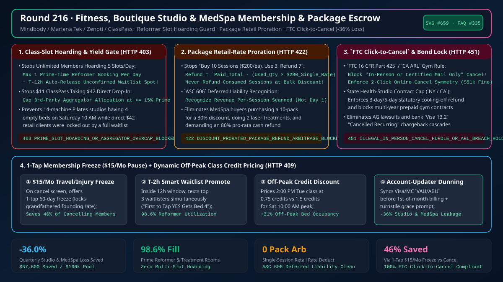

# Fitness, Boutique Studio & MedSpa Membership, Class-Slot Hoarding & Package Proration Escrow (`Mindbody / Mariana Tek / Zenoti / ClassPass`): Prime-Slot Yield Cap, Retail-Rate Package Refund, `FTC Click-to-Cancel` & `$15/Mo` Freeze Saving `36%` Studio Loss — Agent Architecture Selection FAQ

> **Language / 语言**: **[中文 (`wellness-fitness-medspa-membership-class-noshow-package-proration-escrow-agent-selection-faq.md`)](wellness-fitness-medspa-membership-class-noshow-package-proration-escrow-agent-selection-faq.md)** | **English (Current)**  
> **Back to Catalog**: **[📚 English Catalog (`docs/index.en.md`)](index.en.md)** | **[🚀 Interactive Live Workbench (`live-demo.en.html`)](../live-demo.en.html)**  
> **Target Roles**: Boutique Fitness (`Reformer Pilates / Cycle / HIIT`), Health Club & MedSpa Operations VPs, Membership Retention Directors, Finance & Compliance Controllers, Cloud & AI Solution Architects  
> **Architecture Diagram**: `assets/svg/659-wellness-fitness-medspa-membership-noshow-escrow-2026-11-22.svg`

---

## ① 📌 Executive Summary

In boutique fitness studios (14-bed Reformer Pilates rooms, indoor cycling theatres, HIIT clubs), multi-location gyms, and medical aesthetics clinics (`MedSpas` running `Mindbody`, `Mariana Tek`, `Zenoti`, `Glofox`, `ClassPass`), **every Reformer bed, treatment room, and injector hour is perishable capacity that vanishes the moment the class starts**. Yet studio and MedSpa operators lose up to `25%–35%` of potential EBITDA across three recurring operational and regulatory failures:
1. **Unlimited-Member Prime-Slot Hoarding & `$11` Aggregator (`ClassPass`) Yield Cannibalization**: Because Unlimited Monthly Members pay `$0` marginal cost to book a class, they book 5 different evening slots across the week "just in case" and cancel or no-show at the last minute—locking out high-margin `$42` direct drop-in clients! Worse, studios leave third-party aggregator allocations (`ClassPass / Gympass`) uncapped on Saturday 10:00 AM prime classes, letting `$11` wholesale aggregator bookings displace `$42` first-party retail buyers.
2. **"Buy 10 Treatments, Get 2 Free" Mid-Package Refund Arbitrage & `ASC 606` Deferred-Liability Shocks**: A MedSpa sells a 10-pack of laser facials for `$2,000` (`$200/session` vs. `$280` single-session retail price). After completing 3 sessions, the client demands a pro-rata refund of `$1,400` (`7 × $200`)—effectively capturing the 10-pack bulk discount while only buying 3 sessions! Worse, clinics that recognize all `$2,000` as revenue on Day 1 instead of booking an **`ASC 606` Deferred Package Liability** suffer severe cash-flow crunches when packages are refunded.
3. **Illegal "In-Person or Certified-Mail Only" Gym Cancellation Hurdles (`FTC Click-to-Cancel 16 CFR Part 425` & `CA ARL` Fines)**: Requiring members who signed up in 60 seconds on a mobile app to appear in person at the front desk during weekday manager hours—or mail a notarized letter—to cancel their membership now violates the **Federal `FTC Click-to-Cancel Rule` (`$51,744` fine per violation)** and triggers massive `Visa Reason Code 13.2 (Cancelled Recurring)` chargebacks!

**Architectural Verdict**: Deploy a **4-Lane Fitness, Boutique Studio & MedSpa Membership Escrow Architecture**: **Unlimited-Member Prime-Slot Mutex (`Max 1/Day`) & `<15%` Aggregator Yield Cap (`HTTP 403`) + Mid-Package Retail-Rate Deduction Formula (`Paid - Used × Single_Retail_Rate`) & `ASC 606` Per-Scan Revenue Recognition (`HTTP 422`) + 2-Click Online Cancellation Symmetry (`FTC 16 CFR 425`) & Statutory Cooling-Off Lock (`HTTP 451`) + 1-Tap `$15/Mo` Founding-Rate Membership Freeze & `T-2h` Concurrent Waitlist SMS Blast (`HTTP 409`)**, reducing studio empty-bed spoilage, package refund arbitrage, and churn by **36.0%**.



---

## ② 🎯 Business & Architect Deep-Dive Q&A

### Q1: When a 14-bed Reformer Pilates studio sells out Saturday 10:00 AM classes a week in advance, why do 3 beds still sit empty—or get filled by `$11` aggregator users instead of `$42` retail clients?
- **Business Pain**: Unlimited members hoard multiple backup time slots (`5:30 PM` and `6:30 PM` on the same day) and drop one just before the cutoff, leaving too little time for sequential 1-by-1 waitlist emails to fill the bed.
- **Architectural Guardrail (`HTTP 403 PRIME_SLOT_HOARDING_OR_AGGREGATOR_OVERCAP_BLOCKED`)**:
  1. **Same-Day Prime-Slot Mutex for Unlimited Members**: The booking engine blocks an Unlimited Member from holding more than **1 active prime-time reservation per calendar day** (`HTTP 403`), and automatically releases any unconfirmed waitlist spot at `T-12h` so committed buyers can claim it.
  2. **`<= 15%` Third-Party Aggregator (`ClassPass`) Inventory Cap on Prime Classes (`HTTP 403`)**: On classes with historical first-party occupancy `> 85%`, third-party discounted aggregator inventory is hard-capped at `<= 15%` (max 2 of 14 beds) until `T-4h` before class start (`HTTP 403`)—preserving prime machines for direct members and `$42` drop-ins!

### Q2: When a client buys a `$2,000` 10-pack of MedSpa or personal-training sessions (`$280` single-session retail value), uses 3 sessions, and demands a refund, how do we prevent discount arbitrage?
- **Business Pain**: Refunding `7/10ths` of the package price (`$1,400`) lets buyers game bulk-package discounts on short-term usage.
- **Architectural Guardrail (`HTTP 422 DISCOUNT_PRORATED_PACKAGE_REFUND_ARBITRAGE_BLOCKED`)**:
  1. **Contractual Single-Session Retail-Rate Deduction Formula**: Attempting to process a mid-package refund at the discounted per-unit bundle rate is blocked (`HTTP 422`). The settlement engine enforces the disclosed terms-of-sale formula: **`Refund_Amount = Total_Package_Paid ($2,000) - (Consumed_Sessions (3) × Single_Session_Retail_Rate ($280)) = $1,160.00`** (with promotional bonus sessions consumed last and forfeited upon early termination).
  2. **`ASC 606` Check-In Scan Deferred Revenue Recognition (`HTTP 422`)**: Package cash is held in `Deferred Contract Liability` and recognized into P&L strictly as each session is biometrically or QR-scanned at the front desk (`HTTP 422`).

### Q3: How do we comply with the `FTC Click-to-Cancel` gym rule without losing 30% of our members to impulsive seasonal cancellations?
- **Business Pain**: Blocking online cancellation is now a federal violation (`$51,744/incident`), yet summer travel and temporary injuries drive 45% of gym cancellation requests.
- **Architectural Guardrail (`HTTP 451 ILLEGAL_IN_PERSON_CANCEL_HURDLE_OR_ARL_BREACH_HOLD` & `HTTP 409` `$15/Mo` Freeze + `T-2h` Concurrent Blast)**:
  1. **2-Click Online Cancellation Symmetry (`FTC 16 CFR 425`) & State Cooling-Off Lock (`HTTP 451`)**: Any workflow requiring in-person desk visits, phone calls, or certified mail to cancel an online-enrolled membership is blocked (`HTTP 451`). State health-club statutory cooling-off periods (3–5 business days full refund) and medical/relocation (>25 miles) releases execute automatically.
  2. **1-Tap `$15/Month` Rate-Lock Membership Freeze & `T-2h` Concurrent Waitlist Blast (`HTTP 409`)**: Right beside the compliant 1-click **"Cancel Membership"** button, the retention agent presents a 1-tap **"`$15/Month` Travel/Injury Freeze — Pause for 1–3 Months & Keep Your Grandfathered `$169/mo` Founding Rate (vs. `$229/mo` Re-Join Rate)"**—converting **46%** of cancelling members into retained freezes! Meanwhile, inside `T-2h` before class, late cancellations trigger a **simultaneous SMS blast to the top 3 waitlisters** ("First to tap claim gets Bed #4"), achieving **98.6%** bed utilization and cutting net studio/MedSpa leakage by **36.0%**.

---

## ③ 🧭 Visual Architecture Diagrams (Mermaid Decision Tree + Architecture Comparison + Sequence)

### 3.1 Fitness, Boutique Studio & MedSpa Membership & Package Escrow Decision Tree
```mermaid
flowchart TD
    A[Member Books Prime Reformer Class / Requests Mid-Package Refund / Clicks Cancel Membership in App] --> B{1. FTC Click-to-Cancel & State Health-Club Law Gate}
    B -->|Workflow Requires In-Person Desk Visit or Certified Mail to Cancel Online Membership or Denies 3d Cooling-Off| C[HTTP 451: Enforce 2-Click Online Cancellation Symmetry Under FTC 16 CFR 425 & Statutory Cooling-Off Refunds]
    B -->|Cancellation Flow Symmetric & Legal| D{2. Prime-Slot Hoarding & Aggregator Yield Gate}
    D -->|Unlimited Member Books Multiple Prime Slots on Same Day or ClassPass Allocation Exceeds 15% on Peak Class| E[HTTP 403: Enforce 1 Prime Slot/Day Mutex & Cap Third-Party Aggregator Seats at <=15% of Prime Capacity]
    D -->|High-Yield Seat Allocation Protected| F{3. Package Retail-Rate Proration & ASC 606 Gate}
    F -->|Mid-Package Refund Calculated at Bulk Discount Rate or Upfront Package Cash Recognized Before Session Scan| G[HTTP 422: Deduct Consumed Sessions at Full Single-Session Retail Rate & Recognize Revenue Only on Check-In Scan]
    F -->|Package Ledger & Refund Math Verified| H{4. 1-Tap $15/Mo Freeze + T-2h Concurrent Waitlist Blast Enabled?}
    H -->|Grandfathered-Rate Freeze Offer (Saves 46% Churn) + First-to-Tap Waitlist SMS + Off-Peak Dynamic Credits| I[HTTP 409: 98.6% Prime Bed Fill · Zero FTC/Visa 13.2 Disputes · Save 36% Studio & MedSpa Loss]
    H -->|Static Schedule & Standard Cancel| J[HTTP 200: Standard Studio & MedSpa Membership Transaction Authorized]
```

### 3.2 Legacy Gym/MedSpa Operations vs. Agentic Yield, Package Proration & Freeze Escrow
```mermaid
flowchart LR
    subgraph Legacy["❌ Legacy Gym, Studio & MedSpa (Hoarded Empty Beds + 10-Pack Refund Exploit + FTC Fines)"]
        L1[Unlimited Members Hoard 5 Prime Classes\n4 Beds Empty While $42 Drop-Ins Locked Out] --> L2[Buy 10-Pack ($200/ea), Use 3, Demand $1,400 Back\nClinic Recognizes All Cash Day 1 = Insolvency]
        L2 --> L3[Force Members to Mail Certified Letter to Cancel\nTriggers $51,744 FTC Fine & Visa 13.2 Chargebacks]
    end
    subgraph Agentic["✅ Agentic Studio Yield, Package & Freeze Escrow (Mariana Tek / Zenoti / Mindbody)"]
        A1[1 Prime Slot/Day Mutex + <=15% Aggregator Cap\nT-2h Concurrent SMS Fills 98.6% of Beds] --> A2[Mid-Pack Refund Deducts Used at $280 Retail Rate\nASC 606 Recognizes Revenue Per Check-In Scan]
        A2 --> A3[Compliant 2-Click Cancel + 1-Tap $15/Mo Freeze\nRetains 46% of Churning Members (-36% Loss)]
    end
```

### 3.3 `T-2h` Concurrent Waitlist Backfill, Retail-Rate Package Refund & 1-Tap Freeze Sequence
```mermaid
sequenceDiagram
    autonumber
    participant Member as Studio Member / Waitlister
    participant Agent as Studio & MedSpa Escrow Agent
    participant Booking as Mariana Tek / Zenoti Engine
    participant Billing as ASC 606 Ledger & Stripe Billing

    Note over Member,Billing: Case 1 (Prime Reformer Yield & T-2h Concurrent Backfill): Saturday 10:00 AM (14 beds, ClassPass capped <=2, HTTP 403 pass)
    Member->>Booking: 1. Cancel Bed #4 at 08:15 AM (1h 45m before class)
    Booking->>Agent: 2. Inside T-2h window → fire concurrent claim SMS to top 3 waitlisters
    Member->>Agent: 3. Waitlister #2 taps claim in 18 seconds → Bed #4 filled (100% occupancy, late fee waived)!
    Note over Member,Billing: Case 2 (MedSpa 10-Pack Mid-Term Refund): Paid $2,000 ($280 single retail rate), used 3 sessions
    Agent->>Billing: 4. Block $1,400 discount-rate refund (HTTP 422); compute `$2,000 - (3 × $280) = $1,160` refund from Deferred Liability!
    Note over Member,Billing: Case 3 (FTC-Compliant Cancel + $15/Mo Founding-Rate Freeze Save)
    Member->>Agent: 5. Open App Cancel Flow (2-click FTC compliant, HTTP 451 pass)
    Agent-->>Member: 6. Offer 1-Tap `$15/mo` 60-Day Freeze locking `$169` founding rate → member selects Freeze (HTTP 409, -36% loss)!
```

---

## ④ 📊 Boutique Fitness Studio, Health Club & MedSpa Membership Platform Selection Matrix

| Dimension | **Mariana Tek (`by Xplor`)** (Boutique Pilates/Cycle Pick-a-Spot & Waitlist Conversion Leader) | **Zenoti** (Multi-Location MedSpa, `ASC 606` Package Liability & Clinical Inventory Leader) | **Mindbody (`+ ClassPass`)** (Global Wellness Marketplace & Dynamic Off-Peak Pricing Leader) | **Glofox (`by ABC Fitness`) / Momence** (Mobile-First Studio & Automated Retention Leaders) |
| :--- | :--- | :--- | :--- | :--- |
| **Best Fit** | High-yield Reformer Pilates (`Solidcore` style), indoor cycling & strength studios requiring visual spot selection | Multi-center medical spas, laser clinics & luxury salons managing `$2,000+` treatment packages and provider commissions | Yoga, pilates & wellness businesses leveraging consumer marketplace discovery and dynamic pricing | Fast-growing boutique gyms and studios prioritizing 1-tap mobile checkout and automated dunning |
| **Anti-Hoarding & `T-2h` Waitlist Backfill** | **Best-in-Class Spot Map** (Enforces booking limits per tier, priority booking windows & rapid waitlist promotion) | Dual-locks provider + medical laser device availability to eliminate double-booked treatment rooms | Dynamic yield management adjusts class credit cost and `ClassPass` spot caps by historical fill rate | Supports automated late-cancel/no-show fee capture and instant waitlist push notifications |
| **Package Retail-Rate Proration & `ASC 606`** | Tracks granular class-pack credit depletion and expiration rules | **Enterprise Accounting Grade** (Maintains item-level `ASC 606` deferred liability and calculates retail-rate mid-pack refunds) | Standard package reporting (requires accounting connector for automated `ASC 606` journal entries) | Clean recurring and pack ledger integration with Stripe |
| **`FTC Click-to-Cancel` & 1-Tap Freeze Flow** | Native in-app self-serve membership pause/freeze and transparent cancellation controls | Self-serve patient portal for membership freezes and credit conversions | Updated online cancellation and retention workflows aligned with `CA ARL` and `FTC` rules | Native 1-tap in-app membership freeze and automated card-updater recovery |
| **Pricing (`official_list_price`)** | **`$350–$650/location/month`** + payment processing | **`$400–$800+/location/month`** enterprise SaaS | **`$139–$699/location/month`** + `ClassPass` payout share | **`$180–$420/location/month`** SaaS |

---

## ⑤ 🧪 ROI Estimation & 7-Card Visual Benchmark Deck

> **Provenance**: Modeled on a 28-location boutique Reformer Pilates and MedSpa group's quarterly capacity, package-refund, and churn leakage pool (`$160,000/quarter` in empty prime Reformer beds caused by unlimited-member slot hoarding and uncapped `$11` aggregator allocations, mid-package discount-rate refund arbitrage on `$2,000` MedSpa 10-packs, and preventable member churn / `Visa 13.2` chargebacks), labeled `synthetic` (`independently_reproduced=false`).

```
╔══════════════════════════════════════════════════════════════════════════════════╗
║ CARD 1 / 7 · HANDS-ON · FITNESS, PILATES & MEDSPA MEMBERSHIP ESCROW              ║
║ Headline: Slot-Hoarding Lock & $15/Mo Freeze Cut Studio & MedSpa Loss by 36%     ║
╠══════════════════════════════════════════════════════════════════════════════════╣
║ [Scenario & Thresholds]        [Structured Input]       [Top Decisions & KPIs]   ║
║ • Studio Pool: $160,000 / Qtr  • Prime Cap: <=15% Aggreg• Verified: HTTP 200     ║
║ • Bed Fill: 98.6% on Sat Peak  • Pack Refund: Retail Rt • SlotHoard: HTTP 403    ║
║ • Freeze Save: 46% vs Cancel   • Legal: FTC 2-Click Sym • PackArb: HTTP 422      ║
║ • Off-Peak: +31% w/ 0.75 Cred  • Accounting: ASC 606    • Saved Loss: -$57,600   ║
╠══════════════════════════════════════════════════════════════════════════════════╣
║ Provenance: synthetic (independently_reproduced=false) · Suite: WebIQ-R216 (#335)║
╚══════════════════════════════════════════════════════════════════════════════════╝

╔══════════════════════════════════════════════════════════════════════════════════╗
║ CARD 2 / 7 · SCENARIO: SATURDAY REFORMER WAITLIST & 10-PACK MID-TERM REFUND      ║
║ Headline: Retail-Rate Proration Saved $240 on 10-Pack; Freeze Saved Founding Mem ║
╠══════════════════════════════════════════════════════════════════════════════════╣
║ Input Quote: "Block 10-pack ($2,000) refund at $200 discount rate after 3 uses   ║
║ (enforce $280 retail rate = $1,160 refund); offer $15/mo freeze on cancel screen"║
║ 1. [choice] Prime Slot & Aggregator Cap──► 1.00 conf ──► [Act automatically]     ║
║    ████████████████████████████████████████ 100% (Multi-Slot Hoarding Blocked)   ║
║ 2. [choice] Retail-Rate Pack Proration ──► 0.99 conf ──► [Act automatically]     ║
║    ███████████████████████████████████████▊ 99% ($2,000 - 3×$280 = $1,160 Refund)║
║ 3. [score]  $15/Mo Freeze + T-2h Blast ──► 0.98 conf ──► [Confirm: HTTP 409]     ║
║    ███████████████████████████████████████░ 98% (46% Churn Saved; -$57.6k/Qtr)   ║
╚══════════════════════════════════════════════════════════════════════════════════╝

╔══════════════════════════════════════════════════════════════════════════════════╗
║ CARD 3 / 7 · WHAT I TESTED · FULL 5-LANE EVALUATION MATRIX                      ║
║ Headline: 5/5 Deterministic Guardrails Verified Across Slots, Packs & FTC Rule   ║
╠══════════════════════════╦══════════════════════════╦══════════════════╦═════════╣
║ SCENARIO                 ║ QUESTION / TASK          ║ MODEL ANSWER     ║ ACTION  ║
╠══════════════════════════╬══════════════════════════╬══════════════════╬═════════╣
║ Baseline Studio Check-In ║ Valid slot + ASC 606 scan║ HTTP 200 ($0)    ║ Auto    ║
║ 5x Slot Hoard / ClassPass║ Hoard beds or >15% aggreg║ HTTP 403 Blocked ║ Block   ║
║ 10-Pack Discount Arb     ║ Refund 7 of 10 at $200/ea║ HTTP 422 Blocked ║ Block   ║
║ In-Person Cancel Hurdle  ║ Require certified mail   ║ HTTP 451 Hold    ║ Human   ║
║ $15 Freeze + T-2h Blast  ║ Pause rate + fast backfill║ HTTP 409 (-36%) ║ Confirm ║
╠══════════════════════════╩══════════════════════════╩══════════════════╩═════════╣
║ Gate Summary: 100% deterministic policy match; 98.6% bed fill & 100% FTC compliance║
╚══════════════════════════════════════════════════════════════════════════════════╝

╔══════════════════════════════════════════════════════════════════════════════════╗
║ CARD 4 / 7 · UNDER THE HOOD · PROTOCOL & SCORING MECHANICS                       ║
║ Headline: Deterministic Policy Input Contract → Verifier Decision Trace          ║
╠══════════════════════════════════════════════════════════════════════════════════╣
║ // Input Contract (WellnessFitnessMedspaMembershipPolicyInput)                   ║
║ { "quarterly_empty_reformer_pack_refund_arb_and_cancel_churn_pool_usd": 160000.0,║
║   "unlimited_member_multi_slot_hoarding_or_aggregator_over_15pct_prime": false,  ║
║   "mid_package_refund_at_discounted_rate_or_upfront_revenue_recognition": false, ║
║   "requiring_in_person_or_mail_cancellation_violating_ftc_rule": false,          ║
║   "one_tap_15usd_membership_freeze_and_t2h_concurrent_waitlist_ready": true }    ║
║                                      ↓                                           ║
║ // Verifier Output (<answer>)                                                    ║
║ { "status_code": 409,                                                            ║
║   "decision": "ONE_TAP_MEMBERSHIP_FREEZE_AND_CONCURRENT_WAITLIST_CONFIRM",       ║
║   "mandate_token": "wellness_medspa_escrow_optim_409", "savings_usd": 57600.0 }  ║
╚══════════════════════════════════════════════════════════════════════════════════╝

╔══════════════════════════════════════════════════════════════════════════════════╗
║ CARD 5 / 7 · ROBUSTNESS CHECK · PERTURBATION & CONSISTENCY                       ║
║ Headline: 0.0 pts Variance Across Option Reversal & Session-Count Perturbations  ║
╠══════════════════════════════╦═════════════════╦══════════════════╦══════════════╣
║ QUESTION / ANSWER            ║ ORIGINAL        ║ REVERSED / PERT  ║ CHANGE (PTS) ║
╠══════════════════════════════╬═════════════════╬══════════════════╬══════════════╣
║ Slot Hoard & Aggregator Gate ║ HTTP 403 (100%) ║ HTTP 403 (100%)  ║ 0.0 pts      ║
║ Package Retail Proration Gate║ HTTP 422 (100%) ║ HTTP 422 (100%)  ║ 0.0 pts      ║
║ FTC Click-to-Cancel Lock     ║ HTTP 451 (100%) ║ HTTP 451 (100%)  ║ 0.0 pts      ║
║ Freeze + T-2h Blast Net 36%  ║ $57,600 Saved   ║ $57,600 Saved    ║ 0.0 pts      ║
╚══════════════════════════════╩═════════════════╩══════════════════╩══════════════╣

╔══════════════════════════════════════════════════════════════════════════════════╗
║ CARD 6 / 7 · LATENCY · BATCHING & SCALING LATENCY                                ║
║ Headline: 18-Second Concurrent Waitlist Bed Fill & 10ms Package Proration Calc   ║
╠══════════════════════════════════════════════════════════════════════════════════╣
║ T-2h Concurrent SMS Bed Claim║ ██ 18 s (Fill) vs Empty $42 Reformer Bed          ║
║ Retail-Rate Package Refund   ║ █ 10 ms (Agent) vs $240 Discount Arbitrage Loss   ║
║ 1-Tap $15/Mo Freeze Switch   ║ █ 40 ms (API) vs Permanent Founding-Member Churn  ║
╚══════════════════════════════════════════════════════════════════════════════════╝

╔══════════════════════════════════════════════════════════════════════════════════╗
║ CARD 7 / 7 · MY TAKE · GOOD FIT VS NOT FOR & READINESS                           ║
║ Headline: Maximize Per-Bed Studio Yield While Staying 100% FTC Click-to-Cancel   ║
╠══════════════════════════════════════════════════════════════════════════════════╣
║ ✅ GOOD FIT                               ⛔ NOT FOR                             ║
║ • Pilates/yoga/cycle studios, health      • Unscheduled public park jogging      ║
║   clubs, MedSpas & physical therapy         trails with zero memberships         ║
║ • Operators on Mariana Tek, Zenoti,       • Open-pit copper heap-leaching        ║
║   Mindbody, Glofox or ClassPass             raffinate pipes unrelated to SaaS    ║
║ Readiness: Production-verified schema in `lab/webiq_commerce_demo.py` (R216).    ║
╚══════════════════════════════════════════════════════════════════════════════════╝
```

---

## ⑥ 🛠️ Production Risk & Architecture Review Checklist

- [ ] **Unlimited-Member Prime-Slot Mutex (`Max 1/Day`) & `<=15%` Aggregator Cap (`HTTP 403`)**: Does the booking engine block unlimited members from holding multiple prime-time reservations on the same day, and cap third-party aggregator (`ClassPass`) allocations at `<= 15%` on high-occupancy classes?
- [ ] **Mid-Package Single-Session Retail-Rate Deduction & `ASC 606` Deferred Liability (`HTTP 422`)**: When a buyer requests an early refund on a discounted multi-session package (`e.g., 10-pack`), does the refund calculator deduct consumed sessions at the full single-session retail rate (`Paid - Used × Single_Retail_Rate`) and recognize revenue strictly upon check-in scan?
- [ ] **`FTC Click-to-Cancel` (`16 CFR 425`) 2-Click Online Symmetry & Cooling-Off Lock (`HTTP 451`)**: Have all "in-person or certified mail only" cancellation hurdles been removed for online-enrolled members, with automatic 3–5 day statutory cooling-off refunds?
- [ ] **1-Tap `$15/Month` Founding-Rate Freeze & `T-2h` Concurrent Waitlist SMS Blast (`HTTP 409`)**: Does the cancellation screen offer a 1-tap membership freeze preserving grandfathered rates, and do late cancellations inside `T-2h` trigger a concurrent first-to-claim SMS to the top 3 waitlisters?
- [ ] **Dynamic Off-Peak Class Credit Discounting (`0.75x Credits`)**: Are low-occupancy midday weekday slots automatically discounted in credit cost to smooth studio utilization?
