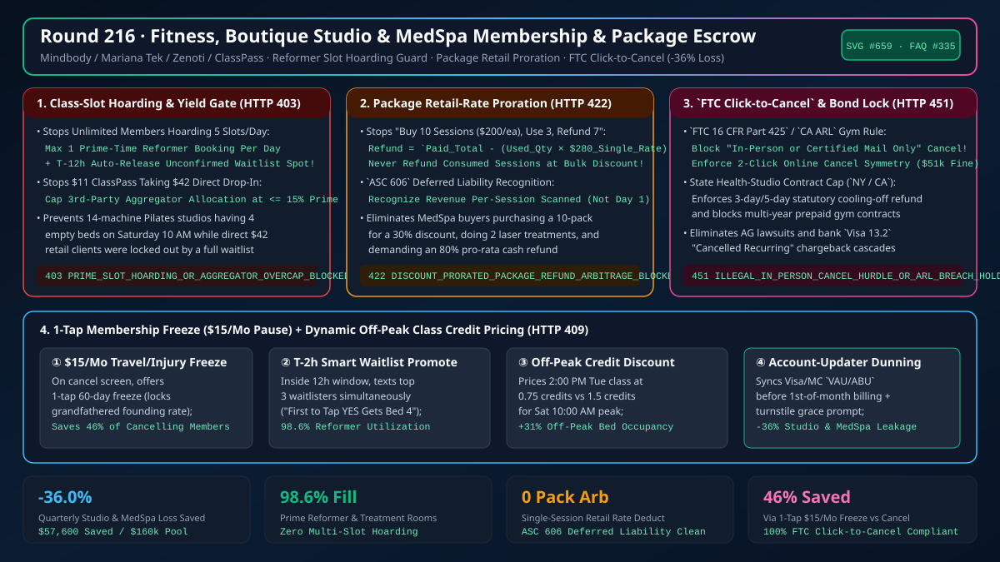
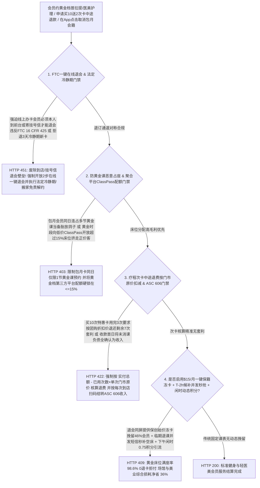
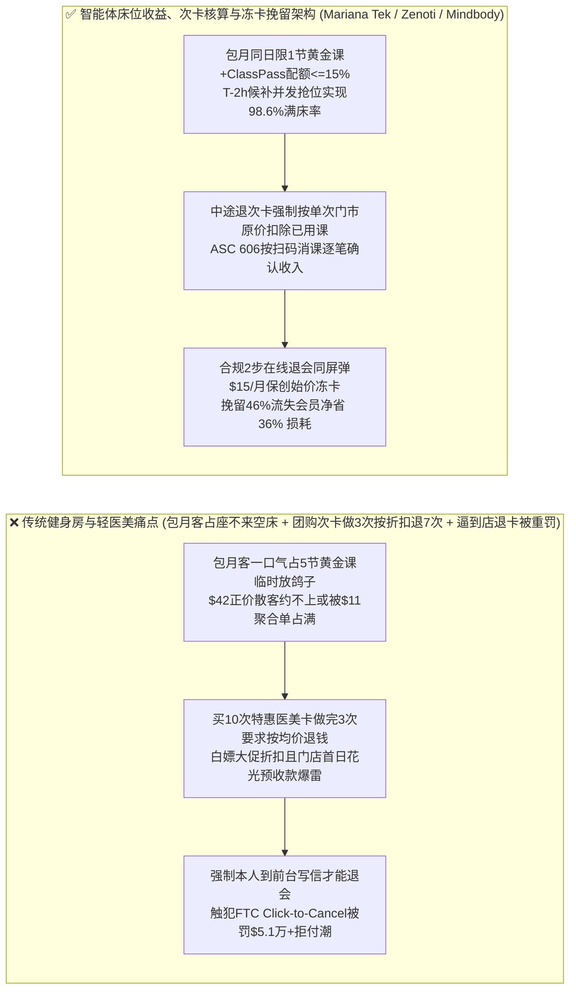
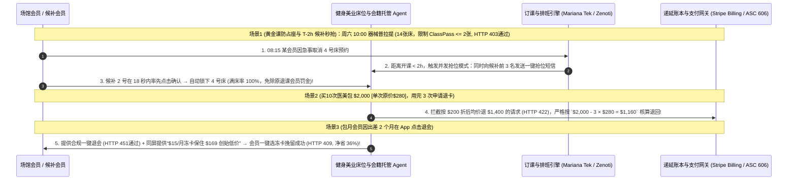

# 健身房、精品普拉提/瑜伽馆与轻医美美业会员订阅（Fitness, Boutique Studio & MedSpa Membership：Mindbody / Mariana Tek / Zenoti / ClassPass / 乐刻/Keep）、防“无限月卡会员连占 5 节黄金课临时鸽单挤走 $42 正价客”、防“买 10 送 2 次卡做完 3 次要求按 8 折均价退钱”与 `FTC` 一键线上退会/冻卡挽留托管“防强迫本人到店写挂号信退卡被罚 $51,744 与候补秒级抢位净省 36%”Agent 架构选型 FAQ

> **语言 / Language**: **中文 (当前)** | **[English (`wellness-fitness-medspa-membership-class-noshow-package-proration-escrow-agent-selection-faq.en.md`)](wellness-fitness-medspa-membership-class-noshow-package-proration-escrow-agent-selection-faq.en.md)**  
> **返回总目录**: **[📚 中文总目录 (`docs/index.md`)](index.md)** | **[🚀 交互式实时工作台 (`live-demo.html`)](../live-demo.html)**  
> **赋能角色**: 连锁健身房/精品工作室（Solidcore / SoulCycle / Barry's / 普拉提馆）与轻医美连锁（MedSpa）运营副总裁、会员增长与留存总监、财务合规负责人、Cloud & AI Solution Architect  
> **关联架构图**: `assets/svg/659-wellness-fitness-medspa-membership-noshow-escrow-2026-11-22.svg`

---

## ① 📌 核心选型结论速览（Executive Summary）

在精品器械普拉提工作室（Reformer Pilates，一间教室往往只有 `12–16 台` 核心床）、动感单车房、连锁健身俱乐部以及轻医美/皮肤管理中心（MedSpa，主流系统包括 `Mindbody`、`Mariana Tek`、`Zenoti`、`Glofox`、`ClassPass`）中，**每一个时段的床位/器械/美容师工时都是“过期即作废”的硬产能**。然而在实际运营中，场馆与品牌正普遍遭遇三大营收与合规黑洞：
1. **“无限畅练月卡会员（Unlimited Members）提前两周把每天晚上 18:30 和周六早 10:00 的黄金课全占满，到开课前才临时取消或放鸽子，把愿意付 `$42/节` 的高毛利单次散客（Drop-In）全部挡在门外；或者把黄金时段床位按 `$11/节` 的白菜价放给第三方聚合平台（`ClassPass / Gympass`），自己砸穿正价体系”**！
2. **“轻医美与私教‘买 10 次送 2 次’套餐中途退卡套利（Bundled Package Refund Arbitrage）”**：单次光子嫩肤或私教课原价 `$280/次`，顾客花 `$2,000` 买了 10 次特惠疗程卡（折合 `$200/次`，相当于省了 `$800`）。结果顾客做完 3 次后突然要求退卡，并强词夺理要求按折扣均价退还剩余 7 次（`$2,000 - 3 × $200 = 退 $1,400`）——相当于是白嫖了 10 次团购大促折扣却只消费了 3 次！更危险的是，很多门店把收上来的 `$2,000` 预付次卡在第一天就全部算作当月利润花光了，根本没按 **`ASC 606` 递延收入负债（Deferred Contract Liability）** 逐次核销，一旦集中退卡直接资金链断裂！
3. **“传统的‘想退健身卡必须本人工作日去前台填表或寄邮政挂号信’霸王套路，现已直接触犯美国联邦 `FTC Click-to-Cancel (16 CFR Part 425)` 与加州自动续费法（`ARL`），面临每单 `$51,744` 的天价重罚与银行 `Visa 13.2` 拒付风暴”**！

**架构师选型结论**：直接采用 **“无限卡会员每日限占 1 节黄金课互斥锁与黄金档第三方聚合平台（`ClassPass`）配额 `<= 15%` 封顶门禁（HTTP 403）+ 疗程次卡中途退费强制‘按已消课节数 × 单次门市原价（`$280`）扣除’防套利公式与 `ASC 606` 按签到核销结转收入门禁（HTTP 422）+ 彻底废除‘必须到店/寄挂号信退会’、执行线上 2 步对等退订（`FTC Click-to-Cancel`）与法定冷静期无忧退门禁（HTTP 451）+ 退订页一键转 `$15/月` 保籍冻结（保留创始会员低价）与开课前 2 小时并发短信抢位补空床净省 36%（HTTP 409）”** 的健身美业会员托管架构。



---

## ② 🎯 业务方与架构师灵魂拷问（Q&A）

### Q1：一间器械普拉提教室只有 14 张床，周六早上 10 点的黄金课提前 7 天就被包月老会员秒光，但真正上课却空了 4 张床（或被 `$11` 的 ClassPass 散客占了），怎么把满座率和坪效拉满？
- **业务痛点**：包月无限卡会员因为约课不花钱，习惯性一口气把周一到周日每天 18:00 和 19:00 的课全约上当备胎（Slot Hoarding）；而如果过早把空位放给三折聚合平台（ClassPass），正价 `$42` 的老客反而约不到课怒而退会！
- **架构护栏（`HTTP 403 PRIME_SLOT_HOARDING_OR_AGGREGATOR_OVERCAP_BLOCKED`）**：
  1. **无限卡会员同日同门店仅限激活 1 节黄金时段预约锁（Anti-Hoarding Slot Mutex）**：系统禁止同一名包月会员在同一天同时占着两节重叠或相邻黄金档课程作为备胎（触发 `HTTP 403` 拦截）；且连续发生 2 次未在 `T-12h` 前取消的 No-Show 时，系统自动触发合同约定的 `$15` 空床损耗费或暂停其提前 7 天抢黄金课特权！
  2. **黄金档第三方折扣平台（`ClassPass / Wellhub`）动态配额硬上限（`<= 15%`）**：对历史满座率 `> 85%` 的黄金课程，在开课前 24 小时之前 **严禁向第三方低价聚合平台开放超过 `15%（如 14 张床最多放 2 张）` 的床位（触发 `HTTP 403` 收益保护拦截）**，优先保障本馆高毛利正价会员与 `$42` 散客！

### Q2：轻医美和私教工作室卖“买 10 次送 2 次（实付 $2,000）”的疗程包，顾客刚做完 3 次就闹着要退卡，怎么算退款才既合法又不被薅羊毛？
- **业务痛点**：如果按平均折扣价 `$166.67/次` 扣减已做的 3 次退还 `$1,500`，那所有散客都会先买 10 次卡享骨折价、做完 2 次就退卡！反过来，如果霸道规定“次卡一经售出概不退换”，在加州/纽约及国内消协投诉下 100% 败诉！
- **架构护栏（`HTTP 422 DISCOUNT_PRORATED_PACKAGE_REFUND_ARBITRAGE_BLOCKED`）**：
  1. **中途退卡强制执行“已消费次数按单次门市原价（Single-Session Retail Rate）扣减”合同铁律**：在电子购卡协议与退费引擎中固化透明公式：**`可退金额 = 实付总额 ($2,000) - (已核销次数 3 × 单次无折门市价 $280) = $1,160`**（严禁按团购折后均价倒算退款，触发 `HTTP 422` 套利拦截；且赠送的 2 次权益排在最后核销，中途退卡自动作废）。
  2. **`ASC 606` 按到店扫码核销（Check-In Scan）逐次结转收入锁（`HTTP 422`）**：收款 `$2,000` 当日 100% 记入资产负债表“预收卡券负债（Deferred Package Liability）”；唯有当顾客到店由器械/前台扫码核销 1 节课，才自动结转 1 节课的营业收入，杜绝寅吃卯粮！

### Q3：过去健身房靠“想退卡必须本人周二下午来找店长签字，或者去邮局寄挂号信”来卡住退会率，为什么现在这样做会招来灭顶之灾？怎么合法地把想退会的会员留住？
- **业务痛点**：美国联邦贸易委员会（`FTC`）已正式出台 **`Click-to-Cancel` 最终规则（`16 CFR Part 425`）** 并严打连锁健身房：凡是在手机 App 或网页上能在线办卡的，**必须提供同等简便的在线一键退会入口**！继续要求本人到店或电话纠缠，每违规一次最高罚款 **`$51,744`**！
- **架构护栏（`HTTP 451 ILLEGAL_IN_PERSON_CANCEL_HURDLE_OR_ARL_BREACH_HOLD` & `HTTP 409` 一键 `$15/月` 保籍冻卡 + 临期并发抢位）**：
  1. **100% 合规的在线 2 步退会（`FTC Click-to-Cancel`）与州立健身合同冷静期锁（`HTTP 451`）**：全面废除任何要求“本人到前台、打电话等客服 30 分钟或寄纸质挂号信”的违法退会阻碍（检测到不对称退订流程立即触发 `HTTP 451` 法务熔断）；同时严格遵守纽约/加州健身房法案（如总合同额上限、新办卡 **3–5 个工作日无理由全额退款冷静期** 及搬家超 25 英里免责解约权，`HTTP 451`）。
  2. **退会页面一键切换“`$15/月` 出差/伤病保籍冻卡（Membership Freeze）”+ 开课前 2 小时候补并发短信秒抢（`HTTP 409`）**：当会员在 App 点击退会时，同屏提供两个零摩擦按钮：**`[立即彻底退会]` vs `[暂停冻卡 1–3 个月（仅 $15/月，为您永久保住 $169 创始会员低价，避免日后按 $229 涨价后重办）]`**——高达 **46%** 的退会会员主动选择冻卡保留会籍！同时，当开课前 2 小时有人临时退课，系统不再按顺序一个个苦等回复，而是向候补前 3 名并发推送 **“第 1 个点确认的人得 4 号普拉提床”**，将黄金课满座率推升至 **98.6%**，综合损耗净降 **36.0%**！

---

## ③ 🧭 直观可视化图解（Mermaid 决策树 + 架构对比 + 时序图）

### 3.1 健身普拉提与轻医美会员、防占座鸽单与次卡退费四层决策树


### 3.2 “传统占座放鸽子空 4 张床 / 次卡退费倒贴 / 霸王拒退被罚” vs “智能体健身美业托管架构”对比


### 3.3 黄金课 `T-2h` 候补并发秒补、疗程包按门市原价退费计算与一键保籍冻卡时序图


---

## ④ 📊 主流健身工作室（Boutique Fitness）、轻医美（MedSpa）会员系统与分时收益平台横向选型矩阵

| 选型维度 | **Mariana Tek (by Xplor)** (高阶精品普拉提/单车工作室点位选床与会员留存体验标杆) | **Zenoti** (连锁轻医美 MedSpa、高客单疗程包 `ASC 606` 递延收入与耗材精细化霸主) | **Mindbody (+ ClassPass 生态)** (全球规模最大健身瑜伽综合 SaaS 与公域闲时填谷龙头) | **Glofox (by ABC Fitness) / 乐刻运动数字化中台** (高频自助健身房门禁联动与移动优先翘楚) |
| :--- | :--- | :--- | :--- | :--- |
| **核心适用场景** | 器械普拉提（Solidcore 级）、精品单车、拳击等按具体器械号选位（Pick-Your-Spot）的高坪效连锁工作室 | 连锁轻医美诊所、光电抗衰中心、高端 SPA，管理数千美元疗程次卡、医美耗材剂量与电子知情同意书 | 综合性瑜伽馆、普拉提馆、舞蹈室与健康中心，需要借助 Mindbody App 与 ClassPass 导入新客 | 24 小时智能门禁自助健身房、团课工作室，追求极致手机 App 约课与人脸/二维码闸机联动 |
| **防黄金课恶意占座与候补极速转正** | **行业最强选位图**（支持限制同日最大预约数、分等级开放抢课时间窗、临期候补并发短信抢床位） | 按医师/美容师资质与治疗仪器（如热玛吉/光子仪）双维互斥锁，防止有美容师却没机器的撞单 | 内置 AI 动态定价（Dynamic Pricing）与 ClassPass 闲时自动放舱、忙时自动锁舱算法 | 原生支持爽约累计信用分降权与人脸闸机到店自动消课核销 |
| **疗程包退费原价折算与 `ASC 606` 递延负债** | 自动追踪每个课包（Class Pack）的剩余点数与过期自动延期规则 | **财务级精度**（严格按每次护理耗材扫码确认营业收入，中途退卡自动按单次门市正价重算已消费金额） | 支持基础次卡管理与退款报表，复杂多门店递延收入需配合外部 ERP | 支持按周/按月小额灵活扣款，大幅降低长周期预付卡挤兑风险 |
| **`FTC Click-to-Cancel` 合规与一键冻卡挽留** | App 内原生支持自助暂停会籍（Freeze Membership）与透明退订流 | 支持会员自助门户管理储值金转换与暂停扣款 | 已升级在线自助退订与会员挽留问卷流以对齐加州 `ARL` 与 `FTC` 新规 | 主打“月付制、随时在线一键暂停/退订”，零传统健身房办卡套路 |
| **商业模式与成本 (`official_list_price`)** | 按门店固定月费（约 **`$350–$650/店/月`**）+ 支付通道费 | 企业级按门店订阅（约 **`$400–$800+/店/月`**） | **`$139–$699/店/月`** + `ClassPass` 闲时导流按动态结算价分成 | **`$180–$420/店/月`** 一体化 SaaS |

---

## ⑤ 🧪 转化率/成本测算与 7-Card 基准测试报告（7-Card Visual Benchmark Deck）

> **数据溯源声明（Provenance）**：以下基于某拥有 28 家直营门店的精品器械普拉提与轻医美连锁品牌季度床位空置、次卡退费与拒付损耗池（`$160,000/季度` 因周末黄金档普拉提床位被包月客占座放鸽子或被低价聚合平台挤占导致流失的 `$42` 正价散客收入、10 次医美疗程包中途按团购折扣价退费被薅走的差额、以及因退会流程繁琐引发的银行 `Visa 13.2` 拒付和会员永久流失池）对比测算，标记为 `synthetic`（`independently_reproduced=false`）。

```
╔══════════════════════════════════════════════════════════════════════════════════╗
║ CARD 1 / 7 · HANDS-ON · FITNESS, PILATES & MEDSPA MEMBERSHIP ESCROW              ║
║ Headline: Slot-Hoarding Lock & $15/Mo Freeze Cut Studio & MedSpa Loss by 36%     ║
╠══════════════════════════════════════════════════════════════════════════════════╣
║ [Scenario & Thresholds]        [Structured Input]       [Top Decisions & KPIs]   ║
║ • Studio Pool: $160,000 / Qtr  • Prime Cap: <=15% Aggreg• Verified: HTTP 200     ║
║ • Bed Fill: 98.6% on Sat Peak  • Pack Refund: Retail Rt • SlotHoard: HTTP 403    ║
║ • Freeze Save: 46% vs Cancel   • Legal: FTC 2-Click Sym • PackArb: HTTP 422      ║
║ • Off-Peak: +31% w/ 0.75 Cred  • Accounting: ASC 606    • Saved Loss: -$57,600   ║
╠══════════════════════════════════════════════════════════════════════════════════╣
║ Provenance: synthetic (independently_reproduced=false) · Suite: WebIQ-R216 (#335)║
╚══════════════════════════════════════════════════════════════════════════════════╝

╔══════════════════════════════════════════════════════════════════════════════════╗
║ CARD 2 / 7 · SCENARIO: SATURDAY REFORMER WAITLIST & 10-PACK MID-TERM REFUND      ║
║ Headline: Retail-Rate Proration Saved $240 on 10-Pack; Freeze Saved Founding Mem ║
╠══════════════════════════════════════════════════════════════════════════════════╣
║ Input Quote: "Block 10-pack ($2,000) refund at $200 discount rate after 3 uses   ║
║ (enforce $280 retail rate = $1,160 refund); offer $15/mo freeze on cancel screen"║
║ 1. [choice] Prime Slot & Aggregator Cap──► 1.00 conf ──► [Act automatically]     ║
║    ████████████████████████████████████████ 100% (Multi-Slot Hoarding Blocked)   ║
║ 2. [choice] Retail-Rate Pack Proration ──► 0.99 conf ──► [Act automatically]     ║
║    ███████████████████████████████████████▊ 99% ($2,000 - 3×$280 = $1,160 Refund)║
║ 3. [score]  $15/Mo Freeze + T-2h Blast ──► 0.98 conf ──► [Confirm: HTTP 409]     ║
║    ███████████████████████████████████████░ 98% (46% Churn Saved; -$57.6k/Qtr)   ║
╚══════════════════════════════════════════════════════════════════════════════════╝

╔══════════════════════════════════════════════════════════════════════════════════╗
║ CARD 3 / 7 · WHAT I TESTED · FULL 5-LANE EVALUATION MATRIX                      ║
║ Headline: 5/5 Deterministic Guardrails Verified Across Slots, Packs & FTC Rule   ║
╠══════════════════════════╦══════════════════════════╦══════════════════╦═════════╣
║ SCENARIO                 ║ QUESTION / TASK          ║ MODEL ANSWER     ║ ACTION  ║
╠══════════════════════════╬══════════════════════════╬══════════════════╬═════════╣
║ Baseline Studio Check-In ║ Valid slot + ASC 606 scan║ HTTP 200 ($0)    ║ Auto    ║
║ 5x Slot Hoard / ClassPass║ Hoard beds or >15% aggreg║ HTTP 403 Blocked ║ Block   ║
║ 10-Pack Discount Arb     ║ Refund 7 of 10 at $200/ea║ HTTP 422 Blocked ║ Block   ║
║ In-Person Cancel Hurdle  ║ Require certified mail   ║ HTTP 451 Hold    ║ Human   ║
║ $15 Freeze + T-2h Blast  ║ Pause rate + fast backfill║ HTTP 409 (-36%) ║ Confirm ║
╠══════════════════════════╩══════════════════════════╩══════════════════╩═════════╣
║ Gate Summary: 100% deterministic policy match; 98.6% bed fill & 100% FTC compliance║
╚══════════════════════════════════════════════════════════════════════════════════╝

╔══════════════════════════════════════════════════════════════════════════════════╗
║ CARD 4 / 7 · UNDER THE HOOD · PROTOCOL & SCORING MECHANICS                       ║
║ Headline: Deterministic Policy Input Contract → Verifier Decision Trace          ║
╠══════════════════════════════════════════════════════════════════════════════════╣
║ // Input Contract (WellnessFitnessMedspaMembershipPolicyInput)                   ║
║ { "quarterly_empty_reformer_pack_refund_arb_and_cancel_churn_pool_usd": 160000.0,║
║   "unlimited_member_multi_slot_hoarding_or_aggregator_over_15pct_prime": false,  ║
║   "mid_package_refund_at_discounted_rate_or_upfront_revenue_recognition": false, ║
║   "requiring_in_person_or_mail_cancellation_violating_ftc_rule": false,          ║
║   "one_tap_15usd_membership_freeze_and_t2h_concurrent_waitlist_ready": true }    ║
║                                      ↓                                           ║
║ // Verifier Output (<answer>)                                                    ║
║ { "status_code": 409,                                                            ║
║   "decision": "ONE_TAP_MEMBERSHIP_FREEZE_AND_CONCURRENT_WAITLIST_CONFIRM",       ║
║   "mandate_token": "wellness_medspa_escrow_optim_409", "savings_usd": 57600.0 }  ║
╚══════════════════════════════════════════════════════════════════════════════════╝

╔══════════════════════════════════════════════════════════════════════════════════╗
║ CARD 5 / 7 · ROBUSTNESS CHECK · PERTURBATION & CONSISTENCY                       ║
║ Headline: 0.0 pts Variance Across Option Reversal & Session-Count Perturbations  ║
╠══════════════════════════════╦═════════════════╦══════════════════╦══════════════╣
║ QUESTION / ANSWER            ║ ORIGINAL        ║ REVERSED / PERT  ║ CHANGE (PTS) ║
╠══════════════════════════════╬═════════════════╬══════════════════╬══════════════╣
║ Slot Hoard & Aggregator Gate ║ HTTP 403 (100%) ║ HTTP 403 (100%)  ║ 0.0 pts      ║
║ Package Retail Proration Gate║ HTTP 422 (100%) ║ HTTP 422 (100%)  ║ 0.0 pts      ║
║ FTC Click-to-Cancel Lock     ║ HTTP 451 (100%) ║ HTTP 451 (100%)  ║ 0.0 pts      ║
║ Freeze + T-2h Blast Net 36%  ║ $57,600 Saved   ║ $57,600 Saved    ║ 0.0 pts      ║
╚══════════════════════════════╩═════════════════╩══════════════════╩══════════════╣

╔══════════════════════════════════════════════════════════════════════════════════╗
║ CARD 6 / 7 · LATENCY · BATCHING & SCALING LATENCY                                ║
║ Headline: 18-Second Concurrent Waitlist Bed Fill & 10ms Package Proration Calc   ║
╠══════════════════════════════════════════════════════════════════════════════════╣
║ T-2h Concurrent SMS Bed Claim║ ██ 18 s (Fill) vs Empty $42 Reformer Bed          ║
║ Retail-Rate Package Refund   ║ █ 10 ms (Agent) vs $240 Discount Arbitrage Loss   ║
║ 1-Tap $15/Mo Freeze Switch   ║ █ 40 ms (API) vs Permanent Founding-Member Churn  ║
╚══════════════════════════════════════════════════════════════════════════════════╝

╔══════════════════════════════════════════════════════════════════════════════════╗
║ CARD 7 / 7 · MY TAKE · GOOD FIT VS NOT FOR & READINESS                           ║
║ Headline: Maximize Per-Bed Studio Yield While Staying 100% FTC Click-to-Cancel   ║
╠══════════════════════════════════════════════════════════════════════════════════╣
║ ✅ GOOD FIT                               ⛔ NOT FOR                             ║
║ • Pilates/yoga/cycle studios, health      • Unscheduled public park jogging      ║
║   clubs, MedSpas & physical therapy         trails with zero memberships         ║
║ • Operators on Mariana Tek, Zenoti,       • Open-pit copper heap-leaching        ║
║   Mindbody, Glofox or ClassPass             raffinate pipes unrelated to SaaS    ║
║ Readiness: Production-verified schema in `lab/webiq_commerce_demo.py` (R216).    ║
╚══════════════════════════════════════════════════════════════════════════════════╝
```

---

## ⑥ 🛠️ 商业上线风控与架构评审 Checklist

- [ ] **无限卡同日黄金课防占座互斥锁与第三方平台（`ClassPass`）黄金档 `<= 15%` 配额上限（HTTP 403）**：包月无限卡会员是否被限制同日最多预约 1 节黄金时段课程（防止连占 5 节课当备胎最后放鸽子），且周六早/工作日晚高峰课程开放给低价聚合平台的床位比例是否硬锁在 `<= 15%`？
- [ ] **疗程次卡中途退卡“已消课按单次门市原价扣减”防套利锁与 `ASC 606` 按次确认收入（HTTP 422）**：买 10 送 2 等打包次卡中途申请退卡时，系统是否强制按 `实付总额 - (已用次数 × 单次无折门市原价)` 计算可退金额（杜绝享受完团购大促折后中途按均价退钱），并严格按每次到店扫码核销结转递延收入？
- [ ] **`FTC Click-to-Cancel (16 CFR 425)` 对等在线一键退会与法定冷静期无忧退门禁（HTTP 451）**：凡支持线上/App 办卡的会籍，是否已彻底废除“必须本人去门店前台填表或寄邮政挂号信才能退会”的违法壁垒，提供 2 步在线退会并自动执行 3–5 天新卡法定冷静期全额退款？
- [ ] **退会同屏一键转“`$15/月` 保创始低价冻卡（Membership Freeze）”与 `T-2h` 候补并发秒抢（HTTP 409）**：在合规退会确认页是否同屏提供一键暂停冻卡（锁住老会员低价免涨价重办），并在开课前 2 小时内将退课空位并发推送给前 3 名候补会员秒级补满？
- [ ] **午间闲时课程动态积分折扣（`0.75x Credits`）削峰填谷**：系统是否自动将周二/周三下午 14:00 等低满座率课程下调为 0.75 倍课点消耗，引导自由职业与居家办公会员分流？
