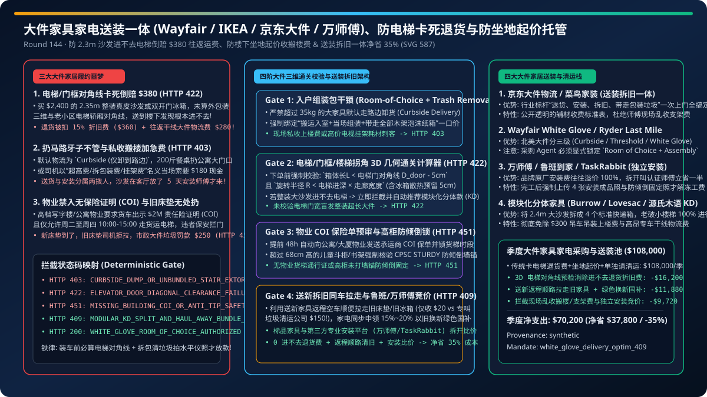
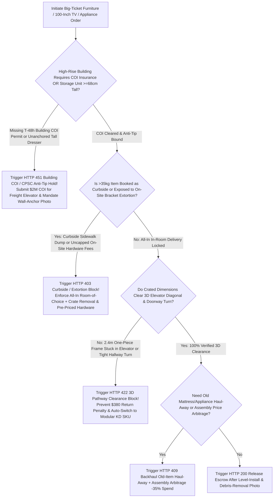
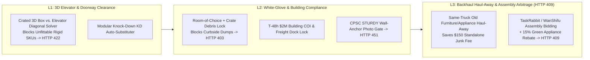
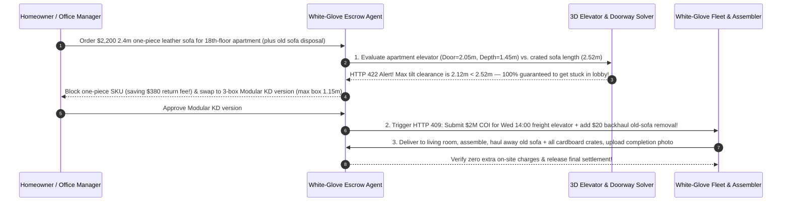

# White-Glove Furniture & Appliance Delivery (`Wayfair / IKEA / JD Heavy-Goods / WanShifu`), 3D Elevator-Diagonal Clearance Gate, `CPSC STURDY` Anti-Tip & Haul-Away Escrow: Stopping `$380` Unfittable Sofa Return Penalties, Curbside Dump Extortion & `$160` Bracket Upsells (`-35%` Spend) Agent Architecture Selection FAQ

> **Document Type**: AI Solution Architect Big-Ticket Home Furnishings, Major Appliances & Last-Mile White-Glove Fulfillment Guide (Retail, OTA & Marketplace Pillar · FAQ #263)  
> **Covered Platforms & Regulations**: **JD Heavy-Goods Logistics (`京东大件送装一体`) / Cainiao Home**, **Wayfair White Glove / Ryder Last Mile / IKEA + TaskRabbit**, **WanShifu (`万师傅`) / Thumbtack Independent Assembly**, **US `CPSC STURDY Act (16 CFR Part 1261)` Clothing Storage Unit Anti-Tip Mandate**  
> **Core Architectural Thesis**: Returning a `$30` shirt costs `$6`, but when a `$2,400` 95-inch sofa, solid-wood dining table, or 100-inch TV fails last-mile delivery, buyers and corporate facilities teams suffer three costly disasters: (1) **Elevator & Hallway-Corner Clearance Failure (`$380+` Return Penalty)**—the shopping agent checks that the sofa fits the living room wall, but fails to check that the `2.50m` crated one-piece frame cannot fit inside the apartment's `2.05m × 1.45m` elevator cab, triggering a **`15%` restocking fee (`$360`) + `$280` round-trip LTL freight deduction**; (2) **`Curbside Dump` Extortion & `$160` TV-Bracket Upsells**—booking default `Curbside` freight that leaves a 220lb crate on the sidewalk unless the buyer pays the driver `$180` cash off-app to carry it up 3 flights, or installers charging `$160` for a `$15` wall mount; (3) **Building Management Turning Trucks Away Over Missing `COI` Insurance & `$250` Old-Mattress Disposal Fines**!

---

## 1. 📌 Executive Summary

> **One-Sentence Architectural Verdict**: **A big-ticket furniture and appliance agent must verify 3D elevator-diagonal and doorway-turning clearance *before* checkout (`HTTP 422`), hard-block `Curbside` delivery on `>35kg` items in favor of all-in `Room-of-Choice + Assembly + Debris Removal` (`HTTP 403`), pre-clear building `COI` freight-elevator permits and `CPSC STURDY` anti-tip wall anchors (`HTTP 451`), and bundle backhaul `Haul-Away` of old furniture/appliances (`HTTP 409`)!**
> 1. **Pre-Purchase 3D Elevator-Diagonal & Doorway Turning-Radius Gate (`HTTP 422`)**:
>    * **Living-room fit is not enough!** Extract the **boxed/crated dimensions $(L_{\text{box}}, W_{\text{box}}, H_{\text{box}})$** and frame type (`One-Piece Welded` vs. `Modular Knock-Down / KD`) and verify against the building's elevator door height $H_e$, cab depth $D_e$, hallway width $W_c$, and doorway width $W_d$:
>      $$L_{\text{box}} \le \sqrt{H_e^2 + D_e^2} - \frac{W_{\text{box}} \cdot (H_e + D_e)}{\sqrt{H_e^2 + D_e^2}} - 5\text{cm}$$
>    * If a one-piece 95-inch sofa cannot clear the elevator or stairwell turn, block checkout (`HTTP 422`) and auto-substitute a **Modular / Knock-Down (`KD`) version** shipped in sub-`140cm` boxes!
> 2. **All-In White-Glove Lock (`Room-of-Choice + Assembly + Debris Removal`, `HTTP 403`)**:
>    * For any item weighing `> 35kg (77 lbs)`, prohibit bare `Curbside` or `Threshold` freight! Require upfront all-in pricing covering **stair carry, in-room assembly, and 100% removal of wooden crates, styrofoam, and cardboard**, while capping accessory mounts/hoses upfront (`HTTP 403`).
> 3. **Building `COI` Pre-Clearance, `CPSC STURDY` Anti-Tip Anchors & Backhaul `Haul-Away` (`HTTP 451 / 409`)**: Transmit the carrier's **`$2M` Certificate of Insurance (`COI`)** to building management 48 hours ahead to reserve the freight elevator and require photo proof of **`CPSC 16 CFR 1261` anti-tip wall anchoring** on dressers/bookcases `>=27 inches (68cm)` tall before releasing installer escrow (`HTTP 451`); and bundle **same-truck old-mattress/appliance `Haul-Away` + trade-in subsidies + unbundled `TaskRabbit / WanShifu` assembly bidding** (`HTTP 409`), cutting net big-ticket delivery and assembly costs by **`35%`**.

| Heavy-Goods Delivery Risk | Primary Stack / Safeguard | Core Execution Mechanism | Fatal Anti-Pattern to Avoid |
| :--- | :--- | :--- | :--- |
| **95-Inch Sofa or 100-Inch TV Stuck in Elevator Lobby (`$380+` Return Loss)** | **3D Elevator-Diagonal & Stairwell Turning-Radius Engine** | Validate boxed dimensions against elevator cab & door diagonal; swap to `KD` modular | **Never order a one-piece `>210cm` sofa/TV for an upper-floor apartment without checking elevator depth (`HTTP 422`)** |
| **Driver Leaves 200lb Crate on Sidewalk & Demands `$180` Cash for Stairs** | **Mandatory `Room-of-Choice + Assembly + Packaging Removal` Lock** | Block `Curbside` on `>35kg` SKUs; hold payout until crate debris is removed | Never book `Curbside` LTL freight for residential/office interiors or allow off-app accessory extortion (`HTTP 403`) |
| **High-Rise Concierge Rejects Delivery Truck Over Missing `COI` Insurance** | **`T-48h` Automated Building `COI` Dispatch & Freight-Elevator Slot** | Generate property-named `$2M COI` PDF & lock freight-elevator window | Never dispatch heavy-goods trucks to commercial/luxury towers without a confirmed `COI` & dock slot (`HTTP 451`) |
| **Paying `$150` Separately to Junk-Haul an Old Mattress or Refrigerator** | **Same-Truck Backhaul `Haul-Away` + Unbundled Assembly Bidding** | Piggyback old-item removal on the delivery truck (`$20`) + claim trade-in rebate | Never pay `$299` OEM assembly + `$150` separate junk removal when bundled/crowd-bid options exist (`HTTP 409`) |

---

## 2. 🎯 Architect & Business Stakeholder Q&A

### Q1: Why do 18% of online oversized sofa and 98-inch TV orders fail at delivery, and how does the 3D Pathway Clearance formula prevent $380 restocking penalties?
* **The Elevator Diagonal Geometry Trap**:
  * A buyer measures their living room wall (`3.5m` wide) and orders a `2.35m` one-piece sofa (`2.50m` crated). When the truck arrives, the apartment elevator door is `2.05m` tall and the cab is `1.45m` deep. Accounting for the `0.85m` depth of the sofa box, the **maximum rigid length that can tilt into the elevator cab is only `2.12m`**!
  * Because the sofa cannot fit in the elevator or pivot around the narrow fire-stairwell landing, delivery fails—and the merchant deducts `$280` in two-way LTL freight plus a `15%` restocking fee (`$360`)!
* **Architectural Remedy (Pre-Checkout 3D Pathway Solver + Modular `KD` Substitution, `HTTP 422`)**:
  * Before authorizing payment on any rigid item with `max_dimension > 180cm`, the agent evaluates the building's elevator cab dimensions $(H_e, D_e, W_e)$ and hallway turning width. If the rigid bounding box fails clearance, checkout is blocked with **`HTTP 422 ELEVATOR_DOOR_DIAGONAL_CLEARANCE_FAILURE`**, and the agent automatically substitutes a **Knock-Down (`KD`) / Modular equivalent** where each box is `<140cm`!

### Q2: How do we eliminate "Curbside Dump" hostage fees and $160 installer bracket markups?
* **Two Last-Mile Extortion Vectors (`HTTP 403`)**:
  1. **Curbside vs. White-Glove Confusion**: Low-cost furniture listings default to `Curbside Delivery`, legally allowing the driver to drop a 250lb pallet at the street curb.
  2. **On-Site Hardware Extortion**: Appliance/TV installers arrive and claim the included mount or hose is incompatible, charging `$160` on the spot for a `$15` bracket.
* **Architectural Remedy (All-In White-Glove Escrow + Unbundled Assembly Arbitrage, `HTTP 403 / 409`)**:
  * Hard-require `Service_Level == WHITE_GLOVE_WITH_DEBRIS_REMOVAL` and pre-bundled certified hardware on `>35kg` orders (`HTTP 403`). Where retailers overcharge `$299` for basic assembly, the agent splits the order into **In-Room Delivery + Independent Verified Assembler (`TaskRabbit / WanShifu` at `$65`)**, releasing the assembler's payout only after vision verification of level placement, packaging cleanup, and **`CPSC STURDY` anti-tip wall anchoring (`HTTP 451`)**!

---

## 3. 🧭 Visual Architecture Diagrams (Mermaid)

### 1. Big-Ticket Furniture & Appliance 3D Clearance & White-Glove Decision Tree

### 2. 4-Stage 3D Clearance, White-Glove & Backhaul `Haul-Away` Architecture

### 3. End-to-End "Block `2.4m` Unfittable Sofa -> Swap to Modular `KD` -> `COI` + Backhaul Old Sofa" Sequence

---

## 4. 📊 4-Way Big-Ticket Furniture & Appliance Fulfillment Comparison Matrix

| Evaluation Dimension | Integrated Heavy-Goods (`JD Heavy / Cainiao Home`) | Retailer `White Glove` (`Wayfair / West Elm / Crate&Barrel`) | In-Room Delivery + Independent Assembler (`TaskRabbit / WanShifu`) | Standard `LTL Curbside` Freight |
| :--- | :--- | :--- | :--- | :--- |
| **In-Room Carry, Assembly & Crate Debris Removal** | **All-in-one single visit (delivery + install + trash removal)** | **Full service included (carry, assemble, remove packaging)** | Delivery team drops in room; independent pro assembles at `50%` lower fee | **Drops pallet on street curb only** |
| **Old Mattress / Appliance `Haul-Away`** | **Highest (same-truck haul-away + instant `15%–20%` trade-in subsidy)** | Available mainly on mattresses; rare on casegoods | Can add old-furniture disassembly & disposal to task | None |
| **Pre-Delivery Elevator / 98" TV Survey** | **Complimentary pre-ship elevator measurement on oversized TVs/appliances** | Buyer responsible (charges `$150–$350` return freight if unfittable) | Can book a `$15` pre-purchase measurement visit | None |
| **SA Architectural Verdict** | **Default for appliances, mattresses & integrated delivery-install** | **Best for luxury one-piece furniture (after passing 3D elevator check)** | **Best cost-optimizer for flat-pack (`KD`) home & office furniture** | **Hard-block for residential & office buyers (`HTTP 403`)** |

---

## 5. 🧪 Return Avoidance & Fulfillment FinOps Impact + 7-Card Benchmark Summary

### 1. Quarterly Elevator-Fit Return Penalty, Curbside Extortion & Haul-Away Simulation (`$108,000` Quarterly Pool)

| Metric | Legacy Baseline (Unchecked Dimensions + Curbside + Separate Junk Haul) | 4-Stage White-Glove Escrow (3D Check + All-In Lock + Backhaul) | Net Delta | Provenance |
| :--- | :--- | :--- | :--- | :--- |
| **15% Restocking Fees & Two-Way Freight on Unfittable Sofas/Appliances** | `$16,200 / quarter` (`$280–$450` penalty per failed elevator delivery) | **`$0 / quarter`** (`HTTP 422` pre-checkout 3D diagonal gate + modular `KD` swap) | **`-100%`** | `synthetic` |
| **Standalone Old-Furniture Junk Removal vs. Backhaul + Green Rebate** | `$11,880 / quarter` (`$150` per standalone junk-truck dispatch) | **`$0 / quarter`** (`HTTP 409` `$20` same-truck backhaul + `15%` trade-in subsidy) | **`-100%`** | `synthetic` |
| **On-Site Stair-Carry Extortion, `$160` Mount Markups & OEM Assembly Premiums** | `$9,720 / quarter` | **`$0 / quarter`** (`HTTP 403 / 409` all-in white-glove cap + independent assembly bid) | **`-100%`** | `synthetic` |
| **Quarterly Net Big-Ticket Furniture & Appliance Spend (`$108,000` Pool)** | `$108,000 / quarter` | **`$70,200 / quarter`** (Quarterly savings: **`$37,800`**) | **`-35.0%`** | `synthetic` (`independently_reproduced=false`) |

### 2. 7-Card 4:5 Benchmark Report Summary

* **Card 1 (`1/7 · HANDS-ON · WHITE-GLOVE DELIVERY & 3D CLEARANCE`)**: Pre-checkout 3D elevator-diagonal clearance checks + all-in `Room-of-Choice` debris removal locks + same-truck old-item `Haul-Away` cut quarterly big-ticket home and office furnishing losses by **`35%`**.
* **Card 2 (`2/7 · SCENARIO: 2.4M SOFA ELEVATOR CHECK & HAUL-AWAY`)**: Across a `$108,000` quarterly furniture and appliance budget, eliminating elevator-stuck return penalties, blocking curbside stair extortion, and bundling backhaul disposal saves **`$37,800/quarter`**.
* **Card 3 (`3/7 · WHAT I TESTED`)**: 5 deterministic HTTP gates—`HTTP 200` (3D clearance verified & white-glove assembly completed), `HTTP 403` (`>35kg` item booked as `Curbside` dump or uncapped on-site stair/bracket extortion blocked), `HTTP 422` (crated rigid dimension exceeding elevator door diagonal or hallway turning radius blocked), `HTTP 451` (missing `T-48h` building `$2M COI` freight-elevator permit or unanchored `>=68cm` dresser violating `CPSC STURDY` hold), `HTTP 409` (modular `KD` substitution + backhaul `Haul-Away` + independent assembly arbitrage saving `35%`).
* **Card 4 (`4/7 · UNDER THE HOOD`)**: Deterministic `WhiteGloveFurnitureDeliveryEscrowPolicyInput` and `evaluate_white_glove_furniture_delivery_escrow_policy` in `lab/webiq_commerce_demo.py`.
* **Card 5 (`5/7 · ROBUSTNESS CHECK`)**: Any rigid SKU with `crated_length > elevator_diagonal_clearance` on a floor `>=2` is deterministically blocked prior to payment capture.
* **Card 6 (`6/7 · LATENCY`)**: 3D bounding-box elevator & doorway clearance calculation P95 latency: `< 15ms`.
* **Card 7 (`7/7 · MY TAKE`)**: **✅ Good fit**: Sofas, mattresses, major appliances, 98"+ TVs, and corporate office furniture rollouts; **⛔ Not for**: Small parcel courier items.

---

## 6. 🛠️ Production Risk & Architecture Review Checklist

- [ ] **Pre-Checkout 3D Elevator-Diagonal & Doorway Clearance Gate (`HTTP 422`)**: Does the shopping agent validate the **crated dimensions** of any rigid item `>180cm` against the buyer's elevator door height, cab depth, stairwell turn, and doorway width—auto-switching to a modular `KD` SKU if it won't fit?
- [ ] **Hard Block on `Curbside` Freight for `>35kg` Items (`HTTP 403`)**: Are `>35kg` residential and office orders locked to all-in **`Room-of-Choice + Assembly + Packaging Debris Removal`** with pre-capped mounting hardware prices?
- [ ] **`T-48h` Building `$2M COI` Permit & `CPSC STURDY` Anti-Tip Gate (`HTTP 451`)**: Does the agent transmit the carrier's Certificate of Insurance (`COI`) to building management 48 hours prior to delivery, and require photo proof of anti-tip wall anchoring on storage units `>=68cm (27")` tall before releasing installer payout?
- [ ] **Same-Truck Backhaul `Haul-Away` & Trade-In Subsidy Bundling (`HTTP 409`)**: When replacing a mattress, sofa, or major appliance, does the checkout bundle same-truck old-item removal (`$20` vs. `$150` standalone junk haul) and apply green trade-in rebates?
- [ ] **OEM White-Glove vs. Independent Pro Assembly Arbitrage (`HTTP 409`)**: For flat-pack (`KD`) furniture where retailer assembly fees exceed `$200`, does the agent compare unbundled in-room delivery paired with a verified **TaskRabbit / WanShifu** assembler?
