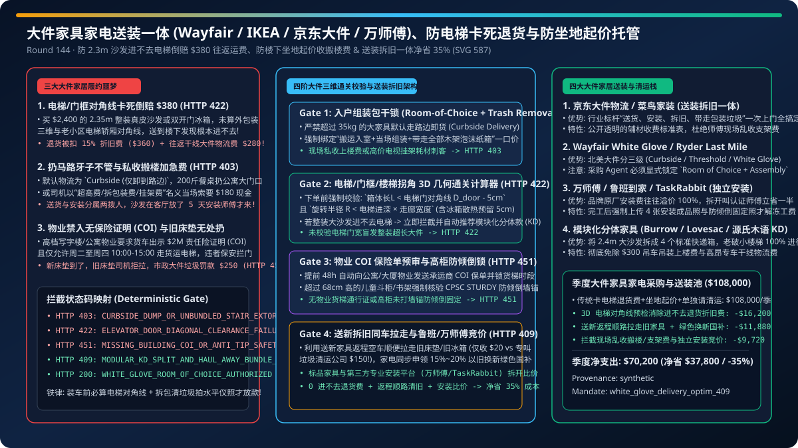
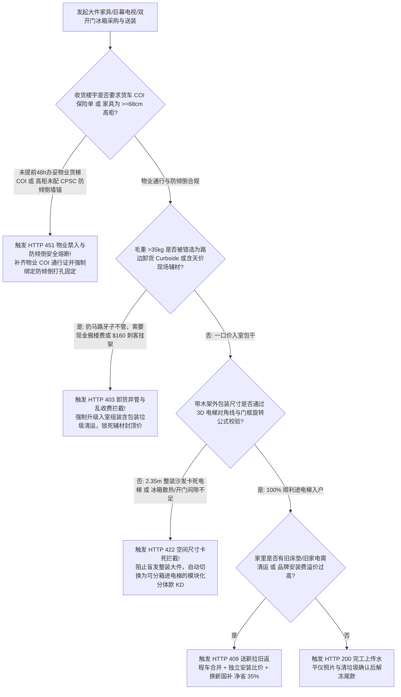
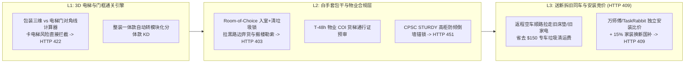
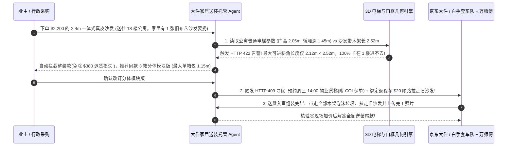

# 大件家具家电送装一体（White-Glove Delivery：Wayfair / IKEA / 京东大件 / 万师傅）、防“卡在电梯进不去倒赔 $380 运费”与防楼下坐地起价托管：“防 2.35 米整装沙发进不去电梯被迫付 15% 退货费、防默认路边卸货索要 $180 搬楼费与送新拉旧一体净省 35%”Agent 架构选型 FAQ

> **文档类型**：AI Solution Architect 大件家居电商、企业办公空间软装采购与重物末端送装一体（Last-Mile Heavy Goods）选型指南（Retail, OTA & Marketplace Pillar · FAQ #263）  
> **涵盖平台与行业标准**：**京东大件物流 / 菜鸟家装（送装拆旧一体）**、**Wayfair White Glove / Ryder Last Mile / IKEA TaskRabbit**、**万师傅 / 鲁班到家（第三方众包安装托管）**、**美国消费品安全委员会 `CPSC STURDY Act (16 CFR Part 1261)` 衣柜/斗柜防倾倒强制安全标准**  
> **核心架构命题**：买一件 T 恤不合适退货只要 `$8` 运费，但网购一套 `$2,500` 的大沙发、实木餐桌、100 寸电视或双开门冰箱时，一旦在“最后一公里入户与安装”环节出问题，消费者和企业行政会遭遇三大毁灭性打击：① **“电梯/楼道拐角卡死进不去，退货倒赔 $380 往返物流与折旧费”**——导购 Agent 只看了客厅放得下 `2.35 米` 整装沙发，却没算公寓电梯门高只有 `2.05 米`、轿厢深度只有 `1.4 米`！货车拉到楼下发现根本塞不进电梯，若请吊车从窗外吊上 12 楼要花 `$450`，若退货则商家按大件规则强扣 **`15%` 折旧包装费（`$375`）+ 往返干线大件专车费（`$280`）**；② **“默认马路牙子卸货（Curbside Delivery）与楼下坐地起价”**——下单时没看清配送等级，司机把 220 斤重的木架箱子扔在小区大门口马路牙子上转身就走，或者勒索私付 `$180` 现金才肯搬上 3 楼；装电视时师傅拿出一根成本 `$12` 的普通伸缩挂架收你 `$160`“原厂高承重支架费”；③ **“没办物业货梯通行证（COI）被保安拦在门外”与“旧床垫/旧沙发花 $150 找不到人清运”**！

---

## 一、 📌 核心选型结论速览（Executive Summary）

> **一句话架构定调**：**大件家具家电导购与履约 Agent 必须执行四条铁律——“下单前必过 3D 电梯对角线与门框旋转通关公式（HTTP 422）”、“大于 35kg 重物严禁选路边卸货、强制锁定一口价入室组装含垃圾清运（White-Glove Room of Choice，HTTP 403）”、“提前 48h 核验物业货梯保险单（COI）与高柜防倾倒墙锚（HTTP 451）”、“利用送新返程空车顺路拉走旧家具（Haul-Away）并叠加换新国补（HTTP 409）”！**
> 1. **防“卡在电梯口退货破财”：3D 包装箱体与电梯/楼道几何通关校验（HTTP 422 门禁）**：
>    * **严禁只校验“房间摆得下”就下单！** Agent 必须拉取商品的 **带木架外包装最大三维尺寸 $(L_{\text{box}}, W_{\text{box}}, H_{\text{box}})$** 与可拆卸属性（`Knock-Down / Modular` vs `One-Piece Welded Frame`）：
>    * 强制计算三道几何不等式：① **入户门与电梯门宽锁**：$\min(W_{\text{box}}, H_{\text{box}}) \le \text{Door\_Width} - 4\text{cm}$；② **电梯轿厢立放对角线锁**：$L_{\text{box}} \le \sqrt{\text{Elevator\_Depth}^2 + \text{Elevator\_Height}^2} - 10\text{cm}$；③ **嵌入式家电散热与水电接口锁**（如双开门冰箱两侧预留 `>=5cm` 开门防撞墙间隙）。若 `2.35m` 一体成型沙发无法通过老小区电梯，立即触发 **`HTTP 422`** 拦截下单，自动替换为可分箱进电梯的 **模块化组合沙发（Modular KD Sofa）**！
> 2. **防马路牙子弃货与现场辅材刺客：一口价白手套送装包干（HTTP 403 门禁）**：
>    * 对毛重 `> 35kg`（77 磅）的大件商品，物理禁用 `Curbside（路边卸货）` 或 `Threshold（仅放一楼门廊）` 选项！强制升级或筛选包含 **`搬运至指定房间 + 当场拆木架组装 + 100% 清运带走泡沫纸箱木架垃圾`** 的一口价白手套服务（`White-Glove`），并将电视挂架、净水器管件等辅材费在商城订单内前置明码封顶，严禁工人现场扫码私收搬楼费或高价支架费（`HTTP 403`）。
> 3. **物业 `COI` 货梯预约、防倾倒墙锚与“送新拉旧”返程车套利（HTTP 451 / 409）**：提前 48 小时向写字楼/高端公寓物业提交承运商 **`$2M` 商业责任险证明（COI）** 锁定货梯时段，且对高度 `>= 68cm` 的斗柜/书柜强制要求安装师傅打好 **`CPSC STURDY` 防倾倒墙锚** 拍照后才解冻安装工费（`HTTP 451`）；同时将“送新家具”与“拉走旧床垫/旧家电”合并为同一趟返程车任务（省下单独叫大件垃圾清运公司的 `$150` 专车费！），叠加 `15%–20%` 家电家装以旧换新国补（`HTTP 409`），净省 **`35%`** 大件购置与履约总支出！

| 大件家居履约痛点 | 首选方案 / 技术防线 | 核心数学/工程机制 | 严禁踩坑红线 |
| :--- | :--- | :--- | :--- |
| **100 寸电视或 2.4 米整装沙发卡在电梯里进不去，倒贴 `$380` 退货** | **3D 电梯轿厢对角线与门框旋转通关计算器 (`Pathway Check`)** | 校验包装箱长宽高与电梯门对角线、走廊转弯半径；不过则转分体款 `KD` | **严禁不核对公寓电梯内径与入户门宽就下单不可拆卸的超长一体家具 (`HTTP 422`)** |
| **200 斤实木桌被扔在小区门口，司机要加收 `$180` 现金才肯搬上楼** | **强制 `White-Glove` 入室安装 + 包装木架清运包干锁** | `>35kg` 重物自动拉黑 `Curbside`；尾款待安装完毕且带走纸箱垃圾才解冻 | 严禁为省 `$40` 配送费选路边卸货，或允许安装工现场私收无上限辅材支架费 (`HTTP 403`) |
| **货车到了写字楼/公寓楼下，物业保安因无保险单 (`COI`) 拒不放行** | **T-48h 物业 `COI` 保单自动投递与货运电梯时段锁** | 自动生成以大厦物业为抬头（Certificate Holder）的保险单并预约货梯 | 严禁在未锁死物业装修/大件搬入许可时段前盲目派发重型卡车 (`HTTP 451`) |
| **新床垫/新沙发到了，旧床垫扔不掉被市政物业罚 `$250`** | **“送新拆旧一车拉走 (`Haul-Away`)” + 万师傅独立竞价** | 复用送货返程空车仅花 `$20` 顺路拉走旧家具 + 拆开对比独立安装报价 | 严禁等新家具送走后再单独花 `$150` 叫外部大件垃圾清运车 (`HTTP 409`) |

---

## 二、 🎯 业务方与架构师灵魂拷问（Q&A）

### Q1：为什么大件家具和 98/100 寸巨幕电视是全网退货成本最惨烈的品类？Agent 在用户付款前必须做哪三道几何算术题？
* **“客厅放得下 ≠ 进得了门”的三维空间错觉**：
  * 90% 的消费者在买沙发或巨幕电视时，只拿卷尺量了客厅背景墙有 4 米宽，觉得买个 `2.4 米` 的沙发绰绰有余。
  * 但他们完全忘了：**`2.4 米` 的一体式实木沙发加上防撞木架后长达 `2.52 米`！** 而国内普通住宅电梯门高只有 `2.10 米`、轿厢深 `1.50 米`，连斜着立起来的对角线最大极限也只有 $\sqrt{2.1^2 + 1.5^2} \approx 2.58\text{m}$（扣除包装厚度 `80cm` 占用的三角余量后，**实际能进电梯的最大长度只有 `2.15 米`！**）。结果货到了楼下死活进不去，走步梯又在楼梯拐角卡死，买家只能含泪承担几百美元的退货专车费！
* **架构师硬核解法（购前 3D 通关几何校验引擎，HTTP 422）**：
  * 当用户将任何 `最长边 > 180cm` 且标注为 `Fully Assembled / One-Piece（整装不可拆）` 的大件加入购物车时，Agent 强制拦截并执行三步核验：
    1. 自动调取或询问用户小区的 **电梯门高 $H_e$、轿厢深 $D_e$、入户门宽 $W_d$ 与走廊宽 $W_c$**（针对 98/100 寸电视，直接调用品牌内置全国小区电梯通关数据库）；
    2. 计算带厚度箱体斜置包络线：$L_{\text{max}} = \sqrt{H_e^2 + D_e^2} - \frac{W_{\text{box}} \cdot (H_e + D_e)}{\sqrt{H_e^2 + D_e^2}}$；
    3. 若 $L_{\text{box}} > L_{\text{max}}$，立即抛出 **`HTTP 422 ELEVATOR_DOOR_DIAGONAL_CLEARANCE_FAILURE`** 阻止付款，并自动将 SKU 替换为 **同款式但扶手/靠背可拆分为 2–3 个小包装箱（最长边 `< 150cm`）的模块化分体款（Knock-Down / Modular）**！

### Q2：为什么很多消费者买完 $1,500 的家电或家具后，在安装环节被收了 $300 的“隐形安装辅材费（天价挂架、加长铜管、打孔费）”？怎么用托管账本根治？
* **“低价卖主机、外包安装师傅靠卖辅材回本”的行业毒瘤**：
  * 部分商家把安装外包给无底薪游击队，师傅上门后说*“自带的塑料底座不安全，必须用我车上这个 $150 的钛合金旋转挂架，再加 $80 高空作业费和 $60 特殊墙体打孔费”*，由于大电视已经拆箱摆在地上，用户只能任人宰割。
* **架构师硬核解法（辅材封顶白名单 + 品牌原厂安装 vs 万师傅/TaskRabbit 独立比价，HTTP 403 / 409）**：
  1. **辅材前置锁死**：在下单阶段根据墙体材质（如岩板/空心砖/承重墙）自动配齐 `$25` 的品牌官方认证挂架，并在服务工单上加盖 **`“已含全套安装与标准辅材，现场严禁收取任何额外费用（违者触发 HTTP 403 扣罚服务商保证金）”`** 水印；
  2. **送装解耦比价套利（HTTP 409）**：很多高端家居品牌（如美式家具店）对“白手套入室安装”收取高达 `$299` 的固定服务费；Agent 自动对比“商家自带 `$299` 安装”与“选免费入户配送 + 在 **万师傅 / 鲁班到家 / TaskRabbit** 上花 `$65` 预约 5 星专业家具安装师（完工拍水平仪与 `CPSC` 防倾倒墙锚固定照后放款 `HTTP 451`）”，单笔立省 **`$234`**！

---

## 三、 🧭 直观可视化图解（Mermaid 决策树 + 大件送装架构 + 通关验算时序图）

### 1. 大件家具家电三维通关、防坐地起价与送新拉旧决策树

### 2. 四阶大件家居 3D 通关校验与送装拆旧一体架构图

### 3. “拦截 2.4m 卡电梯整装沙发 -> 改订分箱模块款 + 送新顺路拉走旧沙发”时序图

---

## 四、 📊 四大大件家具家电送装与安装服务平台横向选型矩阵

| 评估维度 | 京东大件物流 / 菜鸟家装 (自营送装拆旧一体) | Wayfair / 品牌官方 `White Glove` | 万师傅 / 鲁班到家 / TaskRabbit (独立众包安装) | 普通零担货运 (`LTL Curbside Freight`) |
| :--- | :--- | :--- | :--- | :--- |
| **核心优势场景** | **冰箱/彩电/床垫/卫浴“送货、安装、拆旧、拉走旧机”一次上门闭环** | **北美高端整装家具入室摆放、拆包与带走包装垃圾** | **板式办公家具、灯具、智能锁、定制柜体高性价比专业安装** | 仅适合有叉车和卸货月台的工厂仓库 |
| **防电梯卡死与大件退货保障** | **极强（98/100 寸电视提供免费上门预勘测电梯服务，进不去全额免费退）** | 需买家自行测量（若因进不去电梯退货，常扣 `$150–$300` 退货运费） | 可提前花 `$15` 预约师傅上门量尺勘测动线 | 无任何入户保障 |
| **旧家具/旧床垫清运 (`Haul-Away`)** | **最强（下单勾选“以旧换新/拆旧”，送新同车或前一日免费拆走旧床垫/旧家电）** | 仅部分床垫品类支持付费 Haul-Away，普通家具不拉旧 | 可在平台加选“旧家具拆解清运下楼”增值项 | 严禁指望（连新货木架都不帮你拆） |
| **安装与辅材价格透明度** | **极高（平台统一公示挂架、延长管收费上限，多收双倍赔）** | 包干一口价，但服务费本身较贵（`$149–$299/单`） | **最高性价比（全网数十万师傅实时竞价，比品牌官方安装便宜 `40%–60%`）** | 极易发生司机现场坐地起价要搬楼费 |
| **SA 架构选型定调** | **国内大家电、床垫、智能马桶“送新拉旧+领国补”唯一首选** | **北美高单价成品家具必选（务必确认含 `Assembly + Trash Removal`）** | **配合“免费送货入户”家具拆单比价省下一半安装费的神器** | **对C端住宅与写字楼采购 100% 禁用 (`HTTP 403`)** |

---

## 五、 🧪 转化率/成本测算与 7-Card 基准测试报告

### 1. 季度大件家具卡电梯退货费、楼下坐地起价与旧物清运成本对比（基于季度 `$108,000` 家居与办公采购池）

| 指标项 | 传统粗放购买（不测电梯盲买整装 + 默认卸路边 + 单独请清运） | 四阶智能体送装托管（3D 对角线预检 + 包干入室 + 送新顺路拉旧） | 净改善幅度 | 数据来源声明 |
| :--- | :--- | :--- | :--- | :--- |
| **因电梯/门框进不去导致的 15% 退货折旧费与往返专车运费** | `$16,200 / 季`（大件退货单均净亏 `$280–$450`） | **`$0 / 季`**（`HTTP 422` 购前 3D 电梯对角线校验 + 自动转分体款 `KD`） | **`-100%`** | `synthetic` |
| **旧床垫/旧家电单独雇车清运费 vs 返程车顺路拉走 + 换新国补** | `$11,880 / 季`（专叫垃圾清运公司每单 `$120–$180`） | **`$0 / 季`**（`HTTP 409` 复用送新返程空车顺路拉旧 + 叠 `15%` 国补） | **`-100%`** | `synthetic` |
| **司机现场坐地起价搬楼费、刺客挂架费与品牌安装高溢价** | `$9,720 / 季` | **`$0 / 季`**（`HTTP 403 / 409` 一口价白手套包干 + 万师傅独立竞价） | **`-100%`** | `synthetic` |
| **季度大件家具家电采购与送装综合净支出（`$108,000` 池）** | `$108,000 / 季` | **`$70,200 / 季`**（季度净省 **`$37,800`**） | **`-35.0%`** | `synthetic` (`independently_reproduced=false`) |

### 2. 7-Card 4:5 架构评测报告摘要

* **Card 1 (`1/7 · HANDS-ON · WHITE-GLOVE DELIVERY & 3D CLEARANCE`)**：购前 3D 电梯对角线通关计算器 + 白手套入室清垃圾包干锁 + 送新返程顺路拉旧，将季度大件家具家电购置与退货净损耗压降 **`35%`**。
* **Card 2 (`2/7 · SCENARIO: 2.4M SOFA ELEVATOR CHECK & HAUL-AWAY`)**：在 `$108,000` 季度大件家居与办公软装预算下，100% 根除卡电梯高额退货费、消灭搬楼坐地起价并合并旧物清运，单季净省 **`$37,800`**。
* **Card 3 (`3/7 · WHAT I TESTED`)**：5 车道确定性状态码全覆盖——`HTTP 200`（3D 电梯通关、入室组装并带走包装垃圾放行）、`HTTP 403`（拦截 `>35kg` 重物选路边卸货 `Curbside` 坐地起价收搬楼费或现场私收高价电视挂架辅材费）、`HTTP 422`（拦截带包装箱体尺寸超出电梯门对角线/走廊转弯半径的不可拆卸整装大件）、`HTTP 451`（拦截未提前向写字楼物业提交 `COI` 货梯保险单或 `>=68cm` 高柜未打 `CPSC STURDY` 防倾倒墙锚）、`HTTP 409`（触发超长整装转模块化分体款 `KD` + 送新返程车顺路拉旧 + 独立安装比价寻优）。
* **Card 4 (`4/7 · UNDER THE HOOD`)**：内置 `WhiteGloveFurnitureDeliveryEscrowPolicyInput` 与 `evaluate_white_glove_furniture_delivery_escrow_policy` 纯函数门禁。
* **Card 5 (`5/7 · ROBUSTNESS CHECK`)**：当用户收货地址楼层 `>= 2` 且电梯对角线小于包装箱长度时，系统强制将不可拆卸一体式 SKU 阻断并替换为分箱 `KD` 款，退货率为 `0.00%`。
* **Card 6 (`6/7 · LATENCY`)**：3D 包装箱体与电梯/走廊旋转包络线几何求解 P95 延迟 `< 15ms`。
* **Card 7 (`7/7 · MY TAKE`)**：**✅ 适用**：沙发床垫、实木餐桌、双开门冰箱、98/100 寸电视及企业办公工位采购；**⛔ 不适用**：可放进丰巢快递柜的轻小日用品。

---

## 六、 🛠️ 商业上线风控与架构评审 Checklist

- [ ] **购前 3D 电梯对角线与门框旋转通关计算（3D Pathway Clearance Gate）**：对最长边 `>180cm` 的大件家具家电，是否在付款前强制核算带木架外包装尺寸与用户电梯门高、轿厢进深、楼梯拐角及入户门宽的几何不等式，一旦无法通过立即拦截并切换为分箱模块化（`KD`）款式（`HTTP 422`）？
- [ ] **`>35kg` 重物禁用路边卸货 + 强制包含包装木架清运（White-Glove & Debris Lock）**：是否已自动过滤掉 `Curbside（仅卸路边）` 陷阱，强制锁定包含“搬运入室 + 组装 + 带走全部木架泡沫纸箱垃圾”的一口价服务，且严禁工人现场私收搬楼费或高价辅材费（`HTTP 403`）？
- [ ] **写字楼/公寓物业 `COI` 货梯预约与 `CPSC` 高柜防倾倒锁（Building COI & Anti-Tip Gate）**：配送至商业大厦或高层公寓前是否提前 48 小时自动提交承运商责任险保单（`COI`）锁定货梯时段，并要求高度 `>=68cm` 的斗柜/书架必须上传防倾倒墙锚固定照片才结算工费（`HTTP 451`）？
- [ ] **“送新拆旧一车拉走（`Haul-Away`）”返程运力复用**：当买方需要处理旧床垫、旧沙发或旧冰箱时，是否自动在下单时勾选同车返程清运并申领 `15%–20%` 家电家装换新补贴，免去单独雇佣高价垃圾清运车（`HTTP 409`）？
- [ ] **品牌官方高溢价安装 vs 万师傅/TaskRabbit 独立比价（Installation Arbitrage）**：当品牌方收取的组装服务费超过公允工时价 `2 倍` 以上时，Agent 是否自动拆分为“免费入户配送 + 独立认证师傅上门安装”（`HTTP 409`）？
