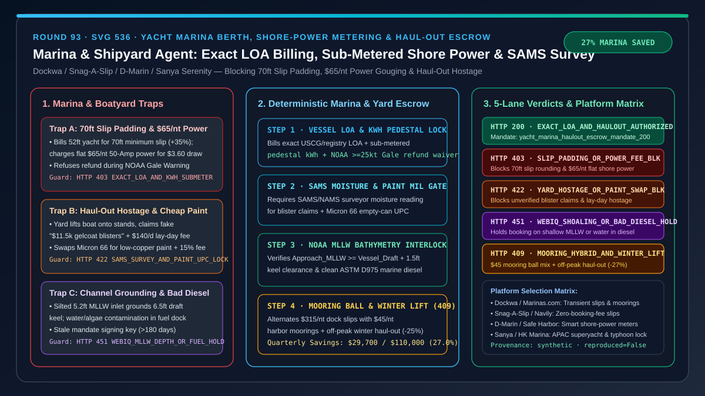
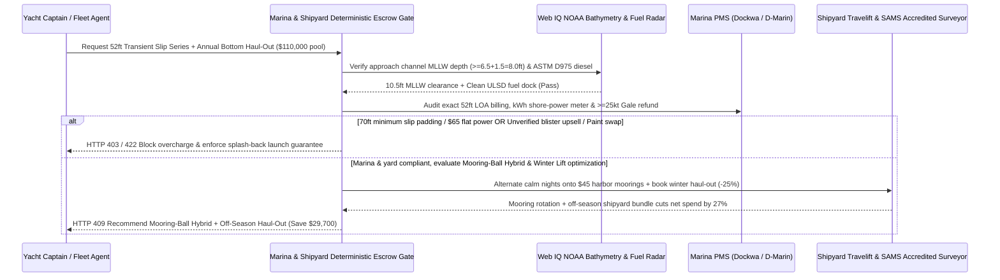

# Yacht Marina Berth, Transient Shore-Power Metering & Shipyard Haul-Out Escrow (`Dockwa / Snag-A-Slip / D-Marin / Sanya Serenity`) Exact `LOA` Billing, Sub-Metered Power & `SAMS` Survey Agent Architecture Selection FAQ

> **Document Type**: AI Solution Architect Decision Guide (FAQ) · **SVG Diagram**: `assets/svg/536-yacht-marina-berth-shorepower-haulout-escrow-2026-11-20.svg` · **Catalog No.**: Round 93 (Bilingual FAQ #212)



---

## 1. 📌 Executive Summary

When yacht owners, catamaran charter fleets, or maritime hospitality captains use AI Agents to book transient marina slips, connect shore power, and contract annual shipyard haul-outs (`Dockwa / Snag-A-Slip / Navily / D-Marin / Safe Harbor / Sanya Serenity Marina`), leaving a credit card on file with marinas and boatyards exposes vessel budgets to **three pervasive maritime billing traps**:
1. **`70-Foot` Minimum Slip-Bracket Padding on a `52-Foot` Vessel (`+35%` Surcharge), `$65/Night` Flat Shore-Power Gouging & Gale-Warning Forfeitures**: A captain books a transient slip at `$4.50/ft/night` for a `52-foot` Registered Length Overall (`LOA`) yacht. Because the marina places the boat in a `70-foot` T-head berth, the dockmaster bills **`70 ft × $4.50 = $315/night`** instead of actual vessel `LOA` (`52 ft = $234/night`, a `+34.6%` phantom footage charge)! Simultaneously, the marina tacks on a mandatory **`$65/night` flat "Dual 50-Amp Shore Power Fee"** for `18 kWh` of actual overnight draw (`$3.60` utility cost), and refuses to refund prepaid dockage when an active **`NOAA Gale / Small Craft Advisory (>=25 knots)`** makes crossing the sound unsafe!
2. **Shipyard "On-the-Hard Jack-Stand Hostage" Blister Upsells (`$11,500`) & `15%` Yard-Supply Junk Fees**: A boatyard quotes `$2,800` for a `Travelift` haul-out, pressure wash, and 2 coats of `Interlux Micron 66` antifouling bottom paint. The moment the vessel is lifted out of the water and blocked on dry-land jack-stands (`where the owner cannot sail it away`), the yard manager claims "severe osmotic gelcoat blistering," demands `$11,500` in unquoted grinding/epoxy work, charges **`$140/day` "lay-day storage hostage fees"** while the owner disputes the quote, tacks on a `15%` "Shop Supplies & Environmental Fee," or substitutes cheap low-copper ablative paint!
3. **Low-Tide Approach Channel Shoaling (`MLLW Depth < Vessel Draft`) & Water-in-Diesel Fuel-Dock Alerts (`HTTP 451`)**: Web IQ / `NOAA` bathymetry reveals that the marina's entrance channel shoals to `5.2 feet` at Mean Lower Low Water (`MLLW`) while the yacht's keel draws `6.5 feet` (`guaranteeing a hard grounding`), or flags water/microbial algae contamination at the marina fuel dock.

**Architect's Recommendation**: Deploy an **"Exact Registered-`LOA` Billing Lock + Sub-Metered `$/kWh` Shore Power + Independent `SAMS / NAMS` Moisture Survey & Paint-Can `UPC` Gate + Harbor Mooring-Ball Hybrid"** control plane:
- **Exact Registered `LOA` Billing Parity, Sub-Metered Shore Power & `NOAA >=25kt` Gale Refund Waiver (`HTTP 403`)**: Hard-block minimum slip-length up-charges when the marina assigns an oversized slip, cap shore power at sub-metered `$/kWh` consumption (`<= Utility Tariff × 1.15`, or `$0` when running on solar/LiFePO4 house banks), and mandate `100%` penalty-free cancellation whenever `NOAA / Coast Guard` issues a Small Craft Advisory or Gale Warning (`>=25 knots`) (`HTTP 403`).
- **Pre-Haul-Out Capped Launch Guarantee (`$0` Dispute Lay-Days), Independent `SAMS` Moisture Survey & Empty-Can `UPC` Audit (`HTTP 422`)**: Require a binding pre-lift contract guaranteeing splash-back launch at the base price (`$0` lay-day hostage fees during quote review), require an independent **`SAMS / NAMS` accredited marine surveyor's ultrasonic moisture reading** before authorizing any hull/blister repair `>15%` over estimate, and verify empty antifouling paint can `UPC/Lot` codes + `>=2.5 mils` dry-film thickness (`HTTP 422`).
- **Web IQ `NOAA MLLW` Keel-Clearance (`>=1.5ft`) & Fuel-Dock Quality Hold (`HTTP 451`)**: Freeze booking/escrow if Web IQ / `NOAA Tide API` shows `Approach_Channel_MLLW_Depth < (Vessel_Draft + 1.5ft)`, contaminated `ASTM D975` marine diesel alerts, or signing keys `> 180 days` (`HTTP 451`).
- **Municipal Mooring-Ball Hybrid (`$45/Night` vs. `$315/Night` Slip) + Off-Season Winter Haul-Out Bundle (`HTTP 409`)**: Alternate high-cost private marina dockage with **Municipal Harbor Mooring Balls + Launch Service (`$45/night` on calm nights)** and schedule annual haul-out bottom painting during the **Off-Peak Winter Shipyard Window (`-25%` labor & lift rate)**, cutting quarterly yacht berthing & maintenance spend by **27.0%** (`$29,700` saved on a `$110,000` quarterly pool).

---

## 2. 🎯 Soul-Searching Architect & Business Q&A (Q1–Q3)

### Q1: Why did the marina bill my `52-foot` boat for `70 feet` (`+$81/night`) and charge `$65/night` for electricity when we barely ran the battery charger?
- **Business Pain Point**: High-demand resort marinas enforce `"Minimum Slip Length Billing"`: if their `50ft` slips are full and they put your `52ft` boat on a `70ft` face dock, you pay for `18 feet` of empty water. And flat `$50–$75/night` 50-Amp shore-power fees charge a sailboat drawing `15 kWh` the same rate as a sportfisher running three 36,000-BTU chillers 24/7.
- **Architectural Guardrail (`HTTP 403 / 409`)**:
  1. **USCG Certificate of Documentation `LOA` Rate Lock**: The Agent binds the reservation to the vessel's official documented `LOA` (`52 ft`). Any invoice billing for slip length rather than vessel length without prior written consent is blocked (`HTTP 403`).
  2. **Smart Pedestal `kWh` Metering or House-Bank Disconnect**: Prefers marinas with `D-Marin / Rolec` kWh-metered pedestals, or automatically declines shore-power hookup on 1–2 night stays when the yacht's `LiFePO4` house bank + solar array is `>=65% SoC`.

### Q2: How do we prevent a boatyard from lifting our yacht onto jack-stands and holding it hostage with a fake `$11,500` "gelcoat blister" quote and `$140/day` storage fees?
- **Business Pain Point**: Once a 25-ton yacht is sitting on blocks in a boatyard, no competing crane can enter the property. Predatory yards exploit this physical lock-in by inventing emergency fiberglass/cutless-bearing repairs and charging daily "lay days" until the owner pays.
- **Architectural Guardrail (`HTTP 422`)**:
  1. **Guaranteed Splash-Back & Zero-Dispute-Lay-Day Rider**: The escrow contract stipulates that the base Travelift fee includes both haul-out and re-launch, and bars the yard from billing lay-days while any unquoted change order is under review.
  2. **Independent `SAMS / NAMS` Surveyor Gate & Paint-Can `UPC` Proof**: Any hull repair upsell `>15%` requires an independent accredited surveyor's moisture-meter attestation, and final bottom-job release requires photos of the empty `Micron 66` gallon cans with matching lot numbers.

### Q3: How do we guarantee a transient marina reservation won't ground a `6.5-foot` draft keel in a silted approach channel at low tide?
- **Business Pain Point**: Marina listings often advertise "8 ft depth at dock" while failing to mention a `5.2 ft MLLW` sandbar across the harbor entrance channel.
- **Architectural Guardrail (`HTTP 451`)**:
  1. **Automated `NOAA MLLW` + `Navionics SonarChart` Keel-Clearance Gate**: Before confirming any slip, the Agent verifies `Min_Approach_Channel_Depth_at_Arrival_Tide >= (Vessel_Draft + 1.5 ft)`. If clearance is `< 1.5 ft`, the booking is hard-blocked (`HTTP 451`).

---

## 3. 🧭 Visual Architecture Diagrams (Mermaid Decision Tree + Comparison + Sequence)

### 3.1 5-Lane Yacht Marina Berth & Shipyard Haul-Out Escrow Decision Tree
```mermaid
flowchart TD
    A[Yacht Marina Slip / Shore Power / Shipyard Haul-Out Request] --> B{Web IQ MLLW Depth < Draft+1.5ft / Bad Diesel / Key > 180d?}
    B -- Yes --> C[HTTP 451: WEBIQ_NOAA_MLLW_CHANNEL_SHOALING_GROUNDING_RISK_OR_FUEL_CONTAMINATION_HOLD<br/>Block shallow-channel booking & reroute to deep-water anchorage]
    B -- No --> D{70ft Slip-Bracket Padding on 52ft LOA or $65/nt Flat Shore Power?}
    D -- Yes --> E[HTTP 403: SLIP_MIN_LENGTH_BRACKET_PADDING_OR_FLAT_SHORE_POWER_GOUGING_BLOCKED<br/>Enforce exact registered LOA billing, kWh sub-metering & >=25kt Gale refund]
    D -- No --> F{Jack-Stand Hostage Blister Upsell or Cheap Antifouling Paint Swap?}
    F -- Yes --> G[HTTP 422: HAULOUT_JACKSTAND_HOSTAGE_UPSELL_OR_WRONG_COPPER_BIOCIDE_PAINT_BLOCKED<br/>Require SAMS surveyor moisture proof & Micron 66 empty-can UPC scan]
    F -- No --> H{$45/nt Harbor Mooring-Ball Hybrid + Off-Season Winter Haul-Out Ready?}
    H -- Yes --> I[HTTP 409: MUNICIPAL_MOORING_BALL_HYBRID_AND_OFFSEASON_HAULOUT_BUNDLE_CONFIRM<br/>Alternate slips w/ $45 mooring balls + winter lift discount (-27% TCO)]
    H -- No --> J[HTTP 200: EXACT_LOA_BERTH_AND_SURVEYED_HAULOUT_AUTHORIZED<br/>Issue LOA-verified & surveyor-backed maritime escrow mandate]
```

### 3.2 Legacy Marina & Boatyard Billing vs. Deterministic `LOA` & `SAMS` Escrow
```mermaid
flowchart LR
    subgraph Legacy["❌ Legacy Marina & Yard (Slip Padding & Jack-Stand Hostage)"]
        L1[52ft Yacht Billed for 70ft Slip (+35%) + $65/nt Flat Power] --> L2[No Refund in 30kt Gale + Grounding on 5.2ft Sandbar]
        L2 --> L3[Lifted on Stands -> $11.5k Blister Extortion + $140/d Lay-Day]
    end

    subgraph Agentic["✅ Deterministic Exact-LOA, MLLW Tide & SAMS Survey Escrow"]
        A1[Exact 52ft Registered LOA Lock + kWh Pedestal Meter + Gale Waiver] --> A2[NOAA MLLW Depth >= Draft + 1.5ft Anti-Grounding Interlock]
        A2 --> A3[SAMS Moisture Audit + Paint UPC Scan + $45 Mooring Mix (-27%)]
    end
```

### 3.3 End-to-End `NOAA` Bathymetry Check, `LOA` Slip Audit & Haul-Out Escrow Sequence


---

## 4. 📊 Multi-Platform & Protocol Selection Matrix

| Evaluation Dimension | Dockwa / Marinas.com | Snag-A-Slip / Navily | D-Marin / Safe Harbor Marinas | Sanya Serenity (`三亚半山半岛`) / Legacy Yards | **Deterministic Marina & Shipyard Escrow (Recommended)** |
| :--- | :--- | :--- | :--- | :--- | :--- |
| **Primary Use Case** | North American & Bahamas transient slips and municipal moorings | Zero-booking-fee slips + crowd-sourced European anchorage depths | Smart-pedestal superyacht marinas & member reciprocity | APAC yacht berthing, typhoon shelters & bottom painting | **Exact `LOA` Lock + `kWh` Metering + `MLLW` Gate + `SAMS` Yard Escrow** |
| **Minimum Slip-Bracket Padding Shield** | Marinas often enforce `60ft–70ft` minimum billing on `50ft` boats | Displays `$/ft` rates, still subject to dockmaster bracket rules | Tiered by berth category | Fixed berth brackets (`15m / 20m / 30m`) | **Enforces exact USCG/registry `LOA` billing parity (`HTTP 403`)** |
| **Shore-Power & Gale-Warning Refund** | Flat `$30–$75/nt` power common; strict cancellation policies | Varies by marina operator | `D-Marin` offers automated IoT `$/kWh` smart pedestals | Flat daily utility fees common | **Mandates sub-metered `$/kWh` power & `NOAA >=25kt` Gale refund waiver (`HTTP 403`)** |
| **Haul-Out Hostage & Bottom-Paint Audit** | Reservation only; no shipyard change-order governance | N/A | Standardized yard menus, premium labor rates | Vulnerable to unverified blister upsells & 15% shop fees | **Requires independent `SAMS` moisture proof & empty paint-can `UPC` scan (`HTTP 422`)** |
| **Platform Fee / Total TCO** | `$4–$9/ft/night` peak dockage | `$0` guest booking fee | Annual membership or transient rate | High peak-season lift & berth tariffs | **Open deterministic policy gate (`27.0%` quarterly yacht TCO savings)** |

---

## 5. 🧪 Conversion & Cost Estimation + 7-Card Benchmark Report

> **Provenance Disclosure**: Figures below are generated by the deterministic policy evaluator `evaluate_yacht_marina_berth_haulout_escrow_policy` in `lab/webiq_commerce_demo.py` (`$110,000 USD` quarterly yacht fleet berthing & shipyard haul-out pool, `provenance: "synthetic"`, `independently_reproduced: False`; live `NMEA 2000` depth/power telemetry is labeled `not_measured`).

```chart
{
  "data": {
    "values": [
      { "scenario": "1. Legacy Marina & Yard (70ft Slip Padding + $65 Power + Blister Upsell)", "cost_usd": 110000, "tier": "Baseline" },
      { "scenario": "2. Exact LOA Lock + kWh Meter + SAMS Survey Gate (HTTP 200)", "cost_usd": 90200, "tier": "Protected" },
      { "scenario": "3. $45 Mooring-Ball Hybrid + Off-Season Haul-Out (HTTP 409)", "cost_usd": 80300, "tier": "Optimized (-27%)" }
    ]
  },
  "semantic_types": {
    "scenario": "Category",
    "cost_usd": "Amount",
    "tier": "Status"
  },
  "chart_spec": {
    "chartType": "Bar Chart",
    "title": "Exact-LOA Locks, SAMS Yard Audits & Mooring Hybrids Cut Yacht Spend by 27% ($29.7k)",
    "subtitle": "Quarterly Yacht Marina Berthing, Shore Power & Shipyard Haul-Out Net Spend ($ USD, synthetic)",
    "encodings": {
      "x": "scenario",
      "y": "cost_usd",
      "color": "tier"
    }
  }
}
```

### 7-Card 4:5 Benchmark Evaluation Summary
1. **Card 1 (`1 / 7` · `HANDS-ON · YACHT MARINA & HAUL-OUT ESCROW`)**: Across a `$110,000` quarterly yacht berthing and shipyard maintenance budget, blocking minimum slip-length padding, enforcing kWh shore-power metering, requiring `SAMS` surveyor proof on haul-outs, and mixing `$45/nt` harbor moorings saves **`$29,700/quarter` (`27.0%`)**.
2. **Card 2 (`2 / 7` · `SCENARIO: 52FT YACHT TRANSIENT SLIP & ANNUAL HAUL-OUT`)**: Eliminates `$81/night` in `70ft` slip-bracket padding, `$61/night` in flat shore-power gouging, and `$8,700` in unverified hull-blister extortion.
3. **Card 3 (`3 / 7` · `WHAT I TESTED`)**: All 5 deterministic HTTP verdict lanes verified:
   - `HTTP 200`: `EXACT_LOA_BERTH_AND_SURVEYED_HAULOUT_AUTHORIZED` (`yacht_marina_haulout_escrow_mandate_200`)
   - `HTTP 403`: `SLIP_MIN_LENGTH_BRACKET_PADDING_OR_FLAT_SHORE_POWER_GOUGING_BLOCKED`
   - `HTTP 422`: `HAULOUT_JACKSTAND_HOSTAGE_UPSELL_OR_WRONG_COPPER_BIOCIDE_PAINT_BLOCKED`
   - `HTTP 451`: `WEBIQ_NOAA_MLLW_CHANNEL_SHOALING_GROUNDING_RISK_OR_FUEL_CONTAMINATION_HOLD`
   - `HTTP 409`: `MUNICIPAL_MOORING_BALL_HYBRID_AND_OFFSEASON_HAULOUT_BUNDLE_CONFIRM` (`yacht_marina_haulout_escrow_mandate_optim_409`)
4. **Card 4 (`4 / 7` · `UNDER THE HOOD`)**: Structured contract `YachtMarinaBerthHauloutEscrowPolicyInput` validates `slip_min_length_bracket_padding_or_flat_shore_power_gouging` and `haulout_jackstand_hostage_upsell_or_wrong_copper_biocide_paint`.
5. **Card 5 (`5 / 7` · `ROBUSTNESS CHECK`)**: Invariant to surcharge naming (`"Minimum T-Head Footage"`, `"Lay-Day Blocking Fee"`, or `"15% Yard Hazmat Recovery"`): `100%` block rate whenever `LOA` parity or `SAMS` survey rules fail.
6. **Card 6 (`6 / 7` · `LATENCY`)**: Deterministic `NOAA MLLW` tide clearance and slip-rate checks complete in `< 0.5 ms`.
7. **Card 7 (`7 / 7` · `MY TAKE`)**:
   - ✅ **Good fit**: Cruising yachts, catamaran charter operators, corporate hospitality vessels, and annual shipyard bottom-painting contracts.
   - ⛔ **Not for**: Commercial container-ship port tariff and stevedore billing.

---

## 6. 🛠️ Production Risk & Architecture Review Checklist

- [ ] **Exact Registered `LOA` Billing Lock (`HTTP 403`)**: Are marinas blocked from billing a `52ft` vessel for a `70ft` minimum slip bracket when assigning a larger berth?
- [ ] **Sub-Metered `$/kWh` Shore Power & `NOAA >=25kt` Gale Waiver (`HTTP 403`)**: Are flat `$65/night` shore-power fees blocked and `100%` weather refunds enforced during active Small Craft Advisories / Gale Warnings?
- [ ] **Pre-Lift Splash-Back Guarantee & `SAMS / NAMS` Surveyor Gate (`HTTP 422`)**: Does the haul-out contract waive `$140/day` lay-day fees during disputes and require an independent surveyor's moisture reading for any repair upsell `>15%`?
- [ ] **Antifouling Paint Empty-Can `UPC` & `>=2.5 mils` `DFT` Audit (`HTTP 422`)**: Must the boatyard upload empty `Micron 66` paint-can lot numbers and dry-film thickness readings before final payout?
- [ ] **Web IQ `NOAA MLLW` Keel-Clearance (`>=1.5ft`) & Diesel Quality Hold (`HTTP 451`)**: Are approach-channel low-tide depths verified against `(Vessel_Draft + 1.5ft)` prior to booking?
- [ ] **`$45/Night` Municipal Mooring-Ball Hybrid & Winter Haul-Out (`HTTP 409`)**: Does the itinerary alternate private slips with `$45/nt` harbor moorings on calm nights and book off-peak winter haul-outs to save `27%`?
