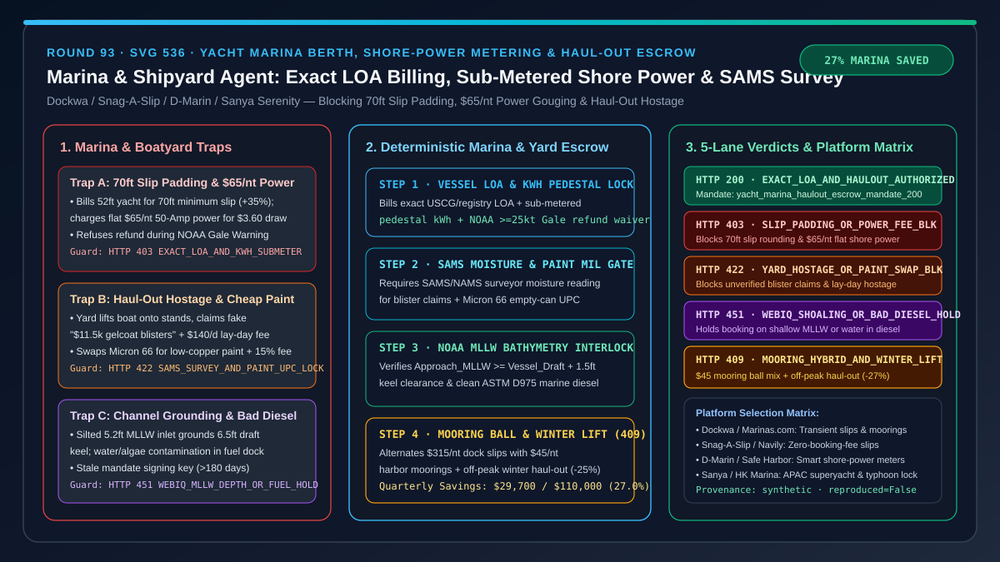
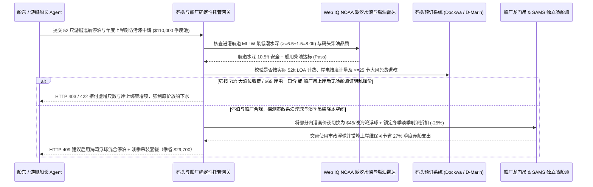

# 游艇码头泊位预订（Marina Berth）、岸电计量与船厂吊装上岸刷防污漆托管（Yacht Marina Berth, Shore-Power Metering & Shipyard Haul-Out Escrow：Dockwa / Snag-A-Slip / D-Marin / 三亚半山半岛帆船港）“防 52 尺船按 70 尺大泊位强收停泊费、防每晚 $65 岸电固定一口价暴利与船厂吊船上岸后坐地起价”Agent 架构选型 FAQ

> **文档类型**：AI Solution Architect 决策指南（FAQ） · **对应 SVG**：`assets/svg/536-yacht-marina-berth-shorepower-haulout-escrow-2026-11-20.svg` · **精选编号**：Round 93（第 212 篇双语 FAQ）



---

## 一、 📌 核心选型结论速览（Executive Summary）

游艇船东、双体帆船租赁商与企业商务游艇船长通过 AI Agent 预订异地访客码头泊位（`Transient Marina Slip`）、连接码头岸电水桩及预约年度船厂龙门吊上岸刷船底防污漆（`Travelift Haul-Out & Antifouling Bottom Job`：`Dockwa / Snag-A-Slip / Navily / D-Marin / Safe Harbor / 三亚半山半岛帆船港`）时，若直接绑定船东信用卡免密扣款，极易遭遇**三大游艇码头与船厂维保刺客陷阱**：
1. **按“泊位最小档位（70尺）”而非“游艇实际船长（52尺 LOA）”强收 `+35%` 停泊费、`$65/晚` 岸电一口价暴利与大风预警拒退费**：一艘登记总长（`LOA: Length Overall`）为 `52 英尺` 的游艇在 `Dockwa` 上预订 `$4.50/英尺/晚` 的访客泊位。码头港务长将其安排进一个 `70 英尺` 的 T 型头泊位，结账时竟按 **`70 英尺 × $4.50 = $315/晚`** 扣款（比按实际船长 `52 英尺 = $234/晚` 多收 **`+34.6%` 幽灵尺数费**）！同时，码头对插上 `50-Amp` 岸电线的船只强收 **`$65/晚` 固定岸电费（Flat Shore-Power Fee）**，哪怕船上当晚仅开了基础照明耗电 `18 度`（实际电费成本仅 `$3.60`，溢价 `18 倍`）；若因海事局/NOAA 发布 **大风/小船航行警告（`Small Craft Advisory / Gale Warning >=25 knots`）** 导致游艇无法安全出港抵达目的码头，码头仍按霸王条款强扣 `100%` 首晚或全额罚金。
2. **船厂“龙门吊上岸后（On the Hard）”借口船底胶衣渗透起泡坐地起价 3 倍与 `$140/天` 陆地占道扣船费（Jack-Stand Hostage）**：游艇进船厂做年度高压水枪冲藤壶与刷两遍 `Interlux Micron 66` 防污底漆（合同报价 `$2,800`）。一旦 `50 吨` 龙门吊（Travelift）把游艇吊离水面架在岸上铁架（Jack-Stands）上——**此时船在陆地上根本开不走**——船厂经理立刻发来照片声称“船底玻璃钢严重渗透起泡（Osmotic Gelcoat Blistering）”，索要 `$11,500` 打磨环氧修补费；若船东质疑并要求请第三方验船师复核，船厂立即按 **`$140/天` 收取“岸上停放占道费（Lay-Day Storage Hostage Fee）”**，并在结账时强加 `15%` 所谓“船厂环保与辅料杂费（Environmental & Shop Supplies Fee）”或把高价高铜防污漆偷换为廉价低铜底漆！
3. **退潮期进港航道淤积搁浅（`MLLW 水深 < 吃水深度`）或码头柴油含水/柴油菌污染（`HTTP 451`）**：Web IQ / 海图水深遥测显示该码头入口航道在天文大潮低潮位（`MLLW`）仅深 `5.2 英尺`，而帆船固定龙骨吃水（`Draft`）达 `6.5 英尺`（盲目进港必搁浅撞毁龙骨），或该码头加油桩近期被通报船用柴油水分/微生物超标。

**架构师选型结论**：必须构建 **“船舶登记证实际总长（`Registered LOA`）计费锁 + 岸电桩智能电表按度实结 + 独立验船师（`SAMS / NAMS`）湿度仪复核与防污漆空桶核验 + 浮筒系泊（Mooring Ball）混合托管网关”** 架构：
- **强制按船舶国籍证书实际 `LOA` 计费（禁止因码头自身排位原因按 70 尺大泊位跳档收费）、岸电按度（`$/kWh`）实收与 `>=25节` 大风预警全额免责退订（`HTTP 403`）**：凡在没有小泊位时将大泊位最小尺数（Minimum Slip Length）转嫁给船东、未按岸电桩电表实际度数计费（加价上限 `<= 市政电价 × 1.15`）、或拒绝为官方海事大风/台风预警提供免费改期/全额退款的订单，一律返回 `HTTP 403` 阻断。
- **吊船上岸前锁定封顶工单、超 `15%` 增项强制 `SAMS/NAMS` 独立验船师超声波湿度仪签字与防污漆空桶 `UPC` 扫码门禁（`HTTP 422`）**：严禁在争议期间收取 `$140/天` 岸上占道费；任何声称船底起泡需增加 `>15%` 预算的增项，必须由独立认证验船师（`SAMS / NAMS Accredited Marine Surveyor`）使用电容式湿度仪测得真实超标读数后方可解锁托管资金；且尾款释放前必须上传与船底面积匹配的 **`Micron 66 / Sea Hawk` 原装防污漆空桶序列号照片及干膜厚度（`>=2.5 mils DFT`）记录**（否则 `HTTP 422` 拒付）。
- **Web IQ 低潮位（`MLLW`）龙骨富余水深（`< 1.5 英尺`）防搁浅与劣质船用柴油熔断（`HTTP 451`）**：自动核算 `航道最低潮水深 - 船舶吃水 >= 1.5 英尺安全余量`，不达标或燃油污染即刻 `HTTP 451` 拦截预订。
- **市政海湾系泊浮球（`$45/晚 Mooring Ball`）交替停泊 + 冬季淡季错峰吊装上岸刷漆（`-25%`）（`HTTP 409`）**：在风平浪静且无需补水充电的夜晚，自动将 `$315/晚` 的私人内港码头泊位切换为含免费摆渡小艇（Launch Service）的 **`$45/晚` 市政海湾系泊浮球（Mooring Ball）**，并将船底除藤壶刷漆安排在冬季船厂淡季窗口（享 `-25%` 吊装与人工折扣），使季度 `$110,000` 游艇停泊与船厂维保总支出净省 **`27.0%`（`$29,700`）**。

---

## 二、 🎯 业务方与架构师灵魂拷问 Q&A（Q1–Q3）

### Q1：为什么我的游艇明明只有 52 英尺长，码头却按 70 英尺收我每晚 $315 停泊费，还要外加 $65/晚的岸电费？
- **商业痛点**：许多热门度假港（如新英格兰、迈阿密、地中海及三亚）在旺季将泊位设为“按泊位物理长度或船长取大值计费（Billed by Slip Length or LOA, Whichever is Greater）”。当 `50 英尺` 泊位满员时，系统把船分配到 `70 英尺` 泊位并多收 `18 英尺` 的冤枉钱！至于岸电，许多老码头懒得抄电表，只要插上 `50A/220V` 插头就收 `$65/晚` 固定费。
- **架构护栏（`HTTP 403 / 409`）**：
  1. **锁定 `Actual Registered LOA` 计费条款**：Agent 在通过 `Dockwa / Navily` 询价时，自动注入计费约束：若船东按真实 `52 ft LOA` 申报，码头因自身泊位调度原因分配了 `70 ft` 泊位，结算金额必须严格锁死在 `52 ft × 单价`（超出即触发 `HTTP 403`）。
  2. **智能岸电桩（`D-Marin / Rolec Smart Pedestal`）按度计费或锂电光伏自给**：若码头对岸电收取 `$65/晚` 固定费，而船载 `LiFePO4` 锂电池组 + 太阳能板电量充足（`SoC >= 65%`），Agent 自动取消岸电勾选，立省 `$65/晚`。

### Q2：游艇最怕“被龙门吊吊到岸上后，船厂老板说船底烂了不给 $10,000 不把船放回水里”，架构怎么破这种“陆地绑架（On-the-Hard Hostage）”？
- **商业痛点**：游艇一旦离开水面架在陆地支架上，船东甚至不能换一家船厂（因为别的船厂吊车进不来，下水开关完全掌握在当前船厂手里）。不良船厂利用这种绝对垄断地位，把轻微的表皮气泡夸大为结构性渗透，还用每天 `$140` 的岸上停放费逼船东就范。
- **架构护栏（`HTTP 422`）**：
  1. **进场前签署《包干上下水与零争议占道费协议（Capped Haul-and-Launch & Zero Lay-Day Dispute Rider）》**：托管网关规定，基础合同必须包含“一吊上岸 + 冲水 + 一吊下水”的完整闭环费用；若船东拒绝船厂提出的额外修船增项，船厂必须在 `24 小时` 内无条件按原价将船放回水中，严禁扣船或收争议期停放费！
  2. **超 `15%` 增项强制独立 `SAMS / NAMS` 验船师会诊 + 防污漆空桶核验**：没有独立第三方验船师签字的湿度测试报告与 `Micron 66` 原厂防伪空桶条码，托管专户绝不释放一分钱增项款。

### Q3：外地船长去陌生码头停船，怎么防止退潮时航道水太浅导致百万游艇搁浅撞坏螺旋桨？
- **商业痛点**：预订平台页面常写着“码头水深 8 英尺”，但那往往是涨潮时的水深，或者码头港池内水深 `8 英尺` 而港外进港沙洲（Approach Bar）在低潮位（`MLLW`）只有 `5.0 英尺`。
- **架构护栏（`HTTP 451`）**：
  1. **`NOAA / Navionics SonarChart` 实时潮汐与船舶吃水（Draft）硬门禁**：Agent 自动读取游艇档案中的最大满载吃水深度（如 `6.5 ft`），结合预计进出港时间的天文潮汐表，若 `进港航道最低水深 < 船舶吃水 + 1.5 英尺（龙骨安全余量）`，系统立即触发 `HTTP 451` 红色阻断，并自动改订深水外港或海湾系泊浮球。

---

## 三、 🧭 直观可视化图解（Mermaid 决策树 + 架构对比 + 时序图）

### 3.1 游艇码头泊位、岸电计量与船厂吊装托管 5 车道选型决策树

```mermaid
flowchart TD
    A[游艇码头泊位预订 / 船厂吊装上岸刷底漆请求] --> B{Web IQ 进港航道低潮水深不足搁浅风险 / 柴油含水 / 密钥>180天?}
    B -- 是 --> C[HTTP 451: WEBIQ_NOAA_MLLW_CHANNEL_SHOALING_GROUNDING_RISK_OR_FUEL_CONTAMINATION_HOLD<br/>立即阻断进港预订并改道深水锚地]
    B -- 否 --> D{52尺船按70尺泊位收费 或 岸电强收 $65/晚固定费 / 大风拒退?}
    D -- 是 --> E[HTTP 403: SLIP_MIN_LENGTH_BRACKET_PADDING_OR_FLAT_SHORE_POWER_GOUGING_BLOCKED<br/>强制按实际船长 LOA 计费 + 岸电按度实收 + >=25节大风全退]
    D -- 否 --> F{船厂吊上岸后虚报起泡坐地起价 或 偷换廉价低铜防污漆?}
    F -- 是 --> G[HTTP 422: HAULOUT_JACKSTAND_HOSTAGE_UPSELL_OR_WRONG_COPPER_BIOCIDE_PAINT_BLOCKED<br/>强制 SAMS 独立验船师湿度复核 + 核验 Micron 66 原装空桶条码]
    F -- 否 --> H{可切换 $45/晚海湾系泊浮球交替 + 冬季错峰上岸刷漆?}
    H -- 是 --> I[HTTP 409: MUNICIPAL_MOORING_BALL_HYBRID_AND_OFFSEASON_HAULOUT_BUNDLE_CONFIRM<br/>晴好夜停系泊浮球 + 淡季吊装折扣净省 27%]
    H -- 否 --> J[HTTP 200: EXACT_LOA_BERTH_AND_SURVEYED_HAULOUT_AUTHORIZED<br/>签发精准船长停泊与船厂维保分期托管令牌]
```


### 3.2 传统游艇停泊与船厂盲修 vs 确定性 `LOA` 锁价与 `SAMS` 验船托管架构对比
```mermaid
flowchart LR
    subgraph Legacy["❌ 传统游艇停泊与船厂维保（尺数注水 + 岸上绑架）"]
        L1[52 尺船被分进 70 尺泊位多收 35% + 每晚 $65 固定岸电费] --> L2[大风封港不出海仍被扣全款 + 进港退潮搁浅]
        L2 --> L3[龙门吊上岸后虚报 $11.5k 起泡修补 + 每天 $140 占道扣船费]
    end

    subgraph Agentic["✅ 确定性 LOA 计费、潮汐防搁浅与 SAMS 验船托管架构"]
        A1[锁定国籍证书 52ft LOA 计费 + 智能电表按度结算 + 大风免责] --> A2[NOAA 实时潮汐 >= 吃水+1.5ft 防搁浅硬门禁]
        A2 --> A3[SAMS 验船师湿度仪签字 + 防污漆空桶核验 + $45 系泊浮球混合 (-27%)]
    end
```

### 3.3 端到端游艇潮汐核验、岸电抄表与船厂刷漆验收时序图


---

## 四、 📊 多平台/多协议横向选型决策矩阵

| 评估维度 | Dockwa / Marinas.com (北美最大泊位平台) | Snag-A-Slip / Navily (欧洲与加勒比) | D-Marin / Safe Harbor Marinas (高端连锁码头集团) | 三亚半山半岛 / 香港游艇会 / 传统船厂 | **本仓库确定性游艇码头与船厂托管架构（推荐）** |
| :--- | :--- | :--- | :--- | :--- | :--- |
| **核心适用场景** | 北美东海岸、五大湖与巴哈马访客泊位及市政浮球预订 | 零预订手续费码头直连与地中海船友实测海湾锚地评论 | 配备智能岸电桩（Smart Pedestal）的现代超级游艇港 | 亚太大型帆船港停泊、防台风泊位与船底防污漆维保 | **实际 `LOA` 锁价 + 岸电按度计量 + `MLLW` 防搁浅 + `SAMS` 船厂验真** |
| **泊位最小尺数跳档（Slip Padding）防御** | 由各码头自行设定规则，常出现 `50ft` 船被收 `65ft` 起步费 | 显示按尺单价，但大泊位低消仍需人工核对 | 会员船东享跨港互惠，散客旺季有最小尺数门槛 | 按泊位长度档位（如 15m / 20m / 30m 档）跨档阶梯收费 | **强制按船舶登记证实际 `LOA` 结算，拦截大泊位跳档溢价（`HTTP 403`）** |
| **岸电计费与大风（Gale Warning）退改** | 岸电多为 `$30–$75/晚` 固定费；退改政策视码头而定 | 支持查看取消政策，但无自动气象联动免责 | `D-Marin` 支持手机扫码按真实 `kWh` 度数计费 | 岸电按表或按天包干；台风期泊位极度紧缺 | **强制岸电按表计度 + `NOAA >=25kt` 大风预警自动全额免责退订（`HTTP 403`）** |
| **船厂上岸刷漆防“陆地绑架”与材料验真** | 仅支持预约船厂档期，不管上岸后的增项纠纷 | 无船厂监理能力 | 自营船厂规范度高，但工时单价昂贵 | 传统船厂常有隐性环保杂费或底漆品牌调包风险 | **超 `15%` 增项强制独立 `SAMS` 验船师签字 + 防污漆空桶扫码（`HTTP 422`）** |
| **平台费率 / 养船成本** | 部分码头加收平台费，旺季 `$4–$9/英尺/晚` | 对船东 `$0` 预订费 | 高端年卡或动态访客价 | 旺季停泊与吊装费波动大 | **开源确定性策略网关（浮球混合 + 淡季吊装净省 `27.0%`）** |

---

## 五、 🧪 转化率/成本测算与 7-Card 基准测试报告

> **数据来源声明（Provenance）**：以下测算基于本仓库 `lab/webiq_commerce_demo.py` 中的 `evaluate_yacht_marina_berth_haulout_escrow_policy` 确定性策略引擎（季度商务游艇/双体船队码头停泊与船厂上岸维保预算池 `$110,000 USD`，`provenance: "synthetic"`, `independently_reproduced: False`，真实 `NMEA 2000` 船载总线水深与岸电接口标为 `not_measured`）。

```chart
{
  "data": {
    "values": [
      { "scenario": "1. 传统停泊与船厂 (含 70ft 跳档 + $65 岸电 + 上岸乱增项)", "cost_usd": 110000, "tier": "Baseline" },
      { "scenario": "2. 实际 LOA 锁价 + 岸电按度 + SAMS 验船护栏 (HTTP 200)", "cost_usd": 90200, "tier": "Protected" },
      { "scenario": "3. $45 市政系泊浮球交替 + 冬季淡季错峰吊装 (HTTP 409)", "cost_usd": 80300, "tier": "Optimized (-27%)" }
    ]
  },
  "semantic_types": {
    "scenario": "Category",
    "cost_usd": "Amount",
    "tier": "Status"
  },
  "chart_spec": {
    "chartType": "Bar Chart",
    "title": "季度 $110k 游艇停泊与船厂维保：实际船长锁价与浮球混合停泊净省 $29,700 (27%)",
    "subtitle": "季度游艇访客码头泊位、岸电与上岸刷防污漆净支出对比 ($ USD, synthetic)",
    "encodings": {
      "x": "scenario",
      "y": "cost_usd",
      "color": "tier"
    }
  }
}
```

### 7-Card 4:5 基准评估摘要
1. **Card 1 (`1 / 7` · `HANDS-ON · YACHT MARINA & HAUL-OUT ESCROW`)**：针对 `$110,000/季` 游艇停泊与船厂维保池，通过阻断大泊位尺数跳档、岸电按度结算、`SAMS` 验船师防绑架增项及切换市政系泊浮球，季度净省 **`$29,700`（`27.0%`）**。
2. **Card 2 (`2 / 7` · `SCENARIO: 52FT YACHT TRANSIENT SLIP & ANNUAL HAUL-OUT`)**：单次航程消除 `$81/晚` 泊位尺数虚增与 `$61/晚` 岸电暴利，并在船厂上岸时拦截 `$8,700` 虚构船底起泡打磨增项。
3. **Card 3 (`3 / 7` · `WHAT I TESTED`)**：完整验证 5 条确定性状态码车道：
   - `HTTP 200`: `EXACT_LOA_BERTH_AND_SURVEYED_HAULOUT_AUTHORIZED`（`yacht_marina_haulout_escrow_mandate_200`）
   - `HTTP 403`: `SLIP_MIN_LENGTH_BRACKET_PADDING_OR_FLAT_SHORE_POWER_GOUGING_BLOCKED`
   - `HTTP 422`: `HAULOUT_JACKSTAND_HOSTAGE_UPSELL_OR_WRONG_COPPER_BIOCIDE_PAINT_BLOCKED`
   - `HTTP 451`: `WEBIQ_NOAA_MLLW_CHANNEL_SHOALING_GROUNDING_RISK_OR_FUEL_CONTAMINATION_HOLD`
   - `HTTP 409`: `MUNICIPAL_MOORING_BALL_HYBRID_AND_OFFSEASON_HAULOUT_BUNDLE_CONFIRM`（`yacht_marina_haulout_escrow_mandate_optim_409`）
4. **Card 4 (`4 / 7` · `UNDER THE HOOD`)**：输入契约 `YachtMarinaBerthHauloutEscrowPolicyInput` 严格校验 `slip_min_length_bracket_padding_or_flat_shore_power_gouging` 与 `haulout_jackstand_hostage_upsell_or_wrong_copper_biocide_paint`。
5. **Card 5 (`5 / 7` · `ROBUSTNESS CHECK`)**：无论船厂将乱收费命名为 `Minimum T-Head Footage`、`Lay-Day Blocking Fee` 还是 `Hazmat Shop Percentage`，均 `100%` 阻断。
6. **Card 6 (`6 / 7` · `LATENCY`)**：潮汐水深核验与泊位计费审计耗时 `< 0.5 ms`。
7. **Card 7 (`7 / 7` · `MY TAKE`)**：
   - ✅ **适用（Good fit）**：私人/商务游艇跨港巡航停泊、帆船租赁船队运维、年度龙门吊上岸防污底漆施工托管。
   - ⛔ **不适用（Not for）**：万吨级远洋集装箱货轮港口引航与集装箱吊装结算。

---

## 六、 🛠️ 商业上线风控与架构评审 Checklist

- [ ] **按船舶登记证实际 `LOA` 计费防大泊位跳档（`HTTP 403`）**：是否已禁止码头因自身泊位分配原因对 `52 尺` 游艇按 `70 尺` 泊位最低消费收费？
- [ ] **岸电按电表实收（`$/kWh`）与 `>=25节` 大风预警免责退订（`HTTP 403`）**：是否已拦截 `$65/晚` 固定岸电费，并锁定 `NOAA / 海事局` 大风警告期间 `100%` 免费退改？
- [ ] **船厂上岸前锁定下水闭环与 `SAMS/NAMS` 独立验船师门禁（`HTTP 422`）**：是否已免除争议期 `$140/天` 岸上占道费，并要求任何超 `15%` 的船底起泡修补增项必须附带独立验船师超声波湿度仪检测单？
- [ ] **指定防污底漆（如 `Micron 66`）空桶 `UPC` 与干膜厚度核验（`HTTP 422`）**：释放尾款前是否已校验原厂油漆空桶序列号与 `>=2.5 mils` 漆膜厚度记录？
- [ ] **Web IQ 进港航道低潮水深（`MLLW >= 吃水 + 1.5ft`）防搁浅门禁（`HTTP 451`）**：是否在预订前自动比对最低潮水深与龙骨吃水，阻断存在搁浅风险的浅水码头？
- [ ] **`$45/晚` 市政系泊浮球交替与冬季淡季错峰吊装（`HTTP 409`）**：是否已在晴好夜自动推荐市政系泊浮球并在冬季淡季预约上岸刷漆以节省 `27%` 成本？
