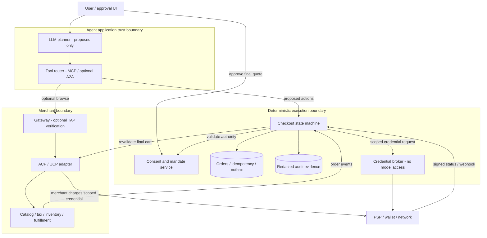

# Personal Agent 参考架构

日期：2026-10-11。**方案设计，不是已部署基础设施或已获供应商认证的实现。** 图使用 Mermaid（适合 GitHub 内联预览）；默认云无关，避免在未确认区域、预算与数据驻留前指定云产品。

## Personal Agent Commerce Architecture

### Legend

实线表示必要的数据或执行依赖；虚线表示可选浏览路径。框为逻辑信任边界，不表示网络配置已经部署。数据库形状代表持久存储。凭证经过专用 broker，图中不表示其流经 LLM。

### Key Relationships

Agent 只能请求动作，不能调用批准接口、扩大预算或修改已批准对象。最终金额包括税费、运费及费用；库存/报价变动重新批准。MCP 是工具边界，ACP/UCP 是商户商业接口，TAP 是可选请求信任机制，PSP/network 才执行实际资金授权。

## 状态与失败恢复

建议状态：`discovered → quoted → approval_required → approved → credential_ready → payment_pending → paid → fulfillment_pending → fulfilled`；异常状态包括 `expired`、`revoked`、`declined`、`unknown`、`refund_pending`。**`unknown` 不能转成成功，也不能通过重新付款“恢复”。**

| 失败点 | 正确处理 | 不能做什么 |
|---|---|---|
| 批准后价格/税费/运费或收款方变化 | 校验最终 cart binding，重新批准 | 用用户笼统“帮我买”覆盖最终价格 |
| 支付超时但可能已扣款 | 用既有 PaymentIntent/transaction hash 查询与对账；保留相同幂等键 | 换 key 重试产生第二笔扣款 |
| webhook 重复/乱序 | 验签、event 去重、单调状态/版本条件写 | 只信网页提示或模型总结 |
| 支付成功、库存/履约失败 | 订单 saga，补偿/退款等待确认；告知用户 | 假装“全部回滚”，把退款请求视为到账 |
| 用户撤销与执行并发 | 最终执行点校验撤销，事务化消耗授权；已支付结果保留 | 删除审计记录或把已扣款当作未执行 |
| 多商户购物 | 按商户拆分凭证、子订单与预算；定义部分成功策略 | 假定跨 PSP 有原子事务 |
| 链上结算后记账失败 | 保存链上 proof，按 hash 重放记账与对账 | 再次生成链上转账 |
| 来源/工具提示注入 | 外部文本作为数据；allowlist tool/merchant/schema；确定性审批 | 让商品描述改写工具权限 |

## 非功能目标与取舍（建议，不是测量值）

| 维度 | 原型边界 / 生产验收方向 |
|---|---|
| 可靠性 | 原型单机 SQLite、单次授权原子消耗；生产使用事务存储/outbox、PSP 对账、恢复演练、明确 RTO/RPO |
| 安全 | 原型仅合成数据；生产独立认证与同意 UI、凭证 broker、轮换、最小权限、TLS、日志脱敏及支付合规评估 |
| 成本 | 无付费模型和真实支付；生产测量每次成功订单的推理、工具、支付、风控成本，设置任务/预算上限 |
| 运维 | 明确错误、持久回执、source provenance、CI；生产增加 trace ID、webhook 验签与告警、密钥迁移 runbook |
| 性能 | 先保证正确性；生产分别测量报价 p95、批准等待、支付确认时长、峰值并发，不把人工等待算作网关延迟 |

先从模块化单体 + 异步订单事件切入，而不是为了“多 Agent”默认微服务。独立凭证边界、版本化商业 adapter 与可替换 PSP 是演进点；模型可切换不能替代确定性的权限层。

## 本仓库资产和设计的映射

`lab/checkout.py` 只实现**已批准最终购物车的单次、离线执行**：商户/币种/金额/购物车绑定、到期/撤销、事务化消耗、持久 receipt 与幂等重试。批准与时钟在测试中由可信调用方提供；没有用户认证/Passkey、数字签名、网络支付、webhook、库存、退款或 outbox。

不能把 SQLite 的本地原子性外推成“外部扣款与订单原子提交”。生产 PSP adapter 必须先设计 `payment_pending/unknown` 和对账恢复；本资产不是 ACP/AP2/TAP/SPT wire-format 实现或兼容性测试。

来源与产品边界见 [协议研究](protocols.md)，场景与验收见 [Agent 使用场景](use-cases.md)。

## 2026-10-12 增量：WAF 是评估框架，不是三层模板

[今日研究](daily/2026-10-12.md)对照官方 WAF AI application design：其已包含 AI 五层、确定性编排/Agent 协作、策略执行和持久状态。Agentic Commerce 需要在此基础上明确每笔交易的消费者授权、credential 隔离、经济副作用状态与对账证据，而不是用更多 Agent 取代确定性执行层。逻辑信任边界不强制微服务；先复用模块化单体，再按真实隔离/扩缩容需求拆分。

新增 `lab/mcp_migration.py` 仅检查 Stripe MCP 认证类别元数据和日期期限，不验证云身份、消费者同意或任何实际权限；它映射本架构的运维/演进职责，不是新增支付能力。

## 2026-10-13 增量：发现、兼容、授权、结果四个独立门槛

[今日研究](daily/2026-10-13.md)补强商业 adapter 入口：发现宣告 → 可执行能力交集 → 消费者最终报价授权 → provider 可信结果。不能从发现到付款直接跳步。版本匹配、受支持 instrument 和卡 tokenization 的环境/关系前置条件只构成接入候选；它们不证明 schema 来源可信、客户已同意、账号可用或付款成功。

`lab/ucp_preflight.py` 是无网络、无凭证的**合成元数据预检**。它拒绝未审阅版本、缺失双方宣告、Stripe handler 下的 Link/Google Pay completion；card 和 Apple Pay 返回不同 credential path，且所有输出 `payment_authorized=false`。本地保守的版本白名单是研究边界，不是供应商兼容矩阵。没有将它连接为现有 checkout 的批准来源，没有新增 tokenize 或付款工具。

Stripe 的自动更新 skills/plugin 改变的是开发指导面，不是交易授权来源。应记录实际加载的版本/revision，并对可执行 tool/schema 的变化做回归；供应商 skill 的反馈建议不能自动获得上传业务资料的权限。可复用的逻辑分层仍可在模块化单体中实现，不需要再造“第六层”或默认拆成多 Agent 微服务。

## 2026-10-14 增量：可解析、可执行、可授权必须分别成立

[今日研究](daily/2026-10-14.md)中的 UCP 官方修复表明：开放的基础 capability schema 允许额外字段，基础验证通过不意味着 fulfillment/AP2 等 extension 内容有效。生产商业 adapter 应分别验证已协商的 capability、extension composed schemas、方向/操作和语义约束；AP2 字符串符合格式也不等于签名、issuer、audience、有效期及最终报价绑定已验证。未知扩展隔离或显式拒绝，不能凭模型解释提升为可信条款。

API 文档表可能漏掉定义在 `securitySchemes` / `security` 或 content maps 中的字段。生成客户端和集成契约应读取固定版本的完整 OpenAPI，不靠截图、字段表或 Agent 的“参数齐全”判断认证是否必需。已有 `lab/ucp_preflight.py` 只做合成版本/instrument/环境声明检查，没有因此获得 wire-format 或 cryptographic conformance。

AI Native 的核心区别是**模型可变的行动空间与不可随意扩大、可追溯的经济权限之间的隔离**，不是推翻 WAF。建议保留 WAF 的可靠性、安全、成本、运维和性能取舍，增补领域不变量：消费者批准绑定最终报价；副作用总额不超过任务预算；`unknown` 不许新扣款；退款请求与确认到账分开；Agent 角色不能批准自己提出的动作。普通三层或模块化单体也可承载这些逻辑边界，不必默认采用多 Agent 或微服务。

新监测资产仅改善**证据/规则变更的运维闭环**：获取成功 → 固定语法选定事实 → 人工审阅 → 显式规则变更 → 回归。`policy_change=unchanged` 不等于业务授权仍有效；`unknown` 不进入自动执行路径。源码、tool schema、prompt/model、商业协议、handler、preview API、资格/地区和客户授权均需独立版本/状态记录。模型 failover 可以更换推理服务，但不能自动换付款凭证、收款方或提高工具权限。

**Sierra 与 Poppy `v0.1` 对 AI-Native 架构的进一步补充**：
- **双轨会话令牌与双向域名防伪**：Poppy `v0.1` 要求发现文档 `auth.issuer` 与 OAuth metadata `poppy_domains` 双向绑定；OpenAPI/会话/Operations 必须校验请求绑定的 `DPoP` 证明（防重放 `jti`），而 MCP 通道必须使用绑定单一 `resource` 的 `Bearer` 令牌，并根据登录方式（`direct` / `device` / `mediated`）限制最大可授予 scope。
- **四层纵深防御与两阶段 `operations` 修订确认**：Sierra 的实践证明自然语言 Rules 与 Supervisors 仍属概率控制，涉及账户修改、换货、退款或支付的工具必须具备第 4 层确定性护栏（未鉴权不暴露修改工具、单会话锁定单客户账户、待发货订单仅允许一次修改），并配合 Poppy `operations` v1：工具调用仅生成带不可变 `revision` 的 `proposed` 操作，仅由独立确认端点针对最新 `revision` 幂等执行（对话消息绝不触发确认）。
- **PCI 支付旁路与目标状态哈希评测**：第一方 Agent 收款（Sierra Payments）将支付信息采集切出 LLM，由服务端预定义序列直传 Stripe；而评测准则（$\tau^2/\tau^3$-bench `reward_basis=["DB","COMMUNICATE"]`）以最终确定性业务数据库状态哈希为准，允许推理探索路径变化但严守终态不变量。新增离线资产 `lab/poppy_guard.py` 实现了上述 Poppy `v0.1` 发现/令牌校验与 Sierra/$\tau^3$-bench 零售售后确定性护栏。

## 2026-10-16 增量：闭合信封签名门禁、防跨企断言重放与不可信企业内容隔离

[今日研究](daily/2026-10-16.md)结合 UCP `#659` 与 Poppy `#36/#37/#49/#50/#51/#53` 提炼出三项区别于经典 Web 三层架构的 AI-Native 控制面要求：

1. **闭合“存在即必签（Closed Sign-if-Present）”门禁与完整状态收敛（UCP `#659`、`#795`）**：不能只校验 HTTP Body 摘要（`Content-Digest`）而放任 `Webhook-Id`、`Webhook-Timestamp`、`UCP-Agent`、`Idempotency-Key` 裸奔；一旦上述请求头存在，必须全部纳入 RFC 9421 `Signature-Input` 覆盖集。订单 Webhook 采用完整状态快照而非增量事件，按 `Webhook-Id` 幂等去重、禁止重试篡改 `Webhook-Timestamp`，并按事件时间戳偏序收敛。
2. **跨企业断言防重放与单账户终身会话锚定（Poppy `#36`、`#37`、`#49`、`#50`、`#53`）**：面对开放生态中不可全信的企业端点，客户端与会话断言 `aud` 必须锁定为企业 `auth.issuer` 单一字符串（不得设为 `token_endpoint`）；发现文档域名仅按忽略大小写匹配重定向后主机名；Session 跨登出永久绑定同一用户账户，且在登录态被吊销后严禁后台凭受托存储凭证自动重登。
3. **不可信企业内容隔离与 `summary`-vs-`terms` 机器核对（Poppy `#51` Section 8.1）**：企业返回的消息、工具描述/结果与操作 `summary` 均视为外部不可信数据；个人 Agent 必须阻断由企业 A 内容触发的向企业 B 的跨企调用，并在请求用户批准前机器核对企业 `summary` 与结构化 `terms` 一致。相应确定性检查已增量合入 `lab/poppy_guard.py`、`lab/ucp_preflight.py` 与 `lab/mcp_migration.py`。

## 2026-10-17 增量：传统企业架构改造对照、跨上下文断言防混淆与三类 `3xx` 重定向安全契约

[今日研究](daily/2026-10-17.md)结合 Poppy `#35`（`95fcbf22c599`）官方发布的 **Before-vs-After 企业架构改造对照图** 与 UCP `#913`（`3ab41043b793`）提炼出三项面向生产落地的架构演进原则：

1. **跨上下文 JWT 类型隔离与 Sidecar 令牌服务拓扑（Poppy `#35` `session.browser-assertion-rejected` & `patterns/token-issuance.md`）**：同一 Session 私钥既签发令牌端点的 `poppy-session+jwt`（`aud == auth.issuer`），又签发浏览器交接端点的 `poppy-browser+jwt`（`aud == browser_session_endpoint`）。令牌端点必须强校验 `typ == "poppy-session+jwt"` 并以 `400 invalid_grant` 拒收浏览器断言；对于不支持动态 URL `client_id` 的既有企业 IdP，优先采用 Sidecar Poppy Token Service + RFC 8693 Token Exchange 模式，避免推翻现有认证中心。
2. **三类 HTTP `3xx` 重定向的差异化安全契约（UCP `#933` vs UCP `#913` vs Poppy `#35` Section 5）**：
   - **协议发现平面（UCP `#933`）**：严禁任何 `3xx` 重定向（防信任根劫持与 SSRF），仅允许条件 `304 Not Modified`。
   - **永久链接入口平面（UCP `#913`）**：强制 `303 See Other`，且必须同时携带 `Location`、`Cache-Control: no-store` 与 `Referrer-Policy: no-referrer`，防止 Permalink URL 中的买家 PII（邮箱、电话）通过缓存或 `Referer` 外泄。
   - **Agent 到浏览器有状态交接平面（Poppy `#35` Section 5）**：强制 `303 See Other`，对 `return_to` 执行 URL 解析级主机名匹配（禁字符串前缀匹配），并设置 `Secure; HttpOnly; SameSite=Lax|None` Cookie（严禁 `SameSite=Strict`，避免跨站重定向首跳丢弃 Cookie），同时将浏览器会话权限限制在该 Poppy Session 的实时 Scopes 内。
3. **Scope 正交性与人工坐席接管（Handoff）权限延续（Poppy `#35` `patterns/scopes.md`）**：`poppy:write` 不隐含 `poppy:read`；且当会话转接给真人客服坐席（Handoff）后，坐席代客执行的操作仍受同一 Session Scopes 约束。
4. **对话适配器事件流、Milestone 3 Account Token 哈希生命周期与 Permalink 不可信输入门禁（Poppy `#35` Milestones 2–3 & UCP `permalink.md` `#913`）**：对话适配器按 `(client_id, user_id)` 校验 `message.id` 幂等与内容哈希冲突（`409 message_id_conflict`），在 Section 7.10 Direct Conversation 打开期间以 `409 direct_conversation_open` 锁定父会话并阻断直连客户消息回流父会话事件流；Milestone 3 登录流强制 Direct PKCE `S256` 与 RFC 9207 `iss`、Mediated 统一 `{"status": "failed"}` 防枚举与同 Session 二步验证码校验、Account Token SHA-256 哈希存储/单向缩权/RFC 7009 级联登出及 Section 8.2 日志/上下文敏感字段确定性脱敏；UCP Permalink 对不可信 GET 输入执行 `continue_to` 五步防开放重定向校验、`~`-base64url 商品 ID 解码、紧凑路径数量权威保护、JSON Pointer 冲突拒绝与禁带支付凭证检查。上述检查已全部合入 `lab/poppy_guard.py` 与 `lab/ucp_preflight.py`。

## 2026-10-18 增量：动态工具重发现、双边非对称商业契约、混合状态合并与证据包准入

[今日研究](daily/2026-10-18.md)结合 Stripe 新增的 WebMCP / Embedded Commerce / SFTP Feed / Service Bookings 文档、Poppy `operations` v1 与 UCP/ACP 规范演进，提炼出四项 AI-Native 控制面原则：

1. **WebMCP 动态工具重发现、`consequentialHint` 确认门禁与 BNPL 人类导航主权（Stripe `webmcp.md` & `embedded.md`）**：切换支付方式会实时改变表单必填 Schema，Agent 必须在状态变更后重新发现工具；对带 `consequentialHint` 的支付提交工具必须先展示最终金额并获用户显式确认；对 Affirm 贷款 WebView 严禁 Agent 编程点击，必须交由买本人导航确认。
2. **双边非对称协议握手、分片完成屏障与显式拒绝未协商参数（Stripe OCA / SFTP Feed & UCP `#940`）**：Stripe OCA 仅允许卖家发起初始协议，且终止后仅终止方有权重新发起；SFTP 百万商品分片同步必须以最后上传的 `manifest.json` 为完成屏障，并对 `disable_checkout=true` 的发现型商品阻断 `RequestedSession` 创建；UCP `create_checkout` 在未协商 Cart 能力时收到 `cart_id` 必须显式拒绝，严禁静默回退到 `line_items`（`#940`）。
3. **混合状态合并契约、剥夺平台算日权与下游超时 `in_progress` 驻留（UCP `#660`/`#966` & Poppy `operations` §§2–7）**：省略 `buyer.consent` 时保留既有同意状态，提交时强制完整回传并在 `complete` 阻断缺失依赖字段（如 SMS 缺 `phone_number`）；严禁平台用 `anchor + duration` 自算退货截止日 `expires_at`；确认操作遇下游超时必须驻留 `in_progress` + `Retry-After`（严禁误报 `failed`），并区分已登录跨 Session 账户共享与未登录单 `session_id` 隔离。
4. **Accelerated IdP 单用户换票绑定与 ATDRP 证据包 Fail-Closed 准入（UCP `#783`/`#970` & ACP `#316` §7.4a）**：RFC 8693 换票提交的 `subject_token` 必须绑定当前会话用户（严禁跨用户复用或服务账号代换）；争议证据包在逐项裁决前先做摘要与 RFC 3161 验真，将未固定公钥日志降级为一致性参考，并坚持“买家沉默（`no_record`）绝不等于验收通过”。对应确定性检查已全部合入 `lab/poppy_guard.py` 与 `lab/ucp_preflight.py`。

## 2026-10-19 增量：AI-Native 负载架构 vs 经典三层 Web 架构六大平面系统重构

[今日研究](daily/2026-10-19.md)将 Agentic Commerce 的 AI-Native 负载架构与云厂商传统 Well-Architected 三层 Web 架构（Presentation / Stateless App / ACID DB）进行系统级对照，提炼出**六大架构平面（Six Architectural Planes）**，并在 [`lab/workload_arch_bench.py`](../lab/workload_arch_bench.py) 与 [7-Card 4:5 视觉基准报告](../reports/agentic-commerce-6plane-bench/index.html) 中实现了 12 个对抗性场景的确定性验证（AI-Native 六平面护栏通过 **12/12**，经典三层 Web 架构仅通过 **1/12**）：

1. **Plane 1 — 身份与委托平面（Identity & Delegation）**：从单跳 Cookie / 平台共享 API Key 重构为**通道绑定令牌（OpenAPI `DPoP` vs MCP `resource` 绑定 `Bearer`）+ Connect 多商户 SPT 档案路由 + 单次消费 `SPT Resolve`**。Direct Charge 强制传入关联商户 `network_business_profile` 与 `Stripe-Account` 头；Destination Charge 配合 `on_behalf_of` 推荐传入关联商户档案；外部 PSP 调用 `POST /v1/shared_payment/granted_tokens/{id}/resolve` 严格限单次调用，强制校验 `CAVV`/`TAVV`/`DCVV` 密文（覆盖 Visa VIC、Mastercard Agent Pay、Amex ACE Kit）与 `<field>:<start>:<length>` RSA 切片不重叠。
2. **Plane 2 — 状态与事务平面（State & Transaction）**：从线性 CRUD 跃迁与定时自动重试重构为**非线性 SPT 状态机（`active` $\leftrightarrow$ `requires_action` $\rightarrow$ `deactivated` 终态）+ Google AP2 §7.4 受托熔断器（Fiduciary Circuit Breaker，`PR #165`）**。一旦触发单笔超限、累计超支、窗口高频或类目越权进入 `OPEN`，严禁凭冷却时间自动恢复扣款，必须验证人类签署的 Recovery Mandate 才可进入 `HALF_OPEN` 单笔探测。
3. **Plane 3 — 推理与执行隔离平面（Reasoning vs. Execution Isolation）**：在 LLM 与工具执行之间部署提示词注入免疫的确定性 **Policy Broker**——强制核对企业 `summary` 金额与结构化 `terms` 完全一致、拦截跨企业不可信内容诱导的调用、对 WebMCP `consequentialHint` 强制插入人工确认门禁，并严禁脚本化提交 Affirm BNPL WebView。
4. **Plane 4 — 协议互操作与批量目录平面（Protocol Interop & Bulk Discovery）**：基于 UCP `dev.ucp.common.feed`（`PR #866`），将控制面 `config.endpoint` 与不可变数据面 `manifest` 分离；每个分片强制校验 RFC 9530 `sha-256` 摘要，**任何分片拉取失败或摘要不匹配严禁触发快照差集删除**；`supplemental` 补充流按变体 `id` 精确合并而非覆盖整个 `variants` 数组。
5. **Plane 5 — 可观测与争议取证平面（Observability & Dispute Forensics）**：基于 ACP ATDRP `PR #316` Appendix C 对 17 家支付网关的审计结论（仅 Stripe 与 Braintree 记录支付侧 Agent 信号，**0/17 家网关提供发卡行侧结构化 Mandate 字段**），先 fail-closed 校验 `digest_ok` 与 RFC 3161 时间戳，再将 Mandate JWS 与结账哈希确定性编译进网关兜底证据字段（如 Stripe `uncategorized_file` / `uncategorized_text`）。
6. **Plane 6 — FinOps 与微支付经济学平面（FinOps & Micropayment Economics）**：结合 Stripe Billing（Metronome Token 计费）与支付轨下限（SPT 卡 `$0.50`、x402 Base `$0.01`、MPP Tempo Sessions `0.000001 USDC`），针对 MPP Tempo 流式会话“仅整美分（$\ge \$0.01$）结算、亚美分尾差直接没收（forfeited）”规则，通过最大公约数算法将结算周期强制对齐至 `$0.01` 的最小整数倍步长（如单价 `$0.000350` 对齐为 `200 units = $0.07`），消除高达 **54.29%** 的亚美分尾差没收损耗。
7. **Stage 34 协议层安全加固（Poppy `v0.2` `#54`–`#70`、UCP `#881`/`#755`/`#731`、AP2 `#369`）**：
   - **按 User ID 隔离 DPoP 密钥与非发现重定向零凭证转发（Poppy `v0.2` `#68`）**：传统 Web 后端常使用进程级单例客户端密钥并任由 HTTP 客户端在 `302` 重定向时自动携带 `Authorization` 头；AI-Native 个人 Agent 必须按 User ID 隔离 ES256 DPoP 密钥对以阻断跨用户硬件指纹关联，并在除两处 `.well-known` 发现端点外的全部协议请求中禁止自动跟随重定向转发凭证。
   - **MCP 通道原生 `DPoP` 升级与 `401 invalid_token` 一步刷新（Poppy `v0.2` `#64`, `#69`）**：当 MCP 服务器在 RFC 9728 元数据中声明支持 `dpop` 时，直接复用 `DPoP` 会话令牌而非降级为 `Bearer`，且严禁将 `DPoP` 令牌放入 `Bearer` 头；令牌过期时资源服务器直接返回 `401 invalid_token` 一步触发刷新。
   - **延期付款总额守恒与多跳委托终端 `SD-JWT+KB` 绑定（UCP `#881`, `#755` & AP2 `#369`）**：B2B 账期/定金/分期结账强制校验 `due_now + sum(deferred) == total`；Identity Linking 彻底禁用 `client_credentials` 防平台越权代绑；多跳 Agent 委托链末端强制校验 RFC 9901 `kb+jwt` 终端持有者证明与 `sd_hash` 完整性。对应 16 场景基准报告见 [`reports/agentic-commerce-protocol-v02-cbdc-bench/index.html`](../reports/agentic-commerce-protocol-v02-cbdc-bench/index.html)（**AI-Native `16/16` vs 经典三层 `1/16`**）。

## 2026-10-22 增量：网络层代币化周期委托复用、有界控制面流式解析与字节保真链上广播

[今日研究](daily/2026-10-22.md)（[English](daily/2026-10-22.en.md)）结合 Stripe 周期性 SPT 新规（`cf14fd45`）、x402 Foundation 当日合入（`#3285`/`#3400`/`#3826`/`#3674`/`#3125`）、UCP `#940`/`#966` 与 Sierra $\tau$-bench 2.0（`#640`/`#667`/`#666`/`#671`/`#670`），进一步明确 AI-Native 架构区别于经典三层 Web 架构的四项设计要求（已落地于 [`lab/x402_caip2_body_cap_ucp_cart_only_stripe_recurring_spt_tau2_phonic_guard.py`](../lab/x402_caip2_body_cap_ucp_cart_only_stripe_recurring_spt_tau2_phonic_guard.py) 与 [Stage 169 `CB-01..CB-16` 双语 7-Card 报告](../reports/agentic-commerce-x402-caip2-body-cap-ucp-cart-only-stripe-recurring-spt-tau2-phonic-bench/index.html)）：

1. **网络层周期性 SPT 复用 vs. 商户侧 `setup_future_usage` 存卡禁令（Stripe SPT `cf14fd45`）**：经典三层电商在首次结账时通过 `setup_future_usage="off_session"` 将卡凭证存入商户自有 Customer Vault；AI-Native 架构将周期频率与额度上限编码在 `usage_limits.recurring_interval` 中，卖家在每期续费时直接复用同一受限 SPT，任何夹带 `setup_future_usage` 或 `payment_method_options[card][setup_future_usage]` 的请求在确定性预检层即被拦截，防止商户私自沉淀长效可复用卡凭据。
2. **有界流式响应体解析（1 MiB / 4 MiB）与不可变挑战模板（x402 `#3400`, `#3826`, `#3285`）**：AI-Native 支付网关与客户端对 Facilitator 控制面响应强制实施 `1 MiB` 流式硬上限、对 Bazaar 发现响应实施 `4 MiB` 硬上限，在生成 `402 Payment Required` 时对 `extensions` 执行浅拷贝隔离，并用严格正则 `^[-a-z0-9]{3,8}:[-_a-zA-Z0-9]{1,32}$` 锁定 CAIP-2 链标识。
3. **原始字节保真广播与幂等瞬态重试（x402 `#3674`, `#3125`/`#3293`）**：针对 Cardano 等对 CBOR 编码敏感的账本，Facilitator 直接透传客户端签名原始字节，严禁经 ORM/SDK 反序列化再序列化触发 Conway Tag-258 见证失效；针对 Stellar RPC `TRY_AGAIN_LATER`，显式标记为可重试瞬态错误并复用原签名交易，杜绝盲目重签引发的双重扣款。
4. **服务端 Cart 权威转换与工具参数语义不变量（UCP `#940` & $\tau$-bench `#667`/`#666`/`#670`/`#671`）**：在 `create_checkout` 中禁止未协商 `dev.ucp.shopping.cart` 时静默忽略 `cart_id`，同传时强制以服务端 Cart 为唯一权威；在工具执行边界强制阻断零售 `item_id == new_item_id` 自换与电信空白 `mmsc_url`，在全双工语音通道按发言生命周期门控 `mulaw_8000` 音频回放，并通过 `.gitattributes` `eol=lf` 锁定跨平台评测基准哈希。

