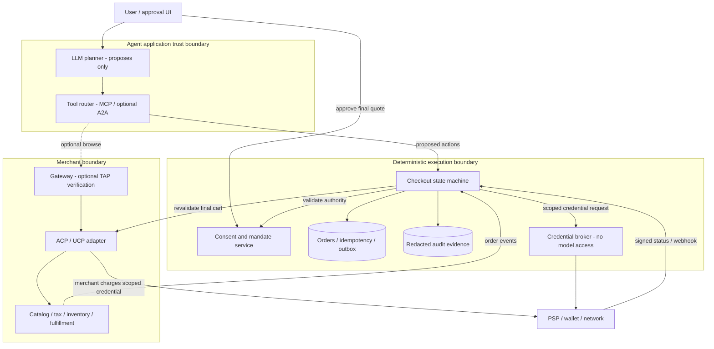

# Personal Agent 参考架构

日期：2026-10-11。**方案设计，不是已部署基础设施或已获供应商认证的实现。** 图使用 Mermaid（适合 GitHub 内联预览）；默认云无关，避免在未确认区域、预算与数据驻留前指定云产品。

## Personal Agent Commerce Architecture

### Legend

实线表示必要的数据或执行依赖；虚线表示可选浏览路径。框为逻辑信任边界，不表示网络配置已经部署。数据库形状代表持久存储。凭证经过专用 broker，图中不表示其流经 LLM。

### Key Relationships

Agent 只能请求动作，不能调用批准接口、扩大预算或修改已批准对象。最终金额包括税费、运费及费用；库存/报价变动重新批准。MCP 是工具边界，ACP/UCP 是商户商业接口，TAP 是可选请求信任机制，PSP/network 才执行实际资金授权。

## 状态与失败恢复

建议状态：`discovered → quoted → approval_required → approved → credential_ready → payment_pending → paid → fulfillment_pending → fulfilled`；异常状态包括 `expired`、`revoked`、`declined`、`unknown`、`refund_pending`。**`unknown` 不能转成成功，也不能通过重新付款“恢复”。**

| 失败点 | 正确处理 | 不能做什么 |
|---|---|---|
| 批准后价格/税费/运费或收款方变化 | 校验最终 cart binding，重新批准 | 用用户笼统“帮我买”覆盖最终价格 |
| 支付超时但可能已扣款 | 用既有 PaymentIntent/transaction hash 查询与对账；保留相同幂等键 | 换 key 重试产生第二笔扣款 |
| webhook 重复/乱序 | 验签、event 去重、单调状态/版本条件写 | 只信网页提示或模型总结 |
| 支付成功、库存/履约失败 | 订单 saga，补偿/退款等待确认；告知用户 | 假装“全部回滚”，把退款请求视为到账 |
| 用户撤销与执行并发 | 最终执行点校验撤销，事务化消耗授权；已支付结果保留 | 删除审计记录或把已扣款当作未执行 |
| 多商户购物 | 按商户拆分凭证、子订单与预算；定义部分成功策略 | 假定跨 PSP 有原子事务 |
| 链上结算后记账失败 | 保存链上 proof，按 hash 重放记账与对账 | 再次生成链上转账 |
| 来源/工具提示注入 | 外部文本作为数据；allowlist tool/merchant/schema；确定性审批 | 让商品描述改写工具权限 |

## 非功能目标与取舍（建议，不是测量值）

| 维度 | 原型边界 / 生产验收方向 |
|---|---|
| 可靠性 | 原型单机 SQLite、单次授权原子消耗；生产使用事务存储/outbox、PSP 对账、恢复演练、明确 RTO/RPO |
| 安全 | 原型仅合成数据；生产独立认证与同意 UI、凭证 broker、轮换、最小权限、TLS、日志脱敏及支付合规评估 |
| 成本 | 无付费模型和真实支付；生产测量每次成功订单的推理、工具、支付、风控成本，设置任务/预算上限 |
| 运维 | 明确错误、持久回执、source provenance、CI；生产增加 trace ID、webhook 验签与告警、密钥迁移 runbook |
| 性能 | 先保证正确性；生产分别测量报价 p95、批准等待、支付确认时长、峰值并发，不把人工等待算作网关延迟 |

先从模块化单体 + 异步订单事件切入，而不是为了“多 Agent”默认微服务。独立凭证边界、版本化商业 adapter 与可替换 PSP 是演进点；模型可切换不能替代确定性的权限层。

## 本仓库资产和设计的映射

`lab/checkout.py` 只实现**已批准最终购物车的单次、离线执行**：商户/币种/金额/购物车绑定、到期/撤销、事务化消耗、持久 receipt 与幂等重试。批准与时钟在测试中由可信调用方提供；没有用户认证/Passkey、数字签名、网络支付、webhook、库存、退款或 outbox。

不能把 SQLite 的本地原子性外推成“外部扣款与订单原子提交”。生产 PSP adapter 必须先设计 `payment_pending/unknown` 和对账恢复；本资产不是 ACP/AP2/TAP/SPT wire-format 实现或兼容性测试。

来源与产品边界见 [协议研究](protocols.md)，场景与验收见 [Agent 使用场景](use-cases.md)。

## 2026-10-12 增量：WAF 是评估框架，不是三层模板

[今日研究](daily/2026-10-12.md)对照官方 WAF AI application design：其已包含 AI 五层、确定性编排/Agent 协作、策略执行和持久状态。Agentic Commerce 需要在此基础上明确每笔交易的消费者授权、credential 隔离、经济副作用状态与对账证据，而不是用更多 Agent 取代确定性执行层。逻辑信任边界不强制微服务；先复用模块化单体，再按真实隔离/扩缩容需求拆分。

新增 `lab/mcp_migration.py` 仅检查 Stripe MCP 认证类别元数据和日期期限，不验证云身份、消费者同意或任何实际权限；它映射本架构的运维/演进职责，不是新增支付能力。
